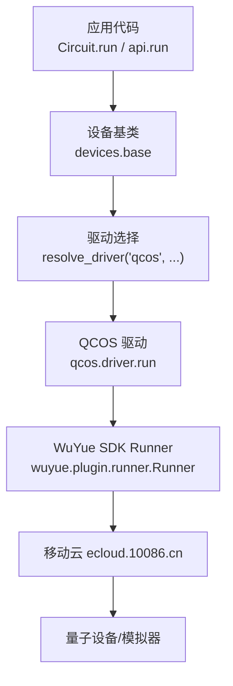
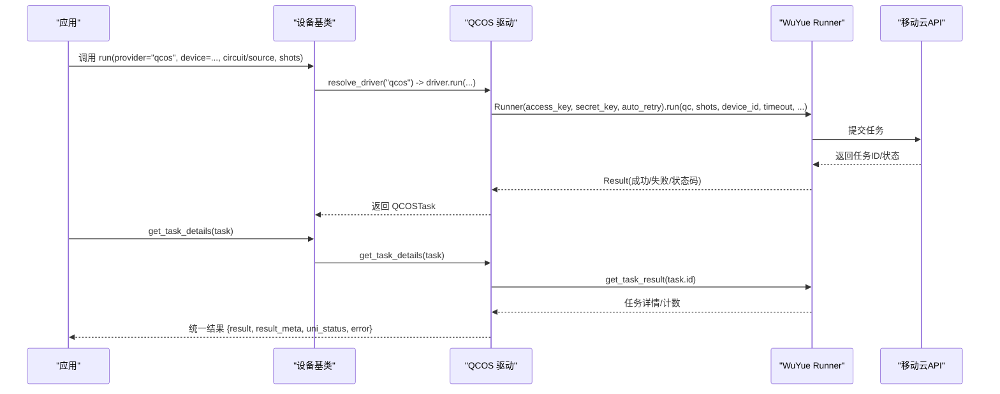
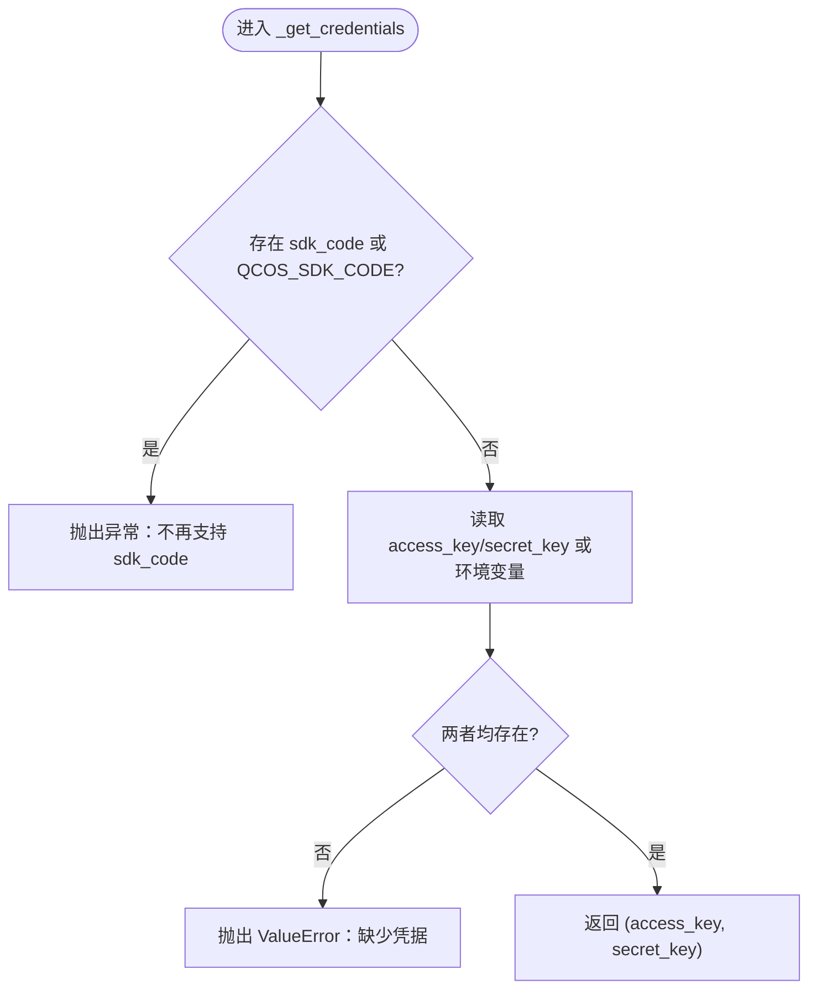
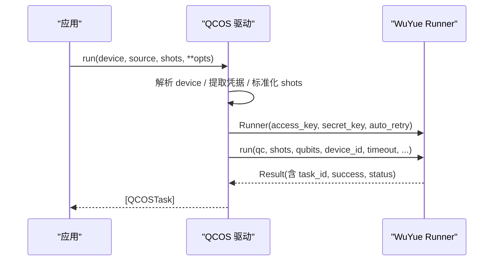
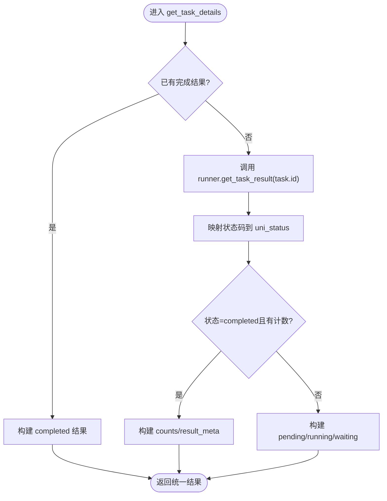
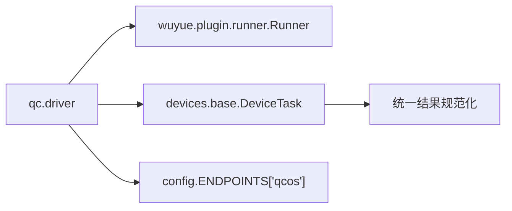

# 中国移动QCOS驱动

<cite>
**本文引用的文件**
- [driver.py](file://src/tyxonq/devices/hardware/qcos/driver.py)
- [config.py](file://src/tyxonq/devices/hardware/config.py)
- [base.py](file://src/tyxonq/devices/base.py)
- [api.py](file://src/tyxonq/cloud/api.py)
- [qcos_provider.md](file://docs/qcos_provider.md)
- [qcos_cloud_task.py](file://examples/qcos_cloud_task.py)
- [cloud_api_task.py](file://examples/cloud_api_task.py)
- [errors.py](file://src/tyxonq/core/errors.py)
- [tyxonq_cloud_api.md](file://docs/tyxonq_cloud_api.md)
</cite>

## 目录
1. [简介](#简介)
2. [项目结构](#项目结构)
3. [核心组件](#核心组件)
4. [架构总览](#架构总览)
5. [详细组件分析](#详细组件分析)
6. [依赖关系分析](#依赖关系分析)
7. [性能考虑](#性能考虑)
8. [故障排除指南](#故障排除指南)
9. [结论](#结论)
10. [附录：配置与使用示例](#附录配置与使用示例)

## 简介
本文件面向中国移动 QCOS（五岳）云平台驱动的接入、SDK集成、认证流程、任务提交与结果处理，以及设备查询、错误恢复与性能调优。文档基于 TyxonQ 代码库中的 qcos 驱动实现与配套文档，提供从“连接平台”到“提交量子任务并获取结果”的完整说明，包含配置项、调用流程、状态映射与常见问题排查建议。

## 项目结构
TyxonQ 将云厂商驱动以“provider + device”的方式组织，qcos 驱动位于硬件设备目录下，通过统一的设备基类与 API 门面进行调度。关键路径如下：
- 驱动实现：src/tyxonq/devices/hardware/qcos/driver.py
- 统一设备基类与任务封装：src/tyxonq/devices/base.py
- 云端 API 门面：src/tyxonq/cloud/api.py
- 端点与默认配置：src/tyxonq/devices/hardware/config.py
- 用户文档与示例：docs/qcos_provider.md, examples/qcos_cloud_task.py, examples/cloud_api_task.py

图表来源
- [base.py:146-200](file://src/tyxonq/devices/base.py#L146-L200)
- [driver.py:80-158](file://src/tyxonq/devices/hardware/qcos/driver.py#L80-L158)
- [config.py:11-19](file://src/tyxonq/devices/hardware/config.py#L11-L19)

章节来源
- [driver.py:1-269](file://src/tyxonq/devices/hardware/qcos/driver.py#L1-L269)
- [base.py:1-200](file://src/tyxonq/devices/base.py#L1-L200)
- [config.py:1-78](file://src/tyxonq/devices/hardware/config.py#L1-L78)
- [api.py:1-160](file://src/tyxonq/cloud/api.py#L1-L160)

## 核心组件
- QCOSTask：驱动内部的任务包装对象，携带任务ID、设备名、状态、上游结果引用及是否异步标志。
- run(device, source, shots, **opts)：将 Qiskit QuantumCircuit 提交至 WuYue Runner，返回 QCOSTask 列表。
- get_task_details(task)：统一结果格式，包含 result、result_meta、uni_status、error。
- list_devices()：返回已知设备清单（静态目录）。
- 配置与端点：qcos 的 base_url 为 https://ecloud.10086.cn。

章节来源
- [driver.py:68-158](file://src/tyxonq/devices/hardware/qcos/driver.py#L68-L158)
- [driver.py:161-238](file://src/tyxonq/devices/hardware/qcos/driver.py#L161-L238)
- [driver.py:241-269](file://src/tyxonq/devices/hardware/qcos/driver.py#L241-L269)
- [config.py:11-19](file://src/tyxonq/devices/hardware/config.py#L11-L19)

## 架构总览
TyxonQ 对 QCOS 的调用链路如下：
- 应用层通过 Circuit.run 或 cloud.api.run 发起执行请求。
- devices.base 负责解析 provider/device 并选择对应驱动。
- qcos.driver.run 使用 wuyue.plugin.runner.Runner 提交任务。
- 结果通过 get_task_details 统一化，屏蔽上游差异。

图表来源
- [base.py:146-200](file://src/tyxonq/devices/base.py#L146-L200)
- [driver.py:80-158](file://src/tyxonq/devices/hardware/qcos/driver.py#L80-L158)
- [driver.py:161-238](file://src/tyxonq/devices/hardware/qcos/driver.py#L161-L238)

## 详细组件分析

### 认证与凭据管理
- 支持两种凭据来源：函数参数 access_key/secret_key 与环境变量 QCOS_ACCESS_KEY/QCOS_SECRET_KEY。
- 旧版 sdk_code/QCOS_SDK_CODE 已废弃，若检测到会抛出异常提示迁移。
- 凭据缺失时抛出 ValueError，明确提示缺失项。

图表来源
- [driver.py:37-65](file://src/tyxonq/devices/hardware/qcos/driver.py#L37-L65)

章节来源
- [driver.py:37-65](file://src/tyxonq/devices/hardware/qcos/driver.py#L37-L65)
- [qcos_provider.md:22-64](file://docs/qcos_provider.md#L22-L64)

### 任务提交流程
- 输入：device（可带 qcos:: 前缀）、source（Qiskit QuantumCircuit）、shots、timeout、auto_retry、task_name、calculate_type 等。
- 内部逻辑：
  - 解析 device，剥离 provider 前缀。
  - 提取凭据。
  - 标准化 shots。
  - 构造 Runner(access_key, secret_key, auto_retry)。
  - 调用 Runner.run(qc, shots, qubits, device_id, timeout, **runner_kwargs)。
  - 封装为 QCOSTask 返回。

图表来源
- [driver.py:80-158](file://src/tyxonq/devices/hardware/qcos/driver.py#L80-L158)

章节来源
- [driver.py:80-158](file://src/tyxonq/devices/hardware/qcos/driver.py#L80-L158)
- [qcos_cloud_task.py:28-57](file://examples/qcos_cloud_task.py#L28-L57)

### 设备查询
- list_devices() 返回静态设备清单，设备ID形如 "qcos::<id>"。
- 由于新版 SDK 移除了 Runner.get_eng_list()，设备发现需参考控制台或静态目录。

章节来源
- [driver.py:241-269](file://src/tyxonq/devices/hardware/qcos/driver.py#L241-L269)
- [qcos_provider.md:65-75](file://docs/qcos_provider.md#L65-L75)

### 结果处理与状态映射
- get_task_details 返回统一结构：
  - result: 比特串到计数的映射
  - result_meta: 包含 task_id、device、prob、amps、raw 等元数据
  - uni_status: 统一状态字符串
  - error: 错误信息（为空表示无错）
- 状态码映射（上游 → 统一）：
  - 1→submitted, 2→queued, 3→running, 4→waiting, 5→completed, 6→failed, 其他→unknown

图表来源
- [driver.py:161-238](file://src/tyxonq/devices/hardware/qcos/driver.py#L161-L238)

章节来源
- [driver.py:161-238](file://src/tyxonq/devices/hardware/qcos/driver.py#L161-L238)
- [qcos_provider.md:138-169](file://docs/qcos_provider.md#L138-L169)

### 异步提交与轮询
- 设置 timeout=0 进行完全异步提交；后续通过 tq.api.get_task_details(tasks[0]) 轮询状态与结果。
- 同步模式：timeout>0 时 Runner 内部轮询直至完成或超时。

章节来源
- [qcos_provider.md:117-136](file://docs/qcos_provider.md#L117-L136)
- [qcos_cloud_task.py:41-55](file://examples/qcos_cloud_task.py#L41-L55)

## 依赖关系分析
- 驱动依赖 wuyue.plugin.runner.Runner（由 wuyue SDK 提供），在运行时懒加载。
- 设备端点 base_url 指向移动云 ecloud.10086.cn。
- 统一设备基类负责任务封装与结果规范化，屏蔽不同驱动差异。

图表来源
- [driver.py:106-147](file://src/tyxonq/devices/hardware/qcos/driver.py#L106-L147)
- [base.py:12-57](file://src/tyxonq/devices/base.py#L12-L57)
- [config.py:11-19](file://src/tyxonq/devices/hardware/config.py#L11-L19)

章节来源
- [driver.py:106-147](file://src/tyxonq/devices/hardware/qcos/driver.py#L106-L147)
- [base.py:12-57](file://src/tyxonq/devices/base.py#L12-L57)
- [config.py:11-19](file://src/tyxonq/devices/hardware/config.py#L11-L19)

## 性能考虑
- 批量化 shots：当传入 shots 为序列时，驱动仅取首个值，避免重复提交。
- 自动重试：auto_retry=True 可在 Runner 层自动重试瞬时失败。
- 超时控制：timeout=0 用于异步提交；合理设置 timeout 避免长时间阻塞。
- 计算类型：部分模拟器需要 calculate_type（例如单点/分布式），未设置可能导致任务被拒绝。
- 设备选择：根据需求选择 FullAmpSim/Simulators 以获得更高吞吐或更精确模拟。

章节来源
- [driver.py:116-131](file://src/tyxonq/devices/hardware/qcos/driver.py#L116-L131)
- [qcos_cloud_task.py:41-55](file://examples/qcos_cloud_task.py#L41-L55)
- [qcos_provider.md:104-116](file://docs/qcos_provider.md#L104-L116)

## 故障排除指南
- 认证失败或缺失：
  - 现象：ValueError 提示缺少 access_key 或 secret_key。
  - 处理：确保通过参数或环境变量提供正确凭据；移除旧的 sdk_code。
- 任务被拒绝（未设置计算类型）：
  - 现象：服务器返回“未设置计算类型”。
  - 处理：为模拟器任务添加 calculate_type（如 1=单点）。
- 轮询失败：
  - 现象：get_task_details 抛异常或返回 unknown/error。
  - 处理：检查网络与凭据；适当增加 poll_interval 与 timeout；查看上游状态码。
- 包冲突（wuyue 固定 qiskit 版本）：
  - 现象：环境内其他依赖需要不同版本的 qiskit。
  - 处理：使用独立 Python 环境或在安装时按需处理依赖。

章节来源
- [driver.py:37-65](file://src/tyxonq/devices/hardware/qcos/driver.py#L37-L65)
- [driver.py:188-238](file://src/tyxonq/devices/hardware/qcos/driver.py#L188-L238)
- [qcos_cloud_task.py:41-55](file://examples/qcos_cloud_task.py#L41-L55)
- [errors.py:1-17](file://src/tyxonq/core/errors.py#L1-L17)

## 结论
TyxonQ 的 QCOS 驱动通过统一的设备抽象与 API 门面，简化了与移动云 WuYue 平台的集成。开发者只需关注 Circuit 构建与运行参数，即可在真实量子设备或模拟器上执行任务。驱动提供了完善的认证、异步提交、状态映射与结果规范化能力，并给出明确的错误提示与排障指引。结合合理的超时、重试与设备选择策略，可获得稳定高效的执行体验。

## 附录：配置与使用示例
- 安装与准备：
  - 安装 wuyue SDK（统一 whl），并确保 Python 环境满足要求。
  - 在移动云控制台创建应用并生成 access_key/secret_key。
- 环境变量配置：
  - 设置 QCOS_ACCESS_KEY 与 QCOS_SECRET_KEY。
- 链式 API 提交任务：
  - 使用 Circuit.run(provider="qcos", device="WuYue-QPUSim-FullAmpSim", shots=..., timeout=..., wait_async_result=...)。
  - 对于模拟器，可能需要设置 calculate_type。
- 异步提交与轮询：
  - 设置 timeout=0 并提交任务；随后调用 tq.api.get_task_details(tasks[0]) 获取状态与结果。
- 设备列表：
  - 使用 tq.api.list_devices(provider="qcos") 获取可用设备清单。

章节来源
- [qcos_provider.md:9-20](file://docs/qcos_provider.md#L9-L20)
- [qcos_provider.md:22-64](file://docs/qcos_provider.md#L22-L64)
- [qcos_provider.md:77-136](file://docs/qcos_provider.md#L77-L136)
- [qcos_cloud_task.py:28-57](file://examples/qcos_cloud_task.py#L28-L57)
- [cloud_api_task.py:30-59](file://examples/cloud_api_task.py#L30-L59)