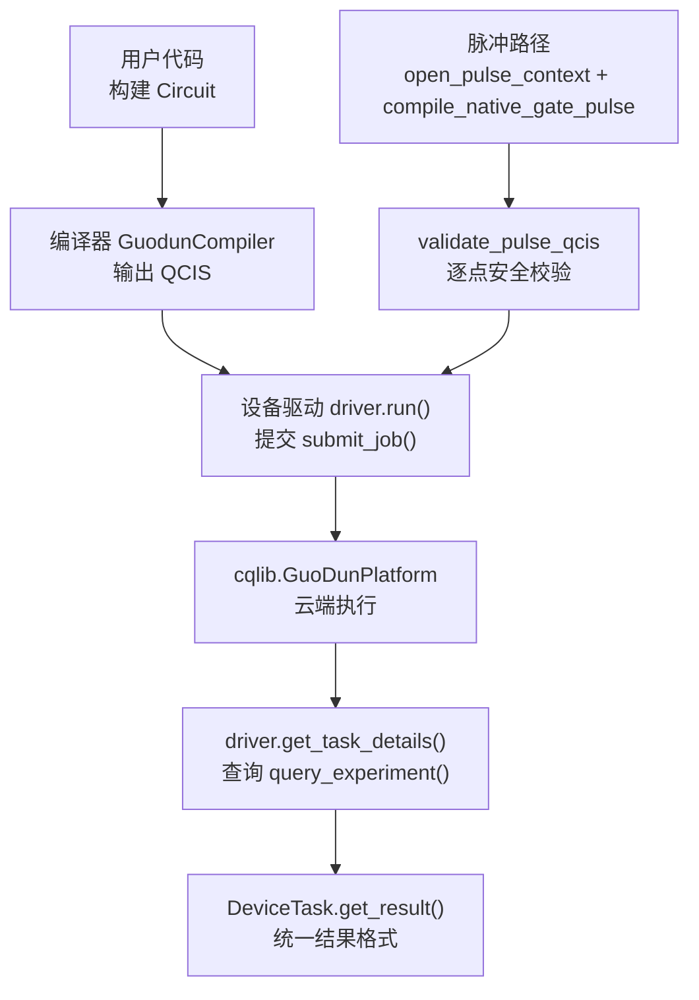
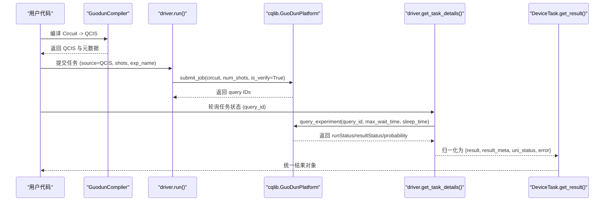
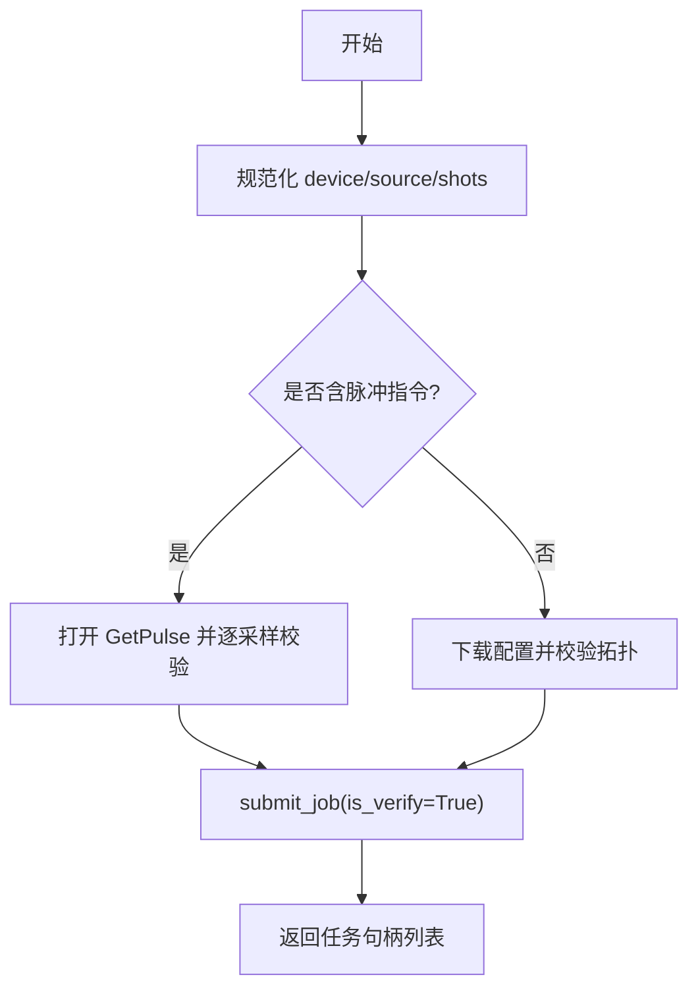
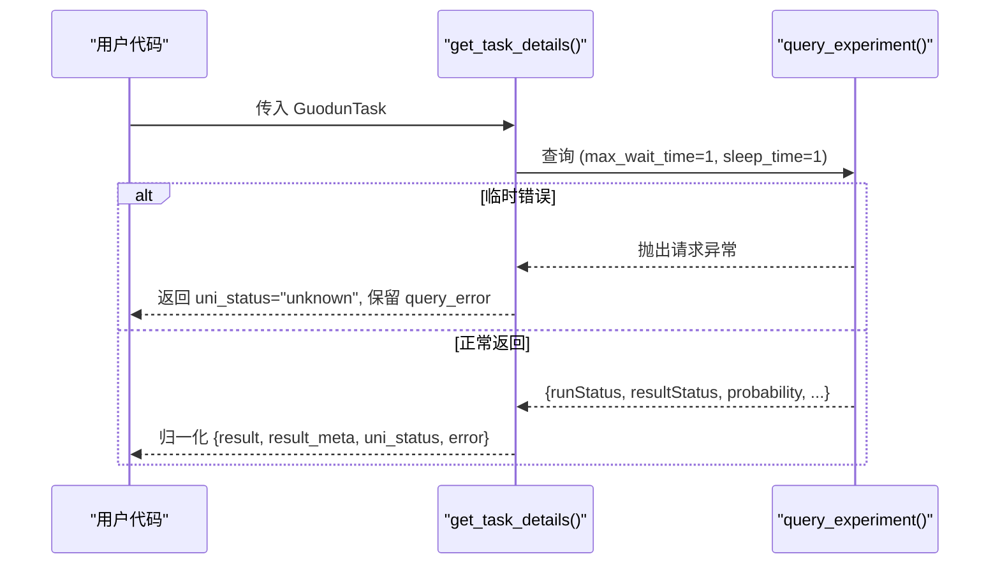
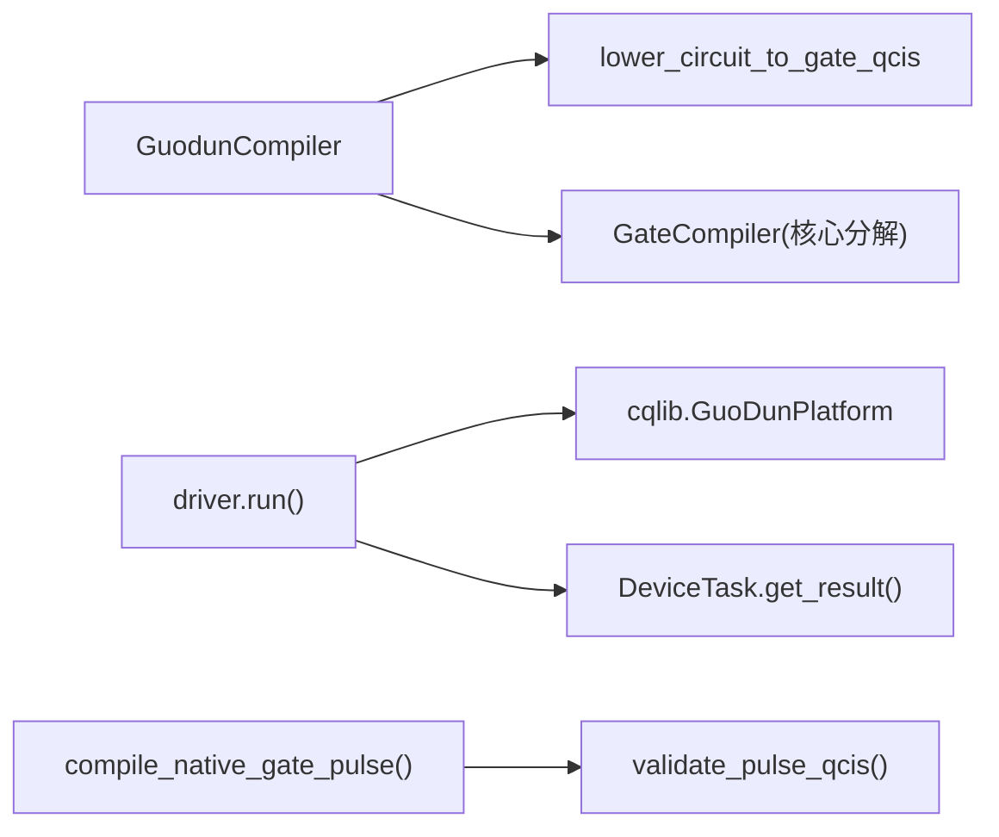
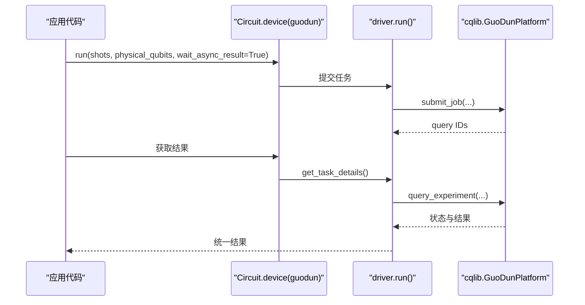

# 国盾量子驱动

<cite>
**本文引用的文件**   
- [driver.py](file://src/tyxonq/devices/hardware/guodun/driver.py)
- [compiler.py](file://src/tyxonq/compiler/platforms/guodun/compiler.py)
- [pulse.py](file://src/tyxonq/compiler/platforms/guodun/pulse.py)
- [__init__.py](file://src/tyxonq/compiler/platforms/guodun/__init__.py)
- [base.py](file://src/tyxonq/devices/base.py)
- [run_circuit_on_guodun.py](file://examples/run_circuit_on_guodun.py)
- [run_guodun_variational.py](file://examples/run_guodun_variational.py)
- [guodun_provider.md](file://docs/guodun_provider.md)
- [GUODUN_CHANGES.md](file://GUODUN_CHANGES.md)
- [test_guodun_driver.py](file://tests_core_module/test_guodun_driver.py)
</cite>

## 目录
1. [简介](#简介)
2. [项目结构](#项目结构)
3. [核心组件](#核心组件)
4. [架构总览](#架构总览)
5. [详细组件分析](#详细组件分析)
6. [依赖关系分析](#依赖关系分析)
7. [性能与稳定性](#性能与稳定性)
8. [故障排除指南](#故障排除指南)
9. [结论](#结论)
10. [附录：集成示例与最佳实践](#附录：集成示例与最佳实践)

## 简介
本文件面向需要在 TyxonQ 中接入国盾量子（Guodun）云平台的开发者，提供完整的 API 文档与使用指南。内容涵盖：
- 平台接入方式与认证机制
- 任务提交流程、执行监控与结果处理
- 设备接口、拓扑校验、错误恢复策略
- 完整集成示例：配置连接、提交量子电路任务、获取执行结果、异常处理
- 部署、排障与性能调优建议

本驱动基于官方 cqlib SDK（当前兼容基线为 1.3.11），通过编译到门级 QCIS 或原生脉冲 QCIS 的方式提交任务，并在驱动层进行拓扑与安全校验、状态归一化与结果解析。

## 项目结构
围绕国盾 provider 的关键代码分布在以下模块：
- 编译器：将 TyxonQ Circuit 降为门级 QCIS（X/H/RZ/CZ/M）
- 脉冲编译器：生成并校验官方原生门脉冲的 pulse-QCIS
- 设备驱动：封装登录、提交、查询、取消、设备发现与结果归一化
- 统一设备抽象：DeviceTask、轮询与结果标准化
- 示例与文档：端到端运行脚本与接入指引

图表来源
- [compiler.py:88-173](file://src/tyxonq/compiler/platforms/guodun/compiler.py#L88-L173)
- [driver.py:310-357](file://src/tyxonq/devices/hardware/guodun/driver.py#L310-L357)
- [driver.py:403-471](file://src/tyxonq/devices/hardware/guodun/driver.py#L403-L471)
- [pulse.py:233-420](file://src/tyxonq/compiler/platforms/guodun/pulse.py#L233-L420)
- [base.py:13-57](file://src/tyxonq/devices/base.py#L13-L57)

章节来源
- [guodun_provider.md:1-169](file://docs/guodun_provider.md#L1-L169)
- [GUODUN_CHANGES.md:11-144](file://GUODUN_CHANGES.md#L11-L144)

## 核心组件
- 编译器 GuodunCompiler
  - 负责将 TyxonQ Circuit 编译为门级 QCIS（X/H/RZ/CZ/M），强制启用 matchgate 与旋转分解，确保目标基集可表达；物理比特映射在编译期烘焙进 QCIS。
  - 对生成的 QCIS 做指令白名单校验与 cqlib 离线语法验收。
- 脉冲编译器与校验器
  - 从当前标定模板生成官方原生门脉冲 QCIS（X2P/X2M/Y2M/Y2M/CZ），并对 PXY/PZ/PZ0/G/I/B/M/RZ 等指令进行语法、拓扑与逐采样安全检查。
- 设备驱动
  - 密钥解析优先级：显式 token > set_token(provider="guodun") > 环境变量 TYXONQ_GUODUN_TOKEN。
  - 关闭 cqlib 自动重试，避免隐式重提；提交前下载配置并校验禁用比特、禁用耦合器与 CZ 边。
  - run() 仅调用一次 submit_job()；get_task_details() 仅查询已有 query ID；remove_task() 仅取消已有任务。
  - list_devices() 动态提取可用设备代码。
- 统一设备抽象
  - DeviceTask 封装 provider/device/handle，并提供 get_result() 与 cancel()；内部统一 result/result_meta/metadata 字段，便于下游后处理。

章节来源
- [compiler.py:88-173](file://src/tyxonq/compiler/platforms/guodun/compiler.py#L88-L173)
- [pulse.py:233-420](file://src/tyxonq/compiler/platforms/guodun/pulse.py#L233-L420)
- [driver.py:56-90](file://src/tyxonq/devices/hardware/guodun/driver.py#L56-L90)
- [driver.py:310-357](file://src/tyxonq/devices/hardware/guodun/driver.py#L310-L357)
- [driver.py:403-471](file://src/tyxonq/devices/hardware/guodun/driver.py#L403-L471)
- [base.py:13-57](file://src/tyxonq/devices/base.py#L13-L57)

## 架构总览
下图展示从 Circuit 到云端执行的端到端流程，以及脉冲路径的安全校验环节。

图表来源
- [compiler.py:102-173](file://src/tyxonq/compiler/platforms/guodun/compiler.py#L102-L173)
- [driver.py:310-357](file://src/tyxonq/devices/hardware/guodun/driver.py#L310-L357)
- [driver.py:403-471](file://src/tyxonq/devices/hardware/guodun/driver.py#L403-L471)
- [base.py:20-57](file://src/tyxonq/devices/base.py#L20-L57)

## 详细组件分析

### 认证与连接
- 密钥解析顺序
  - 显式传入 token
  - tq.set_token(..., provider="guodun")
  - 环境变量 TYXONQ_GUODUN_TOKEN
- 平台创建与登录
  - 构造未登录平台对象，关闭 SDK 隐式 HTTP 重试，再执行一次显式 login()
- 设备发现
  - list_devices() 通过公共查询结果动态提取设备代码，无密钥时返回空列表

章节来源
- [driver.py:56-90](file://src/tyxonq/devices/hardware/guodun/driver.py#L56-L90)
- [driver.py:493-510](file://src/tyxonq/devices/hardware/guodun/driver.py#L493-L510)
- [guodun_provider.md:14-28](file://docs/guodun_provider.md#L14-L28)

### 任务提交流程
- 输入规范
  - source：QCIS 字符串或字符串列表（批量）
  - shots：整数或同批次相同长度的整数序列
  - exp_name：实验名，默认自动生成
- 前置校验
  - 若包含脉冲指令，则必须为 gd_qc1，并使用 GetPulse 下载当前标定进行逐采样校验
  - 对 gd_sim1/gd_qc1 会下载配置并校验禁用比特、禁用耦合器与 CZ 边
- 提交行为
  - 仅调用一次 submit_job()，is_verify=True
  - 返回每个线路的 query ID，封装为 GuodunTask

图表来源
- [driver.py:100-140](file://src/tyxonq/devices/hardware/guodun/driver.py#L100-L140)
- [driver.py:152-222](file://src/tyxonq/devices/hardware/guodun/driver.py#L152-L222)
- [driver.py:310-357](file://src/tyxonq/devices/hardware/guodun/driver.py#L310-L357)

章节来源
- [driver.py:100-222](file://src/tyxonq/devices/hardware/guodun/driver.py#L100-L222)
- [driver.py:310-357](file://src/tyxonq/devices/hardware/guodun/driver.py#L310-L357)

### 执行监控与结果处理
- 状态映射
  - runStatus=2 -> completed
  - runStatus=3 -> failed
  - 其他状态为非终态
- 结果解析
  - 按 resultStatus[0] 的物理测量顺序统计 counts，不反转 bitstring
  - 保留 measurement_order、probability、raw 响应于 result_meta
- 临时错误处理
  - 查询阶段若遇到排队或校准导致的临时异常，返回 unknown 状态，由上层轮询继续查询同一 query ID，绝不重新提交

图表来源
- [driver.py:360-471](file://src/tyxonq/devices/hardware/guodun/driver.py#L360-L471)

章节来源
- [driver.py:360-471](file://src/tyxonq/devices/hardware/guodun/driver.py#L360-L471)

### 设备接口与拓扑校验
- 设备名称
  - 支持 guodun::gd_test、guodun::gd_sim1、guodun::gd_qc1 等
- 拓扑校验要点
  - disabledQubits/disabledCouplers 必须存在且结构正确
  - coupler_map 中的每条边需有效
  - 禁止使用的比特/耦合器会被拒绝
  - CZ 边必须在活跃边集合内
  - B 指令的目标耦合器必须连接对应比特对

章节来源
- [driver.py:152-222](file://src/tyxonq/devices/hardware/guodun/driver.py#L152-L222)

### 脉冲路径与波形任务
- 开放上下文
  - open_pulse_context("gd_qc1") 登录并下载当前标定，不提交任务
- 原生门脉冲
  - compile_native_gate_pulse(get_pulse, gate, qagent, measure_qubits) 生成 pulse-QCIS 并进行逐采样安全校验
- 波形任务
  - create_waveform(context, source, circuit_name) 创建 waveform 任务
  - get_waveform(task) 仅查询已有 waveform ID，空 URL 表示 pending

章节来源
- [driver.py:254-307](file://src/tyxonq/devices/hardware/guodun/driver.py#L254-L307)
- [pulse.py:367-420](file://src/tyxonq/compiler/platforms/guodun/pulse.py#L367-L420)

### 取消任务
- remove_task(task) 仅取消已有 query ID，不创建新任务

章节来源
- [driver.py:474-478](file://src/tyxonq/devices/hardware/guodun/driver.py#L474-L478)

## 依赖关系分析
- 外部依赖
  - cqlib==1.3.11（可选依赖，仅在访问 guodun 时懒加载）
- 内部依赖
  - compiler.platforms.guodun.compiler -> lowering -> GateCompiler 核心
  - devices.hardware.guodun.driver -> cqlib.GuoDunPlatform
  - devices.base -> DeviceTask 统一结果包装与轮询

图表来源
- [compiler.py:123-154](file://src/tyxonq/compiler/platforms/guodun/compiler.py#L123-L154)
- [driver.py:310-357](file://src/tyxonq/devices/hardware/guodun/driver.py#L310-L357)
- [pulse.py:367-420](file://src/tyxonq/compiler/platforms/guodun/pulse.py#L367-L420)
- [base.py:20-57](file://src/tyxonq/devices/base.py#L20-L57)

章节来源
- [GUODUN_CHANGES.md:77-106](file://GUODUN_CHANGES.md#L77-L106)

## 性能与稳定性
- 提交与查询分离
  - run() 仅提交一次；查询阶段短轮询（max_wait_time=1, sleep_time=1），适合高频轮询
- 拓扑与脉冲安全校验
  - 提交前完成禁用比特/耦合器与 CZ 边检查，失败即停止，避免无效任务
  - 脉冲路径逐采样检查幅度范围与 AWG 码值安全区间，降低硬件风险
- 结果一致性
  - counts 严格按平台测量顺序统计，total shots 应与提交一致，不一致时应丢弃该结果
- 并发与重试
  - 驱动不自动重提、不并发提交、不扩大 shots；如需并发，请在应用层控制

[本节为通用指导，不直接分析具体文件]

## 故障排除指南
- 常见错误与定位
  - 缺少密钥：_resolve_token 抛出运行时错误，提示设置 TYXONQ_GUODUN_TOKEN 或通过 set_token 配置
  - 非允许指令：编译器对 QCIS 指令白名单校验失败
  - 拓扑违规：使用了禁用比特/耦合器或不可用 CZ 边
  - 脉冲参数越界：频率、相位、时长、波形参数超出平台限制
  - 查询临时错误：排队或校准时可能抛请求异常，应继续轮询同一 query ID
- 排查步骤
  - 确认密钥来源与优先级
  - 本地先编译并打印 QCIS，确认指令与物理映射
  - 检查设备配置中的 disabledQubits/disabledCouplers/coupler_map
  - 对脉冲路径，使用 open_pulse_context 并查看 validate_pulse_qcis 返回的 channels 安全信息
  - 对结果，核对 uni_status、error、measurement_order、probability 与 total shots

章节来源
- [driver.py:56-67](file://src/tyxonq/devices/hardware/guodun/driver.py#L56-L67)
- [compiler.py:72-85](file://src/tyxonq/compiler/platforms/guodun/compiler.py#L72-L85)
- [driver.py:152-222](file://src/tyxonq/devices/hardware/guodun/driver.py#L152-L222)
- [pulse.py:233-364](file://src/tyxonq/compiler/platforms/guodun/pulse.py#L233-L364)
- [driver.py:392-430](file://src/tyxonq/devices/hardware/guodun/driver.py#L392-L430)

## 结论
国盾 provider 通过“编译到 QCIS + 驱动层安全校验 + 统一结果”的方式，提供了稳定、可控的云端量子计算接入能力。其关键优势在于：
- 明确的密钥管理与设备发现
- 严格的拓扑与脉冲安全校验
- 提交与查询解耦，避免隐式重提
- 统一的结果结构与元数据，便于后续处理与分析

建议在工程实践中优先本地编译验证，再在线提交；对脉冲路径务必使用当前标定并关注逐采样安全信息。

[本节为总结性内容，不直接分析具体文件]

## 附录：集成示例与最佳实践

### 快速开始（门线路）
- 安装可选依赖
  - pip install 'tyxonq[guodun]'
- 配置密钥
  - 通过 tq.set_token(..., provider="guodun", device="...") 或环境变量 TYXONQ_GUODUN_TOKEN
- 本地编译并查看 QCIS
  - 参考示例：examples/run_circuit_on_guodun.py
- 在线提交并等待结果
  - 参考示例：examples/run_guodun_variational.py

章节来源
- [guodun_provider.md:6-28](file://docs/guodun_provider.md#L6-L28)
- [run_circuit_on_guodun.py:18-120](file://examples/run_circuit_on_guodun.py#L18-L120)
- [run_guodun_variational.py:18-150](file://examples/run_guodun_variational.py#L18-L150)

### 端到端调用链（高层接口）

图表来源
- [run_guodun_variational.py:126-150](file://examples/run_guodun_variational.py#L126-L150)
- [driver.py:310-357](file://src/tyxonq/devices/hardware/guodun/driver.py#L310-L357)
- [driver.py:403-471](file://src/tyxonq/devices/hardware/guodun/driver.py#L403-L471)

### 脉冲路径最小示例
- 打开上下文并生成原生门脉冲
  - 参考：open_pulse_context("gd_qc1") 与 compile_native_gate_pulse(...)
- 提交前再次校验
  - 驱动会在提交前读取当前标定并逐采样校验，任一失败即停止

章节来源
- [guodun_provider.md:130-152](file://docs/guodun_provider.md#L130-L152)
- [pulse.py:367-420](file://src/tyxonq/compiler/platforms/guodun/pulse.py#L367-L420)

### 测试与回归
- 驱动层测试覆盖密钥优先级、单次提交、拓扑校验、结果解析与取消
- 示例行为测试确保本地编译与在线提交边界清晰

章节来源
- [test_guodun_driver.py:25-163](file://tests_core_module/test_guodun_driver.py#L25-L163)

### 最佳实践清单
- 始终先本地编译并打印 QCIS，确认指令与物理映射
- 使用专用环境变量或 set_token 管理密钥，不要硬编码
- 对批量任务保证所有线路使用相同 shots
- 提交前关注拓扑校验与脉冲安全信息
- 轮询时使用短间隔，遇到临时错误继续查询同一 query ID
- 结果校验：uni_status 应为 completed，total shots 与提交一致

[本节为实践建议汇总，不直接分析具体文件]