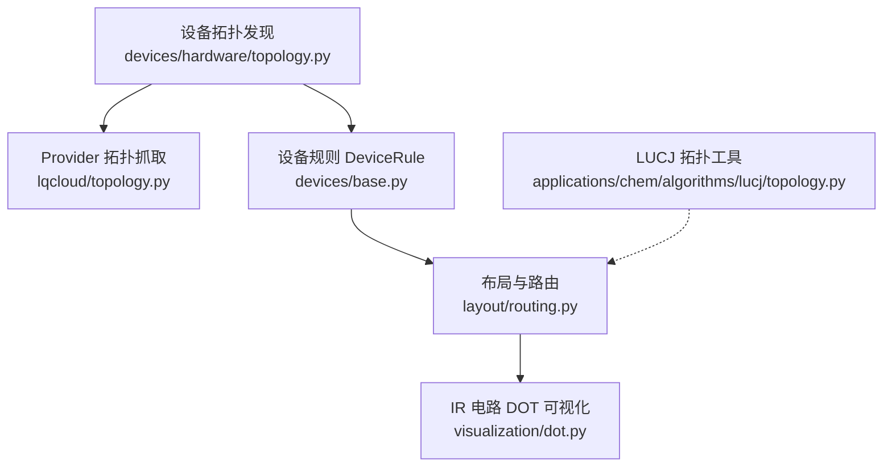
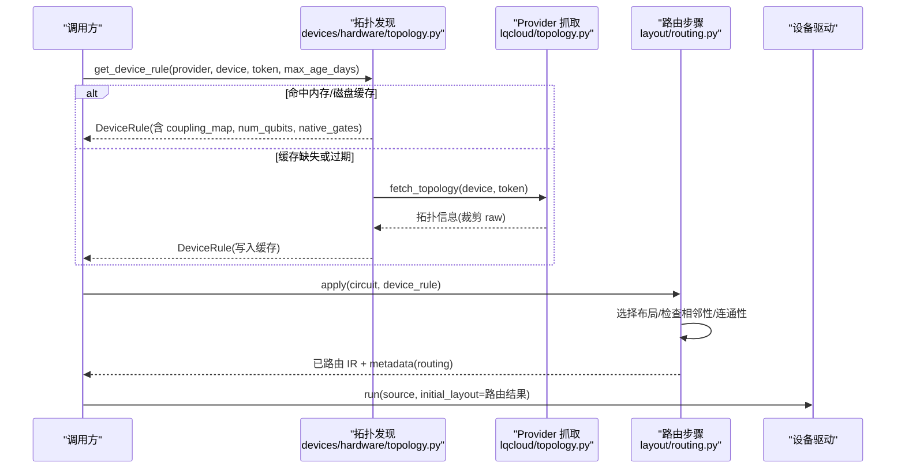
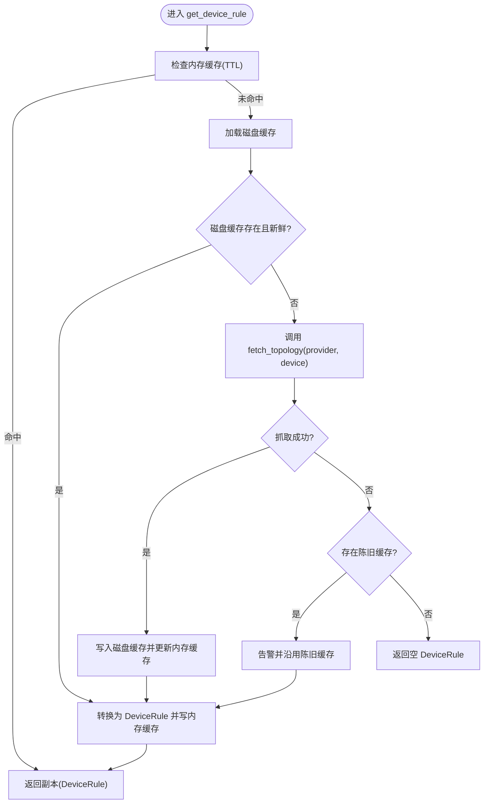
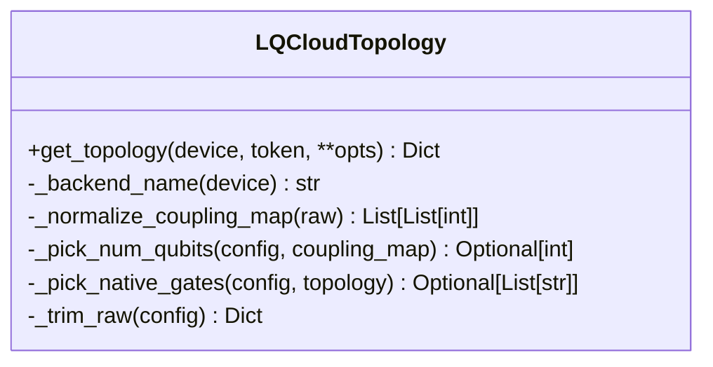
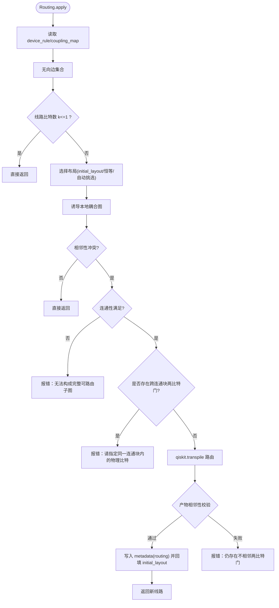
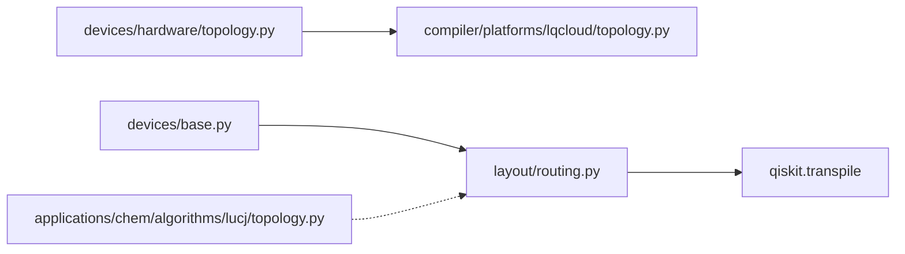

# 拓扑结构管理

<cite>
**本文引用的文件**
- [src/tyxonq/devices/hardware/topology.py](file://src/tyxonq/devices/hardware/topology.py)
- [src/tyxonq/compiler/platforms/lqcloud/topology.py](file://src/tyxonq/compiler/platforms/lqcloud/topology.py)
- [src/tyxonq/devices/base.py](file://src/tyxonq/devices/base.py)
- [src/tyxonq/compiler/gate_compiler/stages/layout/routing.py](file://src/tyxonq/compiler/gate_compiler/stages/layout/routing.py)
- [src/tyxonq/compiler/gate_compiler/stages/layout/__init__.py](file://src/tyxonq/compiler/gate_compiler/stages/layout/__init__.py)
- [src/tyxonq/applications/chem/algorithms/lucj/topology.py](file://src/tyxonq/applications/chem/algorithms/lucj/topology.py)
- [src/tyxonq/visualization/dot.py](file://src/tyxonq/visualization/dot.py)
- [tests_core_module/test_device_topology_cache.py](file://tests_core_module/test_device_topology_cache.py)
</cite>

## 目录
1. [简介](#简介)
2. [项目结构](#项目结构)
3. [核心组件](#核心组件)
4. [架构总览](#架构总览)
5. [详细组件分析](#详细组件分析)
6. [依赖关系分析](#依赖关系分析)
7. [性能考量](#性能考量)
8. [故障排查指南](#故障排查指南)
9. [结论](#结论)
10. [附录：示例与最佳实践](#附录示例与最佳实践)

## 简介
本文件面向 TyxonQ 的量子设备拓扑结构管理，系统性说明以下能力：
- 量子比特连接性查询与缓存策略（跨 provider 统一入口、TTL 磁盘缓存与会话内存缓存）
- 拓扑图构建与归一化（耦合图双向去重、门集提取、比特数推断）
- 路由优化（布局选择、SWAP 插入、测量序保持、保守门集合兜底）
- 连接性检查（相邻性校验、连通块检测、跨块门拦截）
- 不同硬件平台的拓扑差异（以 LQCloud AGate-100 为例）
- 拓扑可视化方法（IR 电路 DOT 生成）
- 性能分析与路由策略选择指南
- 具体使用示例（查询设备拓扑、分析连通性、配置路由参数）

## 项目结构
围绕拓扑管理的代码主要分布在以下模块：
- 设备拓扑发现与缓存：devices/hardware/topology.py
- Provider 特定拓扑抓取：compiler/platforms/lqcloud/topology.py
- 设备规则与运行接口：devices/base.py
- 编译期布局与路由：compiler/gate_compiler/stages/layout/routing.py
- 算法侧拓扑工具（化学应用）：applications/chem/algorithms/lucj/topology.py
- 可视化：visualization/dot.py
- 单测覆盖：tests_core_module/test_device_topology_cache.py

图表来源
- [src/tyxonq/devices/hardware/topology.py:164-258](file://src/tyxonq/devices/hardware/topology.py#L164-L258)
- [src/tyxonq/compiler/platforms/lqcloud/topology.py:108-151](file://src/tyxonq/compiler/platforms/lqcloud/topology.py#L108-L151)
- [src/tyxonq/devices/base.py:60-83](file://src/tyxonq/devices/base.py#L60-L83)
- [src/tyxonq/compiler/gate_compiler/stages/layout/routing.py:289-543](file://src/tyxonq/compiler/gate_compiler/stages/layout/routing.py#L289-L543)
- [src/tyxonq/visualization/dot.py:12-44](file://src/tyxonq/visualization/dot.py#L12-L44)
- [src/tyxonq/applications/chem/algorithms/lucj/topology.py:33-99](file://src/tyxonq/applications/chem/algorithms/lucj/topology.py#L33-L99)

章节来源
- [src/tyxonq/devices/hardware/topology.py:1-29](file://src/tyxonq/devices/hardware/topology.py#L1-L29)
- [src/tyxonq/compiler/platforms/lqcloud/topology.py:1-23](file://src/tyxonq/compiler/platforms/lqcloud/topology.py#L1-L23)
- [src/tyxonq/devices/base.py:60-83](file://src/tyxonq/devices/base.py#L60-L83)
- [src/tyxonq/compiler/gate_compiler/stages/layout/routing.py:1-32](file://src/tyxonq/compiler/gate_compiler/stages/layout/routing.py#L1-L32)

## 核心组件
- 拓扑发现与缓存（跨 provider 统一入口）
  - 会话内内存缓存 + 磁盘 TTL 缓存（默认 1 天），支持强制刷新与环境变量重定向缓存目录
  - 抓取失败时降级沿用过期缓存并告警；完全不可用时返回空 DeviceRule，不中断编译
- Provider 拓扑抓取（LQCloud）
  - 通过 SDK 获取后端配置，解析耦合图、比特数、原生门集，裁剪大字段后落盘
- 设备规则 DeviceRule
  - 声明式设备能力描述，包含 coupling_map、num_qubits、native_gates 等
- 布局与路由
  - 在“本地下标空间”进行路由，避免产物膨胀；保持测量逻辑序；保守门集合兜底；可复现种子
- 算法拓扑工具（LUCJ）
  - 提供轨道拓扑、自旋配对、邻接调度等工具，用于化学算法中的相互作用建模

章节来源
- [src/tyxonq/devices/hardware/topology.py:164-258](file://src/tyxonq/devices/hardware/topology.py#L164-L258)
- [src/tyxonq/compiler/platforms/lqcloud/topology.py:108-151](file://src/tyxonq/compiler/platforms/lqcloud/topology.py#L108-L151)
- [src/tyxonq/devices/base.py:60-83](file://src/tyxonq/devices/base.py#L60-L83)
- [src/tyxonq/compiler/gate_compiler/stages/layout/routing.py:289-543](file://src/tyxonq/compiler/gate_compiler/stages/layout/routing.py#L289-L543)
- [src/tyxonq/applications/chem/algorithms/lucj/topology.py:33-99](file://src/tyxonq/applications/chem/algorithms/lucj/topology.py#L33-L99)

## 架构总览
TyxonQ 的拓扑管理采用“发现—缓存—路由—执行”的分层设计：
- 发现层：按 provider 分派到具体抓取实现（当前落地 LQCloud）
- 缓存层：两级缓存（内存+磁盘）保证高可用与低延迟
- 路由层：基于 qiskit.transpile 的布局与 SWAP 插入，结合本地子图与连通性检查
- 执行层：将 initial_layout 下发至驱动，确保物理比特映射正确

图表来源
- [src/tyxonq/devices/hardware/topology.py:164-258](file://src/tyxonq/devices/hardware/topology.py#L164-L258)
- [src/tyxonq/compiler/platforms/lqcloud/topology.py:108-151](file://src/tyxonq/compiler/platforms/lqcloud/topology.py#L108-L151)
- [src/tyxonq/compiler/gate_compiler/stages/layout/routing.py:378-543](file://src/tyxonq/compiler/gate_compiler/stages/layout/routing.py#L378-L543)

## 详细组件分析

### 组件A：拓扑发现与缓存（跨 provider）
- 功能要点
  - 统一入口 get_device_rule：优先内存缓存，其次磁盘 TTL 缓存，最后联网抓取
  - 磁盘缓存路径由环境变量控制，文件名固定为 .topology_cache.json
  - 抓取失败时降级沿用过期缓存并告警；完全不可用返回空 DeviceRule
  - 清理缓存：支持清空全部或指定 provider/device
- 关键流程
  - 设备名归一化：去除 provider:: 前缀，保证键一致
  - 年龄计算：fetched_at 缺失或不可解析视为过期
  - 条目转换：raw 字段保留供排查，DeviceRule 中剔除 raw 避免元数据膨胀

图表来源
- [src/tyxonq/devices/hardware/topology.py:180-258](file://src/tyxonq/devices/hardware/topology.py#L180-L258)

章节来源
- [src/tyxonq/devices/hardware/topology.py:46-162](file://src/tyxonq/devices/hardware/topology.py#L46-L162)
- [src/tyxonq/devices/hardware/topology.py:164-258](file://src/tyxonq/devices/hardware/topology.py#L164-L258)
- [tests_core_module/test_device_topology_cache.py:59-314](file://tests_core_module/test_device_topology_cache.py#L59-L314)

### 组件B：Provider 拓扑抓取（LQCloud）
- 功能要点
  - 通过 SDK 获取后端配置，解析 topology.coupling_map
  - 归一化为双向去重的边列表，丢弃自环与非法项
  - 推断 num_qubits 与 native_gates；裁剪大字段（properties、qubit_coordinates）后落盘
- 输出结构
  - provider、device、num_qubits、coupling_map、native_gates、status、raw（裁剪后）

图表来源
- [src/tyxonq/compiler/platforms/lqcloud/topology.py:37-151](file://src/tyxonq/compiler/platforms/lqcloud/topology.py#L37-L151)

章节来源
- [src/tyxonq/compiler/platforms/lqcloud/topology.py:1-23](file://src/tyxonq/compiler/platforms/lqcloud/topology.py#L1-L23)
- [src/tyxonq/compiler/platforms/lqcloud/topology.py:108-151](file://src/tyxonq/compiler/platforms/lqcloud/topology.py#L108-L151)

### 组件C：设备规则 DeviceRule
- 作用：声明式描述设备能力，供编译器与运行时使用
- 关键字段
  - coupling_map：物理比特可交互边列表
  - num_qubits/max_qubits：物理比特总数
  - native_gates：原生门集合
  - initial_layout：逻辑比特到物理比特的初始映射（可由路由回填）

章节来源
- [src/tyxonq/devices/base.py:60-83](file://src/tyxonq/devices/base.py#L60-L83)

### 组件D：布局与路由（Layout/Routing）
- 设计要点
  - 仅在需要时路由：若两比特门已相邻则原样返回
  - 本地下标空间路由：限制耦合图到所选 k 个物理比特并重编号
  - 保持测量逻辑序：依据经典比特映射重排 measure_z
  - 保守门集合兜底：自由路由失败时使用安全基重试
  - 可复现：固定 seed_transpiler
- 关键流程
  - 选择布局：显式 initial_layout 优先；否则恒等；必要时从设备耦合图挑选连通子图
  - 相邻性检查：若冲突则进入路由；否则直接返回
  - 连通性检查：若跨连通块的两比特门存在，提前报错并提示指定同一连通块
  - 路由执行：to_qiskit → transpile → from_qiskit；后置校验产物相邻性
  - 回填 initial_layout：供运行期下发给驱动

图表来源
- [src/tyxonq/compiler/gate_compiler/stages/layout/routing.py:128-543](file://src/tyxonq/compiler/gate_compiler/stages/layout/routing.py#L128-L543)

章节来源
- [src/tyxonq/compiler/gate_compiler/stages/layout/routing.py:1-32](file://src/tyxonq/compiler/gate_compiler/stages/layout/routing.py#L1-L32)
- [src/tyxonq/compiler/gate_compiler/stages/layout/routing.py:289-543](file://src/tyxonq/compiler/gate_compiler/stages/layout/routing.py#L289-L543)
- [src/tyxonq/compiler/gate_compiler/stages/layout/__init__.py:1-15](file://src/tyxonq/compiler/gate_compiler/stages/layout/__init__.py#L1-L15)

### 组件E：算法拓扑工具（LUCJ）
- 功能要点
  - 拓扑名称规范化与校验（square、hex、linear）
  - 自旋轨道到量子比特索引映射（alpha/beta）
  - 同自旋/异自旋轨道对生成与约束
  - 允许的对角库仑指标与 Givens 调度
- 适用场景
  - 化学算法中根据拓扑选择相互作用对，指导电路构造与资源估计

章节来源
- [src/tyxonq/applications/chem/algorithms/lucj/topology.py:8-141](file://src/tyxonq/applications/chem/algorithms/lucj/topology.py#L8-L141)

### 组件F：拓扑可视化（DOT）
- 功能要点
  - 将 IR Circuit 转为 DOT 文本，便于 GraphViz 渲染
  - 量子比特轨道与操作节点顺序展示，两比特门以边连接
- 用途
  - 快速查看电路结构与门作用范围，辅助调试与分析

章节来源
- [src/tyxonq/visualization/dot.py:12-44](file://src/tyxonq/visualization/dot.py#L12-L44)

## 依赖关系分析
- 模块耦合
  - devices/hardware/topology.py 依赖 compiler/platforms/lqcloud/topology.py 进行实际抓取
  - layout/routing.py 依赖 qiskit 进行 transpile，并通过 interop 与 IR 互转
  - devices/base.py 提供 DeviceRule 类型与设备运行接口
- 外部依赖
  - qiskit（>=2.1.0）作为硬依赖用于路由
  - LQCloud SDK（0.4.2）用于设备配置获取

图表来源
- [src/tyxonq/devices/hardware/topology.py:164-177](file://src/tyxonq/devices/hardware/topology.py#L164-L177)
- [src/tyxonq/compiler/gate_compiler/stages/layout/routing.py:312-375](file://src/tyxonq/compiler/gate_compiler/stages/layout/routing.py#L312-L375)
- [src/tyxonq/devices/base.py:60-83](file://src/tyxonq/devices/base.py#L60-L83)

章节来源
- [src/tyxonq/devices/hardware/topology.py:164-177](file://src/tyxonq/devices/hardware/topology.py#L164-L177)
- [src/tyxonq/compiler/gate_compiler/stages/layout/routing.py:312-375](file://src/tyxonq/compiler/gate_compiler/stages/layout/routing.py#L312-L375)

## 性能考量
- 缓存策略
  - 会话内存缓存避免重复读盘/联网；磁盘 TTL 缓存减少频繁网络请求
  - 环境变量可重定向缓存目录，适配只读安装场景
- 路由开销
  - 仅在相邻性冲突时触发路由；本地下标空间路由降低产物规模
  - 保守门集合兜底提升成功率，但可能引入额外门；可通过 optimization_level 调整
- 可复现性
  - 固定 seed_transpiler，确保多次编译结果一致，利于回归测试与对比
- 测量序保持
  - 依据经典比特映射重排 measure_z，避免计数键错位导致能量计算错误

[本节为通用性能讨论，不直接分析具体文件]

## 故障排查指南
- 拓扑抓取失败
  - 现象：警告“沿用过期缓存”或“无法获取设备拓扑”
  - 处理：检查网络/凭证；使用 force_refresh=True 强制刷新；确认缓存目录可写
- 路由失败
  - 现象：报错“设备耦合图在所选物理比特上不连通”或“仍存在不相邻两比特门”
  - 处理：显式指定 initial_layout 使所有两比特门位于同一连通块；尝试提高 optimization_level；必要时调整 basis_gates
- 测量序异常
  - 现象：计数键比特序与预期不一致
  - 处理：确认 AutoMeasure 已在路由前插入；检查路由产物是否保留了测量逻辑序
- 缓存问题
  - 现象：缓存损坏或只读目录导致写盘失败
  - 处理：清理缓存（clear_topology_cache）；设置 TYXONQ_TOPOLOGY_CACHE_DIR 指向可写目录

章节来源
- [src/tyxonq/devices/hardware/topology.py:224-258](file://src/tyxonq/devices/hardware/topology.py#L224-L258)
- [src/tyxonq/compiler/gate_compiler/stages/layout/routing.py:435-495](file://src/tyxonq/compiler/gate_compiler/stages/layout/routing.py#L435-L495)
- [tests_core_module/test_device_topology_cache.py:168-314](file://tests_core_module/test_device_topology_cache.py#L168-L314)

## 结论
TyxonQ 的拓扑结构管理通过统一的发现与缓存机制、稳健的路由策略以及完善的连接性检查，实现了跨平台、高可用的量子设备接入。其设计兼顾了性能（缓存与本地子图路由）、可靠性（降级与兜底）与可维护性（清晰的职责划分与测试覆盖）。在实际使用中，建议：
- 合理配置缓存 TTL 与目录，避免频繁网络请求
- 针对复杂线路显式指定 initial_layout，确保连通性与相邻性
- 利用 DOT 可视化与路由 metadata 进行调试与性能分析
- 结合 LUCJ 拓扑工具进行算法级资源评估与电路构造

[本节为总结性内容，不直接分析具体文件]

## 附录：示例与最佳实践
- 查询特定设备的拓扑信息
  - 使用 get_device_rule(provider="lqcloud", device="AGate-100") 获取 DeviceRule
  - 关注 coupling_map、num_qubits、native_gates 字段
- 分析量子比特连通性
  - 使用路由前的相邻性检查与连通块检测，判断是否需要路由及如何选择物理比特
- 配置路由策略
  - 设置 RoutingSpec(seed=0, optimization_level=0/1)，必要时指定 basis_gates
  - 对于不连通或孤立比特较多的设备，显式 initial_layout 更可靠
- 拓扑可视化
  - 使用 circuit_to_dot 生成 DOT 文本，借助 GraphViz 查看电路结构
- 性能分析
  - 观察路由 metadata 中的 swaps_inserted、initial_layout、local_coupling_map 等字段
  - 对比不同 optimization_level 与 basis_gates 下的路由结果与运行开销

章节来源
- [src/tyxonq/devices/hardware/topology.py:180-258](file://src/tyxonq/devices/hardware/topology.py#L180-L258)
- [src/tyxonq/compiler/gate_compiler/stages/layout/routing.py:378-543](file://src/tyxonq/compiler/gate_compiler/stages/layout/routing.py#L378-L543)
- [src/tyxonq/visualization/dot.py:12-44](file://src/tyxonq/visualization/dot.py#L12-L44)
- [tests_core_module/test_device_topology_cache.py:59-314](file://tests_core_module/test_device_topology_cache.py#L59-L314)