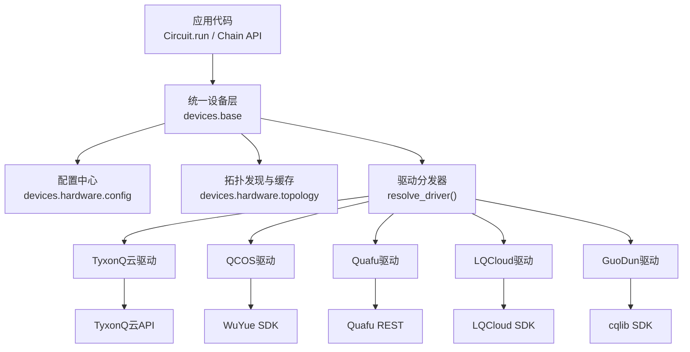
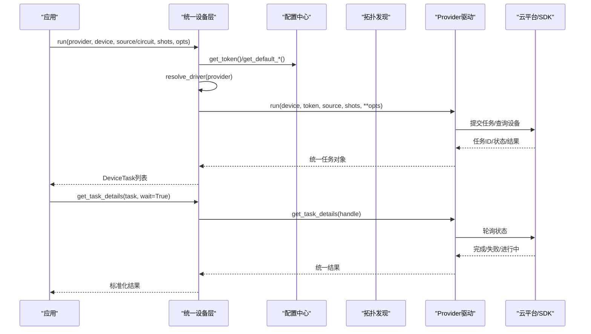
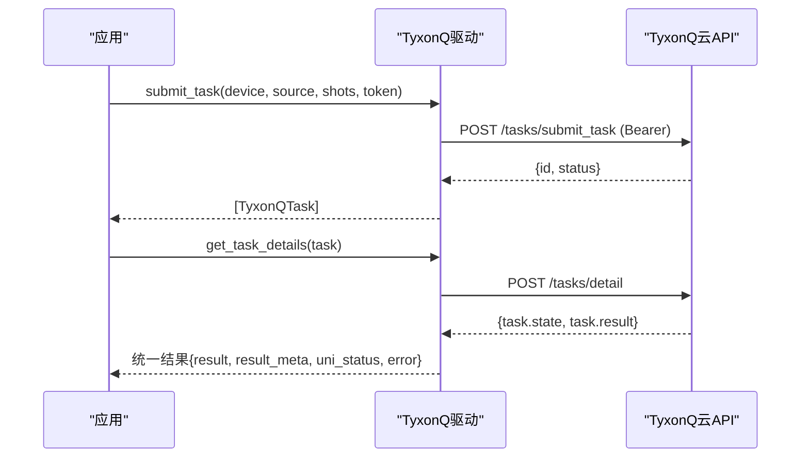
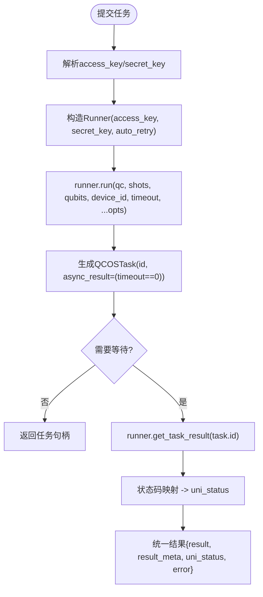
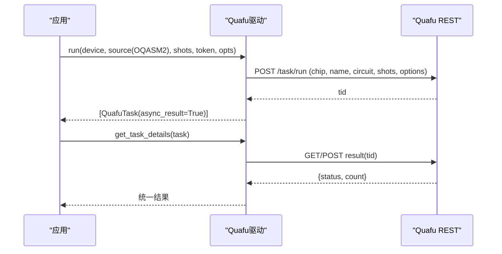
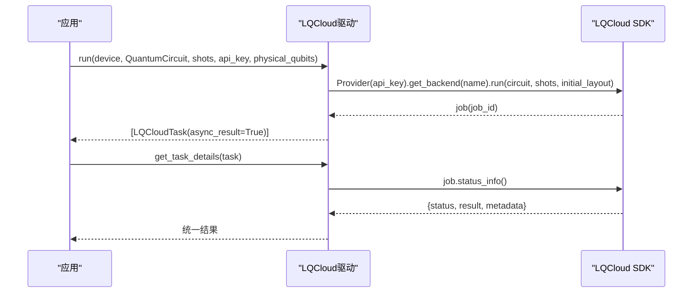
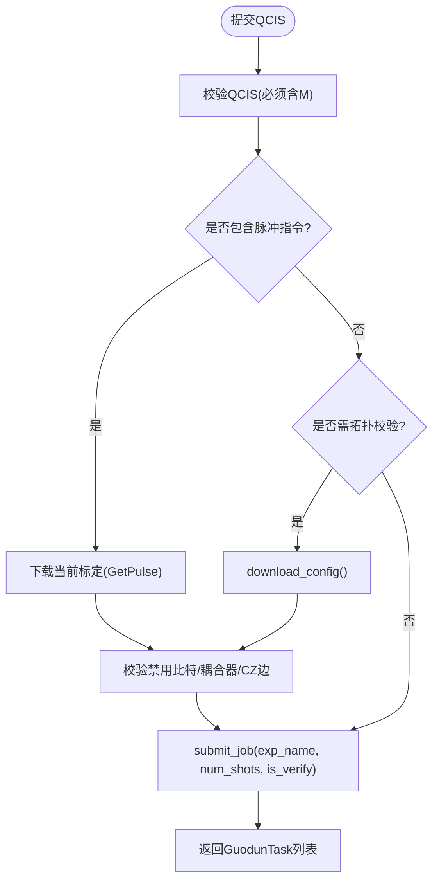
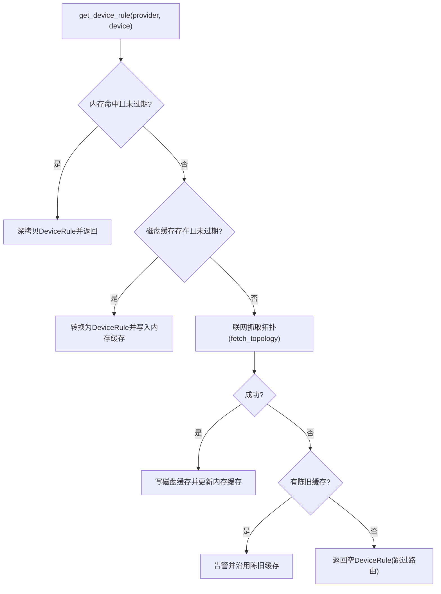
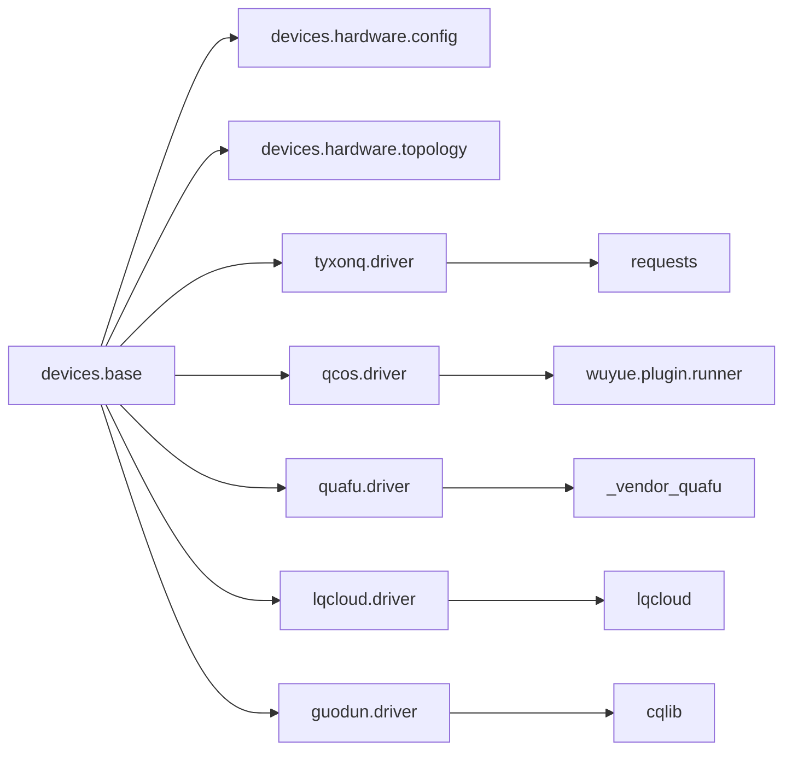

# 硬件驱动API

<cite>
**本文引用的文件**
- [base.py](file://src/tyxonq/devices/base.py)
- [config.py](file://src/tyxonq/devices/hardware/config.py)
- [topology.py](file://src/tyxonq/devices/hardware/topology.py)
- [tyxonq/driver.py](file://src/tyxonq/devices/hardware/tyxonq/driver.py)
- [qcos/driver.py](file://src/tyxonq/devices/hardware/qcos/driver.py)
- [quafu/driver.py](file://src/tyxonq/devices/hardware/quafu/driver.py)
- [lqcloud/driver.py](file://src/tyxonq/devices/hardware/lqcloud/driver.py)
- [guodun/driver.py](file://src/tyxonq/devices/hardware/guodun/driver.py)
- [tyxonq_cloud_api.md](file://docs/tyxonq_cloud_api.md)
- [guodun_provider.md](file://docs/guodun_provider.md)
- [qcos_provider.md](file://docs/qcos_provider.md)
- [quafu_provider.md](file://docs/quafu_provider.md)
</cite>

## 目录
1. [简介](#简介)
2. [项目结构](#项目结构)
3. [核心组件](#核心组件)
4. [架构总览](#架构总览)
5. [详细组件分析](#详细组件分析)
6. [依赖关系分析](#依赖关系分析)
7. [性能与可靠性](#性能与可靠性)
8. [故障排除指南](#故障排除指南)
9. [结论](#结论)
10. [附录：配置示例与兼容性测试](#附录：配置示例与兼容性测试)

## 简介
本文件面向TyxonQ硬件驱动API，覆盖设备配置管理、拓扑发现与缓存、云平台集成（TyxonQ云、QCOS、Quafu、LQCloud、GuoDun）的接入方式、认证机制与任务提交流程。文档同时解释设备拓扑查询、连接性检查、错误处理等核心能力，并提供自定义驱动开发指南与兼容性测试方法，帮助开发者快速对接不同量子硬件平台并稳定运行任务。

## 项目结构
TyxonQ将“统一设备抽象”与“各provider驱动”解耦：
- 统一设备层（devices.base）提供统一的run/expval/list_devices/get_task_details/remove_task接口，屏蔽provider差异。
- 硬件配置（devices.hardware.config）集中管理默认provider/device、token解析与端点信息。
- 拓扑发现与缓存（devices.hardware.topology）负责跨provider的设备拓扑抓取与TTL持久化缓存，供编译器路由使用。
- 各provider驱动位于devices.hardware.<provider>.driver，实现具体平台的提交、查询、取消与设备列表能力。

图表来源
- [base.py:146-258](file://src/tyxonq/devices/base.py#L146-L258)
- [config.py:11-19](file://src/tyxonq/devices/hardware/config.py#L11-L19)
- [topology.py:164-177](file://src/tyxonq/devices/hardware/topology.py#L164-L177)

章节来源
- [base.py:111-258](file://src/tyxonq/devices/base.py#L111-L258)
- [config.py:1-78](file://src/tyxonq/devices/hardware/config.py#L1-L78)
- [topology.py:1-302](file://src/tyxonq/devices/hardware/topology.py#L1-L302)

## 核心组件
- DeviceTask：统一的任务句柄包装，提供get_result/cancel，自动归一化结果字段（result/result_meta/metadata/expectations/probabilities）。
- DeviceRule：声明式设备能力描述（native_gates、max_qubits、coupling_map、initial_layout、num_qubits），用于编译器路由。
- run/expval：统一执行入口，支持source或circuit路径；对模拟器注入噪声参数，对真机丢弃无关参数；统一返回DeviceTask列表。
- get_task_details：统一轮询与状态归一化，支持wait/poll_interval/timeout，超时发出RuntimeWarning。
- list_all_devices：聚合模拟器与provider设备列表。
- resolve_driver：按provider动态加载对应驱动模块。

章节来源
- [base.py:12-57](file://src/tyxonq/devices/base.py#L12-L57)
- [base.py:294-445](file://src/tyxonq/devices/base.py#L294-L445)
- [base.py:497-574](file://src/tyxonq/devices/base.py#L497-L574)

## 架构总览
TyxonQ通过“统一设备层 + provider驱动”的分层设计，实现多后端一致体验：
- 调用方仅依赖统一接口（run/expval/list_devices/get_task_details/remove_task）。
- 配置中心提供默认provider/device与token解析策略。
- 拓扑模块在编译期按需获取耦合图，带内存+磁盘两级TTL缓存，失败时降级不中断流程。
- 各provider驱动封装各自SDK/REST，输出统一结果结构。

图表来源
- [base.py:294-445](file://src/tyxonq/devices/base.py#L294-L445)
- [base.py:497-574](file://src/tyxonq/devices/base.py#L497-L574)
- [tyxonq/driver.py:80-141](file://src/tyxonq/devices/hardware/tyxonq/driver.py#L80-L141)
- [qcos/driver.py:80-158](file://src/tyxonq/devices/hardware/qcos/driver.py#L80-L158)
- [quafu/driver.py:103-180](file://src/tyxonq/devices/hardware/quafu/driver.py#L103-L180)
- [lqcloud/driver.py:56-92](file://src/tyxonq/devices/hardware/lqcloud/driver.py#L56-L92)
- [guodun/driver.py:310-357](file://src/tyxonq/devices/hardware/guodun/driver.py#L310-L357)

## 详细组件分析

### TyxonQ云驱动（tyxonq）
- 认证：Authorization: Bearer token，token优先级为显式传入 > set_token(provider="tyxonq") > 环境变量回退。
- 设备列表：POST /api/v1/devices/list，返回设备id集合。
- 任务提交：POST /api/v1/tasks/submit_task，支持批量source/shots，lang=OPENQASM，version=1。
- 任务详情：POST /api/v1/tasks/detail，返回state/result等，统一映射到uni_status。
- 任务删除：POST /api/v1/task/remove。

图表来源
- [tyxonq/driver.py:45-62](file://src/tyxonq/devices/hardware/tyxonq/driver.py#L45-L62)
- [tyxonq/driver.py:80-141](file://src/tyxonq/devices/hardware/tyxonq/driver.py#L80-L141)
- [tyxonq/driver.py:145-214](file://src/tyxonq/devices/hardware/tyxonq/driver.py#L145-L214)
- [tyxonq_cloud_api.md:89-158](file://docs/tyxonq_cloud_api.md#L89-L158)
- [tyxonq_cloud_api.md:201-258](file://docs/tyxonq_cloud_api.md#L201-L258)

章节来源
- [tyxonq/driver.py:1-222](file://src/tyxonq/devices/hardware/tyxonq/driver.py#L1-L222)
- [tyxonq_cloud_api.md:1-361](file://docs/tyxonq_cloud_api.md#L1-L361)

### QCOS驱动（移动云 WuYue）
- 认证：access_key + secret_key，优先级：函数参数 > 环境变量（QCOS_ACCESS_KEY/QCOS_SECRET_KEY）。不支持旧sdk_code。
- 设备列表：静态已知设备清单（wuyue SDK不再暴露枚举）。
- 任务提交：通过wuyue.plugin.runner.Runner.run，支持auto_retry、timeout、task_name等透传。
- 任务详情：基于Runner.get_task_result轮询，状态码映射为统一uni_status。

图表来源
- [qcos/driver.py:37-65](file://src/tyxonq/devices/hardware/qcos/driver.py#L37-L65)
- [qcos/driver.py:80-158](file://src/tyxonq/devices/hardware/qcos/driver.py#L80-L158)
- [qcos/driver.py:161-238](file://src/tyxonq/devices/hardware/qcos/driver.py#L161-L238)
- [qcos_provider.md:22-64](file://docs/qcos_provider.md#L22-L64)
- [qcos_provider.md:117-169](file://docs/qcos_provider.md#L117-L169)

章节来源
- [qcos/driver.py:1-269](file://src/tyxonq/devices/hardware/qcos/driver.py#L1-L269)
- [qcos_provider.md:1-169](file://docs/qcos_provider.md#L1-L169)

### Quafu驱动（BAQIS）
- 认证：四步优先级：显式token > tq.set_token(provider="quafu") > TYXONQ_QUAFU_TOKEN/QPU_API_TOKEN > 报错提示。
- 设备列表：调用vendor status接口过滤在线芯片。
- 任务提交：要求OpenQASM 2.0字符串，支持server-side recompilation选项（compiler/correct/open_dd/target_qubits）。
- 任务详情：vendor result接口返回status/count，映射为统一uni_status。

图表来源
- [quafu/driver.py:28-45](file://src/tyxonq/devices/hardware/quafu/driver.py#L28-L45)
- [quafu/driver.py:103-180](file://src/tyxonq/devices/hardware/quafu/driver.py#L103-L180)
- [quafu/driver.py:203-236](file://src/tyxonq/devices/hardware/quafu/driver.py#L203-L236)
- [quafu_provider.md:14-36](file://docs/quafu_provider.md#L14-L36)
- [quafu_provider.md:48-88](file://docs/quafu_provider.md#L48-L88)

章节来源
- [quafu/driver.py:1-276](file://src/tyxonq/devices/hardware/quafu/driver.py#L1-L276)
- [quafu_provider.md:1-113](file://docs/quafu_provider.md#L1-L113)

### LQCloud驱动
- 认证：api_key优先级：opts.api_key > token(若provider=lqcloud) > TYXONQ_LQCLOUD_API_KEY/LQCLOUD_API_KEY。
- 设备列表：通过官方SDK Provider.get_backends()动态列出。
- 任务提交：要求lqcloud.QuantumCircuit，支持initial_layout物理比特映射。
- 任务详情：job.status_info()解析为统一结果，支持概率与格式元数据。

图表来源
- [lqcloud/driver.py:33-42](file://src/tyxonq/devices/hardware/lqcloud/driver.py#L33-L42)
- [lqcloud/driver.py:56-92](file://src/tyxonq/devices/hardware/lqcloud/driver.py#L56-L92)
- [lqcloud/driver.py:119-180](file://src/tyxonq/devices/hardware/lqcloud/driver.py#L119-L180)

章节来源
- [lqcloud/driver.py:1-223](file://src/tyxonq/devices/hardware/lqcloud/driver.py#L1-L223)

### GuoDun驱动（国盾）
- 认证：显式token > set_token(provider="guodun") > TYXONQ_GUODUN_TOKEN。
- 设备列表：通过SDK查询机器列表，提取匹配设备代码。
- 任务提交：要求QCIS源（含显式M测量），支持pulse-QCIS（PXY/PZ/PZ0/G/I/B/M/RZ）并在提交前校验当前标定与拓扑。
- 任务详情：query_experiment轮询，解析resultStatus保持平台bit顺序，映射runStatus为uni_status。

图表来源
- [guodun/driver.py:56-67](file://src/tyxonq/devices/hardware/guodun/driver.py#L56-L67)
- [guodun/driver.py:100-113](file://src/tyxonq/devices/hardware/guodun/driver.py#L100-L113)
- [guodun/driver.py:152-222](file://src/tyxonq/devices/hardware/guodun/driver.py#L152-L222)
- [guodun/driver.py:310-357](file://src/tyxonq/devices/hardware/guodun/driver.py#L310-L357)
- [guodun_provider.md:14-28](file://docs/guodun_provider.md#L14-L28)
- [guodun_provider.md:30-97](file://docs/guodun_provider.md#L30-L97)

章节来源
- [guodun/driver.py:1-525](file://src/tyxonq/devices/hardware/guodun/driver.py#L1-L525)
- [guodun_provider.md:1-169](file://docs/guodun_provider.md#L1-L169)

### 拓扑发现与缓存（跨provider）
- 目标：为编译器提供coupling_map/num_qubits/native_gates，避免每次编译都联网。
- 策略：会话内内存缓存 + 磁盘TTL缓存（默认1天），可环境变量重定向缓存目录。
- 行为：抓取失败时，若有过期缓存则降级沿用并发出警告；若无缓存则返回空DeviceRule，不影响编译。
- 当前落地：lqcloud已实现fetch_topology；其他provider后续增量支持。

图表来源
- [topology.py:164-177](file://src/tyxonq/devices/hardware/topology.py#L164-L177)
- [topology.py:180-258](file://src/tyxonq/devices/hardware/topology.py#L180-L258)
- [topology.py:261-291](file://src/tyxonq/devices/hardware/topology.py#L261-L291)

章节来源
- [topology.py:1-302](file://src/tyxonq/devices/hardware/topology.py#L1-L302)

## 依赖关系分析
- 统一设备层依赖配置中心获取默认值与token；根据provider动态导入对应驱动。
- 各驱动依赖各自SDK/REST：
  - TyxonQ云：requests直接HTTP调用。
  - QCOS：wuyue.plugin.runner.Runner。
  - Quafu：_vendor_quafu.Task。
  - LQCloud：lqcloud.LQCloudProvider/QuantumCircuit/Result。
  - GuoDun：cqlib.GuoDunPlatform/GetPulse。
- 拓扑模块仅在编译期按需调用，不影响运行时提交。

图表来源
- [base.py:146-258](file://src/tyxonq/devices/base.py#L146-L258)
- [tyxonq/driver.py:1-10](file://src/tyxonq/devices/hardware/tyxonq/driver.py#L1-L10)
- [qcos/driver.py:1-34](file://src/tyxonq/devices/hardware/qcos/driver.py#L1-L34)
- [quafu/driver.py:1-16](file://src/tyxonq/devices/hardware/quafu/driver.py#L1-L16)
- [lqcloud/driver.py:1-12](file://src/tyxonq/devices/hardware/lqcloud/driver.py#L1-L12)
- [guodun/driver.py:1-15](file://src/tyxonq/devices/hardware/guodun/driver.py#L1-L15)

章节来源
- [base.py:146-258](file://src/tyxonq/devices/base.py#L146-L258)

## 性能与可靠性
- 拓扑缓存：内存+磁盘两级缓存降低网络开销，默认TTL=1天，可通过clear_topology_cache清理。
- 任务轮询：get_task_details支持poll_interval与timeout，避免阻塞过久；超时发出RuntimeWarning提示排队或执行耗时。
- 噪声注入：仅对模拟器生效，真机提交前自动丢弃noise/use_noise键，避免驱动报错。
- 批处理：run支持批量circuits与shots对齐，保证顺序与一致性。
- 错误降级：拓扑抓取失败不会中断编译；部分provider设备列表为空时安全返回[]。

[本节为通用指导，无需特定文件引用]

## 故障排除指南
- 认证失败
  - TyxonQ云：检查Authorization头Bearer token是否正确。
  - QCOS：确认access_key/secret_key设置，弃用sdk_code。
  - Quafu：确保OQASM 2.0头部与token有效（每30天轮换）。
  - LQCloud：确认api_key来源与环境变量。
  - GuoDun：确认TYXONQ_GUODUN_TOKEN或set_token配置。
- 任务状态异常
  - 使用get_task_details查看uni_status与error字段；注意超时警告可能表示排队或执行耗时。
- 拓扑问题
  - 若编译器跳过路由导致非相邻门被拒绝，检查拓扑缓存是否过期或刷新失败；必要时force_refresh或清理缓存。
- 驱动兼容
  - 各驱动对输入格式有严格要求（如Quafu要求OQASM 2.0；GuoDun要求QCIS含M；LQCloud要求QuantumCircuit）。

章节来源
- [base.py:497-574](file://src/tyxonq/devices/base.py#L497-L574)
- [qcos/driver.py:37-65](file://src/tyxonq/devices/hardware/qcos/driver.py#L37-L65)
- [quafu/driver.py:90-101](file://src/tyxonq/devices/hardware/quafu/driver.py#L90-L101)
- [lqcloud/driver.py:33-42](file://src/tyxonq/devices/hardware/lqcloud/driver.py#L33-L42)
- [guodun/driver.py:56-67](file://src/tyxonq/devices/hardware/guodun/driver.py#L56-L67)
- [topology.py:240-258](file://src/tyxonq/devices/hardware/topology.py#L240-L258)

## 结论
TyxonQ通过统一设备抽象与provider驱动解耦，实现了跨平台一致的量子任务提交与结果获取体验。结合拓扑发现与TTL缓存，既保证了编译期路由准确性，又提升了整体性能与鲁棒性。各provider驱动遵循统一契约，便于扩展新平台与定制功能。

[本节为总结，无需特定文件引用]

## 附录：配置示例与兼容性测试

### 配置示例（以路径引用代替代码片段）
- TyxonQ云
  - 设备列表与任务提交：参考[TyxonQ云API文档:89-158](file://docs/tyxonq_cloud_api.md#L89-L158)、[TyxonQ云API文档:201-258](file://docs/tyxonq_cloud_api.md#L201-L258)
  - 驱动实现：[tyxonq/driver.py:80-141](file://src/tyxonq/devices/hardware/tyxonq/driver.py#L80-L141)
- QCOS
  - 认证与提交：参考[QCOS接入指引:22-64](file://docs/qcos_provider.md#L22-L64)、[QCOS接入指引:117-169](file://docs/qcos_provider.md#L117-L169)
  - 驱动实现：[qcos/driver.py:80-158](file://src/tyxonq/devices/hardware/qcos/driver.py#L80-L158)
- Quafu
  - 认证与提交：参考[Quafu接入指引:14-36](file://docs/quafu_provider.md#L14-L36)、[Quafu接入指引:48-88](file://docs/quafu_provider.md#L48-L88)
  - 驱动实现：[quafu/driver.py:103-180](file://src/tyxonq/devices/hardware/quafu/driver.py#L103-L180)
- LQCloud
  - 认证与提交：参考[lqcloud/driver.py:56-92](file://src/tyxonq/devices/hardware/lqcloud/driver.py#L56-L92)
- GuoDun
  - 认证与提交：参考[GuoDun接入指引:14-28](file://docs/guodun_provider.md#L14-L28)、[GuoDun接入指引:30-97](file://docs/guodun_provider.md#L30-L97)
  - 驱动实现：[guodun/driver.py:310-357](file://src/tyxonq/devices/hardware/guodun/driver.py#L310-L357)

### 自定义硬件驱动开发指南
- 实现最小接口：run、get_task_details、list_devices（可选remove_task）。
- 统一结果结构：返回{result, result_meta, uni_status, error}，确保下游postprocessing可用。
- 认证策略：优先显式token，其次set_token(provider)，最后环境变量；避免误用全局密钥。
- 拓扑支持：如需路由，实现fetch_topology逻辑并纳入topology模块分派。
- 错误处理：对网络/权限/格式错误给出明确uni_status与error，便于上层重试或告警。

[本节为通用指导，无需特定文件引用]

### 设备兼容性测试方法
- 单元测试要点
  - 认证解析：验证token优先级与环境变量读取。
  - 提交校验：格式校验（如OQASM 2.0、QCIS含M、QuantumCircuit类型）。
  - 状态映射：验证上游状态到uni_status映射正确。
  - 拓扑缓存：验证内存/磁盘缓存命中与TTL失效。
- 端到端测试
  - 选择在线设备，提交简单电路（Bell态），验证counts之和等于shots。
  - 异步提交后轮询，验证超时与重试行为。
  - 拓扑刷新：强制刷新后验证coupling_map变化。

[本节为通用指导，无需特定文件引用]