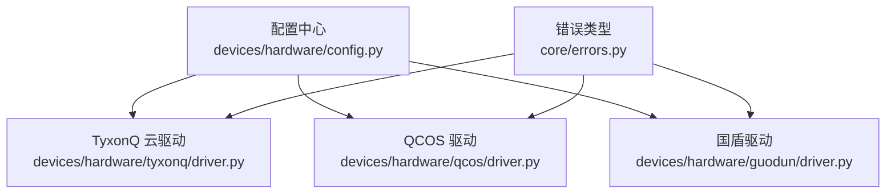
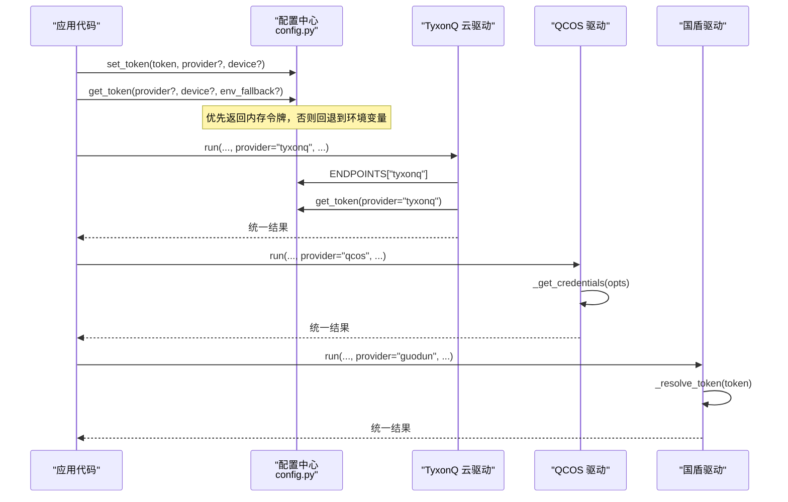
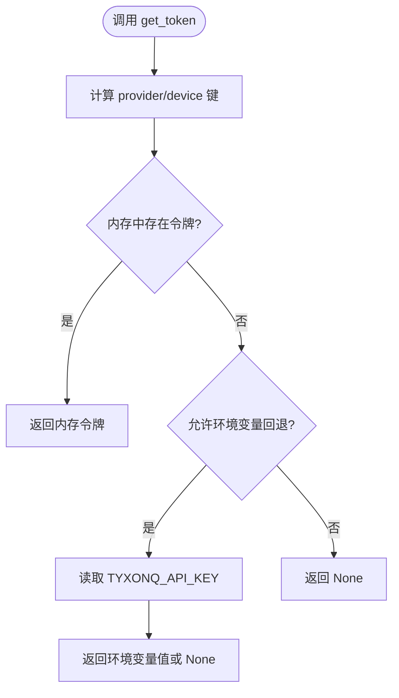
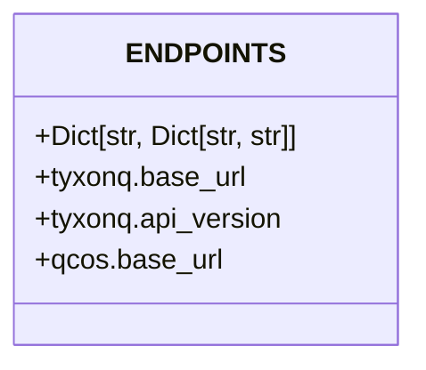
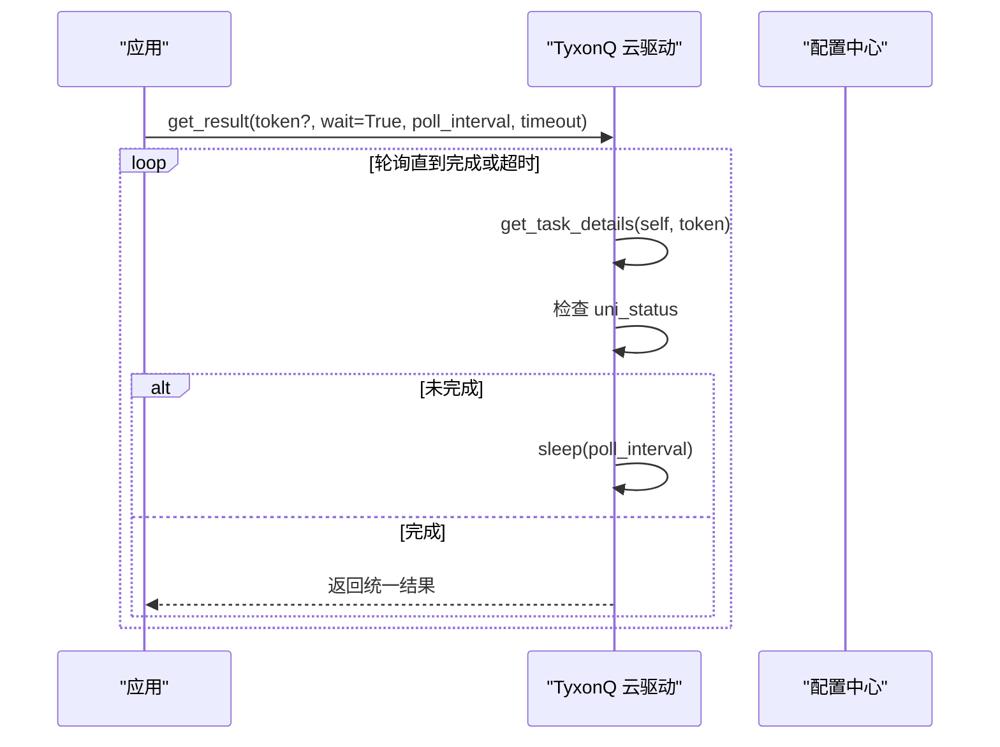
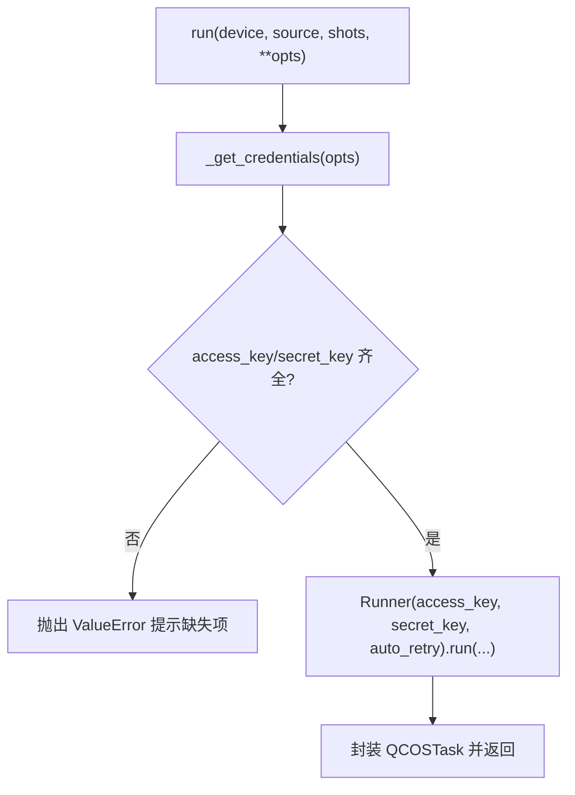
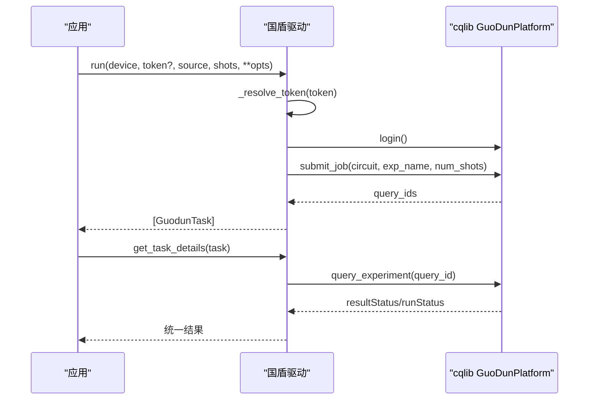
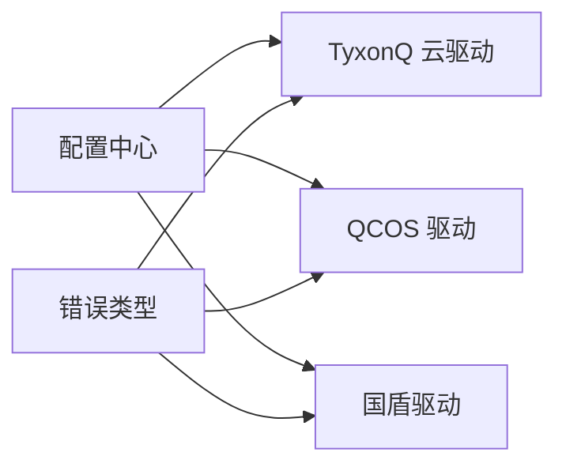

# 设备配置管理

<cite>
**本文引用的文件**
- [src/tyxonq/devices/hardware/config.py](file://src/tyxonq/devices/hardware/config.py)
- [src/tyxonq/devices/hardware/tyxonq/driver.py](file://src/tyxonq/devices/hardware/tyxonq/driver.py)
- [src/tyxonq/devices/hardware/qcos/driver.py](file://src/tyxonq/devices/hardware/qcos/driver.py)
- [src/tyxonq/devices/hardware/guodun/driver.py](file://src/tyxonq/devices/hardware/guodun/driver.py)
- [docs/qcos_provider.md](file://docs/qcos_provider.md)
- [docs/guodun_provider.md](file://docs/guodun_provider.md)
- [docs/tyxonq_cloud_api.md](file://docs/tyxonq_cloud_api.md)
- [src/tyxonq/core/errors.py](file://src/tyxonq/core/errors.py)
</cite>

## 目录
1. [简介](#简介)
2. [项目结构](#项目结构)
3. [核心组件](#核心组件)
4. [架构总览](#架构总览)
5. [详细组件分析](#详细组件分析)
6. [依赖关系分析](#依赖关系分析)
7. [性能考虑](#性能考虑)
8. [故障排除指南](#故障排除指南)
9. [结论](#结论)
10. [附录：配置示例与最佳实践](#附录：配置示例与最佳实践)

## 简介
本文件聚焦 TyxonQ 的设备配置管理，围绕以下主题展开：
- 设备令牌管理：set_token、get_token 的机制与优先级
- 默认配置设置：set_default、get_default_provider、get_default_device
- 云平台端点配置：ENDPOINTS 的结构与环境变量覆盖
- 多提供商认证机制：TyxonQ 云、QCOS（移动云五岳）、国盾（Guodun）
- 环境变量支持与配置文件格式
- 常见配置示例：设置 TyxonQ 云 API 密钥、配置 QCOS 平台连接等
- 故障排除：认证失败、连接超时等问题的定位与解决

## 项目结构
设备配置管理的核心位于硬件层配置模块与各提供商驱动中。关键路径如下：
- 全局配置与端点：devices/hardware/config.py
- TyxonQ 云驱动：devices/hardware/tyxonq/driver.py
- QCOS 驱动：devices/hardware/qcos/driver.py
- 国盾驱动：devices/hardware/guodun/driver.py
- 错误类型定义：core/errors.py
- 文档与使用指引：docs/qcos_provider.md、docs/guodun_provider.md、docs/tyxonq_cloud_api.md

**图表来源**
- [src/tyxonq/devices/hardware/config.py:11-19](file://src/tyxonq/devices/hardware/config.py#L11-L19)
- [src/tyxonq/devices/hardware/tyxonq/driver.py:45-53](file://src/tyxonq/devices/hardware/tyxonq/driver.py#L45-L53)
- [src/tyxonq/devices/hardware/qcos/driver.py:37-65](file://src/tyxonq/devices/hardware/qcos/driver.py#L37-L65)
- [src/tyxonq/devices/hardware/guodun/driver.py:56-66](file://src/tyxonq/devices/hardware/guodun/driver.py#L56-L66)
- [src/tyxonq/core/errors.py:1-17](file://src/tyxonq/core/errors.py#L1-L17)

**章节来源**
- [src/tyxonq/devices/hardware/config.py:1-78](file://src/tyxonq/devices/hardware/config.py#L1-L78)
- [src/tyxonq/devices/hardware/tyxonq/driver.py:23-53](file://src/tyxonq/devices/hardware/tyxonq/driver.py#L23-L53)
- [src/tyxonq/devices/hardware/qcos/driver.py:1-269](file://src/tyxonq/devices/hardware/qcos/driver.py#L1-L269)
- [src/tyxonq/devices/hardware/guodun/driver.py:1-525](file://src/tyxonq/devices/hardware/guodun/driver.py#L1-L525)
- [src/tyxonq/core/errors.py:1-17](file://src/tyxonq/core/errors.py#L1-L17)

## 核心组件
- 令牌存储与获取：内存中的 _TOKENS 字典，支持按 provider 和 device 维度存取；可选回退到全局环境变量 TYXONQ_API_KEY
- 默认配置：_DEFAULTS 保存默认 provider 与 device；提供 set_default、get_default_provider、get_default_device
- 端点配置：ENDPOINTS 集中管理各提供商的 base_url 与 api_version，可通过环境变量覆盖
- 提供商驱动：TyxonQ 云、QCOS、国盾各自实现认证、提交、查询与结果统一化

**章节来源**
- [src/tyxonq/devices/hardware/config.py:7-19](file://src/tyxonq/devices/hardware/config.py#L7-L19)
- [src/tyxonq/devices/hardware/config.py:24-65](file://src/tyxonq/devices/hardware/config.py#L24-L65)

## 架构总览
下图展示配置中心与各驱动的交互关系，以及令牌解析与端点选择流程。

**图表来源**
- [src/tyxonq/devices/hardware/config.py:24-65](file://src/tyxonq/devices/hardware/config.py#L24-L65)
- [src/tyxonq/devices/hardware/tyxonq/driver.py:45-53](file://src/tyxonq/devices/hardware/tyxonq/driver.py#L45-L53)
- [src/tyxonq/devices/hardware/qcos/driver.py:80-158](file://src/tyxonq/devices/hardware/qcos/driver.py#L80-L158)
- [src/tyxonq/devices/hardware/guodun/driver.py:310-357](file://src/tyxonq/devices/hardware/guodun/driver.py#L310-L357)

## 详细组件分析

### 令牌管理与默认配置（config.py）
- set_token：将 token 同时写入 device-scoped 与 provider-scoped 键，便于灵活查找
- get_token：按 provider/device 组合键查找内存令牌；若未命中且允许回退，则读取全局环境变量 TYXONQ_API_KEY
- set_default/get_default_provider/get_default_device：维护并读取默认 provider 与 device

**图表来源**
- [src/tyxonq/devices/hardware/config.py:34-50](file://src/tyxonq/devices/hardware/config.py#L34-L50)

**章节来源**
- [src/tyxonq/devices/hardware/config.py:24-65](file://src/tyxonq/devices/hardware/config.py#L24-L65)

### 云平台端点配置（ENDPOINTS）
- tyxonq：base_url 与 api_version 可从环境变量覆盖（TYXONQ_BASE_URL、TYXONQ_API_VERSION）
- qcos：当前仅定义 base_url（移动云量子平台）

**图表来源**
- [src/tyxonq/devices/hardware/config.py:11-19](file://src/tyxonq/devices/hardware/config.py#L11-L19)

**章节来源**
- [src/tyxonq/devices/hardware/config.py:11-19](file://src/tyxonq/devices/hardware/config.py#L11-L19)
- [docs/tyxonq_cloud_api.md:9-22](file://docs/tyxonq_cloud_api.md#L9-L22)

### TyxonQ 云驱动（tyxonq/driver.py）
- 端点构造：基于 ENDPOINTS["tyxonq"] 拼接请求 URL
- 认证头：优先使用传入 token，其次通过 get_token(provider="tyxonq") 获取，最后回退为兼容占位值
- 任务轮询：get_result 支持 wait/poll_interval/timeout，统一状态映射

**图表来源**
- [src/tyxonq/devices/hardware/tyxonq/driver.py:23-42](file://src/tyxonq/devices/hardware/tyxonq/driver.py#L23-L42)
- [src/tyxonq/devices/hardware/tyxonq/driver.py:45-53](file://src/tyxonq/devices/hardware/tyxonq/driver.py#L45-L53)

**章节来源**
- [src/tyxonq/devices/hardware/tyxonq/driver.py:23-53](file://src/tyxonq/devices/hardware/tyxonq/driver.py#L23-L53)

### QCOS 驱动（qcos/driver.py）
- 认证：从 opts 或环境变量读取 access_key 与 secret_key；废弃 sdk_code/QCOS_SDK_CODE
- 提交：通过 wuyue.plugin.runner.Runner 提交 Qiskit QuantumCircuit，支持批量 shots、自动重试、任务名等
- 查询：get_task_details 统一状态码映射，处理异步轮询与异常

**图表来源**
- [src/tyxonq/devices/hardware/qcos/driver.py:37-65](file://src/tyxonq/devices/hardware/qcos/driver.py#L37-L65)
- [src/tyxonq/devices/hardware/qcos/driver.py:80-158](file://src/tyxonq/devices/hardware/qcos/driver.py#L80-L158)

**章节来源**
- [src/tyxonq/devices/hardware/qcos/driver.py:37-65](file://src/tyxonq/devices/hardware/qcos/driver.py#L37-L65)
- [src/tyxonq/devices/hardware/qcos/driver.py:80-158](file://src/tyxonq/devices/hardware/qcos/driver.py#L80-L158)
- [docs/qcos_provider.md:22-63](file://docs/qcos_provider.md#L22-L63)

### 国盾驱动（guodun/driver.py）
- 认证：固定顺序解析 token（显式参数 > set_token(provider="guodun") > 环境变量 TYXONQ_GUODUN_TOKEN）
- 平台对象：延迟加载 cqlib 并锁定版本，关闭隐式 HTTP 重试后显式登录
- 拓扑校验：对禁用比特、禁用耦合器、CZ 边进行严格校验，确保线路合法
- 提交与查询：submit_job 返回 query ID，get_task_details 统一状态与计数解析

**图表来源**
- [src/tyxonq/devices/hardware/guodun/driver.py:56-66](file://src/tyxonq/devices/hardware/guodun/driver.py#L56-L66)
- [src/tyxonq/devices/hardware/guodun/driver.py:80-90](file://src/tyxonq/devices/hardware/guodun/driver.py#L80-L90)
- [src/tyxonq/devices/hardware/guodun/driver.py:310-357](file://src/tyxonq/devices/hardware/guodun/driver.py#L310-L357)
- [src/tyxonq/devices/hardware/guodun/driver.py:403-471](file://src/tyxonq/devices/hardware/guodun/driver.py#L403-L471)

**章节来源**
- [src/tyxonq/devices/hardware/guodun/driver.py:56-66](file://src/tyxonq/devices/hardware/guodun/driver.py#L56-L66)
- [src/tyxonq/devices/hardware/guodun/driver.py:80-90](file://src/tyxonq/devices/hardware/guodun/driver.py#L80-L90)
- [src/tyxonq/devices/hardware/guodun/driver.py:310-357](file://src/tyxonq/devices/hardware/guodun/driver.py#L310-L357)
- [src/tyxonq/devices/hardware/guodun/driver.py:403-471](file://src/tyxonq/devices/hardware/guodun/driver.py#L403-L471)
- [docs/guodun_provider.md:14-27](file://docs/guodun_provider.md#L14-L27)

## 依赖关系分析
- 配置中心被所有驱动引用，用于端点与令牌解析
- TyxonQ 云驱动依赖 ENDPOINTS 与 get_token
- QCOS 驱动依赖 wuyue SDK，不依赖 TYXONQ_API_KEY
- 国盾驱动依赖 cqlib 指定版本，并通过专用环境变量获取令牌
- 错误类型集中在 core/errors.py，供上层捕获与分类

**图表来源**
- [src/tyxonq/devices/hardware/config.py:11-19](file://src/tyxonq/devices/hardware/config.py#L11-L19)
- [src/tyxonq/devices/hardware/tyxonq/driver.py:45-53](file://src/tyxonq/devices/hardware/tyxonq/driver.py#L45-L53)
- [src/tyxonq/devices/hardware/qcos/driver.py:37-65](file://src/tyxonq/devices/hardware/qcos/driver.py#L37-L65)
- [src/tyxonq/devices/hardware/guodun/driver.py:56-66](file://src/tyxonq/devices/hardware/guodun/driver.py#L56-L66)
- [src/tyxonq/core/errors.py:1-17](file://src/tyxonq/core/errors.py#L1-L17)

**章节来源**
- [src/tyxonq/devices/hardware/config.py:11-19](file://src/tyxonq/devices/hardware/config.py#L11-L19)
- [src/tyxonq/devices/hardware/tyxonq/driver.py:45-53](file://src/tyxonq/devices/hardware/tyxonq/driver.py#L45-L53)
- [src/tyxonq/devices/hardware/qcos/driver.py:37-65](file://src/tyxonq/devices/hardware/qcos/driver.py#L37-L65)
- [src/tyxonq/devices/hardware/guodun/driver.py:56-66](file://src/tyxonq/devices/hardware/guodun/driver.py#L56-L66)
- [src/tyxonq/core/errors.py:1-17](file://src/tyxonq/core/errors.py#L1-L17)

## 性能考虑
- 令牌查找：内存字典 O(1) 访问，避免重复 I/O
- 轮询策略：poll_interval 与 timeout 控制网络开销与等待时间，建议根据设备队列长度调整
- 批处理：shots 支持列表时统一转换为单值，减少多次往返
- 懒加载：QCOS 与国盾驱动仅在需要时导入外部 SDK，降低启动开销

[本节为通用指导，无需具体文件来源]

## 故障排除指南
- 认证失败
  - TyxonQ 云：确认已通过 set_token 或环境变量 TYXONQ_API_KEY 正确设置；检查 Authorization 头是否携带有效 Bearer token
  - QCOS：确保 access_key 与 secret_key 齐全；移除已废弃的 sdk_code/QCOS_SDK_CODE
  - 国盾：按顺序提供 token（显式 > set_token(provider="guodun") > TYXONQ_GUODUN_TOKEN）
- 连接超时
  - 调整 get_result 的 poll_interval 与 timeout；检查网络连通性与设备队列状态
  - 对于 QCOS，合理设置 Runner 的 timeout 与 auto_retry
- 拓扑与指令校验失败（国盾）
  - 检查禁用比特、禁用耦合器与 CZ 边；确保脉冲指令符合当前标定
- 统一错误类型
  - 捕获 DeviceExecutionError 处理执行期错误；CompilationError 处理编译期问题

**章节来源**
- [src/tyxonq/devices/hardware/config.py:24-50](file://src/tyxonq/devices/hardware/config.py#L24-L50)
- [src/tyxonq/devices/hardware/qcos/driver.py:37-65](file://src/tyxonq/devices/hardware/qcos/driver.py#L37-L65)
- [src/tyxonq/devices/hardware/guodun/driver.py:56-66](file://src/tyxonq/devices/hardware/guodun/driver.py#L56-L66)
- [src/tyxonq/core/errors.py:1-17](file://src/tyxonq/core/errors.py#L1-L17)

## 结论
TyxonQ 的设备配置管理以配置中心为核心，统一令牌与端点管理，并通过各提供商驱动实现差异化认证与执行。通过环境变量与内存令牌的双重机制，既保证灵活性又兼顾安全性。结合严格的拓扑校验与统一的错误模型，用户可稳定地在多平台上运行量子任务。

[本节为总结性内容，无需具体文件来源]

## 附录：配置示例与最佳实践
- 设置 TyxonQ 云 API 密钥
  - 使用 set_token 设置 provider 与 device 范围令牌
  - 或通过环境变量 TYXONQ_API_KEY 提供全局回退
  - 参考：[src/tyxonq/devices/hardware/config.py:24-50](file://src/tyxonq/devices/hardware/config.py#L24-L50)
- 配置 QCOS 平台连接
  - 通过环境变量 QCOS_ACCESS_KEY 与 QCOS_SECRET_KEY 提供凭据
  - 或在 run 调用中直接传入 access_key 与 secret_key
  - 参考：[docs/qcos_provider.md:22-63](file://docs/qcos_provider.md#L22-L63)、[src/tyxonq/devices/hardware/qcos/driver.py:37-65](file://src/tyxonq/devices/hardware/qcos/driver.py#L37-L65)
- 配置国盾平台连接
  - 通过 set_token(provider="guodun") 或环境变量 TYXONQ_GUODUN_TOKEN 提供令牌
  - 参考：[docs/guodun_provider.md:14-27](file://docs/guodun_provider.md#L14-L27)、[src/tyxonq/devices/hardware/guodun/driver.py:56-66](file://src/tyxonq/devices/hardware/guodun/driver.py#L56-L66)
- 端点与环境变量覆盖
  - 使用 TYXONQ_BASE_URL 与 TYXONQ_API_VERSION 覆盖 TyxonQ 云端点
  - 参考：[src/tyxonq/devices/hardware/config.py:11-19](file://src/tyxonq/devices/hardware/config.py#L11-L19)、[docs/tyxonq_cloud_api.md:9-22](file://docs/tyxonq_cloud_api.md#L9-L22)

**章节来源**
- [src/tyxonq/devices/hardware/config.py:11-19](file://src/tyxonq/devices/hardware/config.py#L11-L19)
- [src/tyxonq/devices/hardware/config.py:24-50](file://src/tyxonq/devices/hardware/config.py#L24-L50)
- [docs/qcos_provider.md:22-63](file://docs/qcos_provider.md#L22-L63)
- [docs/guodun_provider.md:14-27](file://docs/guodun_provider.md#L14-L27)
- [docs/tyxonq_cloud_api.md:9-22](file://docs/tyxonq_cloud_api.md#L9-L22)