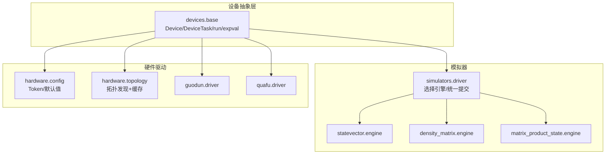
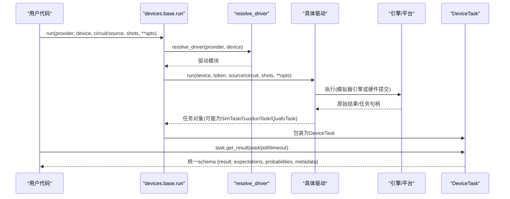
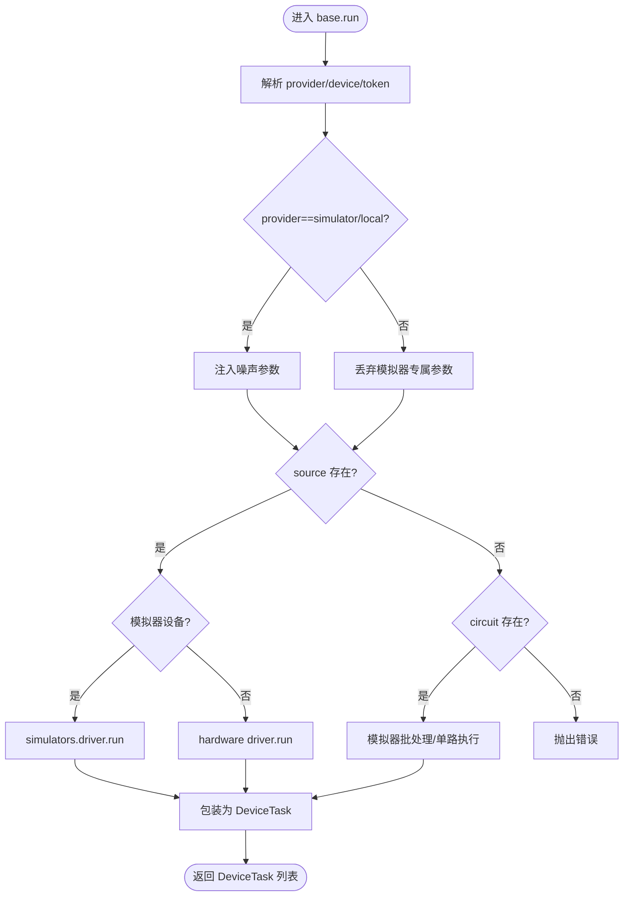
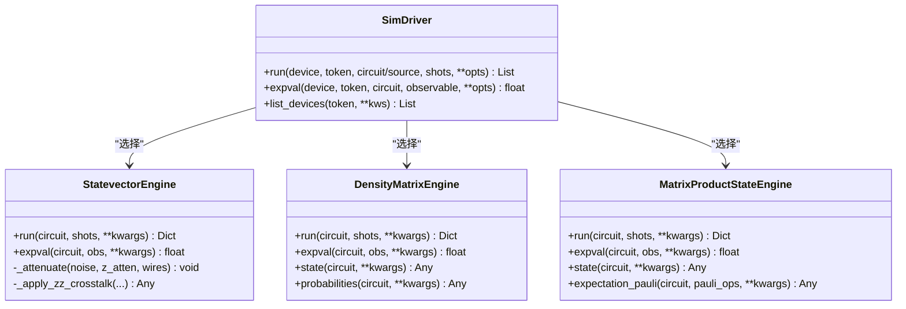
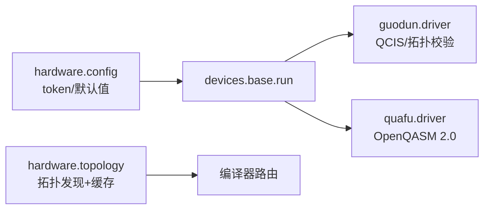
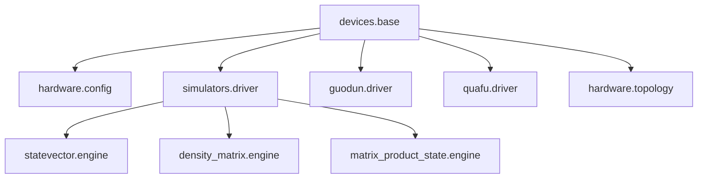

# 设备API

<cite>
**本文引用的文件**
- [base.py](file://src/tyxonq/devices/base.py)
- [driver.py](file://src/tyxonq/devices/simulators/driver.py)
- [engine.py（态矢量）](file://src/tyxonq/devices/simulators/statevector/engine.py)
- [engine.py（密度矩阵）](file://src/tyxonq/devices/simulators/density_matrix/engine.py)
- [engine.py（MPS）](file://src/tyxonq/devices/simulators/matrix_product_state/engine.py)
- [config.py（硬件配置）](file://src/tyxonq/devices/hardware/config.py)
- [topology.py（拓扑缓存）](file://src/tyxonq/devices/hardware/topology.py)
- [driver.py（国盾驱动）](file://src/tyxonq/devices/hardware/guodun/driver.py)
- [driver.py（夸父驱动）](file://src/tyxonq/devices/hardware/quafu/driver.py)
- [__init__.py（包入口）](file://src/tyxonq/__init__.py)
</cite>

## 目录
1. [简介](#简介)
2. [项目结构](#项目结构)
3. [核心组件](#核心组件)
4. [架构总览](#架构总览)
5. [详细组件分析](#详细组件分析)
6. [依赖关系分析](#依赖关系分析)
7. [性能考量](#性能考量)
8. [故障排除指南](#故障排除指南)
9. [结论](#结论)
10. [附录](#附录)

## 简介
本文件面向 TyxonQ 设备抽象层，提供统一设备接口、模拟器实现与硬件驱动的完整 API 文档。内容覆盖：
- 统一设备接口与任务封装
- 设备注册与发现、配置管理（令牌、默认值、端点）
- 执行调度（run/expval）、批处理与结果归一化
- 模拟器特性对比（态矢量、密度矩阵、MPS）
- 硬件设备接入方式（国盾、夸父等）与拓扑结构定义
- 自定义设备开发指南与扩展机制
- 噪声模型配置、性能基准建议与常见问题排查

## 项目结构
TyxonQ 的设备子系统位于 src/tyxonq/devices，按“抽象基类 + 模拟器 + 硬件驱动”分层组织：
- devices.base：统一协议 Device、DeviceRule、RunResult、任务 DeviceTask、统一 run/expval/list_all_devices 等
- devices.simulators.driver：模拟器驱动选择器、QASM→IR 转换、统一提交与结果包装
- devices.simulators.*.engine：具体模拟器引擎（statevector、density_matrix、matrix_product_state）
- devices.hardware.config：Provider/Device 默认值与 Token 管理
- devices.hardware.topology：跨 Provider 的拓扑发现与 TTL 缓存
- devices.hardware.*.driver：各硬件平台驱动（如 guodun、quafu），实现 run/get_task_details/list_devices/remove_task

图表来源
- [base.py:97-109](file://src/tyxonq/devices/base.py#L97-L109)
- [driver.py:20-38](file://src/tyxonq/devices/simulators/driver.py#L20-L38)
- [config.py:7-19](file://src/tyxonq/devices/hardware/config.py#L7-L19)
- [topology.py:164-177](file://src/tyxonq/devices/hardware/topology.py#L164-L177)

章节来源
- [base.py:97-109](file://src/tyxonq/devices/base.py#L97-L109)
- [driver.py:20-38](file://src/tyxonq/devices/simulators/driver.py#L20-L38)
- [config.py:7-19](file://src/tyxonq/devices/hardware/config.py#L7-L19)
- [topology.py:164-177](file://src/tyxonq/devices/hardware/topology.py#L164-L177)

## 核心组件
- 统一设备协议 Device：声明 name、device_rule，以及 run(expval) 接口，供上层以统一方式调用不同后端。
- 设备规则 DeviceRule：描述 native_gates、max_qubits、coupling_map、initial_layout、num_qubits 等，供编译器路由使用。
- 运行结果 RunResult：统一返回 samples/expectations/metadata。
- 任务封装 DeviceTask：对底层任务句柄进行统一包装，提供 get_result/cancel，并做结果 schema 归一化。
- 统一入口 run/expval：根据 provider/device 解析驱动，注入噪声参数，支持单/批量电路，统一返回任务列表。
- 设备发现 list_all_devices：聚合模拟器与硬件设备列表。

章节来源
- [base.py:12-57](file://src/tyxonq/devices/base.py#L12-L57)
- [base.py:60-109](file://src/tyxonq/devices/base.py#L60-L109)
- [base.py:294-470](file://src/tyxonq/devices/base.py#L294-L470)
- [base.py:475-493](file://src/tyxonq/devices/base.py#L475-L493)

## 架构总览
TyxonQ 设备抽象层通过“统一入口 → 驱动选择 → 引擎/平台实现 → 结果归一化”的流水线工作：
- 用户调用 tyxonq.devices.base.run 或顶层 tyxonq.run
- base.run 解析 provider/device，resolve_driver 选择具体驱动
- 模拟器路径：simulators.driver 选择 statevector/density_matrix/MPS 引擎执行
- 硬件路径：对应 hardware.*.driver 提交作业、轮询状态、解析结果
- 所有结果经 DeviceTask.get_result 归一化为统一 schema，便于下游后处理

图表来源
- [base.py:294-445](file://src/tyxonq/devices/base.py#L294-L445)
- [driver.py:86-141](file://src/tyxonq/devices/simulators/driver.py#L86-L141)
- [guodun/driver.py:310-357](file://src/tyxonq/devices/hardware/guodun/driver.py#L310-L357)
- [quafu/driver.py:103-180](file://src/tyxonq/devices/hardware/quafu/driver.py#L103-L180)

## 详细组件分析

### 统一设备接口与任务封装
- Device 协议：name、device_rule、run、expval
- DeviceTask：provider/device/handle/async_result；get_result 负责从驱动获取详情并归一化；cancel 委托 remove_task
- 统一 run：
  - 解析默认 provider/device
  - 注入噪声参数（仅模拟器有效）
  - 支持 source 直接提交或 circuit 路径（模拟器）
  - 支持批处理（shots 可为标量或列表）
  - 返回 DeviceTask 列表
- expval：仅模拟器可用，走 analytic 快速路径

图表来源
- [base.py:294-445](file://src/tyxonq/devices/base.py#L294-L445)

章节来源
- [base.py:97-109](file://src/tyxonq/devices/base.py#L97-L109)
- [base.py:294-470](file://src/tyxonq/devices/base.py#L294-L470)

### 模拟器驱动与引擎
- simulators.driver：
  - _select_engine：根据设备名选择 statevector/density_matrix/matrix_product_state 引擎
  - run：将 QASM 字符串转换为 IR（OpenQASM 3/TQASM 用原生导入，否则回退到 Qiskit），构造引擎实例执行，统一输出格式并包装为 SimTask
  - expval：路由到引擎的 expval
- 引擎共性：
  - 统一门分发：通过权威门表 resolve_unitary 解析幺正门，避免多套分支导致遗漏
  - 测量与期望：measure_z 收集测量比特，shots>0 时采样计数；shots=0 时返回精确概率/态矢/密度矩阵
  - 噪声：支持 depolarizing/readout 等噪声混合；statevector 还支持 ZZ crosstalk 两种模式（local/global）
  - 脉冲：statevector 支持 pulse/pulse_inline（含三能级泄漏建模），density_matrix/MPS 不支持脉冲级演化

图表来源
- [driver.py:20-38](file://src/tyxonq/devices/simulators/driver.py#L20-L38)
- [driver.py:86-166](file://src/tyxonq/devices/simulators/driver.py#L86-L166)
- [engine.py（态矢量）:38-463](file://src/tyxonq/devices/simulators/statevector/engine.py#L38-L463)
- [engine.py（密度矩阵）:36-189](file://src/tyxonq/devices/simulators/density_matrix/engine.py#L36-L189)
- [engine.py（MPS）:39-319](file://src/tyxonq/devices/simulators/matrix_product_state/engine.py#L39-L319)

章节来源
- [driver.py:20-38](file://src/tyxonq/devices/simulators/driver.py#L20-L38)
- [driver.py:86-166](file://src/tyxonq/devices/simulators/driver.py#L86-L166)
- [engine.py（态矢量）:38-463](file://src/tyxonq/devices/simulators/statevector/engine.py#L38-L463)
- [engine.py（密度矩阵）:36-189](file://src/tyxonq/devices/simulators/density_matrix/engine.py#L36-L189)
- [engine.py（MPS）:39-319](file://src/tyxonq/devices/simulators/matrix_product_state/engine.py#L39-L319)

### 硬件驱动与拓扑
- 配置管理（hardware.config）：
  - set_token/get_token：支持设备级与 Provider 级 token，环境变量回退
  - set_default/get_default_provider/get_default_device：设置默认 provider/device
  - ENDPOINTS：Provider 端点（如 tyxonq、qcos）
- 拓扑发现（hardware.topology）：
  - fetch_topology：按 provider 分派抓取（当前落地 lqcloud）
  - get_device_rule：内存缓存 → 磁盘 TTL 缓存 → 联网抓取；失败降级策略（沿用过期缓存或空规则）
  - clear_topology_cache：清理内存/磁盘缓存
- 国盾驱动（guodun.driver）：
  - 提交 QCIS 源（含脉冲指令校验与拓扑校验）
  - 任务查询/取消，状态映射与结果解析
  - list_devices：动态提取可用机器码
- 夸父驱动（quafu.driver）：
  - 提交 OpenQASM 2.0 源，支持 batch 提交
  - 任务状态映射、结果解析、list_devices

图表来源
- [config.py:7-19](file://src/tyxonq/devices/hardware/config.py#L7-L19)
- [topology.py:164-177](file://src/tyxonq/devices/hardware/topology.py#L164-L177)
- [guodun/driver.py:310-357](file://src/tyxonq/devices/hardware/guodun/driver.py#L310-L357)
- [quafu/driver.py:103-180](file://src/tyxonq/devices/hardware/quafu/driver.py#L103-L180)

章节来源
- [config.py:7-19](file://src/tyxonq/devices/hardware/config.py#L7-L19)
- [topology.py:164-177](file://src/tyxonq/devices/hardware/topology.py#L164-L177)
- [guodun/driver.py:310-357](file://src/tyxonq/devices/hardware/guodun/driver.py#L310-L357)
- [quafu/driver.py:103-180](file://src/tyxonq/devices/hardware/quafu/driver.py#L103-L180)

### 设备注册与发现
- 模拟器设备列表：固定返回 matrix_product_state、statevector、density_matrix
- 硬件设备列表：调用对应驱动 list_devices，聚合到统一列表
- 设备描述符 device_descriptor：规范化 provider/device/shots，兼容多种命名约定

章节来源
- [driver.py:33-38](file://src/tyxonq/devices/simulators/driver.py#L33-L38)
- [base.py:112-143](file://src/tyxonq/devices/base.py#L112-L143)
- [base.py:475-493](file://src/tyxonq/devices/base.py#L475-L493)

### 执行调度与批处理
- base.run 支持：
  - 单电路/批电路
  - shots 标量或列表（需与电路数对齐）
  - 自动注入噪声（仅模拟器）
  - 真机路径丢弃模拟器专属参数
- 模拟器批处理：逐电路执行，保持顺序
- 硬件批处理：按驱动能力提交（如 Guodun 要求同批次 shots 一致）

章节来源
- [base.py:294-445](file://src/tyxonq/devices/base.py#L294-L445)
- [guodun/driver.py:116-130](file://src/tyxonq/devices/hardware/guodun/driver.py#L116-L130)

### 噪声模型配置
- 全局开关：enable_noise/is_noise_enabled/get_noise_config
- 注入逻辑：仅在 simulator/local 生效；若未显式传入 noise，则使用全局配置或默认 depolarizing(p=0)
- 引擎内噪声：
  - statevector：depolarizing 衰减 Z 期望；readout 校准矩阵混合；ZZ crosstalk（local/global）
  - density_matrix：Kraus 通道（depolarizing/amplitude_damping/phase_damping/pauli）
  - MPS：不支持脉冲级噪声，但可复用 depolarizing/readout 混合

章节来源
- [base.py:274-292](file://src/tyxonq/devices/base.py#L274-L292)
- [base.py:344-356](file://src/tyxonq/devices/base.py#L344-L356)
- [engine.py（态矢量）:357-383](file://src/tyxonq/devices/simulators/statevector/engine.py#L357-L383)
- [engine.py（密度矩阵）:120-137](file://src/tyxonq/devices/simulators/density_matrix/engine.py#L120-L137)
- [engine.py（MPS）:157-176](file://src/tyxonq/devices/simulators/matrix_product_state/engine.py#L157-L176)

### 拓扑结构与路由
- DeviceRule 字段：native_gates、max_qubits、coupling_map、initial_layout、num_qubits
- 拓扑发现：
  - 当前仅 lqcloud 实现 fetch_topology
  - 两级缓存（内存+磁盘）遵循 max_age_days
  - 失败降级：沿用过期缓存或返回空规则（跳过路由）
- 编译器路由：基于 coupling_map 进行布局/路由，避免非相邻两比特门被设备拒绝

章节来源
- [base.py:60-83](file://src/tyxonq/devices/base.py#L60-L83)
- [topology.py:180-258](file://src/tyxonq/devices/hardware/topology.py#L180-L258)

### 自定义设备开发指南
- 实现驱动模块：
  - 提供 run(list_devices/get_task_details/remove_task) 函数
  - 返回任务对象需具备 async_result 属性（True 表示异步）
  - get_task_details 返回统一 schema：result/result_meta/uni_status/error
- 注册 Provider：
  - 在 base.resolve_driver 中添加 provider 分支，指向新驱动模块
- 设备规则：
  - 通过 topology 或驱动暴露 DeviceRule（coupling_map/native_gates/max_qubits）
- 噪声与脉冲：
  - 模拟器引擎需支持统一噪声接口；脉冲需在 statevector 引擎中实现或提前编译为幺正

章节来源
- [base.py:146-258](file://src/tyxonq/devices/base.py#L146-L258)
- [driver.py:86-141](file://src/tyxonq/devices/simulators/driver.py#L86-L141)
- [topology.py:164-177](file://src/tyxonq/devices/hardware/topology.py#L164-L177)

## 依赖关系分析
- 模块耦合：
  - base 依赖 hardware.config 获取默认值与 token
  - simulators.driver 依赖各 engine 与编译器 QASM 导入
  - hardware.*.driver 依赖各自 SDK/REST 客户端
  - topology 依赖 compiler.platforms.<provider>.get_topology（当前仅 lqcloud）
- 外部依赖：
  - 模拟器：numpy、可选 openfermion（expval）
  - 国盾：cqlib==1.3.11
  - 夸父：内部 vendor 客户端

图表来源
- [base.py:146-258](file://src/tyxonq/devices/base.py#L146-L258)
- [driver.py:20-38](file://src/tyxonq/devices/simulators/driver.py#L20-L38)
- [topology.py:164-177](file://src/tyxonq/devices/hardware/topology.py#L164-L177)

章节来源
- [base.py:146-258](file://src/tyxonq/devices/base.py#L146-L258)
- [driver.py:20-38](file://src/tyxonq/devices/simulators/driver.py#L20-L38)
- [topology.py:164-177](file://src/tyxonq/devices/hardware/topology.py#L164-L177)

## 性能考量
- 模拟器选择：
  - statevector：O(2^n) 内存，适合中小规模高精度模拟；支持脉冲级与三能级泄漏建模
  - density_matrix：O(4^n) 内存，适合噪声研究（Kraus 通道）
  - MPS：内存/时间随键维 χ 增长，适合低纠缠大系统；不支持脉冲/Kraus
- 噪声影响：
  - depolarizing 会衰减 Z 期望；readout 校准矩阵混合概率分布
  - ZZ crosstalk 在 statevector 中可选择 local（高效）或 global（精确但昂贵）
- 批处理优化：
  - 模拟器批处理保持顺序，注意 shots 列表长度匹配
  - 硬件批处理受平台限制（如 Guodun 同批次 shots 必须一致）

[本节为通用指导，不直接分析具体文件]

## 故障排除指南
- 令牌问题：
  - 确保通过 set_token 或环境变量提供正确 token（各 Provider 有独立 token 链）
  - Quafu 不支持 TYXONQ_API_KEY 回退；Guodun 需要 TYXONQ_GUODUN_TOKEN
- 拓扑发现失败：
  - 无网络/凭证缺失时，若存在过期缓存则降级沿用并告警；否则返回空规则（跳过路由）
  - 可通过 clear_topology_cache 强制刷新
- 任务等待超时：
  - get_task_details 支持 wait/poll/timeout；超时会发出 RuntimeWarning，结果可能为空/不完整
- 模拟器噪声：
  - 确认 use_noise 与 noise 配置；density_matrix 不支持脉冲级演化，需改用 statevector
- 硬件提交校验：
  - Guodun：QCIS 必须包含 M 测量指令；pulse-QCIS 需通过 GetPulse 标定校验；拓扑边必须可用
  - Quafu：OpenQASM 2.0 头必需；shots 需为 1024 倍数（服务器可能四舍五入或拒绝）

章节来源
- [config.py:24-50](file://src/tyxonq/devices/hardware/config.py#L24-L50)
- [topology.py:224-258](file://src/tyxonq/devices/hardware/topology.py#L224-L258)
- [base.py:497-557](file://src/tyxonq/devices/base.py#L497-L557)
- [guodun/driver.py:100-130](file://src/tyxonq/devices/hardware/guodun/driver.py#L100-L130)
- [quafu/driver.py:90-100](file://src/tyxonq/devices/hardware/quafu/driver.py#L90-L100)

## 结论
TyxonQ 设备抽象层通过统一的 Device 协议、DeviceTask 封装与 base.run/expval 入口，屏蔽了模拟器与硬件差异，提供一致的编程体验。模拟器引擎在精度、噪声与脉冲支持上各有侧重；硬件驱动实现了多平台的接入与拓扑发现。开发者可按指南扩展自定义设备与 Provider，结合拓扑缓存与噪声模型进行性能调优与故障排查。

[本节为总结性内容，不直接分析具体文件]

## 附录
- 常用 API 速查：
  - 设备初始化：tq.set_token(...), tq.device(...)
  - 执行电路：tq.run(provider, device, circuit/source, shots, **opts)
  - 期望值：tq.devices.base.expval(...)
  - 噪声控制：tq.enable_noise(True, config)
  - 设备发现：tq.devices.base.list_all_devices()
- 模拟器特性对比：
  - 态矢量：高精度、支持脉冲/三能级、ZZ crosstalk
  - 密度矩阵：原生 Kraus 噪声、适合噪声研究
  - MPS：大系统低纠缠场景、不支持脉冲/Kraus

[本节为补充信息，不直接分析具体文件]