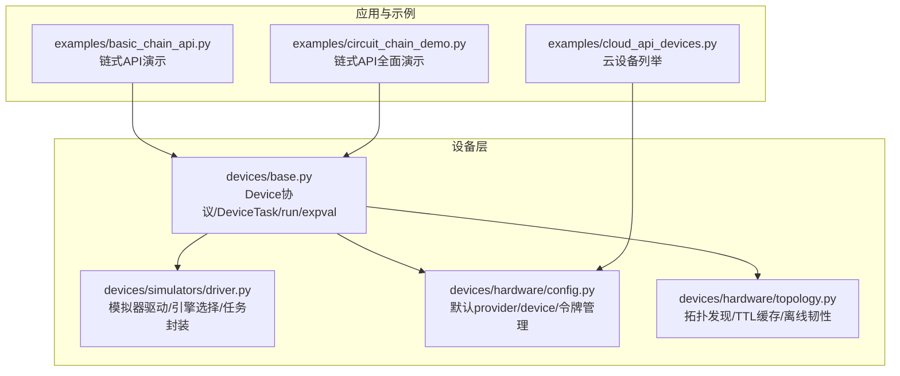
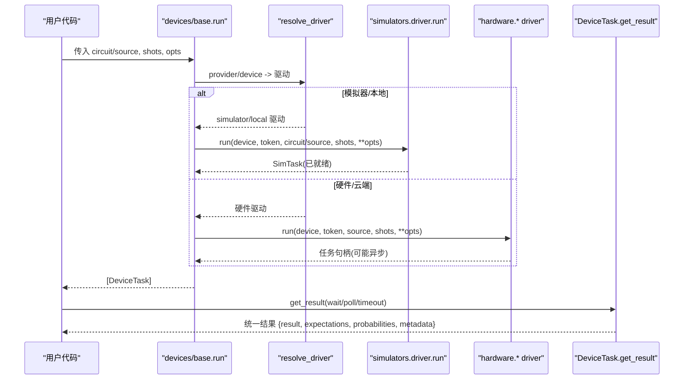
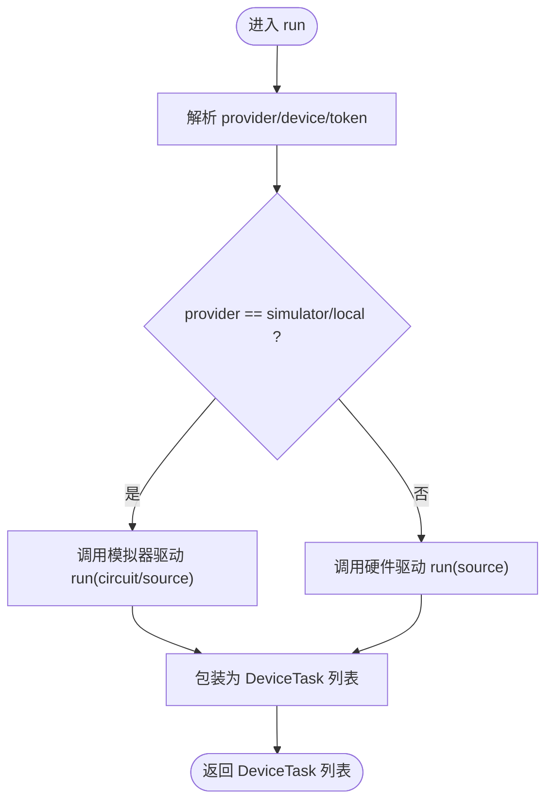
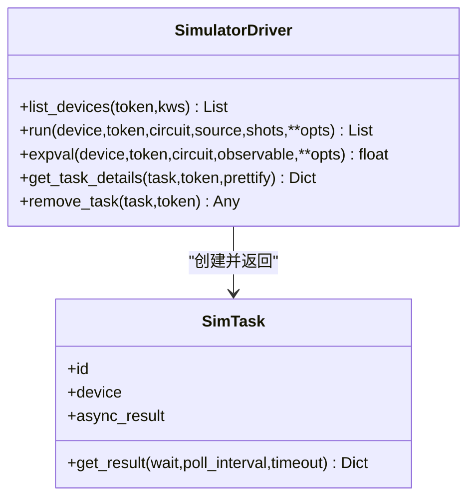
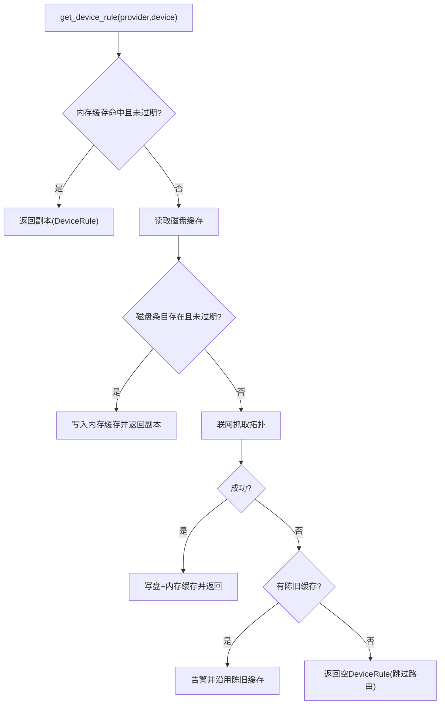
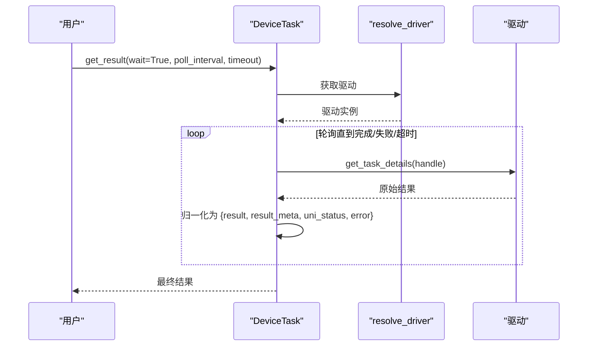
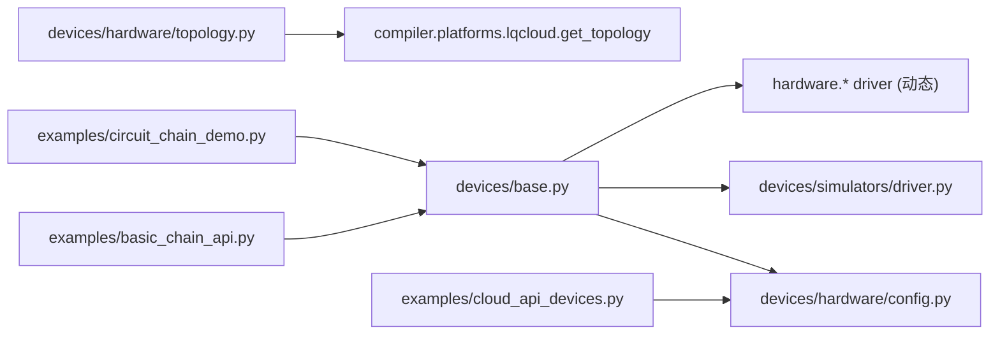

# 设备管理API

<cite>
**本文引用的文件**
- [base.py](file://src/tyxonq/devices/base.py)
- [driver.py](file://src/tyxonq/devices/simulators/driver.py)
- [config.py](file://src/tyxonq/devices/hardware/config.py)
- [topology.py](file://src/tyxonq/devices/hardware/topology.py)
- [errors.py](file://src/tyxonq/core/errors.py)
- [basic_chain_api.py](file://examples/basic_chain_api.py)
- [circuit_chain_demo.py](file://examples/circuit_chain_demo.py)
- [cloud_api_devices.py](file://examples/cloud_api_devices.py)
</cite>

## 目录
1. [简介](#简介)
2. [项目结构](#项目结构)
3. [核心组件](#核心组件)
4. [架构总览](#架构总览)
5. [详细组件分析](#详细组件分析)
6. [依赖关系分析](#依赖关系分析)
7. [性能考量](#性能考量)
8. [故障排查指南](#故障排查指南)
9. [结论](#结论)
10. [附录](#附录)

## 简介
本文件面向TyxonQ设备管理系统的API与运行机制，聚焦以下目标：
- 统一设备抽象与执行调度：通过Device协议、DeviceTask与run/expval入口，屏蔽模拟器与硬件差异。
- 设备注册与发现：统一provider/device解析、默认配置、令牌管理与设备列表聚合。
- 设备规则定义与拓扑发现：DeviceRule描述能力；跨provider的拓扑发现与TTL缓存，支撑编译器路由。
- 运行结果处理：统一任务返回格式、异步轮询、错误状态归一化。
- 高级功能：设备发现、负载均衡（可扩展）、错误恢复（离线韧性）。
- 自定义设备开发指南：基于驱动接口扩展新后端或模拟器。
- 链式API使用示例与设备切换最佳实践：compile().device().postprocessing().run()范式。

## 项目结构
设备子系统位于devices目录，核心由“基类与统一调度”、“模拟器驱动”、“硬件配置与拓扑”组成；示例位于examples目录，演示链式API与云设备列举。

图表来源
- [base.py:97-108](file://src/tyxonq/devices/base.py#L97-L108)
- [driver.py:20-38](file://src/tyxonq/devices/simulators/driver.py#L20-L38)
- [config.py:7-19](file://src/tyxonq/devices/hardware/config.py#L7-L19)
- [topology.py:1-29](file://src/tyxonq/devices/hardware/topology.py#L1-L29)

章节来源
- [base.py:12-578](file://src/tyxonq/devices/base.py#L12-L578)
- [driver.py:1-169](file://src/tyxonq/devices/simulators/driver.py#L1-L169)
- [config.py:1-78](file://src/tyxonq/devices/hardware/config.py#L1-L78)
- [topology.py:1-302](file://src/tyxonq/devices/hardware/topology.py#L1-L302)
- [basic_chain_api.py:1-150](file://examples/basic_chain_api.py#L1-L150)
- [circuit_chain_demo.py:1-305](file://examples/circuit_chain_demo.py#L1-L305)
- [cloud_api_devices.py:1-29](file://examples/cloud_api_devices.py#L1-L29)

## 核心组件
- Device协议与RunResult：定义设备需实现的run与expval接口，以及结构化返回字段(samples/expectations/metadata)。
- DeviceTask：统一任务句柄，提供get_result/cancel，负责结果规范化与元数据提升。
- run/expval：统一执行入口，自动选择驱动、注入噪声参数、处理shots与批处理、包装为DeviceTask。
- resolve_driver：按provider动态加载对应驱动（simulator/本地/各云平台）。
- device_descriptor/init：统一设备标识符解析与全局默认配置设置。
- list_all_devices：聚合模拟器与硬件设备列表。
- get_task_details/remove_task：统一任务查询与取消。

章节来源
- [base.py:60-108](file://src/tyxonq/devices/base.py#L60-L108)
- [base.py:112-258](file://src/tyxonq/devices/base.py#L112-L258)
- [base.py:261-470](file://src/tyxonq/devices/base.py#L261-L470)
- [base.py:475-578](file://src/tyxonq/devices/base.py#L475-L578)

## 架构总览
下图展示从用户调用到具体驱动的完整流程，包括统一入口、驱动选择、模拟器/硬件路径、结果归一化与任务轮询。

图表来源
- [base.py:294-445](file://src/tyxonq/devices/base.py#L294-L445)
- [driver.py:86-141](file://src/tyxonq/devices/simulators/driver.py#L86-L141)

## 详细组件分析

### Device协议与设备规则
- Device协议要求实现name、device_rule、run、expval，确保上层对各类设备一致调用。
- DeviceRule声明设备能力：native_gates、max_qubits、connectivity、supports_shots/batch、coupling_map、initial_layout、num_qubits等，供编译器路由与优化。
- RunResult约定samples/expectations/metadata，便于下游后处理统一消费。

章节来源
- [base.py:60-108](file://src/tyxonq/devices/base.py#L60-L108)

### 统一执行入口 run/expval
- run职责：
  - 解析provider/device默认值与token。
  - 根据provider选择驱动；模拟器路径支持circuit直接执行，硬件路径要求source（编译产物）。
  - 注入噪声参数（仅模拟器有效），标准化shots（真机>=1）。
  - 将驱动返回统一包装为DeviceTask列表。
- expval职责：
  - 仅对模拟器/本地生效，走解析期望值快速路径。

图表来源
- [base.py:294-445](file://src/tyxonq/devices/base.py#L294-L445)

章节来源
- [base.py:294-470](file://src/tyxonq/devices/base.py#L294-L470)

### 模拟器驱动与引擎选择
- 引擎选择：根据device名称映射到statevector/density_matrix/matrix_product_state引擎。
- run流程：
  - 若source为字符串，尝试解析为IR（QASM3/QASM2）。
  - 执行引擎run，归一化输出为counts/expectations/probabilities/statevector/result_meta/uni_status/error。
  - 返回SimTask（async_result=False，立即可用）。
- expval：直接调用引擎expval计算解析期望值。

图表来源
- [driver.py:6-18](file://src/tyxonq/devices/simulators/driver.py#L6-L18)
- [driver.py:20-38](file://src/tyxonq/devices/simulators/driver.py#L20-L38)
- [driver.py:86-169](file://src/tyxonq/devices/simulators/driver.py#L86-L169)

章节来源
- [driver.py:1-169](file://src/tyxonq/devices/simulators/driver.py#L1-L169)

### 设备发现与拓扑缓存
- 拓扑发现：按provider分派抓取（当前lqcloud落地），返回包含coupling_map/num_qubits/native_gates的结构。
- TTL缓存：两级缓存（会话内存+磁盘文件），遵守max_age_days；force_refresh可强制刷新。
- 离线韧性：抓取失败时降级沿用过期缓存并告警；完全不可用时返回空DeviceRule，不中断编译/提交。

图表来源
- [topology.py:180-258](file://src/tyxonq/devices/hardware/topology.py#L180-L258)

章节来源
- [topology.py:1-302](file://src/tyxonq/devices/hardware/topology.py#L1-L302)

### 令牌与默认配置
- set_token/get_token：支持provider/device级与全局环境变量回退。
- set_default/get_default_provider/get_default_device：维护默认provider/device。
- ENDPOINTS：不同provider的基础URL与版本信息。

章节来源
- [config.py:1-78](file://src/tyxonq/devices/hardware/config.py#L1-L78)

### 任务轮询与结果归一化
- get_task_details：统一轮询策略，等待超时告警；将不同驱动的结果归一为{result, result_meta, uni_status, error}。
- DeviceTask.get_result：进一步将provider-specific元数据提升到外层，补齐expectations/probabilities键，保证下游一致性。

图表来源
- [base.py:497-558](file://src/tyxonq/devices/base.py#L497-L558)
- [base.py:12-57](file://src/tyxonq/devices/base.py#L12-L57)

章节来源
- [base.py:12-57](file://src/tyxonq/devices/base.py#L12-L57)
- [base.py:497-558](file://src/tyxonq/devices/base.py#L497-L558)

### 链式API与设备切换最佳实践
- 链式API：compile().device().postprocessing().run()，支持部分链式调用与自动补全。
- 全局默认：tq.device(...)设置全局默认，后续Circuit.run()自动使用。
- 多后端：set_backend在numpy/pytorch间切换，不影响设备链路。
- 设备切换：通过provider/device参数或全局默认切换至模拟器/硬件；硬件路径需提前编译为source。

章节来源
- [basic_chain_api.py:22-124](file://examples/basic_chain_api.py#L22-L124)
- [circuit_chain_demo.py:46-118](file://examples/circuit_chain_demo.py#L46-L118)

## 依赖关系分析
- base.py依赖：
  - hardware.config：默认provider/device与令牌管理。
  - simulators.driver：模拟器执行与引擎选择。
  - hardware.* drivers：通过resolve_driver动态导入。
- topology.py依赖：
  - compiler.platforms.lqcloud.get_topology：实际拓扑抓取实现。
- 示例依赖：
  - tyxonq顶层API：链式调用与设备列举。

图表来源
- [base.py:146-258](file://src/tyxonq/devices/base.py#L146-L258)
- [topology.py:164-177](file://src/tyxonq/devices/hardware/topology.py#L164-L177)

章节来源
- [base.py:146-258](file://src/tyxonq/devices/base.py#L146-L258)
- [topology.py:164-177](file://src/tyxonq/devices/hardware/topology.py#L164-L177)

## 性能考量
- 解析期望值快速路径：shots==0且提供observable时，走expval解析路径，避免采样开销。
- 批处理优化：run支持批量电路与每电路独立shots，保持顺序提交与收集。
- 拓扑缓存：减少重复网络请求，提高编译期路由效率。
- 噪声注入：仅在模拟器路径生效，避免对硬件驱动产生无效参数。

[本节为通用性能建议，无需特定文件引用]

## 故障排查指南
- 常见异常类型：
  - CompilationError：编译失败或产出无效。
  - DeviceExecutionError：设备执行失败（超时、连接问题等）。
  - VectorizationFallbackWarning：向量化禁用或回退提示。
- 任务轮询超时：
  - get_task_details在wait模式下超过timeout会发出RuntimeWarning，返回可能不完整结果；建议增大timeout并重试。
- 拓扑发现失败：
  - 无网络/凭证/SDK缺失时，优先沿用过期缓存并告警；若无缓存则返回空DeviceRule，跳过路由。
- 令牌与默认配置：
  - 确认set_token/provider/device是否正确；检查环境变量TYXONQ_API_KEY是否生效。

章节来源
- [errors.py:1-17](file://src/tyxonq/core/errors.py#L1-L17)
- [base.py:497-558](file://src/tyxonq/devices/base.py#L497-L558)
- [topology.py:224-258](file://src/tyxonq/devices/hardware/topology.py#L224-L258)
- [config.py:24-50](file://src/tyxonq/devices/hardware/config.py#L24-L50)

## 结论
TyxonQ设备管理系统通过统一的Device协议、DeviceTask与run/expval入口，实现了模拟器与硬件设备的无缝切换与执行调度。结合设备规则与拓扑发现缓存，系统在编译期即可进行智能路由与优化；同时提供健壮的离线韧性与结果归一化机制。链式API与全局默认配置简化了日常使用，示例覆盖了从基础到高级的使用场景。

[本节为总结性内容，无需特定文件引用]

## 附录

### 自定义设备开发指南
- 实现设备驱动：
  - 遵循base.py中resolve_driver的provider分支模式，新增provider分支并返回对应驱动模块。
  - 驱动需实现run/list_devices/get_task_details/remove_task等接口，返回统一的任务对象或兼容结构。
- 设备规则：
  - 提供DeviceRule（至少包含coupling_map/num_qubits/native_gates等），用于编译器路由与优化。
- 测试建议：
  - 覆盖单/多量子比特门、测量、重置、屏障等操作；验证统计分布与边界条件。
  - 模拟远程设备时，校验作业提交、轮询与错误处理路径。

章节来源
- [base.py:146-258](file://src/tyxonq/devices/base.py#L146-L258)
- [custom_devices.rst:34-91](file://docs/source/developer_guide/custom_devices.rst#L34-L91)
- [custom_devices.rst:192-347](file://docs/source/developer_guide/custom_devices.rst#L192-L347)

### 设备性能监控与调试工具
- 任务详情：
  - 使用get_task_details获取uni_status与error字段，辅助定位排队/执行/失败原因。
- 拓扑缓存：
  - 使用clear_topology_cache清理内存与磁盘缓存，便于复现实验或验证最新拓扑。
- 日志与警告：
  - 关注拓扑抓取失败的RuntimeWarning与get_task_details的超时告警，及时调整参数或重试策略。

章节来源
- [base.py:497-558](file://src/tyxonq/devices/base.py#L497-L558)
- [topology.py:261-291](file://src/tyxonq/devices/hardware/topology.py#L261-L291)

### 链式API使用示例与设备切换最佳实践
- 基本用法：
  - Circuit(...).compile().device(provider, device, shots).postprocessing(method).run()
- 自动补全：
  - 仅设置部分阶段（如仅device），其余阶段自动补全。
- 全局默认：
  - tq.device(...)设置全局默认，后续Circuit.run()直接使用。
- 设备切换：
  - 通过provider/device参数或全局默认在模拟器与硬件间切换；硬件路径需提前编译为source。

章节来源
- [basic_chain_api.py:22-124](file://examples/basic_chain_api.py#L22-L124)
- [circuit_chain_demo.py:46-118](file://examples/circuit_chain_demo.py#L46-L118)

### 云设备列举
- 使用tq.api.list_devices(provider="tyxonq")列出可用设备；如需认证，先通过set_token设置令牌。

章节来源
- [cloud_api_devices.py:16-21](file://examples/cloud_api_devices.py#L16-L21)