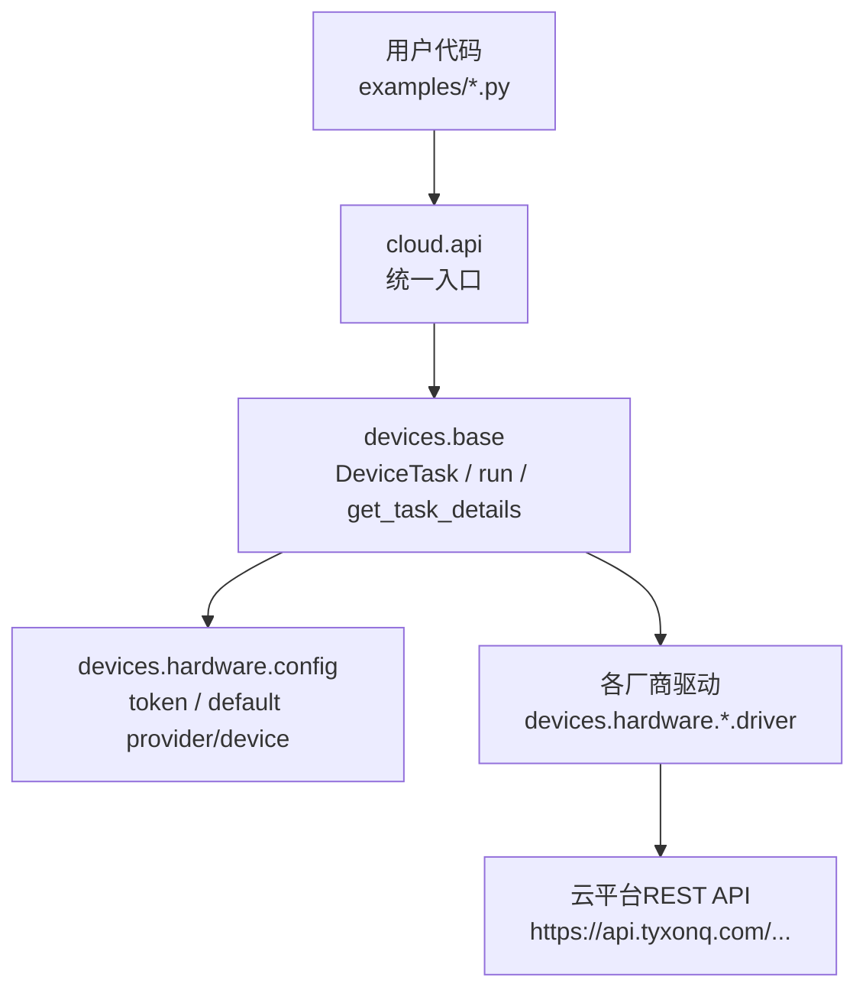
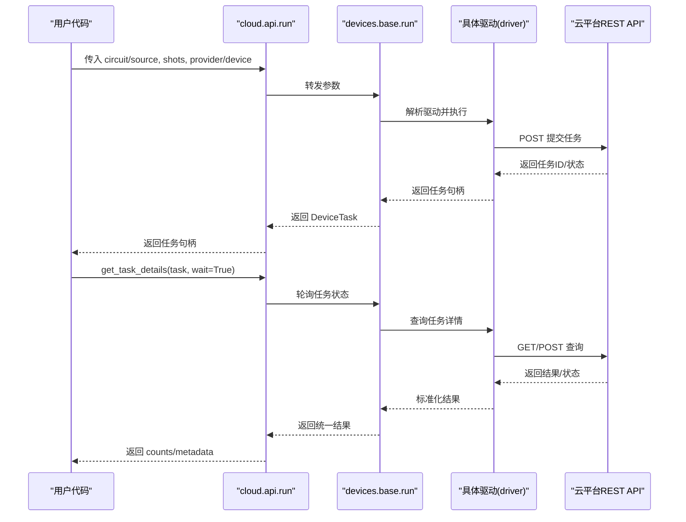
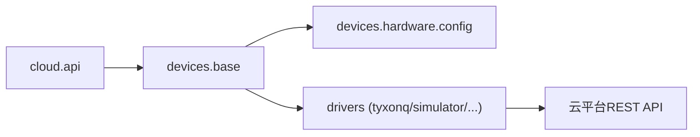
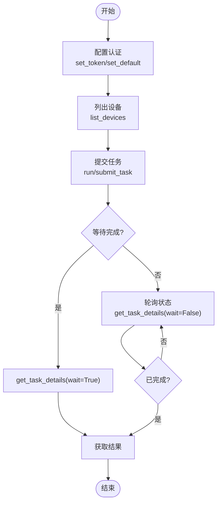

# 云平台API使用

<cite>
**本文引用的文件**
- [src/tyxonq/cloud/api.py](file://src/tyxonq/cloud/api.py)
- [src/tyxonq/devices/base.py](file://src/tyxonq/devices/base.py)
- [src/tyxonq/devices/hardware/config.py](file://src/tyxonq/devices/hardware/config.py)
- [examples/cloud_api_devices.py](file://examples/cloud_api_devices.py)
- [examples/cloud_api_task.py](file://examples/cloud_api_task.py)
- [examples/cloud_api_task_qaoa.py](file://examples/cloud_api_task_qaoa.py)
- [docs/source/cloud_services/api_reference.rst](file://docs/source/cloud_services/api_reference.rst)
- [docs/source/cloud_services/task_submission.rst](file://docs/source/cloud_services/task_submission.rst)
- [docs/tyxonq_cloud_api.md](file://docs/tyxonq_cloud_api.md)
</cite>

## 目录
1. [简介](#简介)
2. [项目结构](#项目结构)
3. [核心组件](#核心组件)
4. [架构总览](#架构总览)
5. [详细组件分析](#详细组件分析)
6. [依赖关系分析](#依赖关系分析)
7. [性能考虑](#性能考虑)
8. [故障排查指南](#故障排查指南)
9. [结论](#结论)
10. [附录](#附录)

## 简介
本文件面向使用 TyxonQ 云平台的开发者，提供统一的 RESTful API 使用指南。内容涵盖：
- 设备管理、任务提交、结果获取等核心功能
- API 密钥配置与安全认证机制（set_token、set_default）
- run 函数的高级用法（支持电路对象与预编译源代码）
- 任务状态监控（get_task_details 的参数与场景）
- 端到端调用示例（从设备查询到任务执行）
- 错误处理策略与重试机制最佳实践
- 批量任务提交与异步执行模式

## 项目结构
TyxonQ 的云平台统一入口位于 cloud.api 模块，负责对外暴露 set_token、set_default、device、list_devices、submit_task、run、get_task_details、result、cancel 等接口；底层通过 devices.base 解析驱动并统一封装任务对象 DeviceTask；硬件配置与默认值在 devices.hardware.config 中维护。

图表来源
- [src/tyxonq/cloud/api.py:1-160](file://src/tyxonq/cloud/api.py#L1-L160)
- [src/tyxonq/devices/base.py:1-200](file://src/tyxonq/devices/base.py#L1-L200)
- [src/tyxonq/devices/hardware/config.py:1-78](file://src/tyxonq/devices/hardware/config.py#L1-L78)
- [docs/tyxonq_cloud_api.md:1-361](file://docs/tyxonq_cloud_api.md#L1-L361)

章节来源
- [src/tyxonq/cloud/api.py:1-160](file://src/tyxonq/cloud/api.py#L1-L160)
- [src/tyxonq/devices/base.py:1-200](file://src/tyxonq/devices/base.py#L1-L200)
- [src/tyxonq/devices/hardware/config.py:1-78](file://src/tyxonq/devices/hardware/config.py#L1-L78)
- [docs/tyxonq_cloud_api.md:1-361](file://docs/tyxonq_cloud_api.md#L1-L361)

## 核心组件
- 统一入口（cloud.api）
  - set_token(token, provider=None, device=None)：设置认证令牌，支持按 provider 或 device 维度存储
  - set_default(provider=None, device=None)：设置全局默认 provider 与 device
  - device(name, provider, id, shots)：生成设备描述符（provider::device 形式）
  - list_devices(provider=None, token=None, **kws)：列出可用设备
  - submit_task(...)：提交任务（支持 circuit 或 source），返回任务句柄或列表
  - run(...)：高级入口，支持电路对象或预编译源代码（OpenQASM/TQASM）
  - get_task_details(task, token=None, wait=False, poll_interval=2.0, timeout=60.0)：查询任务详情与结果
  - result(task, token=None, prettify=False)：便捷获取结果
  - cancel(task, token=None)：取消任务

- 设备与任务抽象（devices.base）
  - DeviceTask：统一的任务包装，提供 get_result()、cancel()
  - resolve_driver(provider, device)：根据 provider 与 device 解析具体驱动
  - run(...)：统一执行入口，委托至具体驱动
  - get_task_details(...)：统一的任务状态轮询与结果归一化

- 配置与认证（devices.hardware.config）
  - set_token/get_token：内存级 token 缓存，支持 provider/device 双键
  - set_default/get_default_provider/get_default_device：默认 provider/device 管理
  - ENDPOINTS：云平台基础地址与版本

章节来源
- [src/tyxonq/cloud/api.py:1-160](file://src/tyxonq/cloud/api.py#L1-L160)
- [src/tyxonq/devices/base.py:1-200](file://src/tyxonq/devices/base.py#L1-L200)
- [src/tyxonq/devices/hardware/config.py:1-78](file://src/tyxonq/devices/hardware/config.py#L1-L78)

## 架构总览
TyxonQ 云平台 API 采用“统一门面 + 驱动解耦”的架构：
- 上层通过 cloud.api 暴露简洁一致的接口
- 中间层 devices.base 将不同驱动的返回结果标准化为 DeviceTask，并提供统一的 get_result/cancel
- 底层 devices.hardware.*.driver 对接各云平台 REST API
- 配置中心 devices.hardware.config 集中管理认证与默认参数

图表来源
- [src/tyxonq/cloud/api.py:42-131](file://src/tyxonq/cloud/api.py#L42-L131)
- [src/tyxonq/devices/base.py:12-57](file://src/tyxonq/devices/base.py#L12-L57)
- [docs/tyxonq_cloud_api.md:91-258](file://docs/tyxonq_cloud_api.md#L91-L258)

## 详细组件分析

### 认证与默认配置（set_token、set_default）
- set_token(token, provider=None, device=None)
  - 作用：设置认证令牌，支持按 provider 或 device 维度存储
  - 行为：同时保存 provider 级与 device 级键，便于灵活覆盖
  - 返回值：当前内存中的 token 映射快照
- set_default(provider=None, device=None)
  - 作用：设置全局默认 provider 与 device
  - 影响：后续未显式指定时自动使用默认值

使用建议
- 优先通过环境变量或安全输入获取 token，避免硬编码
- 对多租户或多设备场景，建议使用 device 级 token 覆盖

章节来源
- [src/tyxonq/devices/hardware/config.py:24-65](file://src/tyxonq/devices/hardware/config.py#L24-L65)
- [examples/cloud_api_devices.py:16-21](file://examples/cloud_api_devices.py#L16-L21)
- [examples/cloud_api_task.py:30-37](file://examples/cloud_api_task.py#L30-L37)

### 设备管理（device、list_devices）
- device(name, provider, id, shots)
  - 作用：生成设备描述符，规范化 provider::device 格式
  - 适用：构建链式调用或驱动选择
- list_devices(provider=None, token=None, **kws)
  - 作用：列出可用设备，返回设备名列表
  - 典型用途：动态发现目标设备，结合优化选项选择合适设备

章节来源
- [src/tyxonq/cloud/api.py:30-39](file://src/tyxonq/cloud/api.py#L30-L39)
- [src/tyxonq/devices/base.py:112-143](file://src/tyxonq/devices/base.py#L112-L143)
- [examples/cloud_api_devices.py:16-21](file://examples/cloud_api_devices.py#L16-L21)

### 任务提交（submit_task、run）
- submit_task(...)
  - 支持 circuit 或 source（OpenQASM/TQASM）二选一
  - 支持批量：circuit/source/shots 可为序列，返回任务句柄列表
  - 自动编译：当传入 Circuit 对象时，由驱动完成编译与下发
- run(...)
  - 高级入口，语义与 submit_task 一致，提供更清晰的文档说明
  - 适合需要明确区分“电路对象”和“预编译源代码”的场景

使用建议
- 简单场景直接使用 run(...)
- 复杂工作流可先 compile() 再提交，以获得更细粒度控制

章节来源
- [src/tyxonq/cloud/api.py:42-131](file://src/tyxonq/cloud/api.py#L42-L131)
- [docs/source/cloud_services/api_reference.rst:67-123](file://docs/source/cloud_services/api_reference.rst#L67-L123)
- [docs/source/cloud_services/task_submission.rst:13-95](file://docs/source/cloud_services/task_submission.rst#L13-L95)

### 任务状态监控（get_task_details）
- get_task_details(task, token=None, wait=False, poll_interval=2.0, timeout=60.0)
  - 作用：查询任务详情与结果，支持等待完成与超时控制
  - 返回：统一的结构化结果（包含 result/result_meta/metadata 等）
  - 典型场景：
    - 非阻塞检查：wait=False，轮询状态字段
    - 阻塞等待：wait=True，直到完成或超时
    - 自定义轮询：调整 poll_interval 与 timeout

章节来源
- [src/tyxonq/cloud/api.py:67-72](file://src/tyxonq/cloud/api.py#L67-L72)
- [src/tyxonq/devices/base.py:12-57](file://src/tyxonq/devices/base.py#L12-L57)
- [docs/source/cloud_services/api_reference.rst:220-258](file://docs/source/cloud_services/api_reference.rst#L220-L258)

### 结果获取与取消（result、cancel）
- result(task, token=None, prettify=False)
  - 便捷方法，内部委托至 Circuit 模块的 get_task_details
- cancel(task, token=None)
  - 取消任务，内部委托至 Circuit 模块的 cancel_task

章节来源
- [src/tyxonq/cloud/api.py:134-145](file://src/tyxonq/cloud/api.py#L134-L145)

### 端到端流程示例
以下示例展示了从设备查询到任务执行的完整流程（以 OpenQASM 为例）：
- 设备查询：通过 list_devices 获取可用设备
- 任务提交：通过 run 或 submit_task 提交 OpenQASM 源
- 结果获取：通过 get_task_details 轮询或直接等待完成
- 参考实现：
  - 设备查询示例：[examples/cloud_api_devices.py:16-21](file://examples/cloud_api_devices.py#L16-L21)
  - 任务提交与轮询示例：[examples/cloud_api_task.py:30-59](file://examples/cloud_api_task.py#L30-L59)
  - 直接 HTTP 调用示例（含认证头）：[examples/cloud_api_task_qaoa.py:52-84](file://examples/cloud_api_task_qaoa.py#L52-L84)

章节来源
- [examples/cloud_api_devices.py:16-21](file://examples/cloud_api_devices.py#L16-L21)
- [examples/cloud_api_task.py:30-59](file://examples/cloud_api_task.py#L30-L59)
- [examples/cloud_api_task_qaoa.py:52-84](file://examples/cloud_api_task_qaoa.py#L52-L84)

## 依赖关系分析
- cloud.api 依赖 devices.base 的统一运行与任务抽象
- devices.base 依赖 devices.hardware.config 的认证与默认配置
- 具体驱动（如 tyxonq 驱动）通过 devices.base.resolve_driver 被选择并调用
- 云平台 REST API 通过驱动层访问，返回标准化结果

图表来源
- [src/tyxonq/cloud/api.py:1-160](file://src/tyxonq/cloud/api.py#L1-L160)
- [src/tyxonq/devices/base.py:112-200](file://src/tyxonq/devices/base.py#L112-L200)
- [src/tyxonq/devices/hardware/config.py:1-78](file://src/tyxonq/devices/hardware/config.py#L1-L78)

章节来源
- [src/tyxonq/cloud/api.py:1-160](file://src/tyxonq/cloud/api.py#L1-L160)
- [src/tyxonq/devices/base.py:112-200](file://src/tyxonq/devices/base.py#L112-L200)
- [src/tyxonq/devices/hardware/config.py:1-78](file://src/tyxonq/devices/hardware/config.py#L1-L78)

## 性能考虑
- 批量化提交：将多个 circuit/source/shots 作为序列传入，减少网络往返
- 合理超时：根据电路复杂度设置合适的 timeout，避免长时间阻塞
- 优化选项：使用设备字符串中的优化标志（如 o=7）提升执行效率
- 资源监控：利用 result_meta.raw.task 中的 runDur/durChip 等指标评估性能

章节来源
- [docs/source/cloud_services/api_reference.rst:124-153](file://docs/source/cloud_services/api_reference.rst#L124-L153)
- [docs/tyxonq_cloud_api.md:125-147](file://docs/tyxonq_cloud_api.md#L125-L147)

## 故障排查指南
常见问题与处理建议：
- 认证失败：确认 set_token 已正确设置，或检查环境变量 TYXONQ_API_KEY
- 设备不可用：通过 list_properties 或 list_devices 检查设备状态
- 任务失败：读取 result_meta.raw.task.state 与 error 字段定位原因
- 超时：适当增加 timeout，或降低电路复杂度/shots

错误处理与重试最佳实践：
- 提交前校验：检查设备状态与电路规模是否匹配
- 指数退避轮询：基于 poll_interval 逐步增大等待间隔
- 降级策略：云端失败时回退到本地模拟器，保证流程连续性
- 记录任务ID：便于事后追溯与恢复

章节来源
- [docs/source/cloud_services/task_submission.rst:447-619](file://docs/source/cloud_services/task_submission.rst#L447-L619)
- [docs/source/cloud_services/api_reference.rst:419-499](file://docs/source/cloud_services/api_reference.rst#L419-L499)

## 结论
TyxonQ 云平台 API 提供了统一、易用的接口来管理设备与任务。通过 set_token/set_default 进行认证与默认配置，使用 run/submit_task 提交电路或源代码，借助 get_task_details 监控任务状态与获取结果。结合批量化提交、异步执行、错误处理与重试机制，可实现稳定高效的云端量子计算工作流。

## 附录

### API 参考速查
- 设备管理
  - list_devices(provider=None, token=None, **kws)
- 任务提交
  - submit_task(..., circuit|source, shots, ...)
  - run(..., circuit|source, shots, ...)
- 任务监控
  - get_task_details(task, token=None, wait=False, poll_interval=2.0, timeout=60.0)
- 结果与取消
  - result(task, token=None, prettify=False)
  - cancel(task, token=None)

章节来源
- [src/tyxonq/cloud/api.py:22-158](file://src/tyxonq/cloud/api.py#L22-L158)
- [docs/source/cloud_services/api_reference.rst:18-153](file://docs/source/cloud_services/api_reference.rst#L18-L153)

### 关键流程图

#### 任务提交与监控流程

图表来源
- [src/tyxonq/cloud/api.py:67-131](file://src/tyxonq/cloud/api.py#L67-L131)
- [src/tyxonq/devices/base.py:12-57](file://src/tyxonq/devices/base.py#L12-L57)