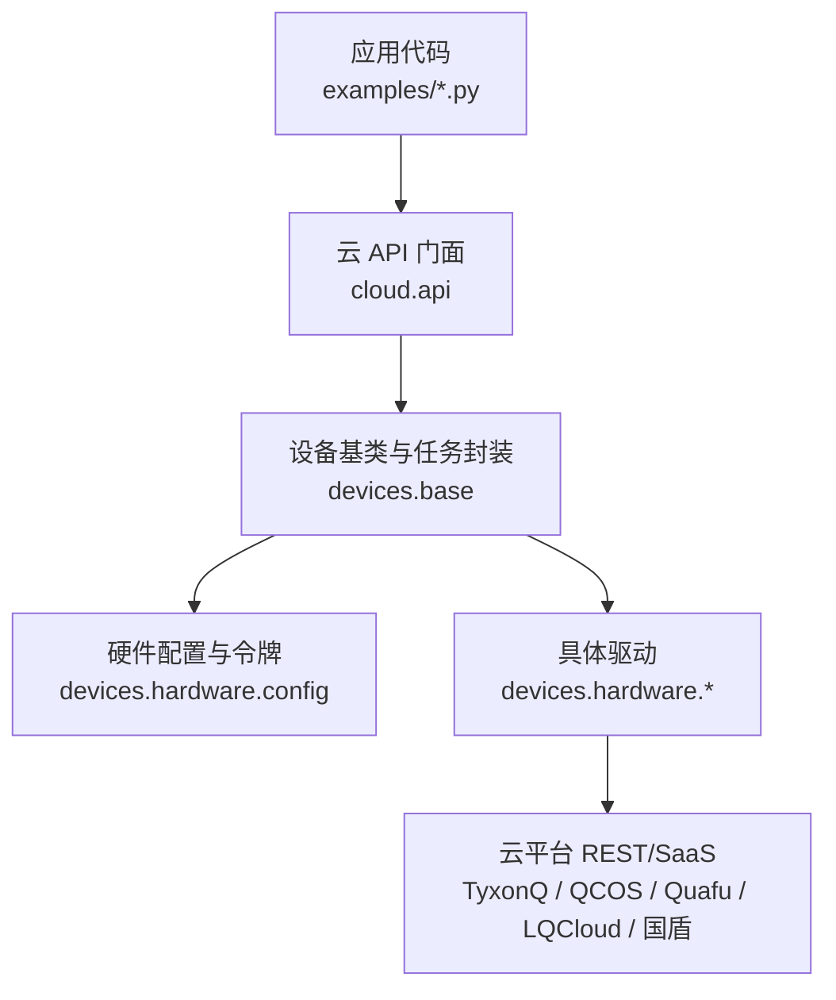
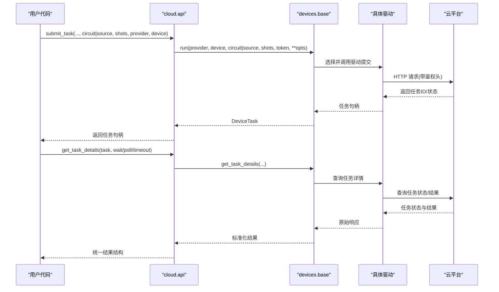
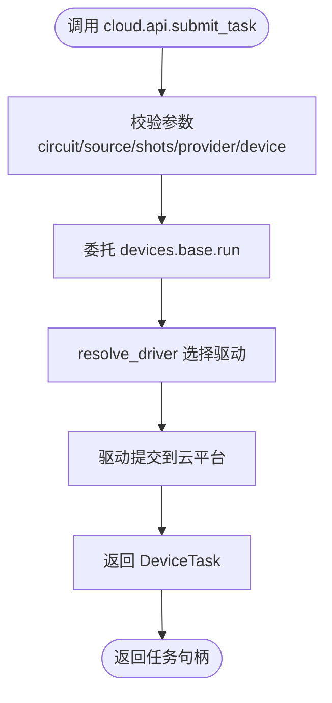
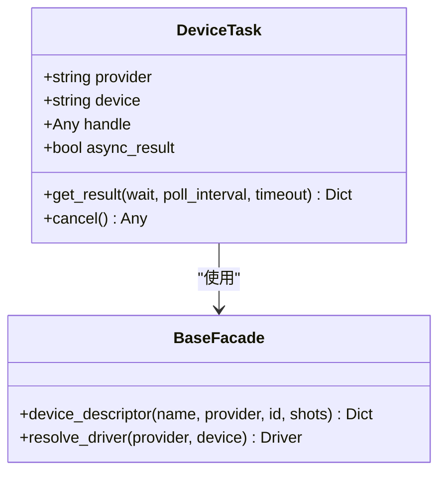
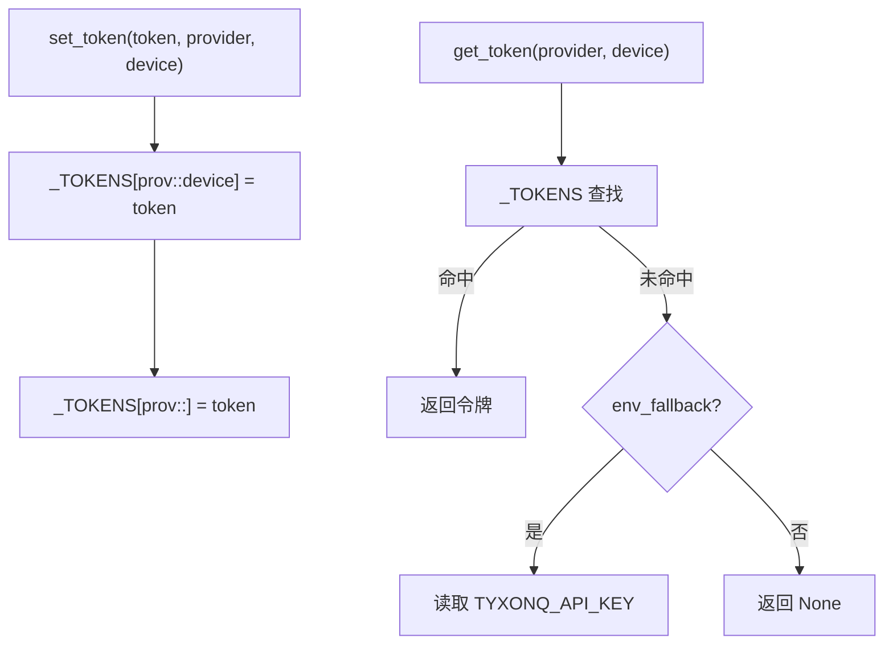
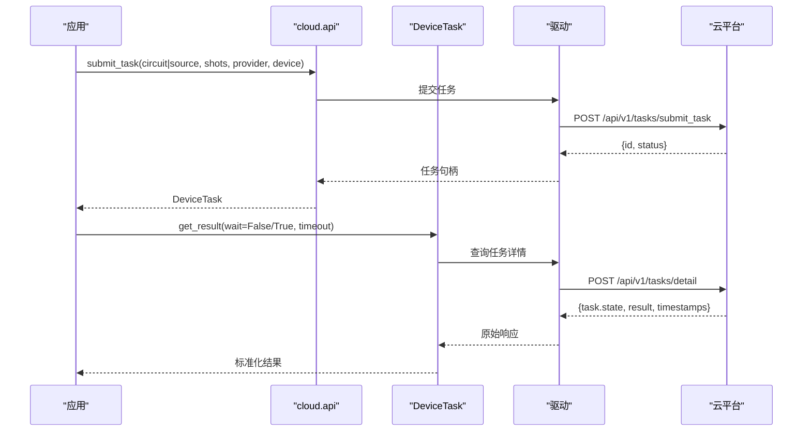
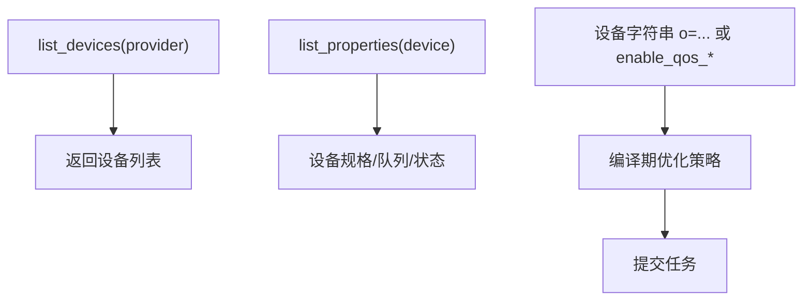
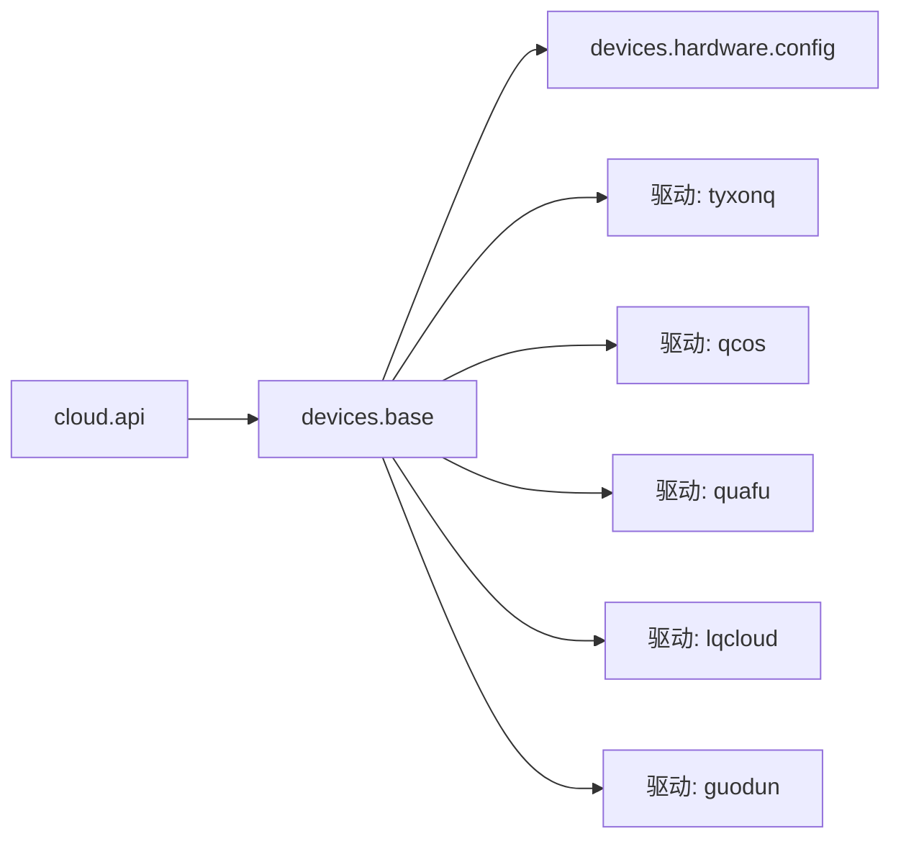

# 云平台服务

<cite>
**本文引用的文件**
- [src/tyxonq/cloud/api.py](file://src/tyxonq/cloud/api.py)
- [src/tyxonq/devices/base.py](file://src/tyxonq/devices/base.py)
- [src/tyxonq/devices/hardware/config.py](file://src/tyxonq/devices/hardware/config.py)
- [docs/source/cloud_services/task_submission.rst](file://docs/source/cloud_services/task_submission.rst)
- [docs/source/cloud_services/device_management.rst](file://docs/source/cloud_services/device_management.rst)
- [docs/tyxonq_cloud_api.md](file://docs/tyxonq_cloud_api.md)
- [examples/cloud_api_task.py](file://examples/cloud_api_task.py)
- [examples/cloud_api_devices.py](file://examples/cloud_api_devices.py)
- [examples/run_circuit_on_quafu.py](file://examples/run_circuit_on_quafu.py)
- [examples/run_circuit_on_lqcloud.py](file://examples/run_circuit_on_lqcloud.py)
- [examples/run_circuit_on_guodun.py](file://examples/run_circuit_on_guodun.py)
- [docs/qcos_provider.md](file://docs/qcos_provider.md)
- [docs/quafu_provider.md](file://docs/quafu_provider.md)
</cite>

## 目录
1. [简介](#简介)
2. [项目结构](#项目结构)
3. [核心组件](#核心组件)
4. [架构总览](#架构总览)
5. [详细组件分析](#详细组件分析)
6. [依赖关系分析](#依赖关系分析)
7. [性能考虑](#性能考虑)
8. [故障排除指南](#故障排除指南)
9. [结论](#结论)
10. [附录](#附录)

## 简介
本文件面向使用 TyxonQ 云平台服务的开发者与用户，系统阐述“量子计算即服务”的端到端能力：设备管理、任务提交（异步/批量/实时）、结果获取与解析、多云平台集成（TyxonQ、中国移动 QCOS、Quafu、LQCloud、国盾等）、API 密钥与安全认证、错误处理与重试策略，以及性能优化实践。文档同时提供从设备查询到任务执行的完整示例路径，帮助快速上手并稳定运行生产级任务。

## 项目结构
TyxonQ 将云平台能力抽象为统一的 API 门面与设备驱动层，并通过配置模块集中管理提供商、默认设备与令牌。关键目录与职责如下：
- cloud.api：统一云 API 门面，暴露 set_token、list_devices、submit_task、get_task_details、run、result、cancel 等方法，内部委托到底层设备基类与驱动。
- devices.base：设备协议、统一任务包装 DeviceTask、设备描述符解析、驱动解析与通用结果规范化。
- devices.hardware.config：提供商端点、默认值、令牌存储与读取（含环境变量回退）。
- docs/source/cloud_services：官方文档，涵盖任务提交、设备管理、最佳实践与错误处理。
- examples：各平台接入示例（TyxonQ、Quafu、LQCloud、国盾），展示链式 API 与低层驱动的用法。
- docs/*_provider.md：各云平台提供商的配置、认证、限制与最佳实践说明。

图表来源
- [src/tyxonq/cloud/api.py:22-158](file://src/tyxonq/cloud/api.py#L22-L158)
- [src/tyxonq/devices/base.py:12-57](file://src/tyxonq/devices/base.py#L12-L57)
- [src/tyxonq/devices/hardware/config.py:7-19](file://src/tyxonq/devices/hardware/config.py#L7-L19)

章节来源
- [src/tyxonq/cloud/api.py:22-158](file://src/tyxonq/cloud/api.py#L22-L158)
- [src/tyxonq/devices/base.py:12-57](file://src/tyxonq/devices/base.py#L12-L57)
- [src/tyxonq/devices/hardware/config.py:7-19](file://src/tyxonq/devices/hardware/config.py#L7-L19)

## 核心组件
- 统一云 API 门面（cloud.api）
  - 提供 set_token、set_default、device、list_devices、submit_task、get_task_details、run、result、cancel 等接口，屏蔽底层差异，支持电路对象或预编译源（OpenQASM/TQASM）提交。
- 设备基类与任务封装（devices.base）
  - DeviceTask：统一的任务句柄，封装 get_result、cancel；自动规范化返回结构，提升跨驱动一致性。
  - device_descriptor：解析 provider::device 格式，兼容简写与模拟器别名。
  - resolve_driver：按 provider 选择具体驱动（simulator、tyxonq、qcos、quafu、lqcloud、guodun 等）。
- 硬件配置与令牌（devices.hardware.config）
  - 维护内存中的令牌字典与默认 provider/device；支持通过环境变量回退；定义各提供商基础端点（如 TyxonQ、QCOS）。

章节来源
- [src/tyxonq/cloud/api.py:22-158](file://src/tyxonq/cloud/api.py#L22-L158)
- [src/tyxonq/devices/base.py:12-57](file://src/tyxonq/devices/base.py#L12-L57)
- [src/tyxonq/devices/hardware/config.py:7-19](file://src/tyxonq/devices/hardware/config.py#L7-L19)

## 架构总览
TyxonQ 采用“门面 + 驱动”的分层架构：上层提供一致的 Python API，下层根据 provider 路由到具体驱动，最终调用云平台 REST/SaaS。任务生命周期由 DeviceTask 统一管理，结果在 base 层进行标准化，便于下游后处理与聚合。

图表来源
- [src/tyxonq/cloud/api.py:42-72](file://src/tyxonq/cloud/api.py#L42-L72)
- [src/tyxonq/devices/base.py:12-57](file://src/tyxonq/devices/base.py#L12-L57)
- [docs/tyxonq_cloud_api.md:16-23](file://docs/tyxonq_cloud_api.md#L16-L23)

## 详细组件分析

### 统一云 API 门面（cloud.api）
- 功能要点
  - set_token/set_default：设置认证与默认 provider/device。
  - list_devices：列出可用设备（可指定 provider/token）。
  - submit_task/run：提交单个或多个任务，支持 circuit 或 source（OpenQASM/TQASM）。
  - get_task_details/result/cancel：查询任务详情、获取结果、取消任务。
- 设计模式
  - 门面模式：对外暴露简洁 API，内部委托至 devices.base 与具体驱动。
  - 延迟导入：避免不必要的依赖加载，按需引入驱动模块。

图表来源
- [src/tyxonq/cloud/api.py:42-72](file://src/tyxonq/cloud/api.py#L42-L72)
- [src/tyxonq/devices/base.py:146-200](file://src/tyxonq/devices/base.py#L146-L200)

章节来源
- [src/tyxonq/cloud/api.py:22-158](file://src/tyxonq/cloud/api.py#L22-L158)

### 设备基类与任务封装（devices.base）
- DeviceTask
  - get_result：统一轮询与超时控制，规范化返回结构（result、metadata、probabilities、expectations）。
  - cancel：委托 remove_task。
- device_descriptor
  - 解析 provider::device 字符串，兼容模拟器别名与简写。
- resolve_driver
  - 根据 provider 选择驱动（simulator、tyxonq、qcos、quafu、lqcloud、guodun 等），并返回驱动实例。

图表来源
- [src/tyxonq/devices/base.py:12-57](file://src/tyxonq/devices/base.py#L12-L57)
- [src/tyxonq/devices/base.py:112-200](file://src/tyxonq/devices/base.py#L112-L200)

章节来源
- [src/tyxonq/devices/base.py:12-57](file://src/tyxonq/devices/base.py#L12-L57)
- [src/tyxonq/devices/base.py:112-200](file://src/tyxonq/devices/base.py#L112-L200)

### 令牌与配置（devices.hardware.config）
- 令牌存储
  - 内存字典 _TOKENS，支持按 provider 与 device 维度存储。
  - get_token 优先内存，其次环境变量 TYXONQ_API_KEY。
- 默认值
  - _DEFAULTS 保存默认 provider 与 device（如 tyxonq、tyxonq::simulator:mps）。
- 端点
  - ENDPOINTS 定义各提供商基础 URL（如 TyxonQ、QCOS）。

图表来源
- [src/tyxonq/devices/hardware/config.py:7-19](file://src/tyxonq/devices/hardware/config.py#L7-L19)
- [src/tyxonq/devices/hardware/config.py:24-50](file://src/tyxonq/devices/hardware/config.py#L24-L50)

章节来源
- [src/tyxonq/devices/hardware/config.py:7-19](file://src/tyxonq/devices/hardware/config.py#L7-L19)
- [src/tyxonq/devices/hardware/config.py:24-50](file://src/tyxonq/devices/hardware/config.py#L24-L50)

### 任务提交与监控（任务生命周期）
- 提交模式
  - 异步任务：提交后立即返回任务句柄，后续轮询状态。
  - 批量任务：传入多个 circuit/source，返回多个任务句柄。
  - 实时查询：wait=True 时阻塞等待完成。
- 状态与结果
  - 状态包括 submitted/processing/running/completed/failed 等。
  - 结果包含 counts、执行元数据（shots、device、时间戳、耗时等）。

图表来源
- [docs/tyxonq_cloud_api.md:91-158](file://docs/tyxonq_cloud_api.md#L91-L158)
- [docs/tyxonq_cloud_api.md:201-258](file://docs/tyxonq_cloud_api.md#L201-L258)
- [src/tyxonq/devices/base.py:20-54](file://src/tyxonq/devices/base.py#L20-L54)

章节来源
- [docs/source/cloud_services/task_submission.rst:13-137](file://docs/source/cloud_services/task_submission.rst#L13-L137)
- [docs/source/cloud_services/task_submission.rst:211-443](file://docs/source/cloud_services/task_submission.rst#L211-L443)
- [docs/tyxonq_cloud_api.md:91-158](file://docs/tyxonq_cloud_api.md#L91-L158)
- [docs/tyxonq_cloud_api.md:201-258](file://docs/tyxonq_cloud_api.md#L201-L258)

### 设备管理与优化标志
- 设备发现
  - 通过 list_devices 获取可用设备列表（需先设置 token 与 provider）。
- 设备信息
  - 通过驱动提供的 list_properties 获取设备规格（qubits、queue、status 等）。
- 优化标志
  - 设备字符串支持 o=1/2/4/7 等组合，分别对应 qubit mapping、gate decomposition、initial mapping。
  - 也可通过关键字参数 enable_qos_* 精确控制。

图表来源
- [docs/source/cloud_services/device_management.rst:13-63](file://docs/source/cloud_services/device_management.rst#L13-L63)
- [docs/source/cloud_services/device_management.rst:97-210](file://docs/source/cloud_services/device_management.rst#L97-L210)

章节来源
- [docs/source/cloud_services/device_management.rst:13-63](file://docs/source/cloud_services/device_management.rst#L13-L63)
- [docs/source/cloud_services/device_management.rst:97-210](file://docs/source/cloud_services/device_management.rst#L97-L210)

### 多云平台集成与示例
- TyxonQ 云平台
  - 通过 cloud.api 直接提交 OpenQASM 或 Circuit，支持设备优化标志与异步/同步模式。
  - 示例：examples/cloud_api_task.py、examples/cloud_api_devices.py。
- 中国移动 QCOS（五岳）
  - 通过 wuyue_plugin SDK 提交，支持 FullAmpSim 与真机；credentials 通过 access_key/secret_key 或环境变量注入。
  - 文档：docs/qcos_provider.md。
- Quafu
  - 要求显式 compile(compile_engine="qiskit", output="qasm2") 后再提交；token 每 30 天轮换。
  - 示例：examples/run_circuit_on_quafu.py；文档：docs/quafu_provider.md。
- LQCloud
  - 通过官方 SDK 提交，支持逻辑比特到物理比特的映射；示例演示离线生成线路与在线提交。
  - 示例：examples/run_circuit_on_lqcloud.py。
- 国盾
  - 通过 QCIS 语言提交，支持脉冲 QCIS 与拓扑校验；示例仅提交不查询结果，便于权限探测。
  - 示例：examples/run_circuit_on_guodun.py。

章节来源
- [examples/cloud_api_task.py:30-59](file://examples/cloud_api_task.py#L30-L59)
- [examples/cloud_api_devices.py:16-21](file://examples/cloud_api_devices.py#L16-L21)
- [docs/qcos_provider.md:1-169](file://docs/qcos_provider.md#L1-L169)
- [docs/quafu_provider.md:1-113](file://docs/quafu_provider.md#L1-L113)
- [examples/run_circuit_on_quafu.py:22-51](file://examples/run_circuit_on_quafu.py#L22-L51)
- [examples/run_circuit_on_lqcloud.py:52-109](file://examples/run_circuit_on_lqcloud.py#L52-L109)
- [examples/run_circuit_on_guodun.py:70-119](file://examples/run_circuit_on_guodun.py#L70-L119)

## 依赖关系分析
- 耦合与内聚
  - cloud.api 与 devices.base 高内聚，负责统一入口与结果规范化；与具体驱动解耦，通过 resolve_driver 动态选择。
  - devices.hardware.config 集中管理令牌与默认值，降低各驱动重复实现。
- 外部依赖
  - 各云平台 SDK/REST：wuyue_plugin（QCOS）、Quafu 官方 SDK、LQCloud SDK、国盾平台 SDK。
- 潜在循环依赖
  - 通过延迟导入避免循环；cloud.api 在运行时才导入 devices.base 与驱动模块。

图表来源
- [src/tyxonq/cloud/api.py:18-20](file://src/tyxonq/cloud/api.py#L18-L20)
- [src/tyxonq/devices/base.py:146-200](file://src/tyxonq/devices/base.py#L146-L200)
- [src/tyxonq/devices/hardware/config.py:7-19](file://src/tyxonq/devices/hardware/config.py#L7-L19)

章节来源
- [src/tyxonq/cloud/api.py:18-20](file://src/tyxonq/cloud/api.py#L18-L20)
- [src/tyxonq/devices/base.py:146-200](file://src/tyxonq/devices/base.py#L146-L200)
- [src/tyxonq/devices/hardware/config.py:7-19](file://src/tyxonq/devices/hardware/config.py#L7-L19)

## 性能考虑
- 批处理与并行
  - 使用 batch_run 或并发线程池执行多个电路，减少上下文切换与网络开销。
  - 对模拟器可使用多线程（如 OMP_NUM_THREADS）加速采样。
- 缓存策略
  - 缓存 Hamiltonians、MPO 矩阵、CI 映射等中间结果，避免重复计算。
- 资源监控
  - 记录每个任务的 shots、qubits、depth、runDur、durChip 等指标，评估排队与执行效率。
- 优化标志选择
  - 根据电路类型选择合适的 o=... 或 enable_qos_*，平衡编译时间与执行质量。

章节来源
- [docs/source/examples/optimization_examples.rst:478-514](file://docs/source/examples/optimization_examples.rst#L478-L514)
- [docs/source/technical_references/performance_optimization.rst:300-360](file://docs/source/technical_references/performance_optimization.rst#L300-L360)

## 故障排除指南
- 常见错误
  - 认证失败：检查 token 是否设置正确，注意 Quafu token 每 30 天轮换。
  - 任务超时：延长 timeout，或在超时后继续轮询状态决定是否继续等待。
  - 电路被拒绝：检查设备 qubits 数量、深度限制与优化标志；必要时降级优化级别。
- 重试机制
  - 对提交与轮询实现指数退避重试；捕获 ConnectionError、TimeoutError 与业务错误。
- 设备维护与队列过长
  - 提交前查询设备状态与队列长度；在维护期间回退到本地模拟器。
- 结果解析异常
  - 确保使用 DeviceTask.get_result 获取标准化结果；若 result_meta 嵌套多层，base 层已提升必要字段。

章节来源
- [docs/source/cloud_services/task_submission.rst:447-571](file://docs/source/cloud_services/task_submission.rst#L447-L571)
- [docs/source/cloud_services/device_management.rst:354-414](file://docs/source/cloud_services/device_management.rst#L354-L414)
- [docs/quafu_provider.md:7-36](file://docs/quafu_provider.md#L7-L36)

## 结论
TyxonQ 云平台服务通过统一 API 门面与设备驱动层，实现了跨平台的量子计算即服务能力。开发者可以以一致的方式完成设备管理、任务提交、结果获取与监控，并灵活适配不同云平台（TyxonQ、QCOS、Quafu、LQCloud、国盾）。结合优化标志、批处理与缓存策略，可在保证正确性的前提下显著提升性能与稳定性。建议在生产环境中实施完善的错误处理与重试机制，并持续监控资源使用情况。

## 附录
- 端到端使用流程（从设备查询到任务执行）
  - 设置令牌与 provider：tq.set_token(token, provider="...")
  - 列出设备：tq.api.list_devices(provider="...")
  - 构建电路或准备 QASM：Circuit 或 OpenQASM 字符串
  - 提交任务：tq.api.submit_task(...) 或 c.compile().device(...).postprocessing().run(...)
  - 获取结果：task.get_result(wait=True/False, timeout=...)
  - 参考示例：examples/cloud_api_task.py、examples/cloud_api_devices.py、examples/run_circuit_on_quafu.py、examples/run_circuit_on_lqcloud.py、examples/run_circuit_on_guodun.py

章节来源
- [examples/cloud_api_task.py:30-59](file://examples/cloud_api_task.py#L30-L59)
- [examples/cloud_api_devices.py:16-21](file://examples/cloud_api_devices.py#L16-L21)
- [examples/run_circuit_on_quafu.py:22-51](file://examples/run_circuit_on_quafu.py#L22-L51)
- [examples/run_circuit_on_lqcloud.py:52-109](file://examples/run_circuit_on_lqcloud.py#L52-L109)
- [examples/run_circuit_on_guodun.py:70-119](file://examples/run_circuit_on_guodun.py#L70-L119)