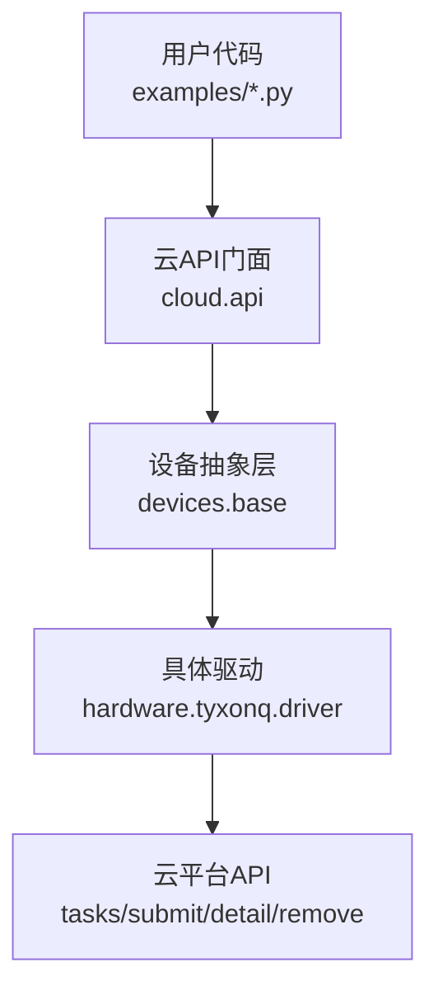
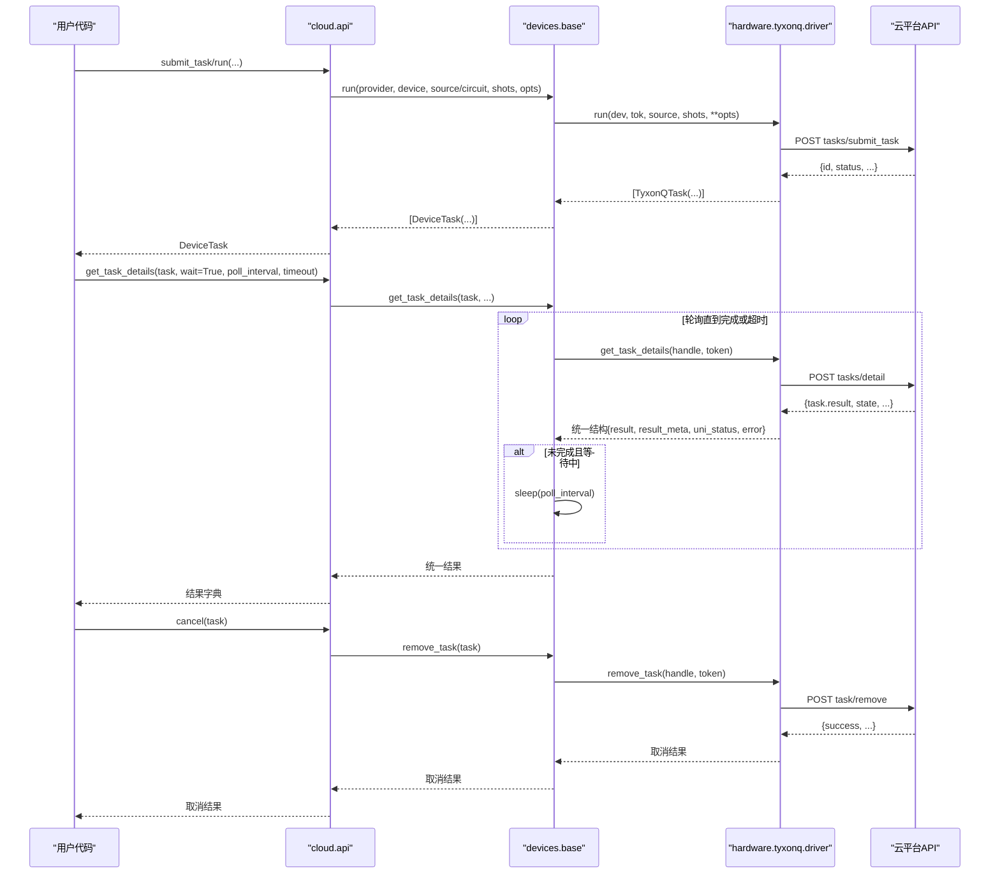
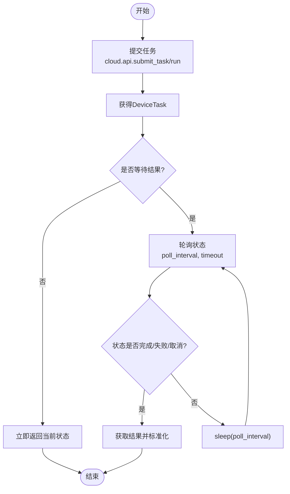
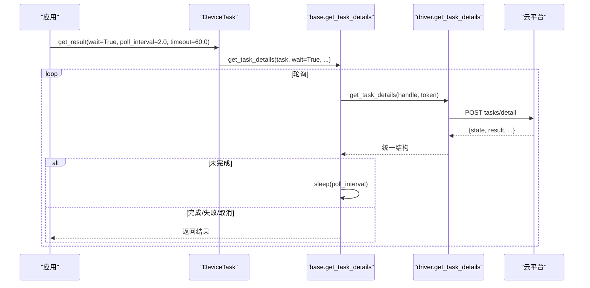
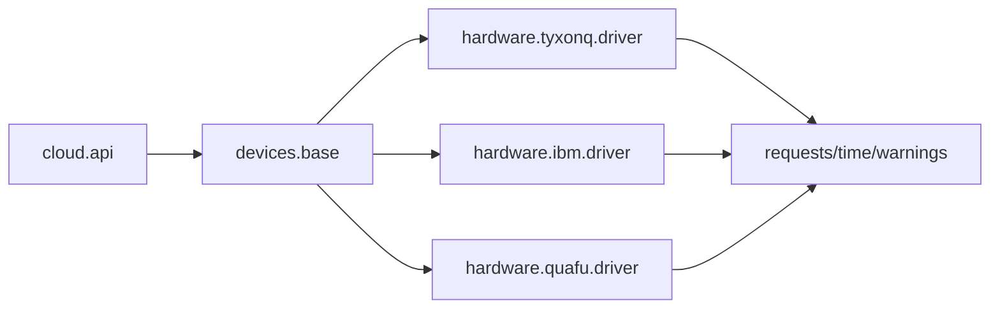
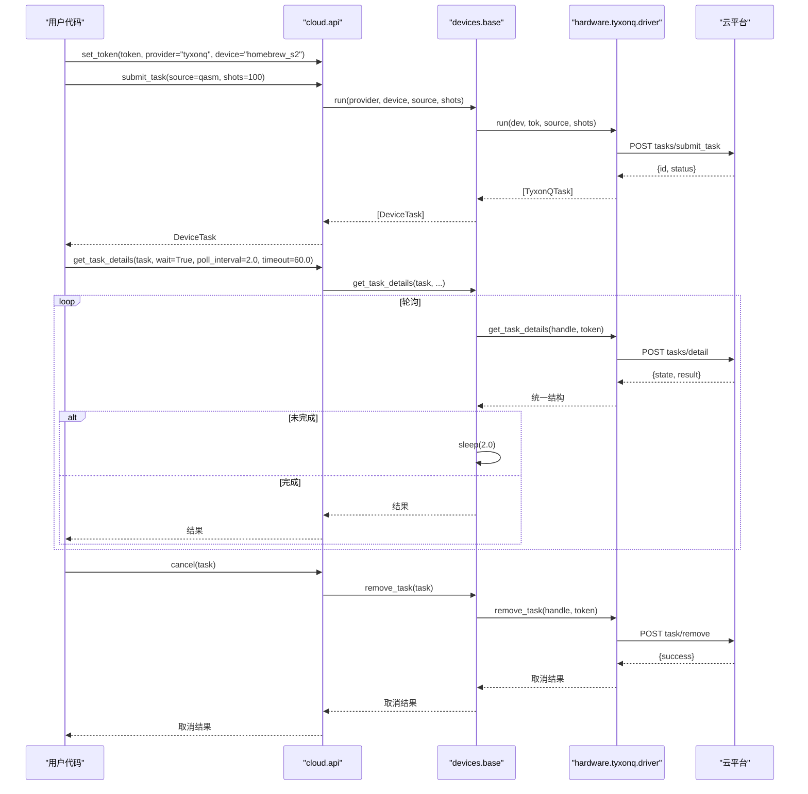

# 任务管理

<cite>
**本文引用的文件**
- [src/tyxonq/cloud/api.py](file://src/tyxonq/cloud/api.py)
- [src/tyxonq/devices/base.py](file://src/tyxonq/devices/base.py)
- [src/tyxonq/core/ir/circuit.py](file://src/tyxonq/core/ir/circuit.py)
- [src/tyxonq/devices/hardware/tyxonq/driver.py](file://src/tyxonq/devices/hardware/tyxonq/driver.py)
- [examples/cloud_api_task.py](file://examples/cloud_api_task.py)
- [examples/cloud_api_task_qaoa.py](file://examples/cloud_api_task_qaoa.py)
- [docs/source/cloud_services/task_submission.rst](file://docs/source/cloud_services/task_submission.rst)
</cite>

## 目录
1. [简介](#简介)
2. [项目结构](#项目结构)
3. [核心组件](#核心组件)
4. [架构总览](#架构总览)
5. [详细组件分析](#详细组件分析)
6. [依赖关系分析](#依赖关系分析)
7. [性能与优化建议](#性能与优化建议)
8. [故障排查指南](#故障排查指南)
9. [结论](#结论)
10. [附录：端到端工作流示例](#附录端到端工作流示例)

## 简介
本文件面向TyxonQ云平台任务管理的完整生命周期，覆盖任务创建、状态监控、结果获取、取消操作、异步执行与同步等待机制、优先级与资源分配策略、批量提交与管理、失败处理与重试、性能监控与优化建议，并提供从提交到结果处理的端到端工作流示例。文档基于仓库中的云API门面、设备抽象层、具体硬件驱动以及示例与文档进行系统化梳理，帮助读者快速掌握在TyxonQ上高效、可靠地运行量子任务的方法。

## 项目结构
TyxonQ的任务管理由“云API门面 → 设备抽象层 → 具体硬件驱动”的分层架构组成：
- 云API门面（cloud.api）提供统一入口，如提交任务、查询详情、取消任务等。
- 设备抽象层（devices.base）定义统一的DeviceTask、run、get_task_details、remove_task等接口，屏蔽不同后端差异。
- 具体硬件驱动（如 devices/hardware/tyxonq/driver.py）实现与云平台的具体交互，包括提交、查询、取消等。
- 示例与文档提供了典型用法和最佳实践。

图表来源
- [src/tyxonq/cloud/api.py:42-73](file://src/tyxonq/cloud/api.py#L42-L73)
- [src/tyxonq/devices/base.py:294-445](file://src/tyxonq/devices/base.py#L294-L445)
- [src/tyxonq/devices/hardware/tyxonq/driver.py:83-141](file://src/tyxonq/devices/hardware/tyxonq/driver.py#L83-L141)

章节来源
- [src/tyxonq/cloud/api.py:1-160](file://src/tyxonq/cloud/api.py#L1-L160)
- [src/tyxonq/devices/base.py:1-578](file://src/tyxonq/devices/base.py#L1-L578)
- [src/tyxonq/devices/hardware/tyxonq/driver.py:1-222](file://src/tyxonq/devices/hardware/tyxonq/driver.py#L1-L222)
- [examples/cloud_api_task.py:1-65](file://examples/cloud_api_task.py#L1-L65)
- [examples/cloud_api_task_qaoa.py:1-85](file://examples/cloud_api_task_qaoa.py#L1-L85)
- [docs/source/cloud_services/task_submission.rst:1-200](file://docs/source/cloud_services/task_submission.rst#L1-L200)

## 核心组件
- 云API门面
  - 提供 set_token、set_default、device、list_devices、submit_task、get_task_details、run、result、cancel 等统一接口。
  - submit_task/run 将请求委派给设备抽象层的 run；get_task_details/result 委托至底层驱动或CIRCUIT模块的辅助函数。
- 设备抽象层
  - DeviceTask：统一封装任务句柄，提供 get_result、cancel 等方法，内部调用 get_task_details 并标准化返回结构。
  - run：根据provider/device选择驱动，支持source直接提交或circuit路径（模拟器），统一返回DeviceTask列表。
  - get_task_details：轮询等待、超时控制、状态归一化（uni_status）、错误信息提取。
  - remove_task：按驱动能力取消任务。
- 具体驱动（以TyxonQ为例）
  - TyxonQTask：封装任务ID、设备、状态、异步结果标志等，提供 get_result 等待逻辑。
  - submit_task：校验QASM2格式，构造payload，POST到云平台提交任务。
  - get_task_details：拉取任务详情，标准化为统一结构（result、result_meta、uni_status、error）。
  - remove_task：调用云平台删除任务接口。

章节来源
- [src/tyxonq/cloud/api.py:22-145](file://src/tyxonq/cloud/api.py#L22-L145)
- [src/tyxonq/devices/base.py:12-58](file://src/tyxonq/devices/base.py#L12-L58)
- [src/tyxonq/devices/base.py:294-445](file://src/tyxonq/devices/base.py#L294-L445)
- [src/tyxonq/devices/base.py:497-574](file://src/tyxonq/devices/base.py#L497-L574)
- [src/tyxonq/devices/hardware/tyxonq/driver.py:12-42](file://src/tyxonq/devices/hardware/tyxonq/driver.py#L12-L42)
- [src/tyxonq/devices/hardware/tyxonq/driver.py:83-141](file://src/tyxonq/devices/hardware/tyxonq/driver.py#L83-L141)
- [src/tyxonq/devices/hardware/tyxonq/driver.py:145-222](file://src/tyxonq/devices/hardware/tyxonq/driver.py#L145-L222)

## 架构总览
下图展示从用户代码到云平台任务的完整调用链，包括提交、轮询、结果获取与取消。

图表来源
- [src/tyxonq/cloud/api.py:42-73](file://src/tyxonq/cloud/api.py#L42-L73)
- [src/tyxonq/devices/base.py:294-445](file://src/tyxonq/devices/base.py#L294-L445)
- [src/tyxonq/devices/base.py:497-574](file://src/tyxonq/devices/base.py#L497-L574)
- [src/tyxonq/devices/hardware/tyxonq/driver.py:83-141](file://src/tyxonq/devices/hardware/tyxonq/driver.py#L83-L141)
- [src/tyxonq/devices/hardware/tyxonq/driver.py:145-222](file://src/tyxonq/devices/hardware/tyxonq/driver.py#L145-L222)

## 详细组件分析

### 任务生命周期管理
- 任务创建
  - 通过 cloud.api.submit_task 或 run 提交，最终委派到 devices.base.run，再路由到具体驱动（如 tyxonq driver）执行提交。
  - 支持单条与批量提交；对模拟器与真机分别处理shots参数与噪声选项。
- 状态监控
  - 使用 get_task_details 进行轮询，支持 wait=True 与 poll_interval、timeout 配置。
  - 驱动返回的状态被归一化为 uni_status（done/completed/success/finished 视为完成；failed/error/cancelled/canceled 视为终止）。
- 结果获取
  - DeviceTask.get_result 会调用 get_task_details 并标准化结果结构，确保 result、metadata、expectations、probabilities 等键存在。
- 取消操作
  - 通过 cloud.api.cancel 或 DeviceTask.cancel 调用 remove_task，最终由驱动实现云平台取消接口。

图表来源
- [src/tyxonq/devices/base.py:497-574](file://src/tyxonq/devices/base.py#L497-L574)
- [src/tyxonq/devices/base.py:20-58](file://src/tyxonq/devices/base.py#L20-L58)
- [src/tyxonq/devices/hardware/tyxonq/driver.py:24-42](file://src/tyxonq/devices/hardware/tyxonq/driver.py#L24-L42)

章节来源
- [src/tyxonq/cloud/api.py:42-73](file://src/tyxonq/cloud/api.py#L42-L73)
- [src/tyxonq/devices/base.py:294-445](file://src/tyxonq/devices/base.py#L294-L445)
- [src/tyxonq/devices/base.py:497-574](file://src/tyxonq/devices/base.py#L497-L574)
- [src/tyxonq/devices/hardware/tyxonq/driver.py:83-141](file://src/tyxonq/devices/hardware/tyxonq/driver.py#L83-L141)
- [src/tyxonq/devices/hardware/tyxonq/driver.py:145-222](file://src/tyxonq/devices/hardware/tyxonq/driver.py#L145-L222)

### 异步任务执行模式与同步等待机制
- 异步模式
  - 硬件驱动返回的 TyxonQTask.async_result=True，表示需要轮询等待。
  - DeviceTask.get_result 默认可设置 wait=False 仅返回当前状态；wait=True 则进入轮询循环直至完成或超时。
- 同步等待
  - get_task_details 内置轮询逻辑：检查 uni_status，若未终止且 wait=True，则按 poll_interval 休眠后继续轮询，直到达到 timeout 上限。
  - 超时时会发出警告，提示可能因排队或执行耗时导致结果不完整。

图表来源
- [src/tyxonq/devices/base.py:497-574](file://src/tyxonq/devices/base.py#L497-L574)
- [src/tyxonq/devices/hardware/tyxonq/driver.py:24-42](file://src/tyxonq/devices/hardware/tyxonq/driver.py#L24-L42)

章节来源
- [src/tyxonq/devices/base.py:497-574](file://src/tyxonq/devices/base.py#L497-L574)
- [src/tyxonq/devices/hardware/tyxonq/driver.py:24-42](file://src/tyxonq/devices/hardware/tyxonq/driver.py#L24-L42)

### 任务优先级与资源分配策略
- 优先级
  - 示例中展示了通过HTTP请求向云平台提交任务时包含 prior 字段，用于指定任务优先级。
  - 在TyxonQ驱动提交中，可通过设备字符串或额外参数传递优化选项（如 o=7），间接影响调度与资源分配。
- 资源分配
  - 设备属性中包含队列长度等信息，可在提交前评估队列负载，选择合适的时机提交任务以降低等待时间。
  - 模拟器与真机的资源模型不同：模拟器本地执行，无网络开销；真机受云平台队列与硬件限制影响。

章节来源
- [examples/cloud_api_task_qaoa.py:52-68](file://examples/cloud_api_task_qaoa.py#L52-L68)
- [docs/source/cloud_services/device_management.rst:212-250](file://docs/source/cloud_services/device_management.rst#L212-L250)
- [src/tyxonq/devices/hardware/tyxonq/driver.py:83-141](file://src/tyxonq/devices/hardware/tyxonq/driver.py#L83-L141)

### 任务状态查询方法：轮询间隔与超时设置
- 轮询间隔（poll_interval）
  - 默认值通常为秒级（例如2.0s），可根据任务规模与云平台响应速度调整，避免频繁请求造成压力。
- 超时设置（timeout）
  - 默认值通常为分钟级（例如60.0s），当任务长时间处于排队或执行中时，需适当增大超时以避免误判。
- 状态归一化
  - 统一状态 uni_status 涵盖 done/completed/success/finished 与 failed/error/cancelled/canceled，便于上层逻辑判断。

章节来源
- [src/tyxonq/devices/base.py:497-574](file://src/tyxonq/devices/base.py#L497-L574)
- [src/tyxonq/devices/hardware/tyxonq/driver.py:24-42](file://src/tyxonq/devices/hardware/tyxonq/driver.py#L24-L42)

### 批量任务提交与管理
- 批量提交
  - 支持传入多个电路或源程序，驱动会逐个提交并返回任务列表；shots可为标量或列表，保持顺序一致。
  - 设备抽象层对batch路径进行统一处理，注入噪声设置（仅模拟器），并收集所有任务句柄。
- 管理
  - 可对每个任务单独查询状态与结果，也可批量轮询；取消操作同样支持逐任务取消。

章节来源
- [src/tyxonq/devices/base.py:384-445](file://src/tyxonq/devices/base.py#L384-L445)
- [src/tyxonq/devices/hardware/tyxonq/driver.py:112-141](file://src/tyxonq/devices/hardware/tyxonq/driver.py#L112-L141)
- [docs/source/cloud_services/task_submission.rst:177-200](file://docs/source/cloud_services/task_submission.rst#L177-L200)

### 任务失败处理与自动重试机制
- 失败处理
  - 驱动在提交失败时会尝试获取设备属性以增强诊断信息，并抛出异常。
  - 查询阶段若 uni_status 为失败或错误，上层应读取 error 字段并进行相应处理。
- 自动重试
  - 建议在应用层实现指数退避的重试策略，结合自定义轮询逻辑，提高鲁棒性。
  - 文档提供了带退避的轮询示例，可按需集成到业务代码中。

章节来源
- [src/tyxonq/devices/hardware/tyxonq/driver.py:123-141](file://src/tyxonq/devices/hardware/tyxonq/driver.py#L123-L141)
- [docs/source/cloud_services/task_submission.rst:275-309](file://docs/source/cloud_services/task_submission.rst#L275-L309)
- [docs/source/cloud_services/task_submission.rst:447-489](file://docs/source/cloud_services/task_submission.rst#L447-L489)

### 任务性能监控与优化建议
- 性能监控
  - 通过任务详情中的 qubits、depth、shots、runDur、durChip 等字段统计资源使用情况。
  - 可记录每次任务的队列长度、执行时长与芯片占用时间，形成趋势分析。
- 优化建议
  - 合理设置 shots 与优化选项（如 o=7），平衡精度与速度。
  - 在提交前评估设备队列长度，选择低负载时段提交。
  - 对长深度电路考虑分块或并行提交，降低单次任务复杂度。

章节来源
- [docs/source/cloud_services/task_submission.rst:699-732](file://docs/source/cloud_services/task_submission.rst#L699-L732)
- [src/tyxonq/devices/hardware/tyxonq/driver.py:145-214](file://src/tyxonq/devices/hardware/tyxonq/driver.py#L145-L214)

## 依赖关系分析
- 耦合与内聚
  - cloud.api 与 devices.base 松耦合，通过统一接口解耦具体驱动实现。
  - devices.base 对内聚了任务轮询、结果标准化与批处理逻辑，对外暴露简洁API。
  - 具体驱动（如 tyxonq driver）负责与云平台通信，保持高内聚。
- 外部依赖
  - requests 用于HTTP请求；time 用于轮询与超时控制；warnings 用于超时警告。
- 潜在循环依赖
  - 通过延迟导入（lazy import）避免硬依赖，减少启动时耦合。

图表来源
- [src/tyxonq/cloud/api.py:1-160](file://src/tyxonq/cloud/api.py#L1-L160)
- [src/tyxonq/devices/base.py:1-578](file://src/tyxonq/devices/base.py#L1-L578)
- [src/tyxonq/devices/hardware/tyxonq/driver.py:1-222](file://src/tyxonq/devices/hardware/tyxonq/driver.py#L1-L222)

章节来源
- [src/tyxonq/cloud/api.py:1-160](file://src/tyxonq/cloud/api.py#L1-L160)
- [src/tyxonq/devices/base.py:1-578](file://src/tyxonq/devices/base.py#L1-L578)
- [src/tyxonq/devices/hardware/tyxonq/driver.py:1-222](file://src/tyxonq/devices/hardware/tyxonq/driver.py#L1-L222)

## 性能与优化建议
- 轮询策略
  - 根据任务规模与云平台响应调整 poll_interval，避免过短导致频繁请求。
  - 合理设置 timeout，防止长时间阻塞；对长任务可适当增大超时。
- 提交时机
  - 利用设备队列信息选择低负载时段提交，缩短排队时间。
- 电路设计
  - 减少不必要的门与深度，合理使用优化选项（如 o=7）提升编译与执行效率。
- 批处理
  - 将相似任务合并提交，减少网络往返与上下文切换开销。

[本节为通用指导，不直接分析具体文件]

## 故障排查指南
- 提交失败
  - 检查token与设备名称是否正确；查看驱动抛出的异常信息，必要时获取设备属性辅助诊断。
- 轮询超时
  - 确认任务是否仍在排队或执行中；适当增大 timeout 或调整 poll_interval。
- 结果为空或不完整
  - 可能是超时导致提前返回；建议增大超时并重试；检查 uni_status 与 error 字段。
- 取消无效
  - 确认驱动是否支持 remove_task；部分平台可能不支持取消已执行任务。

章节来源
- [src/tyxonq/devices/hardware/tyxonq/driver.py:123-141](file://src/tyxonq/devices/hardware/tyxonq/driver.py#L123-L141)
- [src/tyxonq/devices/base.py:497-574](file://src/tyxonq/devices/base.py#L497-L574)
- [src/tyxonq/devices/hardware/tyxonq/driver.py:217-222](file://src/tyxonq/devices/hardware/tyxonq/driver.py#L217-L222)

## 结论
TyxonQ的任务管理体系通过清晰的分层架构与统一的接口设计，实现了跨平台、可扩展的任务提交、监控与结果获取。借助设备抽象层与具体驱动的协作，用户可以灵活配置轮询策略、超时与优化选项，满足从简单实验到大规模批处理的不同需求。结合性能监控与故障排查指南，能够显著提升任务执行的稳定性与效率。

[本节为总结，不直接分析具体文件]

## 附录：端到端工作流示例
以下示例展示从任务提交到结果处理的完整流程，包括异步等待、轮询与取消操作。

图表来源
- [examples/cloud_api_task.py:30-59](file://examples/cloud_api_task.py#L30-L59)
- [src/tyxonq/cloud/api.py:42-73](file://src/tyxonq/cloud/api.py#L42-L73)
- [src/tyxonq/devices/base.py:294-445](file://src/tyxonq/devices/base.py#L294-L445)
- [src/tyxonq/devices/base.py:497-574](file://src/tyxonq/devices/base.py#L497-L574)
- [src/tyxonq/devices/hardware/tyxonq/driver.py:83-141](file://src/tyxonq/devices/hardware/tyxonq/driver.py#L83-L141)
- [src/tyxonq/devices/hardware/tyxonq/driver.py:145-222](file://src/tyxonq/devices/hardware/tyxonq/driver.py#L145-L222)

章节来源
- [examples/cloud_api_task.py:1-65](file://examples/cloud_api_task.py#L1-L65)
- [examples/cloud_api_task_qaoa.py:1-85](file://examples/cloud_api_task_qaoa.py#L1-L85)
- [docs/source/cloud_services/task_submission.rst:1-200](file://docs/source/cloud_services/task_submission.rst#L1-L200)