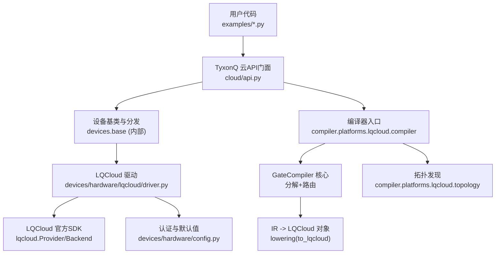
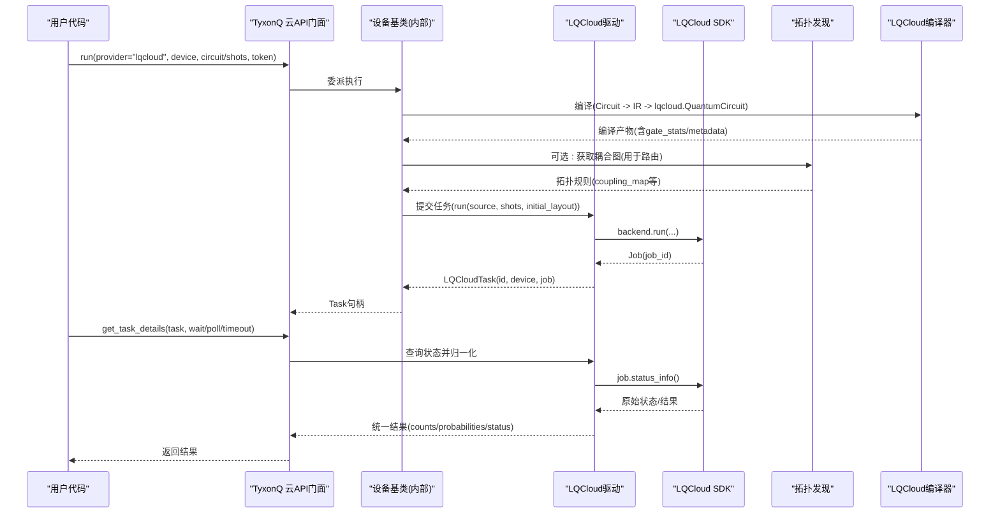
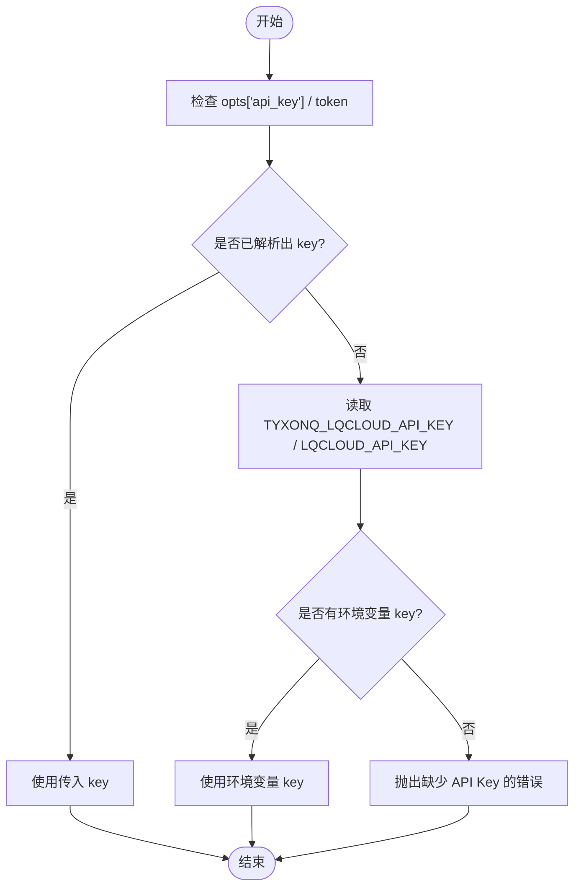
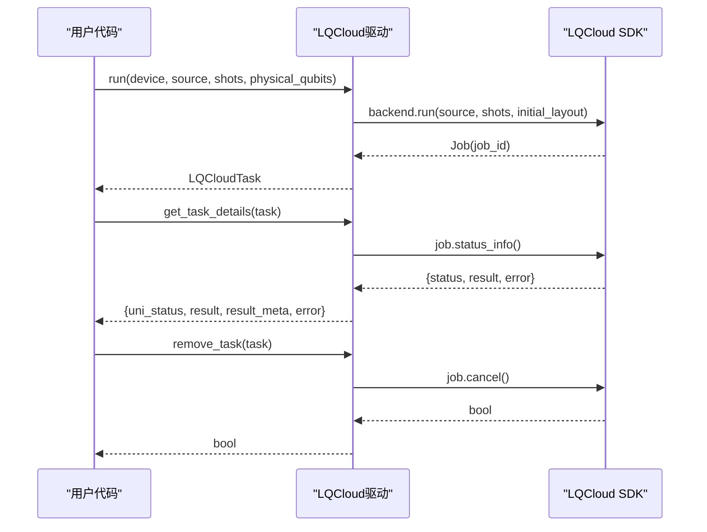
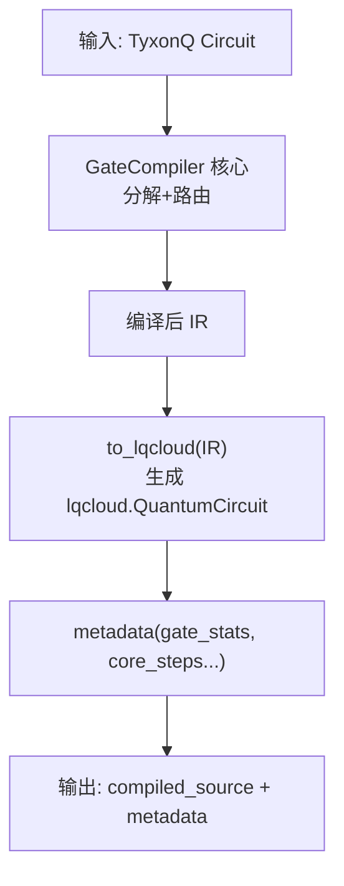
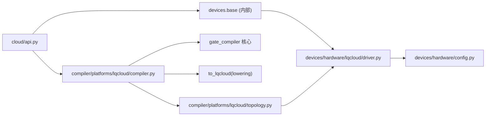

# LQCloud平台

<cite>
**本文引用的文件**
- [driver.py](file://src/tyxonq/devices/hardware/lqcloud/driver.py)
- [compiler.py](file://src/tyxonq/compiler/platforms/lqcloud/compiler.py)
- [topology.py](file://src/tyxonq/compiler/platforms/lqcloud/topology.py)
- [api.py](file://src/tyxonq/cloud/api.py)
- [config.py](file://src/tyxonq/devices/hardware/config.py)
- [run_circuit_on_lqcloud.py](file://examples/run_circuit_on_lqcloud.py)
- [run_chem_on_lqcloud.py](file://examples/run_chem_on_lqcloud.py)
- [cloud_api_task.py](file://examples/cloud_api_task.py)
- [tyxonq_cloud_api.md](file://docs/tyxonq_cloud_api.md)
</cite>

## 目录
1. [简介](#简介)
2. [项目结构](#项目结构)
3. [核心组件](#核心组件)
4. [架构总览](#架构总览)
5. [详细组件分析](#详细组件分析)
6. [依赖关系分析](#依赖关系分析)
7. [性能与优化](#性能与优化)
8. [故障诊断与错误处理](#故障诊断与错误处理)
9. [结论](#结论)
10. [附录：快速上手与示例](#附录快速上手与示例)

## 简介
本文件面向需要在 TyxonQ 框架内接入 LQCloud 量子云平台的使用者与开发者，系统性说明 LQCloud 的服务特点、认证配置、设备发现、任务提交与监控、资源调度机制、算法实现示例、队列优先级与平台特定优化选项，以及故障诊断方法。LQCloud 通过官方 SDK（lqcloud==0.4.2）集成，TyxonQ 提供统一的设备抽象、编译链路和结果归一化，使同一套代码可在模拟器与真机之间无缝切换。

## 项目结构
围绕 LQCloud 的关键代码分布在以下位置：
- 设备驱动层：devices/hardware/lqcloud/driver.py
- 编译器层：compiler/platforms/lqcloud/compiler.py 与 lowering（由 compiler 委托 gate_compiler 核心后直译）
- 拓扑发现：compiler/platforms/lqcloud/topology.py
- 统一云 API 门面：cloud/api.py
- 认证与默认值：devices/hardware/config.py
- 示例程序：examples/run_circuit_on_lqcloud.py、examples/run_chem_on_lqcloud.py、examples/cloud_api_task.py
- 云端 API 文档：docs/tyxonq_cloud_api.md

图表来源
- [api.py:42-72](file://src/tyxonq/cloud/api.py#L42-L72)
- [driver.py:56-92](file://src/tyxonq/devices/hardware/lqcloud/driver.py#L56-L92)
- [compiler.py:50-109](file://src/tyxonq/compiler/platforms/lqcloud/compiler.py#L50-L109)
- [topology.py:108-151](file://src/tyxonq/compiler/platforms/lqcloud/topology.py#L108-L151)
- [config.py:24-50](file://src/tyxonq/devices/hardware/config.py#L24-L50)

章节来源
- [api.py:1-160](file://src/tyxonq/cloud/api.py#L1-L160)
- [driver.py:1-223](file://src/tyxonq/devices/hardware/lqcloud/driver.py#L1-L223)
- [compiler.py:1-113](file://src/tyxonq/compiler/platforms/lqcloud/compiler.py#L1-L113)
- [topology.py:1-155](file://src/tyxonq/compiler/platforms/lqcloud/topology.py#L1-L155)
- [config.py:1-78](file://src/tyxonq/devices/hardware/config.py#L1-L78)

## 核心组件
- LQCloud 驱动（driver.py）
  - 负责解析 API Key、构造 Provider/Backend、提交任务、查询状态、取消任务、列出设备。
  - 将 LQCloud 的 Job/Result 转换为 TyxonQ 统一结果结构（counts/probabilities/status）。
- LQCloud 编译器（compiler.py）
  - 将 TyxonQ Circuit 经 GateCompiler 核心完成设备无关的分解与路由，再 1:1 直译为 lqcloud.QuantumCircuit 对象。
  - 不消费 physical_qubits（该参数在运行期作为 initial_layout 透传）。
- 拓扑发现（topology.py）
  - 读取后端 config.topology.coupling_map，归一化为双向去重边集，提取 qubit 数、原生门集合等，供路由使用。
- 云 API 门面（api.py）
  - 暴露 set_token、list_devices、submit_task、get_task_details、run、result、cancel 等统一接口，内部委派到 devices.base。
- 认证与默认值（config.py）
  - 管理 provider/device 默认值与 token 存储；支持按 provider 维度设置与获取。

章节来源
- [driver.py:33-92](file://src/tyxonq/devices/hardware/lqcloud/driver.py#L33-L92)
- [compiler.py:50-109](file://src/tyxonq/compiler/platforms/lqcloud/compiler.py#L50-L109)
- [topology.py:43-151](file://src/tyxonq/compiler/platforms/lqcloud/topology.py#L43-L151)
- [api.py:22-72](file://src/tyxonq/cloud/api.py#L22-L72)
- [config.py:24-50](file://src/tyxonq/devices/hardware/config.py#L24-L50)

## 架构总览
下图展示从用户代码到 LQCloud 真机的完整调用链，包括认证、编译、拓扑发现、任务提交与结果归一化。

图表来源
- [api.py:42-72](file://src/tyxonq/cloud/api.py#L42-L72)
- [compiler.py:50-109](file://src/tyxonq/compiler/platforms/lqcloud/compiler.py#L50-L109)
- [topology.py:108-151](file://src/tyxonq/compiler/platforms/lqcloud/topology.py#L108-L151)
- [driver.py:56-92](file://src/tyxonq/devices/hardware/lqcloud/driver.py#L56-L92)
- [driver.py:119-180](file://src/tyxonq/devices/hardware/lqcloud/driver.py#L119-L180)

## 详细组件分析

### 认证与令牌管理
- 支持三种方式注入 LQCloud API Key：
  - 显式传入 api_key=...
  - 调用 tq.set_token(token, provider="lqcloud")
  - 环境变量 TYXONQ_LQCLOUD_API_KEY 或 LQCLOUD_API_KEY
- 驱动层明确拒绝回退到 TyxonQ 全局密钥，避免跨 provider 误用。
- 默认 provider/device 可通过 config 设置，便于后续统一调用。

图表来源
- [driver.py:33-42](file://src/tyxonq/devices/hardware/lqcloud/driver.py#L33-L42)
- [config.py:24-50](file://src/tyxonq/devices/hardware/config.py#L24-L50)

章节来源
- [driver.py:33-42](file://src/tyxonq/devices/hardware/lqcloud/driver.py#L33-L42)
- [config.py:24-50](file://src/tyxonq/devices/hardware/config.py#L24-L50)

### 设备信息查询与拓扑
- list_devices：动态列出当前 API Key 可见的 LQCloud 设备，返回形如 "lqcloud::DeviceName" 的设备标识。
- 拓扑发现：通过 backend.config.topology.coupling_map 获取耦合图，归一为双向去重边集，并裁剪大字段以控制缓存体积。
- 用途：为 gate_compiler 的路由阶段提供设备约束，减少不必要的 SWAP 插入。

章节来源
- [driver.py:190-213](file://src/tyxonq/devices/hardware/lqcloud/driver.py#L190-L213)
- [topology.py:43-151](file://src/tyxonq/compiler/platforms/lqcloud/topology.py#L43-L151)

### 任务提交、监控与管理
- 提交任务：
  - 输入：TyxonQ Circuit 或预编译 source；shots 必须为正整数；physical_qubits 会映射为 initial_layout。
  - 输出：LQCloudTask（包含 job_id、device、job 引用），支持异步等待。
- 查询详情：
  - 将 LQCloud 的 status/result 映射为统一结构：uni_status（queued/running/completed/failed/cancelled/unknown）、result（counts/probabilities）、result_meta（job_id、shots、raw 等）。
- 取消任务：
  - 对排队中的任务调用 cancel。

图表来源
- [driver.py:56-92](file://src/tyxonq/devices/hardware/lqcloud/driver.py#L56-L92)
- [driver.py:119-180](file://src/tyxonq/devices/hardware/lqcloud/driver.py#L119-L180)
- [driver.py:183-187](file://src/tyxonq/devices/hardware/lqcloud/driver.py#L183-L187)

章节来源
- [driver.py:56-92](file://src/tyxonq/devices/hardware/lqcloud/driver.py#L56-L92)
- [driver.py:119-180](file://src/tyxonq/devices/hardware/lqcloud/driver.py#L119-L180)
- [driver.py:183-187](file://src/tyxonq/devices/hardware/lqcloud/driver.py#L183-L187)

### 编译与直译流程
- LQCloudCompiler.compile：
  - 先调用 GateCompiler 核心进行设备无关的分解（matchgate/rotations）与路由，得到编译后的 IR。
  - 再通过 to_lqcloud 将 IR 直译为 lqcloud.QuantumCircuit 对象（纯本地操作，无网络请求）。
  - metadata 包含 output/target/num_qubits/gate_stats/core_steps 等，便于排查。
- physical_qubits 语义：
  - 不在编译期消费，而是随 Circuit.run() 流转到驱动层作为 initial_layout。

图表来源
- [compiler.py:50-109](file://src/tyxonq/compiler/platforms/lqcloud/compiler.py#L50-L109)

章节来源
- [compiler.py:50-109](file://src/tyxonq/compiler/platforms/lqcloud/compiler.py#L50-L109)

### 量子算法实现示例
- 基础线路示例：四比特门线路构建、离线查看指令统计、在线提交并等待结果。
- 化学应用示例：HEA/UCCSD/SQD 三种方法在 LQCloud 上的最小可用链路，统一通过 .energy()/scan() 调用，仅 provider/device 不同。
- 通用云 API 示例：演示 legacy 风格 submit_task 与 chain 风格 compile().device(...).postprocessing().run(...) 两种用法。

章节来源
- [run_circuit_on_lqcloud.py:18-114](file://examples/run_circuit_on_lqcloud.py#L18-L114)
- [run_chem_on_lqcloud.py:50-111](file://examples/run_chem_on_lqcloud.py#L50-L111)
- [cloud_api_task.py:17-59](file://examples/cloud_api_task.py#L17-L59)

### 任务队列管理与优先级
- 通过 TyxonQ 云 API 文档可知，任务提交支持 prior 参数（1-10，数值越小优先级越高），可用于队列优先级设置。
- 在 TyxonQ 高层封装中，可通过底层 API 传递 prior 等参数（具体取决于上层设备实现与协议版本）。

章节来源
- [tyxonq_cloud_api.md:91-147](file://docs/tyxonq_cloud_api.md#L91-L147)

### 平台特定的优化选项与性能调参
- 设备参数优化标志（o=...）：
  - enable_qos_qubit_mapping（1）：自动量子比特映射
  - enable_qos_gate_decomposition（2）：将门分解为设备原生门集
  - enable_qos_initial_mapping（4）：初始量子比特放置优化
  - 可组合使用，例如 o=3 表示同时启用映射与分解；o=7 启用全部优化；dry 模式仅编译不执行。
- 物理比特映射：
  - 通过 physical_qubits 指定逻辑比特到物理比特的映射，驱动层将其转为 initial_layout。
- 拓扑感知路由：
  - 利用 coupling_map 进行设备无关路由，减少 SWAP 插入，降低电路深度与误差。

章节来源
- [tyxonq_cloud_api.md:125-147](file://docs/tyxonq_cloud_api.md#L125-L147)
- [driver.py:82-88](file://src/tyxonq/devices/hardware/lqcloud/driver.py#L82-L88)
- [topology.py:43-67](file://src/tyxonq/compiler/platforms/lqcloud/topology.py#L43-L67)

## 依赖关系分析
- 模块耦合：
  - cloud/api.py 作为门面，依赖 devices.base（内部）进行统一分发。
  - devices/hardware/lqcloud/driver.py 依赖 lqcloud SDK（延迟导入）与 devices/hardware/config.py。
  - compiler/platforms/lqcloud/compiler.py 依赖 gate_compiler 核心与 lowering（to_lqcloud）。
  - topology.py 依赖 driver 的 _resolve_api_key 与 SDK 的 backend.config。
- 外部依赖：
  - lqcloud==0.4.2（官方 SDK）
  - PySCF（化学应用示例中的 UCCSD/SQD 需要）

图表来源
- [api.py:42-72](file://src/tyxonq/cloud/api.py#L42-L72)
- [driver.py:24-42](file://src/tyxonq/devices/hardware/lqcloud/driver.py#L24-L42)
- [compiler.py:74-92](file://src/tyxonq/compiler/platforms/lqcloud/compiler.py#L74-L92)
- [topology.py:127-137](file://src/tyxonq/compiler/platforms/lqcloud/topology.py#L127-L137)

章节来源
- [api.py:1-160](file://src/tyxonq/cloud/api.py#L1-L160)
- [driver.py:1-223](file://src/tyxonq/devices/hardware/lqcloud/driver.py#L1-L223)
- [compiler.py:1-113](file://src/tyxonq/compiler/platforms/lqcloud/compiler.py#L1-L113)
- [topology.py:1-155](file://src/tyxonq/compiler/platforms/lqcloud/topology.py#L1-L155)

## 性能与优化
- 编译期优化：
  - 通过 GateCompiler 核心进行 matchgate/rotations 分解与路由，减少不必要门与 SWAP。
  - 直译为 lqcloud.QuantumCircuit 对象，避免中间文本转换开销。
- 运行期优化：
  - 使用 physical_qubits 指定 initial_layout，减少路由带来的额外开销。
  - 结合设备参数 o=... 启用映射与分解优化，必要时使用 dry 模式验证编译效果。
- 拓扑感知：
  - 归一化的双向耦合图有助于路由选择更优路径，降低电路深度与误差。
- 采样策略：
  - 根据算法需求调整 shots（如 HEA/UCCSD/SQD 示例默认 1024，可按精度需求提高）。

[本节为通用性能讨论，不直接分析具体文件]

## 故障诊断与错误处理
- 常见错误与定位：
  - 缺少 API Key：驱动层会在未解析到 key 时抛出运行时错误，提示正确设置方式。
  - 非预期响应：当 status_info 返回非 dict 或非标准格式时，统一结果中包含 raw 字段便于排查。
  - 提交失败：若后端未返回 job_id，将抛出运行时错误。
  - 取消失败：remove_task 返回布尔值，可根据返回值判断是否成功。
- 调试建议：
  - 使用 metadata.gate_stats 与 core_steps 检查编译过程。
  - 使用 result_meta.raw 查看 LQCloud 原始响应，辅助定位问题。
  - 离线模式先行验证线路与编译结果，再切换到在线模式提交任务。

章节来源
- [driver.py:33-42](file://src/tyxonq/devices/hardware/lqcloud/driver.py#L33-L42)
- [driver.py:119-180](file://src/tyxonq/devices/hardware/lqcloud/driver.py#L119-L180)
- [driver.py:183-187](file://src/tyxonq/devices/hardware/lqcloud/driver.py#L183-L187)
- [compiler.py:94-109](file://src/tyxonq/compiler/platforms/lqcloud/compiler.py#L94-L109)

## 结论
TyxonQ 对 LQCloud 的集成提供了端到端的解决方案：从认证、设备发现、拓扑感知路由、编译直译到任务提交与结果归一化，均具备清晰的职责划分与健壮的错误处理。通过统一的云 API 门面与示例程序，用户可以在模拟器与真机之间无缝切换，并以最小成本接入 LQCloud 的量子计算能力。结合平台特定的优化选项与优先级设置，可进一步提升任务执行效率与质量。

[本节为总结性内容，不直接分析具体文件]

## 附录：快速上手与示例
- 基础线路：
  - 构建四比特门线路，离线查看指令统计，在线模式下设置 API Key 并提交任务，等待结果并打印 counts。
- 化学应用：
  - 使用 HEA/UCCSD/SQD 三种方法，在 LQCloud 上执行最小可用链路，统一通过 .energy()/scan() 调用。
- 通用云 API：
  - 演示 legacy 风格 submit_task 与 chain 风格 compile().device(...).postprocessing().run(...) 两种用法。

章节来源
- [run_circuit_on_lqcloud.py:18-114](file://examples/run_circuit_on_lqcloud.py#L18-L114)
- [run_chem_on_lqcloud.py:50-111](file://examples/run_chem_on_lqcloud.py#L50-L111)
- [cloud_api_task.py:17-59](file://examples/cloud_api_task.py#L17-L59)