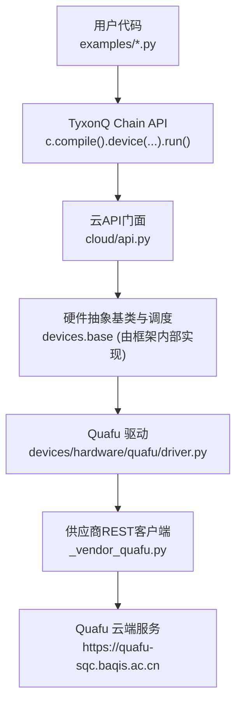
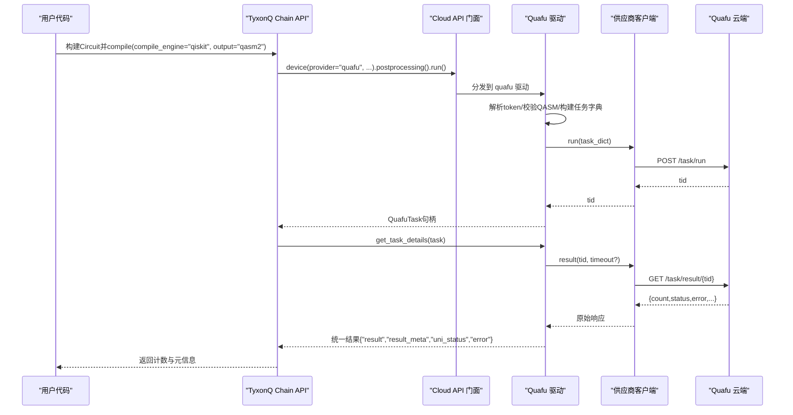
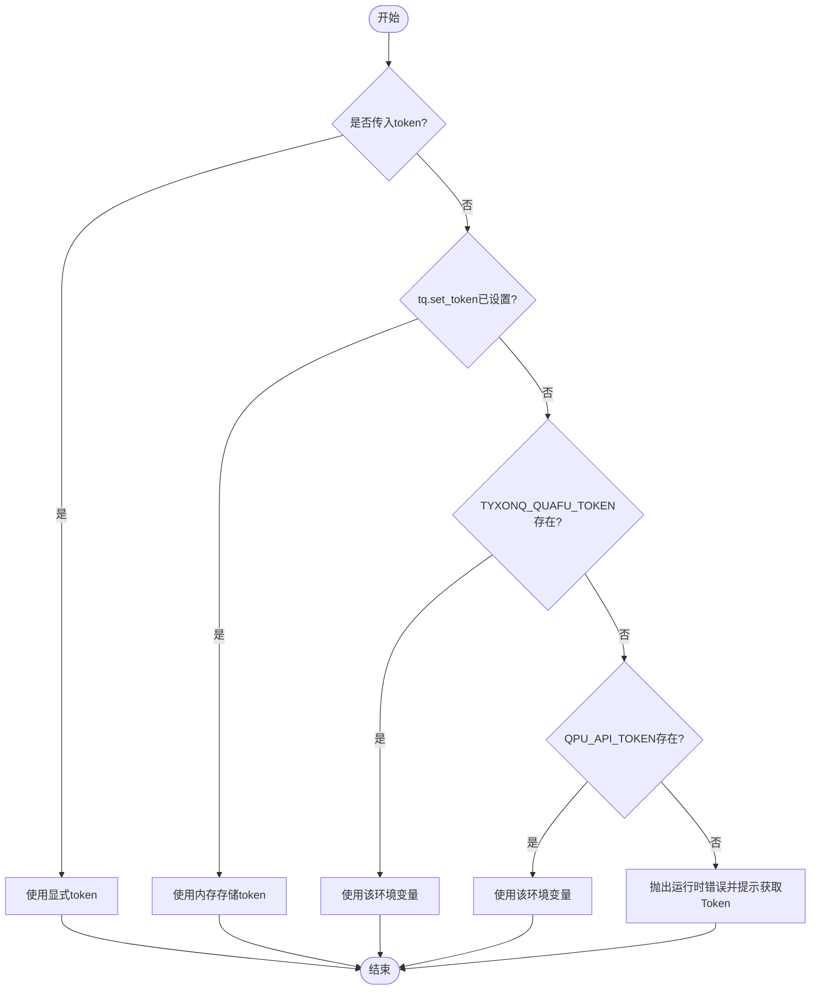
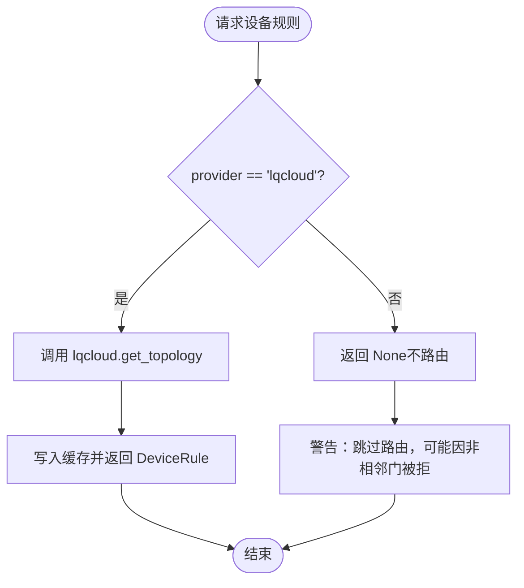
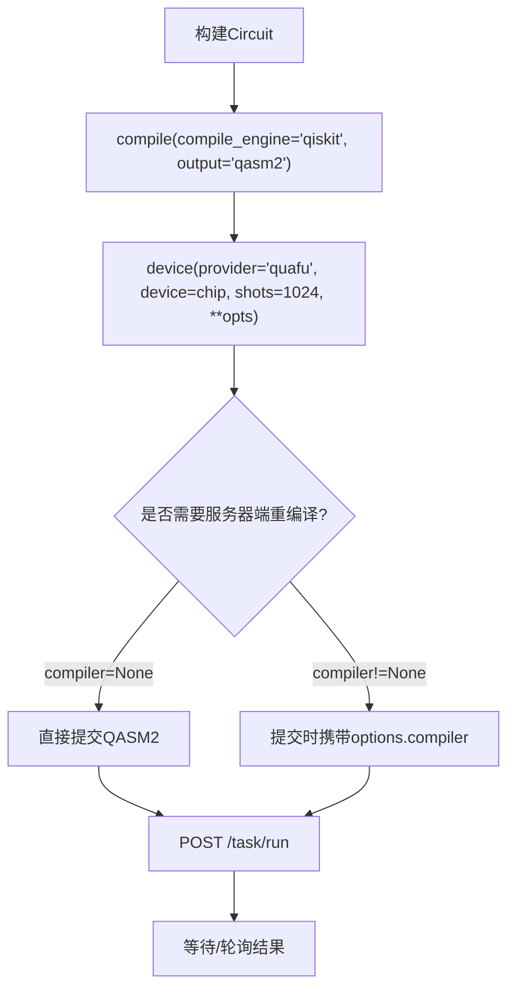
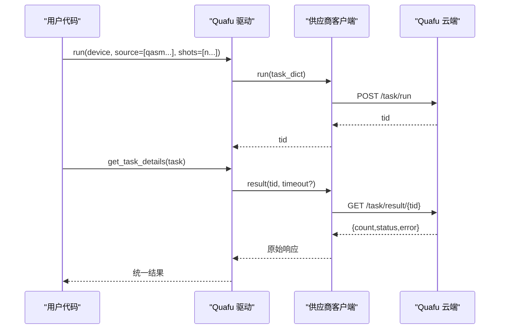
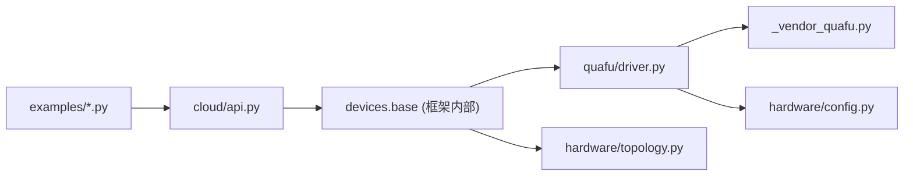

# Quafu平台

<cite>
**本文引用的文件**
- [src/tyxonq/devices/hardware/quafu/driver.py](file://src/tyxonq/devices/hardware/quafu/driver.py)
- [src/tyxonq/devices/hardware/quafu/_vendor_quafu.py](file://src/tyxonq/devices/hardware/quafu/_vendor_quafu.py)
- [examples/run_circuit_on_quafu.py](file://examples/run_circuit_on_quafu.py)
- [examples/run_circuit_on_quafu_full.py](file://examples/run_circuit_on_quafu_full.py)
- [docs/quafu_provider.md](file://docs/quafu_provider.md)
- [src/tyxonq/cloud/api.py](file://src/tyxonq/cloud/api.py)
- [src/tyxonq/devices/hardware/config.py](file://src/tyxonq/devices/hardware/config.py)
- [src/tyxonq/devices/hardware/topology.py](file://src/tyxonq/devices/hardware/topology.py)
</cite>

## 目录
1. [简介](#简介)
2. [项目结构](#项目结构)
3. [核心组件](#核心组件)
4. [架构总览](#架构总览)
5. [详细组件分析](#详细组件分析)
6. [依赖关系分析](#依赖关系分析)
7. [性能与适用场景](#性能与适用场景)
8. [调试与故障排查](#调试与故障排查)
9. [结论](#结论)
10. [附录：示例与最佳实践](#附录示例与最佳实践)

## 简介
本文件面向需要在 TyxonQ 中集成并运行 BAQIS Quafu 超导量子云平台任务的用户与开发者。内容涵盖：
- Quafu 平台特点与服务范围（云端任务提交、OpenQASM 2.0 电路执行、设备状态查询等）
- 账户注册、API Token 获取与配置方式
- 设备拓扑查询与量子比特映射方法（当前版本对 Quafu 的拓扑发现为预留接口，默认不启用）
- 量子电路编译与优化选项（本地预编译到 OpenQASM 2.0；可选服务器端重新编译）
- 从基础门操作到复杂算法的完整示例路径
- 噪声模型与误差缓解的使用说明（平台侧读出纠错与动态解耦）
- 性能特征与适用场景建议
- 调试技巧与常见问题解决方案

## 项目结构
TyxonQ 对 Quafu 的支持以“驱动 + 供应商客户端 + 示例 + 文档”的方式组织：
- 驱动层：封装 TyxonQ 统一接口，负责令牌解析、任务构建、结果归一化、设备列表查询等
- 供应商客户端：内嵌的 REST 客户端，直接对接 Quafu 云端 API
- 示例：提供最小可运行脚本与端到端工作流
- 文档：Quafu Provider 使用说明与限制

图表来源
- [examples/run_circuit_on_quafu.py:22-51](file://examples/run_circuit_on_quafu.py#L22-L51)
- [examples/run_circuit_on_quafu_full.py:103-173](file://examples/run_circuit_on_quafu_full.py#L103-L173)
- [src/tyxonq/cloud/api.py:38-72](file://src/tyxonq/cloud/api.py#L38-L72)
- [src/tyxonq/devices/hardware/quafu/driver.py:103-180](file://src/tyxonq/devices/hardware/quafu/driver.py#L103-L180)
- [src/tyxonq/devices/hardware/quafu/_vendor_quafu.py:178-201](file://src/tyxonq/devices/hardware/quafu/_vendor_quafu.py#L178-L201)

章节来源
- [docs/quafu_provider.md:1-113](file://docs/quafu_provider.md#L1-L113)
- [src/tyxonq/devices/hardware/quafu/driver.py:1-276](file://src/tyxonq/devices/hardware/quafu/driver.py#L1-L276)
- [src/tyxonq/devices/hardware/quafu/_vendor_quafu.py:1-202](file://src/tyxonq/devices/hardware/quafu/_vendor_quafu.py#L1-L202)

## 核心组件
- Quafu 驱动（driver.py）
  - 令牌解析优先级：显式 token → tq.set_token(provider="quafu") → 环境变量 TYXONQ_QUAFU_TOKEN / QPU_API_TOKEN
  - 任务构建：将 TyxonQ 的 Circuit 或 OpenQASM 2.0 字符串转换为 Quafu 任务字典
  - 结果归一化：将 Quafu 返回的结构统一为 {"result", "result_meta", "uni_status", "error"}
  - 设备列表：列出在线芯片（过滤离线/维护态），返回形如 "quafu::Dongling" 的设备名
- 供应商客户端（_vendor_quafu.py）
  - 基于 requests 的 REST 客户端，封装 verify、status、run、result、cancel 等接口
  - 单例模式管理会话与缓存
- Cloud API 门面（cloud/api.py）
  - 统一的 set_token、list_devices、submit_task、get_task_details、run、result、cancel
- 配置与默认值（hardware/config.py）
  - 内存级 provider/device 作用域的 token 存储与读取
- 拓扑发现（hardware/topology.py）
  - 统一拓扑抓取与 TTL 缓存机制；当前仅 lqcloud 落地，Quafu 暂未实现 fetch_topology

章节来源
- [src/tyxonq/devices/hardware/quafu/driver.py:18-46](file://src/tyxonq/devices/hardware/quafu/driver.py#L18-L46)
- [src/tyxonq/devices/hardware/quafu/driver.py:63-180](file://src/tyxonq/devices/hardware/quafu/driver.py#L63-L180)
- [src/tyxonq/devices/hardware/quafu/driver.py:203-267](file://src/tyxonq/devices/hardware/quafu/driver.py#L203-L267)
- [src/tyxonq/devices/hardware/quafu/_vendor_quafu.py:121-201](file://src/tyxonq/devices/hardware/quafu/_vendor_quafu.py#L121-L201)
- [src/tyxonq/cloud/api.py:22-72](file://src/tyxonq/cloud/api.py#L22-L72)
- [src/tyxonq/devices/hardware/config.py:24-50](file://src/tyxonq/devices/hardware/config.py#L24-L50)
- [src/tyxonq/devices/hardware/topology.py:164-177](file://src/tyxonq/devices/hardware/topology.py#L164-L177)

## 架构总览
下图展示了从用户代码到 Quafu 云端的调用链路与数据流向。

图表来源
- [examples/run_circuit_on_quafu.py:39-49](file://examples/run_circuit_on_quafu.py#L39-L49)
- [examples/run_circuit_on_quafu_full.py:103-173](file://examples/run_circuit_on_quafu_full.py#L103-L173)
- [src/tyxonq/devices/hardware/quafu/driver.py:103-180](file://src/tyxonq/devices/hardware/quafu/driver.py#L103-L180)
- [src/tyxonq/devices/hardware/quafu/driver.py:203-236](file://src/tyxonq/devices/hardware/quafu/driver.py#L203-L236)
- [src/tyxonq/devices/hardware/quafu/_vendor_quafu.py:155-201](file://src/tyxonq/devices/hardware/quafu/_vendor_quafu.py#L155-L201)

## 详细组件分析

### 令牌与认证流程
- 支持四种方式设置 Quafu Token，优先级从高到低：
  1) 函数参数 token
  2) tq.set_token(token, provider="quafu")
  3) 环境变量 TYXONQ_QUAFU_TOKEN
  4) 环境变量 QPU_API_TOKEN
- 若均未设置，驱动会抛出运行时错误并提示获取地址

图表来源
- [src/tyxonq/devices/hardware/quafu/driver.py:18-46](file://src/tyxonq/devices/hardware/quafu/driver.py#L18-L46)
- [src/tyxonq/devices/hardware/config.py:24-50](file://src/tyxonq/devices/hardware/config.py#L24-L50)
- [docs/quafu_provider.md:14-36](file://docs/quafu_provider.md#L14-L36)

章节来源
- [src/tyxonq/devices/hardware/quafu/driver.py:18-46](file://src/tyxonq/devices/hardware/quafu/driver.py#L18-L46)
- [docs/quafu_provider.md:7-36](file://docs/quafu_provider.md#L7-L36)

### 设备拓扑查询与量子比特映射
- 当前 TyxonQ 的拓扑发现模块仅实现了 lqcloud provider；对于 Quafu，fetch_topology 未实现，因此不会自动拉取耦合图
- 这意味着编译器在 Quafu 上默认跳过路由步骤；若电路包含非相邻两比特门，可能由服务器端编译器处理或被拒绝
- 如需拓扑信息，可在未来扩展 Quafu 的 fetch_topology 实现，或通过外部工具获取后注入

图表来源
- [src/tyxonq/devices/hardware/topology.py:164-177](file://src/tyxonq/devices/hardware/topology.py#L164-L177)
- [src/tyxonq/devices/hardware/topology.py:223-258](file://src/tyxonq/devices/hardware/topology.py#L223-L258)

章节来源
- [src/tyxonq/devices/hardware/topology.py:164-177](file://src/tyxonq/devices/hardware/topology.py#L164-L177)
- [src/tyxonq/devices/hardware/topology.py:223-258](file://src/tyxonq/devices/hardware/topology.py#L223-L258)

### 量子电路编译与优化选项
- 本地编译：必须显式 compile(compile_engine="qiskit", output="qasm2")，生成 OpenQASM 2.0 字符串
- 服务器端重新编译：可通过 options.compiler 指定 "quarkcircuit" | "qsteed" | "qiskit"，用于处理不在本机编译集的门
- 其他选项：
  - correct：读出误差校正（布尔）
  - open_dd：动态解耦（"XY4" | "CPMG"）
  - target_qubits：指定物理量子比特子集
  - task_name：任务显示名称
  - compile：是否允许服务器端重新编译（默认 True）

图表来源
- [examples/run_circuit_on_quafu.py:39-49](file://examples/run_circuit_on_quafu.py#L39-L49)
- [examples/run_circuit_on_quafu_full.py:103-173](file://examples/run_circuit_on_quafu_full.py#L103-L173)
- [src/tyxonq/devices/hardware/quafu/driver.py:63-87](file://src/tyxonq/devices/hardware/quafu/driver.py#L63-L87)
- [docs/quafu_provider.md:77-98](file://docs/quafu_provider.md#L77-L98)

章节来源
- [docs/quafu_provider.md:48-98](file://docs/quafu_provider.md#L48-L98)
- [src/tyxonq/devices/hardware/quafu/driver.py:63-87](file://src/tyxonq/devices/hardware/quafu/driver.py#L63-L87)

### 任务提交与结果获取（含批量）
- 单次提交：通过 Chain API 或 driver.run 提交单个 OpenQASM 2.0 源
- 批量提交：source 可为字符串列表，shots 可为整数或列表（长度需匹配）
- 结果统一格式：{"result": counts, "result_meta": {...}, "uni_status": ..., "error": ...}
- 轮询：示例中包含带超时的轮询逻辑，避免首次返回临时状态导致误判

图表来源
- [src/tyxonq/devices/hardware/quafu/driver.py:103-180](file://src/tyxonq/devices/hardware/quafu/driver.py#L103-L180)
- [src/tyxonq/devices/hardware/quafu/driver.py:203-236](file://src/tyxonq/devices/hardware/quafu/driver.py#L203-L236)
- [src/tyxonq/devices/hardware/quafu/_vendor_quafu.py:155-201](file://src/tyxonq/devices/hardware/quafu/_vendor_quafu.py#L155-L201)
- [examples/run_circuit_on_quafu_full.py:202-224](file://examples/run_circuit_on_quafu_full.py#L202-L224)

章节来源
- [src/tyxonq/devices/hardware/quafu/driver.py:103-180](file://src/tyxonq/devices/hardware/quafu/driver.py#L103-L180)
- [examples/run_circuit_on_quafu_full.py:202-224](file://examples/run_circuit_on_quafu_full.py#L202-L224)

### 噪声模型与误差缓解
- 平台侧选项：
  - correct：开启读出误差校正
  - open_dd：动态解耦（"XY4" | "CPMG"）
- 这些选项通过 options 传递至 Quafu 服务端执行，TyxonQ 不在此处实现噪声模拟
- 注意：Quafu 驱动目前不支持脉冲级编程，噪声控制限于上述选项

章节来源
- [docs/quafu_provider.md:90-98](file://docs/quafu_provider.md#L90-L98)
- [src/tyxonq/devices/hardware/quafu/driver.py:63-87](file://src/tyxonq/devices/hardware/quafu/driver.py#L63-L87)

### 设备列表与选择策略
- list_devices(provider="quafu") 返回在线设备，形如 ["quafu::Dongling", "quafu::Baihua"]
- 示例中提供了按队列深度选择空闲设备的策略：优先选择队列为 0 的设备，否则选择队列最小的

章节来源
- [docs/quafu_provider.md:38-46](file://docs/quafu_provider.md#L38-L46)
- [examples/run_circuit_on_quafu_full.py:54-79](file://examples/run_circuit_on_quafu_full.py#L54-L79)

## 依赖关系分析
- 驱动依赖供应商客户端进行网络通信
- Cloud API 门面作为统一入口，屏蔽底层差异
- 配置模块提供跨 provider 的 token 存储与默认值
- 拓扑模块为通用能力，但当前未对 Quafu 实现

图表来源
- [examples/run_circuit_on_quafu.py:19-49](file://examples/run_circuit_on_quafu.py#L19-L49)
- [src/tyxonq/cloud/api.py:38-72](file://src/tyxonq/cloud/api.py#L38-L72)
- [src/tyxonq/devices/hardware/quafu/driver.py:103-180](file://src/tyxonq/devices/hardware/quafu/driver.py#L103-L180)
- [src/tyxonq/devices/hardware/quafu/_vendor_quafu.py:178-201](file://src/tyxonq/devices/hardware/quafu/_vendor_quafu.py#L178-L201)
- [src/tyxonq/devices/hardware/config.py:24-50](file://src/tyxonq/devices/hardware/config.py#L24-L50)
- [src/tyxonq/devices/hardware/topology.py:164-177](file://src/tyxonq/devices/hardware/topology.py#L164-L177)

章节来源
- [src/tyxonq/devices/hardware/quafu/driver.py:103-180](file://src/tyxonq/devices/hardware/quafu/driver.py#L103-L180)
- [src/tyxonq/devices/hardware/quafu/_vendor_quafu.py:178-201](file://src/tyxonq/devices/hardware/quafu/_vendor_quafu.py#L178-L201)
- [src/tyxonq/cloud/api.py:38-72](file://src/tyxonq/cloud/api.py#L38-L72)
- [src/tyxonq/devices/hardware/config.py:24-50](file://src/tyxonq/devices/hardware/config.py#L24-L50)
- [src/tyxonq/devices/hardware/topology.py:164-177](file://src/tyxonq/devices/hardware/topology.py#L164-L177)

## 性能与适用场景
- 性能特征
  - 本地预编译到 OpenQASM 2.0，减少服务器端编译开销
  - 支持服务器端重新编译，便于处理非本机门集
  - 支持批量提交，提高吞吐
  - 支持读出误差校正与动态解耦，提升结果质量
- 适用场景
  - 需要访问真实超导量子处理器进行验证与基准测试
  - 需要对比不同后端（模拟器 vs 真实设备）的结果
  - 需要利用平台侧误差缓解能力（读出纠错、动态解耦）

章节来源
- [docs/quafu_provider.md:77-104](file://docs/quafu_provider.md#L77-L104)
- [src/tyxonq/devices/hardware/quafu/driver.py:63-87](file://src/tyxonq/devices/hardware/quafu/driver.py#L63-L87)

## 调试与故障排查
- 常见错误与解决
  - Token 缺失：确保通过显式参数、tq.set_token、或环境变量之一设置
  - QASM 格式错误：必须包含 "OPENQASM 2.0;" 头；否则驱动会报错
  - Shots 非 1024 倍数：驱动会发出警告，服务器可能四舍五入或拒绝
  - 设备离线：list_devices 会自动过滤离线设备；若全部离线，稍后再试
  - 超时：轮询时可设置超时，避免长时间阻塞
- 调试技巧
  - 打印统一结果中的 uni_status 与 error 字段定位问题
  - 检查 result_meta 中的 tid、device、raw 字段核对任务详情
  - 使用示例中的 pick_chip 策略选择最少忙闲的设备
  - 关闭服务器端重新编译（compile=False）以排除重编译问题

章节来源
- [src/tyxonq/devices/hardware/quafu/driver.py:90-101](file://src/tyxonq/devices/hardware/quafu/driver.py#L90-L101)
- [src/tyxonq/devices/hardware/quafu/driver.py:147-156](file://src/tyxonq/devices/hardware/quafu/driver.py#L147-L156)
- [src/tyxonq/devices/hardware/quafu/driver.py:203-236](file://src/tyxonq/devices/hardware/quafu/driver.py#L203-L236)
- [examples/run_circuit_on_quafu_full.py:103-173](file://examples/run_circuit_on_quafu_full.py#L103-L173)

## 结论
TyxonQ 对 Quafu 的集成提供了稳定、统一的云端任务提交与结果获取能力。通过本地预编译到 OpenQASM 2.0 与可选的服务器端重新编译，兼顾了效率与兼容性；通过读出误差校正与动态解耦，提升了结果质量。当前版本未实现 Quafu 的拓扑发现，编译器默认跳过路由，建议在后续迭代中补充该能力以提升自动化程度。

## 附录：示例与最佳实践
- 快速入门
  - 参考示例：[examples/run_circuit_on_quafu.py](file://examples/run_circuit_on_quafu.py)
  - 关键步骤：设置 Token → 列出设备 → 构建并编译到 QASM2 → 提交并获取结果
- 端到端工作流
  - 参考示例：[examples/run_circuit_on_quafu_full.py](file://examples/run_circuit_on_quafu_full.py)
  - 覆盖：令牌配置、设备选择、编译、提交、轮询、批量提交、结果解析
- 最佳实践
  - 始终显式 compile(compile_engine="qiskit", output="qasm2")
  - 合理设置 shots（1024 的倍数）
  - 根据需求开启 correct 与 open_dd
  - 使用 list_devices 与队列深度选择设备
  - 遇到临时状态时采用带超时的轮询

章节来源
- [examples/run_circuit_on_quafu.py:22-51](file://examples/run_circuit_on_quafu.py#L22-L51)
- [examples/run_circuit_on_quafu_full.py:28-282](file://examples/run_circuit_on_quafu_full.py#L28-L282)
- [docs/quafu_provider.md:48-98](file://docs/quafu_provider.md#L48-L98)