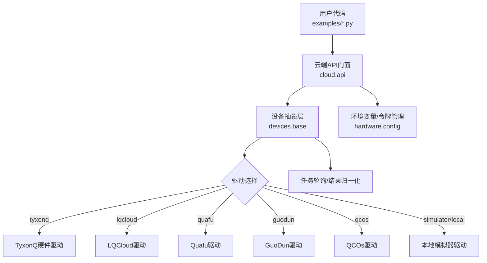
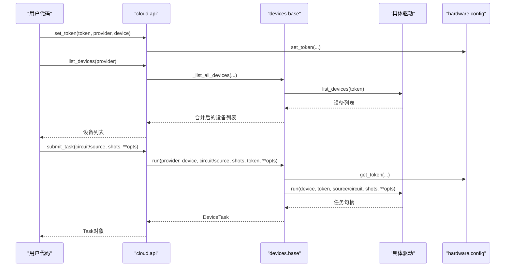
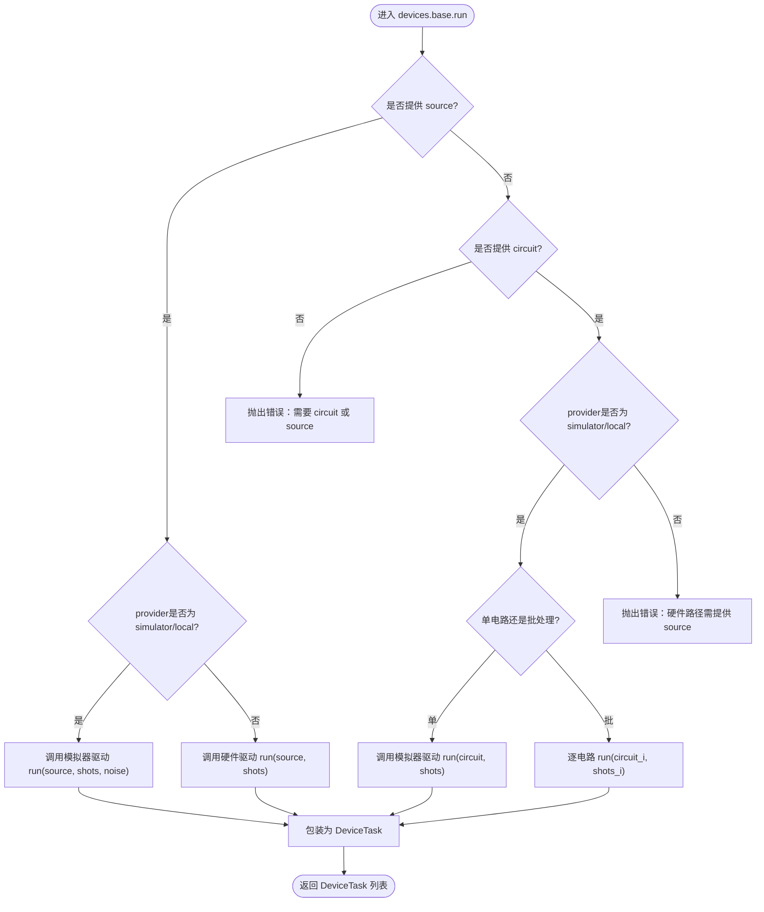
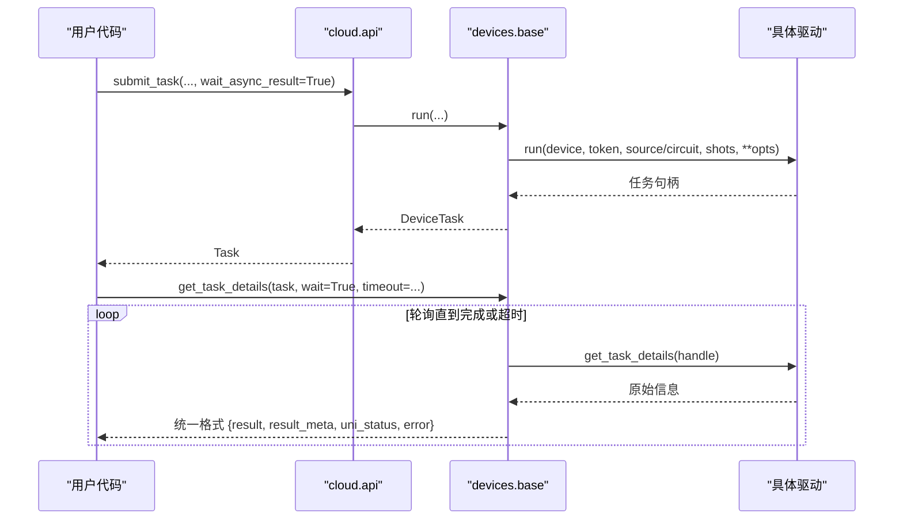
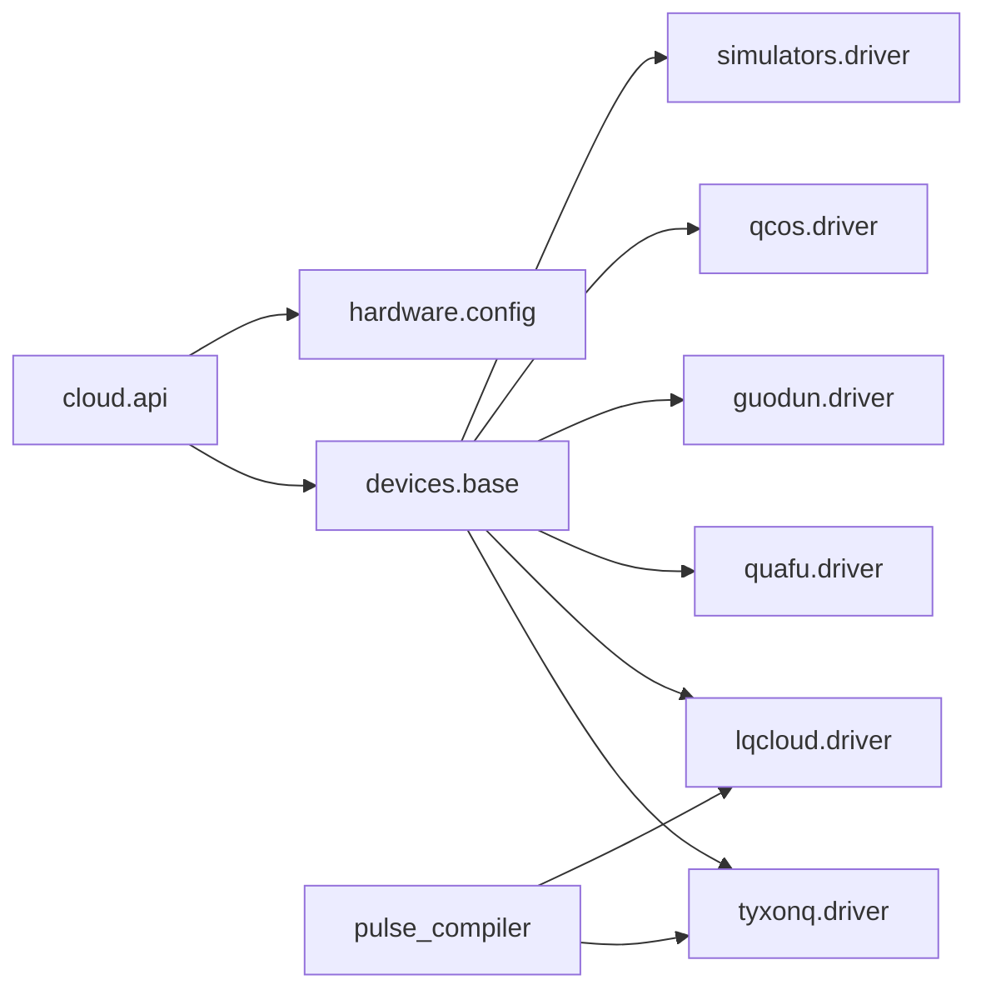

# TyxonQ云平台

<cite>
**本文引用的文件**
- [src/tyxonq/cloud/api.py](file://src/tyxonq/cloud/api.py)
- [src/tyxonq/devices/base.py](file://src/tyxonq/devices/base.py)
- [src/tyxonq/devices/hardware/config.py](file://src/tyxonq/devices/hardware/config.py)
- [docs/source/cloud_services/task_submission.rst](file://docs/source/cloud_services/task_submission.rst)
- [docs/source/cloud_services/device_management.rst](file://docs/source/cloud_services/device_management.rst)
- [examples/cloud_api_task.py](file://examples/cloud_api_task.py)
- [examples/cloud_api_devices.py](file://examples/cloud_api_devices.py)
- [examples/run_circuit_on_lqcloud.py](file://examples/run_circuit_on_lqcloud.py)
- [src/tyxonq/compiler/pulse_compiler/native/pulse_compiler.py](file://src/tyxonq/compiler/pulse_compiler/native/pulse_compiler.py)
- [src/tyxonq/compiler/pulse_compiler/native/tqasm_exporter.py](file://src/tyxonq/compiler/pulse_compiler/native/tqasm_exporter.py)
- [tests_core_module/test_qasm3_import.py](file://tests_core_module/test_qasm3_import.py)
- [docs/source/technical_references/performance_optimization.rst](file://docs/source/technical_references/performance_optimization.rst)
- [src/tyxonq/core/errors.py](file://src/tyxonq/core/errors.py)
</cite>

## 目录
1. [简介](#简介)
2. [项目结构](#项目结构)
3. [核心组件](#核心组件)
4. [架构总览](#架构总览)
5. [详细组件分析](#详细组件分析)
6. [依赖关系分析](#依赖关系分析)
7. [性能考虑](#性能考虑)
8. [故障排除指南](#故障排除指南)
9. [结论](#结论)
10. [附录](#附录)

## 简介
本文件面向需要在TyxonQ云平台上提交、管理与执行量子任务的用户与开发者，系统性地说明：
- 云平台特性与优势：统一的设备抽象、多后端支持（本地模拟器与多家硬件平台）、脉冲级控制与编译优化。
- API密钥与环境变量配置方法。
- 任务提交流程与状态管理机制。
- 支持的量子电路格式与编译选项（OpenQASM 2/3、TQASM 0.2等）。
- 完整代码示例路径（简单电路执行、批量任务、结果处理）。
- 性能优化建议与常见问题排查。
- 与本地模拟器的差异及注意事项。

## 项目结构
TyxonQ将“云端API门面”、“设备抽象层”、“硬件驱动”和“编译器”解耦，形成可插拔的架构：
- 云端API门面：提供set_token、list_devices、submit_task、get_task_details、run、result、cancel等统一接口。
- 设备抽象层：统一DeviceTask包装、驱动选择、任务轮询与结果归一化。
- 硬件驱动：按provider（如tyxonq、lqcloud、quafu、guodun、qcos、ibm）加载具体实现。
- 编译器：支持从Circuit到QASM2/QASM3/TQASM的转换，以及脉冲级编译与导出。

图表来源
- [src/tyxonq/cloud/api.py:1-160](file://src/tyxonq/cloud/api.py#L1-L160)
- [src/tyxonq/devices/base.py:146-258](file://src/tyxonq/devices/base.py#L146-L258)
- [src/tyxonq/devices/hardware/config.py:1-78](file://src/tyxonq/devices/hardware/config.py#L1-L78)

章节来源
- [src/tyxonq/cloud/api.py:1-160](file://src/tyxonq/cloud/api.py#L1-L160)
- [src/tyxonq/devices/base.py:146-258](file://src/tyxonq/devices/base.py#L146-L258)
- [src/tyxonq/devices/hardware/config.py:1-78](file://src/tyxonq/devices/hardware/config.py#L1-L78)

## 核心组件
- 云端API门面（cloud.api）
  - set_token/set_default：设置认证与默认provider/device。
  - list_devices：列出可用设备（含模拟器与硬件）。
  - submit_task/run：提交任务或执行电路/源码；返回统一任务句柄。
  - get_task_details/result/cancel：查询任务详情、获取结果、取消任务。
- 设备抽象层（devices.base）
  - DeviceTask：统一封装异步/同步任务，提供get_result、cancel。
  - resolve_driver：根据provider/device解析具体驱动。
  - run/expval：统一执行入口，自动注入噪声参数（仅模拟器），规范化shots与批处理。
  - get_task_details：统一轮询与结果格式归一化。
- 配置与端点（devices.hardware.config）
  - ENDPOINTS：各provider的基础URL与版本。
  - set_token/get_token：内存令牌存储与环境变量回退。
  - set_default/get_default_provider/get_default_device：默认运行目标。

章节来源
- [src/tyxonq/cloud/api.py:22-158](file://src/tyxonq/cloud/api.py#L22-L158)
- [src/tyxonq/devices/base.py:14-578](file://src/tyxonq/devices/base.py#L14-L578)
- [src/tyxonq/devices/hardware/config.py:1-78](file://src/tyxonq/devices/hardware/config.py#L1-L78)

## 架构总览
TyxonQ通过“门面→抽象→驱动”的分层设计，屏蔽底层差异，提供一致的任务提交与结果获取体验。云端API负责易用性，设备抽象层负责统一行为，驱动层对接具体云平台或模拟器。

图表来源
- [src/tyxonq/cloud/api.py:22-139](file://src/tyxonq/cloud/api.py#L22-L139)
- [src/tyxonq/devices/base.py:294-445](file://src/tyxonq/devices/base.py#L294-L445)
- [src/tyxonq/devices/hardware/config.py:24-50](file://src/tyxonq/devices/hardware/config.py#L24-L50)

## 详细组件分析

### 云端API门面（cloud.api）
- 职责：提供简洁易用的云端执行入口，内部委托至devices.base.run以保持一致行为。
- 关键函数：
  - set_token/set_default：持久化token与默认目标。
  - list_devices：聚合模拟器与硬件设备列表。
  - submit_task/run：统一提交任务，支持circuit或source（预编译源码）。
  - get_task_details/result/cancel：统一查询与结果获取。

章节来源
- [src/tyxonq/cloud/api.py:22-158](file://src/tyxonq/cloud/api.py#L22-L158)

### 设备抽象层（devices.base）
- DeviceTask：封装provider/device/handle/async_result，并提供get_result与cancel。
- resolve_driver：根据provider映射到具体驱动模块（simulator、tyxonq、ibm、qcos、quafu、lqcloud、guodun）。
- run：
  - 若传入source：直接交由驱动提交（硬件路径要求已编译源码）。
  - 若传入circuit：仅模拟器/本地路径支持；真机需先编译为source。
  - 自动注入noise/use_noise（仅模拟器），并过滤对真机无意义的参数。
  - 支持单电路与批处理（shots可为标量或列表）。
- get_task_details：统一轮询策略、超时处理与结果格式归一化（result/result_meta/unified status/error）。

图表来源
- [src/tyxonq/devices/base.py:294-445](file://src/tyxonq/devices/base.py#L294-L445)

章节来源
- [src/tyxonq/devices/base.py:14-578](file://src/tyxonq/devices/base.py#L14-L578)

### 配置与端点（devices.hardware.config）
- 端点配置：TYXONQ_BASE_URL、TYXONQ_API_VERSION等环境变量覆盖默认值。
- 令牌管理：支持按provider/device维度存储，并回退到全局环境变量TYXONQ_API_KEY。
- 默认目标：默认provider为tyxonq，默认device为tyxonq::simulator:mps。

章节来源
- [src/tyxonq/devices/hardware/config.py:1-78](file://src/tyxonq/devices/hardware/config.py#L1-L78)

### 任务提交流程与状态管理
- 提交流程：
  - 使用cloud.api.submit_task或run提交任务，返回DeviceTask。
  - 通过DeviceTask.get_result(wait=True/False, timeout, poll_interval)轮询状态。
- 状态管理：
  - 统一状态字符串：done/completed/success/finished视为完成；failed/error/cancelled视为失败。
  - 超时处理：超过timeout仍非终止状态时发出警告并返回当前结果（可能为空或不完整）。
- 结果归一化：
  - result：计数字典（如{"00": 51, "11": 49}）。
  - result_meta：原始驱动payload。
  - metadata：提升内层引擎元数据字段（如num_qubits）。
  - expectations/probabilities：可选键，确保存在。

图表来源
- [src/tyxonq/devices/base.py:497-558](file://src/tyxonq/devices/base.py#L497-L558)
- [src/tyxonq/cloud/api.py:67-73](file://src/tyxonq/cloud/api.py#L67-L73)

章节来源
- [docs/source/cloud_services/task_submission.rst:211-443](file://docs/source/cloud_services/task_submission.rst#L211-L443)
- [src/tyxonq/devices/base.py:497-558](file://src/tyxonq/devices/base.py#L497-L558)

### 支持的量子电路格式与编译选项
- 支持的格式：
  - OpenQASM 2.0：用于homebrew_s2等设备的gate-level提交。
  - OpenQASM 3.0：标准格式，包含更丰富的声明与表达式。
  - TQASM 0.2：脉冲级控制专用格式，支持波形与帧定义。
- 编译选项：
  - output="qasm"/"qasm3"/"openqasm3"/"tqasm"/"tqasm0.2"等。
  - inline_pulses：控制是否内联脉冲定义（适合云端提交与序列化）。
  - 输出适配：不同provider的设备可能需要特定格式（如tyxonq_homebrew_tqasm）。

章节来源
- [src/tyxonq/compiler/pulse_compiler/native/pulse_compiler.py:162-184](file://src/tyxonq/compiler/pulse_compiler/native/pulse_compiler.py#L162-L184)
- [src/tyxonq/compiler/pulse_compiler/native/tqasm_exporter.py:94-127](file://src/tyxonq/compiler/pulse_compiler/native/tqasm_exporter.py#L94-L127)
- [tests_core_module/test_qasm3_import.py:583-622](file://tests_core_module/test_qasm3_import.py#L583-L622)

### 代码示例与用法路径
- 简单电路执行（链式API）：
  - 参考：[examples/cloud_api_task.py:52-59](file://examples/cloud_api_task.py#L52-L59)
- 批量任务与结果处理：
  - 参考：[docs/source/cloud_services/task_submission.rst:177-210](file://docs/source/cloud_services/task_submission.rst#L177-L210)
- 设备列表与令牌配置：
  - 参考：[examples/cloud_api_devices.py:16-21](file://examples/cloud_api_devices.py#L16-L21)
- LQCloud真机运行示例：
  - 参考：[examples/run_circuit_on_lqcloud.py:52-109](file://examples/run_circuit_on_lqcloud.py#L52-L109)

章节来源
- [examples/cloud_api_task.py:1-65](file://examples/cloud_api_task.py#L1-L65)
- [examples/cloud_api_devices.py:1-29](file://examples/cloud_api_devices.py#L1-L29)
- [examples/run_circuit_on_lqcloud.py:1-114](file://examples/run_circuit_on_lqcloud.py#L1-L114)
- [docs/source/cloud_services/task_submission.rst:177-210](file://docs/source/cloud_services/task_submission.rst#L177-L210)

## 依赖关系分析
- cloud.api依赖devices.base进行统一执行与任务管理。
- devices.base通过resolve_driver动态加载具体驱动模块。
- hardware.config提供令牌与端点配置，被cloud.api与devices.base共同使用。
- 编译器模块（pulse_compiler）生成TQASM/OpenQASM供驱动提交。

图表来源
- [src/tyxonq/devices/base.py:146-258](file://src/tyxonq/devices/base.py#L146-L258)
- [src/tyxonq/cloud/api.py:18-20](file://src/tyxonq/cloud/api.py#L18-L20)
- [src/tyxonq/compiler/pulse_compiler/native/pulse_compiler.py:162-184](file://src/tyxonq/compiler/pulse_compiler/native/pulse_compiler.py#L162-L184)

章节来源
- [src/tyxonq/devices/base.py:146-258](file://src/tyxonq/devices/base.py#L146-L258)
- [src/tyxonq/cloud/api.py:18-20](file://src/tyxonq/cloud/api.py#L18-L20)

## 性能考虑
- 测量分组与调度：
  - 通过measurement_rewrite与shot_scheduler减少电路执行次数与总shots。
- 光锥简化（lightcone）：
  - 裁剪不影响测量的门，降低深度与门数。
- 后端选择：
  - NumPy用于开发与小系统；PyTorch用于梯度计算；CuPyNumeric用于GPU加速。
- 状态向量与MPS：
  - statevector适用于纯态小系统；MPS适用于低纠缠大系统。
- 批处理与并行：
  - 使用batch_run或并发执行多个电路，提高吞吐。
- 云卸载：
  - 将经典核（如HF/积分）卸载到云端GPU节点，显著提升速度。

章节来源
- [docs/source/technical_references/performance_optimization.rst:10-172](file://docs/source/technical_references/performance_optimization.rst#L10-L172)
- [docs/source/technical_references/performance_optimization.rst:254-278](file://docs/source/technical_references/performance_optimization.rst#L254-L278)
- [docs/source/technical_references/performance_optimization.rst:326-371](file://docs/source/technical_references/performance_optimization.rst#L326-L371)

## 故障排除指南
- 常见错误类型：
  - CompilationError：编译失败或输出无效。
  - DeviceExecutionError：设备执行失败（超时、连接问题等）。
- 提交错误：
  - 检查设备状态与权限，确认设备在线且队列合理。
- 执行错误：
  - 根据错误信息定位原因（如qubits不足、depth过大、超时）。
- 超时处理：
  - 增大timeout或采用指数退避轮询；记录task ID以便恢复。
- 回退策略：
  - 硬件不可用时自动回退到本地模拟器，保持流程连续性。

章节来源
- [src/tyxonq/core/errors.py:1-17](file://src/tyxonq/core/errors.py#L1-L17)
- [docs/source/cloud_services/task_submission.rst:447-619](file://docs/source/cloud_services/task_submission.rst#L447-L619)
- [docs/source/cloud_services/device_management.rst:354-414](file://docs/source/cloud_services/device_management.rst#L354-L414)

## 结论
TyxonQ云平台通过统一的API与设备抽象层，提供了跨多种硬件与模拟器的稳定执行环境。借助灵活的编译选项、完善的任务管理与性能优化策略，用户可以在开发与生产环境中高效地构建、提交与监控量子任务。结合本地模拟器与云端硬件，既能快速迭代算法，又能验证真实设备上的表现。

## 附录

### API密钥配置与环境变量设置
- 设置令牌：
  - 使用set_token(token, provider, device)设置provider/device维度的令牌。
  - 支持全局环境变量TYXONQ_API_KEY作为回退。
- 端点配置：
  - TYXONQ_BASE_URL与TYXONQ_API_VERSION可覆盖默认云端地址与版本。
- 默认目标：
  - 可通过set_default设置默认provider与device。

章节来源
- [src/tyxonq/devices/hardware/config.py:24-65](file://src/tyxonq/devices/hardware/config.py#L24-L65)
- [src/tyxonq/cloud/api.py:22-28](file://src/tyxonq/cloud/api.py#L22-L28)

### 任务提交流程与状态管理（实践要点）
- 同步执行：
  - task.results()或get_result(wait=True)阻塞直至完成。
- 异步执行：
  - get_result(wait=False)立即返回当前状态；按需轮询。
- 自定义轮询：
  - 基于uni_status判断完成/失败；实现指数退避与重试逻辑。
- 结果提取：
  - 从result_meta.raw.task中获取队列、qubits、depth、shots、时间戳等元数据。

章节来源
- [docs/source/cloud_services/task_submission.rst:211-443](file://docs/source/cloud_services/task_submission.rst#L211-L443)
- [src/tyxonq/devices/base.py:497-558](file://src/tyxonq/devices/base.py#L497-L558)

### 支持的量子电路格式与编译选项（实践要点）
- Gate-level：
  - OpenQASM 2.0用于homebrew_s2等设备。
- Pulse-level：
  - TQASM 0.2用于脉冲级控制；需禁用优化标志以保持原样提交。
- 编译输出：
  - 根据目标设备选择合适的output（qasm/qasm3/tqasm等）。
  - inline_pulses控制是否内联波形定义，便于云端提交。

章节来源
- [src/tyxonq/compiler/pulse_compiler/native/pulse_compiler.py:162-184](file://src/tyxonq/compiler/pulse_compiler/native/pulse_compiler.py#L162-L184)
- [src/tyxonq/compiler/pulse_compiler/native/tqasm_exporter.py:94-127](file://src/tyxonq/compiler/pulse_compiler/native/tqasm_exporter.py#L94-L127)

### 与本地模拟器的差异与注意事项
- 执行路径：
  - 模拟器支持直接运行Circuit；硬件路径需先编译为source。
- 噪声模型：
  - 仅模拟器支持noise/use_noise注入；真机噪声由硬件决定。
- 资源限制：
  - 模拟器受内存限制（statevector O(2^n)）；硬件受qubits/depth限制。
- 性能特征：
  - 模拟器适合快速迭代；硬件适合最终验证与真实噪声评估。

章节来源
- [src/tyxonq/devices/base.py:368-445](file://src/tyxonq/devices/base.py#L368-L445)
- [docs/source/technical_references/performance_optimization.rst:133-157](file://docs/source/technical_references/performance_optimization.rst#L133-L157)