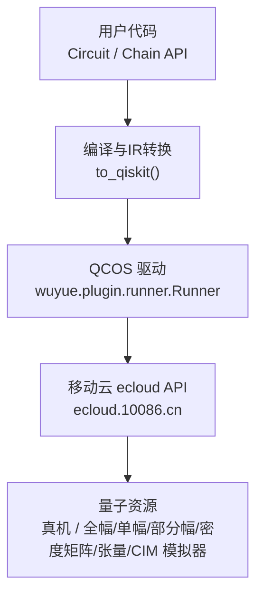
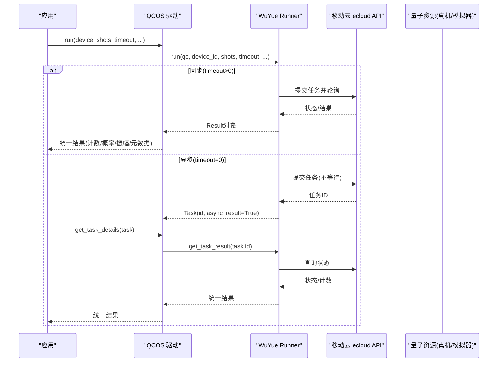
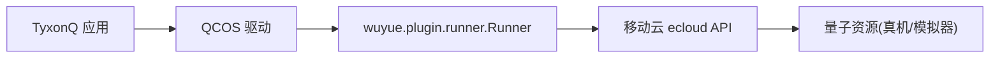

# 中国移动QCOS平台

<cite>
**本文引用的文件**
- [qcos_provider.md](file://docs/qcos_provider.md)
- [driver.py](file://src/tyxonq/devices/hardware/qcos/driver.py)
- [__init__.py](file://src/tyxonq/devices/hardware/qcos/__init__.py)
- [qcos_cloud_task.py](file://examples/qcos_cloud_task.py)
- [task_submission.rst](file://docs/source/cloud_services/task_submission.rst)
- [device_management.rst](file://docs/source/cloud_services/device_management.rst)
- [performance_optimization.rst](file://docs/source/technical_references/performance_optimization.rst)
- [errors.py](file://src/tyxonq/core/errors.py)
- [topology.py](file://src/tyxonq/devices/hardware/topology.py)
- [test_device_topology_cache.py](file://tests_core_module/test_device_topology_cache.py)
- [test_lqcloud_run_routing_wiring.py](file://tests_core_module/test_lqcloud_run_routing_wiring.py)
- [pulse_variational_algorithms.py](file://examples/pulse_variational_algorithms.py)
- [optimization_examples.rst](file://docs/source/examples/optimization_examples.rst)
- [QCOS_CHANGES.md](file://QCOS_CHANGES.md)
</cite>

## 目录
1. [简介](#简介)
2. [项目结构](#项目结构)
3. [核心组件](#核心组件)
4. [架构总览](#架构总览)
5. [详细组件分析](#详细组件分析)
6. [依赖关系分析](#依赖关系分析)
7. [性能与成本优化](#性能与成本优化)
8. [故障排查指南](#故障排查指南)
9. [结论](#结论)
10. [附录](#附录)

## 简介
本文件面向需要在 TyxonQ 中集成并高效使用中国移动 QCOS（五岳）云平台进行量子计算任务的工程师与研究人员。内容覆盖：
- QCOS 平台特性与服务类型（真机与多种模拟器）
- SDK 安装、认证配置与环境要求
- 设备发现与连接建立方法
- 任务提交、监控与结果获取的完整流程
- 在 QCOS 上实现常见量子算法的实践指引
- 网络配置、超时处理与错误重试机制
- QCOS 特有功能与限制
- 性能调优与成本优化建议

## 项目结构
TyxonQ 对 QCOS 的支持以“驱动”形式提供，位于硬件设备层；上层通过统一的 Chain API 或 Cloud API 调用，底层将 TyxonQ IR 转换为 Qiskit QuantumCircuit 后交由 WuYue SDK 执行。

图表来源
- [driver.py:80-158](file://src/tyxonq/devices/hardware/qcos/driver.py#L80-L158)
- [qcos_provider.md:77-102](file://docs/qcos_provider.md#L77-L102)
- [QCOS_CHANGES.md:74-87](file://QCOS_CHANGES.md#L74-L87)

章节来源
- [driver.py:1-269](file://src/tyxonq/devices/hardware/qcos/driver.py#L1-L269)
- [qcos_provider.md:1-169](file://docs/qcos_provider.md#L1-L169)
- [QCOS_CHANGES.md:1-153](file://QCOS_CHANGES.md#L1-L153)

## 核心组件
- QCOS 驱动模块：负责认证、任务提交、状态轮询与结果统一化
- WuYue SDK Runner：封装与移动云平台的交互（含自动重试、异步/同步模式）
- 设备目录：静态列出已知设备 ID（因新版 SDK 不再暴露动态枚举接口）
- 统一结果格式：counts、概率、振幅、原始响应等元数据

关键职责
- 认证：优先从参数获取 access_key/secret_key，其次回退到环境变量
- 提交：将 Qiskit QuantumCircuit 提交至指定设备，支持 shots、timeout、auto_retry、task_name、calculate_type 等
- 查询：根据任务 ID 轮询状态，映射为统一 uni_status
- 设备列表：返回带 provider 前缀的设备名

章节来源
- [driver.py:37-65](file://src/tyxonq/devices/hardware/qcos/driver.py#L37-L65)
- [driver.py:80-158](file://src/tyxonq/devices/hardware/qcos/driver.py#L80-L158)
- [driver.py:161-238](file://src/tyxonq/devices/hardware/qcos/driver.py#L161-L238)
- [driver.py:241-269](file://src/tyxonq/devices/hardware/qcos/driver.py#L241-L269)
- [qcos_provider.md:22-75](file://docs/qcos_provider.md#L22-L75)

## 架构总览
下图展示从应用层到 QCOS 云端的端到端调用链，包括同步与异步两种模式。

图表来源
- [driver.py:80-158](file://src/tyxonq/devices/hardware/qcos/driver.py#L80-L158)
- [driver.py:161-238](file://src/tyxonq/devices/hardware/qcos/driver.py#L161-L238)
- [qcos_provider.md:117-136](file://docs/qcos_provider.md#L117-L136)

## 详细组件分析

### 认证与凭据管理
- 支持两种优先级：函数参数 > 环境变量
- 旧版 sdk_code/QCOS_SDK_CODE 已弃用，会抛出明确异常提示迁移
- 缺失任一凭据将抛出 ValueError，避免静默失败

章节来源
- [driver.py:37-65](file://src/tyxonq/devices/hardware/qcos/driver.py#L37-L65)
- [qcos_provider.md:22-63](file://docs/qcos_provider.md#L22-L63)

### 设备发现与连接
- list_devices 返回静态设备清单（带 qcos:: 前缀），包含多种模拟器与真机
- 由于新版 SDK 移除了动态枚举接口，需以控制台为准确认可用性
- 若未配置凭据，list_devices 返回空列表并记录警告

章节来源
- [driver.py:241-269](file://src/tyxonq/devices/hardware/qcos/driver.py#L241-L269)
- [qcos_provider.md:65-75](file://docs/qcos_provider.md#L65-L75)

### 任务提交与运行选项
- 接受 Qiskit QuantumCircuit（由 TyxonQ IR 转换而来）
- 关键选项：
  - device：设备标识（可带 provider 前缀）
  - shots：采样次数
  - timeout：等待秒数（0 表示异步）
  - auto_retry：是否启用 Runner 内部重试
  - task_name：任务名称
  - calculate_type：模拟器必需的计算类型（如单点/分布式）
  - bit_info、qmachine_type、dry_run、initial_mapping 等透传给 Runner

章节来源
- [driver.py:80-158](file://src/tyxonq/devices/hardware/qcos/driver.py#L80-L158)
- [qcos_provider.md:104-115](file://docs/qcos_provider.md#L104-L115)
- [qcos_cloud_task.py:41-55](file://examples/qcos_cloud_task.py#L41-L55)

### 任务监控与结果获取
- 同步模式：run 直接返回统一结果字典
- 异步模式：返回任务对象，后续通过 get_task_details 轮询
- 统一状态映射：submitted/queued/running/waiting/completed/failed/unknown
- 结果形状包含 result（计数）、result_meta（任务ID、设备、概率、振幅、原始响应）、uni_status、error

章节来源
- [driver.py:161-238](file://src/tyxonq/devices/hardware/qcos/driver.py#L161-L238)
- [qcos_provider.md:138-167](file://docs/qcos_provider.md#L138-L167)

### 典型工作流示例
- 构建 Bell 态电路并提交到全幅模拟器
- 设置 calculate_type 以满足模拟器要求
- 打印统一结果

章节来源
- [qcos_cloud_task.py:28-57](file://examples/qcos_cloud_task.py#L28-L57)

### 通用云端任务管理参考
- 提供通用的任务提交、监控、批处理、自定义轮询策略、错误处理与最佳实践
- 适用于跨平台统一认知，便于在 QCOS 场景下复用思路

章节来源
- [task_submission.rst:13-310](file://docs/source/cloud_services/task_submission.rst#L13-L310)
- [task_submission.rst:447-567](file://docs/source/cloud_services/task_submission.rst#L447-L567)

## 依赖关系分析
- 运行时依赖：wuyue SDK（>=1.0，统一 whl），内部导入 wuyue.plugin.runner.Runner
- 兼容性：新 SDK 固定了 qiskit 版本，必要时隔离环境或使用 --no-deps
- 拓扑发现韧性：当拓扑抓取失败时，系统会降级沿用缓存或跳过路由，确保提交不被阻断

图表来源
- [driver.py:106-147](file://src/tyxonq/devices/hardware/qcos/driver.py#L106-L147)
- [topology.py:23-60](file://src/tyxonq/devices/hardware/topology.py#L23-L60)
- [test_device_topology_cache.py:168-195](file://tests_core_module/test_device_topology_cache.py#L168-L195)
- [test_lqcloud_run_routing_wiring.py:79-103](file://tests_core_module/test_lqcloud_run_routing_wiring.py#L79-L103)

章节来源
- [driver.py:106-147](file://src/tyxonq/devices/hardware/qcos/driver.py#L106-L147)
- [topology.py:23-60](file://src/tyxonq/devices/hardware/topology.py#L23-L60)
- [test_device_topology_cache.py:168-195](file://tests_core_module/test_device_topology_cache.py#L168-L195)
- [test_lqcloud_run_routing_wiring.py:79-103](file://tests_core_module/test_lqcloud_run_routing_wiring.py#L79-L103)

## 性能与成本优化

### 在 QCOS 上的优化要点
- 选择合适的设备与 calculate_type：模拟器通常需要显式指定计算类型（单点/分布式）
- 合理设置 shots：平衡统计精度与成本
- 利用 auto_retry：减少瞬态失败的额外开销
- 控制 timeout：开发阶段短超时快速反馈，生产长超时保障完成
- 使用批处理与并行：结合上游 Runner 能力与队列空闲时段提交

章节来源
- [qcos_provider.md:104-115](file://docs/qcos_provider.md#L104-L115)
- [qcos_cloud_task.py:41-55](file://examples/qcos_cloud_task.py#L41-L55)

### 通用性能优化策略（适用于 QCOS 任务）
- 测量分组：减少电路执行次数
- 方差加权 shot 调度：降低总采样数达到目标精度
- 光锥简化：裁剪无关门操作
- 后端选择：NumPy/PyTorch/CuPyNumeric 按规模与需求切换
- 状态向量/MPS：依据纠缠程度与内存约束选择
- 主动空间近似与 Ansatz 选择：化学问题中显著降维
- 云端卸载：经典核（HF/积分）可上云 GPU 加速

章节来源
- [performance_optimization.rst:22-99](file://docs/source/technical_references/performance_optimization.rst#L22-L99)
- [performance_optimization.rst:100-172](file://docs/source/technical_references/performance_optimization.rst#L100-L172)
- [performance_optimization.rst:173-278](file://docs/source/technical_references/performance_optimization.rst#L173-L278)
- [performance_optimization.rst:279-371](file://docs/source/technical_references/performance_optimization.rst#L279-L371)
- [performance_optimization.rst:372-473](file://docs/source/technical_references/performance_optimization.rst#L372-L473)

### 成本优化建议
- 先本地/模拟器验证，再上真机
- 使用较短 shots 做探索性实验，收敛后再放大
- 避开高峰时段提交，降低排队与整体时延
- 合理拆分任务，利用异步提交与批处理提高吞吐

[本节为通用指导，无需特定文件引用]

## 故障排查指南

### 常见问题与定位
- 认证失败或缺失：检查 access_key/secret_key 或环境变量；旧版 sdk_code 已弃用
- 设备不可用：list_devices 为空或控制台显示离线；确认权限与设备状态
- 任务失败：查看 uni_status 与 error 字段，必要时保留任务 ID 以便回溯
- 网络/超时：调整 timeout；实现指数退避重试；关注 Runner 的 auto_retry

章节来源
- [driver.py:37-65](file://src/tyxonq/devices/hardware/qcos/driver.py#L37-L65)
- [driver.py:161-238](file://src/tyxonq/devices/hardware/qcos/driver.py#L161-L238)
- [qcos_provider.md:53-63](file://docs/qcos_provider.md#L53-L63)
- [task_submission.rst:447-567](file://docs/source/cloud_services/task_submission.rst#L447-L567)

### 拓扑发现失败的处理
- 无网络/无凭证/SDK 未装时，若存在过期缓存则降级沿用并告警
- 若无缓存，返回空 DeviceRule，编译器跳过路由，仍允许提交
- 可通过环境变量重定向缓存目录

章节来源
- [topology.py:23-60](file://src/tyxonq/devices/hardware/topology.py#L23-L60)
- [test_device_topology_cache.py:168-195](file://tests_core_module/test_device_topology_cache.py#L168-L195)
- [test_lqcloud_run_routing_wiring.py:79-103](file://tests_core_module/test_lqcloud_run_routing_wiring.py#L79-L103)

### 错误类型与扩展
- TyxonQError 及其子类用于统一异常体系
- 设备执行错误涵盖超时、连接等问题

章节来源
- [errors.py:1-17](file://src/tyxonq/core/errors.py#L1-L17)

## 结论
TyxonQ 对 QCOS 的集成提供了简洁一致的接口：从认证、设备发现、任务提交到结果获取均被抽象为统一模型。借助 WuYue SDK 的 Runner，开发者可在同步与异步模式间灵活切换，并通过 auto_retry、timeout、calculate_type 等参数获得稳定且高效的执行体验。配合通用性能优化策略与成本管控手段，可在保证精度的同时显著降低成本与时延。

[本节为总结，无需特定文件引用]

## 附录

### 安装与配置步骤（摘要）
- 安装统一 wuyue SDK（>=1.0）
- 准备 access_key/secret_key（或通过环境变量）
- 使用 provider="qcos" 提交任务，按需设置 device、shots、timeout、calculate_type 等

章节来源
- [QCOS_CHANGES.md:91-114](file://QCOS_CHANGES.md#L91-L114)
- [qcos_provider.md:9-20](file://docs/qcos_provider.md#L9-L20)
- [qcos_provider.md:32-63](file://docs/qcos_provider.md#L32-L63)

### 在 QCOS 上实现量子算法的实践指引
- VQE/QAOA：可参考脉冲变分算法示例，理解 Ansatz 设计与参数优化流程
- 在 QCOS 上执行时，注意：
  - 使用合适的 shots 与 timeout
  - 对模拟器设置 calculate_type
  - 利用测量分组与光锥简化减少执行次数
  - 结合批处理与异步提交提升吞吐

章节来源
- [pulse_variational_algorithms.py:1-31](file://examples/pulse_variational_algorithms.py#L1-L31)
- [optimization_examples.rst:1-54](file://docs/source/examples/optimization_examples.rst#L1-L54)
- [performance_optimization.rst:22-99](file://docs/source/technical_references/performance_optimization.rst#L22-L99)

### QCOS 特有功能与限制
- 设备列表为静态清单，需以控制台为准
- 模拟器通常要求显式 calculate_type
- 新版 SDK 移除了动态枚举接口，list_devices 仅返回已知设备
- 认证方式已更新为 access_key + secret_key，旧版 sdk_code 不再支持

章节来源
- [driver.py:241-269](file://src/tyxonq/devices/hardware/qcos/driver.py#L241-L269)
- [qcos_provider.md:65-75](file://docs/qcos_provider.md#L65-L75)
- [qcos_provider.md:22-63](file://docs/qcos_provider.md#L22-L63)
- [QCOS_CHANGES.md:28-38](file://QCOS_CHANGES.md#L28-L38)