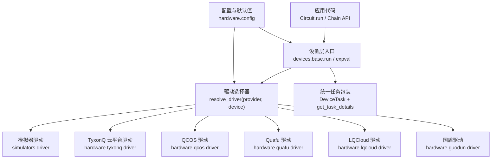
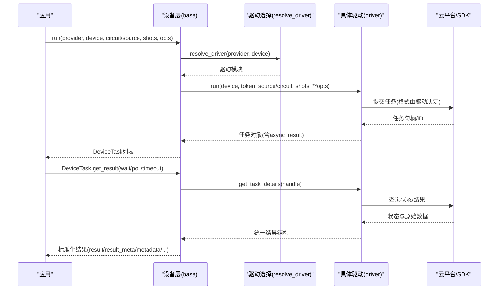
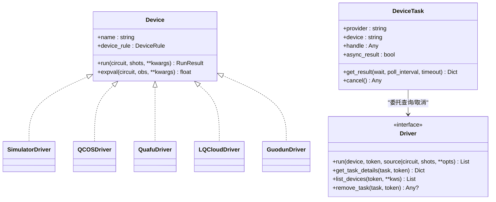
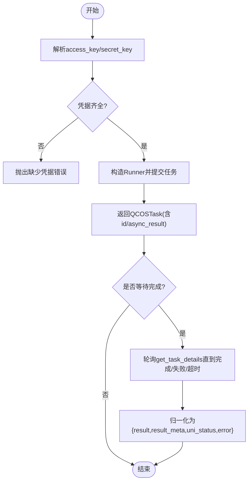
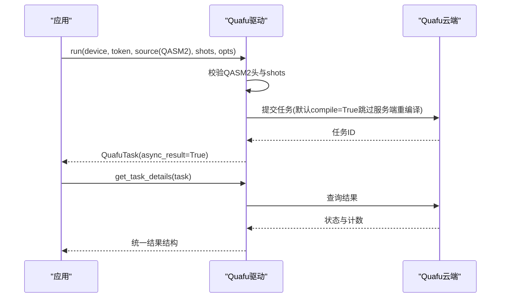
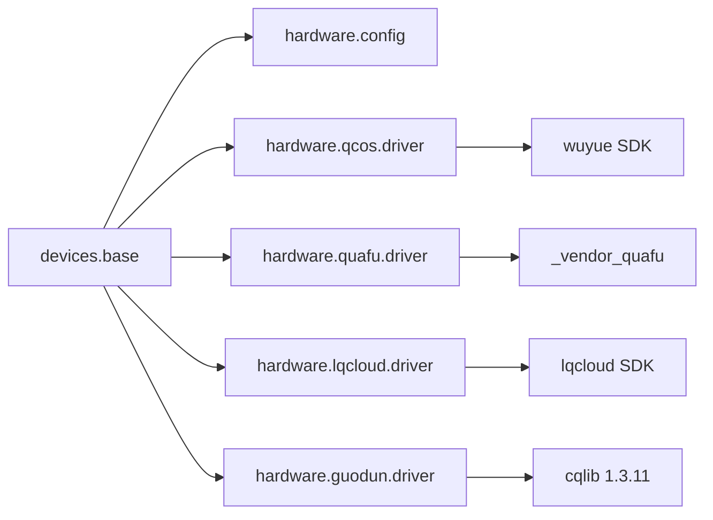

# 多提供商集成

<cite>
**本文引用的文件**
- [src/tyxonq/devices/base.py](file://src/tyxonq/devices/base.py)
- [src/tyxonq/devices/hardware/config.py](file://src/tyxonq/devices/hardware/config.py)
- [src/tyxonq/devices/hardware/qcos/driver.py](file://src/tyxonq/devices/hardware/qcos/driver.py)
- [src/tyxonq/devices/hardware/quafu/driver.py](file://src/tyxonq/devices/hardware/quafu/driver.py)
- [src/tyxonq/devices/hardware/lqcloud/driver.py](file://src/tyxonq/devices/hardware/lqcloud/driver.py)
- [src/tyxonq/devices/hardware/guodun/driver.py](file://src/tyxonq/devices/hardware/guodun/driver.py)
- [docs/qcos_provider.md](file://docs/qcos_provider.md)
- [docs/quafu_provider.md](file://docs/quafu_provider.md)
- [docs/guodun_provider.md](file://docs/guodun_provider.md)
- [examples/run_circuit_on_quafu.py](file://examples/run_circuit_on_quafu.py)
- [examples/qcos_cloud_task.py](file://examples/qcos_cloud_task.py)
- [examples/cloud_api_devices.py](file://examples/cloud_api_devices.py)
</cite>

## 目录
1. [简介](#简介)
2. [项目结构](#项目结构)
3. [核心组件](#核心组件)
4. [架构总览](#架构总览)
5. [详细组件分析](#详细组件分析)
6. [依赖关系分析](#依赖关系分析)
7. [性能与适用场景](#性能与适用场景)
8. [故障排除指南](#故障排除指南)
9. [结论](#结论)
10. [附录：使用示例与最佳实践](#附录使用示例与最佳实践)

## 简介
本文件面向 TyxonQ 的多量子计算提供商集成，系统梳理并解释以下能力：
- 支持的云平台提供商：TyxonQ 云平台、中国移动 QCOS（五岳）、BAQIS Quafu、LQCloud、国盾（GuoDun）等。
- 提供商抽象层设计：统一设备接口、驱动注册机制、任务包装与结果归一化。
- 各提供商的配置选项与认证方式差异。
- 设备发现与拓扑信息获取方法。
- 使用示例、最佳实践与提供商切换策略。
- 性能对比与适用场景分析。
- 故障排除与常见问题解决方案。

## 项目结构
TyxonQ 将“执行设备”抽象为统一的 Device 协议，并通过 provider/device 解析器动态加载具体驱动。硬件相关配置与默认值集中在 hardware.config；各云厂商的驱动位于 devices/hardware/<provider>/driver.py。文档侧提供各提供商的使用说明与注意事项。

图表来源
- [src/tyxonq/devices/base.py:112-258](file://src/tyxonq/devices/base.py#L112-L258)
- [src/tyxonq/devices/base.py:294-445](file://src/tyxonq/devices/base.py#L294-L445)
- [src/tyxonq/devices/hardware/config.py:7-19](file://src/tyxonq/devices/hardware/config.py#L7-L19)

章节来源
- [src/tyxonq/devices/base.py:112-258](file://src/tyxonq/devices/base.py#L112-L258)
- [src/tyxonq/devices/base.py:294-445](file://src/tyxonq/devices/base.py#L294-L445)
- [src/tyxonq/devices/hardware/config.py:7-19](file://src/tyxonq/devices/hardware/config.py#L7-L19)

## 核心组件
- 统一设备协议与规则
  - Device 协议定义 run/expval 的统一契约，DeviceRule 描述设备能力（如 native_gates、max_qubits、coupling_map 等），供编译器路由使用。
- 驱动选择与初始化
  - resolve_driver 根据 provider 动态导入对应驱动模块；init 设置默认 provider/device 与 token。
- 统一运行入口
  - run 函数负责：选择驱动、注入噪声（仅模拟器）、规范化 shots、提交任务、包装为 DeviceTask；expval 提供模拟器的解析期望值快速路径。
- 统一任务与结果
  - DeviceTask.get_result 对驱动返回进行 schema 归一化（result/result_meta/metadata/expectations/probabilities）。
  - get_task_details 提供轮询等待、状态统一、超时告警。

章节来源
- [src/tyxonq/devices/base.py:12-109](file://src/tyxonq/devices/base.py#L12-L109)
- [src/tyxonq/devices/base.py:146-258](file://src/tyxonq/devices/base.py#L146-L258)
- [src/tyxonq/devices/base.py:294-445](file://src/tyxonq/devices/base.py#L294-L445)
- [src/tyxonq/devices/base.py:497-557](file://src/tyxonq/devices/base.py#L497-L557)

## 架构总览
下图展示从高层调用到具体驱动的完整流程，包括认证、编译产物传递、任务提交与结果归一化。

图表来源
- [src/tyxonq/devices/base.py:294-445](file://src/tyxonq/devices/base.py#L294-L445)
- [src/tyxonq/devices/base.py:497-557](file://src/tyxonq/devices/base.py#L497-L557)
- [src/tyxonq/devices/hardware/qcos/driver.py:80-158](file://src/tyxonq/devices/hardware/qcos/driver.py#L80-L158)
- [src/tyxonq/devices/hardware/quafu/driver.py:103-180](file://src/tyxonq/devices/hardware/quafu/driver.py#L103-L180)
- [src/tyxonq/devices/hardware/lqcloud/driver.py:56-92](file://src/tyxonq/devices/hardware/lqcloud/driver.py#L56-L92)
- [src/tyxonq/devices/hardware/guodun/driver.py:310-357](file://src/tyxonq/devices/hardware/guodun/driver.py#L310-L357)

## 详细组件分析

### 提供商抽象层与统一接口
- 统一设备接口
  - Device 协议要求实现 name、device_rule、run、expval。
  - DeviceRule 声明设备能力，包含拓扑字段（coupling_map、initial_layout、num_qubits）供编译器路由。
- 驱动注册机制
  - resolve_driver 通过 provider 字符串映射到具体驱动模块，支持 simulator/local、tyxonq、ibm、qcos、quafu、lqcloud、guodun。
- 统一任务与结果
  - DeviceTask 封装 provider/device/handle/async_result，并提供 get_result/cancel。
  - get_task_details 统一状态码与结果结构，支持轮询等待与超时警告。

图表来源
- [src/tyxonq/devices/base.py:12-109](file://src/tyxonq/devices/base.py#L12-L109)
- [src/tyxonq/devices/base.py:146-258](file://src/tyxonq/devices/base.py#L146-L258)
- [src/tyxonq/devices/base.py:497-557](file://src/tyxonq/devices/base.py#L497-L557)

章节来源
- [src/tyxonq/devices/base.py:12-109](file://src/tyxonq/devices/base.py#L12-L109)
- [src/tyxonq/devices/base.py:146-258](file://src/tyxonq/devices/base.py#L146-L258)
- [src/tyxonq/devices/base.py:497-557](file://src/tyxonq/devices/base.py#L497-L557)

### 中国移动 QCOS（五岳）提供商
- 特性与差异
  - 通过 wuyue SDK 提交 Qiskit QuantumCircuit；支持全幅仿真与真机。
  - 需要 access_key/secret_key 认证；支持自动重试与异步提交。
  - 设备发现为静态清单（SDK 不再暴露引擎列表）。
- 认证与配置
  - 优先级：显式参数 > 环境变量 QCOS_ACCESS_KEY/QCOS_SECRET_KEY。
  - 旧版 sdk_code 已弃用，会抛出明确错误提示升级。
- 运行选项
  - device、shots、timeout、auto_retry、task_name、calculate_type 等；未知键透传到 Runner.param_map。
- 设备发现与拓扑
  - list_devices 返回已知设备 ID 列表；拓扑信息需参考控制台或平台文档。
- 使用要点
  - 仿真器通常需指定 calculate_type；提交后可通过统一 API 轮询状态。

图表来源
- [src/tyxonq/devices/hardware/qcos/driver.py:37-65](file://src/tyxonq/devices/hardware/qcos/driver.py#L37-L65)
- [src/tyxonq/devices/hardware/qcos/driver.py:80-158](file://src/tyxonq/devices/hardware/qcos/driver.py#L80-L158)
- [src/tyxonq/devices/hardware/qcos/driver.py:161-238](file://src/tyxonq/devices/hardware/qcos/driver.py#L161-L238)
- [src/tyxonq/devices/hardware/qcos/driver.py:258-269](file://src/tyxonq/devices/hardware/qcos/driver.py#L258-L269)

章节来源
- [src/tyxonq/devices/hardware/qcos/driver.py:37-65](file://src/tyxonq/devices/hardware/qcos/driver.py#L37-L65)
- [src/tyxonq/devices/hardware/qcos/driver.py:80-158](file://src/tyxonq/devices/hardware/qcos/driver.py#L80-L158)
- [src/tyxonq/devices/hardware/qcos/driver.py:161-238](file://src/tyxonq/devices/hardware/qcos/driver.py#L161-L238)
- [src/tyxonq/devices/hardware/qcos/driver.py:258-269](file://src/tyxonq/devices/hardware/qcos/driver.py#L258-L269)
- [docs/qcos_provider.md:1-169](file://docs/qcos_provider.md#L1-L169)

### BAQIS Quafu 提供商
- 特性与差异
  - 提交 OpenQASM 2.0 线路；默认关闭服务器端重编译（TyxonQ 已降至可运行 QASM）。
  - 支持 readout 纠错、动态解耦、目标比特子集等选项。
  - 配额限制：每日最多 1000 次提交。
- 认证与配置
  - 四步优先级：显式 token > tq.set_token(provider="quafu") > TYXONQ_QUAFU_TOKEN > QPU_API_TOKEN。
  - 不回落至全局 TYXONQ_API_KEY。
- 运行选项
  - task_name、compiler、correct、open_dd、target_qubits、compile 等。
- 设备发现
  - 在线芯片过滤：队列深度为整数表示在线。
- 使用要点
  - 必须显式编译为 QASM2；shots 需为 1024 倍数（否则警告）。

图表来源
- [src/tyxonq/devices/hardware/quafu/driver.py:28-45](file://src/tyxonq/devices/hardware/quafu/driver.py#L28-L45)
- [src/tyxonq/devices/hardware/quafu/driver.py:103-180](file://src/tyxonq/devices/hardware/quafu/driver.py#L103-L180)
- [src/tyxonq/devices/hardware/quafu/driver.py:203-236](file://src/tyxonq/devices/hardware/quafu/driver.py#L203-L236)
- [src/tyxonq/devices/hardware/quafu/driver.py:242-266](file://src/tyxonq/devices/hardware/quafu/driver.py#L242-L266)

章节来源
- [src/tyxonq/devices/hardware/quafu/driver.py:28-45](file://src/tyxonq/devices/hardware/quafu/driver.py#L28-L45)
- [src/tyxonq/devices/hardware/quafu/driver.py:103-180](file://src/tyxonq/devices/hardware/quafu/driver.py#L103-L180)
- [src/tyxonq/devices/hardware/quafu/driver.py:203-236](file://src/tyxonq/devices/hardware/quafu/driver.py#L203-L236)
- [src/tyxonq/devices/hardware/quafu/driver.py:242-266](file://src/tyxonq/devices/hardware/quafu/driver.py#L242-L266)
- [docs/quafu_provider.md:1-113](file://docs/quafu_provider.md#L1-L113)

### LQCloud 提供商
- 特性与差异
  - 最小门线路适配官方 SDK；首版不支持批量任务。
  - 严格限制运行参数，仅允许 api_key、physical_qubits 等必要项。
- 认证与配置
  - 优先级：显式 api_key > tq.set_token(provider="lqcloud") > TYXONQ_LQCLOUD_API_KEY/LQCLOUD_API_KEY。
  - 不回落至全局密钥。
- 设备发现
  - 动态列出当前 API key 可见的设备。
- 使用要点
  - source 必须是 lqcloud.QuantumCircuit；shots 必须为正整数。

章节来源
- [src/tyxonq/devices/hardware/lqcloud/driver.py:24-42](file://src/tyxonq/devices/hardware/lqcloud/driver.py#L24-L42)
- [src/tyxonq/devices/hardware/lqcloud/driver.py:56-92](file://src/tyxonq/devices/hardware/lqcloud/driver.py#L56-L92)
- [src/tyxonq/devices/hardware/lqcloud/driver.py:119-180](file://src/tyxonq/devices/hardware/lqcloud/driver.py#L119-L180)
- [src/tyxonq/devices/hardware/lqcloud/driver.py:190-213](file://src/tyxonq/devices/hardware/lqcloud/driver.py#L190-L213)

### 国盾（GuoDun）提供商
- 特性与差异
  - 基于 cqlib 1.3.11；支持门级 QCIS 与原生脉冲 QCIS。
  - 提交前下载当前标定，校验禁用比特/耦合器与 CZ 边；脉冲指令逐采样检查。
  - 仅 gd_qc1 支持 pulse-QCIS；不提供通用波形转换。
- 认证与配置
  - 优先级：显式 token > tq.set_token(provider="guodun") > TYXONQ_GUODUN_TOKEN。
- 设备发现
  - 动态提取机器代码；无密钥时返回空列表。
- 使用要点
  - 必须包含显式测量 M；物理比特映射通过 physical_qubits 指定。

章节来源
- [src/tyxonq/devices/hardware/guodun/driver.py:30-66](file://src/tyxonq/devices/hardware/guodun/driver.py#L30-L66)
- [src/tyxonq/devices/hardware/guodun/driver.py:152-222](file://src/tyxonq/devices/hardware/guodun/driver.py#L152-L222)
- [src/tyxonq/devices/hardware/guodun/driver.py:310-357](file://src/tyxonq/devices/hardware/guodun/driver.py#L310-L357)
- [src/tyxonq/devices/hardware/guodun/driver.py:493-510](file://src/tyxonq/devices/hardware/guodun/driver.py#L493-L510)
- [docs/guodun_provider.md:1-169](file://docs/guodun_provider.md#L1-L169)

### TyxonQ 云平台提供商
- 特性与差异
  - 通过 base.resolve_driver 接入；默认 provider 为 tyxonq。
  - 支持 TQASM 脉冲控制与设备特定优化标志（在驱动内部处理）。
- 认证与配置
  - 使用 hardware.config 的全局令牌解析（TYXONQ_API_KEY 回退）。
- 设备发现
  - 通过驱动 list_devices 获取可用设备。

章节来源
- [src/tyxonq/devices/base.py:146-258](file://src/tyxonq/devices/base.py#L146-L258)
- [src/tyxonq/devices/hardware/config.py:7-19](file://src/tyxonq/devices/hardware/config.py#L7-L19)

## 依赖关系分析
- 组件耦合
  - base.py 作为编排层，依赖 hardware.config 管理默认值与令牌；通过 resolve_driver 动态加载各驱动。
  - 各驱动独立对接各自 SDK/REST 接口，保持低耦合。
- 外部依赖
  - QCOS：wuyue SDK（>=1.0）。
  - Quafu：内置 REST 客户端（_vendor_quafu）。
  - LQCloud：lqcloud==0.4.2。
  - 国盾：cqlib==1.3.11。
- 潜在循环依赖
  - 通过延迟 import 避免循环；base 仅在运行时按需导入驱动模块。

图表来源
- [src/tyxonq/devices/base.py:146-258](file://src/tyxonq/devices/base.py#L146-L258)
- [src/tyxonq/devices/hardware/qcos/driver.py:106-147](file://src/tyxonq/devices/hardware/qcos/driver.py#L106-L147)
- [src/tyxonq/devices/hardware/quafu/driver.py:14-15](file://src/tyxonq/devices/hardware/quafu/driver.py#L14-L15)
- [src/tyxonq/devices/hardware/lqcloud/driver.py:24-30](file://src/tyxonq/devices/hardware/lqcloud/driver.py#L24-L30)
- [src/tyxonq/devices/hardware/guodun/driver.py:30-45](file://src/tyxonq/devices/hardware/guodun/driver.py#L30-L45)

章节来源
- [src/tyxonq/devices/base.py:146-258](file://src/tyxonq/devices/base.py#L146-L258)
- [src/tyxonq/devices/hardware/qcos/driver.py:106-147](file://src/tyxonq/devices/hardware/qcos/driver.py#L106-L147)
- [src/tyxonq/devices/hardware/quafu/driver.py:14-15](file://src/tyxonq/devices/hardware/quafu/driver.py#L14-L15)
- [src/tyxonq/devices/hardware/lqcloud/driver.py:24-30](file://src/tyxonq/devices/hardware/lqcloud/driver.py#L24-L30)
- [src/tyxonq/devices/hardware/guodun/driver.py:30-45](file://src/tyxonq/devices/hardware/guodun/driver.py#L30-L45)

## 性能与适用场景
- 模拟器（local/simulator）
  - 适合算法开发与调试；支持 statevector、density_matrix、matrix_product_state。
  - 可通过 noise/use_noise 注入噪声模型；shots=0 走解析期望值路径。
- QCOS（五岳）
  - 全幅仿真适合大规模概率分布验证；真机用于端到端验证。
  - 注意 calculate_type 等仿真器必需参数；异步提交+轮询提升吞吐。
- Quafu
  - 适合超导量子电路验证；注意每日配额与 shots 倍数限制。
  - 可开启读读出纠错与动态解耦改善结果质量。
- LQCloud
  - 轻量门线路提交；首版不支持批处理，适合单任务快速验证。
- 国盾
  - 支持脉冲级 QCIS，适合精细校准与原生脉冲实验；需严格拓扑与标定校验。
- 选择策略
  - 开发期优先模拟器；上线前在 QCOS 仿真器回归；最终在目标真机（Quafu/LQCloud/国盾/TysonQ）验证。
  - 对延迟敏感的任务采用异步提交与合理超时；对稳定性要求高的任务增加重试与结果校验。

[本节为一般性指导，无需引用具体文件]

## 故障排除指南
- 认证失败
  - QCOS：缺失 access_key/secret_key 或使用了已弃用的 sdk_code。
  - Quafu：未设置任何有效 token；请检查环境变量与 set_token。
  - LQCloud：未设置 API key；确保使用专用环境变量。
  - 国盾：未设置 TYXONQ_GUODUN_TOKEN 或未通过 set_token 配置。
- 提交失败
  - Quafu：source 非 QASM2 或 shots 非 1024 倍数（会警告）。
  - 国盾：QCIS 缺少测量指令 M；pulse-QCIS 仅支持 gd_qc1；拓扑校验失败（禁用比特/耦合器/CZ 边）。
  - LQCloud：source 类型不符或 shots<=0；首版不支持额外运行参数。
- 任务轮询与超时
  - get_task_details 在等待超时会发出 RuntimeWarning；建议增大 timeout 或降低并发。
- 设备发现为空
  - Quafu：无 token 或网络异常时返回空列表；先配置 token 再调用 list_devices。
  - QCOS：SDK 不再暴露引擎列表，使用静态清单；以控制台为准。
  - 国盾：无 token 时返回空列表；先配置 token。

章节来源
- [src/tyxonq/devices/hardware/qcos/driver.py:37-65](file://src/tyxonq/devices/hardware/qcos/driver.py#L37-L65)
- [src/tyxonq/devices/hardware/quafu/driver.py:28-45](file://src/tyxonq/devices/hardware/quafu/driver.py#L28-L45)
- [src/tyxonq/devices/hardware/lqcloud/driver.py:33-42](file://src/tyxonq/devices/hardware/lqcloud/driver.py#L33-L42)
- [src/tyxonq/devices/hardware/guodun/driver.py:56-66](file://src/tyxonq/devices/hardware/guodun/driver.py#L56-L66)
- [src/tyxonq/devices/base.py:497-557](file://src/tyxonq/devices/base.py#L497-L557)

## 结论
TyxonQ 通过统一的设备协议与驱动选择器，屏蔽了不同云平台与仿真器的差异，提供了稳定的任务提交、轮询与结果归一化能力。各提供商在认证方式、运行选项、设备发现与拓扑校验上各有特点，开发者应依据应用场景选择合适的提供商与策略，并结合示例与最佳实践提高成功率与效率。

[本节为总结性内容，无需引用具体文件]

## 附录：使用示例与最佳实践
- 设备发现
  - 使用 cloud_api_devices 示例读取 token 并列出设备。
- QCOS 任务提交
  - 使用 qcos_cloud_task 示例设置凭据并提交 Bell 态；注意 calculate_type。
- Quafu 任务提交
  - 使用 run_circuit_on_quafu 示例；必须先编译为 QASM2，再链式提交。
- 最佳实践
  - 始终显式配置 provider 与 device，避免默认值冲突。
  - 对真机任务使用异步提交与合理超时；对关键任务增加结果校验（如 counts 总和等于 shots）。
  - 对模拟器启用噪声模型评估鲁棒性；对真机任务关注拓扑与标定约束。

章节来源
- [examples/cloud_api_devices.py:16-21](file://examples/cloud_api_devices.py#L16-L21)
- [examples/qcos_cloud_task.py:28-57](file://examples/qcos_cloud_task.py#L28-L57)
- [examples/run_circuit_on_quafu.py:22-51](file://examples/run_circuit_on_quafu.py#L22-L51)