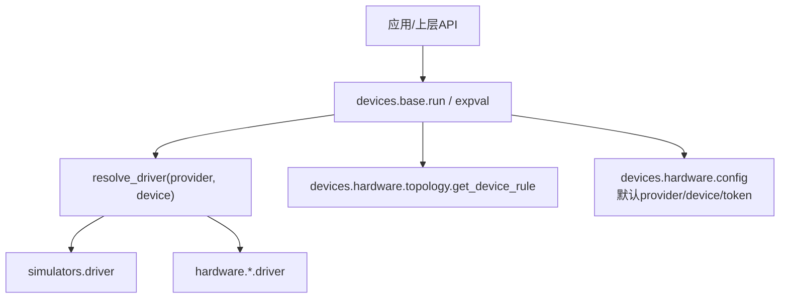
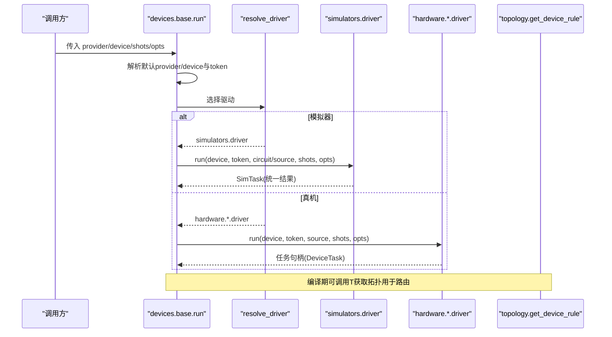
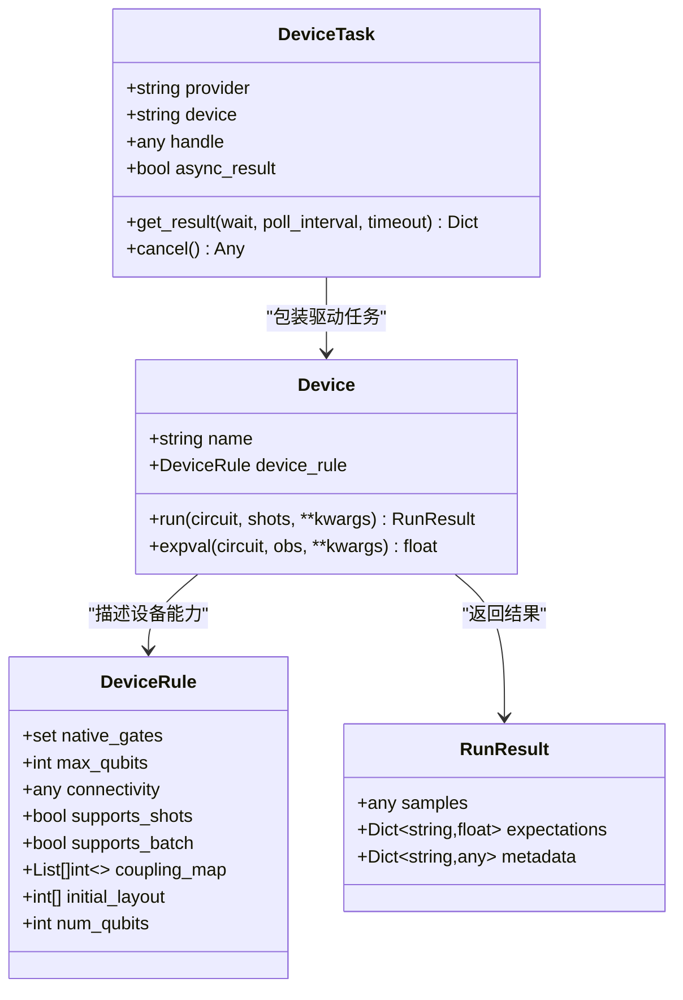
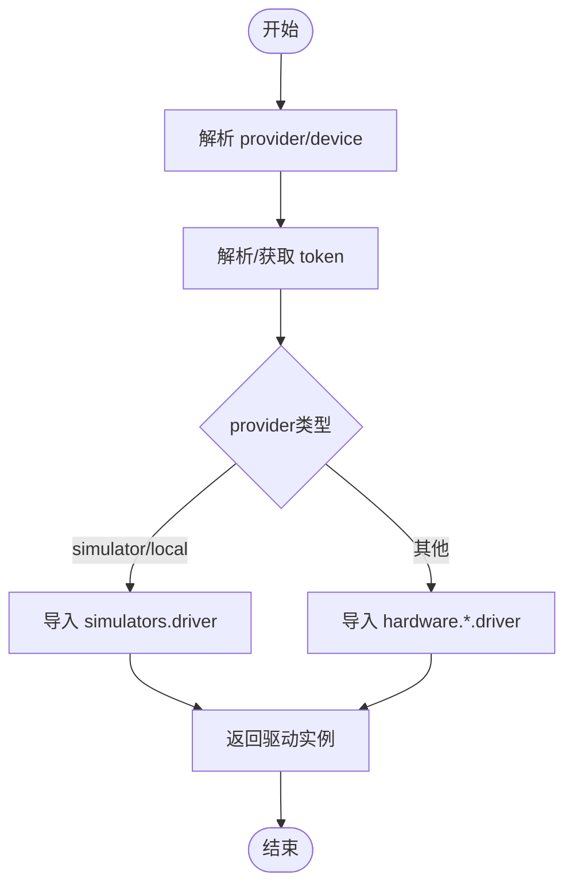
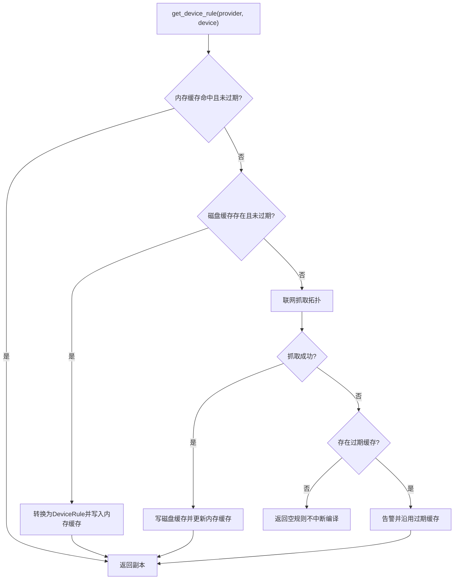
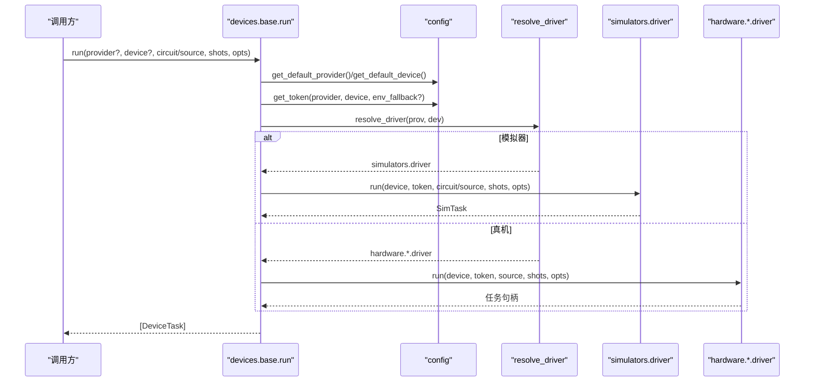
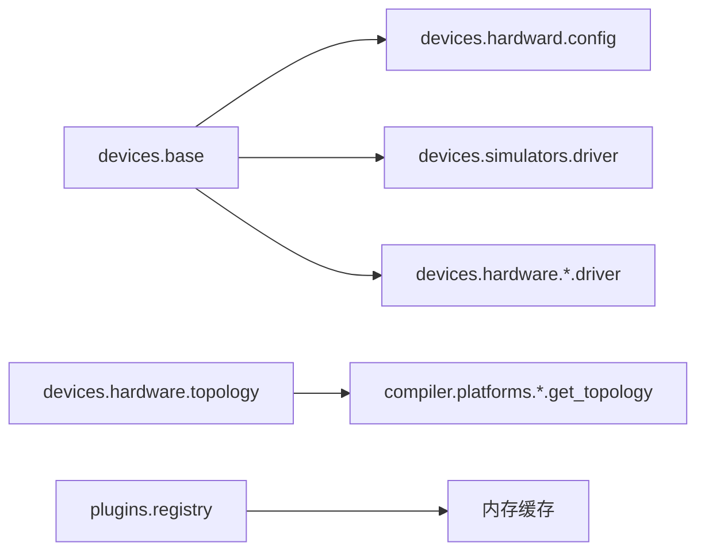

# 提供商架构设计

<cite>
**本文引用的文件**
- [base.py](file://src/tyxonq/devices/base.py)
- [__init__.py（devices）](file://src/tyxonq/devices/__init__.py)
- [config.py（硬件配置）](file://src/tyxonq/devices/hardware/config.py)
- [topology.py（拓扑发现与缓存）](file://src/tyxonq/devices/hardware/topology.py)
- [driver.py（模拟器驱动）](file://src/tyxonq/devices/simulators/driver.py)
- [driver.py（国盾驱动）](file://src/tyxonq/devices/hardware/guodun/driver.py)
- [registry.py（插件注册表）](file://src/tyxonq/plugins/registry.py)
- [custom_devices.rst（自定义设备指南）](file://docs/source/developer_guide/custom_devices.rst)
- [architecture_design.rst（架构设计参考）](file://docs/source/technical_references/architecture_design.rst)
</cite>

## 目录
1. [简介](#简介)
2. [项目结构](#项目结构)
3. [核心组件](#核心组件)
4. [架构总览](#架构总览)
5. [详细组件分析](#详细组件分析)
6. [依赖关系分析](#依赖关系分析)
7. [性能考量](#性能考量)
8. [故障排查指南](#故障排查指南)
9. [结论](#结论)
10. [附录：自定义提供商开发指南](#附录自定义提供商开发指南)

## 简介
本文件系统性阐述 TyxonQ 的多提供商架构设计，重点包括：
- 统一设备接口的设计原理与扩展机制（Device 协议、DeviceRule、RunResult、DeviceTask）。
- 提供商注册与选择流程（resolve_driver、默认 provider/device、token 管理）。
- 设备拓扑信息的获取与 TTL 缓存策略（内存+磁盘两级缓存、离线降级）。
- 提供商切换的实现原理与设备选择算法。
- 自定义提供商开发的步骤与最佳实践。
- 架构图与数据流图，帮助理解各组件交互关系。

## 项目结构
TyxonQ 在设备层采用“统一抽象 + 多实现”的分层组织：
- devices.base：定义 Device 协议、DeviceRule、RunResult、DeviceTask，以及统一的 run/expval/list_all_devices 等入口。
- devices.simulators：本地模拟器驱动（statevector、density_matrix、matrix_product_state）。
- devices.hardware：硬件提供商驱动（如 guodun、lqcloud、quafu、qcos、ibm、tyxonq），以及跨提供商的拓扑发现与缓存。
- plugins.registry：轻量级插件/设备实例加载与缓存。
- devices.hardward.config：默认 provider/device、token 管理与端点配置。

图表来源
- [base.py:294-445](file://src/tyxonq/devices/base.py#L294-L445)
- [topology.py:180-258](file://src/tyxonq/devices/hardware/topology.py#L180-L258)
- [config.py:24-65](file://src/tyxonq/devices/hardware/config.py#L24-L65)

章节来源
- [base.py:97-109](file://src/tyxonq/devices/base.py#L97-L109)
- [base.py:146-258](file://src/tyxonq/devices/base.py#L146-L258)
- [base.py:294-445](file://src/tyxonq/devices/base.py#L294-L445)
- [topology.py:1-29](file://src/tyxonq/devices/hardware/topology.py#L1-L29)
- [config.py:1-78](file://src/tyxonq/devices/hardware/config.py#L1-L78)

## 核心组件
- Device 协议：统一 run(expval) 能力契约，屏蔽不同后端差异。
- DeviceRule：声明式设备能力描述（耦合图、原生门、比特数等），供编译器路由使用。
- RunResult：结构化运行结果（samples/expectations/metadata）。
- DeviceTask：统一任务包装，提供 get_result/cancel 等一致行为。
- resolve_driver：按 provider/device 动态选择具体驱动模块。
- run/expval：统一执行入口，处理 shots、噪声注入、批处理、同步/异步任务封装。
- list_all_devices：聚合模拟器与硬件设备列表。
- topology.get_device_rule：跨提供商拓扑发现与 TTL 缓存。
- config：默认 provider/device、token 管理、端点信息。

章节来源
- [base.py:12-57](file://src/tyxonq/devices/base.py#L12-L57)
- [base.py:60-109](file://src/tyxonq/devices/base.py#L60-L109)
- [base.py:146-258](file://src/tyxonq/devices/base.py#L146-L258)
- [base.py:294-470](file://src/tyxonq/devices/base.py#L294-L470)
- [base.py:475-493](file://src/tyxonq/devices/base.py#L475-L493)
- [topology.py:180-258](file://src/tyxonq/devices/hardware/topology.py#L180-L258)
- [config.py:24-65](file://src/tyxonq/devices/hardware/config.py#L24-L65)

## 架构总览
TyxonQ 的设备层通过“统一入口 + 驱动分派 + 拓扑缓存”的方式，实现对多种提供商的一致访问。上层调用 run/expval 时，先解析默认 provider/device 与 token，再根据 provider 动态导入对应驱动；对模拟器直接执行，对真机则提交任务并返回统一的任务句柄。拓扑信息在编译阶段通过 get_device_rule 获取，支持会话内内存缓存与磁盘持久化 TTL 缓存，并在网络不可用时降级为过期缓存或空规则，确保编译不中断。

图表来源
- [base.py:294-445](file://src/tyxonq/devices/base.py#L294-L445)
- [base.py:146-258](file://src/tyxonq/devices/base.py#L146-L258)
- [driver.py（模拟器）:86-141](file://src/tyxonq/devices/simulators/driver.py#L86-L141)
- [topology.py:180-258](file://src/tyxonq/devices/hardware/topology.py#L180-L258)

## 详细组件分析

### 统一设备接口与扩展机制
- Device 协议定义了 name、device_rule、run、expval 等最小必要能力，便于新增提供商只需实现相应方法。
- DeviceRule 以声明式字段描述设备能力（如 coupling_map、native_gates、max_qubits），编译器据此进行布局与路由。
- RunResult 规范了返回结构，保证下游后处理一致性。
- DeviceTask 将不同驱动的返回统一为任务对象，屏蔽同步/异步差异，并提供 cancel/get_result。

图表来源
- [base.py:60-109](file://src/tyxonq/devices/base.py#L60-L109)
- [base.py:12-57](file://src/tyxonq/devices/base.py#L12-L57)

章节来源
- [base.py:97-109](file://src/tyxonq/devices/base.py#L97-L109)
- [base.py:60-109](file://src/tyxonq/devices/base.py#L60-L109)
- [base.py:12-57](file://src/tyxonq/devices/base.py#L12-L57)

### 提供商注册系统与工作流程
- 动态驱动选择：resolve_driver 根据 provider 字符串动态 import 对应驱动模块，未支持的 provider 抛出异常。
- 默认配置：通过 config.set_default/get_default_provider/get_default_device 设置与读取默认值。
- Token 管理：get_token 支持显式参数、内存存储、环境变量回退；不同 provider 可使用独立 token。
- 设备列表：list_all_devices 聚合模拟器与硬件设备列表，便于前端或工具展示。

图表来源
- [base.py:146-258](file://src/tyxonq/devices/base.py#L146-L258)
- [config.py:24-65](file://src/tyxonq/devices/hardware/config.py#L24-L65)

章节来源
- [base.py:146-258](file://src/tyxonq/devices/base.py#L146-L258)
- [config.py:24-65](file://src/tyxonq/devices/hardware/config.py#L24-L65)
- [base.py:475-493](file://src/tyxonq/devices/base.py#L475-L493)

### 设备拓扑信息的获取与缓存策略
- 统一入口：get_device_rule 负责从内存缓存→磁盘缓存→联网抓取三级路径获取拓扑。
- 内存缓存：进程内按 (provider, device) 命中，避免重复 IO 和网络请求。
- 磁盘缓存：按 provider 目录保存 .topology_cache.json，带 fetched_at 时间戳，遵守 TTL（默认1天）。
- 离线韧性：抓取失败时优先沿用过期缓存并告警；若无可用的缓存则返回空规则，编译器跳过路由但不中断。
- 强制刷新：force_refresh=True 跳过所有缓存，强制联网抓取。

图表来源
- [topology.py:180-258](file://src/tyxonq/devices/hardware/topology.py#L180-L258)

章节来源
- [topology.py:1-29](file://src/tyxonq/devices/hardware/topology.py#L1-L29)
- [topology.py:180-258](file://src/tyxonq/devices/hardware/topology.py#L180-L258)

### 提供商切换与设备选择算法
- 选择优先级：显式传入 provider/device → 默认配置 → 环境变量回退（特定 provider）。
- 模拟器直跑：当 provider 为 simulator/local 时，直接调用模拟器驱动执行，支持 batch、shots=0 的解析期望值路径。
- 真机提交：当 provider 为硬件时，要求已编译的 source，统一丢弃仅对模拟器有意义的参数（如 noise/use_noise），提交后返回统一任务句柄。
- 任务统一：无论哪种路径，最终都包装为 DeviceTask，提供一致的 get_result/cancel。

图表来源
- [base.py:294-445](file://src/tyxonq/devices/base.py#L294-L445)
- [config.py:24-65](file://src/tyxonq/devices/hardware/config.py#L24-L65)

章节来源
- [base.py:294-445](file://src/tyxonq/devices/base.py#L294-L445)
- [base.py:146-258](file://src/tyxonq/devices/base.py#L146-L258)

### 模拟器与硬件驱动的关键差异
- 模拟器驱动：
  - 支持 QASM/QIR 到 IR 的自动转换（QASM3/TQASM 走原生导入，QASM2 走 Qiskit 适配）。
  - 统一输出 counts/expectations/probabilities/statevector，并附带元数据。
  - 支持 shots=0 的解析期望值路径。
- 硬件驱动（以国盾为例）：
  - 严格校验 QCIS source（必须包含测量指令）、shots 合法性、脉冲指令集。
  - 提交前下载当前标定并校验禁用比特/耦合器及 CZ 边，任一失败即停止提交。
  - 任务状态与结果按平台语义解析，不反转 bitstring。

章节来源
- [driver.py（模拟器）:41-72](file://src/tyxonq/devices/simulators/driver.py#L41-L72)
- [driver.py（模拟器）:86-141](file://src/tyxonq/devices/simulators/driver.py#L86-L141)
- [driver.py（国盾）:100-130](file://src/tyxonq/devices/hardware/guodun/driver.py#L100-L130)
- [driver.py（国盾）:152-200](file://src/tyxonq/devices/hardware/guodun/driver.py#L152-L200)

## 依赖关系分析
- base.py 依赖 hardware.config 获取默认 provider/device 与 token。
- base.py 通过 resolve_driver 动态导入 simulators 或 hardware.* 驱动。
- topology.py 作为跨提供商的统一入口，内部按需导入 compiler.platforms.<provider>.get_topology。
- plugins.registry 提供基于路径的动态加载与实例缓存（当前为占位实现，可扩展为 entry points）。

图表来源
- [base.py:146-258](file://src/tyxonq/devices/base.py#L146-L258)
- [topology.py:164-177](file://src/tyxonq/devices/hardware/topology.py#L164-L177)
- [registry.py:36-62](file://src/tyxonq/plugins/registry.py#L36-L62)

章节来源
- [base.py:146-258](file://src/tyxonq/devices/base.py#L146-L258)
- [topology.py:164-177](file://src/tyxonq/devices/hardware/topology.py#L164-L177)
- [registry.py:36-62](file://src/tyxonq/plugins/registry.py#L36-L62)

## 性能考量
- 拓扑缓存：会话内内存缓存减少重复 IO；磁盘 TTL 缓存降低频繁网络请求；过期缓存降级保障离线可用性。
- 批处理与并行：模拟器支持批量电路提交；硬件驱动在同一批次中限制 shots 一致性，避免额外开销。
- 解析期望值路径：shots=0 时走解析期望值，避免采样噪声与重复计算。
- 噪声注入：仅在模拟器路径注入噪声，真机提交前剔除无关参数，减少无效传输与错误。

[本节为通用指导，无需特定文件引用]

## 故障排查指南
- 任务等待超时：get_task_details 在 wait=True 且超过 timeout 时会发出 RuntimeWarning，提示可能为空/不完整结果，建议增大超时重试。
- 拓扑抓取失败：若网络/凭证/SDK 缺失导致抓取失败，会尝试沿用过期缓存并告警；若无缓存则返回空规则，编译器跳过路由。
- 国盾驱动校验失败：QCIS 缺少测量指令、禁用比特/耦合器、脉冲指令不合法等会在提交前阻断，需检查线路与当前标定。
- 模拟器输入错误：QASM 版本识别失败或 IR 转换异常会抛出 ValueError，请确保传入有效 IR 或兼容 QASM。

章节来源
- [base.py:497-557](file://src/tyxonq/devices/base.py#L497-L557)
- [topology.py:224-258](file://src/tyxonq/devices/hardware/topology.py#L224-L258)
- [driver.py（国盾）:100-130](file://src/tyxonq/devices/hardware/guodun/driver.py#L100-L130)
- [driver.py（模拟器）:41-72](file://src/tyxonq/devices/simulators/driver.py#L41-L72)

## 结论
TyxonQ 的多提供商架构通过稳定的 Device 协议、统一的 run/expval 入口、动态驱动选择与跨提供商拓扑缓存，实现了“一次编写、多处运行”的目标。该设计在保证硬件真实性的同时，提供了高效的模拟与批处理能力，并通过严格的输入校验与离线降级策略提升了鲁棒性。对于新提供商接入，遵循协议与缓存约定即可快速集成。

[本节为总结性内容，无需特定文件引用]

## 附录：自定义提供商开发指南
- 目标：为新模拟器、硬件后端或专用量子平台提供驱动，使其可通过 TyxonQ 的统一接口执行。
- 关键步骤：
  - 实现 Device 协议（至少提供 run/expval），并返回符合 RunResult 的结构。
  - 提供 DeviceRule（至少包含 coupling_map、native_gates、num_qubits/max_qubits），以便编译器路由。
  - 实现驱动模块的 run/get_task_details/remove_task 等方法，返回统一的任务句柄。
  - 如需拓扑发现，实现 fetch_topology 逻辑并按 topology.py 的约定写入缓存。
  - 在 resolve_driver 中添加 provider 分支，或在 registry 中注册（当前 registry 为占位，可按需扩展）。
- 最佳实践：
  - 输入校验：严格验证 source/circuit/shots，提前失败优于运行时错误。
  - 资源管理：妥善处理连接、登录、令牌与并发提交。
  - 错误处理：提供清晰的错误信息与降级策略（如拓扑不可用跳过路由）。
  - 测试：覆盖单测与集成测试，验证基本门、两比特门与错误路径。

章节来源
- [custom_devices.rst:10-91](file://docs/source/developer_guide/custom_devices.rst#L10-L91)
- [custom_devices.rst:192-338](file://docs/source/developer_guide/custom_devices.rst#L192-L338)
- [architecture_design.rst:74-90](file://docs/source/technical_references/architecture_design.rst#L74-L90)
- [registry.py:36-62](file://src/tyxonq/plugins/registry.py#L36-L62)