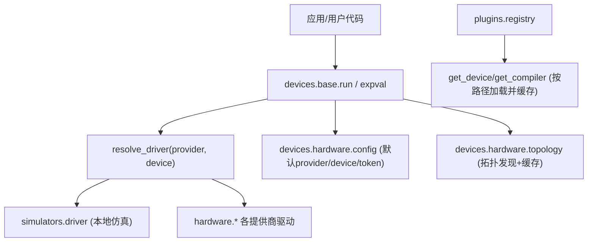
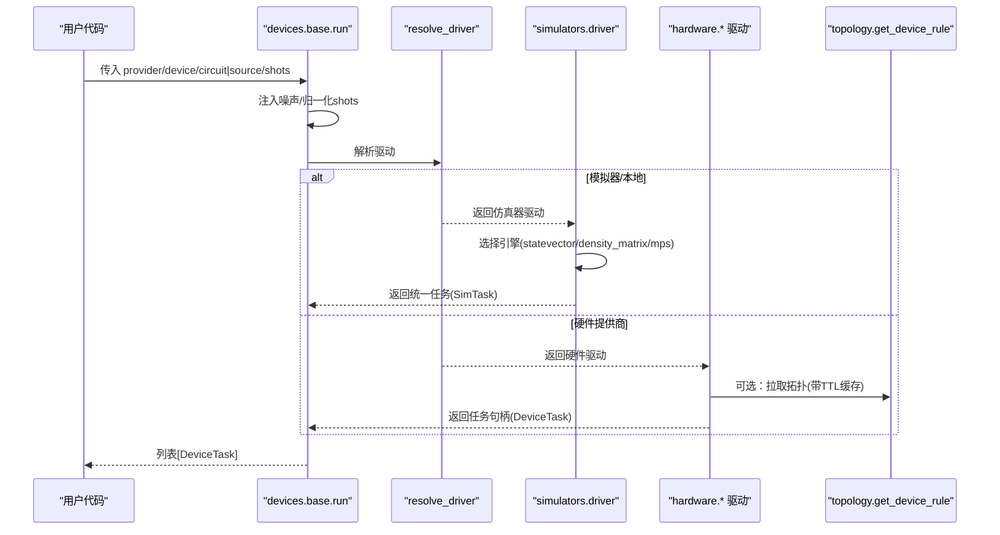
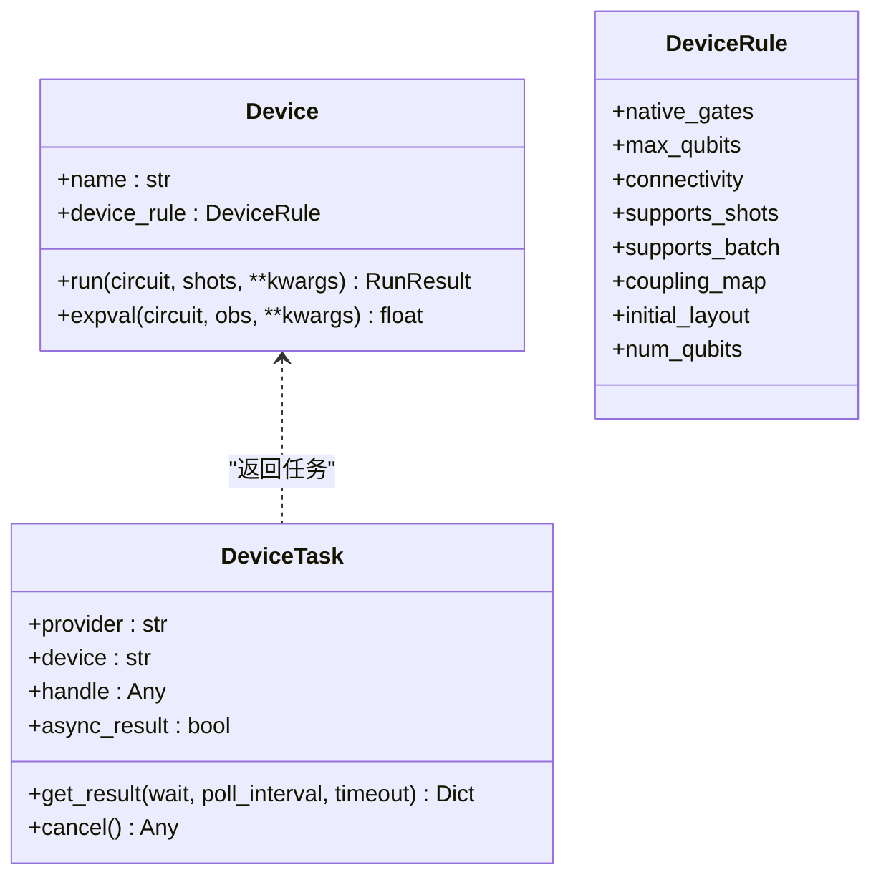
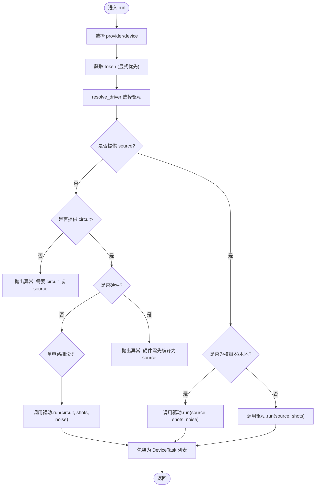
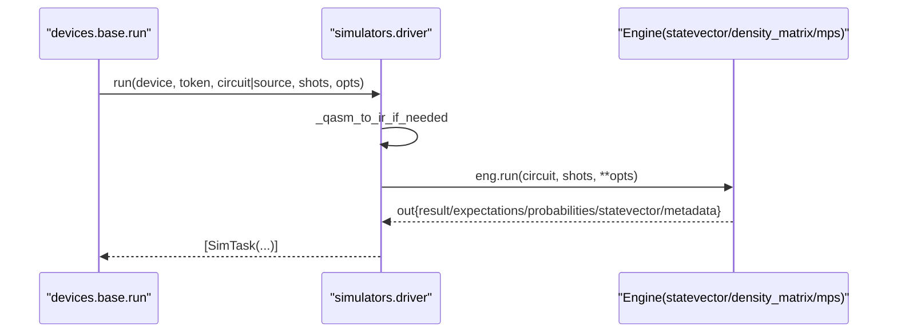
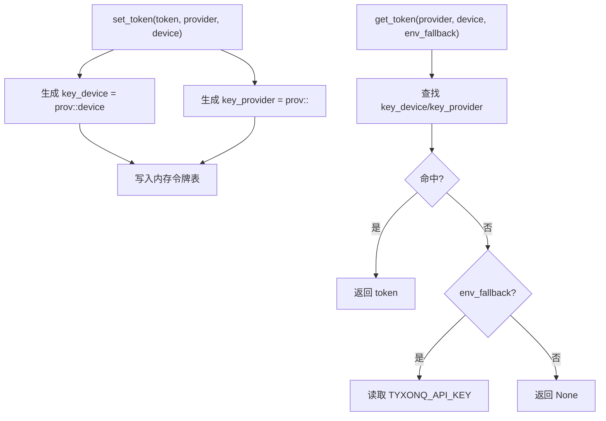
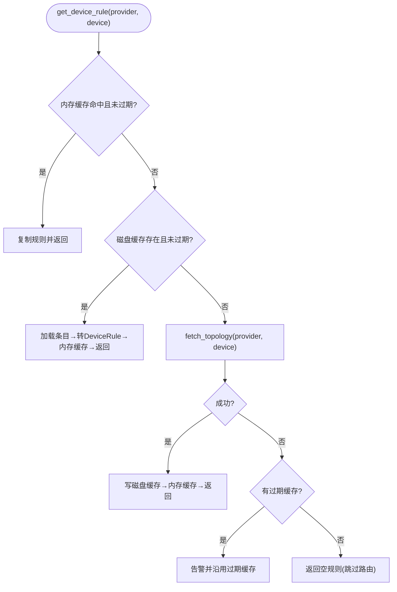
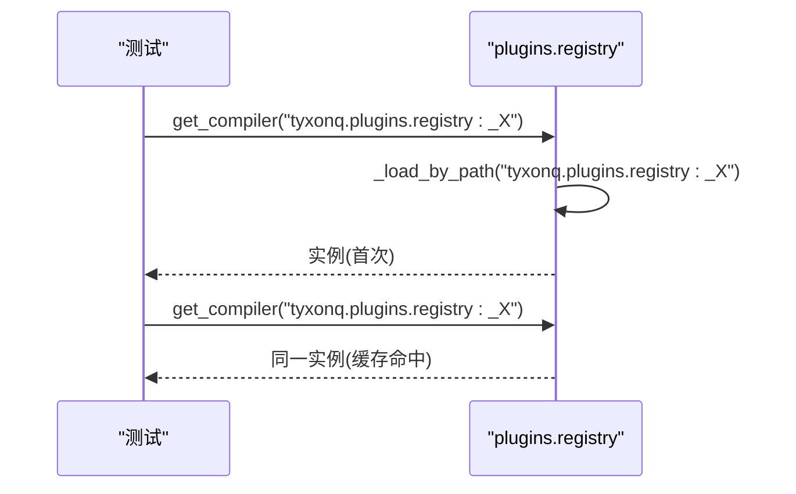
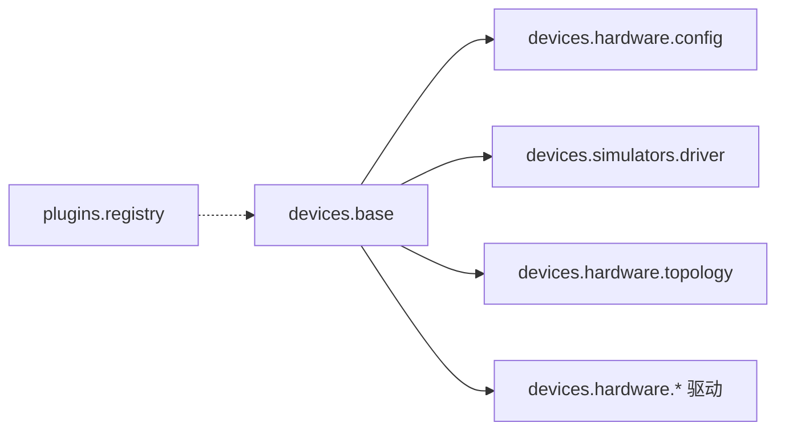

# 自定义提供商开发

<cite>
**本文引用的文件**
- [src/tyxonq/devices/base.py](file://src/tyxonq/devices/base.py)
- [src/tyxonq/devices/hardware/config.py](file://src/tyxonq/devices/hardware/config.py)
- [src/tyxonq/devices/simulators/driver.py](file://src/tyxonq/devices/simulators/driver.py)
- [src/tyxonq/devices/hardware/topology.py](file://src/tyxonq/devices/hardware/topology.py)
- [src/tyxonq/plugins/registry.py](file://src/tyxonq/plugins/registry.py)
- [src/tyxonq/core/errors.py](file://src/tyxonq/core/errors.py)
- [examples/run_circuit_on_guodun.py](file://examples/run_circuit_on_guodun.py)
- [tests_core_module/test_plugins_registry.py](file://tests_core_module/test_plugins_registry.py)
- [docs/source/developer_guide/custom_devices.rst](file://docs/source/developer_guide/custom_devices.rst)
- [docs/source/developer_guide/testing_guidelines.rst](file://docs/source/developer_guide/testing_guidelines.rst)
</cite>

## 目录
1. [简介](#简介)
2. [项目结构](#项目结构)
3. [核心组件](#核心组件)
4. [架构总览](#架构总览)
5. [详细组件分析](#详细组件分析)
6. [依赖关系分析](#依赖关系分析)
7. [性能考量](#性能考量)
8. [故障排查指南](#故障排查指南)
9. [结论](#结论)
10. [附录](#附录)

## 简介
本指南面向希望为 TyxonQ 开发“自定义量子计算提供商”的工程师，覆盖设备基类与驱动契约、注册与插件机制、配置与认证、错误处理模式、拓扑发现与量子比特映射、测试策略与调试技巧，以及发布与分发最佳实践。文档以仓库现有实现为依据，提供可操作的步骤与图示，帮助快速集成模拟器或真实硬件后端。

## 项目结构
TyxonQ 将设备抽象、驱动选择、仿真器与硬件后端、拓扑缓存、插件注册等模块解耦，形成可扩展的提供商生态：
- 设备抽象与统一执行入口位于 devices.base
- 仿真器驱动位于 devices.simulators.driver
- 硬件配置与默认值位于 devices.hardware.config
- 拓扑发现与 TTL 缓存位于 devices.hardware.topology
- 插件注册与动态加载位于 plugins.registry
- 示例与测试分别位于 examples 与 tests_*

图表来源
- [src/tyxonq/devices/base.py:146-258](file://src/tyxonq/devices/base.py#L146-L258)
- [src/tyxonq/devices/simulators/driver.py:20-38](file://src/tyxonq/devices/simulators/driver.py#L20-L38)
- [src/tyxonq/devices/hardware/config.py:24-65](file://src/tyxonq/devices/hardware/config.py#L24-L65)
- [src/tyxonq/devices/hardware/topology.py:164-258](file://src/tyxonq/devices/hardware/topology.py#L164-L258)
- [src/tyxonq/plugins/registry.py:36-62](file://src/tyxonq/plugins/registry.py#L36-L62)

章节来源
- [src/tyxonq/devices/base.py:146-258](file://src/tyxonq/devices/base.py#L146-L258)
- [src/tyxonq/devices/simulators/driver.py:20-38](file://src/tyxonq/devices/simulators/driver.py#L20-L38)
- [src/tyxonq/devices/hardware/config.py:24-65](file://src/tyxonq/devices/hardware/config.py#L24-L65)
- [src/tyxonq/devices/hardware/topology.py:164-258](file://src/tyxonq/devices/hardware/topology.py#L164-L258)
- [src/tyxonq/plugins/registry.py:36-62](file://src/tyxonq/plugins/registry.py#L36-L62)

## 核心组件
- Device 协议与 DeviceTask：定义 run/expval 契约与统一任务包装，屏蔽不同驱动的返回差异。
- 驱动解析 resolve_driver：根据 provider 动态导入对应驱动模块（simulator/local/tyxonq/ibm/qcos/quafu/lqcloud/guodun）。
- 统一运行接口 run/expval：封装噪声注入、shots 归一化、source/circuit 分支、批处理与结果标准化。
- 仿真器驱动 simulators.driver：选择具体引擎（statevector/density_matrix/matrix_product_state），统一输出 schema。
- 配置与认证 hardware.config：维护默认 provider/device、token 存储与作用域、端点配置。
- 拓扑发现 topology：跨 provider 的统一拓扑获取与 TTL 缓存（内存+磁盘），失败降级不中断流程。
- 插件注册 registry：按“模块:属性”或“模块.属性”路径动态加载对象并缓存实例。

章节来源
- [src/tyxonq/devices/base.py:12-109](file://src/tyxonq/devices/base.py#L12-L109)
- [src/tyxonq/devices/base.py:294-470](file://src/tyxonq/devices/base.py#L294-L470)
- [src/tyxonq/devices/simulators/driver.py:20-169](file://src/tyxonq/devices/simulators/driver.py#L20-L169)
- [src/tyxonq/devices/hardware/config.py:24-65](file://src/tyxonq/devices/hardware/config.py#L24-L65)
- [src/tyxonq/devices/hardware/topology.py:164-258](file://src/tyxonq/devices/hardware/topology.py#L164-L258)
- [src/tyxonq/plugins/registry.py:36-62](file://src/tyxonq/plugins/registry.py#L36-L62)

## 架构总览
下图展示从高层 API 到底层驱动与拓扑发现的调用链，体现“统一入口 + 驱动分派 + 结果归一化”的设计。

图表来源
- [src/tyxonq/devices/base.py:294-445](file://src/tyxonq/devices/base.py#L294-L445)
- [src/tyxonq/devices/simulators/driver.py:86-141](file://src/tyxonq/devices/simulators/driver.py#L86-L141)
- [src/tyxonq/devices/hardware/topology.py:180-258](file://src/tyxonq/devices/hardware/topology.py#L180-L258)

## 详细组件分析

### 设备基类与驱动契约
- Device 协议要求实现 name、device_rule、run、expval；用于上层对设备能力与执行进行统一描述与调用。
- DeviceRule 声明设备能力（如 native_gates、max_qubits、coupling_map、initial_layout、num_qubits），供编译器路由使用。
- DeviceTask 统一封装任务句柄，提供 get_result/cancel，并对 result_meta/metadata/probabilities/expectations 做归一化处理。

图表来源
- [src/tyxonq/devices/base.py:12-109](file://src/tyxonq/devices/base.py#L12-L109)

章节来源
- [src/tyxonq/devices/base.py:12-109](file://src/tyxonq/devices/base.py#L12-L109)

### 驱动解析与统一运行
- resolve_driver 根据 provider 动态导入对应驱动模块，支持 simulator/local/tyxonq/ibm/qcos/quafu/lqcloud/guodun。
- run 负责：
  - 选择默认 provider/device 与 token（显式优先）
  - 注入噪声设置（仅对模拟器有效）
  - 归一化 shots（真机不允许 0）
  - 分支处理 source 直传与 circuit 路径（仅模拟器）
  - 批处理与顺序保持
  - 统一返回 DeviceTask 列表
- expval 针对模拟器/本地提供解析期望值的快捷路径。

图表来源
- [src/tyxonq/devices/base.py:294-445](file://src/tyxonq/devices/base.py#L294-L445)

章节来源
- [src/tyxonq/devices/base.py:294-445](file://src/tyxonq/devices/base.py#L294-L445)

### 仿真器驱动与引擎选择
- simulators.driver 通过设备名选择引擎：statevector、density_matrix、matrix_product_state。
- run 将 QASM 字符串转换为 IR（OpenQASM 3/TQASM 0.2 走原生导入，否则回退到 Qiskit QASM2），再交给引擎执行。
- 输出统一为包含 result/expectations/probabilities/statevector/result_meta/uni_status/error 的结构，并以 SimTask 返回。
- expval 直接调用引擎的 expval 方法，返回浮点期望值。

图表来源
- [src/tyxonq/devices/simulators/driver.py:41-169](file://src/tyxonq/devices/simulators/driver.py#L41-L169)

章节来源
- [src/tyxonq/devices/simulators/driver.py:41-169](file://src/tyxonq/devices/simulators/driver.py#L41-L169)

### 配置管理与认证处理
- hardware.config 维护：
  - 默认 provider/device（可通过 set_default 修改）
  - token 作用域：支持 provider 级与 device 级键（prov:: 与 prov::device）
  - 环境变量回退：TYXONQ_API_KEY（可按 provider 控制）
  - 端点配置：ENDPOINTS（如 tyxonq、qcos）
- base.init 提供便捷初始化入口，设置默认 provider/device 与 token。

图表来源
- [src/tyxonq/devices/hardware/config.py:24-65](file://src/tyxonq/devices/hardware/config.py#L24-L65)

章节来源
- [src/tyxonq/devices/hardware/config.py:24-65](file://src/tyxonq/devices/hardware/config.py#L24-L65)
- [src/tyxonq/devices/base.py:261-272](file://src/tyxonq/devices/base.py#L261-L272)

### 设备拓扑与量子比特映射
- topology.get_device_rule 提供统一的拓扑获取流程：
  - 会话内内存缓存 → 磁盘 TTL 缓存 → 联网抓取（按 provider 分派）
  - 失败时降级：沿用过期缓存并告警，或返回空规则跳过路由
  - 返回 DeviceRule 字段（coupling_map、num_qubits、native_gates 等）
- 缓存目录可通过环境变量重定向，便于测试与只读安装场景。

图表来源
- [src/tyxonq/devices/hardware/topology.py:180-258](file://src/tyxonq/devices/hardware/topology.py#L180-L258)

章节来源
- [src/tyxonq/devices/hardware/topology.py:180-258](file://src/tyxonq/devices/hardware/topology.py#L180-L258)

### 插件系统与提供商注册
- plugins.registry 提供：
  - discover(group)：预留扩展点，当前返回空映射
  - get_device/get_compiler(name)：按“模块:属性”或“模块.属性”路径加载对象并缓存实例
- 测试验证了路径加载与缓存单调性。

图表来源
- [src/tyxonq/plugins/registry.py:21-62](file://src/tyxonq/plugins/registry.py#L21-L62)
- [tests_core_module/test_plugins_registry.py:14-18](file://tests_core_module/test_plugins_registry.py#L14-L18)

章节来源
- [src/tyxonq/plugins/registry.py:21-62](file://src/tyxonq/plugins/registry.py#L21-L62)
- [tests_core_module/test_plugins_registry.py:14-18](file://tests_core_module/test_plugins_registry.py#L14-L18)

### 完整开发示例（模拟器与真实硬件）
- 模拟器驱动：参考 simulators.driver 的 run 与引擎选择逻辑，实现自己的引擎或复用现有 statevector/density_matrix/mps。
- 真实硬件驱动：遵循 base.resolve_driver 的分派约定，在各自 provider 目录下暴露 driver 模块，实现 run/get_task_details/remove_task/list_devices 等接口；通过 hardware.config 管理 token 与端点。
- 端到端示例：examples/run_circuit_on_guodun.py 展示了本地编译为 QCIS 后，通过 device_base.run 提交任务并获取 query ID 的流程。

章节来源
- [src/tyxonq/devices/simulators/driver.py:86-169](file://src/tyxonq/devices/simulators/driver.py#L86-L169)
- [examples/run_circuit_on_guodun.py:70-120](file://examples/run_circuit_on_guodun.py#L70-L120)

## 依赖关系分析
- devices.base 依赖：
  - devices.hardware.config（默认 provider/device/token）
  - devices.simulators.driver（模拟器路径）
  - devices.hardware.*（各硬件驱动）
  - devices.hardware.topology（拓扑发现）
- plugins.registry 独立，提供通用对象加载与缓存。
- 示例与测试依赖上述模块以验证行为。

图表来源
- [src/tyxonq/devices/base.py:146-258](file://src/tyxonq/devices/base.py#L146-L258)
- [src/tyxonq/devices/hardware/config.py:24-65](file://src/tyxonq/devices/hardware/config.py#L24-L65)
- [src/tyxonq/devices/simulators/driver.py:20-38](file://src/tyxonq/devices/simulators/driver.py#L20-L38)
- [src/tyxonq/devices/hardware/topology.py:164-258](file://src/tyxonq/devices/hardware/topology.py#L164-L258)
- [src/tyxonq/plugins/registry.py:36-62](file://src/tyxonq/plugins/registry.py#L36-L62)

章节来源
- [src/tyxonq/devices/base.py:146-258](file://src/tyxonq/devices/base.py#L146-L258)
- [src/tyxonq/devices/hardware/config.py:24-65](file://src/tyxonq/devices/hardware/config.py#L24-L65)
- [src/tyxonq/devices/simulators/driver.py:20-38](file://src/tyxonq/devices/simulators/driver.py#L20-L38)
- [src/tyxonq/devices/hardware/topology.py:164-258](file://src/tyxonq/devices/hardware/topology.py#L164-L258)
- [src/tyxonq/plugins/registry.py:36-62](file://src/tyxonq/plugins/registry.py#L36-L62)

## 性能考量
- 模拟器选择：
  - statevector：适合小规模纯态模拟（O(2^n) 内存）
  - density_matrix：支持噪声与混合态（O(4^n) 内存）
  - matrix_product_state：低纠缠大系统更高效
- 批处理与 shots：
  - run 支持单电路与批处理，保持顺序；shots 为标量或对齐列表
  - 真机 shots=0 会被强制为 1，避免无效提交
- 拓扑缓存：
  - 两级缓存减少网络请求；失败时降级不中断编译/提交
- 数值后端：
  - 支持 numpy/pytorch/cupynumeric，按需切换以提升性能

章节来源
- [src/tyxonq/devices/simulators/driver.py:20-38](file://src/tyxonq/devices/simulators/driver.py#L20-L38)
- [src/tyxonq/devices/base.py:358-433](file://src/tyxonq/devices/base.py#L358-L433)
- [src/tyxonq/devices/hardware/topology.py:180-258](file://src/tyxonq/devices/hardware/topology.py#L180-L258)

## 故障排查指南
- 常见错误类型：
  - CompilationError：编译失败或产生无效输出
  - DeviceExecutionError：设备执行失败（超时、连接问题等）
- 任务等待与超时：
  - get_task_details 支持轮询与超时；超时返回警告并继续，避免静默空计数导致能量为 0
- 拓扑发现失败：
  - 无网络/凭证/SDK缺失时，若存在过期缓存则降级沿用并告警；否则返回空规则跳过路由
- 调试建议：
  - 使用模拟器先行验证线路与参数
  - 检查 token 作用域与默认 provider/device 是否正确
  - 打印 DeviceTask 的 handle 与 uni_status，定位阶段

章节来源
- [src/tyxonq/core/errors.py:1-17](file://src/tyxonq/core/errors.py#L1-L17)
- [src/tyxonq/devices/base.py:497-558](file://src/tyxonq/devices/base.py#L497-L558)
- [src/tyxonq/devices/hardware/topology.py:224-258](file://src/tyxonq/devices/hardware/topology.py#L224-L258)

## 结论
TyxonQ 通过清晰的设备协议、统一的驱动解析与运行入口、健壮的拓扑缓存与配置管理，为自定义提供商提供了稳定可扩展的基础。开发者可基于现有仿真器驱动模式实现新引擎，或按 provider 规范接入真实硬件。结合完善的测试指南与示例，能够快速完成从开发到发布的闭环。

## 附录
- 开发步骤建议：
  - 明确 provider 名称与设备标识，实现 driver 模块并暴露 run/get_task_details/remove_task/list_devices
  - 在 hardware.config 中配置端点与默认值，支持 token 作用域
  - 实现拓扑发现（可选），利用 topology 缓存降低开销
  - 编写单元测试与集成测试，覆盖正常路径与异常路径
- 发布与分发：
  - 将 provider 驱动作为独立包或子模块，遵循现有目录结构
  - 在文档中说明安装与配置方式（环境变量、token 设置）
  - 提供最小可运行示例与测试用例，确保兼容性

章节来源
- [docs/source/developer_guide/custom_devices.rst:1-451](file://docs/source/developer_guide/custom_devices.rst#L1-L451)
- [docs/source/developer_guide/testing_guidelines.rst:1-971](file://docs/source/developer_guide/testing_guidelines.rst#L1-L971)