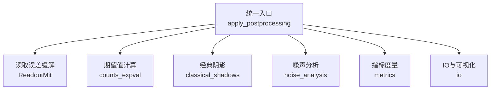
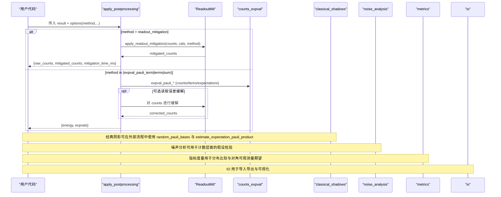
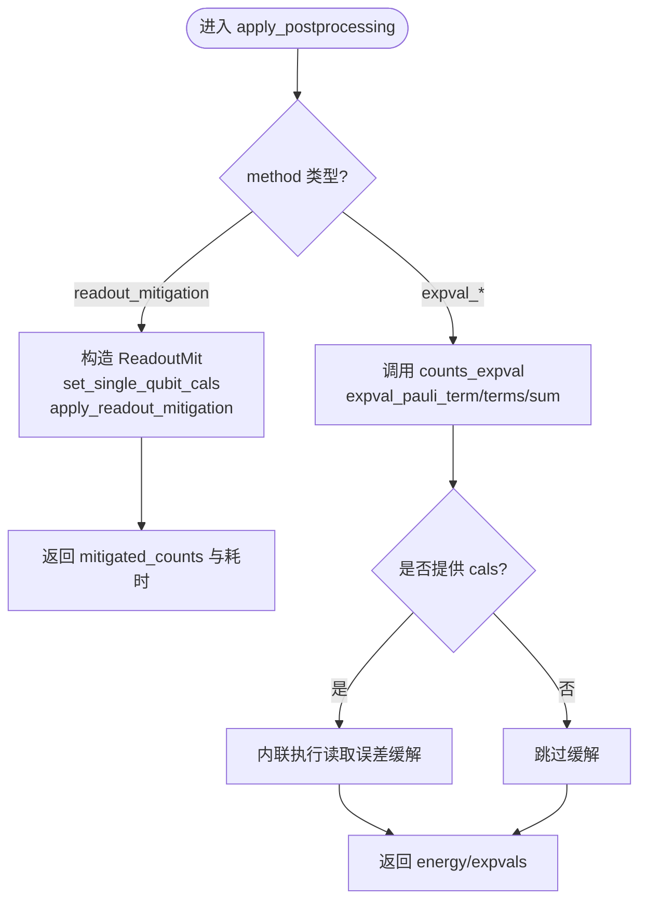
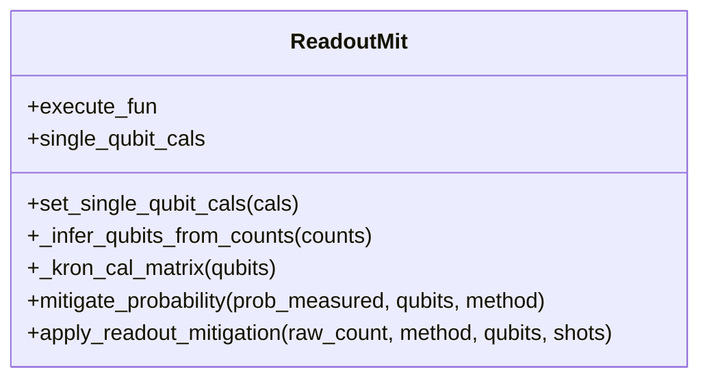
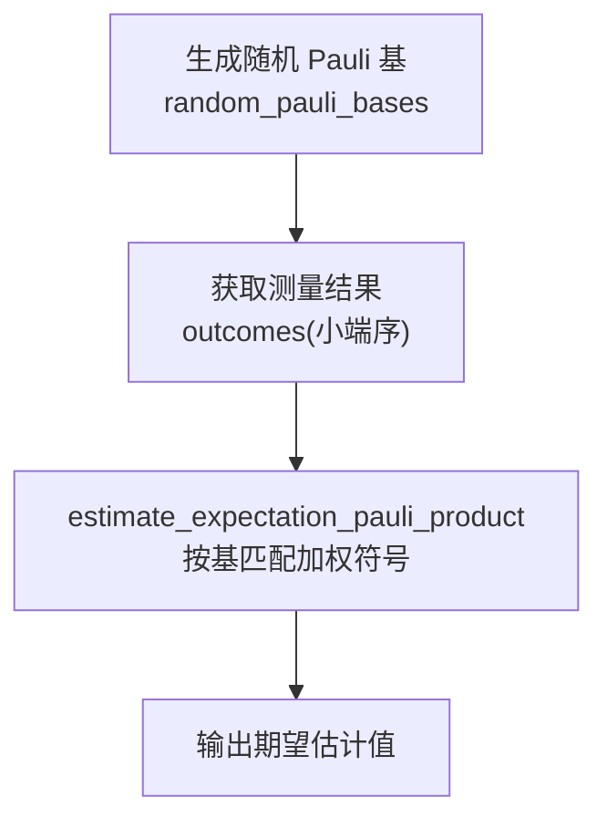
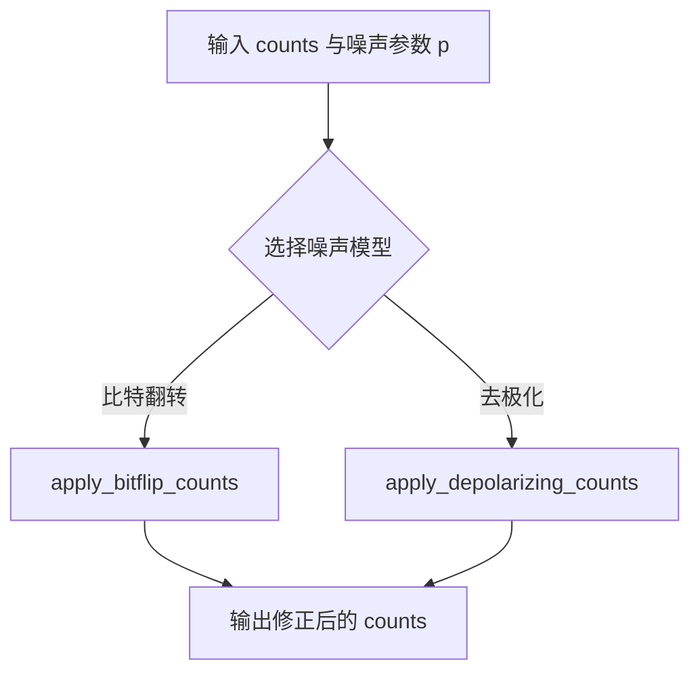
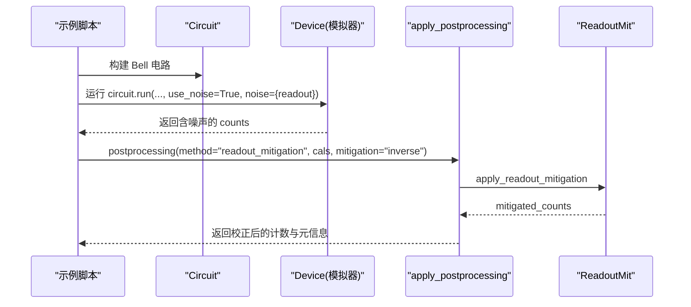
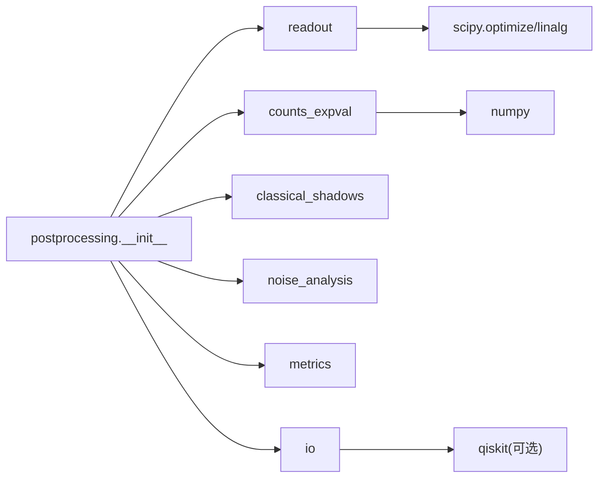

# 后处理和数据分析

<cite>
**本文引用的文件**
- [src/tyxonq/postprocessing/__init__.py](file://src/tyxonq/postprocessing/__init__.py)
- [src/tyxonq/postprocessing/counts_expval.py](file://src/tyxonq/postprocessing/counts_expval.py)
- [src/tyxonq/postprocessing/readout.py](file://src/tyxonq/postprocessing/readout.py)
- [src/tyxonq/postprocessing/classical_shadows.py](file://src/tyxonq/postprocessing/classical_shadows.py)
- [src/tyxonq/postprocessing/noise_analysis.py](file://src/tyxonq/postprocessing/noise_analysis.py)
- [src/tyxonq/postprocessing/metrics.py](file://src/tyxonq/postprocessing/metrics.py)
- [src/tyxonq/postprocessing/io.py](file://src/tyxonq/postprocessing/io.py)
- [examples/readout_mitigation.py](file://examples/readout_mitigation.py)
</cite>

## 目录
1. [简介](#简介)
2. [项目结构](#项目结构)
3. [核心组件](#核心组件)
4. [架构总览](#架构总览)
5. [详细组件分析](#详细组件分析)
6. [依赖关系分析](#依赖关系分析)
7. [性能考虑](#性能考虑)
8. [故障排查指南](#故障排查指南)
9. [结论](#结论)
10. [附录](#附录)

## 简介
本文件系统性介绍 TyxonQ 的后处理与数据分析能力，覆盖计数数据处理、期望值计算、读取误差缓解（Readout Error Mitigation）、噪声分析与诊断、经典阴影（Classical Shadows）技术、数据可视化与导出、后处理管道配置与定制、误差分析与置信度评估，以及将结果用于科学计算与机器学习应用的最佳实践。文档同时提供可复现的流程图与时序图，帮助读者快速理解从原始计数到可用科学结果的完整链路。

## 项目结构
TyxonQ 的后处理模块位于 src/tyxonq/postprocessing，采用“统一入口 + 功能解耦”的组织方式：
- 统一入口：apply_postprocessing 根据 options["method"] 路由到具体实现，屏蔽底层差异。
- 计数与期望值：counts_expval 提供 Pauli 项与求和的期望值计算，支持从计数或解析概率/态矢量路径。
- 读取误差缓解：readout.ReadoutMit 提供单量子比特校准矩阵与多量子比特张量积校正，支持逆矩阵与约束最小二乘两种方法。
- 经典阴影：classical_shadows 提供随机 Pauli 基生成与基于计数的 Z 期望估计、Pauli 乘积期望估计。
- 噪声分析：noise_analysis 提供在计数层面的比特翻转与去极化通道近似，便于快速假设检验。
- 指标与度量：metrics 提供归一化、KL 散度、对角可观测量期望等工具。
- IO 与可视化：io 提供 CSV 读写、计数向量转换、直方图绘制（可选依赖 qiskit）。

**图示来源**
- [src/tyxonq/postprocessing/__init__.py:16-225](file://src/tyxonq/postprocessing/__init__.py#L16-L225)
- [src/tyxonq/postprocessing/readout.py:15-137](file://src/tyxonq/postprocessing/readout.py#L15-L137)
- [src/tyxonq/postprocessing/counts_expval.py:7-112](file://src/tyxonq/postprocessing/counts_expval.py#L7-L112)
- [src/tyxonq/postprocessing/classical_shadows.py:14-103](file://src/tyxonq/postprocessing/classical_shadows.py#L14-L103)
- [src/tyxonq/postprocessing/noise_analysis.py:24-100](file://src/tyxonq/postprocessing/noise_analysis.py#L24-L100)
- [src/tyxonq/postprocessing/metrics.py:20-84](file://src/tyxonq/postprocessing/metrics.py#L20-L84)
- [src/tyxonq/postprocessing/io.py:9-99](file://src/tyxonq/postprocessing/io.py#L9-L99)

**章节来源**
- [src/tyxonq/postprocessing/__init__.py:16-225](file://src/tyxonq/postprocessing/__init__.py#L16-L225)

## 核心组件
- 统一后处理入口 apply_postprocessing：
  - 支持 method=readout_mitigation、expval_pauli_term、expval_pauli_terms、expval_pauli_sum。
  - 自动推断 shots、兼容 statevector/probabilities/expectations 多种输入源。
  - 在 expval_pauli_sum 中可选择性集成读取误差缓解。
- 计数与期望值 counts_expval：
  - term_expectation_from_counts：基于 Z 基计数计算单项期望。
  - expval_pauli_terms：批量计算多项期望。
  - expval_pauli_sum：聚合能量，支持解析路径（使用 per-qubit Z 期望或全概率分布）。
- 读取误差缓解 ReadoutMit：
  - set_single_qubit_cals：设置单量子比特 2x2 校准矩阵。
  - mitigate_probability：逆矩阵法或约束最小二乘法求解真实概率。
  - apply_readout_mitigation：将计数转为概率向量，校正后再转回计数。
- 经典阴影 classical_shadows：
  - random_pauli_basis/bases：为每比特随机选择 X/Y/Z（可选 I）。
  - estimate_z_from_counts：从计数估计单比特 Z 期望。
  - estimate_expectation_pauli_product：基于随机基与测量结果估计 Pauli 乘积期望。
- 噪声分析 noise_analysis：
  - apply_bitflip_counts：独立比特翻转通道近似。
  - apply_depolarizing_counts：n 量子比特去极化通道近似。
- 指标度量 metrics：
  - normalized_count、kl_divergence、expectation（对角可观测量）。
- IO 与可视化 io：
  - counts_to_csv/csv_to_counts、count2vec/vec2count、marginal_count、plot_histogram（可选依赖 qiskit）。

**章节来源**
- [src/tyxonq/postprocessing/__init__.py:16-225](file://src/tyxonq/postprocessing/__init__.py#L16-L225)
- [src/tyxonq/postprocessing/counts_expval.py:7-112](file://src/tyxonq/postprocessing/counts_expval.py#L7-L112)
- [src/tyxonq/postprocessing/readout.py:15-137](file://src/tyxonq/postprocessing/readout.py#L15-L137)
- [src/tyxonq/postprocessing/classical_shadows.py:14-103](file://src/tyxonq/postprocessing/classical_shadows.py#L14-L103)
- [src/tyxonq/postprocessing/noise_analysis.py:24-100](file://src/tyxonq/postprocessing/noise_analysis.py#L24-L100)
- [src/tyxonq/postprocessing/metrics.py:20-84](file://src/tyxonq/postprocessing/metrics.py#L20-L84)
- [src/tyxonq/postprocessing/io.py:9-99](file://src/tyxonq/postprocessing/io.py#L9-L99)

## 架构总览
下图展示从电路执行结果到后处理的调用链路与数据流向。

**图示来源**
- [src/tyxonq/postprocessing/__init__.py:16-225](file://src/tyxonq/postprocessing/__init__.py#L16-L225)
- [src/tyxonq/postprocessing/readout.py:131-137](file://src/tyxonq/postprocessing/readout.py#L131-L137)
- [src/tyxonq/postprocessing/counts_expval.py:87-112](file://src/tyxonq/postprocessing/counts_expval.py#L87-L112)
- [src/tyxonq/postprocessing/classical_shadows.py:63-103](file://src/tyxonq/postprocessing/classical_shadows.py#L63-L103)
- [src/tyxonq/postprocessing/noise_analysis.py:24-100](file://src/tyxonq/postprocessing/noise_analysis.py#L24-L100)
- [src/tyxonq/postprocessing/metrics.py:20-84](file://src/tyxonq/postprocessing/metrics.py#L20-L84)
- [src/tyxonq/postprocessing/io.py:9-99](file://src/tyxonq/postprocessing/io.py#L9-L99)

## 详细组件分析

### 统一后处理入口与计数期望值
- 路由逻辑：
  - readout_mitigation：调用 ReadoutMit 对 counts 进行校正，返回 raw/mitigated 计数与耗时。
  - expval_pauli_term/terms/sum：调用 counts_expval 计算期望；当提供 cals 时，在 sum 路径内联执行读取误差缓解。
- 输入兼容性：
  - 支持 counts、probabilities、statevector、expectations 等多种输入；自动推断 shots。
- 输出结构：
  - readout_mitigation：{"raw_counts", "mitigated_counts", "mitigation_time_ms"}
  - expval_*：{"energy", "expvals"}

**图示来源**
- [src/tyxonq/postprocessing/__init__.py:109-221](file://src/tyxonq/postprocessing/__init__.py#L109-L221)
- [src/tyxonq/postprocessing/readout.py:131-137](file://src/tyxonq/postprocessing/readout.py#L131-L137)
- [src/tyxonq/postprocessing/counts_expval.py:87-112](file://src/tyxonq/postprocessing/counts_expval.py#L87-L112)

**章节来源**
- [src/tyxonq/postprocessing/__init__.py:16-225](file://src/tyxonq/postprocessing/__init__.py#L16-L225)
- [src/tyxonq/postprocessing/counts_expval.py:7-112](file://src/tyxonq/postprocessing/counts_expval.py#L7-L112)

### 读取误差缓解（Readout Error Mitigation）
- 校准矩阵：
  - 通过 set_single_qubit_cals 设置每个量子比特的 2x2 矩阵，表示“真实概率 → 测量概率”。
  - 多量子比特系统通过张量积构建全局校准矩阵。
- 校正方法：
  - inverse：使用伪逆求解真实概率，再裁剪并归一化。
  - constrained least squares：在单纯形约束下求解，保证概率非负且和为 1。
- 计数转换：
  - _count2vec/_vec2count 负责计数与概率向量的双向转换，保留 shot 数一致性。

**图示来源**
- [src/tyxonq/postprocessing/readout.py:15-137](file://src/tyxonq/postprocessing/readout.py#L15-L137)

**章节来源**
- [src/tyxonq/postprocessing/readout.py:15-137](file://src/tyxonq/postprocessing/readout.py#L15-L137)

### 经典阴影（Classical Shadows）
- 随机基生成：
  - random_pauli_basis/random_pauli_bases：为每个量子比特随机选择 X/Y/Z（可选包含 I），支持种子控制。
- 期望估计：
  - estimate_z_from_counts：从计数估计单比特 Z 期望。
  - estimate_expectation_pauli_product：对给定 Pauli 乘积，仅当测量基匹配时贡献符号，平均得到期望。
- 典型用法：
  - 通过多次随机基测量，以较少样本高效估计多体可观测量集合。

**图示来源**
- [src/tyxonq/postprocessing/classical_shadows.py:14-103](file://src/tyxonq/postprocessing/classical_shadows.py#L14-L103)

**章节来源**
- [src/tyxonq/postprocessing/classical_shadows.py:14-103](file://src/tyxonq/postprocessing/classical_shadows.py#L14-L103)

### 噪声分析与诊断
- 计数层面近似：
  - apply_bitflip_counts：独立比特翻转通道的一阶近似，保持总数守恒。
  - apply_depolarizing_counts：去极化通道近似，混合均匀分布。
- 用途：
  - 快速假设检验、基线对比、敏感性分析。

**图示来源**
- [src/tyxonq/postprocessing/noise_analysis.py:24-100](file://src/tyxonq/postprocessing/noise_analysis.py#L24-L100)

**章节来源**
- [src/tyxonq/postprocessing/noise_analysis.py:24-100](file://src/tyxonq/postprocessing/noise_analysis.py#L24-L100)

### 指标度量与可视化
- 指标：
  - normalized_count：计数归一化为概率分布。
  - kl_divergence：两个分布之间的 KL 散度。
  - expectation：对角可观测量期望（支持指定 Z 位置或逐比特对角算符）。
- 可视化与 IO：
  - counts_to_csv/csv_to_counts：CSV 导入导出。
  - count2vec/vec2count：计数与向量互转。
  - plot_histogram：直方图绘制（需安装 qiskit）。

**章节来源**
- [src/tyxonq/postprocessing/metrics.py:20-84](file://src/tyxonq/postprocessing/metrics.py#L20-L84)
- [src/tyxonq/postprocessing/io.py:9-99](file://src/tyxonq/postprocessing/io.py#L9-L99)

### 端到端示例：读取误差缓解
示例演示了如何构建 Bell 态电路、注入读取误差、应用校准矩阵进行校正，并通过 Circuit 链式 API 完成执行与后处理。

**图示来源**
- [examples/readout_mitigation.py:82-129](file://examples/readout_mitigation.py#L82-L129)
- [src/tyxonq/postprocessing/__init__.py:109-150](file://src/tyxonq/postprocessing/__init__.py#L109-L150)
- [src/tyxonq/postprocessing/readout.py:131-137](file://src/tyxonq/postprocessing/readout.py#L131-L137)

**章节来源**
- [examples/readout_mitigation.py:82-129](file://examples/readout_mitigation.py#L82-L129)

## 依赖关系分析
- 模块耦合：
  - __init__.py 作为路由器，低耦合地调用各子模块。
  - readout 依赖数值后端与 scipy 优化器，用于稳定求解。
  - counts_expval 依赖 numpy，提供高效的计数与概率运算。
  - classical_shadows 仅依赖标准库 random，轻量无外部依赖。
  - noise_analysis 与 metrics 均为纯函数式工具，易于组合。
  - io 可选依赖 qiskit 用于可视化。
- 外部依赖：
  - scipy.optimize.minimize、scipy.linalg.pinv：用于约束优化与伪逆。
  - qiskit：可选，用于 marginal_count 与 plot_histogram。

**图示来源**
- [src/tyxonq/postprocessing/__init__.py:16-225](file://src/tyxonq/postprocessing/__init__.py#L16-L225)
- [src/tyxonq/postprocessing/readout.py:5-12](file://src/tyxonq/postprocessing/readout.py#L5-L12)
- [src/tyxonq/postprocessing/io.py:69-86](file://src/tyxonq/postprocessing/io.py#L69-L86)

**章节来源**
- [src/tyxonq/postprocessing/__init__.py:16-225](file://src/tyxonq/postprocessing/__init__.py#L16-L225)
- [src/tyxonq/postprocessing/readout.py:5-12](file://src/tyxonq/postprocessing/readout.py#L5-L12)
- [src/tyxonq/postprocessing/io.py:69-86](file://src/tyxonq/postprocessing/io.py#L69-L86)

## 性能考虑
- 计数规模与维度：
  - 多量子比特系统的概率向量长度为 2^n，注意内存占用随 n 指数增长。建议在 n 较大时使用稀疏表示或采样策略。
- 数值稳定性：
  - 读取误差缓解中的逆矩阵法可能不稳定，建议使用伪逆与裁剪归一化；约束最小二乘在病态矩阵上更稳健但计算成本更高。
- 批处理与并行：
  - 对于大量任务，建议在外层进行批处理与并行执行，减少 Python 层循环开销。
- 内存管理：
  - 避免重复创建大数组；复用中间变量；及时释放不再使用的对象。
  - 使用 vec2count 的 prune 选项过滤接近零的概率，降低存储与后续计算成本。
- 后端选择：
  - 通过数值后端接口切换不同后端（如 NumPy、CuPy 等），在 GPU 上加速大规模向量运算。

[本节为通用指导，不直接分析具体文件]

## 故障排查指南
- 常见错误与定位：
  - 缺少校准矩阵：ReadoutMit 在多量子比特路径会抛出缺失校准的错误，检查 set_single_qubit_cals 是否正确设置。
  - 非法形状：单量子比特校准矩阵必须为 2x2，否则抛出形状错误。
  - 空计数或零 shot：计数为空或总 shot 为零时，部分函数会退化或返回默认值，确保输入有效。
  - 可视化依赖：plot_histogram 与 marginal_count 需要 qiskit，未安装时会抛出运行时错误。
- 调试建议：
  - 先验证 counts 与 metadata 的一致性（shots 与计数总和）。
  - 逐步启用后处理步骤，定位问题所在阶段。
  - 使用 metrics.kl_divergence 比较原始与校正后的分布，评估缓解效果。

**章节来源**
- [src/tyxonq/postprocessing/readout.py:33-43](file://src/tyxonq/postprocessing/readout.py#L33-L43)
- [src/tyxonq/postprocessing/io.py:69-86](file://src/tyxonq/postprocessing/io.py#L69-L86)
- [src/tyxonq/postprocessing/metrics.py:33-50](file://src/tyxonq/postprocessing/metrics.py#L33-L50)

## 结论
TyxonQ 的后处理模块提供了从计数到科学结果的完整工具链：统一的入口简化了方法选择；读取误差缓解提升了结果准确性；经典阴影为多体可观测量的高效估计提供了实用方案；噪声分析与指标度量支持诊断与评估；IO 与可视化便于结果导出与展示。结合性能优化与内存管理最佳实践，可在大规模任务中稳定高效地获得可信的科学结论。

[本节为总结性内容，不直接分析具体文件]

## 附录
- 后处理管道配置与定制：
  - 通过 options["method"] 选择具体方法，并在同一 options 中传递方法特定参数（如 cals、items、identity_const、mitigation 等）。
  - 在 expval_pauli_sum 中可内联启用读取误差缓解，无需手动调用 ReadoutMit。
- 误差分析与置信度评估：
  - 使用 metrics.normalized_count 与 metrics.kl_divergence 比较分布差异。
  - 通过多次采样与经典阴影估计方差，评估置信区间。
- 科学计算与机器学习应用：
  - 将期望值作为特征或损失函数的一部分，接入优化器或训练循环。
  - 利用 IO 导出 CSV/向量格式，供下游分析工具消费。

[本节为补充说明，不直接分析具体文件]