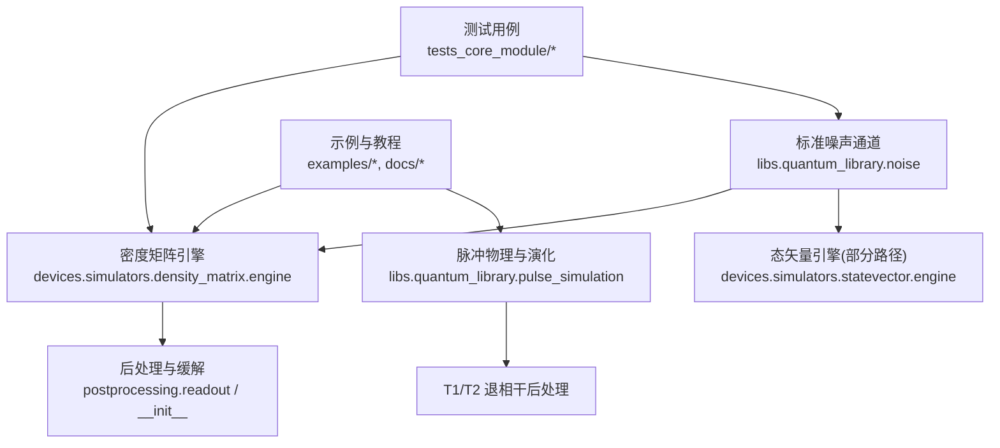
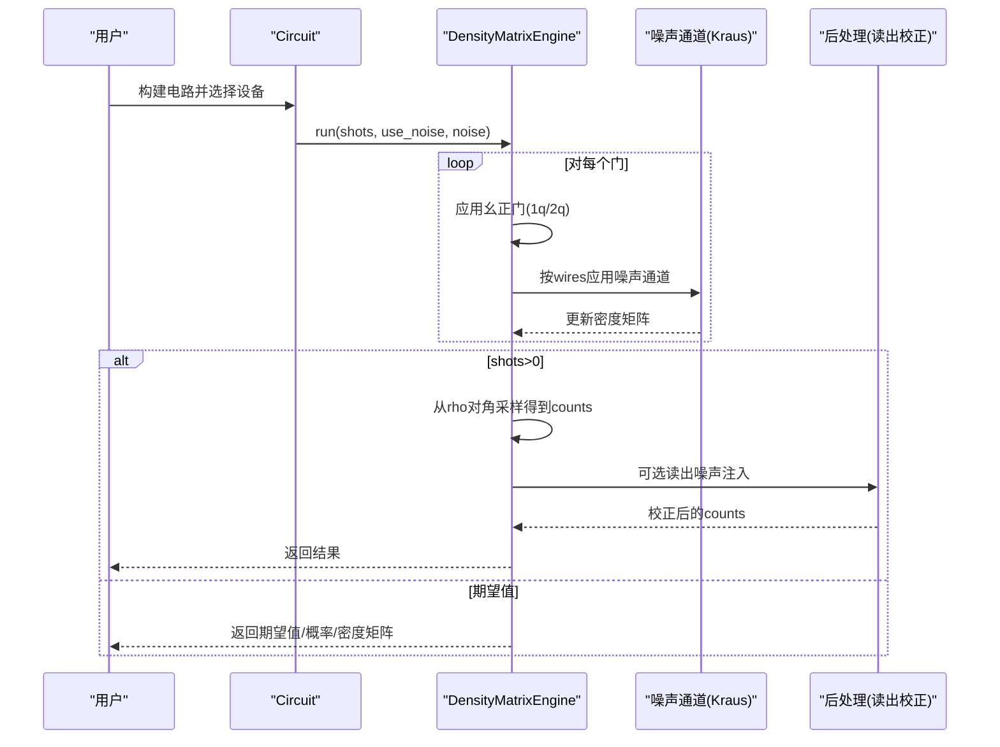
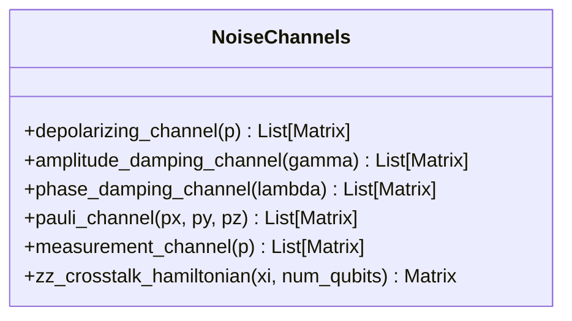
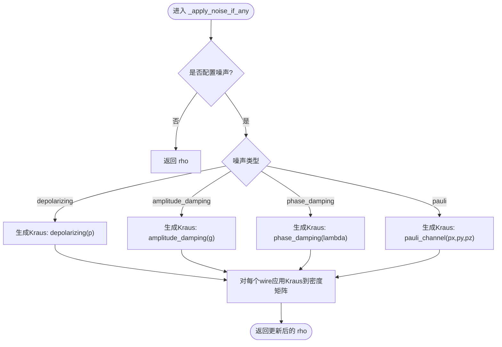
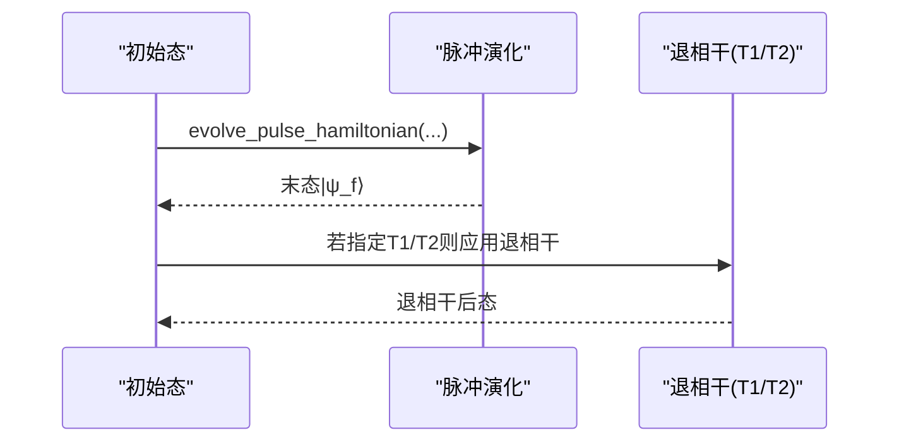
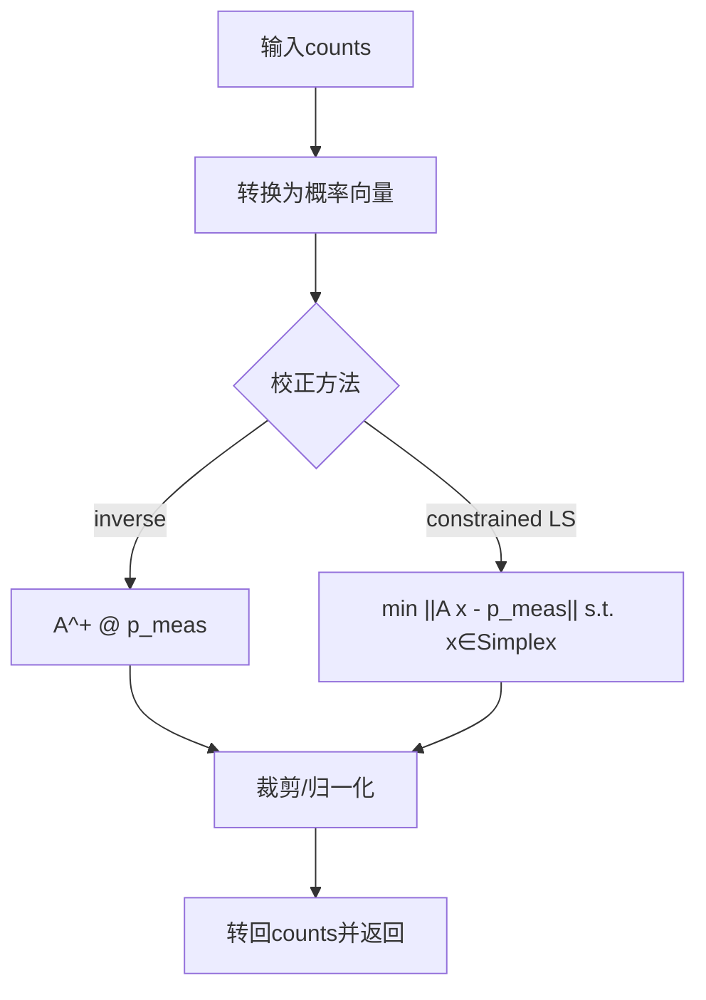
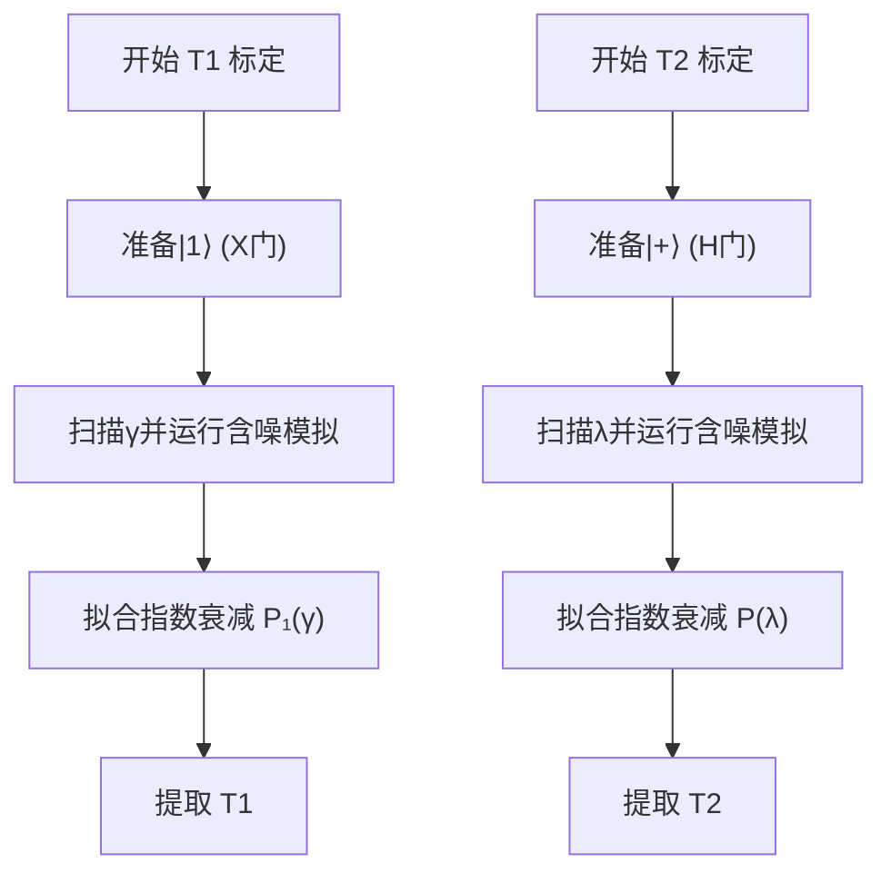
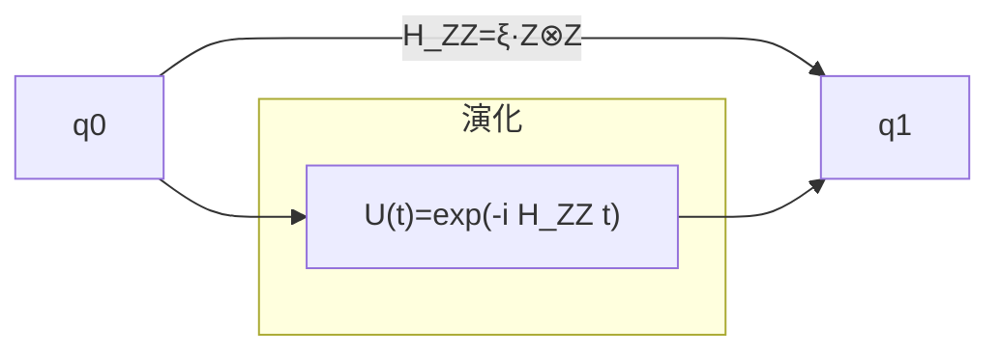
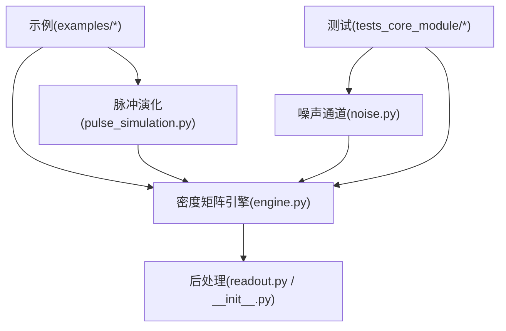

# 噪声分析和诊断工具

<cite>
**本文引用的文件**
- [noise.py](file://src/tyxonq/libs/quantum_library/noise.py)
- [channels.py](file://src/tyxonq/devices/simulators/noise/channels.py)
- [density_matrix_engine.py](file://src/tyxonq/devices/simulators/density_matrix/engine.py)
- [statevector_engine.py](file://src/tyxonq/devices/simulators/statevector/engine.py)
- [pulse_simulation.py](file://src/tyxonq/libs/quantum_library/pulse_simulation.py)
- [readout.py](file://src/tyxonq/postprocessing/readout.py)
- [postprocessing_init.py](file://src/tyxonq/postprocessing/__init__.py)
- [noise_analysis.py](file://src/tyxonq/postprocessing/noise_analysis.py)
- [noise_t1_t2_calibration.py](file://examples/noise_t1_t2_calibration.py)
- [noise_controls_demo.py](file://examples/noise_controls_demo.py)
- [noise_simulation.rst](file://docs/source/user_guide/devices/noise_simulation.rst)
- [test_noise_integration.py](file://tests_core_module/test_noise_integration.py)
- [test_zz_crosstalk.py](file://tests_core_module/test_zz_crosstalk.py)
- [pulse_noise_modeling.py](file://examples/pulse_noise_modeling.py)
</cite>

## 目录
1. [简介](#简介)
2. [项目结构](#项目结构)
3. [核心组件](#核心组件)
4. [架构总览](#架构总览)
5. [详细组件分析](#详细组件分析)
6. [依赖关系分析](#依赖关系分析)
7. [性能考量](#性能考量)
8. [故障排查指南](#故障排查指南)
9. [结论](#结论)
10. [附录](#附录)

## 简介
本文件面向使用 TyxonQ 进行量子噪声分析与诊断的工程师与研究人员，系统阐述：
- 量子噪声类型及其影响机制（退极化、振幅阻尼、相位阻尼、Pauli 通道、读出误差、ZZ 串扰等）
- 噪声模拟与指标计算（Kraus 算子、密度矩阵演化、采样统计）
- T1/T2 弛豫时间的测量与分析流程
- 退极化与其他噪声通道的建模方法
- 噪声特征提取与模式识别思路
- 基于噪声数据的硬件特性表征实践
- 噪声抑制与补偿策略（读出校正、脉冲级 ZZ 补偿、动态解耦等）
- 噪声模拟与预测工具的使用指南
- 噪声环境下的实验设计与数据分析最佳实践

## 项目结构
TyxonQ 将噪声建模与仿真分层组织：
- 标准噪声通道定义：位于量子库噪声模块，提供 Kraus 算子实现
- 模拟器后端：态矢量与密度矩阵引擎负责门演化与噪声注入
- 脉冲级物理：脉冲哈密顿量构建与含 T1/T2 的退相干后处理
- 后处理与缓解：读出误差校准与校正、计数级近似噪声注入
- 示例与文档：端到端演示与用户指南

图表来源
- [noise.py:1-341](file://src/tyxonq/libs/quantum_library/noise.py#L1-L341)
- [density_matrix_engine.py:1-242](file://src/tyxonq/devices/simulators/density_matrix/engine.py#L1-L242)
- [pulse_simulation.py:386-659](file://src/tyxonq/libs/quantum_library/pulse_simulation.py#L386-L659)
- [readout.py:1-143](file://src/tyxonq/postprocessing/readout.py#L1-L143)
- [postprocessing_init.py:58-150](file://src/tyxonq/postprocessing/__init__.py#L58-L150)

章节来源
- [noise_simulation.rst:86-188](file://docs/source/user_guide/devices/noise_simulation.rst#L86-L188)
- [noise_t1_t2_calibration.py:1-426](file://examples/noise_t1_t2_calibration.py#L1-L426)

## 核心组件
- 标准噪声通道（Kraus 表示）
  - 退极化通道：各向同性 Pauli 错误
  - 振幅阻尼通道：能量弛豫 |1⟩→|0⟩
  - 相位阻尼通道：纯退相干，保持布居数
  - Pauli 通道：非对称 X/Y/Z 错误
  - 测量通道：随机投影测量（MIPT 等）
  - ZZ 串扰哈密顿量：相邻比特间恒定的 ZZ 耦合
- 密度矩阵引擎
  - 在每一步幺正门后按 wires 应用噪声通道（Kraus 作用到密度矩阵）
  - 支持 shots 采样与读出噪声注入
- 态矢量引擎（脉冲路径）
  - 通过脉冲哈密顿量演化，并在结束后可选地施加 T1/T2 退相干
- 后处理与缓解
  - 读出误差校准矩阵与校正（逆矩阵或约束最小二乘）
  - 计数级近似噪声（bitflip/depolarizing）用于快速 what-if 分析
- 示例与文档
  - T1/T2 标定工作流、噪声控制开关、ZZ 串扰建模与测量

章节来源
- [noise.py:29-341](file://src/tyxonq/libs/quantum_library/noise.py#L29-L341)
- [density_matrix_engine.py:196-227](file://src/tyxonq/devices/simulators/density_matrix/engine.py#L196-L227)
- [pulse_simulation.py:386-524](file://src/tyxonq/libs/quantum_library/pulse_simulation.py#L386-L524)
- [readout.py:15-143](file://src/tyxonq/postprocessing/readout.py#L15-L143)
- [noise_analysis.py:17-100](file://src/tyxonq/postprocessing/noise_analysis.py#L17-L100)

## 架构总览
下图展示从电路到噪声注入、再到后处理的完整数据流。

图表来源
- [density_matrix_engine.py:43-167](file://src/tyxonq/devices/simulators/density_matrix/engine.py#L43-L167)
- [density_matrix_engine.py:196-227](file://src/tyxonq/devices/simulators/density_matrix/engine.py#L196-L227)
- [readout.py:94-137](file://src/tyxonq/postprocessing/readout.py#L94-L137)

## 详细组件分析

### 标准噪声通道（Kraus 算子）
- 退极化通道：以概率 p 均匀施加 I/X/Y/Z，适用于各向同性退相干建模
- 振幅阻尼通道：参数 γ≈1−exp(−t_gate/T1)，描述能量弛豫
- 相位阻尼通道：参数 λ≈1−exp(−t_gate/T2)，描述纯退相干
- Pauli 通道：独立设置 px/py/pz，刻画非对称错误
- 测量通道：以概率 p 执行 Z 基投影，用于 MIPT 等协议
- ZZ 串扰哈密顿量：H_ZZ=ξ·σ_z⊗σ_z，描述相邻比特间的恒耦合

图表来源
- [noise.py:29-341](file://src/tyxonq/libs/quantum_library/noise.py#L29-L341)

章节来源
- [noise.py:29-341](file://src/tyxonq/libs/quantum_library/noise.py#L29-L341)

### 密度矩阵引擎中的噪声注入
- 在每个门操作后，根据 noise 配置选择通道类型，并对目标 qubit(s) 应用对应的 Kraus 算子
- 支持 depolarizing、amplitude_damping、phase_damping、pauli 等通道
- 在 shots 模式下，可从密度矩阵对角采样；同时支持 readout 噪声注入

图表来源
- [density_matrix_engine.py:196-227](file://src/tyxonq/devices/simulators/density_matrix/engine.py#L196-L227)

章节来源
- [density_matrix_engine.py:196-227](file://src/tyxonq/devices/simulators/density_matrix/engine.py#L196-L227)

### 脉冲级噪声与 T1/T2 退相干
- 通过构建脉冲哈密顿量（漂移+驱动），数值求解薛定谔方程得到末态
- 若指定 T1/T2，则在演化结束后对态施加退相干（Kraus 或等效模型）
- 支持单比特与多比特扩展（局部哈密顿量嵌入全空间）

图表来源
- [pulse_simulation.py:386-524](file://src/tyxonq/libs/quantum_library/pulse_simulation.py#L386-L524)

章节来源
- [pulse_simulation.py:386-524](file://src/tyxonq/libs/quantum_library/pulse_simulation.py#L386-L524)

### 读出误差校准与校正
- 提供单比特校准矩阵 A_q，满足 measured_prob = A_q · true_prob
- 多比特时按升序 qubit 做 Kronecker 积构造全局校准矩阵
- 校正方法：逆矩阵法或约束最小二乘（保证概率单纯形）
- 与 Circuit.run 链式 API 集成，可在设备层注入读出噪声并在后处理中校正

图表来源
- [readout.py:94-137](file://src/tyxonq/postprocessing/readout.py#L94-L137)
- [postprocessing_init.py:109-150](file://src/tyxonq/postprocessing/__init__.py#L109-L150)

章节来源
- [readout.py:15-143](file://src/tyxonq/postprocessing/readout.py#L15-L143)
- [postprocessing_init.py:58-150](file://src/tyxonq/postprocessing/__init__.py#L58-L150)

### T1/T2 弛豫时间测量与分析
- T1 测量：制备 |1⟩，扫描振幅阻尼强度 γ，拟合 P₁(γ)=A·exp(−γ·T1)+C，提取 T1
- T2 测量：Ramsey 型序列 H-noise-H，扫描相位阻尼强度 λ，拟合 P(λ)=A·exp(−λ·T2)+C，提取 T2
- 提供完整工作流与可视化输出，便于对比不同噪声速率下的衰减行为

图表来源
- [noise_t1_t2_calibration.py:75-157](file://examples/noise_t1_t2_calibration.py#L75-L157)
- [noise_t1_t2_calibration.py:260-339](file://examples/noise_t1_t2_calibration.py#L260-L339)

章节来源
- [noise_t1_t2_calibration.py:1-426](file://examples/noise_t1_t2_calibration.py#L1-L426)

### ZZ 串扰建模与测量
- 使用 zz_crosstalk_hamiltonian 构建 ξ·σ_z⊗σ_z，支持多比特扩展
- 典型平台耦合强度参考：IBM/Google/Rigetti 等
- 可通过时序演化 U=exp(−i H_ZZ t) 评估条件相位累积与保真度损失
- 提供拓扑与耦合查询接口，便于在脉冲级仿真中叠加 ZZ 项

图表来源
- [noise.py:255-341](file://src/tyxonq/libs/quantum_library/noise.py#L255-L341)
- [test_zz_crosstalk.py:22-111](file://tests_core_module/test_zz_crosstalk.py#L22-L111)

章节来源
- [test_zz_crosstalk.py:1-331](file://tests_core_module/test_zz_crosstalk.py#L1-L331)
- [pulse_noise_modeling.py:1-591](file://examples/pulse_noise_modeling.py#L1-L591)

### 噪声特征提取与模式识别
- 计数级近似：bitflip/depolarizing 适配器用于快速 what-if 分析
- 指标建议：
  - 保真度/重叠：比较理想与含噪分布
  - 误差率估计：通过 Pauli 期望值衰减拟合
  - 通道辨识：对不同通道参数扫描，观察期望值/分布变化
- 结合 T1/T2 标定与 ZZ 测量，建立“通道—参数—指标”映射

章节来源
- [noise_analysis.py:17-100](file://src/tyxonq/postprocessing/noise_analysis.py#L17-L100)
- [noise_t1_t2_calibration.py:344-382](file://examples/noise_t1_t2_calibration.py#L344-L382)

### 基于噪声数据的硬件特性表征
- 利用 T1/T2 标定获取退相干时间
- 通过 ZZ 测量获得相邻比特耦合强度
- 结合不同门深度/并行度的误差增长曲线，反推主要误差源
- 使用状态矢量/密度矩阵引擎对比理想与含噪结果，定位问题环节

章节来源
- [noise_t1_t2_calibration.py:260-339](file://examples/noise_t1_t2_calibration.py#L260-L339)
- [pulse_noise_modeling.py:108-163](file://examples/pulse_noise_modeling.py#L108-L163)

### 噪声抑制与补偿策略
- 读出误差校正：逆矩阵或约束最小二乘
- 脉冲级 ZZ 补偿：在受控门后追加 RZ(+χ·T) 抵消条件相位
- 动态解耦：插入回波序列抑制低频噪声
- 电路优化：布局/调度减少并发邻居控制，降低串扰
- 全局噪声开关：enable_noise 统一控制模拟器噪声

章节来源
- [readout.py:94-137](file://src/tyxonq/postprocessing/readout.py#L94-L137)
- [noise_controls_demo.py:1-53](file://examples/noise_controls_demo.py#L1-L53)
- [pulse_noise_modeling.py:354-453](file://examples/pulse_noise_modeling.py#L354-L453)

### 噪声模拟与预测工具使用指南
- 密度矩阵引擎：适合精确噪声研究（内存 O(4^n)）
- 态矢量引擎：适合无噪声或小规模含噪场景
- 脉冲演化：可加入 T1/T2 退相干，适合脉冲级优化与校准
- 计数级近似：快速评估 bitflip/depolarizing 的影响

章节来源
- [density_matrix_engine.py:1-242](file://src/tyxonq/devices/simulators/density_matrix/engine.py#L1-L242)
- [pulse_simulation.py:527-659](file://src/tyxonq/libs/quantum_library/pulse_simulation.py#L527-L659)
- [noise_analysis.py:24-100](file://src/tyxonq/postprocessing/noise_analysis.py#L24-L100)

### 噪声环境下的实验设计与数据分析最佳实践
- 定期校准读出矩阵与 T1/T2，跟踪漂移
- 合理设置 shots 数量，平衡统计误差与耗时
- 用理想模拟作为基准，逐步引入噪声验证稳健性
- 组合多种缓解技术（读出校正、脉冲补偿、动态解耦）
- 批处理与缓存校准数据，提升效率

章节来源
- [noise_simulation.rst:241-285](file://docs/source/user_guide/postprocessing/index.rst#L241-L285)
- [postprocessing_init.py:109-150](file://src/tyxonq/postprocessing/__init__.py#L109-L150)

## 依赖关系分析
- 密度矩阵引擎依赖标准噪声通道与核函数（apply_kraus_density）
- 脉冲演化依赖哈密顿量构建与数值积分器
- 后处理模块依赖校准矩阵与优化求解器
- 示例与测试覆盖端到端流程，确保一致性

图表来源
- [noise.py:29-341](file://src/tyxonq/libs/quantum_library/noise.py#L29-L341)
- [density_matrix_engine.py:196-227](file://src/tyxonq/devices/simulators/density_matrix/engine.py#L196-L227)
- [pulse_simulation.py:386-524](file://src/tyxonq/libs/quantum_library/pulse_simulation.py#L386-L524)
- [readout.py:94-137](file://src/tyxonq/postprocessing/readout.py#L94-L137)
- [postprocessing_init.py:109-150](file://src/tyxonq/postprocessing/__init__.py#L109-L150)

章节来源
- [test_noise_integration.py:13-40](file://tests_core_module/test_noise_integration.py#L13-L40)

## 性能考量
- 密度矩阵模拟内存随 2^n 增长，n≥10 需谨慎
- 脉冲演化使用数值积分，步长与精度影响速度与稳定性
- 读出校正涉及矩阵求逆/优化，多比特时复杂度上升
- 计数级近似仅适用于快速评估，不替代态级噪声模拟

## 故障排查指南
- 未知 op 报错：密度矩阵引擎对未知操作会抛出异常，检查 IR 与门表
- 噪声参数越界：Kraus 通道要求参数在 [0,1]，请校验 gamma/lambda/p
- 校准矩阵维度错误：读出校准需为 2×2 矩阵，多比特按顺序 Kronecker 积
- 采样统计不稳定：增加 shots 或使用期望值路径验证
- ZZ 串扰导致相位偏差：检查拓扑与耦合强度，必要时采用频率失谐或补偿

章节来源
- [density_matrix_engine.py:103-109](file://src/tyxonq/devices/simulators/density_matrix/engine.py#L103-L109)
- [noise.py:56-108](file://src/tyxonq/libs/quantum_library/noise.py#L56-L108)
- [readout.py:33-60](file://src/tyxonq/postprocessing/readout.py#L33-L60)

## 结论
TyxonQ 提供了从标准噪声通道、密度矩阵/态矢量仿真、脉冲级物理到后处理缓解的完整噪声分析与诊断能力。借助 T1/T2 标定、ZZ 串扰建模与读出校正，用户可对硬件特性进行定量表征，并通过脉冲补偿、动态解耦与电路优化等手段有效抑制噪声影响。建议在真实设备上定期校准、在模拟器中反复验证，形成“测量—建模—补偿—再测量”的闭环工作流。

## 附录
- 常用噪声通道与参数范围见标准噪声模块
- T1/T2 标定工作流与可视化脚本可直接复用
- ZZ 串扰测量与补偿策略参见脉冲噪声建模示例
- 读出误差校正与批量后处理请参考后处理模块与示例