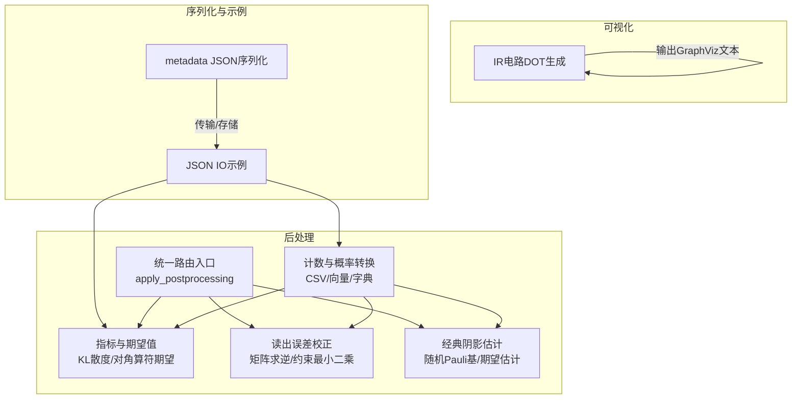
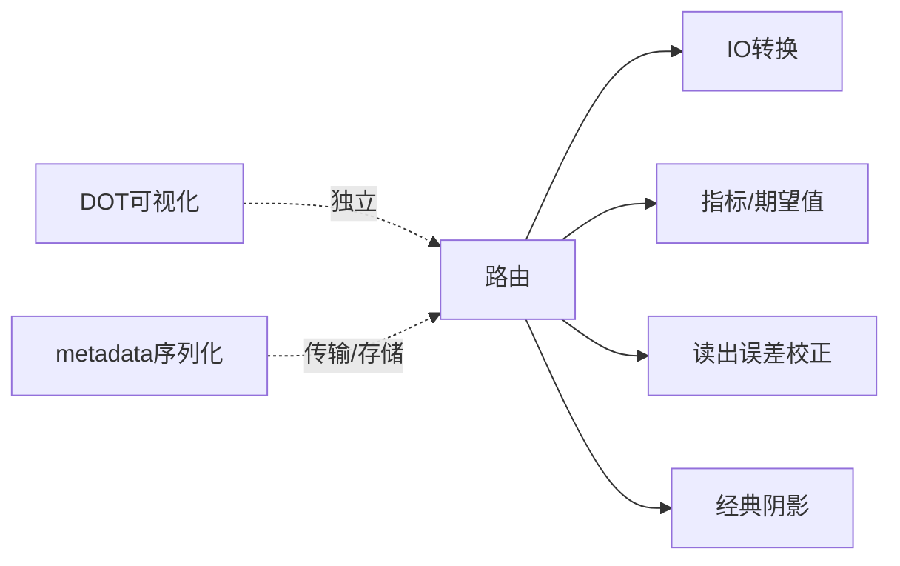

# 数据可视化和导出

<cite>
**本文引用的文件**
- [src/tyxonq/postprocessing/io.py](file://src/tyxonq/postprocessing/io.py)
- [src/tyxonq/postprocessing/__init__.py](file://src/tyxonq/postprocessing/__init__.py)
- [src/tyxonq/postprocessing/metrics.py](file://src/tyxonq/postprocessing/metrics.py)
- [src/tyxonq/postprocessing/readout.py](file://src/tyxonq/postprocessing/readout.py)
- [src/tyxonq/postprocessing/classical_shadows.py](file://src/tyxonq/postprocessing/classical_shadows.py)
- [src/tyxonq/visualization/dot.py](file://src/tyxonq/visualization/dot.py)
- [src/tyxonq/visualization/__init__.py](file://src/tyxonq/visualization/__init__.py)
- [examples/jsonio.py](file://examples/jsonio.py)
- [src/tyxonq/compiler/pulse_compiler/serialization.py](file://src/tyxonq/compiler/pulse_compiler/serialization.py)
</cite>

## 目录
1. [简介](#简介)
2. [项目结构](#项目结构)
3. [核心组件](#核心组件)
4. [架构总览](#架构总览)
5. [详细组件分析](#详细组件分析)
6. [依赖关系分析](#依赖关系分析)
7. [性能考虑](#性能考虑)
8. [故障排查指南](#故障排查指南)
9. [结论](#结论)
10. [附录](#附录)

## 简介
本文件聚焦 TyxonQ 的后处理结果格式化、存储与可视化能力，覆盖以下主题：
- 支持的数据格式与导出选项（JSON、CSV、HDF5等）
- 结果数据结构组织与元数据管理
- 数据可视化方法与工具集成
- 批量数据处理与结果聚合技术
- 将后处理结果用于科学计算与机器学习应用
- 数据压缩与传输优化策略
- 数据验证与质量检查方法
- 与其他量子计算框架的数据交换格式

## 项目结构
TyxonQ 中与“数据可视化和导出”直接相关的模块主要位于 postprocessing 与 visualization 两个子包，辅以示例和序列化辅助代码：
- postprocessing：提供计数统计、期望值计算、读出误差校正、经典阴影估计、指标度量以及 CSV/向量/字典转换等。
- visualization：提供 IR 电路的 DOT 图生成，便于在 GraphViz 中可视化。
- examples/jsonio.py：演示电路的 JSON 序列化与反序列化，并基于计数计算期望值。
- compiler/pulse_compiler/serialization.py：提供 metadata 的 JSON 安全序列化逻辑，便于跨进程/网络传输。

图表来源
- [src/tyxonq/postprocessing/io.py:9-98](file://src/tyxonq/postprocessing/io.py#L9-L98)
- [src/tyxonq/postprocessing/metrics.py:20-84](file://src/tyxonq/postprocessing/metrics.py#L20-L84)
- [src/tyxonq/postprocessing/readout.py:15-137](file://src/tyxonq/postprocessing/readout.py#L15-L137)
- [src/tyxonq/postprocessing/classical_shadows.py:14-103](file://src/tyxonq/postprocessing/classical_shadows.py#L14-L103)
- [src/tyxonq/postprocessing/__init__.py:16-225](file://src/tyxonq/postprocessing/__init__.py#L16-L225)
- [src/tyxonq/visualization/dot.py:12-63](file://src/tyxonq/visualization/dot.py#L12-L63)
- [examples/jsonio.py:16-63](file://examples/jsonio.py#L16-L63)
- [src/tyxonq/compiler/pulse_compiler/serialization.py:135-165](file://src/tyxonq/compiler/pulse_compiler/serialization.py#L135-L165)

章节来源
- [src/tyxonq/postprocessing/io.py:9-98](file://src/tyxonq/postprocessing/io.py#L9-L98)
- [src/tyxonq/postprocessing/metrics.py:20-84](file://src/tyxonq/postprocessing/metrics.py#L20-L84)
- [src/tyxonq/postprocessing/readout.py:15-137](file://src/tyxonq/postprocessing/readout.py#L15-L137)
- [src/tyxonq/postprocessing/classical_shadows.py:14-103](file://src/tyxonq/postprocessing/classical_shadows.py#L14-L103)
- [src/tyxonq/postprocessing/__init__.py:16-225](file://src/tyxonq/postprocessing/__init__.py#L16-L225)
- [src/tyxonq/visualization/dot.py:12-63](file://src/tyxonq/visualization/dot.py#L12-L63)
- [examples/jsonio.py:16-63](file://examples/jsonio.py#L16-L63)
- [src/tyxonq/compiler/pulse_compiler/serialization.py:135-165](file://src/tyxonq/compiler/pulse_compiler/serialization.py#L135-L165)

## 核心组件
- 计数与概率转换（IO）
  - 提供 counts↔CSV、counts↔向量、counts排序/归一化、边缘分布、直方图绘制等工具。
  - 支持整数样本与二进制样本之间的相互转换，以及多种计数表示形式（稀疏元组、稠密向量、字典）。
- 指标与期望值（Metrics）
  - 提供 KL 散度、对角算符期望值计算，便于评估分布差异与可观测量期望。
- 读出误差校正（Readout Mitigation）
  - 支持单比特校准矩阵的 Kronecker 积构建全局矩阵，采用矩阵求逆或约束最小二乘进行概率校正，再转回计数。
- 经典阴影（Classical Shadows）
  - 随机 Pauli 基生成与 Z 期望估计，支持多 shot 的随机基采样与 Pauli 乘积期望估计。
- 统一后处理路由（Router）
  - 根据 method 分发到具体实现，支持读出误差校正、单/多 Pauli 项期望、Hamiltonian 求和聚合，自动推断 shots 与 probabilities/statevector。
- 可视化（Visualization）
  - 将 IR Circuit 转换为 DOT 文本，便于使用 GraphViz 渲染电路拓扑与门序列。
- 序列化与示例（Serialization & Examples）
  - 提供 metadata 的 JSON 安全序列化；示例展示电路 JSON 序列化/反序列化与期望值一致性验证。

章节来源
- [src/tyxonq/postprocessing/io.py:9-98](file://src/tyxonq/postprocessing/io.py#L9-L98)
- [src/tyxonq/postprocessing/metrics.py:20-84](file://src/tyxonq/postprocessing/metrics.py#L20-L84)
- [src/tyxonq/postprocessing/readout.py:15-137](file://src/tyxonq/postprocessing/readout.py#L15-L137)
- [src/tyxonq/postprocessing/classical_shadows.py:14-103](file://src/tyxonq/postprocessing/classical_shadows.py#L14-L103)
- [src/tyxonq/postprocessing/__init__.py:16-225](file://src/tyxonq/postprocessing/__init__.py#L16-L225)
- [src/tyxonq/visualization/dot.py:12-63](file://src/tyxonq/visualization/dot.py#L12-L63)
- [examples/jsonio.py:16-63](file://examples/jsonio.py#L16-L63)
- [src/tyxonq/compiler/pulse_compiler/serialization.py:135-165](file://src/tyxonq/compiler/pulse_compiler/serialization.py#L135-L165)

## 架构总览
后处理流程以统一入口 apply_postprocessing 为中心，按 method 路由至具体算法模块；IO 层负责数据格式转换，metrics 提供指标，readout 提供误差校正，classical_shadows 提供随机基估计；可视化模块独立于执行流，输出可被外部工具渲染的 DOT 文本；序列化模块确保 metadata 可安全地 JSON 编码，便于存储与传输。

```mermaid
sequenceDiagram
participant User as "用户代码"
participant Router as "apply_postprocessing"
participant IO as "计数/概率转换"
participant Metrics as "指标/期望值"
participant Readout as "读出误差校正"
participant Shadows as "经典阴影"
participant Viz as "DOT可视化"
participant Ser as "metadata序列化"
User->>Router : 调用 apply_postprocessing(result, options)
alt method=readout_mitigation
Router->>Readout : 应用读出误差校正
Readout-->>Router : 返回校正后的计数
else method=expval_pauli_term/terms/sum
Router->>IO : 解析counts/probabilities/statevector
Router->>Metrics : 计算期望值/聚合
Metrics-->>Router : 返回期望值
end
User->>Viz : 生成电路DOT文本
User->>Ser : 序列化metadata为JSON
Router-->>User : 结构化结果{method,result}
```

图表来源
- [src/tyxonq/postprocessing/__init__.py:16-225](file://src/tyxonq/postprocessing/__init__.py#L16-L225)
- [src/tyxonq/postprocessing/io.py:9-98](file://src/tyxonq/postprocessing/io.py#L9-L98)
- [src/tyxonq/postprocessing/metrics.py:20-84](file://src/tyxonq/postprocessing/metrics.py#L20-L84)
- [src/tyxonq/postprocessing/readout.py:15-137](file://src/tyxonq/postprocessing/readout.py#L15-L137)
- [src/tyxonq/postprocessing/classical_shadows.py:14-103](file://src/tyxonq/postprocessing/classical_shadows.py#L14-L103)
- [src/tyxonq/visualization/dot.py:12-63](file://src/tyxonq/visualization/dot.py#L12-L63)
- [src/tyxonq/compiler/pulse_compiler/serialization.py:135-165](file://src/tyxonq/compiler/pulse_compiler/serialization.py#L135-L165)

## 详细组件分析

### 计数与概率转换（IO）
- 功能要点
  - CSV 读写：将计数字典导出为 CSV，支持校验头部并解析回字典。
  - 计数归一化与排序：将计数转为概率分布，按频次降序排列。
  - 向量转换：将计数转为稠密概率向量或从向量重建计数（支持剪枝）。
  - 边缘分布：可选依赖 qiskit 计算指定 qubits 的边缘分布。
  - 直方图绘制：可选依赖 qiskit 的 plot_histogram。
  - 样本转换：整数样本与二进制样本互转，支持多种计数表示（稀疏元组、稠密向量、字典键为 bin/int）。
- 复杂度与性能
  - 稠密向量长度 2^n，适合中小 n；大 n 建议使用稀疏表示或分块处理。
  - 边缘分布依赖外部库，注意导入开销与异常处理。
- 错误处理
  - 对缺失依赖（如 qiskit）抛出运行时异常，避免静默失败。
- 使用建议
  - 大数据量时优先使用稀疏元组或向量化操作；必要时结合批处理与内存映射。

章节来源
- [src/tyxonq/postprocessing/io.py:9-98](file://src/tyxonq/postprocessing/io.py#L9-L98)
- [src/tyxonq/postprocessing/io.py:104-190](file://src/tyxonq/postprocessing/io.py#L104-L190)

### 指标与期望值（Metrics）
- 功能要点
  - 归一化计数为概率分布。
  - KL 散度：比较两个计数分布的差异，带正则化避免 log(0)。
  - 对角算符期望：支持指定 Z 测量位或逐比特对角矩阵，计算期望值。
- 复杂度与性能
  - 线性于状态空间大小（按非零项遍历），适合稀疏计数。
- 错误处理
  - 参数校验：必须提供 z 或 diagonal_op。
- 使用建议
  - 大规模系统下建议使用稀疏计数与向量化计算；结合批处理减少重复开销。

章节来源
- [src/tyxonq/postprocessing/metrics.py:20-84](file://src/tyxonq/postprocessing/metrics.py#L20-L84)

### 读出误差校正（Readout Mitigation）
- 功能要点
  - 单比特校准矩阵输入，Kronecker 积构建全局矩阵。
  - 两种校正方法：矩阵求逆（稳定版使用伪逆）与约束最小二乘（单纯形约束）。
  - 概率向量与计数之间的双向转换，保持概率归一与非负。
- 复杂度与性能
  - 矩阵规模 2^n × 2^n，n 较大时内存与计算成本显著上升；建议限制并行维度或分块处理。
- 错误处理
  - 缺少某比特校准矩阵会报错；数值不稳定时使用伪逆与裁剪保证稳定性。
- 使用建议
  - 小系统可直接使用；大系统建议仅对关键比特子集进行校正或采用近似方法。

章节来源
- [src/tyxonq/postprocessing/readout.py:15-137](file://src/tyxonq/postprocessing/readout.py#L15-L137)

### 经典阴影（Classical Shadows）
- 功能要点
  - 随机 Pauli 基生成（含/不含 I）。
  - 从计数估计单比特 Z 期望。
  - 多 shot 随机基采样与 Pauli 乘积期望估计。
- 复杂度与性能
  - 每 shot 按 Pauli 算符集合计算贡献，整体 O(shots × |P|)。
- 错误处理
  - 空 bases 返回 0；bitstring 长度不足时左补零对齐。
- 使用建议
  - 适用于多可观测量同时估计场景；可通过增加 shots 提升估计精度。

章节来源
- [src/tyxonq/postprocessing/classical_shadows.py:14-103](file://src/tyxonq/postprocessing/classical_shadows.py#L14-L103)

### 统一后处理路由（Router）
- 功能要点
  - 根据 method 路由到 readout_mitigation、expval_pauli_term、expval_pauli_terms、expval_pauli_sum。
  - 自动推断 shots（从 metadata 或 counts 总和）。
  - 支持从 statevector 推导 probabilities，或直接使用已有 expectations/probabilities。
  - expval_pauli_sum 内嵌可选读出误差校正。
- 错误处理
  - 未识别 method 返回占位信息；异常情况下保持部分结果，避免上层崩溃。
- 使用建议
  - 推荐通过 options 明确 method 与参数；对大批量任务可缓存中间结果（如 probabilities）。

章节来源
- [src/tyxonq/postprocessing/__init__.py:16-225](file://src/tyxonq/postprocessing/__init__.py#L16-L225)

### 可视化（DOT）
- 功能要点
  - 将 IR Circuit 转换为 DOT 文本，包含 qubit 轨道与门节点连接。
  - 两比特及以上门用虚线边连接各参与节点，便于观察纠缠关系。
- 使用建议
  - 配合 GraphViz 渲染；大图时可分块或仅导出子图。

章节来源
- [src/tyxonq/visualization/dot.py:12-63](file://src/tyxonq/visualization/dot.py#L12-L63)

### 序列化与示例（Serialization & Examples）
- 功能要点
  - metadata 的 JSON 安全序列化：处理 pulse_library 等特殊对象，保留基本类型与容器。
  - 示例展示电路 JSON 序列化/反序列化，并验证不同加载方式下的期望值一致性。
- 使用建议
  - 跨进程/网络传输前务必序列化 metadata；保存结果时附带必要元数据（shots、num_qubits 等）。

章节来源
- [src/tyxonq/compiler/pulse_compiler/serialization.py:135-165](file://src/tyxonq/compiler/pulse_compiler/serialization.py#L135-L165)
- [examples/jsonio.py:16-63](file://examples/jsonio.py#L16-L63)

## 依赖关系分析
- 内部依赖
  - 路由模块依赖 IO、Metrics、Readout、Shadows；可视化模块独立；序列化模块服务于 metadata。
- 外部依赖
  - 可选依赖 qiskit 用于边缘分布与直方图绘制；SciPy 用于伪逆与约束优化；NumPy 作为基础数值库。
- 耦合与内聚
  - 后处理模块职责清晰，低耦合；路由集中调度，提高内聚性。
- 循环依赖
  - 通过延迟导入避免循环依赖（如 readout 在路由中按需导入）。

图表来源
- [src/tyxonq/postprocessing/__init__.py:16-225](file://src/tyxonq/postprocessing/__init__.py#L16-L225)
- [src/tyxonq/postprocessing/io.py:9-98](file://src/tyxonq/postprocessing/io.py#L9-L98)
- [src/tyxonq/postprocessing/metrics.py:20-84](file://src/tyxonq/postprocessing/metrics.py#L20-L84)
- [src/tyxonq/postprocessing/readout.py:15-137](file://src/tyxonq/postprocessing/readout.py#L15-L137)
- [src/tyxonq/postprocessing/classical_shadows.py:14-103](file://src/tyxonq/postprocessing/classical_shadows.py#L14-L103)
- [src/tyxonq/visualization/dot.py:12-63](file://src/tyxonq/visualization/dot.py#L12-L63)
- [src/tyxonq/compiler/pulse_compiler/serialization.py:135-165](file://src/tyxonq/compiler/pulse_compiler/serialization.py#L135-L165)

章节来源
- [src/tyxonq/postprocessing/__init__.py:16-225](file://src/tyxonq/postprocessing/__init__.py#L16-L225)
- [src/tyxonq/postprocessing/io.py:9-98](file://src/tyxonq/postprocessing/io.py#L9-L98)
- [src/tyxonq/postprocessing/metrics.py:20-84](file://src/tyxonq/postprocessing/metrics.py#L20-L84)
- [src/tyxonq/postprocessing/readout.py:15-137](file://src/tyxonq/postprocessing/readout.py#L15-L137)
- [src/tyxonq/postprocessing/classical_shadows.py:14-103](file://src/tyxonq/postprocessing/classical_shadows.py#L14-L103)
- [src/tyxonq/visualization/dot.py:12-63](file://src/tyxonq/visualization/dot.py#L12-L63)
- [src/tyxonq/compiler/pulse_compiler/serialization.py:135-165](file://src/tyxonq/compiler/pulse_compiler/serialization.py#L135-L165)

## 性能考虑
- 数据规模与表示选择
  - 小 n：使用稠密向量；大 n：优先稀疏元组或分块处理。
- 计算复杂度
  - 读出误差校正矩阵规模 2^n × 2^n，需限制并行维度或采用近似。
- I/O 与序列化
  - CSV 适合小规模；JSON 适合结构化元数据；HDF5 未在核心模块实现，可在上层扩展。
- 依赖引入
  - 可选依赖（qiskit、scipy）按需导入，降低启动开销。
- 批处理与缓存
  - 对多次期望值计算可缓存 probabilities；批量任务中复用校准矩阵与随机种子。

[本节为通用指导，不直接分析具体文件]

## 故障排查指南
- 常见错误
  - 缺少 qiskit：边缘分布与直方图绘制会抛出运行时异常。
  - 缺少校准矩阵：读出误差校正会报错，需补充对应比特校准。
  - 参数校验失败：期望值计算需提供 z 或 diagonal_op。
- 诊断建议
  - 检查 result 结构是否包含 counts/probabilities/statevector 与 metadata。
  - 确认 shots 推断正确（metadata 或 counts 总和）。
  - 对大 n 系统，先验证稀疏表示与内存占用。
- 恢复策略
  - 降级到无误差校正模式；跳过可选依赖功能；使用更小的比特子集进行分析。

章节来源
- [src/tyxonq/postprocessing/io.py:69-86](file://src/tyxonq/postprocessing/io.py#L69-L86)
- [src/tyxonq/postprocessing/readout.py:45-60](file://src/tyxonq/postprocessing/readout.py#L45-L60)
- [src/tyxonq/postprocessing/metrics.py:70-75](file://src/tyxonq/postprocessing/metrics.py#L70-L75)
- [src/tyxonq/postprocessing/__init__.py:109-150](file://src/tyxonq/postprocessing/__init__.py#L109-L150)

## 结论
TyxonQ 的后处理与可视化模块提供了从计数到概率、从指标到误差校正、从电路到 DOT 图的完整链路。通过统一路由与模块化设计，用户可灵活组合不同工具以满足科学计算与机器学习需求。对于大规模系统，建议采用稀疏表示、分块处理与选择性校正；在传输与存储方面，利用 JSON 安全的 metadata 序列化确保可移植性与可复现性。

[本节为总结，不直接分析具体文件]

## 附录

### 数据格式与导出选项
- 已实现
  - CSV：计数字典导出/导入，带头部校验。
  - JSON：电路与 metadata 的序列化/反序列化。
  - 向量/字典：计数与概率向量的双向转换，支持稀疏与稠密表示。
- 可扩展
  - HDF5：当前核心模块未内置，可在上层封装 NumPy/HDF5 接口以支持大规模数据存储。
  - 其他格式：可根据需求扩展（如 Parquet、Zarr）。

章节来源
- [src/tyxonq/postprocessing/io.py:9-24](file://src/tyxonq/postprocessing/io.py#L9-L24)
- [examples/jsonio.py:33-63](file://examples/jsonio.py#L33-L63)
- [src/tyxonq/compiler/pulse_compiler/serialization.py:135-165](file://src/tyxonq/compiler/pulse_compiler/serialization.py#L135-L165)

### 结果数据结构与元数据管理
- 典型结构
  - result：counts/probabilities/statevector/expectations。
  - metadata：shots、num_qubits 等上下文信息。
  - result_meta：原始负载中的附加信息（如 group_items、identity_const）。
- 管理建议
  - 始终附带必要元数据；对 statevector 派生 probabilities 时需记录 num_qubits。
  - 序列化 metadata 时确保对象可 JSON 编码。

章节来源
- [src/tyxonq/postprocessing/__init__.py:24-39](file://src/tyxonq/postprocessing/__init__.py#L24-L39)
- [src/tyxonq/postprocessing/__init__.py:152-218](file://src/tyxonq/postprocessing/__init__.py#L152-L218)
- [src/tyxonq/compiler/pulse_compiler/serialization.py:135-165](file://src/tyxonq/compiler/pulse_compiler/serialization.py#L135-L165)

### 数据可视化方法与工具集成
- 电路可视化
  - 使用 DOT 生成器输出 GraphViz 兼容文本，便于渲染电路拓扑。
- 直方图与分布
  - 可选依赖 qiskit 的 plot_histogram；若无依赖，可使用 Matplotlib 自行绘制。
- 集成建议
  - 将 DOT 文本保存为 .dot 文件并使用 GraphViz 渲染；直方图输出为 PNG/SVG 便于报告。

章节来源
- [src/tyxonq/visualization/dot.py:12-63](file://src/tyxonq/visualization/dot.py#L12-L63)
- [src/tyxonq/postprocessing/io.py:80-86](file://src/tyxonq/postprocessing/io.py#L80-L86)

### 批量数据处理与结果聚合
- 批量策略
  - 对多个 circuit 或参数点，批量运行后合并 counts/probabilities；对期望值进行加权平均或求和。
- 聚合技术
  - Hamiltonian 求和：支持 identity_const 与分组项；可内嵌读出误差校正。
  - 经典阴影：多 shot 随机基采样，累积估计期望值。
- 性能优化
  - 缓存 probabilities；使用稀疏表示；分块处理大 n。

章节来源
- [src/tyxonq/postprocessing/__init__.py:183-218](file://src/tyxonq/postprocessing/__init__.py#L183-L218)
- [src/tyxonq/postprocessing/classical_shadows.py:63-103](file://src/tyxonq/postprocessing/classical_shadows.py#L63-L103)

### 用于科学计算与机器学习应用
- 科学计算
  - 能量期望值：通过 expval_pauli_sum 聚合 Hamiltonian 项；可结合读出误差校正提升精度。
  - 分布比较：使用 KL 散度评估理论分布与实验分布差异。
- 机器学习
  - 特征工程：将 counts/probabilities 作为特征向量输入模型；经典阴影可用于多可观测量特征提取。
  - 训练循环：在后处理阶段缓存中间结果，减少重复计算。

章节来源
- [src/tyxonq/postprocessing/__init__.py:183-218](file://src/tyxonq/postprocessing/__init__.py#L183-L218)
- [src/tyxonq/postprocessing/metrics.py:33-50](file://src/tyxonq/postprocessing/metrics.py#L33-L50)
- [src/tyxonq/postprocessing/classical_shadows.py:63-103](file://src/tyxonq/postprocessing/classical_shadows.py#L63-L103)

### 数据压缩与传输优化
- 压缩策略
  - 稀疏表示：使用稀疏元组减少存储与传输体积。
  - 序列化：JSON 安全序列化 metadata；对大型数组可考虑分块或外部存储（如 HDF5）。
- 传输优化
  - 仅传输必要字段；对重复计算结果进行缓存与复用。
  - 在网络传输前对 metadata 进行压缩与校验。

章节来源
- [src/tyxonq/postprocessing/io.py:104-190](file://src/tyxonq/postprocessing/io.py#L104-L190)
- [src/tyxonq/compiler/pulse_compiler/serialization.py:135-165](file://src/tyxonq/compiler/pulse_compiler/serialization.py#L135-L165)

### 数据验证与质量检查
- 验证方法
  - 概率归一化：确保概率和为 1；计数非负。
  - 分布一致性：使用 KL 散度比较理论与实验分布。
  - 期望值范围：对角算符期望应在合理范围内。
- 质量检查
  - 检查 shots 与 num_qubits 的一致性；验证 metadata 完整性。
  - 对大 n 系统进行内存与时间监控，必要时降级策略。

章节来源
- [src/tyxonq/postprocessing/metrics.py:20-50](file://src/tyxonq/postprocessing/metrics.py#L20-L50)
- [src/tyxonq/postprocessing/readout.py:76-92](file://src/tyxonq/postprocessing/readout.py#L76-L92)

### 与其他量子计算框架的数据交换格式
- 现有支持
  - CSV：计数字典的标准格式，易于跨框架交换。
  - JSON：电路与 metadata 的通用格式。
  - 向量/字典：NumPy 兼容的数组与字典结构。
- 扩展建议
  - 引入 QASM/QCS 等标准格式（如已在编译器中存在）以实现更广泛的互操作。
  - 对 HPC 环境，可采用 HDF5/Zarr 进行大规模数据共享。

章节来源
- [src/tyxonq/postprocessing/io.py:9-24](file://src/tyxonq/postprocessing/io.py#L9-L24)
- [examples/jsonio.py:33-63](file://examples/jsonio.py#L33-L63)