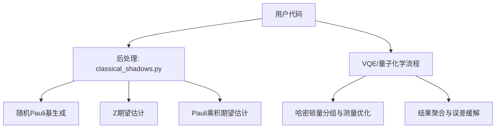
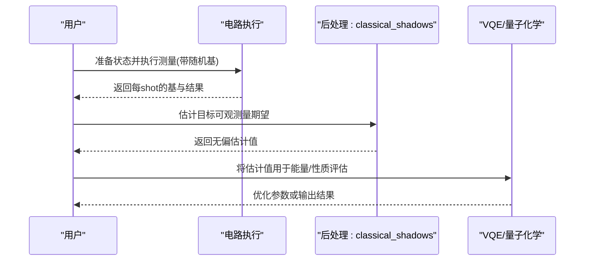
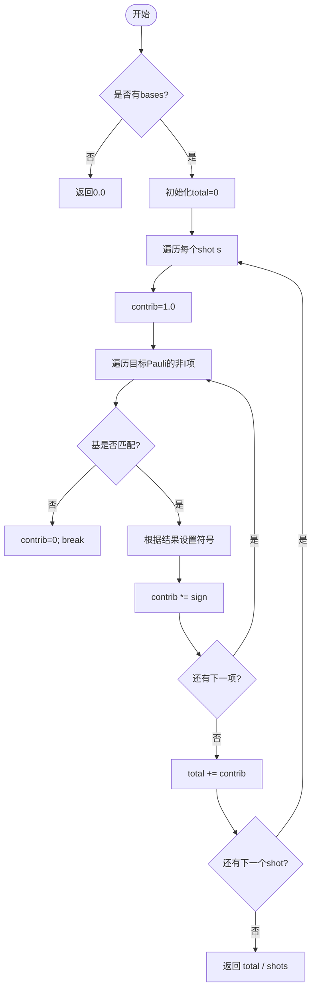
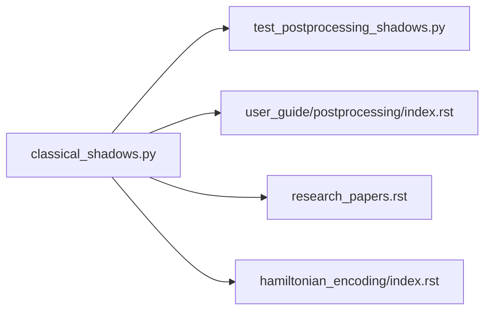
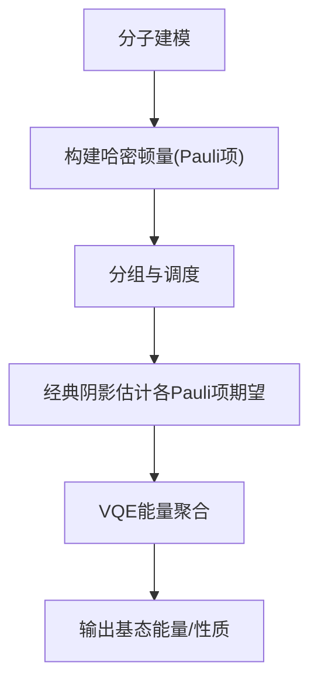

# 经典阴影技术

<cite>
**本文引用的文件**
- [src/tyxonq/postprocessing/classical_shadows.py](file://src/tyxonq/postprocessing/classical_shadows.py)
- [tests_core_module/test_postprocessing_shadows.py](file://tests_core_module/test_postprocessing_shadows.py)
- [docs/source/user_guide/postprocessing/index.rst](file://docs/source/user_guide/postprocessing/index.rst)
- [docs/source/libraries/hamiltonian_encoding/index.rst](file://docs/source/libraries/hamiltonian_encoding/index.rst)
- [docs/source/quantum_chemistry/fundamentals/index.rst](file://docs/source/quantum_chemistry/fundamentals/index.rst)
- [docs/source/examples/advanced_examples.rst](file://docs/source/examples/advanced_examples.rst)
- [examples/pulse_variational_algorithms.py](file://examples/pulse_variational_algorithms.py)
- [docs/source/technical_references/research_papers.rst](file://docs/source/technical_references/research_papers.rst)
</cite>

## 目录
1. [简介](#简介)
2. [项目结构](#项目结构)
3. [核心组件](#核心组件)
4. [架构总览](#架构总览)
5. [详细组件分析](#详细组件分析)
6. [依赖关系分析](#依赖关系分析)
7. [性能与精度控制](#性能与精度控制)
8. [量子化学应用实例](#量子化学应用实例)
9. [与传统方法的对比与优势](#与传统方法的对比与优势)
10. [大规模系统扩展性](#大规模系统扩展性)
11. [故障排查指南](#故障排查指南)
12. [结论](#结论)
13. [附录：配置参数与最佳实践](#附录：配置参数与最佳实践)

## 简介
本文件系统性阐述 TyxonQ 中的“经典阴影”（Classical Shadows）技术，覆盖理论基础、数学原理、随机测量策略、重建算法、不同观测量的估计方法与精度控制、在量子化学中的应用、与传统方法对比、以及面向大规模系统的扩展性与最佳实践。TyxonQ 在后处理层提供了轻量级的经典阴影工具函数，用于从随机 Pauli 基测量中无偏估计目标可观测量期望值，并可与 VQE、哈密顿量分组等模块协同工作，实现高效、可扩展的量子态性质估计。

## 项目结构
TyxonQ 将经典阴影相关能力集中在后处理层，并通过测试与文档提供使用示例与理论背景。关键位置如下：
- 后处理实现：src/tyxonq/postprocessing/classical_shadows.py
- 单元测试：tests_core_module/test_postprocessing_shadows.py
- 用户指南与示例：docs/source/user_guide/postprocessing/index.rst
- 量子化学基础与 VQE：docs/source/quantum_chemistry/fundamentals/index.rst
- 哈密顿量分组与测量优化：docs/source/libraries/hamiltonian_encoding/index.rst
- 高级示例与自适应测量：docs/source/examples/advanced_examples.rst
- 研究论文与测量优化参考：docs/source/technical_references/research_papers.rst
- 脉冲变分算法示例（含 H2 问题）：examples/pulse_variational_algorithms.py

图表来源
- [src/tyxonq/postprocessing/classical_shadows.py:14-103](file://src/tyxonq/postprocessing/classical_shadows.py#L14-L103)
- [docs/source/libraries/hamiltonian_encoding/index.rst:419-464](file://docs/source/libraries/hamiltonian_encoding/index.rst#L419-L464)

章节来源
- [src/tyxonq/postprocessing/classical_shadows.py:14-103](file://src/tyxonq/postprocessing/classical_shadows.py#L14-L103)
- [docs/source/user_guide/postprocessing/index.rst:110-156](file://docs/source/user_guide/postprocessing/index.rst#L110-L156)

## 核心组件
- 随机 Pauli 基生成：为每个量子比特随机选择 X/Y/Z（或包含 I），支持种子控制以复现实验。
- Z 期望估计：基于计数统计估计单比特 Z 期望值。
- 多比特随机基批量生成：为每次 shot 生成一组随机基。
- bitstring 到比特数组转换：统一 little-endian 编码，便于后续处理。
- Pauli 乘积期望估计：基于经典阴影公式，对目标 Pauli 算符给出无偏估计。

这些函数构成经典阴影的核心：通过随机基测量与简单统计，实现对任意 Pauli 乘积观测量的高效估计，且可从同一组数据中估计多个观测量。

章节来源
- [src/tyxonq/postprocessing/classical_shadows.py:14-103](file://src/tyxonq/postprocessing/classical_shadows.py#L14-L103)
- [tests_core_module/test_postprocessing_shadows.py:12-33](file://tests_core_module/test_postprocessing_shadows.py#L12-L33)

## 架构总览
经典阴影在 TyxonQ 中的典型调用链：
- 用户构建电路并执行多次测量，记录每 shot 的随机基与结果。
- 通过后处理函数估计目标可观测量（如 Pauli 乘积）。
- 与 VQE/量子化学流程集成，结合哈密顿量分组与测量优化，降低总体测量成本。

图表来源
- [docs/source/user_guide/postprocessing/index.rst:110-156](file://docs/source/user_guide/postprocessing/index.rst#L110-L156)
- [docs/source/quantum_chemistry/fundamentals/index.rst:230-281](file://docs/source/quantum_chemistry/fundamentals/index.rst#L230-L281)

## 详细组件分析

### 随机 Pauli 基生成
- 功能：为 n 个量子比特生成随机基序列，元素来自 {X, Y, Z}，可选包含 I。
- 复杂度：O(n)。
- 可复现性：支持 seed 参数。
- 适用场景：经典阴影单次 shot 的测量基选择；也可用于其他随机测量协议。

章节来源
- [src/tyxonq/postprocessing/classical_shadows.py:14-22](file://src/tyxonq/postprocessing/classical_shadows.py#L14-L22)

### Z 期望估计
- 功能：根据计数字典估计指定量子比特的 Z 期望值。
- 假设：bitstring 采用 little-endian，右端位对应 qubit 0。
- 复杂度：O(k)，k 为不同 outcome 数。
- 边界情况：当 total=0 时返回 0.0。

章节来源
- [src/tyxonq/postprocessing/classical_shadows.py:25-38](file://src/tyxonq/postprocessing/classical_shadows.py#L25-L38)

### 批量随机基生成
- 功能：为 num_shots 次测量分别生成随机基。
- 复杂度：O(num_shots × n)。
- 用途：配合经典阴影估计，使每次测量在不同基下进行。

章节来源
- [src/tyxonq/postprocessing/classical_shadows.py:41-45](file://src/tyxonq/postprocessing/classical_shadows.py#L41-L45)

### bitstring 到比特数组转换
- 功能：将 little-endian 字符串转换为每 shot 的比特数组，自动补齐长度。
- 复杂度：O(num_shots × n)。
- 注意：确保输入长度一致或进行左补零。

章节来源
- [src/tyxonq/postprocessing/classical_shadows.py:48-60](file://src/tyxonq/postprocessing/classical_shadows.py#L48-L60)

### Pauli 乘积期望估计（经典阴影核心）
- 功能：给定目标 Pauli 乘积、每 shot 的测量基与结果，计算该 Pauli 乘积的无偏估计。
- 算法要点：
  - 仅当某 shot 的测量基与目标 Pauli 在该比特上匹配时才贡献非零项。
  - 贡献符号由测量结果决定（0→+1，1→−1）。
  - 对所有 shot 求平均得到估计值。
- 复杂度：O(S × w)，S 为 shot 数，w 为目标 Pauli 的非恒等项个数。
- 正确性验证：单元测试覆盖了 |Φ+⟩ 下 ZZ 期望为 +1 的情形。

图表来源
- [src/tyxonq/postprocessing/classical_shadows.py:63-103](file://src/tyxonq/postprocessing/classical_shadows.py#L63-L103)

章节来源
- [src/tyxonq/postprocessing/classical_shadows.py:63-103](file://src/tyxonq/postprocessing/classical_shadows.py#L63-L103)
- [tests_core_module/test_postprocessing_shadows.py:25-33](file://tests_core_module/test_postprocessing_shadows.py#L25-L33)

## 依赖关系分析
- 模块内聚性：classical_shadows.py 提供独立的后处理工具，不依赖外部库（除标准库 random），便于嵌入各种流程。
- 与上层流程耦合：通过用户代码与文档示例，与 VQE、量子化学模块协作。
- 测试保障：单元测试覆盖随机基生成、Z 期望估计与端到端 Pauli 乘积估计。

图表来源
- [src/tyxonq/postprocessing/classical_shadows.py:14-103](file://src/tyxonq/postprocessing/classical_shadows.py#L14-L103)
- [tests_core_module/test_postprocessing_shadows.py:1-37](file://tests_core_module/test_postprocessing_shadows.py#L1-L37)
- [docs/source/user_guide/postprocessing/index.rst:110-156](file://docs/source/user_guide/postprocessing/index.rst#L110-L156)
- [docs/source/technical_references/research_papers.rst:596-630](file://docs/source/technical_references/research_papers.rst#L596-L630)
- [docs/source/libraries/hamiltonian_encoding/index.rst:419-464](file://docs/source/libraries/hamiltonian_encoding/index.rst#L419-L464)

章节来源
- [tests_core_module/test_postprocessing_shadows.py:1-37](file://tests_core_module/test_postprocessing_shadows.py#L1-L37)

## 性能与精度控制
- 样本效率：对于低权重（非恒等项少）的 Pauli 乘积，经典阴影显著减少所需测量次数。
- 无偏估计：通过对匹配基的 shot 求平均，保证估计无偏。
- 精度控制：
  - 增加 shot 数可降低方差，提高估计精度。
  - 结合哈密顿量分组可减少重复测量，提升整体效率。
  - 自适应分配 shot 给高方差项，可在固定预算下改善总体精度。
- 复杂度：估计单个 Pauli 乘积的复杂度 O(S × w)，其中 S 为 shot 数，w 为非恒等项数。

章节来源
- [docs/source/user_guide/postprocessing/index.rst:110-156](file://docs/source/user_guide/postprocessing/index.rst#L110-L156)
- [docs/source/libraries/hamiltonian_encoding/index.rst:419-464](file://docs/source/libraries/hamiltonian_encoding/index.rst#L419-L464)
- [docs/source/examples/advanced_examples.rst:388-423](file://docs/source/examples/advanced_examples.rst#L388-L423)

## 量子化学应用实例
- 分子哈密顿量：TyxonQ 支持从分子几何构建电子结构哈密顿量，并进行 Jordan-Wigner、Bravyi-Kitaev、Parity 等映射。
- VQE 流程：通过变分原理最小化能量期望，结合参数化电路与经典优化器。
- 经典阴影集成：
  - 将分子哈密顿量展开为 Pauli 项集合。
  - 对每项使用经典阴影估计期望，结合分组与自适应 shot 分配，降低测量成本。
  - 在 H2 等小分子问题上演示能量估计与收敛。

图表来源
- [docs/source/quantum_chemistry/fundamentals/index.rst:230-281](file://docs/source/quantum_chemistry/fundamentals/index.rst#L230-L281)
- [docs/source/libraries/hamiltonian_encoding/index.rst:419-464](file://docs/source/libraries/hamiltonian_encoding/index.rst#L419-L464)
- [examples/pulse_variational_algorithms.py:43-65](file://examples/pulse_variational_algorithms.py#L43-L65)

章节来源
- [docs/source/quantum_chemistry/fundamentals/index.rst:230-281](file://docs/source/quantum_chemistry/fundamentals/index.rst#L230-L281)
- [examples/pulse_variational_algorithms.py:43-65](file://examples/pulse_variational_algorithms.py#L43-L65)

## 与传统方法的对比与优势
- 传统量子态层析（QST）：需要指数级测量与重建复杂度，难以扩展到较大系统。
- 经典阴影：
  - 可扩展：适用于大系统，尤其对低权重可观测量更高效。
  - 样本效率高：仅需少量测量即可估计多项性质。
  - 无偏估计：从同一组数据可估计多个观测量。
  - 灵活：易于与分组、自适应测量等技术结合。

章节来源
- [docs/source/user_guide/postprocessing/index.rst:110-156](file://docs/source/user_guide/postprocessing/index.rst#L110-L156)

## 大规模系统扩展性
- 测量分组：通过相容 Pauli 项分组，减少电路执行次数，提升整体效率。
- 自适应 shot 分配：按方差权重动态分配 shot，优化有限预算下的精度。
- 并行与批处理：后处理函数轻量，适合批处理与并行加速。
- 误差缓解：结合读出误差校正、零噪声外推等方法，提升实际设备上的可靠性。

章节来源
- [docs/source/libraries/hamiltonian_encoding/index.rst:419-464](file://docs/source/libraries/hamiltonian_encoding/index.rst#L419-L464)
- [docs/source/examples/advanced_examples.rst:388-423](file://docs/source/examples/advanced_examples.rst#L388-L423)
- [docs/source/user_guide/postprocessing/index.rst:195-286](file://docs/source/user_guide/postprocessing/index.rst#L195-L286)

## 故障排查指南
- 基与结果对齐：确保每 shot 的基与结果顺序一致，bitstring 采用 little-endian。
- 空计数处理：当 total=0 时，Z 期望估计返回 0.0，需检查测量是否成功。
- 基匹配条件：仅当测量基与目标 Pauli 在该比特上匹配时才贡献非零项，若估计接近 0，检查基是否充分覆盖目标项。
- 精度不足：增加 shot 数或采用自适应分配；结合分组减少重复测量。
- 误差影响：在真实设备上引入读出误差校正或零噪声外推以提升结果质量。

章节来源
- [src/tyxonq/postprocessing/classical_shadows.py:25-38](file://src/tyxonq/postprocessing/classical_shadows.py#L25-L38)
- [src/tyxonq/postprocessing/classical_shadows.py:63-103](file://src/tyxonq/postprocessing/classical_shadows.py#L63-L103)
- [docs/source/user_guide/postprocessing/index.rst:195-286](file://docs/source/user_guide/postprocessing/index.rst#L195-L286)

## 结论
TyxonQ 的经典阴影实现提供了轻量、可扩展且无偏的量子态性质估计工具。通过与 VQE、哈密顿量分组、自适应测量和误差缓解等技术结合，能够在量子化学等应用中显著降低测量成本并提升精度。其模块化设计便于集成到更广泛的量子算法与工作流中。

## 附录：配置参数与最佳实践
- 随机基生成
  - include_i：是否允许恒等基 I；默认不包含，可根据需求开启。
  - seed：随机种子，用于复现实验。
- 估计参数
  - num_shots：总测量次数，越大方差越小但成本越高。
  - pauli_ops：目标 Pauli 乘积的映射（qubit → {I,X,Y,Z}），忽略 I 项。
- 最佳实践
  - 优先使用分组与自适应分配，提高有限预算下的精度。
  - 在真实设备上启用读出误差校正与零噪声外推。
  - 对小权重可观测量，经典阴影尤为高效；对高权重项，考虑分组与并行。
  - 保持 bitstring 编码一致（little-endian），避免索引错误。

章节来源
- [src/tyxonq/postprocessing/classical_shadows.py:14-103](file://src/tyxonq/postprocessing/classical_shadows.py#L14-L103)
- [docs/source/libraries/hamiltonian_encoding/index.rst:419-464](file://docs/source/libraries/hamiltonian_encoding/index.rst#L419-L464)
- [docs/source/user_guide/postprocessing/index.rst:195-286](file://docs/source/user_guide/postprocessing/index.rst#L195-L286)