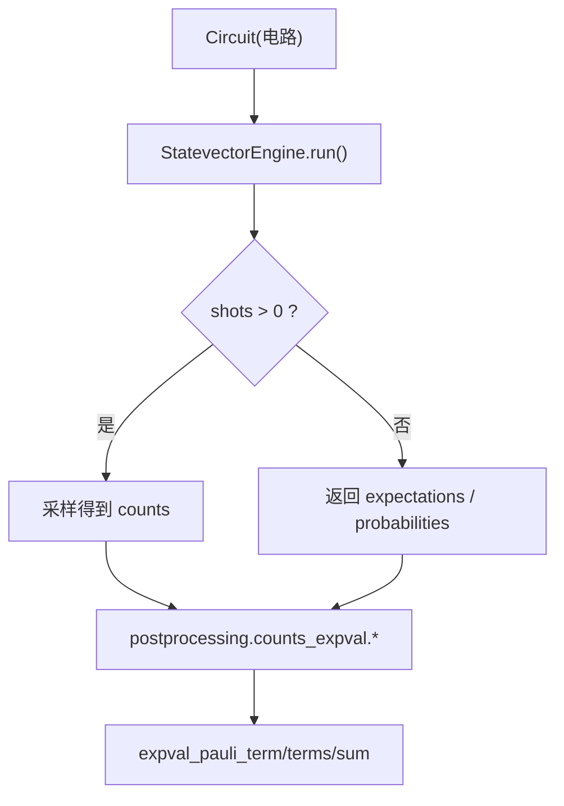
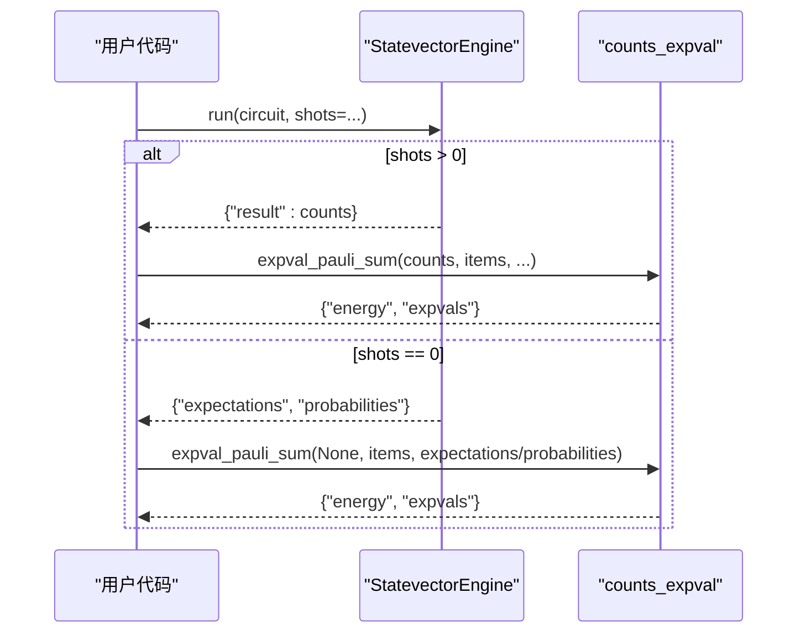
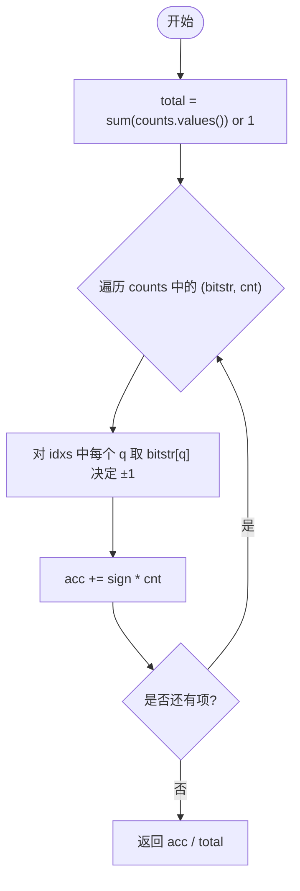
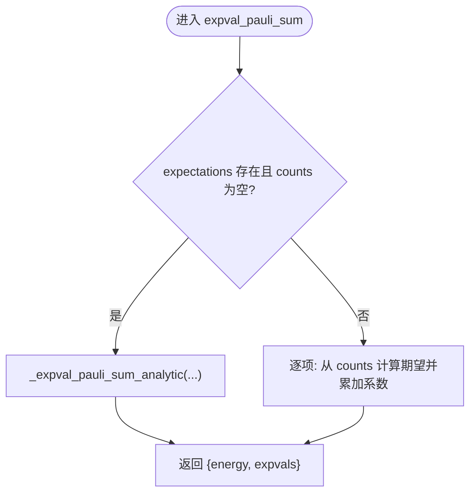
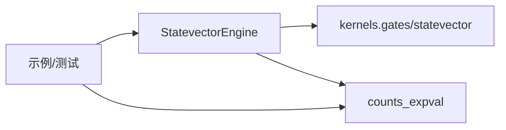

# 计数数据处理和期望值计算

<cite>
**本文引用的文件**
- [counts_expval.py](file://src/tyxonq/postprocessing/counts_expval.py)
- [engine.py](file://src/tyxonq/devices/simulators/statevector/engine.py)
- [test_measurement.py](file://tests_core_module/test_measurement.py)
- [autograd_vs_counts.py](file://examples/autograd_vs_counts.py)
- [vqe_shot_noise.py](file://examples/vqe_shot_noise.py)
- [error_mitigation.py](file://src/tyxonq/postprocessing/error_mitigation.py)
</cite>

## 目录
1. [简介](#简介)
2. [项目结构](#项目结构)
3. [核心组件](#核心组件)
4. [架构总览](#架构总览)
5. [详细组件分析](#详细组件分析)
6. [依赖关系分析](#依赖关系分析)
7. [性能与精度](#性能与精度)
8. [故障排查指南](#故障排查指南)
9. [结论](#结论)
10. [附录：使用示例与最佳实践](#附录使用示例与最佳实践)

## 简介
本文件聚焦 TyxonQ 中“量子测量计数”的处理与“Pauli 算符期望值”的计算，覆盖以下主题：
- 从测量计数（counts）到单项、多项及求和期望值的计算方法与数据格式。
- 基于状态向量与概率分布的精确期望值计算路径。
- expval_pauli_term、expval_pauli_terms、expval_pauli_sum 的参数说明与调用方式。
- 数值精度与性能优化建议。
- 错误处理与异常场景的应对策略。

## 项目结构
围绕计数与期望值的核心代码位于后处理模块与模拟器引擎：
- 后处理模块：提供 counts → 期望值的工具函数与聚合能力。
- 状态向量模拟器：负责运行电路、采样计数或返回精确期望值与概率分布。
- 示例与测试：展示如何从测量结果中提取物理量期望值，并对比不同路径的性能与精度。

图表来源
- [engine.py:46-451](file://src/tyxonq/devices/simulators/statevector/engine.py#L46-L451)
- [counts_expval.py:7-112](file://src/tyxonq/postprocessing/counts_expval.py#L7-L112)

章节来源
- [engine.py:46-451](file://src/tyxonq/devices/simulators/statevector/engine.py#L46-L451)
- [counts_expval.py:7-112](file://src/tyxonq/postprocessing/counts_expval.py#L7-L112)

## 核心组件
- term_expectation_from_counts：从 bitstring 计数计算 Z 乘积项的期望值。
- expval_pauli_term：单一项期望值的薄封装。
- expval_pauli_terms：批量计算多个 Pauli 项的期望值（忽略系数）。
- _expval_pauli_sum_analytic：当提供 per-qubit 的 Z 期望或完整概率分布时，解析地计算多项期望与能量。
- expval_pauli_sum：统一入口，支持 counts 或解析路径，输出能量与各分项期望。

章节来源
- [counts_expval.py:7-112](file://src/tyxonq/postprocessing/counts_expval.py#L7-L112)

## 架构总览
下图展示了从电路执行到期望值计算的端到端流程，包括采样路径与解析路径。

图表来源
- [engine.py:46-451](file://src/tyxonq/devices/simulators/statevector/engine.py#L46-L451)
- [counts_expval.py:55-112](file://src/tyxonq/postprocessing/counts_expval.py#L55-L112)

## 详细组件分析

### 计数到期望值：term_expectation_from_counts
- 输入：counts 字典 {bitstr: int}，以及要观测的 qubit 索引序列 idxs。
- 假设：电路已对 X/Y 项进行基旋转，末态在 Z 基下测量。
- 方法：遍历每个 bitstring，按位计算 ±1 符号，加权累加后除以总计数。
- 复杂度：O(N_terms × N_shots_unique)，N_terms 为项涉及的 qubit 数，N_shots_unique 为不同 bitstring 的数量。

图表来源
- [counts_expval.py:7-20](file://src/tyxonq/postprocessing/counts_expval.py#L7-L20)

章节来源
- [counts_expval.py:7-20](file://src/tyxonq/postprocessing/counts_expval.py#L7-L20)

### 单项期望：expval_pauli_term
- 作用：对单个 Pauli-Z 乘积项，直接调用计数期望计算。
- 参数：
  - counts: {bitstr: int}
  - idxs: 需要观测的 qubit 索引列表
- 返回：float，该项的期望值。

章节来源
- [counts_expval.py:34-36](file://src/tyxonq/postprocessing/counts_expval.py#L34-L36)

### 多项期望：expval_pauli_terms
- 作用：对一组 Pauli 项分别计算期望值（忽略系数）。
- 输入项格式：
  - term_only: Tuple[(q, letter), ...]
  - (term, coeff): 带系数的项（此处忽略系数）
- 返回：List[float]，每项的期望值。

章节来源
- [counts_expval.py:39-52](file://src/tyxonq/postprocessing/counts_expval.py#L39-L52)

### 求和期望：expval_pauli_sum
- 作用：将多项期望值聚合成能量，并返回各分项期望。
- 两种路径：
  - 计数路径：传入 counts，逐项计算期望并累加系数。
  - 解析路径：不传 counts，但提供 per-qubit 的 Z 期望或完整概率分布，利用张量积性质或概率分布精确计算。
- 关键参数：
  - counts: 可选；若 None 且提供 expectations/probabilities，则走解析路径。
  - items: 项列表，支持 (term, coeff) 或 term_only。
  - identity_const: 常数项（单位矩阵项）。
  - expectations: per-qubit 的 Z 期望映射，如 {"Z0": val, "Z1": val}。
  - probabilities: 完整概率分布数组，配合 num_qubits 可精确计算多项期望。
  - num_qubits: 系统比特数，用于概率路径下的维度计算。
- 返回：{"energy": float, "expvals": List[float]}

图表来源
- [counts_expval.py:55-112](file://src/tyxonq/postprocessing/counts_expval.py#L55-L112)

章节来源
- [counts_expval.py:55-112](file://src/tyxonq/postprocessing/counts_expval.py#L55-L112)

### 解析路径：_expval_pauli_sum_analytic
- 当提供 per-qubit 的 Z 期望或完整概率分布时，避免采样噪声，得到精确期望。
- 概率路径：遍历所有基矢，按大端序位映射计算 Z 乘积符号，加权求和。
- 单期望路径：对 Z 乘积项，期望等于各单比特 Z 期望的乘积。

章节来源
- [counts_expval.py:55-84](file://src/tyxonq/postprocessing/counts_expval.py#L55-L84)

### 状态向量引擎：StatevectorEngine.run
- 功能：
  - 当 shots > 0 且有测量时，返回采样计数 result。
  - 当 shots == 0，返回 expectations（per-qubit Z 期望）、probabilities（概率分布）、statevector。
- 与期望值计算的关系：
  - 计数路径：将 result 传给 counts_expval 工具函数。
  - 解析路径：将 expectations/probabilities 传给 expval_pauli_sum 的解析分支。

章节来源
- [engine.py:46-451](file://src/tyxonq/devices/simulators/statevector/engine.py#L46-L451)

### 测量与投影行为验证
- 测试用例验证了中途测量、投影与 reset 后的期望值行为，确保期望值计算的基础正确性。

章节来源
- [test_measurement.py:11-33](file://tests_core_module/test_measurement.py#L11-L33)

## 依赖关系分析
- StatevectorEngine 依赖内核库进行门操作与期望值计算，并在 run 中统一分发测量与采样逻辑。
- counts_expval 仅依赖 numpy，实现轻量高效的计数期望计算。
- 示例与测试展示了两种路径（计数 vs 解析）的等价性与性能差异。

图表来源
- [engine.py:14-32](file://src/tyxonq/devices/simulators/statevector/engine.py#L14-L32)
- [counts_expval.py:1-5](file://src/tyxonq/postprocessing/counts_expval.py#L1-L5)

章节来源
- [engine.py:14-32](file://src/tyxonq/devices/simulators/statevector/engine.py#L14-L32)
- [counts_expval.py:1-5](file://src/tyxonq/postprocessing/counts_expval.py#L1-L5)

## 性能与精度
- 计数路径：
  - 优点：贴近真实硬件，支持有限 shot 噪声建模。
  - 缺点：统计误差随 shot 数增加而降低，收敛较慢。
  - 优化技巧：
    - 增大 shots 以降低方差。
    - 合并相同项以减少重复计算。
    - 使用批量化处理多个项（expval_pauli_terms）。
- 解析路径：
  - 优点：无统计误差，速度快，适合优化过程中的梯度或快速评估。
  - 限制：需要 per-qubit 期望或完整概率分布，适用于 statevector 引擎 shots=0。
- 混合策略：
  - 先用解析路径做快速迭代，再用计数路径校准或验证。
- 误差缓解：
  - 可通过 error_mitigation 中的占位接口进行多次平均或扩展至更完善的误差缓解方案。

章节来源
- [error_mitigation.py:7-79](file://src/tyxonq/postprocessing/error_mitigation.py#L7-L79)

## 故障排查指南
- 未知操作导致崩溃：
  - 现象：遇到未识别的门或操作时报错。
  - 原因：StatevectorEngine 对未知 op 会抛出异常，避免静默跳过。
  - 处理：检查电路操作是否在支持的集合内，或使用 gates.resolve_unitary 提供的权威门表。
- 空计数或零概率：
  - 现象：counts 为空或概率总和为零。
  - 处理：在计数期望计算中，分母采用 max(total, 1) 防止除零；在概率路径中对概率归一化。
- 大端序位映射：
  - 现象：概率路径中位序不一致导致期望值偏差。
  - 处理：遵循大端序约定，q=0 对应最高有效位，索引位为 (n-1-q)。
- 三维系统测量：
  - 现象：三能级模拟下测量解码与二能级不同。
  - 处理：确认 three_level 模式，并按相应解码规则处理 bitstring。

章节来源
- [engine.py:335-342](file://src/tyxonq/devices/simulators/statevector/engine.py#L335-L342)
- [engine.py:344-451](file://src/tyxonq/devices/simulators/statevector/engine.py#L344-L451)
- [counts_expval.py:13-20](file://src/tyxonq/postprocessing/counts_expval.py#L13-L20)

## 结论
- TyxonQ 提供了统一的计数期望计算接口，支持单项、多项与求和期望值。
- 通过 StatevectorEngine 的 shots 控制，可在采样路径与解析路径之间灵活切换。
- 解析路径在无噪声环境下提供高精度与高性能，计数路径则更贴近真实硬件行为。
- 结合误差缓解与性能优化技巧，可在 VQE 等应用中取得稳定可靠的能量估计。

## 附录：使用示例与最佳实践
- 从测量结果提取 ZZ 期望值：
  - 参考示例：构建包含 CX-RZ-CX 的电路，测量两比特，使用计数期望公式计算 ZZ 期望。
  - 参考路径：[autograd_vs_counts.py:17-47](file://examples/autograd_vs_counts.py#L17-L47)
- 有限 shot 噪声下的 VQE：
  - 参考路径：[vqe_shot_noise.py:49-78](file://examples/vqe_shot_noise.py#L49-L78)
- 使用 expval_pauli_sum 的解析路径：
  - 从 StatevectorEngine 获取 expectations 或 probabilities，调用 expval_pauli_sum 计算能量与分项期望。
  - 参考路径：[counts_expval.py:87-112](file://src/tyxonq/postprocessing/counts_expval.py#L87-L112)

章节来源
- [autograd_vs_counts.py:17-47](file://examples/autograd_vs_counts.py#L17-L47)
- [vqe_shot_noise.py:49-78](file://examples/vqe_shot_noise.py#L49-L78)
- [counts_expval.py:87-112](file://src/tyxonq/postprocessing/counts_expval.py#L87-L112)