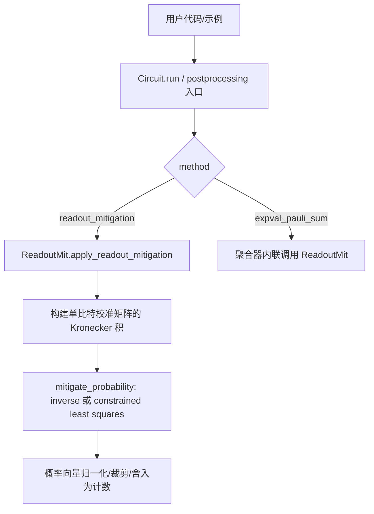
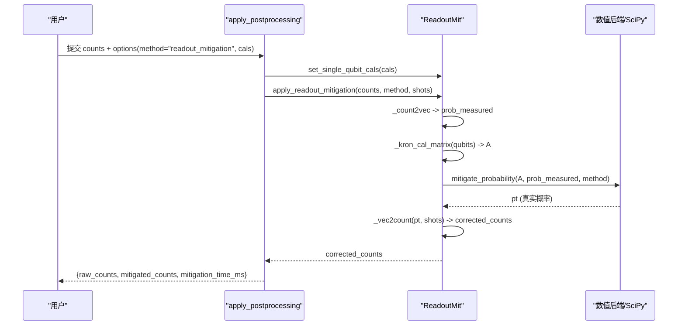
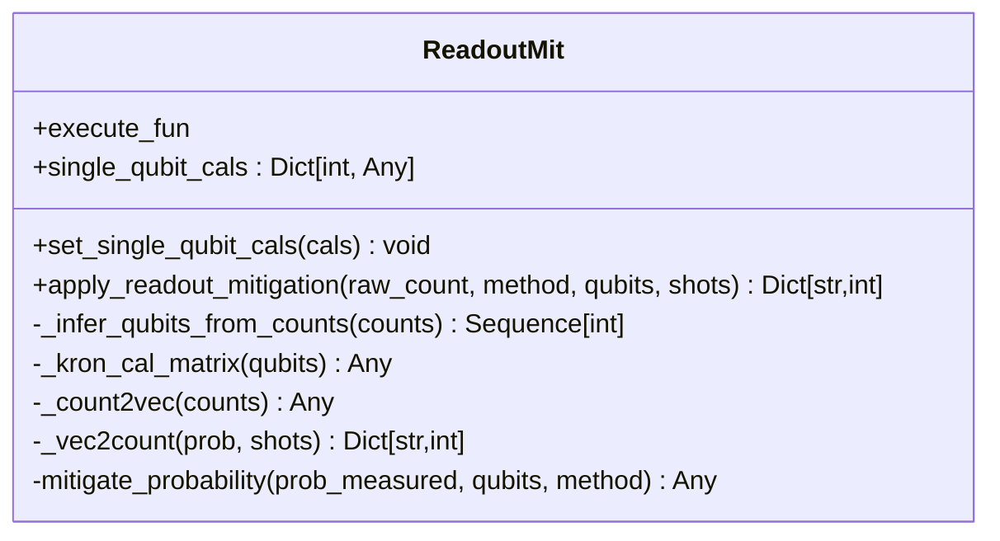
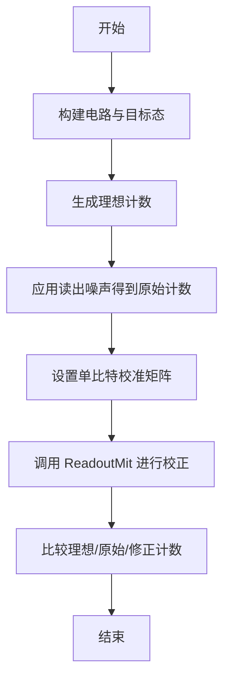
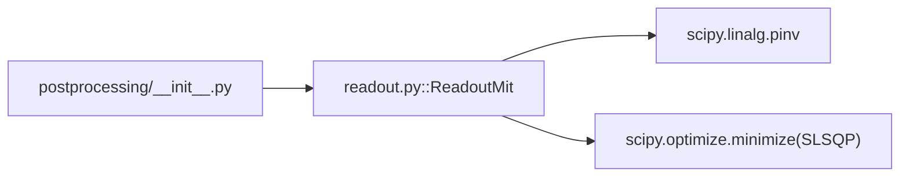

# 读取误差缓解技术

<cite>
**本文引用的文件**
- [readout.py](file://src/tyxonq/postprocessing/readout.py)
- [postprocessing/__init__.py](file://src/tyxonq/postprocessing/__init__.py)
- [research_papers.rst](file://docs/source/technical_references/research_papers.rst)
- [readout_mitigation.py](file://examples/readout_mitigation.py)
- [readout_mitigation_scalability.py](file://examples/readout_mitigation_scalability.py)
- [test_postprocessing_adapters.py](file://tests_core_module/test_postprocessing_adapters.py)
- [test_hea.py](file://tests_mol_valid/test_hea.py)
</cite>

## 目录
1. [简介](#简介)
2. [项目结构](#项目结构)
3. [核心组件](#核心组件)
4. [架构总览](#架构总览)
5. [详细组件分析](#详细组件分析)
6. [依赖关系分析](#依赖关系分析)
7. [性能考量](#性能考量)
8. [故障排查指南](#故障排查指南)
9. [结论](#结论)
10. [附录](#附录)

## 简介
本文件系统性阐述 TyxonQ 中的量子测量“读取误差缓解”（Readout Error Mitigation, REM）技术。内容涵盖：
- 读取误差的来源与影响机制
- ReadoutMit 类的实现原理与使用方法
- 校准数据的获取与配置方式
- 不同缓解算法（逆矩阵法、约束最小二乘）的工作原理与适用场景
- 从校准到结果修正的完整工作流程示例
- 缓解效果评估与质量指标
- 多量子比特系统的策略与可扩展性
- 在 VQE 等变分算法中集成误差缓解的实践
- 性能基准测试与优化建议

## 项目结构
TyxonQ 将读取误差缓解能力集中在后处理层，并通过统一的入口路由到具体实现。关键位置如下：
- 后处理统一入口：src/tyxonq/postprocessing/__init__.py
- 读取误差缓解核心类：src/tyxonq/postprocessing/readout.py
- 示例与可复现实验：examples/readout_mitigation.py、examples/readout_mitigation_scalability.py
- 相关测试：tests_core_module/test_postprocessing_adapters.py、tests_mol_valid/test_hea.py
- 理论参考：docs/source/technical_references/research_papers.rst

图表来源
- [postprocessing/__init__.py:109-150](file://src/tyxonq/postprocessing/__init__.py#L109-L150)
- [readout.py:94-137](file://src/tyxonq/postprocessing/readout.py#L94-L137)

章节来源
- [postprocessing/__init__.py:109-228](file://src/tyxonq/postprocessing/__init__.py#L109-L228)
- [readout.py:15-140](file://src/tyxonq/postprocessing/readout.py#L15-L140)

## 核心组件
- ReadoutMit：封装读取误差缓解的核心逻辑，支持设置单比特校准矩阵、构造全系统校准矩阵、执行逆矩阵或约束最小二乘求解真实概率分布，并将概率转回计数。
- 后处理路由 apply_postprocessing：提供统一接口，根据 method 分发到 readout_mitigation 或期望值聚合等流程；在 expval_pauli_sum 中也可内联启用读取误差缓解。

章节来源
- [readout.py:15-140](file://src/tyxonq/postprocessing/readout.py#L15-L140)
- [postprocessing/__init__.py:109-228](file://src/tyxonq/postprocessing/__init__.py#L109-L228)

## 架构总览
读取误差缓解在 TyxonQ 中的整体数据流如下：
- 输入：原始计数 counts（或状态向量/概率），以及每比特校准矩阵 cals
- 步骤：
  - 将计数归一化为概率向量
  - 通过单比特校准矩阵的张量积构建全系统校准矩阵 A
  - 使用逆矩阵或约束最小二乘求解真实概率 pt = A^{-1} p_meas 或 min ||A x - p_meas||^2 s.t. x∈Simplex
  - 对结果进行裁剪、归一化并转换为计数
- 输出：修正后的计数或用于后续期望值聚合的概率

图表来源
- [postprocessing/__init__.py:109-150](file://src/tyxonq/postprocessing/__init__.py#L109-L150)
- [readout.py:62-137](file://src/tyxonq/postprocessing/readout.py#L62-L137)

## 详细组件分析

### ReadoutMit 类
- 功能要点
  - set_single_qubit_cals：校验并保存每个量子比特的 2×2 校准矩阵（行随机矩阵，描述 true_prob → measured_prob）
  - _kron_cal_matrix：按升序线序对指定 qubits 的校准矩阵做 Kronecker 积得到全系统矩阵 A
  - _count2vec/_vec2count：计数与概率向量的双向转换，含归一化与裁剪
  - mitigate_probability：两种方法
    - inverse：使用伪逆（scipy.linalg.pinv）求解 pt = A^{+} p_meas，再裁剪、归一化
    - square：在单纯形上求解约束最小二乘问题（SLSQP），保证解的概率意义
  - apply_readout_mitigation：对外统一入口，自动推断 qubits，返回修正计数

图表来源
- [readout.py:15-140](file://src/tyxonq/postprocessing/readout.py#L15-L140)

章节来源
- [readout.py:15-140](file://src/tyxonq/postprocessing/readout.py#L15-L140)

### 后处理路由与集成点
- 当 method="readout_mitigation" 时，路由会实例化 ReadoutMit，传入 cals 和 mitigation 方法，执行校正并记录耗时
- 在 expval_pauli_sum 中，若提供 readout_cals/cals，则会在聚合前对 counts 执行读取误差缓解，从而提升期望值精度

章节来源
- [postprocessing/__init__.py:109-228](file://src/tyxonq/postprocessing/__init__.py#L109-L228)

### 校准数据获取与配置
- 校准矩阵含义：A_{ij} = P(测得 i | 真态 j)，即“真实概率→测量概率”的转移矩阵
- 典型获取方式
  - 设备表征：对计算基态 |0...0⟩,...,|1...1⟩ 分别运行大量 shot，统计条件概率，拟合出单比特矩阵
  - 模拟器注入：在仿真环境中直接设定噪声模型参数生成 A，便于验证与回归测试
- 配置方式
  - 直接传入 cals={qubit_index: 2x2 matrix} 给 ReadoutMit 或后处理选项
  - 在 Circuit 链式调用中通过 .postprocessing(method="readout_mitigation", cals=..., mitigation="inverse") 完成端到端校正

章节来源
- [readout_mitigation.py:82-133](file://examples/readout_mitigation.py#L82-L133)
- [postprocessing/__init__.py:109-150](file://src/tyxonq/postprocessing/__init__.py#L109-L150)

### 缓解算法原理与适用场景
- 逆矩阵法（inverse）
  - 原理：pt = A^{+} p_meas，利用伪逆提高数值稳定性
  - 优点：计算简单直接，适合中小规模系统
  - 风险：当 A 病态或样本不足时，可能产生负概率或非物理结果，需裁剪与归一化
- 约束最小二乘法（square）
  - 原理：min ||A x - p_meas||^2，约束 x ∈ Simplex（非负且和为1）
  - 优点：保证解的物理一致性，鲁棒性更强
  - 成本：需要非线性优化（SLSQP），复杂度更高

章节来源
- [readout.py:94-137](file://src/tyxonq/postprocessing/readout.py#L94-L137)

### 完整工作流程示例（从校准到修正）
- 步骤概览
  1) 准备电路与目标态（如 Bell 态）
  2) 合成理想计数，并应用单比特读出噪声矩阵得到原始计数
  3) 配置 ReadoutMit 并传入单比特校准矩阵
  4) 调用 apply_readout_mitigation 获得修正计数
  5) 对比理想、原始与修正计数，评估改善程度
- 参考路径
  - 示例脚本：examples/readout_mitigation.py
  - 单元测试：tests_core_module/test_postprocessing_adapters.py

图表来源
- [readout_mitigation.py:82-133](file://examples/readout_mitigation.py#L82-L133)
- [test_postprocessing_adapters.py:27-49](file://tests_core_module/test_postprocessing_adapters.py#L27-L49)

章节来源
- [readout_mitigation.py:82-133](file://examples/readout_mitigation.py#L82-L133)
- [test_postprocessing_adapters.py:27-49](file://tests_core_module/test_postprocessing_adapters.py#L27-L49)

### 多量子比特系统的误差缓解策略
- 全系统校准矩阵由单比特矩阵按升序线序做 Kronecker 积得到
- 随着量子比特数 n 增加：
  - 矩阵维度 2^n × 2^n 导致存储与求逆成本指数增长
  - 数值病态加剧，伪逆放大噪声
  - 校准所需 shot 数量约 ~2^n/p，实际采集困难
- 实践建议
  - 小系统（n ≤ 10）：优先使用逆矩阵法或约束最小二乘法
  - 大系统：考虑分区缓解、张量网络近似、对称性验证或机器学习方法

章节来源
- [readout_mitigation_scalability.py:101-129](file://examples/readout_mitigation_scalability.py#L101-L129)
- [readout_mitigation_scalability.py:381-412](file://examples/readout_mitigation_scalability.py#L381-L412)

### 在 VQE 等变分算法中集成误差缓解
- 在期望值聚合阶段内联启用读取误差缓解，可显著降低读出误差对能量估计的影响
- 典型用法：在 HEA/VQE 的能量计算中，通过 postprocessing 参数传递 readout_cals 与 mitigation 方法
- 参考路径
  - 端到端测试：tests_mol_valid/test_hea.py（展示无校正与校正后的能量对比）

章节来源
- [test_hea.py:91-115](file://tests_mol_valid/test_hea.py#L91-L115)
- [postprocessing/__init__.py:189-218](file://src/tyxonq/postprocessing/__init__.py#L189-L218)

### 效果评估与质量指标
- 保真度（Fidelity）：衡量修正分布与理想分布的接近程度
- 总变差距离（TVD）：衡量两分布的差异
- 改进幅度：mitigated_fidelity - noisy_fidelity
- 时间开销：mitigation_time_ms
- 参考路径
  - 可扩展性实验脚本中实现了上述指标的统计与报告

章节来源
- [readout_mitigation_scalability.py:136-193](file://examples/readout_mitigation_scalability.py#L136-L193)
- [readout_mitigation_scalability.py:260-299](file://examples/readout_mitigation_scalability.py#L260-L299)

## 依赖关系分析
- 模块耦合
  - postprocessing/__init__.py 作为路由，延迟导入 ReadoutMit，避免循环依赖
  - ReadoutMit 依赖数值后端（numpy/scipy）进行线性代数与优化
- 外部依赖
  - scipy.linalg.pinv：稳定求逆
  - scipy.optimize.minimize（SLSQP）：约束最小二乘
- 潜在风险
  - 大 n 下矩阵病态与数值不稳定
  - 校准数据不足导致过拟合或发散

图表来源
- [postprocessing/__init__.py:109-150](file://src/tyxonq/postprocessing/__init__.py#L109-L150)
- [readout.py:94-137](file://src/tyxonq/postprocessing/readout.py#L94-L137)

章节来源
- [postprocessing/__init__.py:109-228](file://src/tyxonq/postprocessing/__init__.py#L109-L228)
- [readout.py:1-140](file://src/tyxonq/postprocessing/readout.py#L1-L140)

## 性能考量
- 时间与复杂度
  - 逆矩阵法：O((2^n)^3) 的矩阵求逆主导
  - 约束最小二乘：每次迭代涉及矩阵向量乘与约束投影，收敛受初始值与条件数影响
- 内存占用
  - 存储 2^n × 2^n 矩阵随 n 指数增长
- 采样需求
  - 校准矩阵估计需要 ~2^n/p 次 shot，p 为单比特读出误差率
- 经验阈值
  - 通常 n ≤ 10 时 REM 较为实用；更大系统建议采用替代方案

章节来源
- [readout_mitigation_scalability.py:381-412](file://examples/readout_mitigation_scalability.py#L381-L412)

## 故障排查指南
- 常见错误
  - 校准矩阵形状不匹配：必须为 2×2
  - 缺失某量子比特的校准：会抛出缺少校准的错误
  - 数值不稳定：出现负概率或异常大的修正值
- 诊断与修复
  - 检查 cals 是否覆盖所有参与计算的量子比特
  - 使用约束最小二乘法替代逆矩阵法以提升鲁棒性
  - 增加校准 shot 数量，确保统计显著性
  - 在后处理失败时，框架会保留占位结构，便于上层继续执行

章节来源
- [readout.py:33-60](file://src/tyxonq/postprocessing/readout.py#L33-L60)
- [postprocessing/__init__.py:147-150](file://src/tyxonq/postprocessing/__init__.py#L147-L150)

## 结论
TyxonQ 的读取误差缓解通过统一的后处理入口与灵活的 ReadoutMit 实现，提供了从校准到修正的完整链路。对于中小规模系统，逆矩阵法与约束最小二乘法均能有效提升结果质量；对于大规模系统，应谨慎评估可扩展性与数值稳定性，并结合其他技术路线。建议在 VQE 等变分算法中于期望值聚合阶段内联启用读取误差缓解，以获得更稳健的能量估计。

## 附录
- 理论参考
  - 读取误差缓解的校准矩阵方法与文献背景见 docs/source/technical_references/research_papers.rst

章节来源
- [research_papers.rst:348-386](file://docs/source/technical_references/research_papers.rst#L348-L386)