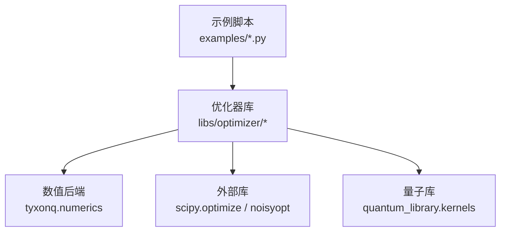
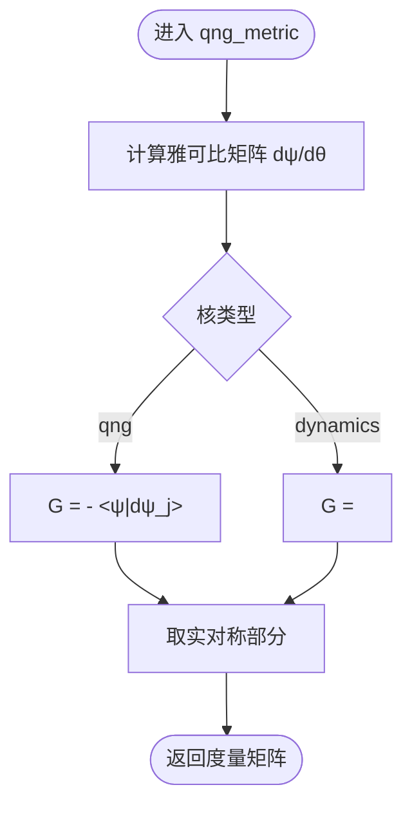
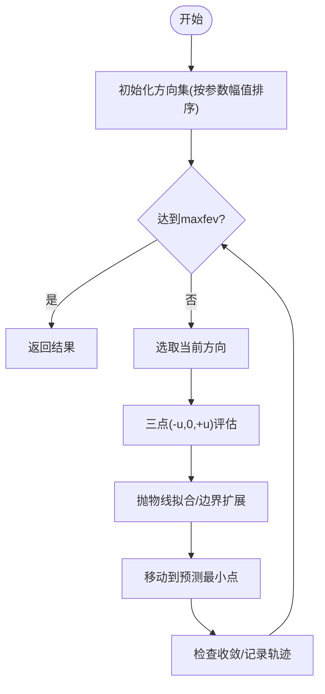
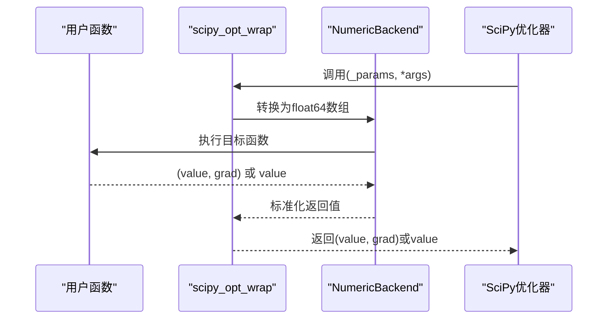
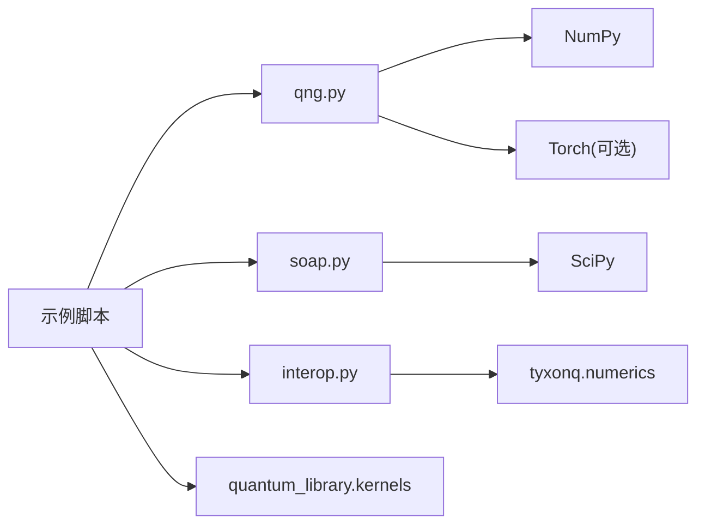

# 优化器

<cite>
**本文引用的文件**
- [qng.py](file://src/tyxonq/libs/optimizer/qng.py)
- [soap.py](file://src/tyxonq/libs/optimizer/soap.py)
- [interop.py](file://src/tyxonq/libs/optimizer/interop.py)
- [__init__.py](file://src/tyxonq/libs/optimizer/__init__.py)
- [quantum_natural_gradient_optimization.py](file://examples/quantum_natural_gradient_optimization.py)
- [vqe_scipy_optimization.py](file://examples/vqe_scipy_optimization.py)
- [vqe_simple_hamiltonian.py](file://examples/vqe_simple_hamiltonian.py)
- [vqe_noisyopt.py](file://examples/vqe_noisyopt.py)
- [performance_optimization_tips.md](file://examples/performance_optimization_tips.md)
- [test_optimizer.py](file://tests_mol_valid/test_optimizer.py)
</cite>

## 目录
1. [简介](#简介)
2. [项目结构](#项目结构)
3. [核心组件](#核心组件)
4. [架构总览](#架构总览)
5. [详细组件分析](#详细组件分析)
6. [依赖关系分析](#依赖关系分析)
7. [性能考虑](#性能考虑)
8. [故障排查指南](#故障排查指南)
9. [结论](#结论)
10. [附录](#附录)

## 简介
本文件系统性梳理 TyxonQ 框架中的优化器生态，涵盖经典优化器（如 SciPy 系列）与量子优化器（如量子自然梯度 QNG、SOAP）的集成方式、使用范式、配置选项与调参建议。文档面向不同技术背景的读者，提供从概念到代码级实现的渐进式说明，并给出收敛性分析、性能监控、调试技巧与常见问题解决方案，帮助在变分量子算法（VQA）中选择合适的优化策略并高效落地。

## 项目结构
TyxonQ 的优化能力主要分布在 libs/optimizer 模块，并通过示例脚本展示如何在 VQE、QNG 等任务中使用。关键路径如下：
- 量子自然梯度工具：libs/optimizer/qng.py
- 无梯度优化器 SOAP：libs/optimizer/soap.py
- SciPy 集成包装：libs/optimizer/interop.py
- 对外导出入口：libs/optimizer/__init__.py
- 示例与用法：examples/*.py（QNG、SciPy、噪声优化、简单 VQE）
- 测试用例：tests_mol_valid/test_optimizer.py



图示来源
- [qng.py:1-114](file://src/tyxonq/libs/optimizer/qng.py#L1-L114)
- [soap.py:1-256](file://src/tyxonq/libs/optimizer/soap.py#L1-L256)
- [interop.py:1-36](file://src/tyxonq/libs/optimizer/interop.py#L1-L36)
- [quantum_natural_gradient_optimization.py:1-406](file://examples/quantum_natural_gradient_optimization.py#L1-L406)
- [vqe_scipy_optimization.py:1-465](file://examples/vqe_scipy_optimization.py#L1-L465)

章节来源
- [qng.py:1-114](file://src/tyxonq/libs/optimizer/qng.py#L1-L114)
- [soap.py:1-256](file://src/tyxonq/libs/optimizer/soap.py#L1-L256)
- [interop.py:1-36](file://src/tyxonq/libs/optimizer/interop.py#L1-L36)
- [quantum_natural_gradient_optimization.py:1-406](file://examples/quantum_natural_gradient_optimization.py#L1-L406)
- [vqe_scipy_optimization.py:1-465](file://examples/vqe_scipy_optimization.py#L1-L465)

## 核心组件
- 量子自然梯度（QNG）
  - 通过有限差分计算雅可比矩阵，再构造 Fubini-Study 度量（量子 Fisher 信息矩阵），用于自然梯度方向更新。
  - 支持两种核：'qng'（投影度量）和 'dynamics'（动力学度量）。
  - 输出为实对称矩阵，便于后续正则化与求逆。
- 无梯度优化器（SOAP）
  - 基于抛物线拟合与自适应方向选择的序列优化方法，对测量噪声鲁棒，适合量子场景。
  - 提供回调、轨迹记录、函数评估计数等实用功能。
- SciPy 集成包装
  - 将用户目标函数适配为 SciPy 可接受的输入输出格式，支持返回 (value, grad) 或仅 value。
  - 统一数据类型为 float64，屏蔽后端差异。

章节来源
- [qng.py:1-114](file://src/tyxonq/libs/optimizer/qng.py#L1-L114)
- [soap.py:1-256](file://src/tyxonq/libs/optimizer/soap.py#L1-L256)
- [interop.py:1-36](file://src/tyxonq/libs/optimizer/interop.py#L1-L36)

## 架构总览
下图展示了典型 VQA 优化流程：示例脚本调用优化器库，结合数值后端与量子库完成能量评估与参数更新；对于 QNG，额外计算 QFIM 以进行自然梯度更新。

```mermaid
sequenceDiagram
participant Ex as "示例脚本"
participant Opt as "优化器库"
participant NB as "数值后端"
participant QL as "量子库"
participant SC as "SciPy/noisyopt"
Ex->>Opt : 调用优化器(目标函数, 初始参数)
Opt->>NB : 类型转换/自动微分(可选)
NB->>QL : 构建电路/计算期望值
QL-->>NB : 状态向量/期望值
NB-->>Opt : 损失值/梯度(可选)
Opt->>SC : 选择优化方法(COBYLA/L-BFGS-B/SPSA/Compass)
SC-->>Ex : 最优参数/收敛信息
```

图示来源
- [quantum_natural_gradient_optimization.py:1-406](file://examples/quantum_natural_gradient_optimization.py#L1-L406)
- [vqe_scipy_optimization.py:1-465](file://examples/vqe_scipy_optimization.py#L1-L465)
- [vqe_noisyopt.py:1-200](file://examples/vqe_noisyopt.py#L1-L200)
- [qng.py:1-114](file://src/tyxonq/libs/optimizer/qng.py#L1-L114)
- [soap.py:1-256](file://src/tyxonq/libs/optimizer/soap.py#L1-L256)
- [interop.py:1-36](file://src/tyxonq/libs/optimizer/interop.py#L1-L36)

## 详细组件分析

### 量子自然梯度（QNG）组件
- 实现要点
  - 使用中心差分计算状态向量的雅可比矩阵。
  - 根据核类型构造度量矩阵：'qng' 为投影度量，'dynamics' 为动力学度量。
  - 输出实对称矩阵，便于正则化与线性求解。
- 复杂度
  - 雅可比计算：O(P·D)，其中 P 为参数个数，D 为态维数。
  - 度量矩阵构造：O(P^2·D) 量级；求逆 O(P^3)。
- 适用场景
  - 中小规模参数（P < ~100）时效果显著；对参数化不变性友好。
- 错误处理
  - 若 QFIM 奇异，回退为标准梯度。



图示来源
- [qng.py:45-106](file://src/tyxonq/libs/optimizer/qng.py#L45-L106)

章节来源
- [qng.py:1-114](file://src/tyxonq/libs/optimizer/qng.py#L1-L114)

### 无梯度优化器（SOAP）组件
- 算法概览
  - 沿坐标方向与平均方向进行一维抛物线拟合搜索。
  - 动态添加有潜力的新方向，逐步逼近极小点。
- 关键特性
  - 无需梯度，对噪声鲁棒；每步通常 3–7 次函数评估。
  - 支持回调、轨迹记录、最大函数评估次数限制。
- 收敛判据
  - 当最近窗口内平均改进小于阈值时停止。



图示来源
- [soap.py:154-250](file://src/tyxonq/libs/optimizer/soap.py#L154-L250)

章节来源
- [soap.py:1-256](file://src/tyxonq/libs/optimizer/soap.py#L1-L256)

### SciPy 集成包装
- 作用
  - 将目标函数转换为 SciPy 友好的接口，支持返回 (value, grad) 或仅 value。
  - 统一数据类型为 float64，屏蔽后端差异。
- 使用方式
  - 在示例中分别包装无梯度与梯度版本，供 COBYLA、L-BFGS-B 等方法调用。



图示来源
- [interop.py:9-30](file://src/tyxonq/libs/optimizer/interop.py#L9-L30)
- [vqe_scipy_optimization.py:224-259](file://examples/vqe_scipy_optimization.py#L224-L259)

章节来源
- [interop.py:1-36](file://src/tyxonq/libs/optimizer/interop.py#L1-L36)
- [vqe_scipy_optimization.py:1-465](file://examples/vqe_scipy_optimization.py#L1-L465)

### 变分量子算法中的参数优化策略与收敛性
- 策略对比
  - 标准梯度下降：实现简单，但对参数化敏感，可能受 barren plateau 影响。
  - 量子自然梯度：利用 QFIM 预条件，参数化不变，通常更快收敛。
  - 无梯度方法（COBYLA、Powell、SPSA、Compass）：对噪声鲁棒，适合真实设备或有限采样。
- 收敛性分析
  - QNG：在平滑且参数化良好的情况下，能更稳定地导航优化地形；但需处理 QFIM 的正则化与求逆稳定性。
  - SOAP：通过方向自适应与抛物线拟合，在噪声环境下仍具良好收敛性；收敛判据基于近期改进均值。
  - SciPy 方法：L-BFGS-B 在有梯度时通常更快；COBYLA 在无梯度时稳健。

章节来源
- [quantum_natural_gradient_optimization.py:168-316](file://examples/quantum_natural_gradient_optimization.py#L168-L316)
- [vqe_scipy_optimization.py:268-386](file://examples/vqe_scipy_optimization.py#L268-L386)
- [vqe_noisyopt.py:156-200](file://examples/vqe_noisyopt.py#L156-L200)

### 优化器的配置选项、超参数调优与性能监控
- QNG
  - eps：有限差分步长，影响雅可比精度与数值稳定性。
  - kernel：'qng' 或 'dynamics'，决定度量类型。
  - 正则化：对 QFIM 加对角项提升求逆稳定性。
- SOAP
  - u：步长控制探索强度；过大可能过冲，过小收敛慢。
  - maxfev：最大函数评估次数，控制预算。
  - atol：收敛阈值；越小越严格。
  - callback：迭代回调，便于监控进度。
  - ret_traj：是否记录轨迹，便于分析。
- SciPy 集成
  - method：COBYLA、L-BFGS-B、SLSQP、Powell、Nelder-Mead 等。
  - jac：是否提供梯度；True 时使用数值梯度或解析梯度。
  - tol/maxiter：容差与最大迭代次数。
- 性能监控
  - 记录每步时间、能量变化、梯度范数与自然梯度范数。
  - 使用回调与轨迹分析收敛行为。

章节来源
- [qng.py:74-106](file://src/tyxonq/libs/optimizer/qng.py#L74-L106)
- [soap.py:8-152](file://src/tyxonq/libs/optimizer/soap.py#L8-L152)
- [vqe_scipy_optimization.py:268-386](file://examples/vqe_scipy_optimization.py#L268-L386)
- [quantum_natural_gradient_optimization.py:230-316](file://examples/quantum_natural_gradient_optimization.py#L230-L316)

### 不同优化场景下的选择建议与最佳实践
- 小规模参数（P < 100）且追求快速收敛：优先尝试 QNG，配合适当正则化。
- 噪声环境或有限采样：优先无梯度方法（COBYLA、SPSA、Compass、SOAP）。
- 需要梯度加速：使用 L-BFGS-B 并结合自动微分或参数平移法。
- 大规模系统：考虑分块近似 QFIM、随机采样或批处理优化。
- 最佳实践
  - 预先构建 Hamiltonian，避免重复电路执行。
  - 缓存状态向量，批量计算期望值。
  - 使用模板函数减少手动构建开销。
  - 合理设置学习率/步长与收敛阈值。

章节来源
- [performance_optimization_tips.md:1-223](file://examples/performance_optimization_tips.md#L1-L223)
- [vqe_simple_hamiltonian.py:1-200](file://examples/vqe_simple_hamiltonian.py#L1-L200)
- [vqe_scipy_optimization.py:1-465](file://examples/vqe_scipy_optimization.py#L1-L465)

### 自定义优化器与扩展优化算法
- 扩展点
  - 在 libs/optimizer 下新增模块，遵循现有接口约定（目标函数签名、返回值格式）。
  - 复用 scipy_opt_wrap 适配 SciPy 接口。
  - 复用 qng_metric 计算 QFIM，实现自然梯度类方法。
- 集成方式
  - 通过 __init__.py 暴露新优化器入口。
  - 在示例脚本中替换优化方法，验证收敛与性能。

章节来源
- [__init__.py:1-10](file://src/tyxonq/libs/optimizer/__init__.py#L1-L10)
- [interop.py:1-36](file://src/tyxonq/libs/optimizer/interop.py#L1-L36)
- [qng.py:1-114](file://src/tyxonq/libs/optimizer/qng.py#L1-L114)

### 调试技巧与常见问题解决方案
- 常见问题
  - QFIM 奇异：增加正则化项或回退到标准梯度。
  - 数值不稳定：调整 eps、dtype 与求逆策略。
  - 噪声导致收敛困难：使用无梯度方法或增大采样次数。
- 调试技巧
  - 打印每步能量、梯度范数、自然梯度范数与耗时。
  - 使用回调记录轨迹，分析停滞或震荡原因。
  - 对比不同优化器与方法，定位瓶颈。
- 参考用例
  - 测试用例验证优化器与分子应用的一致性。

章节来源
- [quantum_natural_gradient_optimization.py:283-295](file://examples/quantum_natural_gradient_optimization.py#L283-L295)
- [vqe_scipy_optimization.py:268-386](file://examples/vqe_scipy_optimization.py#L268-L386)
- [test_optimizer.py:1-18](file://tests_mol_valid/test_optimizer.py#L1-L18)

## 依赖关系分析
- 组件耦合
  - 示例脚本依赖优化器库；优化器库依赖数值后端与量子库；SciPy 集成包装桥接外部优化器。
- 直接依赖
  - qng.py：NumPy、可选 Torch（用于张量转换）。
  - soap.py：NumPy、SciPy OptimizeResult。
  - interop.py：NumPy、tyxonq.numerics。
- 间接依赖
  - 示例脚本依赖 quantum_library.kernels 构建 Hamiltonian 与电路。
- 潜在循环依赖
  - 当前结构清晰，未见循环依赖迹象。



图示来源
- [qng.py:1-114](file://src/tyxonq/libs/optimizer/qng.py#L1-L114)
- [soap.py:1-256](file://src/tyxonq/libs/optimizer/soap.py#L1-L256)
- [interop.py:1-36](file://src/tyxonq/libs/optimizer/interop.py#L1-L36)
- [quantum_natural_gradient_optimization.py:1-406](file://examples/quantum_natural_gradient_optimization.py#L1-L406)
- [vqe_scipy_optimization.py:1-465](file://examples/vqe_scipy_optimization.py#L1-L465)

章节来源
- [qng.py:1-114](file://src/tyxonq/libs/optimizer/qng.py#L1-L114)
- [soap.py:1-256](file://src/tyxonq/libs/optimizer/soap.py#L1-L256)
- [interop.py:1-36](file://src/tyxonq/libs/optimizer/interop.py#L1-L36)

## 性能考虑
- 避免重复电路执行：缓存状态向量，一次性计算所有期望值。
- 使用 Hamiltonian 对象：将多项式项合并为矩阵，减少多次 expectation 调用。
- 模板函数：利用 heisenberg_hamiltonian 等模板简化构建。
- 批处理与向量化：使用 vmap/jit 提升批量评估效率。
- 预期提升：简单优化可达 6–10x，完全优化可达 10–15x。

章节来源
- [performance_optimization_tips.md:1-223](file://examples/performance_optimization_tips.md#L1-L223)
- [vqe_simple_hamiltonian.py:1-200](file://examples/vqe_simple_hamiltonian.py#L1-L200)

## 故障排查指南
- QNG 奇异矩阵
  - 现象：求逆失败或数值不稳定。
  - 解决：增加正则化项；必要时回退标准梯度。
- 噪声导致的收敛问题
  - 现象：能量波动大、收敛缓慢。
  - 解决：使用无梯度方法（COBYLA、SPSA、Compass、SOAP）；增大采样次数。
- 性能瓶颈
  - 现象：单步耗时过长。
  - 解决：缓存状态向量、合并 Hamiltonian、使用模板函数、批处理。
- 调试手段
  - 打印每步指标（能量、梯度范数、自然梯度范数、耗时）。
  - 使用回调记录轨迹，分析停滞或震荡。
  - 对比不同优化器与方法，定位问题。

章节来源
- [quantum_natural_gradient_optimization.py:283-295](file://examples/quantum_natural_gradient_optimization.py#L283-L295)
- [vqe_scipy_optimization.py:268-386](file://examples/vqe_scipy_optimization.py#L268-L386)
- [vqe_noisyopt.py:156-200](file://examples/vqe_noisyopt.py#L156-L200)
- [performance_optimization_tips.md:1-223](file://examples/performance_optimization_tips.md#L1-L223)

## 结论
TyxonQ 提供了丰富的优化器生态，覆盖从经典 SciPy 优化器到量子自然梯度与无梯度方法的多种策略。通过合理的配置与调参、性能优化与调试技巧，可在不同场景下实现高效稳定的变分量子算法优化。推荐根据问题规模、噪声水平与资源约束选择合适的方法，并结合示例与测试用例验证效果。

## 附录
- 快速上手
  - 使用 SciPy 优化器：参考 vqe_scipy_optimization.py。
  - 使用 QNG：参考 quantum_natural_gradient_optimization.py。
  - 使用噪声优化：参考 vqe_noisyopt.py。
  - 基础 VQE：参考 vqe_simple_hamiltonian.py。
- 扩展开发
  - 在 libs/optimizer 新增模块，复用 scipy_opt_wrap 与 qng_metric。
  - 通过 __init__.py 暴露新优化器入口。