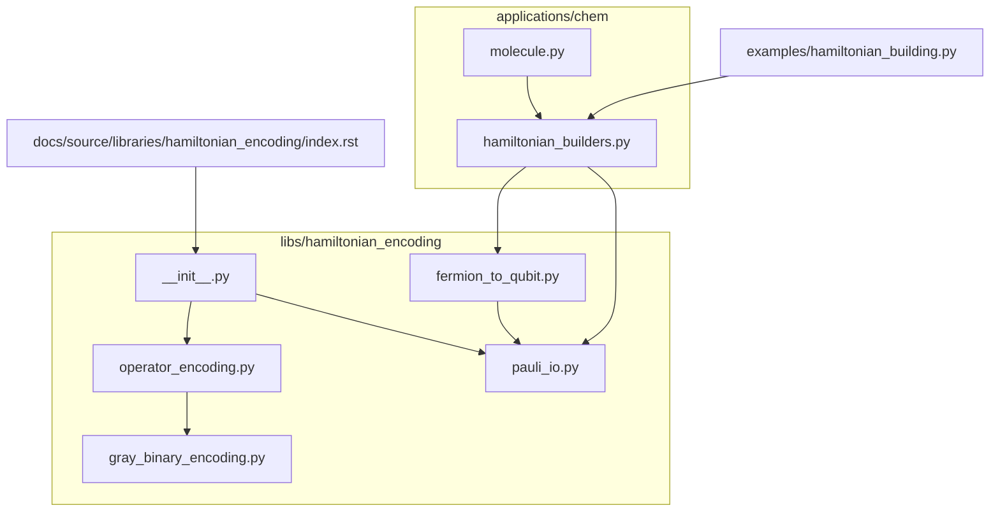
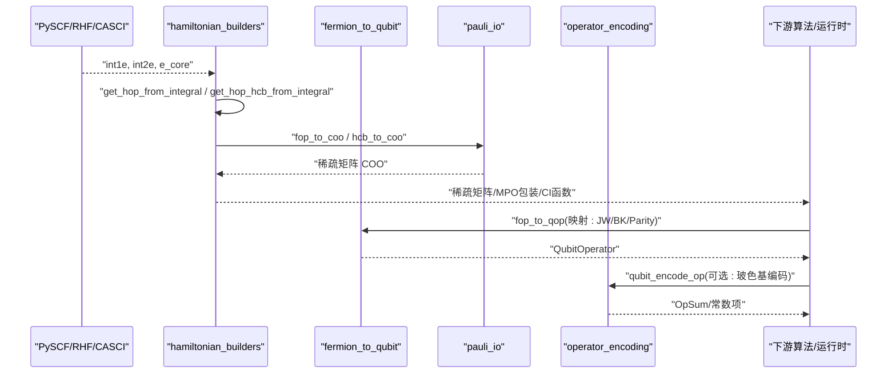
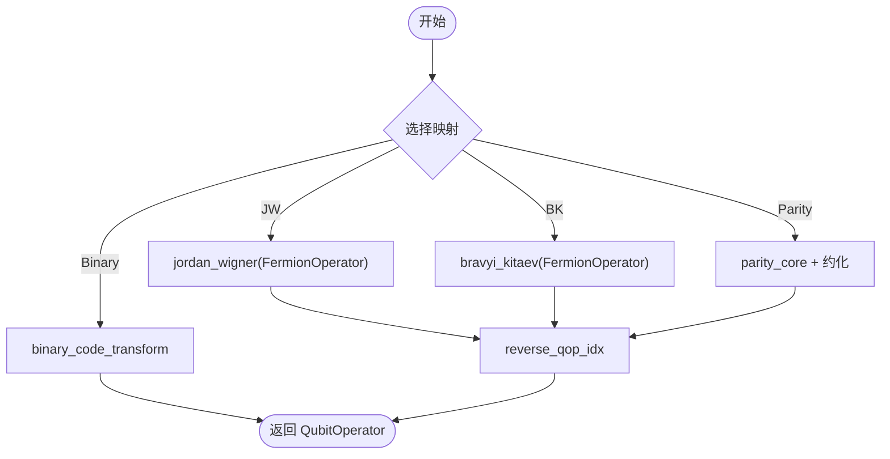
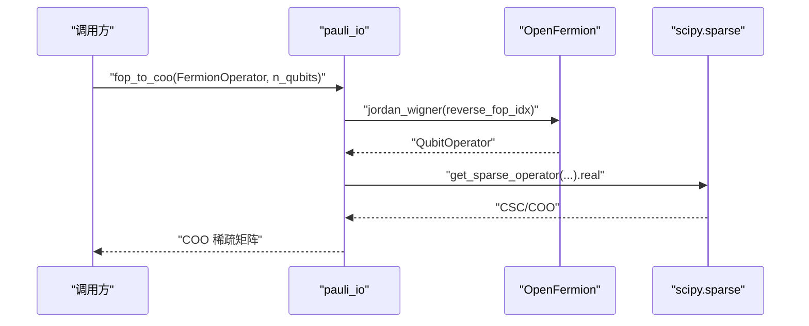
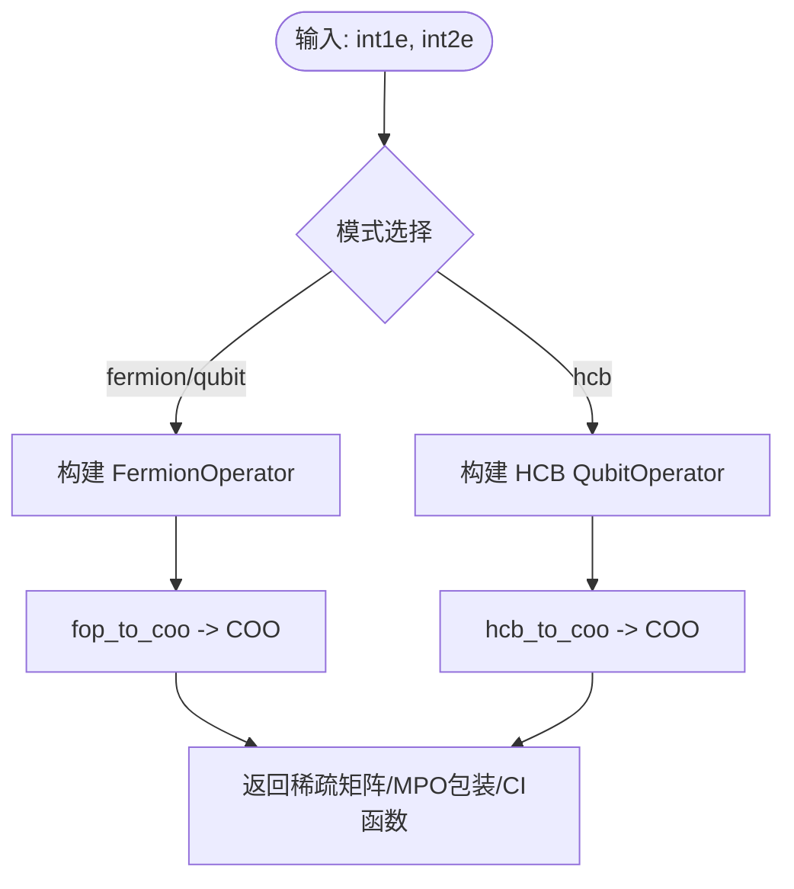
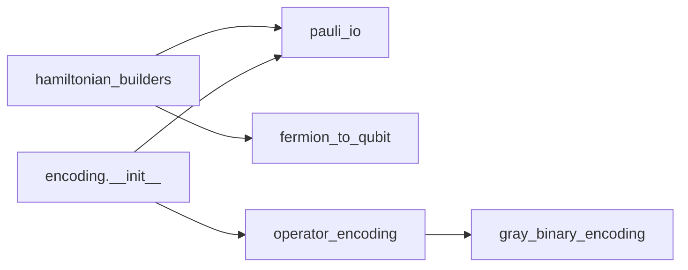

# 哈密顿量编码

<cite>
**本文引用的文件**
- [src/tyxonq/libs/hamiltonian_encoding/__init__.py](file://src/tyxonq/libs/hamiltonian_encoding/__init__.py)
- [src/tyxonq/libs/hamiltonian_encoding/fermion_to_qubit.py](file://src/tyxonq/libs/hamiltonian_encoding/fermion_to_qubit.py)
- [src/tyxonq/libs/hamiltonian_encoding/operator_encoding.py](file://src/tyxonq/libs/hamiltonian_encoding/operator_encoding.py)
- [src/tyxonq/libs/hamiltonian_encoding/pauli_io.py](file://src/tyxonq/libs/hamiltonian_encoding/pauli_io.py)
- [src/tyxonq/libs/hamiltonian_encoding/gray_binary_encoding.py](file://src/tyxonq/libs/hamiltonian_encoding/gray_binary_encoding.py)
- [src/tyxonq/applications/chem/hamiltonian_builders.py](file://src/tyxonq/applications/chem/hamiltonian_builders.py)
- [src/tyxonq/applications/chem/molecule.py](file://src/tyxonq/applications/chem/molecule.py)
- [examples/hamiltonian_building.py](file://examples/hamiltonian_building.py)
- [docs/source/libraries/hamiltonian_encoding/index.rst](file://docs/source/libraries/hamiltonian_encoding/index.rst)
</cite>

## 目录
1. [简介](#简介)
2. [项目结构](#项目结构)
3. [核心组件](#核心组件)
4. [架构总览](#架构总览)
5. [详细组件分析](#详细组件分析)
6. [依赖关系分析](#依赖关系分析)
7. [性能与内存优化](#性能与内存优化)
8. [故障排查指南](#故障排查指南)
9. [结论](#结论)
10. [附录：OpenFermion I/O与外部工具对接](#附录openfermion-io与外部工具对接)

## 简介
本文件系统性介绍 TyxonQ 的哈密顿量编码库，覆盖支持的编码格式（Jordan-Wigner、Bravyi-Kitaev、Parity、Binary/Gray/Unary 等）、从费米子算符到量子比特算符的转换流程、OpenFermion I/O 接口使用、哈密顿量的构建/简化/优化技术、大规模问题的处理策略与内存优化方法，以及将外部量子化学软件结果转换为 TyxonQ 可处理格式的完整工作流。文档同时提供编码选择的指导原则与性能对比分析，帮助在不同场景下做出合理选择。

## 项目结构
TyxonQ 的哈密顿量编码能力主要位于 libs/hamiltonian_encoding 与 applications/chem 两个层次：
- libs/hamiltonian_encoding：提供通用的“问题→量子比特算符”编码与 I/O 工具，面向领域无关的编译前置层。
- applications/chem：面向量子化学应用，提供从积分到费米子/量子比特/硬芯玻色子（HCB）哈密顿量的构建、稀疏矩阵与 MPO 包装、CI 函数生成等。



图表来源
- [src/tyxonq/libs/hamiltonian_encoding/__init__.py:1-17](file://src/tyxonq/libs/hamiltonian_encoding/__init__.py#L1-L17)
- [src/tyxonq/libs/hamiltonian_encoding/operator_encoding.py:1-346](file://src/tyxonq/libs/hamiltonian_encoding/operator_encoding.py#L1-L346)
- [src/tyxonq/libs/hamiltonian_encoding/fermion_to_qubit.py:1-99](file://src/tyxonq/libs/hamiltonian_encoding/fermion_to_qubit.py#L1-L99)
- [src/tyxonq/libs/hamiltonian_encoding/pauli_io.py:1-208](file://src/tyxonq/libs/hamiltonian_encoding/pauli_io.py#L1-L208)
- [src/tyxonq/libs/hamiltonian_encoding/gray_binary_encoding.py:1-36](file://src/tyxonq/libs/hamiltonian_encoding/gray_binary_encoding.py#L1-L36)
- [src/tyxonq/applications/chem/hamiltonian_builders.py:1-320](file://src/tyxonq/applications/chem/hamiltonian_builders.py#L1-L320)
- [src/tyxonq/applications/chem/molecule.py:1-311](file://src/tyxonq/applications/chem/molecule.py#L1-L311)
- [examples/hamiltonian_building.py:1-94](file://examples/hamiltonian_building.py#L1-L94)
- [docs/source/libraries/hamiltonian_encoding/index.rst:509-572](file://docs/source/libraries/hamiltonian_encoding/index.rst#L509-L572)

章节来源
- [src/tyxonq/libs/hamiltonian_encoding/__init__.py:1-17](file://src/tyxonq/libs/hamiltonian_encoding/__init__.py#L1-L17)
- [src/tyxonq/libs/hamiltonian_encoding/operator_encoding.py:1-346](file://src/tyxonq/libs/hamiltonian_encoding/operator_encoding.py#L1-L346)
- [src/tyxonq/libs/hamiltonian_encoding/fermion_to_qubit.py:1-99](file://src/tyxonq/libs/hamiltonian_encoding/fermion_to_qubit.py#L1-L99)
- [src/tyxonq/libs/hamiltonian_encoding/pauli_io.py:1-208](file://src/tyxonq/libs/hamiltonian_encoding/pauli_io.py#L1-L208)
- [src/tyxonq/libs/hamiltonian_encoding/gray_binary_encoding.py:1-36](file://src/tyxonq/libs/hamiltonian_encoding/gray_binary_encoding.py#L1-L36)
- [src/tyxonq/applications/chem/hamiltonian_builders.py:1-320](file://src/tyxonq/applications/chem/hamiltonian_builders.py#L1-L320)
- [src/tyxonq/applications/chem/molecule.py:1-311](file://src/tyxonq/applications/chem/molecule.py#L1-L311)
- [examples/hamiltonian_building.py:1-94](file://examples/hamiltonian_building.py#L1-L94)
- [docs/source/libraries/hamiltonian_encoding/index.rst:509-572](file://docs/source/libraries/hamiltonian_encoding/index.rst#L509-L572)

## 核心组件
- 算符编码与基变换（operator_encoding.py）：支持自旋电子、多电子、声子（玻色）算符到量子比特的编码；提供直接编码、一元（unary）、二进制（binary）、格雷码（gray）等多种基映射；支持初始态构造与子空间索引计算。
- 费米子到量子比特映射（fermion_to_qubit.py）：封装 Jordan-Wigner、Bravyi-Kitaev、Parity、Binary Code 等映射，并内置电子数守恒下的 qubit 约化逻辑。
- Pauli/I/O 工具（pauli_io.py）：实现 OpenFermion FermionOperator/QubitOperator 与稀疏矩阵、Qiskit SparsePauliOp 之间的转换；提供指标反转、相位缓存等实用工具。
- 化学哈密顿量构建（hamiltonian_builders.py）：从 PySCF RHF/CASCI 积分出发，构建费米子/量子比特/HCB 哈密顿量，输出稀疏矩阵或 CI 作用函数；提供 apply_op 后端无关的哈密顿量作用。
- 分子与积分（molecule.py）：封装 PySCF 分子对象，提供常用分子与随机积分生成，便于测试与基准。
- 示例与文档（examples/hamiltonian_building.py, docs/source/.../index.rst）：展示轻量级 Pauli 项列表表示、计数法能量估计与 I/O 用法。

章节来源
- [src/tyxonq/libs/hamiltonian_encoding/operator_encoding.py:1-346](file://src/tyxonq/libs/hamiltonian_encoding/operator_encoding.py#L1-L346)
- [src/tyxonq/libs/hamiltonian_encoding/fermion_to_qubit.py:1-99](file://src/tyxonq/libs/hamiltonian_encoding/fermion_to_qubit.py#L1-L99)
- [src/tyxonq/libs/hamiltonian_encoding/pauli_io.py:1-208](file://src/tyxonq/libs/hamiltonian_encoding/pauli_io.py#L1-L208)
- [src/tyxonq/applications/chem/hamiltonian_builders.py:1-320](file://src/tyxonq/applications/chem/hamiltonian_builders.py#L1-L320)
- [src/tyxonq/applications/chem/molecule.py:1-311](file://src/tyxonq/applications/chem/molecule.py#L1-L311)
- [examples/hamiltonian_building.py:1-94](file://examples/hamiltonian_building.py#L1-L94)
- [docs/source/libraries/hamiltonian_encoding/index.rst:509-572](file://docs/source/libraries/hamiltonian_encoding/index.rst#L509-L572)

## 架构总览
下图展示了从“化学积分”到“量子比特哈密顿量”的主要数据流与模块交互。



图表来源
- [src/tyxonq/applications/chem/hamiltonian_builders.py:46-162](file://src/tyxonq/applications/chem/hamiltonian_builders.py#L46-L162)
- [src/tyxonq/libs/hamiltonian_encoding/fermion_to_qubit.py:16-89](file://src/tyxonq/libs/hamiltonian_encoding/fermion_to_qubit.py#L16-L89)
- [src/tyxonq/libs/hamiltonian_encoding/pauli_io.py:62-84](file://src/tyxonq/libs/hamiltonian_encoding/pauli_io.py#L62-L84)
- [src/tyxonq/libs/hamiltonian_encoding/operator_encoding.py:60-139](file://src/tyxonq/libs/hamiltonian_encoding/operator_encoding.py#L60-L139)

## 详细组件分析

### 组件A：费米子到量子比特映射（fermion_to_qubit.py）
- 功能要点
  - 支持 Jordan-Wigner、Bravyi-Kitaev、Parity、Binary Code 等映射。
  - Parity 映射在电子数守恒下对两量子比特进行约化，减少 qubit 数量。
  - 统一入口 fop_to_qop 接收映射名与轨道/电子数信息，返回 QubitOperator。
- 复杂度与特性
  - 映射本身由 OpenFermion 实现，时间复杂度与费米子项规模线性相关。
  - Parity 约化通过固定索引替换与相位调整实现，避免额外开销。
- 错误处理
  - 奇数总电子数且未提供 (α,β) 拆分时抛出异常，确保约化正确性。



图表来源
- [src/tyxonq/libs/hamiltonian_encoding/fermion_to_qubit.py:16-89](file://src/tyxonq/libs/hamiltonian_encoding/fermion_to_qubit.py#L16-L89)

章节来源
- [src/tyxonq/libs/hamiltonian_encoding/fermion_to_qubit.py:16-89](file://src/tyxonq/libs/hamiltonian_encoding/fermion_to_qubit.py#L16-L89)

### 组件B：通用算符编码与基变换（operator_encoding.py）
- 功能要点
  - 针对自旋电子、多电子、声子（玻色）算符，提供 direct/unary/binary/gray 多种编码。
  - 支持 OpSum 的展开、恒等项分离与简化，返回非恒等项与常数项。
  - 提供初始态电路/态矢构造与子空间索引计算，适配不同编码。
- 关键路径
  - qubit_encode_op：按基类型分解 elementary 项，逐项 transform，合并为 OpSum。
  - transform_op_boson：根据 boson_encoding 选择 unary/binary/gray 或直接编码。
  - get_init_circuit/get_init_statevector：基于编码生成初始态。
- 复杂度与特性
  - 对每个非零矩阵元构造对应量子比特算符，复杂度与算符矩阵非零元数量相关。
  - 通过 simplify(atol=eps) 控制数值误差与冗余项消除。

```mermaid
classDiagram
class OperatorEncoding {
+qubit_encode_op(terms, basis, boson_encoding)
+qubit_encode_basis(basis, boson_encoding)
+transform_op(op, basis, boson_encoding)
+get_init_circuit(model_ref, model, boson_encoding, init_condition)
+get_subspace_idx(basis_list, boson_encoding)
}
class BasisTypes {
<<enum>>
"BasisHalfSpin"
"BasisSimpleElectron"
"BasisMultiElectron"
"Phonon(Basis with is_phonon)"
}
OperatorEncoding --> BasisTypes : "依据基类型选择编码"
```

图表来源
- [src/tyxonq/libs/hamiltonian_encoding/operator_encoding.py:60-346](file://src/tyxonq/libs/hamiltonian_encoding/operator_encoding.py#L60-L346)

章节来源
- [src/tyxonq/libs/hamiltonian_encoding/operator_encoding.py:60-346](file://src/tyxonq/libs/hamiltonian_encoding/operator_encoding.py#L60-L346)

### 组件C：I/O与稀疏表示（pauli_io.py）
- 功能要点
  - fop_to_coo/hcb_to_coo：将 OpenFermion 算符转为 scipy COO 稀疏矩阵。
  - qop_to_qiskit：将 QubitOperator 转为 Qiskit SparsePauliOp。
  - reverse_qop_idx/reverse_fop_idx：处理大端/小端指标顺序一致性。
  - rdm_mo2ao/canonical_mo_coeff：化学辅助工具。
- 性能要点
  - 优先使用 Numeric Backend 的 coo_sparse_matrix 以适配后端稀疏表示，否则回退到 scipy。
  - 相位计算使用位运算缓存加速 CI 向量上的费米子符号。



图表来源
- [src/tyxonq/libs/hamiltonian_encoding/pauli_io.py:62-84](file://src/tyxonq/libs/hamiltonian_encoding/pauli_io.py#L62-L84)

章节来源
- [src/tyxonq/libs/hamiltonian_encoding/pauli_io.py:62-84](file://src/tyxonq/libs/hamiltonian_encoding/pauli_io.py#L62-L84)

### 组件D：化学哈密顿量构建（hamiltonian_builders.py）
- 功能要点
  - 从 RHF/CASCI 积分提取有效单双体积分，构建费米子算符或 HCB 算符。
  - 输出稀疏矩阵、MPO 包装对象或 CI 作用函数，适配不同求解器。
  - apply_op 支持稀疏矩阵、callable、eval_matrix 对象与稠密矩阵的统一作用。
- 适用场景
  - VQE/UCCSD/LUCJ/SQD 等算法可直接消费其输出。
  - 支持 fermion/qubit/hcb 三种模式，灵活切换。



图表来源
- [src/tyxonq/applications/chem/hamiltonian_builders.py:71-162](file://src/tyxonq/applications/chem/hamiltonian_builders.py#L71-L162)

章节来源
- [src/tyxonq/applications/chem/hamiltonian_builders.py:71-162](file://src/tyxonq/applications/chem/hamiltonian_builders.py#L71-L162)

### 组件E：示例与轻量表示（examples/hamiltonian_building.py）
- 功能要点
  - 使用轻量级 Pauli 项列表表示哈密顿量，演示基于计数的能量估计。
  - 适合快速原型与教学，便于理解测量分组与基旋转。

章节来源
- [examples/hamiltonian_building.py:1-94](file://examples/hamiltonian_building.py#L1-L94)

## 依赖关系分析
- 外部依赖
  - OpenFermion：提供 FermionOperator、QubitOperator 及映射（JW/BK/Parity/Binary）。
  - PySCF：RHF/CASCI 积分计算与分子对象。
  - Qiskit（可选）：SparsePauliOp 互操作。
  - renormalizer（可选）：用于 operator_encoding 中的基与算符模型。
- 内部耦合
  - hamiltonian_builders 依赖 pauli_io 与 fermion_to_qubit 完成 I/O 与映射。
  - operator_encoding 依赖 gray_binary_encoding 提供编码表。
  - __init__.py 暴露稳定导入路径，屏蔽底层迁移细节。



图表来源
- [src/tyxonq/libs/hamiltonian_encoding/__init__.py:13-14](file://src/tyxonq/libs/hamiltonian_encoding/__init__.py#L13-L14)
- [src/tyxonq/libs/hamiltonian_encoding/operator_encoding.py:34-36](file://src/tyxonq/libs/hamiltonian_encoding/operator_encoding.py#L34-L36)
- [src/tyxonq/applications/chem/hamiltonian_builders.py:13-16](file://src/tyxonq/applications/chem/hamiltonian_builders.py#L13-L16)

章节来源
- [src/tyxonq/libs/hamiltonian_encoding/__init__.py:13-14](file://src/tyxonq/libs/hamiltonian_encoding/__init__.py#L13-L14)
- [src/tyxonq/libs/hamiltonian_encoding/operator_encoding.py:34-36](file://src/tyxonq/libs/hamiltonian_encoding/operator_encoding.py#L34-L36)
- [src/tyxonq/applications/chem/hamiltonian_builders.py:13-16](file://src/tyxonq/applications/chem/hamiltonian_builders.py#L13-L16)

## 性能与内存优化
- 稀疏表示与后端适配
  - pauli_io.csc_to_coo 优先尝试 Numeric Backend 的 coo_sparse_matrix，降低跨后端转换成本。
  - 对大型稀疏矩阵，建议保持 COO/CSC 形式，避免过早转稠密。
- 算符简化与常数项分离
  - operator_encoding.qubit_encode_op 对恒等项单独累加，非恒等项经 simplify 去冗，减少后续测量项数量。
- 相位缓存
  - pauli_io.get_fermion_phase 使用 FERMION_PHASE_MASK_CACHE 缓存相位掩码与符号，显著加速 CI 向量上的相位计算。
- 量子比特约化
  - fermion_to_qubit.parity 在电子数守恒下对两量子比特进行约化，减少 qubit 数量与门深度。
- 测量分组与计数法能量估计
  - examples/hamiltonian_building.py 演示 Z 项一次测量、X 项基旋转后测量的分组策略，减少 shots 消耗。
- 内存优化建议
  - 使用 CI 作用函数而非显式矩阵（如 get_h_fcifunc_from_integral），避免 O(2^n) 存储。
  - 对大规模问题优先采用稀疏矩阵或 MPO 包装，必要时结合 MPS 近似（框架内其他模块）。

[本节为通用性能讨论，不直接分析具体代码行]

## 故障排查指南
- 常见错误与定位
  - 未知映射：fop_to_qop 中 mapping 参数非法会抛出 ValueError。检查传入值是否为 jordan-wigner/jordan_wigner/bravyi-kitaev/bravyi_kitaev/parity。
  - 奇数电子数未指定拆分：parity 约化要求偶数总电子数或未指定 (α,β) 时抛错。请提供正确的电子数拆分。
  - renormalizer 缺失：operator_encoding 中若未安装 renormalizer，调用时会提示 ImportError。按需安装或避免使用该分支。
  - Qiskit 缺失：qop_to_qiskit 需要 qiskit 已安装，否则会抛出 ImportError。
- 调试建议
  - 使用反查指标函数 reverse_qop_idx/reverse_fop_idx 确认大端/小端一致。
  - 对稀疏矩阵，先检查非零元密度与形状，再决定是否转稠密。
  - 对 CI 作用函数，验证输入向量维度与字符串空间大小匹配。

章节来源
- [src/tyxonq/libs/hamiltonian_encoding/fermion_to_qubit.py:79-89](file://src/tyxonq/libs/hamiltonian_encoding/fermion_to_qubit.py#L79-L89)
- [src/tyxonq/libs/hamiltonian_encoding/operator_encoding.py:46-58](file://src/tyxonq/libs/hamiltonian_encoding/operator_encoding.py#L46-L58)
- [src/tyxonq/libs/hamiltonian_encoding/pauli_io.py:76-84](file://src/tyxonq/libs/hamiltonian_encoding/pauli_io.py#L76-L84)

## 结论
TyxonQ 的哈密顿量编码库提供了从化学积分到量子比特算符的完整链路，支持多种映射与基编码，兼顾易用性与可扩展性。通过稀疏表示、算符简化、相位缓存与量子比特约化等技术，可在大规模问题上获得良好的性能与内存效率。结合 OpenFermion 与 PySCF 生态，用户可便捷地将外部量子化学结果接入 TyxonQ 进行变分算法与动力学模拟。

[本节为总结性内容，不直接分析具体代码行]

## 附录：OpenFermion I/O与外部工具对接
- OpenFermion 格式
  - 使用 QubitOperator/FermionOperator 表达算符，并通过 jordan_wigner/bravyi_kitaev 等进行映射。
  - 通过 pauli_io.fop_to_coo/hcb_to_coo 获取稀疏矩阵，或通过 qop_to_qiskit 导出至 Qiskit。
- 保存/加载
  - 文档提供 save_pauli_operator/load_pauli_operator 的说明，便于持久化与共享。
- 外部工具
  - PySCF：通过 RHF/CASCI 获取积分，再由 hamiltonian_builders 构建哈密顿量。
  - Qiskit：利用 SparsePauliOp 进行算符组合与测量分组。
- 工作流示例
  - 读取积分 → 构建 FermionOperator → 映射为 QubitOperator → 简化/分组 → 提交 VQE/UCCSD 等算法。

章节来源
- [docs/source/libraries/hamiltonian_encoding/index.rst:509-572](file://docs/source/libraries/hamiltonian_encoding/index.rst#L509-L572)
- [src/tyxonq/libs/hamiltonian_encoding/pauli_io.py:62-84](file://src/tyxonq/libs/hamiltonian_encoding/pauli_io.py#L62-L84)
- [src/tyxonq/applications/chem/hamiltonian_builders.py:46-162](file://src/tyxonq/applications/chem/hamiltonian_builders.py#L46-L162)