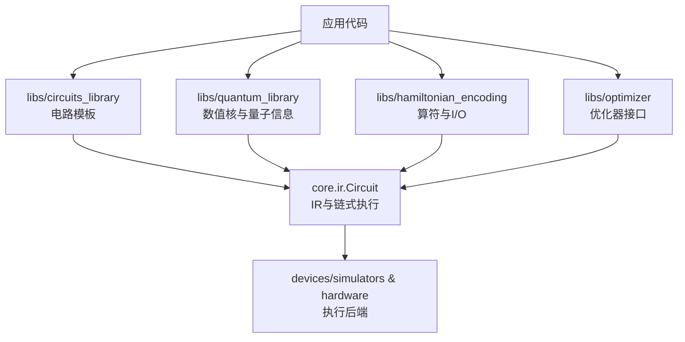
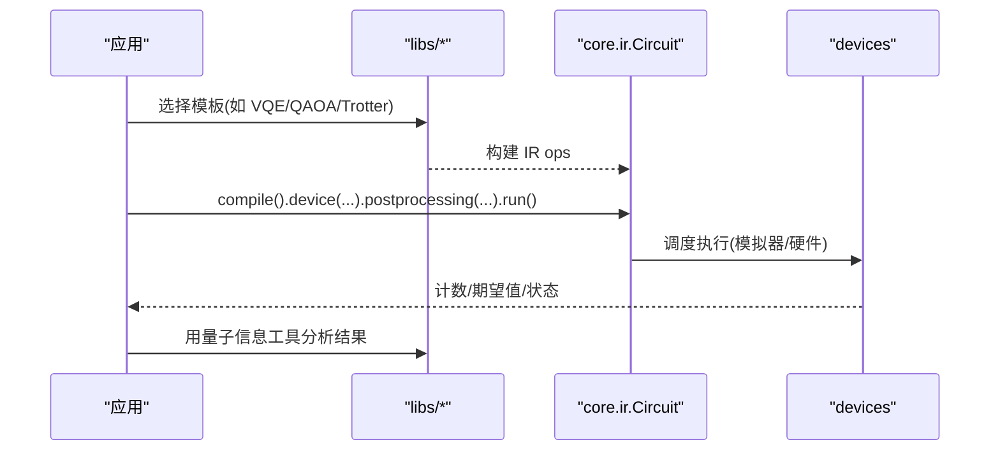
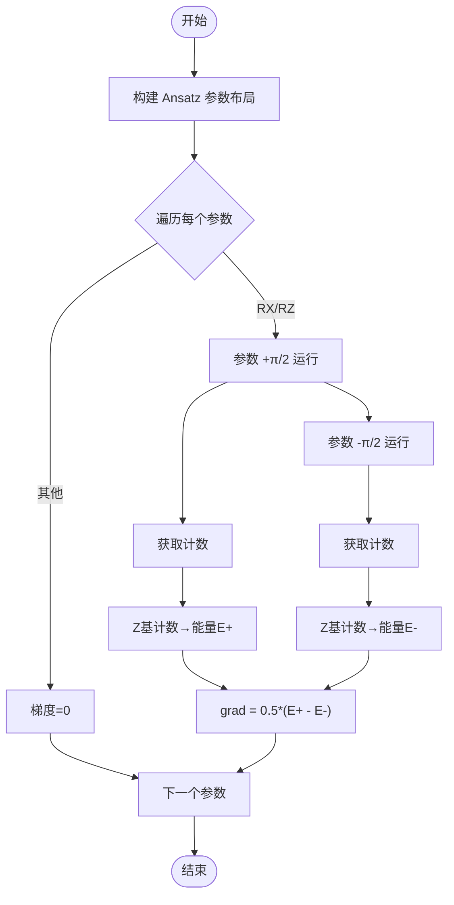
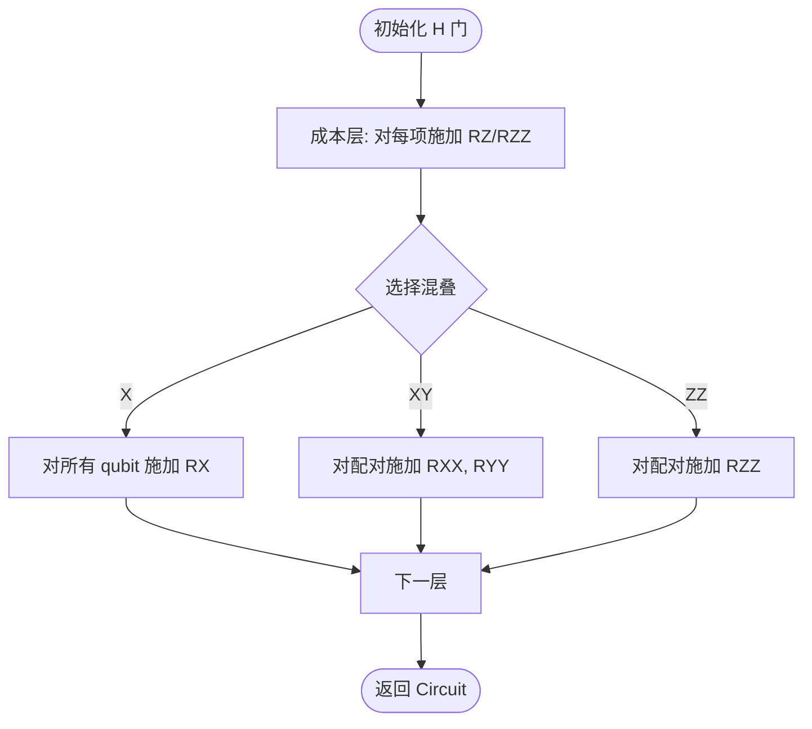
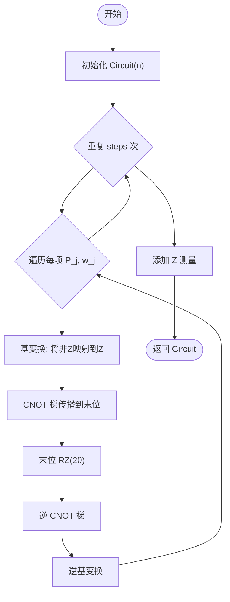
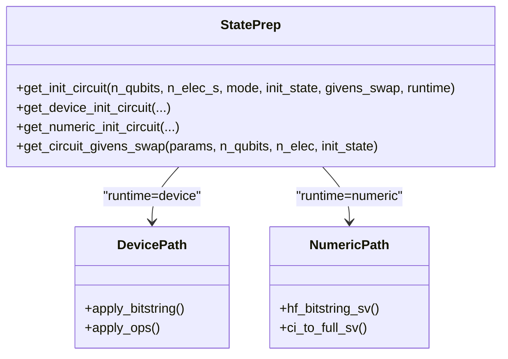
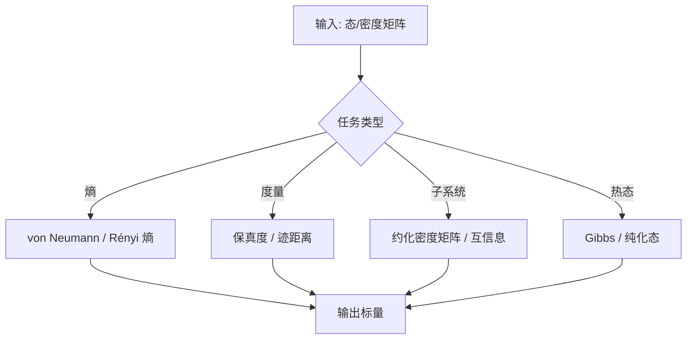
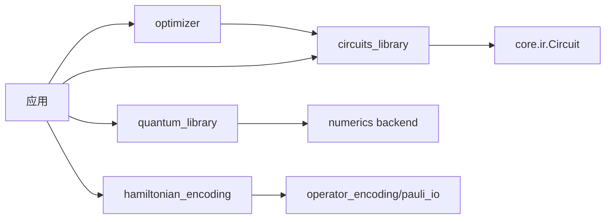

# 库和工具

<cite>
**本文引用的文件**
- [README.md](file://README.md)
- [__init__.py](file://src/tyxonq/__init__.py)
- [circuits_library/__init__.py](file://src/tyxonq/libs/circuits_library/__init__.py)
- [vqe.py](file://src/tyxonq/libs/circuits_library/vqe.py)
- [qaoa_ising.py](file://src/tyxonq/libs/circuits_library/qaoa_ising.py)
- [trotter_circuit.py](file://src/tyxonq/libs/circuits_library/trotter_circuit.py)
- [qubit_state_preparation.py](file://src/tyxonq/libs/circuits_library/qubit_state_preparation.py)
- [quantum_library/__init__.py](file://src/tyxonq/libs/quantum_library/__init__.py)
- [quantum_info.py](file://src/tyxonq/libs/quantum_library/kernels/quantum_info.py)
- [hamiltonian_encoding/__init__.py](file://src/tyxonq/libs/hamiltonian_encoding/__init__.py)
- [optimizer/__init__.py](file://src/tyxonq/libs/optimizer/__init__.py)
</cite>

## 目录
1. [简介](#简介)
2. [项目结构](#项目结构)
3. [核心组件](#核心组件)
4. [架构总览](#架构总览)
5. [详细组件分析](#详细组件分析)
6. [依赖关系分析](#依赖关系分析)
7. [性能考量](#性能考量)
8. [故障排查指南](#故障排查指南)
9. [结论](#结论)
10. [附录](#附录)

## 简介
本文件聚焦 TyxonQ 的“库与工具”层，系统梳理并说明以下能力：
- 电路库中的预定义电路模板：VQE、QAOA、Trotter 时间演化、态制备等。
- 量子库中的数值核函数与量子信息工具：熵、保真度、约化密度矩阵、热态等。
- 优化器集成与使用入口。
- 哈密顿量编码库：算符编码与 I/O 能力（含 OpenFermion 相关路径）。
- 扩展机制与自定义组件开发方法。
- 与其他量子计算库的互操作方式。
- 组合不同库组件构建复杂应用的实践建议与性能基准要点。

TyxonQ 提供链式执行 API（compile → device → postprocessing → run），统一抽象设备与后端，支持模拟器与真实硬件，并在 libs 层提供可复用的算法模板、数值核与编码工具，便于快速搭建从问题建模到执行的完整流程。

**章节来源**
- [README.md:12-25](file://README.md#L12-L25)
- [README.md:191-205](file://README.md#L191-L205)

## 项目结构
TyxonQ 将“库与工具”集中在 src/tyxonq/libs 下，按功能域划分：
- circuits_library：预定义电路模板（VQE、QAOA、Trotter、态制备等）
- quantum_library：数值核与量子信息工具（statevector/density matrix/MPS/pauli/gates/unitary/common）
- hamiltonian_encoding：算符与哈密顿量的编码与 I/O
- optimizer：优化器接口与集成（如 SOAP、QNG 等）

顶层包 tyxonq.__init__ 暴露便捷入口（Circuit/Hamiltonian、后端设置、全局默认配置、噪声控制等），使上层应用以最小依赖调用底层能力。

**图表来源**
- [__init__.py:136-182](file://src/tyxonq/__init__.py#L136-L182)
- [circuits_library/__init__.py:1-20](file://src/tyxonq/libs/circuits_library/__init__.py#L1-L20)
- [quantum_library/__init__.py:1-21](file://src/tyxonq/libs/quantum_library/__init__.py#L1-L21)
- [hamiltonian_encoding/__init__.py:1-17](file://src/tyxonq/libs/hamiltonian_encoding/__init__.py#L1-L17)
- [optimizer/__init__.py:1-10](file://src/tyxonq/libs/optimizer/__init__.py#L1-L10)

**章节来源**
- [__init__.py:136-182](file://src/tyxonq/__init__.py#L136-L182)
- [README.md:191-205](file://README.md#L191-L205)

## 核心组件
- 电路模板（circuits_library）
  - VQE：硬件高效 Ansatz、基于计数的能量估计、参数平移梯度、一键评估能量。
  - QAOA(Ising)：成本层与混合器的 IR 构建，支持多种混叠策略与全耦合/近邻耦合。
  - Trotter：一阶 Trotter-Suzuki 时间演化模板，支持任意 Pauli 串项分解为基变换+CNOT 梯+逆基变换。
  - 态制备：HF/bitstring 初态、CI 向量映射、Givens 交换序列与通用门注入。
- 量子库（quantum_library）
  - 量子信息工具：冯·诺依曼熵、Rényi 熵、保真度、迹距离、部分转置、纠缠负性、约化密度矩阵、互信息、热态与纯化态等。
  - 脉冲仿真与物理模型：用于脉冲级设计与验证（在量子库中导出）。
- 哈密顿量编码（hamiltonian_encoding）
  - 算符编码与 I/O：统一导出 operator_encoding 与 pauli_io，支持 OpenFermion 相关路径。
- 优化器（optimizer）
  - 对外暴露 soap 等优化器入口，便于与 VQE/QAOA/Trotter 等模板组合。

**章节来源**
- [circuits_library/__init__.py:1-20](file://src/tyxonq/libs/circuits_library/__init__.py#L1-L20)
- [quantum_library/__init__.py:1-21](file://src/tyxonq/libs/quantum_library/__init__.py#L1-L21)
- [hamiltonian_encoding/__init__.py:1-17](file://src/tyxonq/libs/hamiltonian_encoding/__init__.py#L1-L17)
- [optimizer/__init__.py:1-10](file://src/tyxonq/libs/optimizer/__init__.py#L1-L10)

## 架构总览
TyxonQ 的库层围绕“IR + 链式执行”展开：电路模板生成 IR 操作，交由编译器与设备执行；数值核与量子信息工具提供后端无关的计算；编码库负责问题到算符的转换；优化器提供参数更新策略。顶层包提供统一的设置与默认值管理，屏蔽后端差异。

**图表来源**
- [README.md:191-205](file://README.md#L191-L205)
- [__init__.py:136-182](file://src/tyxonq/__init__.py#L136-L182)

## 详细组件分析

### 电路库：VQE 模板
- 功能要点
  - 硬件高效 Ansatz：每层包含 CX 链与 RX/RZ/RX 旋转，参数布局固定。
  - 能量估计：从 Z 基测量计数直接估算期望值（需调用方保证正确的基变换）。
  - 梯度：参数平移规则（对 RX/RZ 使用 π/2 移位），通过两次运行得到梯度。
  - 一键评估：构建电路→基变换→测量→计数→能量。
- 复杂度与性能
  - Ansatz 规模 O(n·layers)，每次梯度评估需两次电路运行，适合中小规模与批处理。
- 错误处理
  - 仅支持 Z 项的直接计数能量估计；非 Z 项需在电路端做基变换。
- 最佳实践
  - 合理选择 shots 与 layers；结合编译器分组与 shot 规划减少开销。

**图表来源**
- [vqe.py:23-41](file://src/tyxonq/libs/circuits_library/vqe.py#L23-L41)
- [vqe.py:68-82](file://src/tyxonq/libs/circuits_library/vqe.py#L68-L82)
- [vqe.py:85-130](file://src/tyxonq/libs/circuits_library/vqe.py#L85-L130)
- [vqe.py:44-66](file://src/tyxonq/libs/circuits_library/vqe.py#L44-L66)

**章节来源**
- [vqe.py:23-153](file://src/tyxonq/libs/circuits_library/vqe.py#L23-L153)

### 电路库：QAOA(Ising) 模板
- 功能要点
  - 成本层：对单 Z 项与 ZZ 项分别施加 RZ 与 RZZ。
  - 混合器：支持 X、XY、ZZ 三种混叠策略，支持全耦合或近邻配对。
  - 输出：返回 IR Circuit，后续由编译器分解为标准门集。
- 复杂度与性能
  - 成本层与混合器均为 O(n) 或 O(n^2) 取决于耦合模式；适合图结构嵌入。
- 错误处理
  - 非法 Z 项数量或混叠类型会抛出异常。

**图表来源**
- [qaoa_ising.py:8-66](file://src/tyxonq/libs/circuits_library/qaoa_ising.py#L8-L66)

**章节来源**
- [qaoa_ising.py:8-66](file://src/tyxonq/libs/circuits_library/qaoa_ising.py#L8-L66)

### 电路库：Trotter 时间演化模板
- 功能要点
  - 输入：Pauli 串列表与权重，时间 t，步数 steps。
  - 实现：对每个 Pauli 串进行基变换→CNOT 梯→逆基变换，累积 exp(-iθP)。
  - 输出：带 Z 测量的 Circuit。
- 复杂度与性能
  - 每步 O(∑|P_j|) 个基本门；steps 越大精度越高但开销线性增长。
- 错误处理
  - 仅支持一阶 Trotter；不支持稠密哈密顿量输入。

**图表来源**
- [trotter_circuit.py:8-72](file://src/tyxonq/libs/circuits_library/trotter_circuit.py#L8-L72)
- [trotter_circuit.py:75-122](file://src/tyxonq/libs/circuits_library/trotter_circuit.py#L75-L122)

**章节来源**
- [trotter_circuit.py:8-122](file://src/tyxonq/libs/circuits_library/trotter_circuit.py#L8-L122)

### 电路库：态制备模板
- 功能要点
  - 路由：根据 runtime 选择设备电路或数值态矢量。
  - 设备路径：支持 HF/bitstring 初态、继承电路、追加任意门（X/CNOT/CZ/RY/CRY/ANY）。
  - 数值路径：构造 HF/bitstring 态矢量，或将 CI 向量映射到完整态矢量（需注入 ci_strings）。
  - Givens 交换：支持特定分子轨道排序下的交换序列。
- 复杂度与性能
  - 设备路径门数与态空间指数相关；数值路径避免电路构建，适合纯数值模拟。
- 错误处理
  - 未支持的 runtime；传入 civector 但未提供 ci_strings。

**图表来源**
- [qubit_state_preparation.py:20-53](file://src/tyxonq/libs/circuits_library/qubit_state_preparation.py#L20-L53)
- [qubit_state_preparation.py:57-139](file://src/tyxonq/libs/circuits_library/qubit_state_preparation.py#L57-L139)
- [qubit_state_preparation.py:142-195](file://src/tyxonq/libs/circuits_library/qubit_state_preparation.py#L142-L195)
- [qubit_state_preparation.py:237-246](file://src/tyxonq/libs/circuits_library/qubit_state_preparation.py#L237-L246)

**章节来源**
- [qubit_state_preparation.py:20-246](file://src/tyxonq/libs/circuits_library/qubit_state_preparation.py#L20-L246)

### 量子库：量子信息工具
- 功能要点
  - 熵与自由能：冯·诺依曼熵、Rényi 熵、自由能与截断自由能。
  - 度量：保真度、迹距离、部分转置、纠缠负性与对数负性。
  - 子系统：约化密度矩阵、互信息、投影波函数。
  - 热态：Gibbs 态与纯化态。
- 复杂度与性能
  - 多数操作涉及对角化或张量重塑，复杂度随 qubit 数指数增长；适用于中小系统或作为后处理工具。
- 错误处理
  - 输入维度校验与正则化防止数值不稳定。

**图表来源**
- [quantum_info.py:18-34](file://src/tyxonq/libs/quantum_library/kernels/quantum_info.py#L18-L34)
- [quantum_info.py:121-137](file://src/tyxonq/libs/quantum_library/kernels/quantum_info.py#L121-L137)
- [quantum_info.py:175-210](file://src/tyxonq/libs/quantum_library/kernels/quantum_info.py#L175-L210)
- [quantum_info.py:233-304](file://src/tyxonq/libs/quantum_library/kernels/quantum_info.py#L233-L304)
- [quantum_info.py:140-172](file://src/tyxonq/libs/quantum_library/kernels/quantum_info.py#L140-L172)

**章节来源**
- [quantum_info.py:18-407](file://src/tyxonq/libs/quantum_library/kernels/quantum_info.py#L18-L407)

### 哈密顿量编码库
- 功能要点
  - 统一导出 operator_encoding 与 pauli_io，提供稳定的导入路径。
  - 支持 OpenFermion 相关的 I/O 与编码（通过 pauli_io 与 operator_encoding 的组合）。
- 使用建议
  - 在构建电路前完成问题到 Pauli 算符的转换；与 Trotter/VQE 模板配合使用。

**章节来源**
- [hamiltonian_encoding/__init__.py:1-17](file://src/tyxonq/libs/hamiltonian_encoding/__init__.py#L1-L17)

### 优化器集成
- 功能要点
  - 对外暴露 soap 等优化器入口，便于与 VQE/QAOA 等模板组合。
- 使用建议
  - 结合参数平移梯度或自动微分（PyTorch 后端）进行参数更新；注意学习率与收敛判据。

**章节来源**
- [optimizer/__init__.py:1-10](file://src/tyxonq/libs/optimizer/__init__.py#L1-L10)

## 依赖关系分析
- 模块内聚与耦合
  - circuits_library 依赖 core.ir.Circuit 构建 IR，不依赖具体数值后端，保持高内聚低耦合。
  - quantum_library 提供后端无关的数值核，供上层分析与后处理。
  - hamiltonian_encoding 位于问题建模阶段，与电路模板解耦。
  - optimizer 仅提供接口，实际优化循环由应用层组织。
- 外部依赖
  - 顶层 __init__ 提供 set_backend/get_backend/set_dtype 等便捷入口，屏蔽 NumPy/PyTorch/CuPyNumeric 差异。
  - 支持云平台与多硬件提供商（见 README 的设备表）。

**图表来源**
- [__init__.py:186-275](file://src/tyxonq/__init__.py#L186-L275)
- [circuits_library/__init__.py:1-20](file://src/tyxonq/libs/circuits_library/__init__.py#L1-L20)
- [quantum_library/__init__.py:1-21](file://src/tyxonq/libs/quantum_library/__init__.py#L1-L21)
- [hamiltonian_encoding/__init__.py:1-17](file://src/tyxonq/libs/hamiltonian_encoding/__init__.py#L1-L17)
- [optimizer/__init__.py:1-10](file://src/tyxonq/libs/optimizer/__init__.py#L1-L10)

**章节来源**
- [__init__.py:186-275](file://src/tyxonq/__init__.py#L186-L275)

## 性能考量
- 梯度计算
  - 参数平移规则每次梯度需两次电路运行；可通过批处理与并行化降低开销。
  - 若使用 PyTorch 后端，可利用自动微分获得端到端梯度，参考 README 的性能对比。
- 电路深度与宽度
  - Trotter 步数与 Pauli 项数线性影响门数；合理选择 steps 与分组测量。
  - QAOA 的全耦合会导致 O(n^2) 混合器门；优先使用近邻耦合。
- 数值核
  - 熵/保真度等操作涉及对角化，建议在中小系统使用；大规模场景考虑近似或采样。
- 设备执行
  - 利用编译器分组与 shot 规划；在真实设备上关注 T1/T2 与读出误差，必要时启用读误校正。

[本节为通用指导，不直接分析具体文件]

## 故障排查指南
- 常见错误与定位
  - VQE 能量估计仅支持 Z 项：需在电路端完成 X/Y 基变换后再测量。
  - Trotter 仅支持一阶：如需高阶，请自行扩展或改用其他演化方案。
  - 态制备数值路径缺少 ci_strings：当传入 CI 向量时必须同时提供 ci_strings。
  - 后端切换失败：检查是否安装对应后端（如 cupynumeric），否则回退到 numpy。
- 调试建议
  - 使用 statevector 模拟器验证电路逻辑；逐步增加复杂度。
  - 打印中间计数或期望值，确认基变换与测量顺序正确。
  - 对于真实设备，先在小规模测试，再扩展到目标规模。

**章节来源**
- [vqe.py:44-66](file://src/tyxonq/libs/circuits_library/vqe.py#L44-L66)
- [trotter_circuit.py:102-113](file://src/tyxonq/libs/circuits_library/trotter_circuit.py#L102-L113)
- [qubit_state_preparation.py:184-189](file://src/tyxonq/libs/circuits_library/qubit_state_preparation.py#L184-L189)
- [__init__.py:214-230](file://src/tyxonq/__init__.py#L214-L230)

## 结论
TyxonQ 的库与工具层提供了从问题建模（哈密顿量编码）、电路模板（VQE/QAOA/Trotter/态制备）、数值核（量子信息工具）到优化器接口的完整能力。借助链式执行 API 与统一后端抽象，用户可在模拟器与真实硬件之间无缝切换，并以最小改动组合不同组件构建复杂应用。遵循本文的最佳实践与性能建议，可显著提升开发与部署效率。

[本节为总结，不直接分析具体文件]

## 附录
- 与其他量子计算库的互操作
  - 编译器 interop 支持 Qiskit QuantumCircuit 与 MPO 转换，便于复用既有生态。
  - 示例与文档中展示了与 Qiskit 的互操作路径。
- 扩展机制与自定义组件
  - 电路模板：基于 IR ops 构建新模板，遵循编译器分解约定。
  - 数值核：在后端无关的前提下实现新指标或变换。
  - 优化器：实现标准接口并与模板组合。
  - 设备驱动：遵循 devices/base 契约，接入新硬件或模拟器。
- 组合使用示例思路
  - VQE：hamiltonian_encoding → circuits_library.vqe → optimizer → devices
  - QAOA：problem graph → qaoa_ising → optimizer → devices
  - Trotter：hamiltonian_encoding → trotter_circuit → devices
  - 态制备：qubit_state_preparation → 后续算法（如 VQE/QAOA）

[本节为概念性内容，不直接分析具体文件]