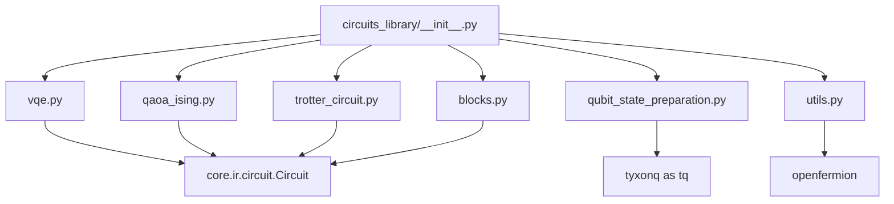
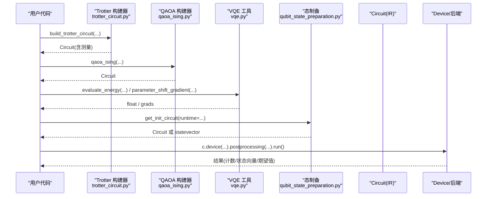
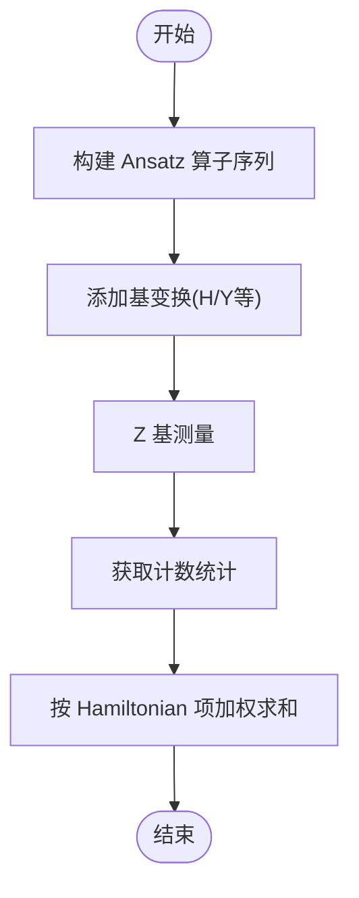
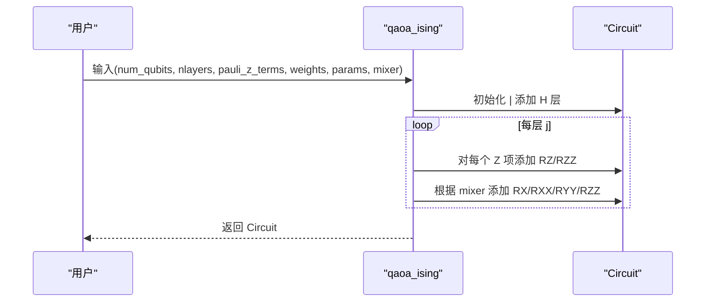
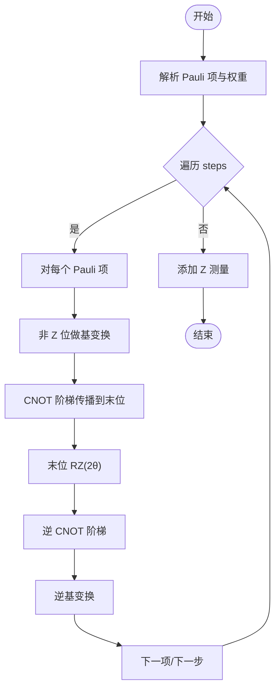
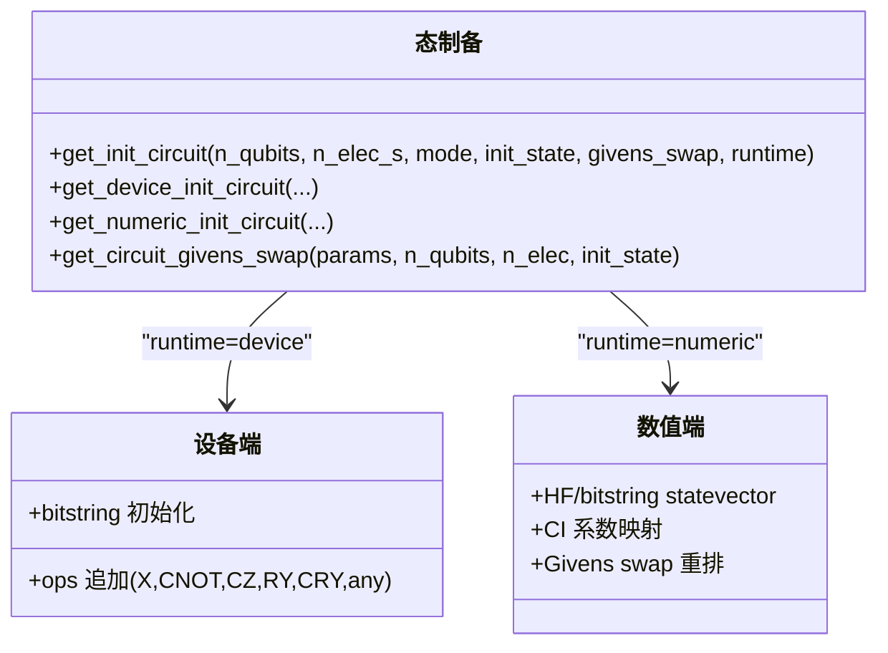
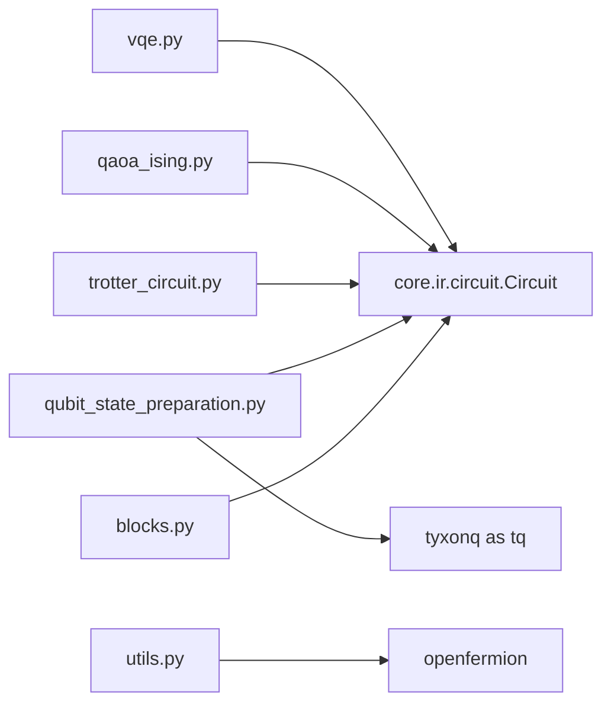

# 电路库

<cite>
**本文引用的文件**
- [src/tyxonq/libs/circuits_library/__init__.py](file://src/tyxonq/libs/circuits_library/__init__.py)
- [src/tyxonq/libs/circuits_library/vqe.py](file://src/tyxonq/libs/circuits_library/vqe.py)
- [src/tyxonq/libs/circuits_library/qaoa_ising.py](file://src/tyxonq/libs/circuits_library/qaoa_ising.py)
- [src/tyxonq/libs/circuits_library/trotter_circuit.py](file://src/tyxonq/libs/circuits_library/trotter_circuit.py)
- [src/tyxonq/libs/circuits_library/qubit_state_preparation.py](file://src/tyxonq/libs/circuits_library/qubit_state_preparation.py)
- [src/tyxonq/libs/circuits_library/blocks.py](file://src/tyxonq/libs/circuits_library/blocks.py)
- [src/tyxonq/libs/circuits_library/utils.py](file://src/tyxonq/libs/circuits_library/utils.py)
- [examples/simple_qaoa.py](file://examples/simple_qaoa.py)
- [examples/timeevolution_trotter.py](file://examples/timeevolution_trotter.py)
</cite>

## 目录
1. [简介](#简介)
2. [项目结构](#项目结构)
3. [核心组件](#核心组件)
4. [架构总览](#架构总览)
5. [详细组件分析](#详细组件分析)
6. [依赖关系分析](#依赖关系分析)
7. [性能与内存优化](#性能与内存优化)
8. [故障排查指南](#故障排查指南)
9. [结论](#结论)
10. [附录：使用示例与最佳实践](#附录使用示例与最佳实践)

## 简介
本文件面向 TyxonQ 的“电路库”模块，系统性介绍框架提供的预定义量子电路模板与构建器，包括 VQE 电路、QAOA 电路、Trotter 演化电路、态制备电路等常用电路的实现原理与使用方法。同时给出如何自定义电路组件、扩展电路库功能的方法，以及电路组合与复用的最佳实践、性能优化技巧与内存管理建议，帮助在不同应用场景中选择合适的电路模板并高效落地。

## 项目结构
TyxonQ 电路库位于 src/tyxonq/libs/circuits_library，采用按功能划分的模块化组织方式：
- vqe.py：VQE 相关工具（硬件高效 Ansatz、基于计数的能量估计、参数移位梯度、一键评估）
- qaoa_ising.py：QAOA(Ising) 变体电路构建器
- trotter_circuit.py：一阶 Trotter 时间演化电路构建器
- qubit_state_preparation.py：初态制备（设备端门级与数值端 statevector），支持 HCB/Givens swap 等约定
- blocks.py：通用电路块（如硬件高效块、RY Ansatz）
- utils.py：Pauli 演化操作生成、多控 RY 分解等基础工具
- __init__.py：对外暴露的公共接口入口

图表来源
- [src/tyxonq/libs/circuits_library/__init__.py:1-20](file://src/tyxonq/libs/circuits_library/__init__.py#L1-L20)
- [src/tyxonq/libs/circuits_library/vqe.py:1-153](file://src/tyxonq/libs/circuits_library/vqe.py#L1-L153)
- [src/tyxonq/libs/circuits_library/qaoa_ising.py:1-69](file://src/tyxonq/libs/circuits_library/qaoa_ising.py#L1-L69)
- [src/tyxonq/libs/circuits_library/trotter_circuit.py:1-128](file://src/tyxonq/libs/circuits_library/trotter_circuit.py#L1-L128)
- [src/tyxonq/libs/circuits_library/qubit_state_preparation.py:1-246](file://src/tyxonq/libs/circuits_library/qubit_state_preparation.py#L1-L246)
- [src/tyxonq/libs/circuits_library/blocks.py:1-87](file://src/tyxonq/libs/circuits_library/blocks.py#L1-L87)
- [src/tyxonq/libs/circuits_library/utils.py:1-182](file://src/tyxonq/libs/circuits_library/utils.py#L1-L182)

章节来源
- [src/tyxonq/libs/circuits_library/__init__.py:1-20](file://src/tyxonq/libs/circuits_library/__init__.py#L1-L20)

## 核心组件
- VQE 工具集：提供硬件高效 Ansatz 算子序列、从计数统计估计期望能量、参数移位梯度计算、一键能量评估封装。
- QAOA(Ising) 构建器：根据 Ising 模型项与权重，自动生成分层 cost 层与 mixer 层，支持 X/XY/ZZ 多种混频器。
- Trotter 演化电路：将 Pauli 项集合以时间步长进行一阶 Trotter 分解，输出可直接运行的 Circuit。
- 态制备：统一入口 get_init_circuit，按 runtime 分流到设备端门级或数值端 statevector；支持 bitstring、ops 继承与 HCB/Givens swap 布局。
- 通用电路块：example_block、build_hwe_ry_ops 等可复用单元，便于组合复杂 Ansatz。
- 工具函数：evolve_pauli_ops、多控 RY 分解等底层原语，支撑上层电路构建。

章节来源
- [src/tyxonq/libs/circuits_library/vqe.py:23-150](file://src/tyxonq/libs/circuits_library/vqe.py#L23-L150)
- [src/tyxonq/libs/circuits_library/qaoa_ising.py:8-66](file://src/tyxonq/libs/circuits_library/qaoa_ising.py#L8-L66)
- [src/tyxonq/libs/circuits_library/trotter_circuit.py:75-122](file://src/tyxonq/libs/circuits_library/trotter_circuit.py#L75-L122)
- [src/tyxonq/libs/circuits_library/qubit_state_preparation.py:20-53](file://src/tyxonq/libs/circuits_library/qubit_state_preparation.py#L20-L53)
- [src/tyxonq/libs/circuits_library/blocks.py:14-85](file://src/tyxonq/libs/circuits_library/blocks.py#L14-L85)
- [src/tyxonq/libs/circuits_library/utils.py:29-59](file://src/tyxonq/libs/circuits_library/utils.py#L29-L59)

## 架构总览
电路库围绕 tyxonq.core.ir.circuit.Circuit 构建，所有模板均返回 IR 级别的 Circuit 对象，交由编译器与后端执行。各模板职责清晰、耦合度低，便于组合与替换。

图表来源
- [src/tyxonq/libs/circuits_library/trotter_circuit.py:75-122](file://src/tyxonq/libs/circuits_library/trotter_circuit.py#L75-L122)
- [src/tyxonq/libs/circuits_library/qaoa_ising.py:8-66](file://src/tyxonq/libs/circuits_library/qaoa_ising.py#L8-L66)
- [src/tyxonq/libs/circuits_library/vqe.py:23-150](file://src/tyxonq/libs/circuits_library/vqe.py#L23-L150)
- [src/tyxonq/libs/circuits_library/qubit_state_preparation.py:20-53](file://src/tyxonq/libs/circuits_library/qubit_state_preparation.py#L20-L53)

## 详细组件分析

### VQE 电路与工具
- 硬件高效 Ansatz：按层构造 CX 链 + RX/RZ 旋转的参数化层，参数布局固定，便于梯度计算与优化。
- 能量估计：从 Z 基测量计数直接估算 <H>，要求调用方在电路中完成必要的基变换。
- 参数移位梯度：对 RX/RZ 使用标准 π/2 移位，分别运行 ±shift 两次得到梯度分量。
- 一键评估：构建电路 → 基变换 → Z 测量 → 计数 → 能量，封装为单函数。

图表来源
- [src/tyxonq/libs/circuits_library/vqe.py:23-65](file://src/tyxonq/libs/circuits_library/vqe.py#L23-L65)
- [src/tyxonq/libs/circuits_library/vqe.py:133-150](file://src/tyxonq/libs/circuits_library/vqe.py#L133-L150)

章节来源
- [src/tyxonq/libs/circuits_library/vqe.py:23-150](file://src/tyxonq/libs/circuits_library/vqe.py#L23-L150)

### QAOA(Ising) 电路
- Cost 层：对单 Z 项与 ZZ 项分别应用 RZ 与 RZZ 旋转，角度由权重与参数控制。
- Mixer 层：支持 X（逐比特 RX）、XY（RXX+RYY 成对）、ZZ（RZZ 成对）三种混频策略，支持全连接或交替配对。
- 输出：IR 级 Circuit，后续由编译器下推到目标基集。

图表来源
- [src/tyxonq/libs/circuits_library/qaoa_ising.py:8-66](file://src/tyxonq/libs/circuits_library/qaoa_ising.py#L8-L66)

章节来源
- [src/tyxonq/libs/circuits_library/qaoa_ising.py:8-66](file://src/tyxonq/libs/circuits_library/qaoa_ising.py#L8-L66)

### Trotter 演化电路
- 输入：Pauli 字符串列表（每项长度为 n，元素∈{0,1,2,3} 表示 I,X,Y,Z），可选权重、演化时间 t、步数 steps。
- 实现：对每个 Pauli 项通过基变换→CNOT 阶梯→RZ 旋转→逆过程实现 exp(-iθP)。
- 输出：包含末态 Z 测量的 Circuit，可直接运行。

图表来源
- [src/tyxonq/libs/circuits_library/trotter_circuit.py:8-72](file://src/tyxonq/libs/circuits_library/trotter_circuit.py#L8-L72)
- [src/tyxonq/libs/circuits_library/trotter_circuit.py:75-122](file://src/tyxonq/libs/circuits_library/trotter_circuit.py#L75-L122)

章节来源
- [src/tyxonq/libs/circuits_library/trotter_circuit.py:75-122](file://src/tyxonq/libs/circuits_library/trotter_circuit.py#L75-L122)

### 态制备电路
- 统一入口 get_init_circuit：按 runtime 选择设备端门级或数值端 statevector。
- 设备端：支持从 HF/bitstring 初始化，或通过 ops 指令追加门（X/CNOT/CZ/RY/CRY/any 等）。
- 数值端：直接构造 dense statevector，支持 CI 系数映射与 HCB/Givens swap 索引置换。
- Givens 交换：用于分子轨道到量子比特的映射，配合两量子比特任意幺正矩阵实现电子激发。

图表来源
- [src/tyxonq/libs/circuits_library/qubit_state_preparation.py:20-53](file://src/tyxonq/libs/circuits_library/qubit_state_preparation.py#L20-L53)
- [src/tyxonq/libs/circuits_library/qubit_state_preparation.py:57-139](file://src/tyxonq/libs/circuits_library/qubit_state_preparation.py#L57-L139)
- [src/tyxonq/libs/circuits_library/qubit_state_preparation.py:142-195](file://src/tyxonq/libs/circuits_library/qubit_state_preparation.py#L142-L195)
- [src/tyxonq/libs/circuits_library/qubit_state_preparation.py:237-245](file://src/tyxonq/libs/circuits_library/qubit_state_preparation.py#L237-L245)

章节来源
- [src/tyxonq/libs/circuits_library/qubit_state_preparation.py:20-246](file://src/tyxonq/libs/circuits_library/qubit_state_preparation.py#L20-L246)

### 通用电路块与工具
- example_block：在已有 Circuit 上叠加 H 层 + 纠缠 CX 链 + RZ/RX 参数层，适合快速搭建硬件高效 Ansatz。
- build_hwe_ry_ops：构建 RY 型硬件高效 Ansatz，含 barrier 便于可视化与调试。
- evolve_pauli_ops：将 Pauli 字符串转换为基变换+CNOT 阶梯+RZ 的 IR 操作序列。
- 多控 RY：提供四线多控 RY 的分解实现，可作为子电路或内联操作。

章节来源
- [src/tyxonq/libs/circuits_library/blocks.py:14-85](file://src/tyxonq/libs/circuits_library/blocks.py#L14-L85)
- [src/tyxonq/libs/circuits_library/utils.py:29-169](file://src/tyxonq/libs/circuits_library/utils.py#L29-L169)

## 依赖关系分析
- 内部依赖：所有模板均依赖 core.ir.circuit.Circuit 作为统一中间表示，保证与编译器/后端解耦。
- 外部依赖：
  - openfermion：用于 Fermion/Qubit 算符转换（utils.py）。
  - numpy：数值模拟与态矢量处理（qubit_state_preparation.py、variational.py）。
  - tyxonq 主包：设备与运行时接口（qubit_state_preparation.py、blocks.py 等）。

图表来源
- [src/tyxonq/libs/circuits_library/vqe.py:1-153](file://src/tyxonq/libs/circuits_library/vqe.py#L1-L153)
- [src/tyxonq/libs/circuits_library/qaoa_ising.py:1-69](file://src/tyxonq/libs/circuits_library/qaoa_ising.py#L1-L69)
- [src/tyxonq/libs/circuits_library/trotter_circuit.py:1-128](file://src/tyxonq/libs/circuits_library/trotter_circuit.py#L1-L128)
- [src/tyxonq/libs/circuits_library/qubit_state_preparation.py:1-246](file://src/tyxonq/libs/circuits_library/qubit_state_preparation.py#L1-L246)
- [src/tyxonq/libs/circuits_library/blocks.py:1-87](file://src/tyxonq/libs/circuits_library/blocks.py#L1-L87)
- [src/tyxonq/libs/circuits_library/utils.py:1-182](file://src/tyxonq/libs/circuits_library/utils.py#L1-L182)

章节来源
- [src/tyxonq/libs/circuits_library/utils.py:1-182](file://src/tyxonq/libs/circuits_library/utils.py#L1-L182)

## 性能与内存优化
- 减少重复构建：将常用 Ansatz（如 example_block、build_hwe_ry_ops）封装为可复用函数，避免每次优化循环重建大电路。
- 合理设置 shots：VQE 能量估计与梯度计算对采样噪声敏感，需权衡精度与耗时；可使用批处理或并行 pmap 提升吞吐。
- 利用编译器优化：启用 lightcone/simplify 等编译阶段优化，减少无效门与冗余连线。
- 内存管理：
  - 深度电路优先使用 statevector 时注意指数增长，必要时切换 MPS/DensityMatrix 模拟器或分块计算。
  - 使用 checkpointing/checkpointed forward 降低深层网络训练时的峰值内存。
  - 数值路径优先使用原地更新与视图操作，避免不必要的拷贝。
- 参数布局：保持参数布局一致（如 VQE 的 3n·layers 布局），有助于梯度计算与缓存命中。

[本节为通用指导，不直接分析具体文件]

## 故障排查指南
- 能量估计仅支持 Z 项：若 Hamiltonian 包含 X/Y 项，需在电路中预先做基变换（例如 H 或 HS），否则 energy_from_counts 会抛出未实现错误。
- 不支持的 Hamiltonian 格式：Trotter 构建器当前仅接受 Pauli 字符串列表，传入稠密矩阵会报错。
- 参数移位梯度：仅对 RX/RZ 有效，其他门类型不会贡献梯度。
- 态制备 CI 映射：当传入 CI 系数向量时必须同时注入 ci_strings，否则会抛出缺失参数错误。
- Mixer 类型校验：QAOA mixer 必须为 X/XY/ZZ 之一，否则抛出无效类型错误。

章节来源
- [src/tyxonq/libs/circuits_library/vqe.py:44-65](file://src/tyxonq/libs/circuits_library/vqe.py#L44-L65)
- [src/tyxonq/libs/circuits_library/trotter_circuit.py:102-113](file://src/tyxonq/libs/circuits_library/trotter_circuit.py#L102-L113)
- [src/tyxonq/libs/circuits_library/qaoa_ising.py:52-64](file://src/tyxonq/libs/circuits_library/qaoa_ising.py#L52-L64)
- [src/tyxonq/libs/circuits_library/qubit_state_preparation.py:184-189](file://src/tyxonq/libs/circuits_library/qubit_state_preparation.py#L184-L189)

## 结论
TyxonQ 电路库提供了覆盖 VQE、QAOA、Trotter 演化与态制备的完整模板体系，均以 IR 级 Circuit 为核心，确保与编译器/后端的松耦合与高可移植性。通过统一的构建器与工具函数，用户可以快速组合出复杂 Ansatz，并在不同后端上获得一致的体验。结合合理的性能优化与内存管理策略，可在真实设备与模拟器上高效运行大规模量子算法。

[本节为总结性内容，不直接分析具体文件]

## 附录：使用示例与最佳实践

- 如何选择电路模板
  - VQE：适用于基态能量求解与变分优化，推荐硬件高效 Ansatz 与参数移位梯度。
  - QAOA：适用于组合优化问题（如 MaxCut），Ising 模型项与权重直接映射到 cost 层。
  - Trotter：适用于哈密顿量时间演化，按步数与时间步长控制精度与开销。
  - 态制备：化学问题常用 HCB/Givens swap 映射分子轨道；也可用 bitstring/ops 灵活定制初态。

- 组合与复用
  - 将 blocks.py 中的 example_block/build_hwe_ry_ops 作为子模块嵌入更大电路。
  - 使用 utils.py 的 evolve_pauli_ops 将任意 Pauli 字符串转为可执行 IR 操作序列。
  - 通过 qubit_state_preparation.get_init_circuit 统一接入不同初态源。

- 参考示例
  - QAOA 示例：simple_qaoa.py 展示了 counts 路径与 autograd 路径两种实现方式。
  - Trotter 示例：timeevolution_trotter.py 演示了从 Pauli 项构建演化电路并运行仿真。

章节来源
- [examples/simple_qaoa.py:48-83](file://examples/simple_qaoa.py#L48-L83)
- [examples/timeevolution_trotter.py:13-53](file://examples/timeevolution_trotter.py#L13-L53)