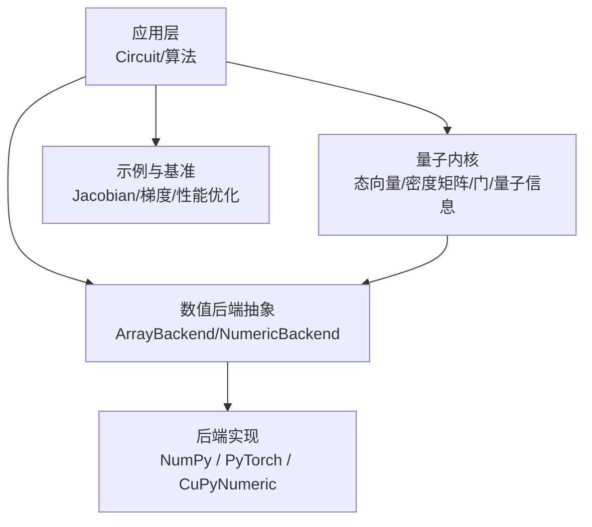
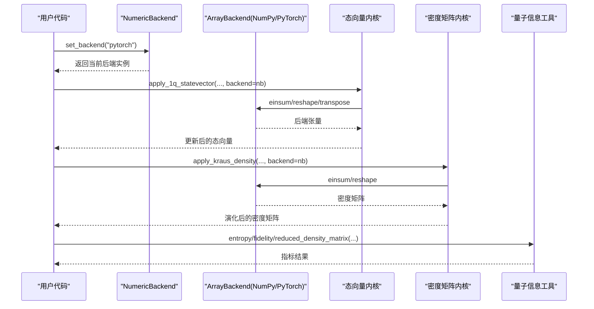
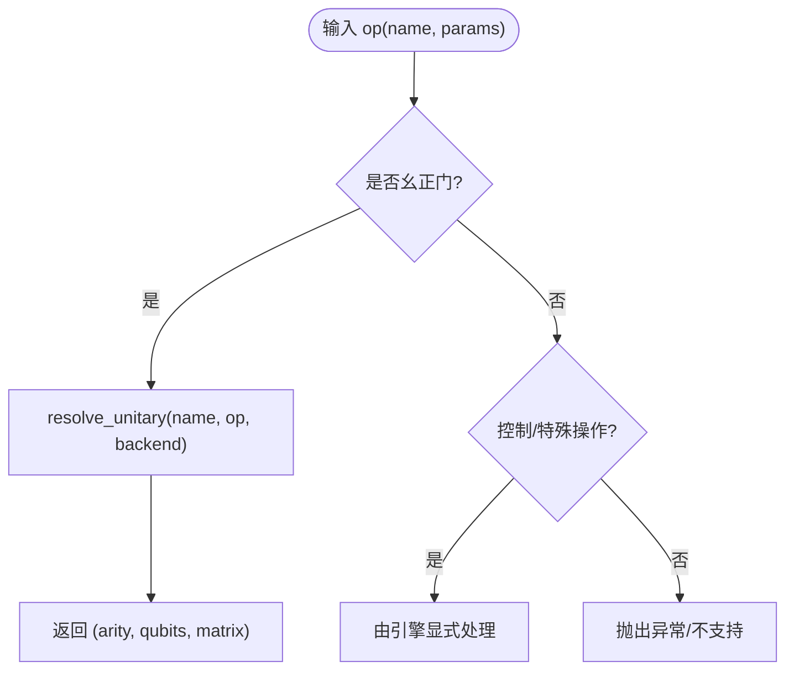
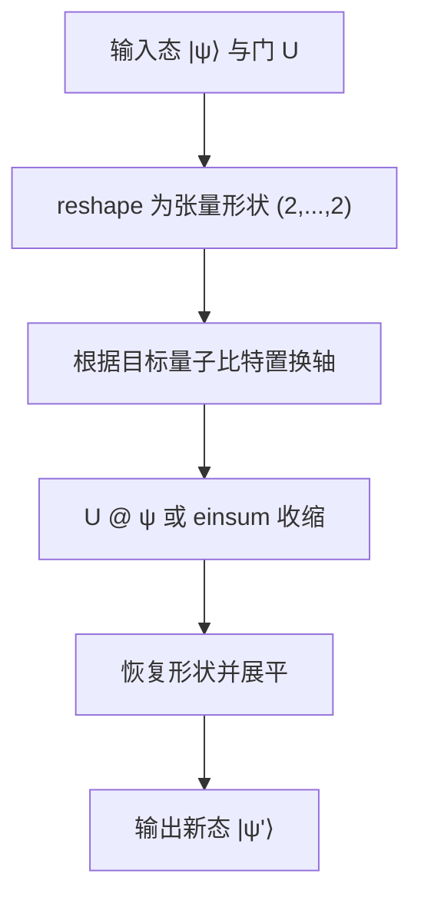
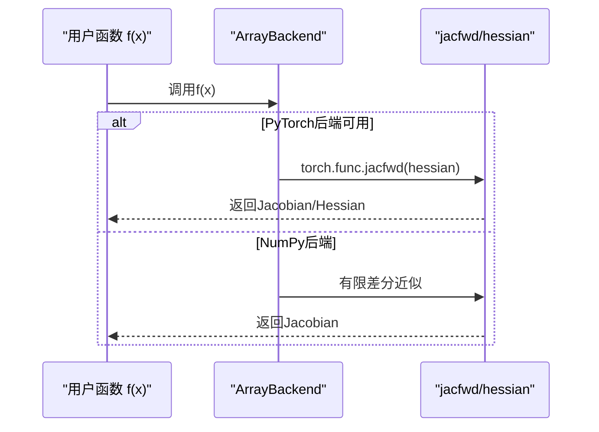
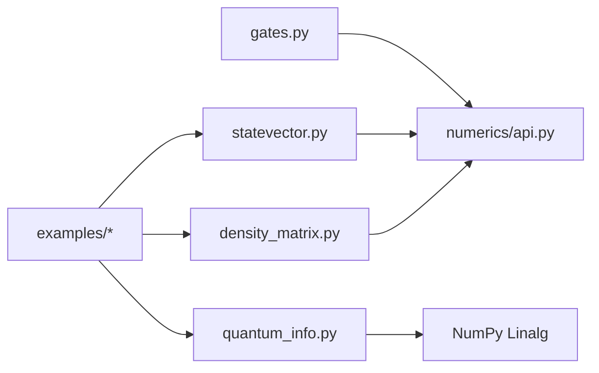

# 量子库

<cite>
**本文引用的文件**
- [README.md](file://README.md)
- [__init__.py](file://src/tyxonq/__init__.py)
- [quantum_library/__init__.py](file://src/tyxonq/libs/quantum_library/__init__.py)
- [statevector.py](file://src/tyxonq/libs/quantum_library/kernels/statevector.py)
- [density_matrix.py](file://src/tyxonq/libs/quantum_library/kernels/density_matrix.py)
- [gates.py](file://src/tyxonq/libs/quantum_library/kernels/gates.py)
- [quantum_info.py](file://src/tyxonq/libs/quantum_library/kernels/quantum_info.py)
- [numerics/__init__.py](file://src/tyxonq/numerics/__init__.py)
- [api.py](file://src/tyxonq/numerics/api.py)
- [numpy_backend.py](file://src/tyxonq/numerics/backends/numpy_backend.py)
- [pytorch_backend.py](file://src/tyxonq/numerics/backends/pytorch_backend.py)
- [jacobian_cal.py](file://examples/jacobian_cal.py)
- [gradient_benchmark.py](file://examples/gradient_benchmark.py)
- [performance_optimization_tips.md](file://examples/performance_optimization_tips.md)
- [memory_optimization_checkpointing.py](file://examples/memory_optimization_checkpointing.py)
</cite>

## 目录
1. [简介](#简介)
2. [项目结构](#项目结构)
3. [核心组件](#核心组件)
4. [架构总览](#架构总览)
5. [详细组件分析](#详细组件分析)
6. [依赖关系分析](#依赖关系分析)
7. [性能考量](#性能考量)
8. [故障排查指南](#故障排查指南)
9. [结论](#结论)
10. [附录](#附录)

## 简介
本文件面向TyxonQ量子库的数值核函数、量子信息工具与数学运算库，系统梳理量子门操作、态向量操作、密度矩阵操作等核心能力，并说明Jacobian与梯度计算等高级数学工具的使用方法。同时给出纠缠度量、熵计算等量子信息实用函数的使用建议，提供性能优化与内存管理技巧，并展示如何将这些工具集成到自定义量子算法中。

## 项目结构
TyxonQ将数值后端抽象为统一的ArrayBackend接口，并在libs/quantum_library下提供可复用的量子内核（态向量、密度矩阵、门矩阵、量子信息等），通过numerics模块统一调度NumPy/PyTorch/CuPyNumeric等后端。顶层入口暴露便捷API与全局默认配置，便于在Circuit链式调用中无缝切换后端与设备。

图表来源
- [numerics/api.py:19-122](file://src/tyxonq/numerics/api.py#L19-L122)
- [numerics/__init__.py:67-123](file://src/tyxonq/numerics/__init__.py#L67-L123)
- [quantum_library/__init__.py:1-18](file://src/tyxonq/libs/quantum_library/__init__.py#L1-L18)

章节来源
- [README.md:191-206](file://README.md#L191-L206)
- [__init__.py:186-276](file://src/tyxonq/__init__.py#L186-L276)

## 核心组件
- 数值后端与统一接口：ArrayBackend协议与NumericBackend类封装了数组创建、线性代数、随机数、自动微分桥接等能力；支持按名称或实例设置全局后端，并提供dtype设置与类型别名。
- 量子内核：
  - 态向量：初始化、单/多量子比特幺正作用、期望值计算、Kraus通道（轨迹法）。
  - 密度矩阵：初始化、单/双量子比特作用、Kraus通道（张量收缩）。
  - 门矩阵：标准单/双量子比特门及受控门、参数门、交换门族等，集中维护“权威”门表与解析器。
  - 量子信息：冯·诺依曼熵、Rényi熵、保真度、迹距离、偏转置、纠缠负性、约化密度矩阵、互信息等。
- 示例与基准：Jacobian数值计算、梯度基准（计数路径与状态路径）、性能优化与内存检查点策略。

章节来源
- [numerics/api.py:19-122](file://src/tyxonq/numerics/api.py#L19-L122)
- [numerics/__init__.py:67-123](file://src/tyxonq/numerics/__init__.py#L67-L123)
- [statevector.py:19-129](file://src/tyxonq/libs/quantum_library/kernels/statevector.py#L19-L129)
- [density_matrix.py:113-173](file://src/tyxonq/libs/quantum_library/kernels/density_matrix.py#L113-L173)
- [gates.py:355-396](file://src/tyxonq/libs/quantum_library/kernels/gates.py#L355-L396)
- [quantum_info.py:18-304](file://src/tyxonq/libs/quantum_library/kernels/quantum_info.py#L18-L304)

## 架构总览
TyxonQ采用“后端抽象 + 内核实现 + 上层算法/示例”的分层设计。数值内核通过ArrayBackend屏蔽底层差异，保证态向量/密度矩阵/门矩阵在不同后端上行为一致；上层示例通过选择不同后端与执行路径（计数/状态）进行对比与优化。

图表来源
- [numerics/__init__.py:67-123](file://src/tyxonq/numerics/__init__.py#L67-L123)
- [statevector.py:28-68](file://src/tyxonq/libs/quantum_library/kernels/statevector.py#L28-L68)
- [density_matrix.py:113-173](file://src/tyxonq/libs/quantum_library/kernels/density_matrix.py#L113-L173)
- [quantum_info.py:18-137](file://src/tyxonq/libs/quantum_library/kernels/quantum_info.py#L18-L137)

## 详细组件分析

### 量子门操作（gates）
- 门矩阵与参数门：提供H、X、Y、Z、S、T及其共轭，以及Rx/Ry/Rz、Rxx/Ryy/Rzz、受控门（CX/CY/CZ/CRY）、iSWAP/SWAP等。所有门均通过后端原生算子构建，确保梯度链不断裂。
- 权威门表与解析：集中定义1Q/2Q幺正门集合与控制/特殊操作，并通过resolve_unitary将op元组解析为(arity, qubits, matrix)，供各引擎统一分发。

图表来源
- [gates.py:355-396](file://src/tyxonq/libs/quantum_library/kernels/gates.py#L355-L396)
- [gates.py:399-418](file://src/tyxonq/libs/quantum_library/kernels/gates.py#L399-L418)

章节来源
- [gates.py:11-337](file://src/tyxonq/libs/quantum_library/kernels/gates.py#L11-L337)
- [gates.py:355-396](file://src/tyxonq/libs/quantum_library/kernels/gates.py#L355-L396)

### 态向量操作（statevector）
- 初始化与幺正作用：通过einsum与轴重排高效施加单/双量子比特门；支持k量子比特通用幺正作用，保持autograd链。
- 期望值与噪声：提供Z期望值快速计算；Kraus通道以Monte Carlo轨迹方式对纯态进行随机演化并归一化。

图表来源
- [statevector.py:28-68](file://src/tyxonq/libs/quantum_library/kernels/statevector.py#L28-L68)
- [statevector.py:71-129](file://src/tyxonq/libs/quantum_library/kernels/statevector.py#L71-L129)

章节来源
- [statevector.py:19-219](file://src/tyxonq/libs/quantum_library/kernels/statevector.py#L19-L219)

### 密度矩阵操作（density_matrix）
- 混合态演化：支持单/双量子比特幺正作用；Kraus通道通过张量收缩直接实现ρ→∑ K_i ρ K_i†，避免逐元素循环。
- 复杂度：O(4^n)存储，单次作用O(4^n)（利用einsum优化常数因子）。

章节来源
- [density_matrix.py:113-173](file://src/tyxonq/libs/quantum_library/kernels/density_matrix.py#L113-L173)

### 量子信息工具（quantum_info）
- 熵与自由能：冯·诺依曼熵、Rényi熵、Gibbs态与纯化态、截断自由能近似。
- 距离与保真度：迹距离、保真度。
- 纠缠度量：偏转置与纠缠负性、对数负性。
- 子系统与互信息：约化密度矩阵、互信息。
- 投影：对指定量子比特进行计算基投影得到约化波函数。

章节来源
- [quantum_info.py:18-304](file://src/tyxonq/libs/quantum_library/kernels/quantum_info.py#L18-L304)

### 数值后端与Jacobian/梯度（numerics）
- 后端选择与统一接口：通过get_backend/set_backend切换NumPy/PyTorch/CuPyNumeric；NumericBackend提供类级代理，便于内核代码不感知后端细节。
- Jacobian与高阶导数：
  - NumPy后端：有限差分实现jacfwd。
  - PyTorch后端：优先使用torch.func.jacfwd/hessian（版本兼容回退）。
- 示例：
  - jacobian_cal.py演示基于状态向量的数值Jacobian。
  - gradient_benchmark.py对比计数路径（参数平移）与状态路径（有限差分/QFI/Hessian）的性能。

图表来源
- [numpy_backend.py:265-303](file://src/tyxonq/numerics/backends/numpy_backend.py#L265-L303)
- [pytorch_backend.py:384-420](file://src/tyxonq/numerics/backends/pytorch_backend.py#L384-L420)
- [api.py:179-252](file://src/tyxonq/numerics/api.py#L179-L252)

章节来源
- [numerics/__init__.py:20-58](file://src/tyxonq/numerics/__init__.py#L20-L58)
- [numerics/api.py:124-176](file://src/tyxonq/numerics/api.py#L124-L176)
- [jacobian_cal.py:13-59](file://examples/jacobian_cal.py#L13-L59)
- [gradient_benchmark.py:140-186](file://examples/gradient_benchmark.py#L140-L186)

## 依赖关系分析
- 耦合与内聚：
  - gates.py作为“权威门表”，被各引擎与内核复用，提升一致性。
  - statevector/density_matrix强依赖numerics提供的ArrayBackend，保证跨后端一致性。
  - quantum_info主要依赖NumPy线性代数，适合离线分析与后处理。
- 外部依赖：
  - PyTorch用于autograd与高阶导数；NumPy作为默认后端；CuPyNumeric可选用于GPU加速。
- 潜在循环依赖：无直接循环导入；模块间通过接口解耦。

图表来源
- [gates.py:355-396](file://src/tyxonq/libs/quantum_library/kernels/gates.py#L355-L396)
- [statevector.py:1-16](file://src/tyxonq/libs/quantum_library/kernels/statevector.py#L1-L16)
- [density_matrix.py:113-173](file://src/tyxonq/libs/quantum_library/kernels/density_matrix.py#L113-L173)
- [quantum_info.py:1-16](file://src/tyxonq/libs/quantum_library/kernels/quantum_info.py#L1-L16)

章节来源
- [numerics/api.py:19-122](file://src/tyxonq/numerics/api.py#L19-L122)
- [numerics/__init__.py:67-123](file://src/tyxonq/numerics/__init__.py#L67-L123)

## 性能考量
- 避免重复电路执行：缓存状态向量，一次性计算多项期望值，可将多次circuit.expectation()降为一次state()。
- 使用Hamiltonian对象：将Pauli项合并为矩阵，一次矩阵乘完成能量计算。
- 批量与向量化：利用vmap/jit（若后端支持）批处理多参数或多电路评估。
- 内存优化：深度电路可采用梯度检查点（checkpointing）降低中间状态存储；大系统考虑MPS/张量网络方法。

章节来源
- [performance_optimization_tips.md:1-223](file://examples/performance_optimization_tips.md#L1-L223)
- [memory_optimization_checkpointing.py:200-267](file://examples/memory_optimization_checkpointing.py#L200-L267)

## 故障排查指南
- 后端不可用：当请求PyTorch/CuPyNumeric后端但依赖未安装时，会抛出运行时错误；请确认依赖或回退至NumPy。
- 未知操作：非幺正且未被引擎识别的操作会抛出异常，需检查op名称与引擎支持集。
- 梯度计算失败：PyTorch版本过低导致jacfwd不可用时会提示升级或回退到有限差分。

章节来源
- [api.py:229-252](file://src/tyxonq/numerics/api.py#L229-L252)
- [pytorch_backend.py:384-420](file://src/tyxonq/numerics/backends/pytorch_backend.py#L384-L420)
- [gates.py:385-396](file://src/tyxonq/libs/quantum_library/kernels/gates.py#L385-L396)

## 结论
TyxonQ通过统一的数值后端抽象与丰富的量子内核，提供了从态向量到密度矩阵、从门矩阵到量子信息指标的完整工具链。结合示例中的Jacobian/梯度基准与性能优化实践，用户可在不同后端与执行路径之间灵活切换，获得稳定、可扩展且高性能的量子计算体验。

## 附录
- 快速上手与硬件接入：参见顶层README中的快速开始与硬件配置部分。
- 更多示例：examples目录下包含脉冲编程、VQE/QAOA、噪声模拟、性能基准等丰富案例。

章节来源
- [README.md:27-106](file://README.md#L27-L106)
- [README.md:477-492](file://README.md#L477-L492)