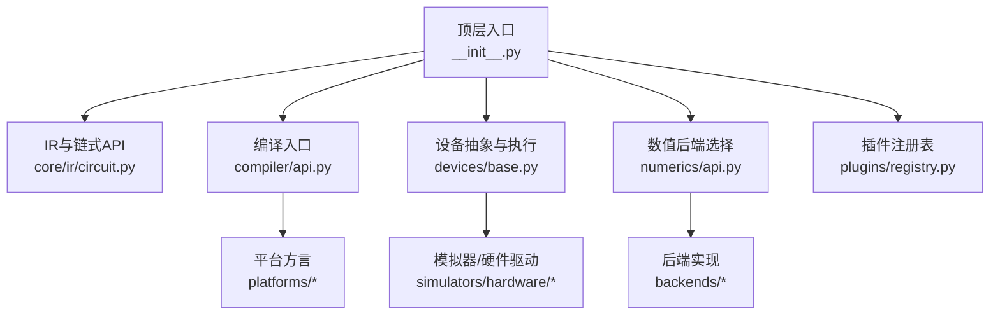
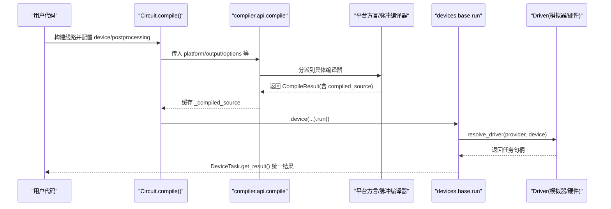
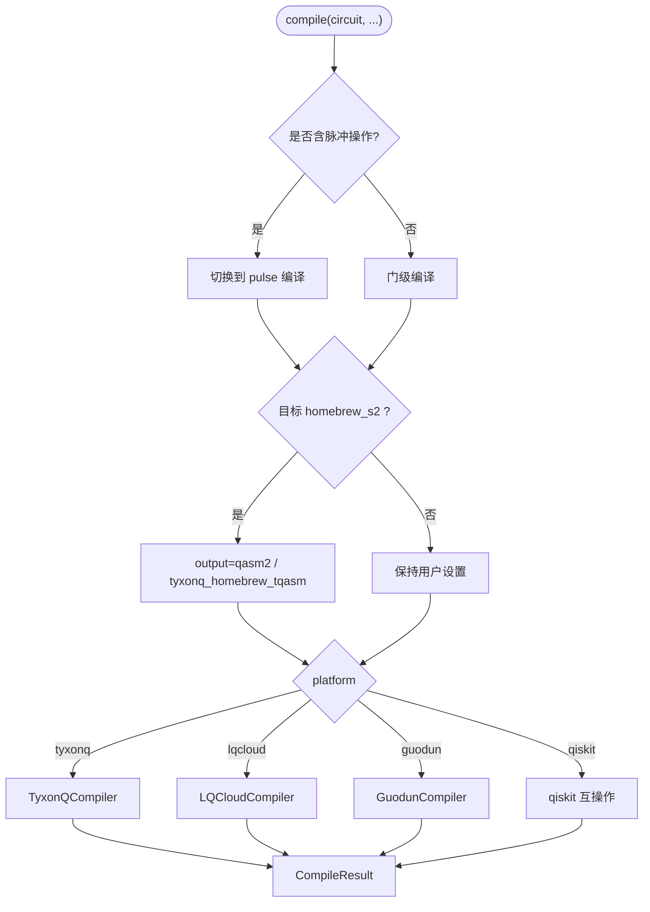
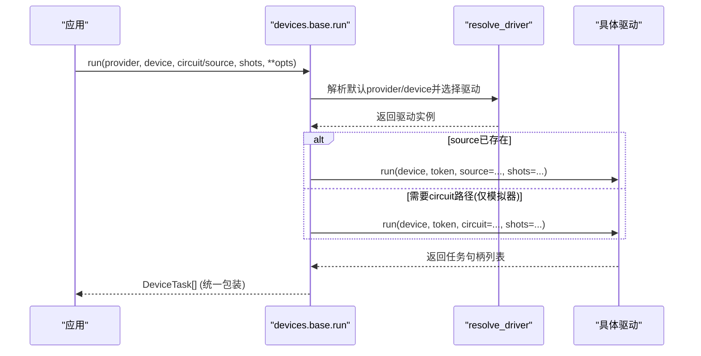
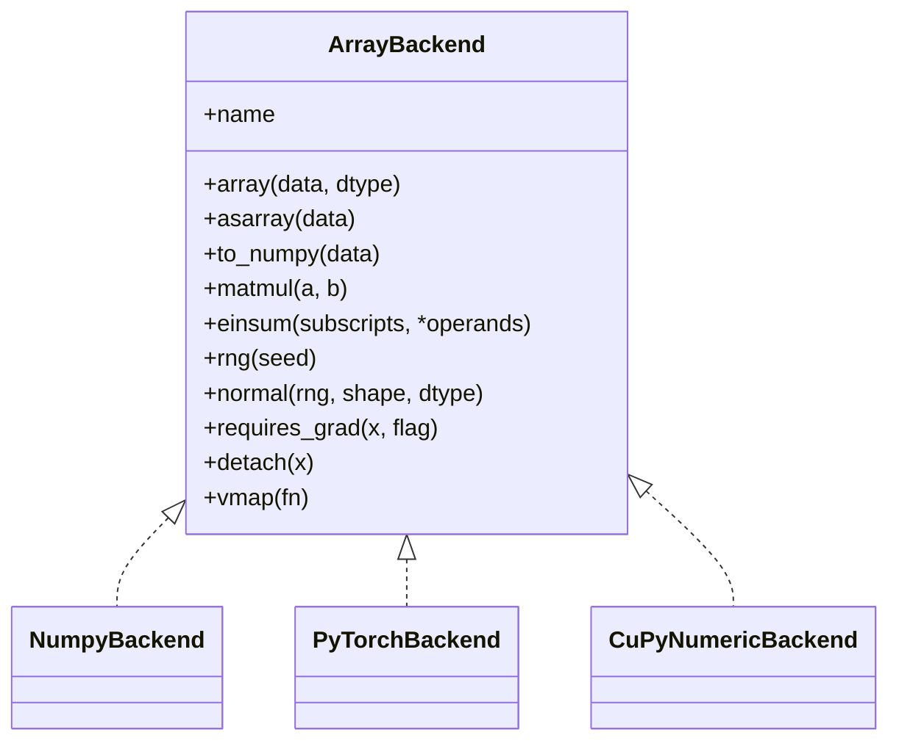
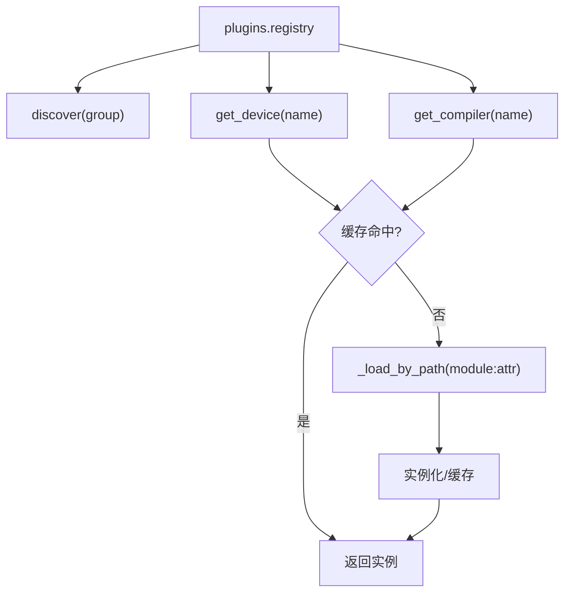
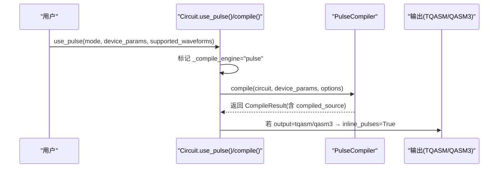
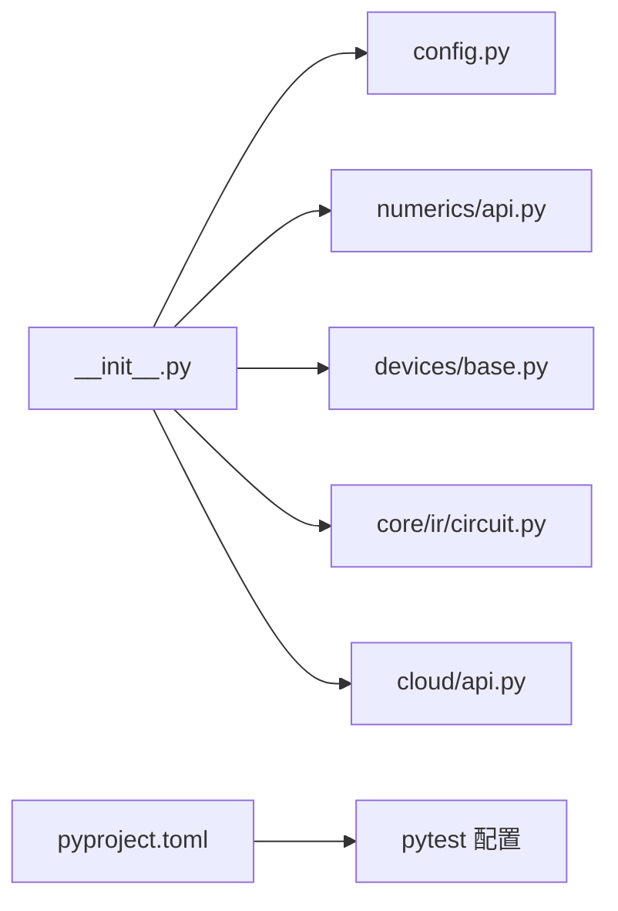

# 开发者指南

<cite>
**本文引用的文件**
- [README.md](file://README.md)
- [pyproject.toml](file://pyproject.toml)
- [src/tyxonq/__init__.py](file://src/tyxonq/__init__.py)
- [src/tyxonq/config.py](file://src/tyxonq/config.py)
- [src/tyxonq/compiler/api.py](file://src/tyxonq/compiler/api.py)
- [src/tyxonq/devices/base.py](file://src/tyxonq/devices/base.py)
- [src/tyxonq/numerics/api.py](file://src/tyxonq/numerics/api.py)
- [src/tyxonq/plugins/registry.py](file://src/tyxonq/plugins/registry.py)
- [src/tyxonq/core/ir/circuit.py](file://src/tyxonq/core/ir/circuit.py)
- [docs/source/developer_guide/testing_guidelines.rst](file://docs/source/developer_guide/testing_guidelines.rst)
- [docs/source/developer_guide/contributing.rst](file://docs/source/developer_guide/contributing.rst)
</cite>

## 目录
1. [简介](#简介)
2. [项目结构](#项目结构)
3. [核心组件](#核心组件)
4. [架构总览](#架构总览)
5. [详细组件分析](#详细组件分析)
6. [依赖关系分析](#依赖关系分析)
7. [性能与内存管理](#性能与内存管理)
8. [测试策略与质量保证](#测试策略与质量保证)
9. [代码规范与贡献流程](#代码规范与贡献流程)
10. [API设计与向后兼容](#api设计与向后兼容)
11. [部署与发布流程](#部署与发布流程)
12. [调试与性能分析工具](#调试与性能分析工具)
13. [社区参与与协作](#社区参与与协作)
14. [结论](#结论)

## 简介
本指南面向贡献者与高级用户，系统化阐述 TyxonQ 的架构设计原则、插件机制、数值后端扩展、测试与质量保障、代码规范与贡献流程、性能分析与调试方法、API 设计与兼容性、以及部署发布与社区协作实践。TyxonQ 提供稳定的 IR、可插拔编译器、统一设备抽象（模拟器与硬件）、单一数值后端接口（NumPy/PyTorch/CuPyNumeric），以及面向设备运行时的后处理管线，支持从门级到脉冲级的完整开发路径。

## 项目结构
仓库采用“功能域 + 层次化”组织：
- src/tyxonq：核心框架实现，包含 IR、编译器、设备抽象、数值后端、后处理、可视化等
- examples：丰富的示例与基准脚本
- docs：Sphinx 文档源与多语言翻译
- tests_*：分层测试集（核心模块、示例、应用化学、分子验证）
- scripts：辅助脚本（如性能分析）

图表来源
- [src/tyxonq/__init__.py:136-183](file://src/tyxonq/__init__.py#L136-L183)
- [src/tyxonq/compiler/api.py:39-98](file://src/tyxonq/compiler/api.py#L39-L98)
- [src/tyxonq/devices/base.py:146-258](file://src/tyxonq/devices/base.py#L146-L258)
- [src/tyxonq/numerics/api.py:179-252](file://src/tyxonq/numerics/api.py#L179-L252)

章节来源
- [README.md:191-218](file://README.md#L191-L218)
- [pyproject.toml:78-91](file://pyproject.toml#L78-L91)

## 核心组件
- 电路 IR 与链式 API：Circuit 提供 compile().device(...).postprocessing(...).run() 的链式调用；支持噪声模型、脉冲模式、状态获取等。
- 编译器：统一的 compile() 入口，按 platform/output/basis_gates/decompose/route/optimize/simplify/device_rule/options 装配步骤，并分发至各平台方言或脉冲编译器。
- 设备抽象：DeviceTask/DeviceRule/run/expval 等统一任务与结果格式；resolve_driver 根据 provider/device 动态加载驱动；内置噪声开关与参数注入。
- 数值后端：ArrayBackend 协议统一数组/张量操作；get_backend/set_backend 支持 numpy/pytorch/cupynumeric；vectorize_or_fallback 提供向量化策略与回退。
- 插件系统：registry 提供 discover/get_device/get_compiler 的动态加载与缓存能力，为未来 entry points 扩展预留接口。

章节来源
- [src/tyxonq/core/ir/circuit.py:48-139](file://src/tyxonq/core/ir/circuit.py#L48-L139)
- [src/tyxonq/compiler/api.py:39-98](file://src/tyxonq/compiler/api.py#L39-L98)
- [src/tyxonq/devices/base.py:12-109](file://src/tyxonq/devices/base.py#L12-L109)
- [src/tyxonq/numerics/api.py:19-122](file://src/tyxonq/numerics/api.py#L19-L122)
- [src/tyxonq/plugins/registry.py:10-62](file://src/tyxonq/plugins/registry.py#L10-L62)

## 架构总览
TyxonQ 采用“稳定 IR + 可插拔编译器 + 统一设备抽象 + 单一数值后端”的分层架构：
- IR 层：Circuit/PulseProgram 作为中间表示，屏蔽底层差异
- 编译层：gate_compiler 核心步骤（规范化→分解→路由→优化→简化）+ 平台方言（tyxonq/lqcloud/guodun/qiskit互操作）+ 脉冲编译器（Gate→Pulse→TQASM）
- 设备层：统一 Device 协议与 Driver 工厂，支持模拟器与多家硬件
- 数值层：ArrayBackend 协议，统一 NumPy/PyTorch/CuPyNumeric 计算
- 后处理层：counts→期望值/概率/指标的统一处理

图表来源
- [src/tyxonq/core/ir/circuit.py:780-800](file://src/tyxonq/core/ir/circuit.py#L780-L800)
- [src/tyxonq/compiler/api.py:39-98](file://src/tyxonq/compiler/api.py#L39-L98)
- [src/tyxonq/devices/base.py:294-445](file://src/tyxonq/devices/base.py#L294-L445)

## 详细组件分析

### 编译器与平台方言
- 统一入口 compile() 接收类型化参数，自动检测脉冲操作并切换 pulse 编译；对 homebrew_s2 设备强制 qasm2/tyxonq_homebrew_tqasm 输出；将 basis_gates/optimize/simplify 等透传给核心步骤与平台方言。
- 平台方言：tyxonq（核心）、lqcloud、guodun、qiskit（互操作别名）。各平台在各自 compiler.py 中委托 gate_compiler 核心后再翻译为本方言。

图表来源
- [src/tyxonq/compiler/api.py:100-218](file://src/tyxonq/compiler/api.py#L100-L218)
- [src/tyxonq/compiler/api.py:219-340](file://src/tyxonq/compiler/api.py#L219-L340)

章节来源
- [src/tyxonq/compiler/api.py:39-98](file://src/tyxonq/compiler/api.py#L39-L98)
- [src/tyxonq/compiler/api.py:100-218](file://src/tyxonq/compiler/api.py#L100-L218)
- [src/tyxonq/compiler/api.py:219-340](file://src/tyxonq/compiler/api.py#L219-L340)

### 设备抽象与执行
- DeviceTask 封装 provider/device/handle/async_result，并提供 get_result() 统一结果格式（result/result_meta/metadata/probabilities/expectations）。
- resolve_driver 根据 provider 动态导入对应驱动；run() 负责注入噪声、归一化 shots、批量提交、异步等待与超时告警。
- expval() 提供模拟器/本地的解析期望值快速路径。

图表来源
- [src/tyxonq/devices/base.py:12-58](file://src/tyxonq/devices/base.py#L12-L58)
- [src/tyxonq/devices/base.py:146-258](file://src/tyxonq/devices/base.py#L146-L258)
- [src/tyxonq/devices/base.py:294-445](file://src/tyxonq/devices/base.py#L294-L445)

章节来源
- [src/tyxonq/devices/base.py:12-109](file://src/tyxonq/devices/base.py#L12-L109)
- [src/tyxonq/devices/base.py:294-445](file://src/tyxonq/devices/base.py#L294-L445)

### 数值后端与向量化
- ArrayBackend 协议定义统一数组/张量接口（创建、代数、随机、线性代数、可选 vmap/autograd 桥接）。
- get_backend(name) 支持通过名称或全局配置获取后端实例；set_backend 在顶层暴露便捷切换。
- vectorize_or_fallback 提供 auto/force/off 策略，优先使用后端 vmap，否则沿首轴元素级回退。

图表来源
- [src/tyxonq/numerics/api.py:19-122](file://src/tyxonq/numerics/api.py#L19-L122)

章节来源
- [src/tyxonq/numerics/api.py:179-252](file://src/tyxonq/numerics/api.py#L179-L252)
- [src/tyxonq/__init__.py:186-276](file://src/tyxonq/__init__.py#L186-L276)

### 插件系统与扩展点
- registry 提供 discover(group)、get_device(name)、get_compiler(name)，基于完全限定路径动态加载并缓存实例，便于后续接入 entry points 与配置文件。
- 当前 discover 返回空映射以稳定接口，实际扩展可通过 get_device/get_compiler 按路径加载自定义设备/编译器。

图表来源
- [src/tyxonq/plugins/registry.py:10-62](file://src/tyxonq/plugins/registry.py#L10-L62)

章节来源
- [src/tyxonq/plugins/registry.py:10-62](file://src/tyxonq/plugins/registry.py#L10-L62)

### 脉冲编程与 TQASM 导出
- Circuit.use_pulse() 启用脉冲编译模式（hybrid/pulse_only/auto_lower），支持 supported_waveforms、device_params、inline_pulses、output 等选项。
- compile() 检测到脉冲操作或显式模式时自动切换到 pulse 编译，并为 homebrew_s2 设备设置支持的波形限制；当 output 为 tqasm/qasm3 等时自动 inline_pulses=True。
- compile_pulse() 为 PulseProgram 提供平级入口，统一 device_params 补全与输出格式转换。

图表来源
- [src/tyxonq/core/ir/circuit.py:300-372](file://src/tyxonq/core/ir/circuit.py#L300-L372)
- [src/tyxonq/compiler/api.py:100-218](file://src/tyxonq/compiler/api.py#L100-L218)
- [src/tyxonq/compiler/api.py:343-463](file://src/tyxonq/compiler/api.py#L343-L463)

章节来源
- [src/tyxonq/core/ir/circuit.py:300-372](file://src/tyxonq/core/ir/circuit.py#L300-L372)
- [src/tyxonq/compiler/api.py:100-218](file://src/tyxonq/compiler/api.py#L100-L218)
- [src/tyxonq/compiler/api.py:343-463](file://src/tyxonq/compiler/api.py#L343-L463)

## 依赖关系分析
- 顶层入口 __init__.py 提供云 API 重导出、全局默认配置（device/postprocessing/compile）、数值后端切换、噪声控制等便捷函数。
- config.py 集中常量与后端名归一化逻辑（cpu→numpy、gpu→cupynumeric、torch→pytorch）。
- pyproject.toml 声明依赖与可选依赖（lqcloud、guodun、md、dev），并配置 pytest 测试路径与标记。

图表来源
- [src/tyxonq/__init__.py:25-128](file://src/tyxonq/__init__.py#L25-L128)
- [src/tyxonq/config.py:17-94](file://src/tyxonq/config.py#L17-L94)
- [pyproject.toml:25-42](file://pyproject.toml#L25-L42)
- [pyproject.toml:84-91](file://pyproject.toml#L84-L91)

章节来源
- [src/tyxonq/__init__.py:25-128](file://src/tyxonq/__init__.py#L25-L128)
- [src/tyxonq/config.py:17-94](file://src/tyxonq/config.py#L17-L94)
- [pyproject.toml:25-42](file://pyproject.toml#L25-L42)
- [pyproject.toml:84-91](file://pyproject.toml#L84-L91)

## 性能与内存管理
- 数值后端选择：通过 set_backend("numpy"/"pytorch"/"cupynumeric") 切换，GPU 加速需安装 cupynumeric；PyTorch 后端支持 autograd。
- 向量化策略：vectorize_or_fallback 支持 auto/force/off，优先使用后端 vmap，失败则回退到逐元素执行。
- 模拟引擎：statevector/density_matrix/mps 三种引擎，MPS 适合低纠缠态，密度矩阵支持噪声；Circuit.state() 自动选择引擎并按 form 返回后端张量或 numpy。
- 噪声控制：enable_noise/is_noise_enabled/get_noise_config 全局开关；with_noise() 便捷配置密度矩阵模拟器噪声。
- 内存建议：大电路优先 MPS；批处理时注意 shots 列表长度匹配；避免重复编译，利用 _compiled_source 缓存。

章节来源
- [src/tyxonq/numerics/api.py:124-177](file://src/tyxonq/numerics/api.py#L124-L177)
- [src/tyxonq/core/ir/circuit.py:427-541](file://src/tyxonq/core/ir/circuit.py#L427-L541)
- [src/tyxonq/devices/base.py:274-292](file://src/tyxonq/devices/base.py#L274-L292)
- [src/tyxonq/core/ir/circuit.py:241-297](file://src/tyxonq/core/ir/circuit.py#L241-L297)

## 测试策略与质量保证
- 分层测试：单元（核心功能）、集成（组件/工作流）、端到端（完整业务场景）、性能回归。
- 测试组织：tests_core_module、tests_examples、tests_applications_chem、tests_mol_valid；pytest 配置在 pyproject.toml。
- 最佳实践：使用真实 API、跨后端验证、覆盖错误与边界条件、资源清理、固定随机种子、性能监控。
- CI 建议：多 Python 版本矩阵、覆盖率上报、并行执行。

章节来源
- [docs/source/developer_guide/testing_guidelines.rst:10-32](file://docs/source/developer_guide/testing_guidelines.rst#L10-L32)
- [docs/source/developer_guide/testing_guidelines.rst:386-464](file://docs/source/developer_guide/testing_guidelines.rst#L386-L464)
- [pyproject.toml:84-91](file://pyproject.toml#L84-L91)

## 代码规范与贡献流程
- 分支模型：main（稳定）、develop（集成）、feature/*、bugfix/*、hotfix/*。
- 提交信息：type(scope): brief description，支持 feat/fix/docs/style/refactor/test/perf/chore。
- 代码风格：black/flake8/mypy；行宽、缩进、引号、import 排序有约定。
- PR 流程：更新分支、运行全量测试、检查样式与类型、更新文档、模板描述变更与影响。
- 社区沟通：GitHub Discussions/Issues、月度开发者会议、行为准则与响应预期。

章节来源
- [docs/source/developer_guide/contributing.rst:144-243](file://docs/source/developer_guide/contributing.rst#L144-L243)
- [docs/source/developer_guide/contributing.rst:244-365](file://docs/source/developer_guide/contributing.rst#L244-L365)
- [docs/source/developer_guide/contributing.rst:366-453](file://docs/source/developer_guide/contributing.rst#L366-L453)
- [docs/source/developer_guide/contributing.rst:454-522](file://docs/source/developer_guide/contributing.rst#L454-L522)

## API设计与向后兼容
- 顶层便捷函数：set_token/submit_task/run 重导出自 cloud.api；device/postprocessing/compile 全局默认设置；set_backend/get_backend/set_dtype 统一数值后端。
- 兼容别名：tyxonq.api/apis 指向 cloud.apis；compile_engine 过渡别名等价于 platform；qiskit 平台为互操作别名而非硬件平台。
- 结果标准化：DeviceTask.get_result() 提升 result_meta/metadata 字段，确保下游后处理一致性。
- 向后兼容：保留旧调用方式（如无 output 时 qiskit 互操作默认输出对象），同时鼓励显式指定 platform/output。

章节来源
- [src/tyxonq/__init__.py:25-128](file://src/tyxonq/__init__.py#L25-L128)
- [src/tyxonq/__init__.py:145-183](file://src/tyxonq/__init__.py#L145-L183)
- [src/tyxonq/__init__.py:186-276](file://src/tyxonq/__init__.py#L186-L276)
- [src/tyxonq/devices/base.py:12-58](file://src/tyxonq/devices/base.py#L12-L58)
- [src/tyxonq/compiler/api.py:190-218](file://src/tyxonq/compiler/api.py#L190-L218)

## 部署与发布流程
- 包元数据：pyproject.toml 定义 name/version/description/dependencies/urls/build-system。
- 构建与安装：支持 pip install tyxonq 或 uv build + pip install wheel；可选依赖通过 extras 安装（lqcloud、guodun、md、dev）。
- 文档构建：docs/Makefile/make.bat 与 requirements-doc.txt；conf.py 配置 Sphinx。
- 发布建议：遵循语义化版本；在 main 分支打 tag；通过 twine 上传；更新 README 与 CHANGELOG。

章节来源
- [pyproject.toml:1-42](file://pyproject.toml#L1-L42)
- [pyproject.toml:44-66](file://pyproject.toml#L44-L66)
- [pyproject.toml:67-91](file://pyproject.toml#L67-L91)
- [README.md:109-120](file://README.md#L109-L120)

## 调试与性能分析工具
- 运行时调试：DeviceTask.get_result() 提供 uni_status/error 字段；异步任务等待超时会发出 RuntimeWarning 提示排队/耗时过长。
- 性能分析：examples 与 docs 提供 benchmark/profile_memory 等工具；建议使用 statevector/density_matrix/mps 引擎对比不同后端；对大电路优先 MPS。
- 噪声调试：enable_noise/is_noise_enabled/get_noise_config 查看全局噪声配置；with_noise() 快速注入噪声模型。
- 编译诊断：compile() 返回 metadata 与 compiled_source；homebrew_s2 设备自动设置 basis_gates 与 output，便于定位问题。

章节来源
- [src/tyxonq/devices/base.py:497-558](file://src/tyxonq/devices/base.py#L497-L558)
- [docs/source/user_guide/advanced/index.rst:669-712](file://docs/source/user_guide/advanced/index.rst#L669-L712)
- [src/tyxonq/devices/base.py:274-292](file://src/tyxonq/devices/base.py#L274-L292)
- [src/tyxonq/compiler/api.py:169-186](file://src/tyxonq/compiler/api.py#L169-L186)

## 社区参与与协作
- 贡献类型：Bug 报告、功能请求、文档改进、代码贡献、测试增强、性能优化、示例编写。
- 入门路径：阅读贡献指南、浏览 issues 标签、加入讨论与会议、从小处着手。
- 认可与晋升：贡献者名单、发布说明、GitHub 活动可见、社区表彰、会议机会；维护者路径包括持续高质量贡献、社区参与、领域专长、指导新人。
- 沟通渠道：Discussions/Issues/PR Comments/月度会议；维护者响应预期与紧急问题处理。

章节来源
- [docs/source/developer_guide/contributing.rst:15-48](file://docs/source/developer_guide/contributing.rst#L15-L48)
- [docs/source/developer_guide/contributing.rst:490-522](file://docs/source/developer_guide/contributing.rst#L490-L522)
- [docs/source/developer_guide/contributing.rst:454-489](file://docs/source/developer_guide/contributing.rst#L454-L489)

## 结论
TyxonQ 以稳定 IR 与可插拔编译器为核心，结合统一设备抽象与单一数值后端，提供了从门级到脉冲级的完整量子软件开发路径。通过清晰的插件机制、严格的测试与质量保障、规范的贡献流程与完善的性能工具，开发者可以高效扩展设备、编译器阶段与后处理方法，并安全地进行数值后端定制。遵循本文档的实践，可在保证向后兼容的前提下，持续优化性能与内存使用，推动框架在生产环境中的可靠落地。