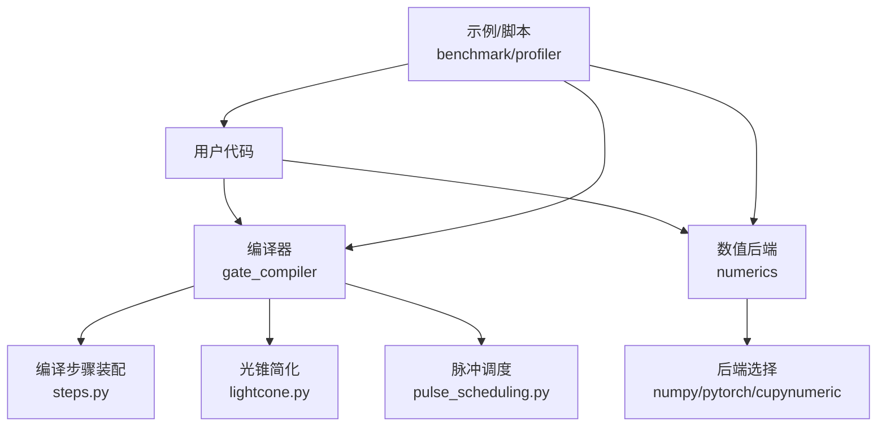
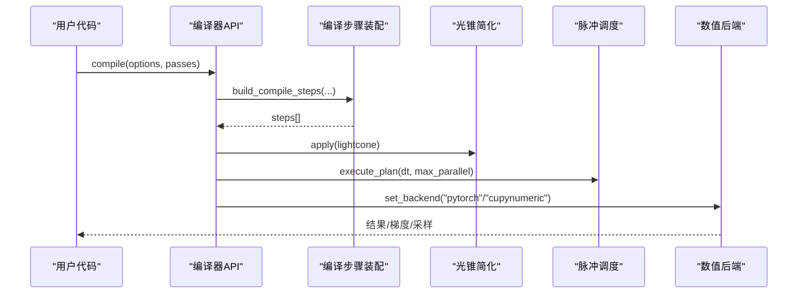
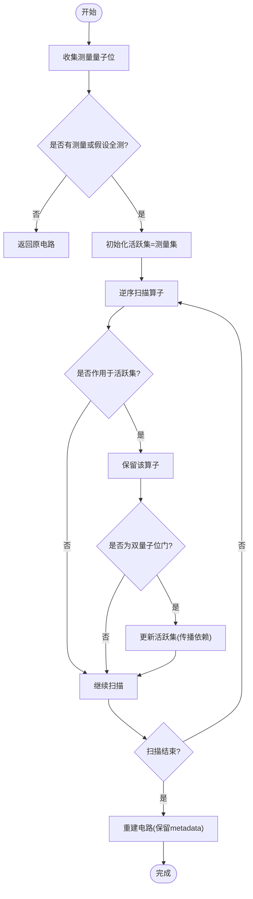
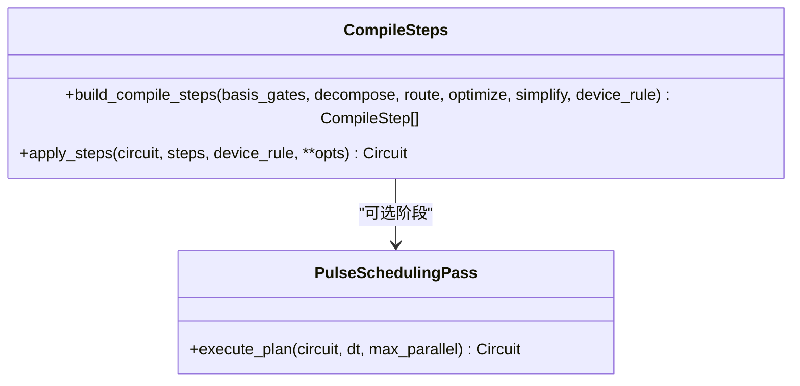
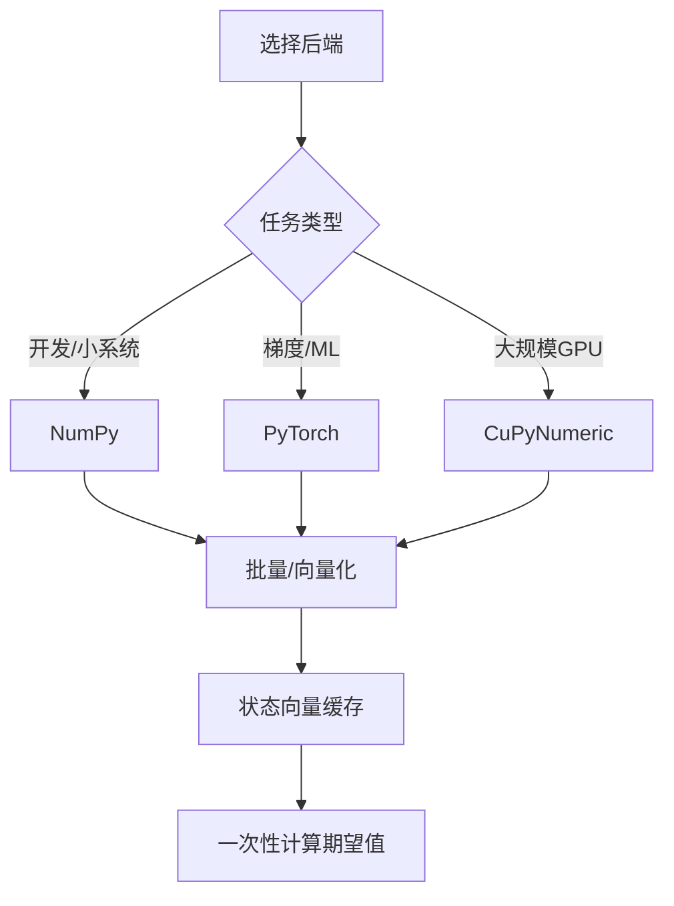
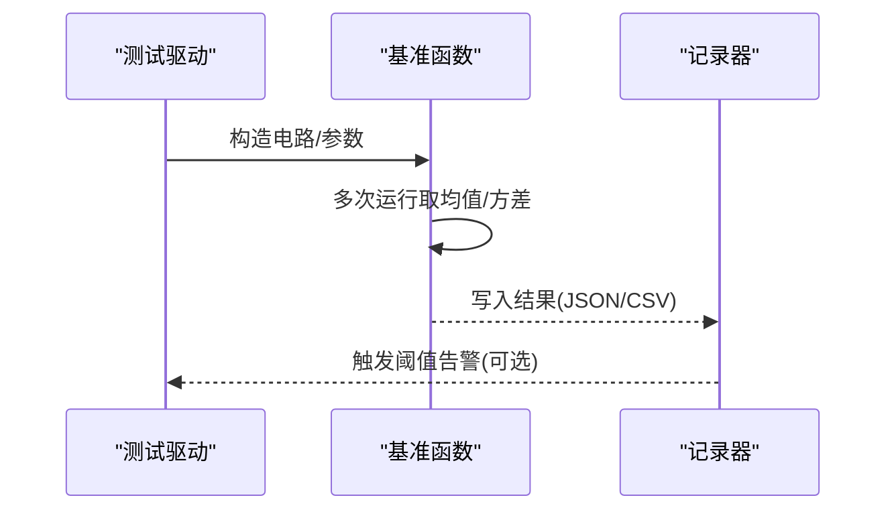
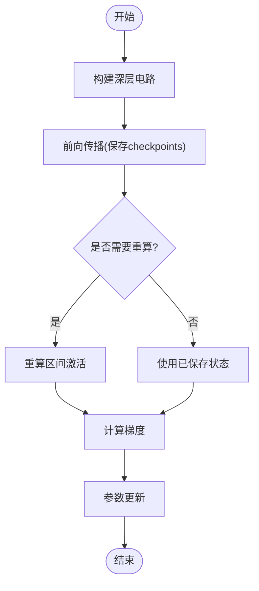
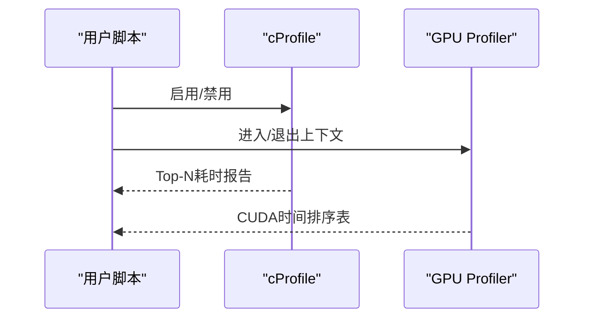
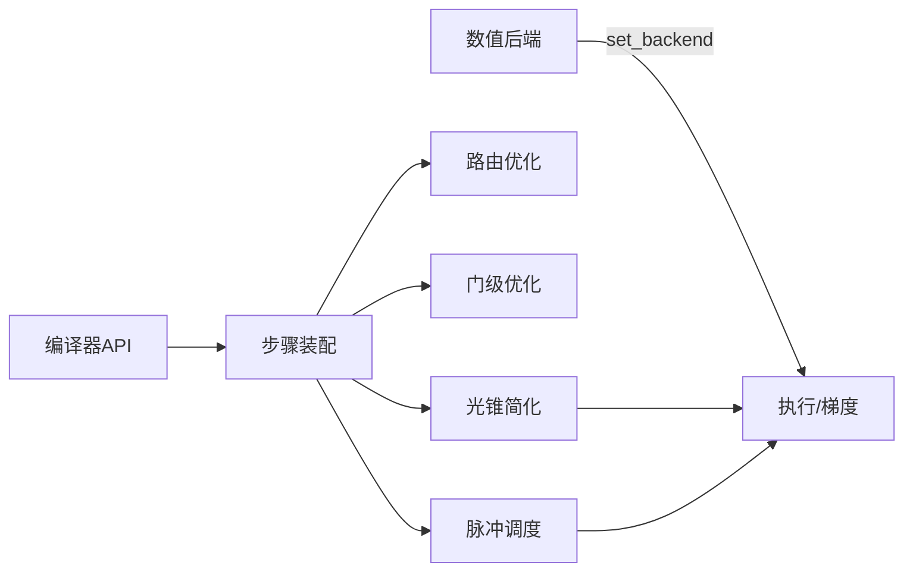

# 性能优化指南

<cite>
**本文引用的文件**
- [performance_optimization.rst](file://docs/source/technical_references/performance_optimization.rst)
- [performance_optimization_tips.md](file://examples/performance_optimization_tips.md)
- [lightcone.py](file://src/tyxonq/compiler/gate_compiler/stages/simplify/lightcone.py)
- [compiler_lightcone_optimization.py](file://examples/compiler_lightcone_optimization.py)
- [test_compiler_simplify_lightcone.py](file://tests_core_module/test_compiler_simplify_lightcone.py)
- [memory_optimization_checkpointing.py](file://examples/memory_optimization_checkpointing.py)
- [profile_chem.py](file://scripts/profile_chem.py)
- [sample_benchmark.py](file://examples/sample_benchmark.py)
- [gradient_benchmark.py](file://examples/gradient_benchmark.py)
- [index.rst（高级用户指南）](file://docs/source/user_guide/advanced/index.rst)
- [steps.py](file://src/tyxonq/compiler/gate_compiler/steps.py)
- [compiler.py](file://src/tyxonq/compiler/gate_compiler/compiler.py)
- [pulse_scheduling.py](file://src/tyxonq/compiler/pulse_compiler/native/pulse_scheduling.py)
- [api.py（编译器API）](file://src/tyxonq/compiler/api.py)
</cite>

## 目录
1. [简介](#简介)
2. [项目结构](#项目结构)
3. [核心组件](#核心组件)
4. [架构总览](#架构总览)
5. [详细组件分析](#详细组件分析)
6. [依赖关系分析](#依赖关系分析)
7. [性能注意事项](#性能注意事项)
8. [故障排查指南](#故障排查指南)
9. [结论](#结论)
10. [附录](#附录)

## 简介
本指南面向TyxonQ用户与开发者，系统阐述如何对量子应用进行端到端性能优化。内容覆盖：
- 性能分析工具：profiler、内存分析器、CPU/GPU利用率监控
- 量子电路优化：门序列简化、并行化策略、内存优化技巧
- 数值计算优化：数组操作优化、批量处理、GPU加速配置
- 编译器优化选项：光锥简化、路由优化、指令调度
- 基准测试方法：基准套件、回归检测、对比分析
- 内存管理最佳实践：内存池使用、垃圾回收调优、大对象处理
- 常见问题诊断与解决方案

## 项目结构
TyxonQ将性能相关能力分布在文档、示例、编译器与数值后端中：
- 文档层：技术参考与用户指南提供方法论与最佳实践
- 编译器层：门级编译步骤、脉冲调度、光锥简化等
- 数值层：多后端（NumPy/PyTorch/CuPyNumeric）与批处理/向量化
- 示例与脚本：可复现实验、基准与profiling流程

图表来源
- [steps.py:1-36](file://src/tyxonq/compiler/gate_compiler/steps.py#L1-L36)
- [lightcone.py:12-97](file://src/tyxonq/compiler/gate_compiler/stages/simplify/lightcone.py#L12-L97)
- [pulse_scheduling.py:24-66](file://src/tyxonq/compiler/pulse_compiler/native/pulse_scheduling.py#L24-L66)
- [index.rst（高级用户指南）:669-759](file://docs/source/user_guide/advanced/index.rst#L669-L759)

章节来源
- [performance_optimization.rst:1-476](file://docs/source/technical_references/performance_optimization.rst#L1-L476)
- [index.rst（高级用户指南）:42-73](file://docs/source/user_guide/advanced/index.rst#L42-L73)

## 核心组件
- 编译器管线：通过类型化参数装配编译步骤，顺序执行规范化→分解→路由→优化→化简
- 光锥简化：基于测量点反向追踪活跃量子位集合，裁剪无关门，保留测量与必要依赖
- 脉冲调度：在脉冲级构建依赖图，按硬件约束最大化并行度
- 数值后端：统一ArrayBackend协议，支持NumPy/PyTorch/CuPyNumeric，便于GPU加速与自动微分
- 基准与profiling：内置计时框架、cProfile集成、GPU时序统计

章节来源
- [compiler.py:57-74](file://src/tyxonq/compiler/gate_compiler/compiler.py#L57-L74)
- [steps.py:1-36](file://src/tyxonq/compiler/gate_compiler/steps.py#L1-L36)
- [lightcone.py:12-97](file://src/tyxonq/compiler/gate_compiler/stages/simplify/lightcone.py#L12-L97)
- [pulse_scheduling.py:24-66](file://src/tyxonq/compiler/pulse_compiler/native/pulse_scheduling.py#L24-L66)
- [index.rst（高级用户指南）:669-759](file://docs/source/user_guide/advanced/index.rst#L669-L759)

## 架构总览
下图展示从用户代码到执行路径的关键环节，包括编译器优化与数值后端选择。

图表来源
- [compiler.py:57-74](file://src/tyxonq/compiler/gate_compiler/compiler.py#L57-L74)
- [steps.py:27-36](file://src/tyxonq/compiler/gate_compiler/steps.py#L27-L36)
- [lightcone.py:15-97](file://src/tyxonq/compiler/gate_compiler/stages/simplify/lightcone.py#L15-L97)
- [pulse_scheduling.py:43-66](file://src/tyxonq/compiler/pulse_compiler/native/pulse_scheduling.py#L43-L66)
- [api.py（编译器API）:122-147](file://src/tyxonq/compiler/api.py#L122-L147)

## 详细组件分析

### 量子电路优化：光锥简化
- 原理：收集测量量子位，自后向前扫描，维护“活跃”量子位集合；遇到两量子位门时传播依赖；仅保留影响测量的门与显式测量
- 适用场景：稀疏测量或仅关注部分量子位期望值时显著减少门数
- 正确性：数学等价于未裁剪电路；当assume_measure_all=True且全量测量时等价于恒等变换

图表来源
- [lightcone.py:15-97](file://src/tyxonq/compiler/gate_compiler/stages/simplify/lightcone.py#L15-L97)

章节来源
- [lightcone.py:12-97](file://src/tyxonq/compiler/gate_compiler/stages/simplify/lightcone.py#L12-L97)
- [test_compiler_simplify_lightcone.py:1-22](file://tests_core_module/test_compiler_simplify_lightcone.py#L1-L22)
- [performance_optimization.rst:67-83](file://docs/source/technical_references/performance_optimization.rst#L67-L83)

### 编译器优化选项：路由与指令调度
- 路由优化：根据设备拓扑与基元门集，插入SWAP或重布线以减少连接开销
- 指令调度：脉冲级依赖图构建，限制最大并行度，按dt步进安排脉冲时序，提升吞吐

图表来源
- [steps.py:27-36](file://src/tyxonq/compiler/gate_compiler/steps.py#L27-L36)
- [pulse_scheduling.py:24-66](file://src/tyxonq/compiler/pulse_compiler/native/pulse_scheduling.py#L24-L66)

章节来源
- [compiler.py:57-74](file://src/tyxonq/compiler/gate_compiler/compiler.py#L57-L74)
- [steps.py:1-36](file://src/tyxonq/compiler/gate_compiler/steps.py#L1-L36)
- [pulse_scheduling.py:24-66](file://src/tyxonq/compiler/pulse_compiler/native/pulse_scheduling.py#L24-L66)

### 数值计算优化：后端选择与批量处理
- 后端选择：开发用NumPy，梯度优化用PyTorch，大规模GPU用CuPyNumeric
- 批量处理：利用vmap/jit与状态向量缓存，避免重复电路执行
- 张量收缩：复杂张量网络优先使用opt_einsum路径

图表来源
- [performance_optimization.rst:100-171](file://docs/source/technical_references/performance_optimization.rst#L100-L171)
- [performance_optimization_tips.md:1-223](file://examples/performance_optimization_tips.md#L1-L223)

章节来源
- [performance_optimization.rst:100-171](file://docs/source/technical_references/performance_optimization.rst#L100-L171)
- [performance_optimization_tips.md:1-223](file://examples/performance_optimization_tips.md#L1-L223)

### 性能基准与回归检测
- 基准套件：采样基准、梯度基准、光锥优化效率基准
- 指标：编译时间、运行时间、总shots、门数、内存峰值、端到端延迟
- 回归检测：固定随机种子与问题规模，比较关键指标阈值

图表来源
- [sample_benchmark.py:1-91](file://examples/sample_benchmark.py#L1-L91)
- [gradient_benchmark.py:1-320](file://examples/gradient_benchmark.py#L1-L320)
- [compiler_lightcone_optimization.py:97-159](file://examples/compiler_lightcone_optimization.py#L97-L159)

章节来源
- [sample_benchmark.py:1-91](file://examples/sample_benchmark.py#L1-L91)
- [gradient_benchmark.py:1-320](file://examples/gradient_benchmark.py#L1-L320)
- [compiler_lightcone_optimization.py:97-159](file://examples/compiler_lightcone_optimization.py#L97-L159)

### 内存管理与深度电路训练
- 梯度检查点：以空间换时间，仅在checkpoint处保存中间态，反向时重算
- 适用条件：深层电路、大比特数、内存受限环境
- 与PyTorch集成：使用checkpoint包装层函数，自动处理重计算

图表来源
- [memory_optimization_checkpointing.py:1-280](file://examples/memory_optimization_checkpointing.py#L1-L280)

章节来源
- [memory_optimization_checkpointing.py:1-280](file://examples/memory_optimization_checkpointing.py#L1-L280)
- [performance_optimization.rst:279-325](file://docs/source/technical_references/performance_optimization.rst#L279-L325)

### Profiler与内存分析器使用
- Python内置profiler：cProfile+pstats输出Top耗时函数
- GPU时序：PyTorch profiler统计CUDA时间
- 自定义装饰器：记录CPU/GPU内存变化与执行时间

图表来源
- [profile_chem.py:1-101](file://scripts/profile_chem.py#L1-L101)
- [index.rst（高级用户指南）:669-759](file://docs/source/user_guide/advanced/index.rst#L669-L759)

章节来源
- [profile_chem.py:1-101](file://scripts/profile_chem.py#L1-L101)
- [index.rst（高级用户指南）:669-759](file://docs/source/user_guide/advanced/index.rst#L669-L759)

## 依赖关系分析
编译器与数值后端之间的耦合主要体现在：
- 编译器步骤装配依赖类型化参数，决定是否启用路由/优化/简化
- 光锥简化依赖测量标记与门类型识别
- 脉冲调度依赖dt与max_parallel等运行时参数
- 数值后端通过统一接口被上层调用，屏蔽实现差异

图表来源
- [api.py（编译器API）:122-147](file://src/tyxonq/compiler/api.py#L122-L147)
- [steps.py:27-36](file://src/tyxonq/compiler/gate_compiler/steps.py#L27-L36)
- [lightcone.py:15-97](file://src/tyxonq/compiler/gate_compiler/stages/simplify/lightcone.py#L15-L97)
- [pulse_scheduling.py:43-66](file://src/tyxonq/compiler/pulse_compiler/native/pulse_scheduling.py#L43-L66)

章节来源
- [api.py（编译器API）:122-147](file://src/tyxonq/compiler/api.py#L122-L147)
- [steps.py:1-36](file://src/tyxonq/compiler/gate_compiler/steps.py#L1-L36)

## 性能注意事项
- 选择合适的执行路径：设备路径用于硬件验证，数值路径用于快速迭代
- 充分利用编译器：测量分组、shot调度、光锥简化、路由优化
- 合理选择后端：NumPy/PyTorch/CuPyNumeric按场景切换
- 避免重复电路执行：缓存状态向量，一次性计算期望值
- 监控内存：长进程定期清理缓存与中间态
- 基准先行：先度量再优化，建立回归阈值

章节来源
- [performance_optimization.rst:8-18](file://docs/source/technical_references/performance_optimization.rst#L8-L18)
- [performance_optimization.rst:433-455](file://docs/source/technical_references/performance_optimization.rst#L433-L455)
- [performance_optimization_tips.md:1-223](file://examples/performance_optimization_tips.md#L1-L223)

## 故障排查指南
- 症状：VQE每步慢
  - 原因：每次expectation重新执行电路
  - 解决：缓存状态向量或使用Hamiltonian对象一次性计算
- 症状：内存溢出
  - 原因：深层电路+大比特数
  - 解决：梯度检查点、MPS模拟、active space近似
- 症状：编译时间长
  - 原因：未启用路由/简化或过度优化
  - 解决：按需启用编译步骤，调整optimization_level
- 症状：GPU利用率低
  - 原因：批次过小或频繁CPU-GPU拷贝
  - 解决：增大batch、使用CuPyNumeric、减少host-device同步

章节来源
- [performance_optimization_tips.md:1-223](file://examples/performance_optimization_tips.md#L1-L223)
- [memory_optimization_checkpointing.py:1-280](file://examples/memory_optimization_checkpointing.py#L1-L280)
- [performance_optimization.rst:433-455](file://docs/source/technical_references/performance_optimization.rst#L433-L455)

## 结论
TyxonQ提供多层优化杠杆：编译器驱动的测量分组与光锥简化、数值后端的选择与批处理、脉冲级调度与路由优化。结合profiler与基准套件，可在保证正确性的前提下获得显著的性能收益。建议遵循“先度量、后优化”的原则，逐步启用各项优化并持续回归检测。

## 附录
- 常用命令与用法
  - cProfile：python -m cProfile -o profile.stats your_script.py
  - PyTorch profiler：with torch.profiler.profile() as prof: ...
  - 采样基准：python examples/sample_benchmark.py --shots 8192 --repeats 3
  - 梯度基准：python examples/gradient_benchmark.py
  - 化学profiling：python scripts/profile_chem.py

章节来源
- [performance_optimization.rst:372-432](file://docs/source/technical_references/performance_optimization.rst#L372-L432)
- [sample_benchmark.py:70-91](file://examples/sample_benchmark.py#L70-L91)
- [gradient_benchmark.py:283-320](file://examples/gradient_benchmark.py#L283-L320)
- [profile_chem.py:85-101](file://scripts/profile_chem.py#L85-L101)