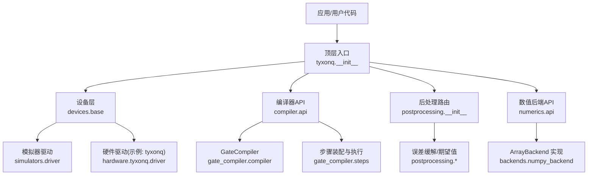
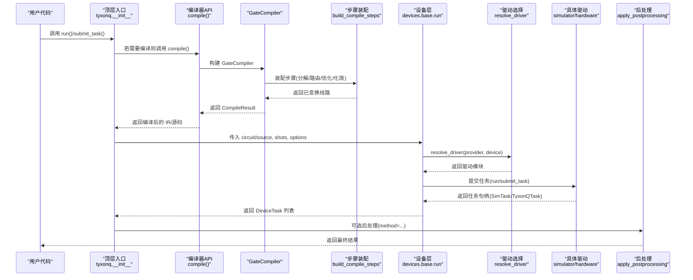
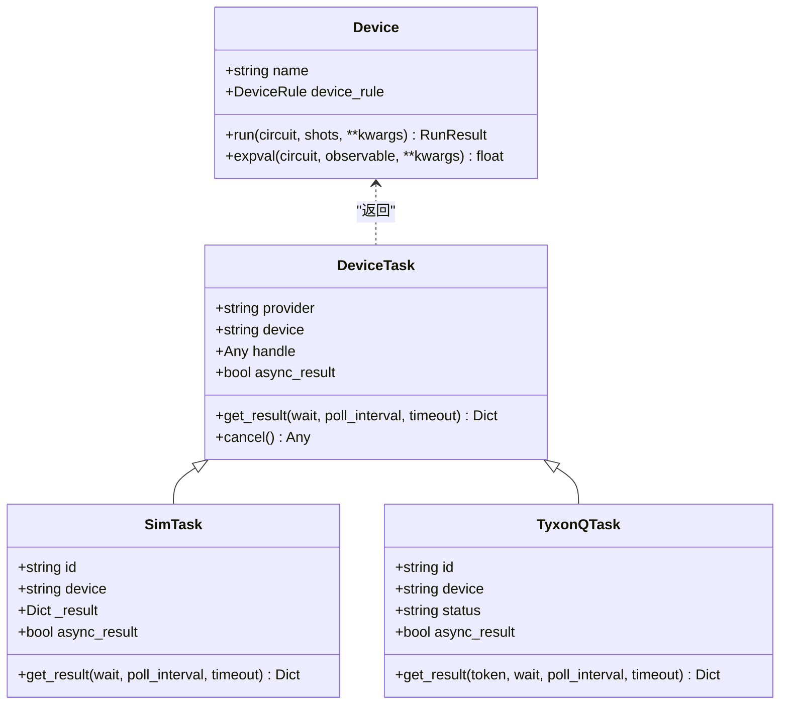
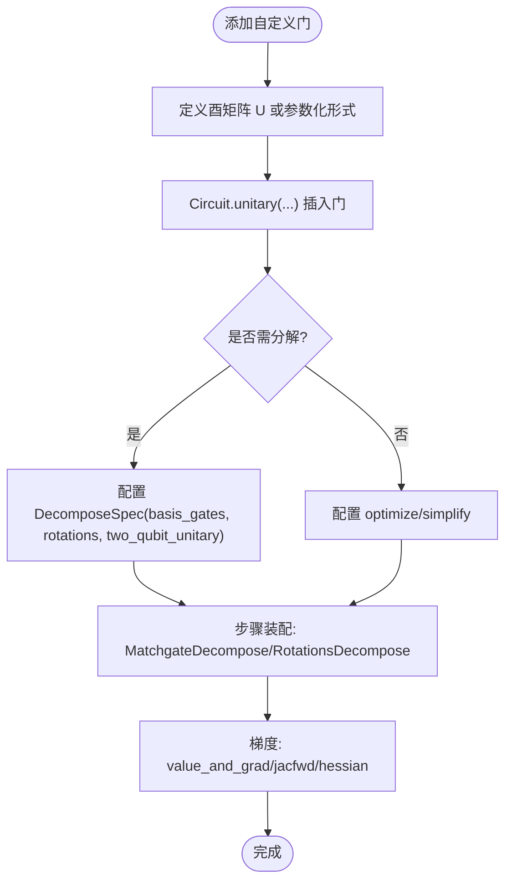
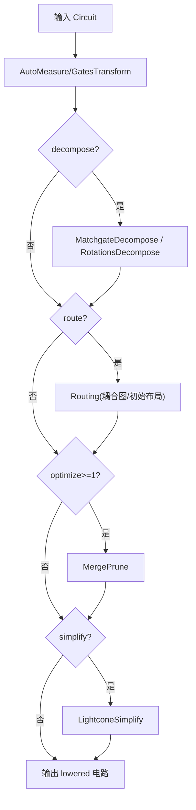
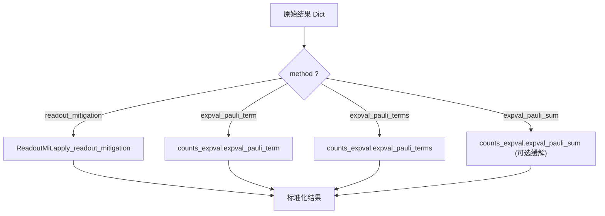
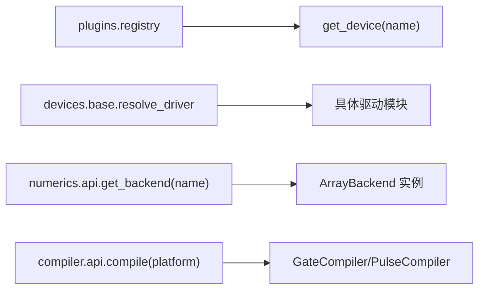
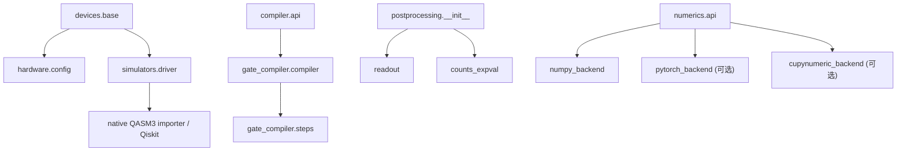

# 扩展开发指南

<cite>
**本文引用的文件**
- [src/tyxonq/__init__.py](file://src/tyxonq/__init__.py)
- [src/tyxonq/plugins/registry.py](file://src/tyxonq/plugins/registry.py)
- [src/tyxonq/devices/base.py](file://src/tyxonq/devices/base.py)
- [src/tyxonq/devices/simulators/driver.py](file://src/tyxonq/devices/simulators/driver.py)
- [src/tyxonq/devices/hardware/config.py](file://src/tyxonq/devices/hardware/config.py)
- [src/tyxonq/devices/hardware/tyxonq/driver.py](file://src/tyxonq/devices/hardware/tyxonq/driver.py)
- [src/tyxonq/compiler/api.py](file://src/tyxonq/compiler/api.py)
- [src/tyxonq/compiler/gate_compiler/compiler.py](file://src/tyxonq/compiler/gate_compiler/compiler.py)
- [src/tyxonq/compiler/gate_compiler/steps.py](file://src/tyxonq/compiler/gate_compiler/steps.py)
- [src/tyxonq/postprocessing/__init__.py](file://src/tyxonq/postprocessing/__init__.py)
- [src/tyxonq/postprocessing/error_mitigation.py](file://src/tyxonq/postprocessing/error_mitigation.py)
- [src/tyxonq/numerics/api.py](file://src/tyxonq/numerics/api.py)
- [src/tyxonq/numerics/backends/numpy_backend.py](file://src/tyxonq/numerics/backends/numpy_backend.py)
- [examples/custom_unitary_gates.py](file://examples/custom_unitary_gates.py)
- [examples/circuit_compiler.py](file://examples/circuit_compiler.py)
</cite>

## 目录
1. [简介](#简介)
2. [项目结构](#项目结构)
3. [核心组件](#核心组件)
4. [架构总览](#架构总览)
5. [详细组件分析](#详细组件分析)
6. [依赖关系分析](#依赖关系分析)
7. [性能考量](#性能考量)
8. [故障排查指南](#故障排查指南)
9. [结论](#结论)
10. [附录：最佳实践与示例](#附录最佳实践与示例)

## 简介
本指南面向希望扩展 TyxonQ 的开发者，覆盖以下主题：
- 自定义设备驱动：接口规范、状态管理、执行流程
- 新增量子门操作：数学定义、梯度计算、优化策略
- 自定义编译器：编译阶段注册、转换规则、优化策略
- 后处理扩展：误差缓解、数据分析、结果格式转换
- 插件注册机制：设备、数值后端、编译器插件的注册与发现
- 完整代码示例与最佳实践

## 项目结构
TyxonQ 采用分层模块化设计：
- 顶层入口提供云 API、全局默认（设备/后处理/编译）、数值后端切换等便捷能力
- 设备层统一抽象 Device 协议，提供模拟器与硬件驱动的调度与任务封装
- 编译器层提供统一的 compile 入口，按平台分派到核心 GateCompiler 或脉冲编译器
- 后处理层提供统一路由，支持读噪缓解、期望值聚合等
- 数值后端通过 ArrayBackend 协议统一数组与线性代数运算，支持多后端切换
- 插件系统提供基于路径的动态加载与缓存

图表来源
- [src/tyxonq/__init__.py:136-184](file://src/tyxonq/__init__.py#L136-L184)
- [src/tyxonq/devices/base.py:97-108](file://src/tyxonq/devices/base.py#L97-L108)
- [src/tyxonq/compiler/api.py:39-98](file://src/tyxonq/compiler/api.py#L39-L98)
- [src/tyxonq/compiler/gate_compiler/compiler.py:14-23](file://src/tyxonq/compiler/gate_compiler/compiler.py#L14-L23)
- [src/tyxonq/compiler/gate_compiler/steps.py:27-91](file://src/tyxonq/compiler/gate_compiler/steps.py#L27-L91)
- [src/tyxonq/postprocessing/__init__.py:16-101](file://src/tyxonq/postprocessing/__init__.py#L16-L101)
- [src/tyxonq/numerics/api.py:19-41](file://src/tyxonq/numerics/api.py#L19-L41)
- [src/tyxonq/numerics/backends/numpy_backend.py:8-25](file://src/tyxonq/numerics/backends/numpy_backend.py#L8-L25)

章节来源
- [src/tyxonq/__init__.py:136-184](file://src/tyxonq/__init__.py#L136-L184)
- [src/tyxonq/devices/base.py:97-108](file://src/tyxonq/devices/base.py#L97-L108)
- [src/tyxonq/compiler/api.py:39-98](file://src/tyxonq/compiler/api.py#L39-L98)
- [src/tyxonq/compiler/gate_compiler/compiler.py:14-23](file://src/tyxonq/compiler/gate_compiler/compiler.py#L14-L23)
- [src/tyxonq/compiler/gate_compiler/steps.py:27-91](file://src/tyxonq/compiler/gate_compiler/steps.py#L27-L91)
- [src/tyxonq/postprocessing/__init__.py:16-101](file://src/tyxonq/postprocessing/__init__.py#L16-L101)
- [src/tyxonq/numerics/api.py:19-41](file://src/tyxonq/numerics/api.py#L19-L41)
- [src/tyxonq/numerics/backends/numpy_backend.py:8-25](file://src/tyxonq/numerics/backends/numpy_backend.py#L8-L25)

## 核心组件
- 设备协议与统一运行
  - Device 协议定义了 run/expval 的统一接口；DeviceTask 封装异步/同步任务并标准化结果
  - devices.base.run 负责选择驱动、注入噪声参数、归一化 shots、批量提交与结果包装
- 编译器统一入口
  - compiler.api.compile 根据 platform/output 自动选择 GateCompiler 或 PulseCompiler，并缓存 compiled_source
  - gate_compiler.compiler.GateCompiler 将类型化参数转换为步骤序列，顺序执行
  - gate_compiler.steps.build_compile_steps 按 basis_gates/decompose/route/optimize/simplify 装配步骤
- 后处理路由
  - postprocessing.apply_postprocessing 根据 method 路由到 readout_mitigation/expval_* 等实现
- 数值后端
  - numerics.api.ArrayBackend 协议统一数组/线性代数/随机/可选 vmap；get_backend 提供工厂获取
  - backends.numpy_backend.NumpyBackend 提供完整实现与有限差分梯度工具

章节来源
- [src/tyxonq/devices/base.py:97-108](file://src/tyxonq/devices/base.py#L97-L108)
- [src/tyxonq/devices/base.py:294-445](file://src/tyxonq/devices/base.py#L294-L445)
- [src/tyxonq/compiler/api.py:39-98](file://src/tyxonq/compiler/api.py#L39-L98)
- [src/tyxonq/compiler/gate_compiler/compiler.py:27-109](file://src/tyxonq/compiler/gate_compiler/compiler.py#L27-L109)
- [src/tyxonq/compiler/gate_compiler/steps.py:27-91](file://src/tyxonq/compiler/gate_compiler/steps.py#L27-L91)
- [src/tyxonq/postprocessing/__init__.py:16-101](file://src/tyxonq/postprocessing/__init__.py#L16-L101)
- [src/tyxonq/numerics/api.py:19-41](file://src/tyxonq/numerics/api.py#L19-L41)
- [src/tyxonq/numerics/backends/numpy_backend.py:8-25](file://src/tyxonq/numerics/backends/numpy_backend.py#L8-L25)

## 架构总览
下图展示从用户代码到设备执行的端到端流程，包括编译、驱动选择、任务管理与结果标准化。

图表来源
- [src/tyxonq/__init__.py:67-118](file://src/tyxonq/__init__.py#L67-L118)
- [src/tyxonq/compiler/api.py:39-98](file://src/tyxonq/compiler/api.py#L39-L98)
- [src/tyxonq/compiler/gate_compiler/compiler.py:27-109](file://src/tyxonq/compiler/gate_compiler/compiler.py#L27-L109)
- [src/tyxonq/compiler/gate_compiler/steps.py:27-91](file://src/tyxonq/compiler/gate_compiler/steps.py#L27-L91)
- [src/tyxonq/devices/base.py:294-445](file://src/tyxonq/devices/base.py#L294-L445)
- [src/tyxonq/devices/base.py:146-258](file://src/tyxonq/devices/base.py#L146-L258)
- [src/tyxonq/devices/simulators/driver.py:86-141](file://src/tyxonq/devices/simulators/driver.py#L86-L141)
- [src/tyxonq/devices/hardware/tyxonq/driver.py:83-141](file://src/tyxonq/devices/hardware/tyxonq/driver.py#L83-L141)
- [src/tyxonq/postprocessing/__init__.py:16-101](file://src/tyxonq/postprocessing/__init__.py#L16-L101)

## 详细组件分析

### 设备驱动扩展（自定义设备）
- 接口规范
  - 实现 Device 协议：name、device_rule、run(circuit, shots, **kwargs)、expval(circuit, obs, **kwargs)
  - 使用 DeviceRule 描述设备能力（native_gates、max_qubits、coupling_map、initial_layout、num_qubits 等）
- 状态管理
  - 使用 DeviceTask 封装任务句柄，提供 get_result(wait/poll_interval/timeout) 与 cancel
  - 统一 get_task_details 轮询与超时处理，标准化 result/result_meta/uni_status/error
- 执行流程
  - devices.base.run 解析 provider/device，选择驱动，注入噪声参数，归一化 shots，提交任务并包装为 DeviceTask
  - 模拟器驱动 simulators.driver 将 QASM/IR 转为本机 IR，选择引擎执行，标准化输出
  - 硬件驱动（如 tyxonq）通过 HTTP 提交任务，返回异步任务句柄，查询详情时标准化结果

图表来源
- [src/tyxonq/devices/base.py:97-108](file://src/tyxonq/devices/base.py#L97-L108)
- [src/tyxonq/devices/base.py:13-58](file://src/tyxonq/devices/base.py#L13-L58)
- [src/tyxonq/devices/simulators/driver.py:6-17](file://src/tyxonq/devices/simulators/driver.py#L6-L17)
- [src/tyxonq/devices/hardware/tyxonq/driver.py:12-42](file://src/tyxonq/devices/hardware/tyxonq/driver.py#L12-L42)

章节来源
- [src/tyxonq/devices/base.py:97-108](file://src/tyxonq/devices/base.py#L97-L108)
- [src/tyxonq/devices/base.py:13-58](file://src/tyxonq/devices/base.py#L13-L58)
- [src/tyxonq/devices/base.py:294-445](file://src/tyxonq/devices/base.py#L294-L445)
- [src/tyxonq/devices/simulators/driver.py:86-141](file://src/tyxonq/devices/simulators/driver.py#L86-L141)
- [src/tyxonq/devices/hardware/tyxonq/driver.py:83-141](file://src/tyxonq/devices/hardware/tyxonq/driver.py#L83-L141)

### 新增量子门操作（数学定义、梯度、优化）
- 数学定义
  - 使用 Circuit.unitary(qubit(s), matrix=U) 直接插入任意酉矩阵，适用于单/双量子比特门
  - 可通过库中的旋转核函数构造参数化门（如 RX/RY/RZ），便于变分算法
- 梯度计算
  - 数值后端提供有限差分工具（jacfwd/hessian/value_and_grad），可用于自定义门的梯度估计
  - 在 GateCompiler 中可通过 DecomposeSpec 将复杂门分解为原生门集合，从而利用框架内置梯度
- 优化策略
  - 设置 basis_gates 与 optimize 级别，使 GatesTransform/MergePrune/LightconeSimplify 参与优化
  - 对 homebrew_s2 等设备，自动选择 qasm2 输出与默认基集，减少后续开销

图表来源
- [examples/custom_unitary_gates.py:31-104](file://examples/custom_unitary_gates.py#L31-L104)
- [src/tyxonq/compiler/gate_compiler/steps.py:61-73](file://src/tyxonq/compiler/gate_compiler/steps.py#L61-L73)
- [src/tyxonq/numerics/backends/numpy_backend.py:265-454](file://src/tyxonq/numerics/backends/numpy_backend.py#L265-L454)

章节来源
- [examples/custom_unitary_gates.py:31-104](file://examples/custom_unitary_gates.py#L31-L104)
- [src/tyxonq/compiler/gate_compiler/steps.py:61-73](file://src/tyxonq/compiler/gate_compiler/steps.py#L61-L73)
- [src/tyxonq/numerics/backends/numpy_backend.py:265-454](file://src/tyxonq/numerics/backends/numpy_backend.py#L265-L454)

### 自定义编译器（阶段注册、转换规则、优化策略）
- 编译阶段注册
  - 通过 build_compile_steps 按类型化参数装配步骤：AutoMeasure → GatesTransform → MatchgateDecompose/RotationsDecompose → Routing → MergePrune → LightconeSimplify
  - 未启用的能力不追加占位步骤，保持轻量
- 转换规则定义
  - 每个步骤实现 apply(circuit, **opts)，从 opts 自取所需参数（basis_gates、device_rule 等）
  - GateCompiler 统一收集并顺序执行步骤，产出 lowered 电路
- 优化策略实现
  - optimize>=1 启用相邻门合并与恒等剪枝
  - simplify=True 启用光锥化简，裁剪不影响测量的算符
  - 针对特定平台（如 homebrew_s2）自动设置输出与默认基集

图表来源
- [src/tyxonq/compiler/gate_compiler/steps.py:27-91](file://src/tyxonq/compiler/gate_compiler/steps.py#L27-L91)
- [src/tyxonq/compiler/gate_compiler/compiler.py:27-109](file://src/tyxonq/compiler/gate_compiler/compiler.py#L27-L109)

章节来源
- [src/tyxonq/compiler/gate_compiler/steps.py:27-91](file://src/tyxonq/compiler/gate_compiler/steps.py#L27-L91)
- [src/tyxonq/compiler/gate_compiler/compiler.py:27-109](file://src/tyxonq/compiler/gate_compiler/compiler.py#L27-L109)

### 扩展后处理功能（误差缓解、数据分析、结果格式转换）
- 误差缓解
  - apply_postprocessing 支持 readout_mitigation，可传入 cals/mitigation 方法
  - expval_pauli_sum 可在聚合时自动应用读噪缓解（当提供 cals/readout_cals）
  - error_mitigation 提供 ZNE/DD/RC 占位实现，便于后续集成
- 数据分析
  - 支持 expval_pauli_term/terms/sum 的多项式期望值计算，兼容 counts/probabilities/statevector
- 结果格式转换
  - 统一结果结构包含 result/result_meta/expectations/probabilities/metadata，便于下游处理

图表来源
- [src/tyxonq/postprocessing/__init__.py:16-101](file://src/tyxonq/postprocessing/__init__.py#L16-L101)
- [src/tyxonq/postprocessing/__init__.py:152-221](file://src/tyxonq/postprocessing/__init__.py#L152-L221)
- [src/tyxonq/postprocessing/error_mitigation.py:7-79](file://src/tyxonq/postprocessing/error_mitigation.py#L7-L79)

章节来源
- [src/tyxonq/postprocessing/__init__.py:16-101](file://src/tyxonq/postprocessing/__init__.py#L16-L101)
- [src/tyxonq/postprocessing/__init__.py:152-221](file://src/tyxonq/postprocessing/__init__.py#L152-L221)
- [src/tyxonq/postprocessing/error_mitigation.py:7-79](file://src/tyxonq/postprocessing/error_mitigation.py#L7-L79)

### 插件注册机制（设备、数值后端、编译器）
- 设备插件
  - plugins.registry.get_device(name) 支持通过完全限定路径动态加载类或实例，并缓存
  - devices.base.resolve_driver 根据 provider 映射到具体驱动模块
- 数值后端插件
  - numerics.api.get_backend(name) 按名称获取 ArrayBackend 实例，支持 numpy/pytorch/cupynumeric
  - 顶层 set_backend/get_backend/set_dtype 提供便捷切换与 dtype 设置
- 编译器插件
  - compiler.api.compile 根据 platform 选择 GateCompiler/PulseCompiler 或平台方言编译器
  - gate_compiler.compiler.GateCompiler 作为通用核心，各平台适配器复用其步骤体系

图表来源
- [src/tyxonq/plugins/registry.py:36-62](file://src/tyxonq/plugins/registry.py#L36-L62)
- [src/tyxonq/devices/base.py:146-258](file://src/tyxonq/devices/base.py#L146-L258)
- [src/tyxonq/numerics/api.py:179-252](file://src/tyxonq/numerics/api.py#L179-L252)
- [src/tyxonq/compiler/api.py:219-339](file://src/tyxonq/compiler/api.py#L219-L339)

章节来源
- [src/tyxonq/plugins/registry.py:36-62](file://src/tyxonq/plugins/registry.py#L36-L62)
- [src/tyxonq/devices/base.py:146-258](file://src/tyxonq/devices/base.py#L146-L258)
- [src/tyxonq/numerics/api.py:179-252](file://src/tyxonq/numerics/api.py#L179-L252)
- [src/tyxonq/compiler/api.py:219-339](file://src/tyxonq/compiler/api.py#L219-L339)

## 依赖关系分析
- 设备层依赖
  - devices.base 依赖 hardware.config 获取默认 provider/device/token
  - 模拟器驱动依赖 native QASM3 importer 或 Qiskit 进行 QASM→IR 转换
- 编译器层依赖
  - compiler.api 依赖 platforms/* 与 gate_compiler 核心
  - gate_compiler.steps 按需延迟导入各阶段模块，避免不必要的依赖
- 后处理层依赖
  - postprocessing.__init__ 延迟导入 readout/counts_expval，避免循环依赖
- 数值后端依赖
  - numerics.api 可选导入 pytorch/cupynumeric，不可用时回退到 numpy

图表来源
- [src/tyxonq/devices/base.py:146-258](file://src/tyxonq/devices/base.py#L146-L258)
- [src/tyxonq/devices/simulators/driver.py:41-72](file://src/tyxonq/devices/simulators/driver.py#L41-L72)
- [src/tyxonq/compiler/api.py:219-339](file://src/tyxonq/compiler/api.py#L219-L339)
- [src/tyxonq/compiler/gate_compiler/steps.py:56-89](file://src/tyxonq/compiler/gate_compiler/steps.py#L56-L89)
- [src/tyxonq/postprocessing/__init__.py:16-101](file://src/tyxonq/postprocessing/__init__.py#L16-L101)
- [src/tyxonq/numerics/api.py:179-252](file://src/tyxonq/numerics/api.py#L179-L252)

章节来源
- [src/tyxonq/devices/base.py:146-258](file://src/tyxonq/devices/base.py#L146-L258)
- [src/tyxonq/devices/simulators/driver.py:41-72](file://src/tyxonq/devices/simulators/driver.py#L41-L72)
- [src/tyxonq/compiler/api.py:219-339](file://src/tyxonq/compiler/api.py#L219-L339)
- [src/tyxonq/compiler/gate_compiler/steps.py:56-89](file://src/tyxonq/compiler/gate_compiler/steps.py#L56-L89)
- [src/tyxonq/postprocessing/__init__.py:16-101](file://src/tyxonq/postprocessing/__init__.py#L16-L101)
- [src/tyxonq/numerics/api.py:179-252](file://src/tyxonq/numerics/api.py#L179-L252)

## 性能考量
- 编译优化
  - 合理设置 optimize 级别与 simplify，减少门数与深度
  - 针对 homebrew_s2 等设备，自动选择 qasm2 与默认基集，降低后续开销
- 执行优化
  - 模拟器 shots==0 走解析期望值路径，避免采样噪声
  - 批量提交与并行执行时注意 shots 列表长度匹配
- 数值后端
  - 使用合适的 dtype（complex64/complex128）平衡精度与内存
  - 优先使用后端提供的 vmap（若可用）以提升批处理能力

[本节为通用指导，无需特定文件引用]

## 故障排查指南
- 任务等待超时
  - get_task_details 在 wait=True 且超过 timeout 时会发出警告并返回可能不完整结果
  - 建议增大 timeout 或检查设备排队情况
- 驱动不支持的参数
  - 真机提交前会丢弃仅对模拟器有效的噪声参数（noise/use_noise），避免驱动报错
- 平台输出不匹配
  - homebrew_s2 要求 QASM2 源；pulse 编译需 inline_pulses 等选项
- 后端不可用
  - 请求 pytorch/cupynumeric 但未安装时会抛出明确错误，回退到 numpy

章节来源
- [src/tyxonq/devices/base.py:497-557](file://src/tyxonq/devices/base.py#L497-L557)
- [src/tyxonq/devices/base.py:344-382](file://src/tyxonq/devices/base.py#L344-L382)
- [src/tyxonq/devices/hardware/tyxonq/driver.py:95-107](file://src/tyxonq/devices/hardware/tyxonq/driver.py#L95-L107)
- [src/tyxonq/numerics/api.py:236-252](file://src/tyxonq/numerics/api.py#L236-L252)

## 结论
TyxonQ 提供了清晰的扩展点：设备驱动、编译器步骤、后处理方法与数值后端。通过统一协议与类型化参数，开发者可以以最小成本接入新硬件、新门集与新优化策略，同时保持跨平台一致性与可维护性。

[本节为总结，无需特定文件引用]

## 附录：最佳实践与示例
- 自定义设备驱动
  - 实现 Device 协议，遵循 DeviceRule 描述能力
  - 使用 DeviceTask 封装任务，确保 get_result 标准化结果
  - 参考模拟器驱动与 tyxonq 硬件驱动的实现模式
- 新增量子门
  - 使用 Circuit.unitary 插入任意酉矩阵
  - 结合 DecomposeSpec 与 basis_gates 控制分解
  - 使用数值后端的有限差分工具计算梯度
- 自定义编译器
  - 通过 build_compile_steps 装配步骤，避免重复逻辑
  - 针对目标平台设置 output/basis_gates 与优化级别
- 后处理扩展
  - 在 apply_postprocessing 中添加新方法分支
  - 复用 readout_mitigation 与 counts_expval 工具
- 插件注册
  - 使用 registry.get_device/get_compiler 动态加载
  - 使用 numerics.api.get_backend 切换数值后端
- 示例参考
  - 自定义门：examples/custom_unitary_gates.py
  - 编译流程：examples/circuit_compiler.py

章节来源
- [examples/custom_unitary_gates.py:31-104](file://examples/custom_unitary_gates.py#L31-L104)
- [examples/circuit_compiler.py:20-51](file://examples/circuit_compiler.py#L20-L51)
- [src/tyxonq/plugins/registry.py:36-62](file://src/tyxonq/plugins/registry.py#L36-L62)
- [src/tyxonq/numerics/api.py:179-252](file://src/tyxonq/numerics/api.py#L179-L252)