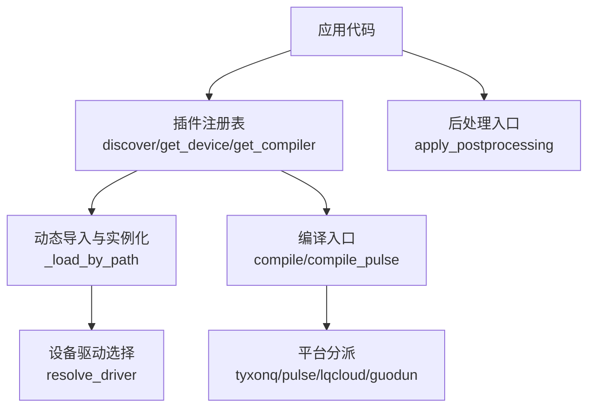
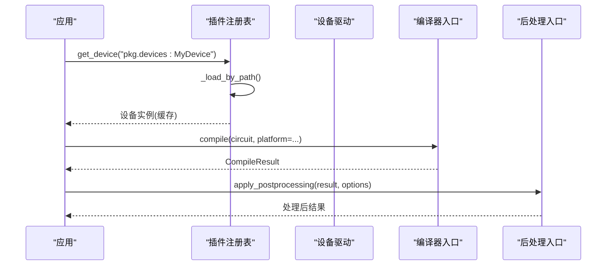
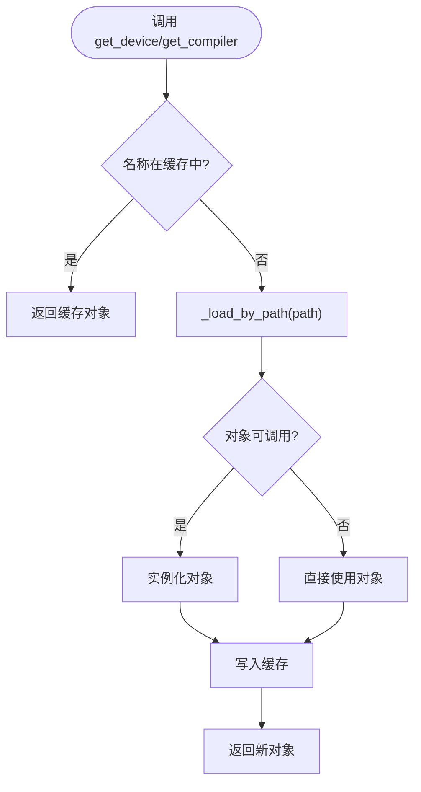
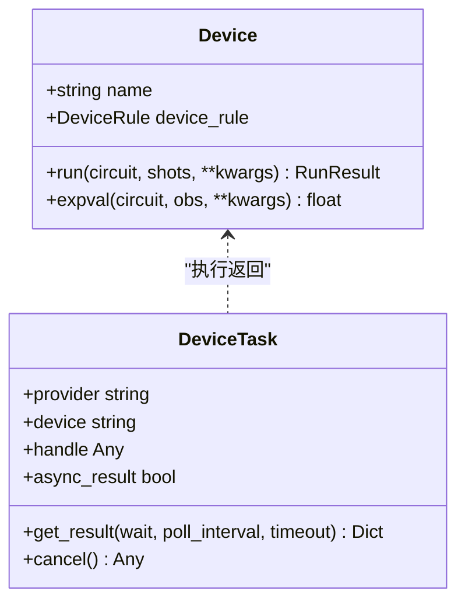
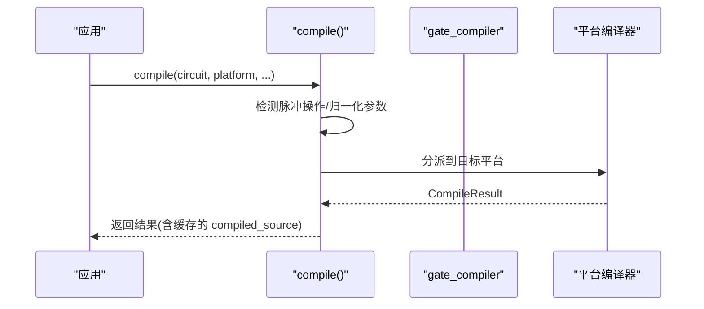
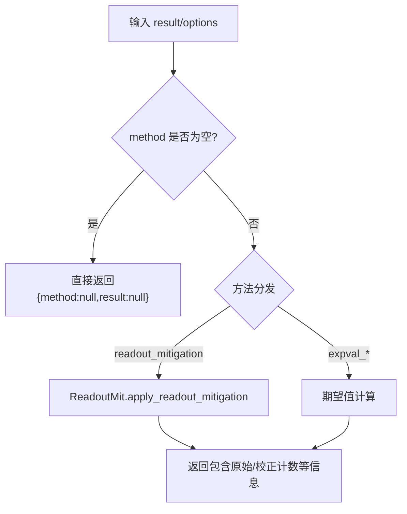
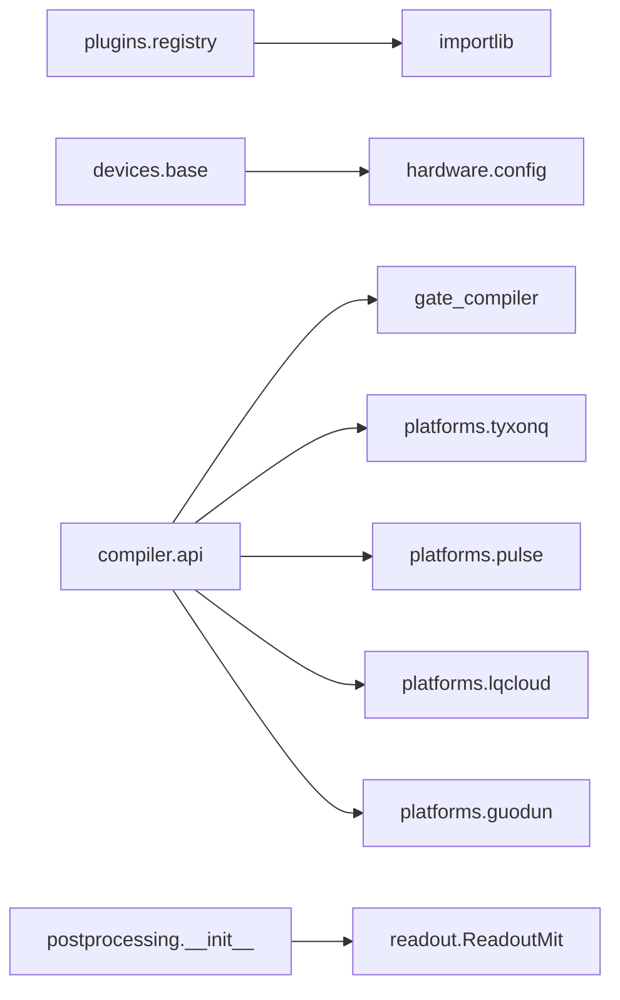

# 插件系统使用

<cite>
**本文引用的文件**
- [src/tyxonq/plugins/registry.py](file://src/tyxonq/plugins/registry.py)
- [tests_core_module/test_plugins_registry.py](file://tests_core_module/test_plugins_registry.py)
- [docs/source/developer_guide/extending_tyxonq.rst](file://docs/source/developer_guide/extending_tyxonq.rst)
- [docs/source/user_guide/advanced/index.rst](file://docs/source/user_guide/advanced/index.rst)
- [src/tyxonq/devices/base.py](file://src/tyxonq/devices/base.py)
- [src/tyxonq/compiler/api.py](file://src/tyxonq/compiler/api.py)
- [src/tyxonq/postprocessing/__init__.py](file://src/tyxonq/postprocessing/__init__.py)
</cite>

## 目录
1. [简介](#简介)
2. [项目结构](#项目结构)
3. [核心组件](#核心组件)
4. [架构总览](#架构总览)
5. [详细组件分析](#详细组件分析)
6. [依赖关系分析](#依赖关系分析)
7. [性能考量](#性能考量)
8. [故障排查指南](#故障排查指南)
9. [结论](#结论)
10. [附录](#附录)

## 简介
本指南面向希望扩展 TyxonQ 能力的开发者，系统性说明插件系统的注册机制、发现过程、生命周期与版本兼容性策略；并分别给出设备插件、编译器插件、后处理插件的开发流程与实践建议。当前仓库中的插件系统处于“可扩展接口 + 动态加载 + 缓存”的演进阶段：提供稳定的 API 表面（discover/get_device/get_compiler），并通过完全限定路径动态导入对象与实例化，同时内置进程级缓存以提升重复访问性能。文档将结合源码与测试用例，帮助读者快速上手并安全地集成自定义能力。

## 项目结构
TyxonQ 的插件相关能力主要分布在以下位置：
- 插件注册与发现：plugins/registry.py
- 设备抽象与驱动选择：devices/base.py
- 编译入口与平台分派：compiler/api.py
- 后处理统一入口：postprocessing/__init__.py
- 用户与开发者文档：docs/source/...

图表来源
- [src/tyxonq/plugins/registry.py:10-62](file://src/tyxonq/plugins/registry.py#L10-L62)
- [src/tyxonq/devices/base.py:146-258](file://src/tyxonq/devices/base.py#L146-L258)
- [src/tyxonq/compiler/api.py:39-340](file://src/tyxonq/compiler/api.py#L39-L340)
- [src/tyxonq/postprocessing/__init__.py:34-150](file://src/tyxonq/postprocessing/__init__.py#L34-L150)

章节来源
- [src/tyxonq/plugins/registry.py:1-71](file://src/tyxonq/plugins/registry.py#L1-L71)
- [src/tyxonq/devices/base.py:111-258](file://src/tyxonq/devices/base.py#L111-L258)
- [src/tyxonq/compiler/api.py:39-340](file://src/tyxonq/compiler/api.py#L39-L340)
- [src/tyxonq/postprocessing/__init__.py:34-150](file://src/tyxonq/postprocessing/__init__.py#L34-L150)

## 核心组件
- 插件注册表（discover/get_device/get_compiler）
  - discover(group)：预留用于按 entry point group 发现扩展类，当前返回空映射以稳定 API 表面。
  - get_device(name)/get_compiler(name)：通过完全限定路径（module:attr 或 module.attr）动态导入对象，若可调用则实例化，并将结果缓存于进程级字典中，保证单调性与复用。
- 设备抽象与驱动选择（Device/resolve_driver）
  - Device 协议定义 run/expval 等执行接口；device_descriptor 规范化 provider::device 形式；resolve_driver 根据 provider 路由到具体驱动模块。
- 编译入口（compile/compile_pulse）
  - compile 统一接收类型化参数，自动检测脉冲操作并切换到 pulse 编译；支持 tyxonq/pulse/lqcloud/guodun 等平台分派；输出格式由 output 控制。
- 后处理入口（apply_postprocessing）
  - 统一方法分发器，支持读出误差缓解、Pauli 期望值计算等；失败时优雅降级，不抛出异常。

章节来源
- [src/tyxonq/plugins/registry.py:10-62](file://src/tyxonq/plugins/registry.py#L10-L62)
- [tests_core_module/test_plugins_registry.py:1-21](file://tests_core_module/test_plugins_registry.py#L1-L21)
- [src/tyxonq/devices/base.py:97-258](file://src/tyxonq/devices/base.py#L97-L258)
- [src/tyxonq/compiler/api.py:39-340](file://src/tyxonq/compiler/api.py#L39-L340)
- [src/tyxonq/postprocessing/__init__.py:34-150](file://src/tyxonq/postprocessing/__init__.py#L34-L150)

## 架构总览
TyxonQ 插件体系围绕“发现—加载—注册—使用”的主线展开：
- 发现：discover 预留 entry points 接入点；当前以完全限定路径为主。
- 加载：_load_by_path 解析 module:attr/module.attr 并 import_module/import attr。
- 注册：通过 TyxonQPlugin 的 register_components 将设备、优化器、门、Pass 等注册到组件注册表（文档示例）。
- 使用：设备通过 resolve_driver 选择驱动；编译通过 compile 分派到平台；后处理通过 apply_postprocessing 统一调用。

图表来源
- [src/tyxonq/plugins/registry.py:21-62](file://src/tyxonq/plugins/registry.py#L21-L62)
- [src/tyxonq/compiler/api.py:39-340](file://src/tyxonq/compiler/api.py#L39-L340)
- [src/tyxonq/postprocessing/__init__.py:34-150](file://src/tyxonq/postprocessing/__init__.py#L34-L150)

## 详细组件分析

### 插件注册与动态加载
- 动态加载机制
  - 支持两种路径语法：module:attr 与 module.attr；解析后 import_module 并 getattr。
  - 若对象可调用，则视为类并实例化；否则直接使用对象本身。
- 缓存管理
  - 进程级字典 _CACHE 缓存已加载的对象/实例，确保多次 get_* 返回同一引用（单调性）。
- 版本兼容性与扩展点
  - discover(group) 预留 entry points 组名空间，便于未来接入 setuptools entry_points。
  - 文档定义了 TyxonQPlugin 基类及 initialize/register_components/cleanup 生命周期钩子，便于插件自描述与资源管理。

图表来源
- [src/tyxonq/plugins/registry.py:21-62](file://src/tyxonq/plugins/registry.py#L21-L62)

章节来源
- [src/tyxonq/plugins/registry.py:1-71](file://src/tyxonq/plugins/registry.py#L1-L71)
- [tests_core_module/test_plugins_registry.py:1-21](file://tests_core_module/test_plugins_registry.py#L1-L21)
- [docs/source/developer_guide/extending_tyxonq.rst:24-84](file://docs/source/developer_guide/extending_tyxonq.rst#L24-L84)

### 设备插件开发模式
- 设备接口
  - 实现 Device 协议（name/device_rule/run/expval），或通过继承抽象基类实现 QuantumDevice（文档示例）。
- 驱动选择
  - 使用 device_descriptor 规范化 provider::device；resolve_driver 根据 provider 路由到对应驱动模块。
- 运行与任务
  - devices.base.run 统一封装提交逻辑，返回 DeviceTask；get_task_details 提供轮询与超时处理，并统一结果结构。

图表来源
- [src/tyxonq/devices/base.py:13-57](file://src/tyxonq/devices/base.py#L13-L57)
- [src/tyxonq/devices/base.py:97-108](file://src/tyxonq/devices/base.py#L97-L108)

章节来源
- [src/tyxonq/devices/base.py:111-258](file://src/tyxonq/devices/base.py#L111-L258)
- [docs/source/developer_guide/custom_devices.rst:34-84](file://docs/source/developer_guide/custom_devices.rst#L34-L84)
- [docs/source/developer_guide/extending_tyxonq.rst:123-240](file://docs/source/developer_guide/extending_tyxonq.rst#L123-L240)

### 编译器插件开发模式
- 统一入口
  - compile(circuit, platform, output, basis_gates, decompose, route, optimize, simplify, device_rule, options, compile_engine) 提供类型化参数装配步骤并顺序施加。
- 平台分派
  - platform="tyxonq"/"pulse"/"lqcloud"/"guodun" 等；检测到脉冲操作或显式模式时自动切换至 pulse 编译。
- 输出与缓存
  - 支持 ir/qasm2/qasm3/qiskit 等输出；编译后的源代码会缓存到 circuit._compiled_source 避免重复编译。

图表来源
- [src/tyxonq/compiler/api.py:39-340](file://src/tyxonq/compiler/api.py#L39-L340)

章节来源
- [src/tyxonq/compiler/api.py:39-340](file://src/tyxonq/compiler/api.py#L39-L340)

### 后处理插件开发模式
- 统一入口
  - apply_postprocessing(result, options) 根据 method 分发到具体实现（如 readout_mitigation、expval_pauli_term/sum）。
- 错误与降级
  - 失败时保持占位结构，不抛异常；对缺失字段进行容错填充。
- 典型用法
  - 传入 cals/mitigation 等选项即可启用读出误差缓解；也可计算 Pauli 项期望值或求和。

图表来源
- [src/tyxonq/postprocessing/__init__.py:34-150](file://src/tyxonq/postprocessing/__init__.py#L34-L150)

章节来源
- [src/tyxonq/postprocessing/__init__.py:34-150](file://src/tyxonq/postprocessing/__init__.py#L34-L150)

### 插件生命周期与配置
- 生命周期
  - initialize(config)：初始化插件内部状态与日志等。
  - register_components(registry)：向组件注册表登记设备、优化器、门、Pass 等。
  - cleanup()：卸载时释放资源。
- 配置与发现
  - 通过 setup.py 的 entry_points 声明插件类；discover(group) 预留组名空间以便未来自动发现。
- 版本兼容性
  - 插件需声明 get_version()；建议在依赖中约束 TyxonQ 版本范围，避免破坏性变更。

章节来源
- [docs/source/developer_guide/extending_tyxonq.rst:24-84](file://docs/source/developer_guide/extending_tyxonq.rst#L24-L84)
- [docs/source/developer_guide/extending_tyxonq.rst:654-746](file://docs/source/developer_guide/extending_tyxonq.rst#L654-L746)

## 依赖关系分析
- 插件注册表依赖 Python 标准库 importlib 进行动态导入。
- 设备层依赖 hardware.config 获取默认 provider/device/token。
- 编译入口依赖 gate_compiler 与平台适配器（tyxonq/pulse/lqcloud/guodun）。
- 后处理模块延迟导入 ReadoutMit，避免循环依赖。

图表来源
- [src/tyxonq/plugins/registry.py:1-33](file://src/tyxonq/plugins/registry.py#L1-L33)
- [src/tyxonq/devices/base.py:111-258](file://src/tyxonq/devices/base.py#L111-L258)
- [src/tyxonq/compiler/api.py:219-340](file://src/tyxonq/compiler/api.py#L219-L340)
- [src/tyxonq/postprocessing/__init__.py:109-150](file://src/tyxonq/postprocessing/__init__.py#L109-L150)

章节来源
- [src/tyxonq/plugins/registry.py:1-33](file://src/tyxonq/plugins/registry.py#L1-L33)
- [src/tyxonq/devices/base.py:111-258](file://src/tyxonq/devices/base.py#L111-L258)
- [src/tyxonq/compiler/api.py:219-340](file://src/tyxonq/compiler/api.py#L219-L340)
- [src/tyxonq/postprocessing/__init__.py:109-150](file://src/tyxonq/postprocessing/__init__.py#L109-L150)

## 性能考量
- 动态加载与缓存
  - get_device/get_compiler 使用进程级缓存，避免重复 import 与实例化开销。
- 编译缓存
  - compile 会将 compiled_source 缓存到电路对象，减少重复编译成本。
- 后处理性能
  - 读出误差缓解在较大量子比特数下存在指数复杂度，建议在小规模系统使用并结合并行批处理。

章节来源
- [src/tyxonq/plugins/registry.py:7-62](file://src/tyxonq/plugins/registry.py#L7-L62)
- [src/tyxonq/compiler/api.py:233-235](file://src/tyxonq/compiler/api.py#L233-L235)
- [examples/readout_mitigation_scalability.py:381-412](file://examples/readout_mitigation_scalability.py#L381-L412)

## 故障排查指南
- 动态加载失败
  - 检查路径格式是否正确（module:attr 或 module.attr）；确认模块可被 import。
- 设备不可用
  - 确认 provider/device 是否匹配；token 是否正确设置；查看 get_task_details 的 uni_status 与 error 字段。
- 编译异常
  - 检查 platform/output 组合是否合法；对于 homebrew_s2 设备，注意强制 qasm2 或 tqasm 输出。
- 后处理失败
  - 检查 options.method 是否存在；cals/mitigation 是否完整；失败时会返回部分结果而非抛错。

章节来源
- [src/tyxonq/plugins/registry.py:21-33](file://src/tyxonq/plugins/registry.py#L21-L33)
- [src/tyxonq/devices/base.py:497-557](file://src/tyxonq/devices/base.py#L497-L557)
- [src/tyxonq/compiler/api.py:165-217](file://src/tyxonq/compiler/api.py#L165-L217)
- [src/tyxonq/postprocessing/__init__.py:109-150](file://src/tyxonq/postprocessing/__init__.py#L109-L150)

## 结论
TyxonQ 的插件系统在当前版本提供了稳定的 API 表面与可靠的动态加载、缓存机制，并通过设备抽象、编译入口与后处理入口形成清晰的扩展边界。开发者可通过完全限定路径快速集成自定义设备、编译器与后处理逻辑；随着 future 版本引入 entry points 与更完善的组件注册表，插件生态将更加自动化与可维护。建议遵循文档中的生命周期约定与最佳实践，确保插件的可移植性与稳定性。

## 附录

### 快速开始：使用插件注册表
- 发现可用插件（当前为预留接口）
  - 参考：[docs/source/user_guide/advanced/index.rst:440-455](file://docs/source/user_guide/advanced/index.rst#L440-L455)
- 通过完全限定路径加载设备/编译器
  - 参考：[src/tyxonq/plugins/registry.py:36-62](file://src/tyxonq/plugins/registry.py#L36-L62)
- 验证缓存单调性
  - 参考：[tests_core_module/test_plugins_registry.py:14-18](file://tests_core_module/test_plugins_registry.py#L14-L18)

章节来源
- [docs/source/user_guide/advanced/index.rst:440-455](file://docs/source/user_guide/advanced/index.rst#L440-L455)
- [src/tyxonq/plugins/registry.py:36-62](file://src/tyxonq/plugins/registry.py#L36-L62)
- [tests_core_module/test_plugins_registry.py:14-18](file://tests_core_module/test_plugins_registry.py#L14-L18)

### 设备插件：从接口到运行
- 实现设备接口
  - 参考：[docs/source/developer_guide/custom_devices.rst:34-84](file://docs/source/developer_guide/custom_devices.rst#L34-L84)
- 驱动选择与运行
  - 参考：[src/tyxonq/devices/base.py:111-258](file://src/tyxonq/devices/base.py#L111-L258)
- 任务轮询与结果统一
  - 参考：[src/tyxonq/devices/base.py:497-557](file://src/tyxonq/devices/base.py#L497-L557)

章节来源
- [docs/source/developer_guide/custom_devices.rst:34-84](file://docs/source/developer_guide/custom_devices.rst#L34-L84)
- [src/tyxonq/devices/base.py:111-258](file://src/tyxonq/devices/base.py#L111-L258)
- [src/tyxonq/devices/base.py:497-557](file://src/tyxonq/devices/base.py#L497-L557)

### 编译器插件：平台分派与输出
- 统一编译入口与参数
  - 参考：[src/tyxonq/compiler/api.py:39-98](file://src/tyxonq/compiler/api.py#L39-L98)
- 平台分派与输出控制
  - 参考：[src/tyxonq/compiler/api.py:219-340](file://src/tyxonq/compiler/api.py#L219-L340)

章节来源
- [src/tyxonq/compiler/api.py:39-98](file://src/tyxonq/compiler/api.py#L39-L98)
- [src/tyxonq/compiler/api.py:219-340](file://src/tyxonq/compiler/api.py#L219-L340)

### 后处理插件：方法与降级
- 方法分发与读出误差缓解
  - 参考：[src/tyxonq/postprocessing/__init__.py:34-150](file://src/tyxonq/postprocessing/__init__.py#L34-L150)

章节来源
- [src/tyxonq/postprocessing/__init__.py:34-150](file://src/tyxonq/postprocessing/__init__.py#L34-L150)