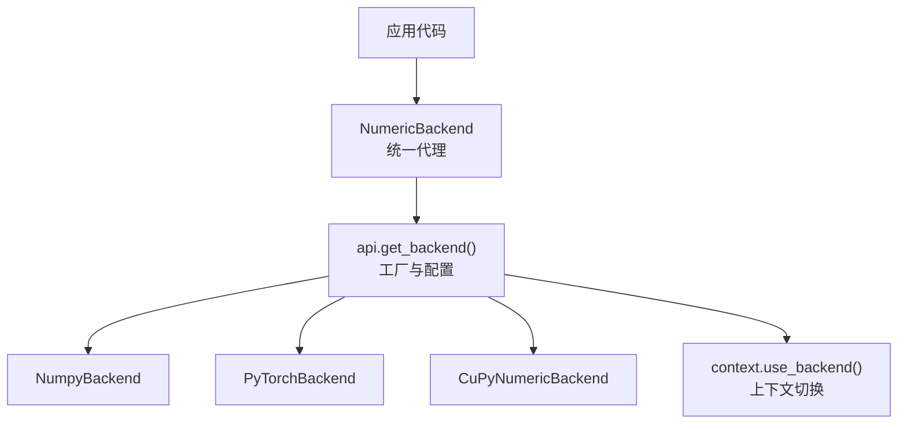
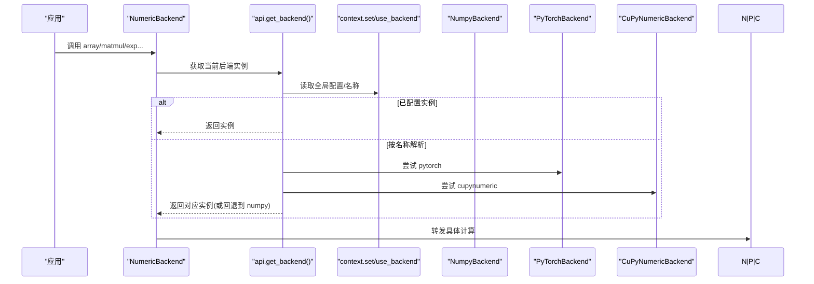
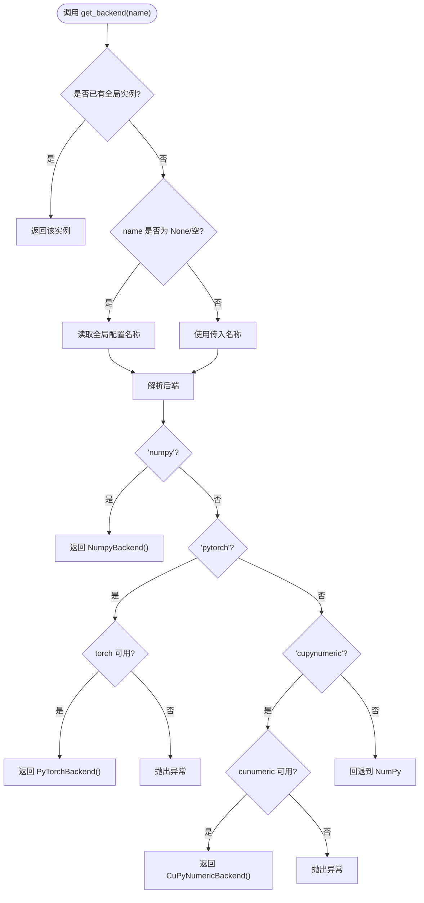
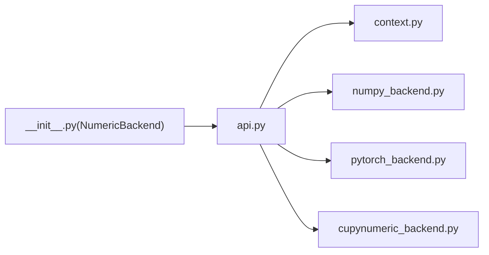

# 自定义数值后端开发

<cite>
**本文引用的文件**
- [src/tyxonq/numerics/api.py](file://src/tyxonq/numerics/api.py)
- [src/tyxonq/numerics/context.py](file://src/tyxonq/numerics/context.py)
- [src/tyxonq/numerics/__init__.py](file://src/tyxonq/numerics/__init__.py)
- [src/tyxonq/numerics/backends/numpy_backend.py](file://src/tyxonq/numerics/backends/numpy_backend.py)
- [src/tyxonq/numerics/backends/pytorch_backend.py](file://src/tyxonq/numerics/backends/pytorch_backend.py)
- [src/tyxonq/numerics/backends/cupynumeric_backend.py](file://src/tyxonq/numerics/backends/cupynumeric_backend.py)
- [examples/numeric_backend_switching.py](file://examples/numeric_backend_switching.py)
- [tests_core_module/test_numerics.py](file://tests_core_module/test_numerics.py)
- [docs/source/developer_guide/custom_backends.rst](file://docs/source/developer_guide/custom_backends.rst)
</cite>

## 目录
1. [简介](#简介)
2. [项目结构](#项目结构)
3. [核心组件](#核心组件)
4. [架构总览](#架构总览)
5. [详细组件分析](#详细组件分析)
6. [依赖关系分析](#依赖关系分析)
7. [性能考量](#性能考量)
8. [故障排查指南](#故障排查指南)
9. [结论](#结论)
10. [附录：完整实现示例与基准测试](#附录完整实现示例与基准测试)

## 简介
本指南面向希望为 TyxonQ 实现自定义数值后端的开发者，系统阐述 ArrayBackend 协议、数组操作、线性代数运算与自动微分支持；对比 NumPy、PyTorch、CuPyNumeric 三种内置后端的特性差异；说明运行时后端切换机制（含上下文管理、默认策略与回退）；提供新数组库或特定硬件加速器的集成步骤；并给出性能基准测试与兼容性验证方法。

## 项目结构
TyxonQ 的数值子系统位于 src/tyxonq/numerics，采用“协议 + 多后端 + 统一代理”的分层设计：
- 协议与工厂：ArrayBackend 协议定义统一接口；get_backend/set_backend/use_backend 负责选择与切换后端；vectorize_or_fallback 提供向量化策略。
- 后端实现：numpy_backend、pytorch_backend、cupynumeric_backend 分别实现协议，覆盖数组创建、数学函数、线性代数、随机数、自动微分桥接等。
- 统一代理：NumericBackend 类将常用操作以类方法形式暴露，内部委托给当前后端实例。
- 示例与测试：examples/numeric_backend_switching.py 演示后端切换与性能对比；tests_core_module/test_numerics.py 覆盖工厂、向量化策略与上下文切换。

图表来源
- [src/tyxonq/numerics/__init__.py:67-471](file://src/tyxonq/numerics/__init__.py#L67-L471)
- [src/tyxonq/numerics/api.py:179-252](file://src/tyxonq/numerics/api.py#L179-L252)
- [src/tyxonq/numerics/context.py:18-50](file://src/tyxonq/numerics/context.py#L18-L50)

章节来源
- [src/tyxonq/numerics/__init__.py:1-476](file://src/tyxonq/numerics/__init__.py#L1-L476)
- [src/tyxonq/numerics/api.py:1-255](file://src/tyxonq/numerics/api.py#L1-L255)
- [src/tyxonq/numerics/context.py:1-53](file://src/tyxonq/numerics/context.py#L1-L53)

## 核心组件
- ArrayBackend 协议：定义统一的数组/张量接口，包括创建、转换、代数运算、随机数、自动微分桥接等。
- NumericBackend 代理：提供类级便捷访问，所有调用转发到当前后端。
- 后端工厂 get_backend：按名称或全局配置返回后端实例，支持 numpy、pytorch、cupynumeric。
- 上下文 use_backend：临时设置全局后端，退出时恢复。
- 向量化 vectorize_or_fallback：优先使用后端 vmap，否则沿首维做轻量级循环回退。

章节来源
- [src/tyxonq/numerics/api.py:19-177](file://src/tyxonq/numerics/api.py#L19-L177)
- [src/tyxonq/numerics/__init__.py:20-58](file://src/tyxonq/numerics/__init__.py#L20-L58)
- [src/tyxonq/numerics/context.py:18-50](file://src/tyxonq/numerics/context.py#L18-L50)

## 架构总览
下图展示从应用到具体后端的调用链与职责划分：

图表来源
- [src/tyxonq/numerics/__init__.py:67-471](file://src/tyxonq/numerics/__init__.py#L67-L471)
- [src/tyxonq/numerics/api.py:179-252](file://src/tyxonq/numerics/api.py#L179-L252)
- [src/tyxonq/numerics/context.py:18-50](file://src/tyxonq/numerics/context.py#L18-L50)

## 详细组件分析

### ArrayBackend 协议与实现要点
- 必需能力：array/asarray/to_numpy、matmul/einsum、reshape/moveaxis、sum/mean/abs/real/imag/conj/diag、zeros/ones/zeros_like/ones_like/eye/kron/square、stack/concatenate/arange/linspace/transpose/norm/cast/sign/outer、svd/eigh/eig/solve/inv/expm/tensordot、rng/normal、requires_grad/detach。
- 可选能力：vmap/jit/value_and_grad/hessian/jacfwd。
- 类型常量：complex64/complex128/float32/float64/int8/int32/int64/bool/int。
- 默认 dtype：dtypestr（量子态复数）、rdtypestr（实参/测量）。

章节来源
- [src/tyxonq/numerics/api.py:19-122](file://src/tyxonq/numerics/api.py#L19-L122)

### NumPy 后端
- 特点：CPU 计算、广泛兼容、稳定可靠；自动微分通过有限差分近似实现（jacfwd/hessian/value_and_grad）。
- 线性代数：基于 numpy.linalg 与 scipy.linalg.expm。
- 随机：基于 numpy.random.default_rng。
- 内存：原生 ndarray，适合中小规模问题与原型开发。

章节来源
- [src/tyxonq/numerics/backends/numpy_backend.py:8-457](file://src/tyxonq/numerics/backends/numpy_backend.py#L8-L457)

### PyTorch 后端
- 特点：GPU 加速、自动微分、ML 生态集成；支持 torch.compile 的 jit 包装。
- 自动微分：value_and_grad 优先使用 autograd，失败时回退到有限差分；jacfwd/hessian 在可用时使用 torch.func，否则提示不可用。
- 数据类型与设备：to_numpy 会 detach+cpu+numpy；矩阵乘法前对齐 dtype/device。
- 随机：torch.Generator；choice/bincount/nonzero 返回兼容格式。

章节来源
- [src/tyxonq/numerics/backends/pytorch_backend.py:13-567](file://src/tyxonq/numerics/backends/pytorch_backend.py#L13-L567)

### CuPyNumeric 后端
- 特点：NumPy-like GPU 加速；部分算子回退到 host（如 SVD 走 numpy），以保证稳定性。
- 自动微分：不提供原生梯度，value_and_grad 通过逐元素有限差分实现。
- 随机：复用 numpy RNG。

章节来源
- [src/tyxonq/numerics/backends/cupynumeric_backend.py:13-300](file://src/tyxonq/numerics/backends/cupynumeric_backend.py#L13-L300)

### 统一代理 NumericBackend
- 将常用操作以类方法暴露，内部通过 get_backend(None) 获取当前后端实例并转发。
- 提供 set_dtype 便捷入口，统一设置复数/实数默认精度。
- 支持 vmap/jit/value_and_grad 的可选能力探测与调用。

章节来源
- [src/tyxonq/numerics/__init__.py:20-58](file://src/tyxonq/numerics/__init__.py#L20-L58)
- [src/tyxonq/numerics/__init__.py:67-471](file://src/tyxonq/numerics/__init__.py#L67-L471)

### 后端切换机制
- 全局设置：set_backend(name_or_instance) 可传入名称或实例；use_backend(...) 作为上下文管理器临时切换并在退出时恢复。
- 工厂解析：get_backend(name=None) 优先读取全局配置实例，其次名称；未指定或未知名称回退到 NumPy。
- 可用性检查：pytorch/cupynumeric 仅在模块可导入且 available 标志为真时返回实例，否则抛出异常。

图表来源
- [src/tyxonq/numerics/api.py:179-252](file://src/tyxonq/numerics/api.py#L179-L252)
- [src/tyxonq/numerics/context.py:18-50](file://src/tyxonq/numerics/context.py#L18-L50)

章节来源
- [src/tyxonq/numerics/api.py:179-252](file://src/tyxonq/numerics/api.py#L179-L252)
- [src/tyxonq/numerics/context.py:18-50](file://src/tyxonq/numerics/context.py#L18-L50)

### 向量化策略
- vectorize_or_fallback：当 policy="off" 直接返回原函数；若后端提供 vmap 则优先使用；否则对首个参数进行迭代式调用以模拟向量化；遇到异常回退到 eager。
- 安全检测：结合 vectorization_checks 中的 safe_for_vectorization/warn_as_error 可在未来扩展中用于保护非纯函数。

章节来源
- [src/tyxonq/numerics/api.py:124-177](file://src/tyxonq/numerics/api.py#L124-L177)
- [tests_core_module/test_numerics.py:62-80](file://tests_core_module/test_numerics.py#L62-L80)

## 依赖关系分析
- 模块耦合：
  - api.py 依赖 context.py 获取/设置全局后端；依赖各后端模块按需导入。
  - __init__.py 暴露 NumericBackend 与 set_dtype，封装 get_backend 调用。
  - 各后端独立实现协议，彼此无直接依赖。
- 外部依赖：
  - PyTorch 后端依赖 torch（可选）。
  - CuPyNumeric 后端依赖 cupynumeric（可选）。
  - NumPy 后端依赖 numpy/scipy（scipy.linalg.expm）。

图表来源
- [src/tyxonq/numerics/api.py:1-255](file://src/tyxonq/numerics/api.py#L1-L255)
- [src/tyxonq/numerics/context.py:1-53](file://src/tyxonq/numerics/context.py#L1-L53)
- [src/tyxonq/numerics/__init__.py:1-476](file://src/tyxonq/numerics/__init__.py#L1-L476)

章节来源
- [src/tyxonq/numerics/api.py:1-255](file://src/tyxonq/numerics/api.py#L1-L255)
- [src/tyxonq/numerics/context.py:1-53](file://src/tyxonq/numerics/context.py#L1-L53)
- [src/tyxonq/numerics/__init__.py:1-476](file://src/tyxonq/numerics/__init__.py#L1-L476)

## 性能考量
- 后端选择建议：
  - 小规模电路/原型：NumPy（稳定、易调试）。
  - VQA/需要梯度/GPU：PyTorch（autograd、可选 JIT）。
  - 大规模状态向量/GPU：CuPyNumeric（NumPy-like API 的 GPU 加速）。
- 精度与内存：
  - 可通过 set_dtype("complex64") 降低内存占用与提高吞吐，但需权衡数值精度。
- 执行路径：
  - PyTorch 的 value_and_grad 优先 autograd，失败时回退有限差分，避免中断训练流程。
  - CuPyNumeric 的部分算子（如 SVD）回退到 host，注意跨设备数据搬运开销。
- 向量化：
  - 优先使用后端 vmap；若无，vectorize_or_fallback 提供轻量回退，但仍需注意函数纯度。

章节来源
- [examples/numeric_backend_switching.py:187-246](file://examples/numeric_backend_switching.py#L187-L246)
- [src/tyxonq/numerics/backends/pytorch_backend.py:446-564](file://src/tyxonq/numerics/backends/pytorch_backend.py#L446-L564)
- [src/tyxonq/numerics/backends/cupynumeric_backend.py:208-216](file://src/tyxonq/numerics/backends/cupynumeric_backend.py#L208-L216)

## 故障排查指南
- 常见错误与处理：
  - 请求了未安装的后端（如 pytorch/cupynumeric）：get_backend 会抛出异常，需在调用前捕获或降级到 NumPy。
  - 梯度为 None：PyTorch 路径中若计算图断裂，value_and_grad 会触发有限差分回退并告警。
  - 设备/类型不匹配：PyTorch 的 matmul 会尝试对齐 dtype/device，仍可能报错，需显式 to(dtype/device)。
- 诊断建议：
  - 使用 use_backend 上下文隔离不同后端的运行环境，避免全局污染。
  - 通过 to_numpy 将结果转回 CPU 以便检查。
  - 在测试中使用 pytest 的 skipif 跳过缺失依赖的后端用例。

章节来源
- [src/tyxonq/numerics/api.py:179-252](file://src/tyxonq/numerics/api.py#L179-L252)
- [src/tyxonq/numerics/backends/pytorch_backend.py:446-564](file://src/tyxonq/numerics/backends/pytorch_backend.py#L446-L564)
- [tests_core_module/test_numerics.py:99-111](file://tests_core_module/test_numerics.py#L99-L111)

## 结论
TyxonQ 的数值后端体系通过 ArrayBackend 协议实现了高度解耦与可扩展性。NumPy、PyTorch、CuPyNumeric 三套后端覆盖了 CPU、GPU、自动微分与高性能计算场景；配合统一的 NumericBackend 代理与灵活的切换机制，用户可以在不修改业务代码的前提下动态选择最优后端。对于自定义后端，只需遵循协议并实现必要接口，即可无缝接入 TyxonQ 的计算栈。

## 附录：完整实现示例与基准测试

### 自定义后端实现步骤
- 新建后端类，实现 ArrayBackend 协议的关键方法（数组创建、代数运算、随机数、自动微分桥接等）。
- 暴露 name 与必要的 dtype 常量；可选实现 available 标志。
- 在 api.get_backend 中注册新后端名称，或在外部通过 set_backend(instance) 注入实例。
- 编写单元测试覆盖关键路径（如矩阵乘法、SVD、梯度计算、to_numpy 转换）。

章节来源
- [src/tyxonq/numerics/api.py:19-122](file://src/tyxonq/numerics/api.py#L19-L122)
- [src/tyxonq/numerics/api.py:179-252](file://src/tyxonq/numerics/api.py#L179-L252)
- [tests_core_module/test_numerics.py:83-111](file://tests_core_module/test_numerics.py#L83-L111)

### 性能基准测试方法
- 使用 examples/numeric_backend_switching.py 中的 compare_backends_performance 对不同后端在同一问题上进行计时对比（排除首次 warmup）。
- 针对 VQE/期望值计算等典型负载，固定问题规模（qubits、layers）与随机种子，重复多次取均值与标准差。
- 记录结果类型与设备信息（如 CUDA 可用性），便于横向比较。

章节来源
- [examples/numeric_backend_switching.py:187-246](file://examples/numeric_backend_switching.py#L187-L246)

### 兼容性验证方法
- 一致性校验：在不同后端下计算相同问题，比较结果差异是否在容忍范围内（例如 <1e-6）。
- 功能回归：对 svd/eigh/eig/solve/inv/expm 等线性代数算子进行输入输出形状与数值范围断言。
- 自动微分：对 PyTorch 后端验证 value_and_grad 的梯度范数与方向合理性；对 NumPy/CuPyNumeric 后端验证有限差分误差阶。

章节来源
- [examples/numeric_backend_switching.py:249-283](file://examples/numeric_backend_switching.py#L249-L283)
- [tests_core_module/test_numerics.py:83-111](file://tests_core_module/test_numerics.py#L83-L111)

### 运行时选择与内存管理最佳实践
- 默认策略：未指定后端时优先使用全局配置，否则回退到 NumPy。
- 上下文切换：使用 use_backend 包裹关键实验段，确保隔离与自动恢复。
- 精度控制：通过 set_dtype 调整复数/实数精度，平衡内存与速度。
- 设备管理：PyTorch 后端注意 tensor 的设备与 dtype 对齐，避免隐式拷贝。

章节来源
- [src/tyxonq/numerics/api.py:179-252](file://src/tyxonq/numerics/api.py#L179-L252)
- [src/tyxonq/numerics/context.py:18-50](file://src/tyxonq/numerics/context.py#L18-L50)
- [src/tyxonq/numerics/__init__.py:20-58](file://src/tyxonq/numerics/__init__.py#L20-L58)