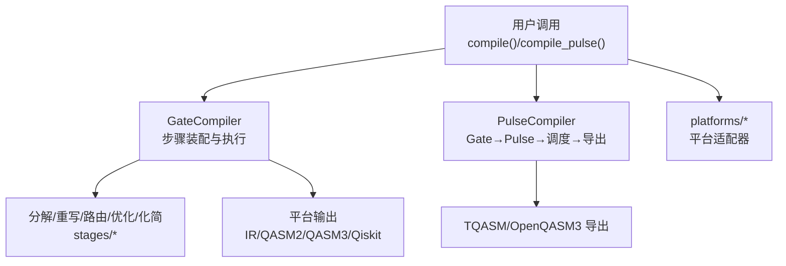
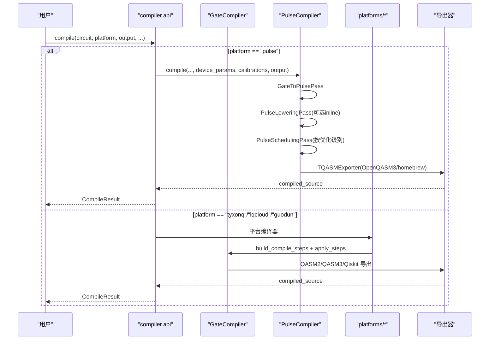
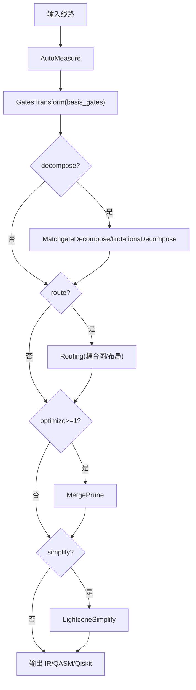
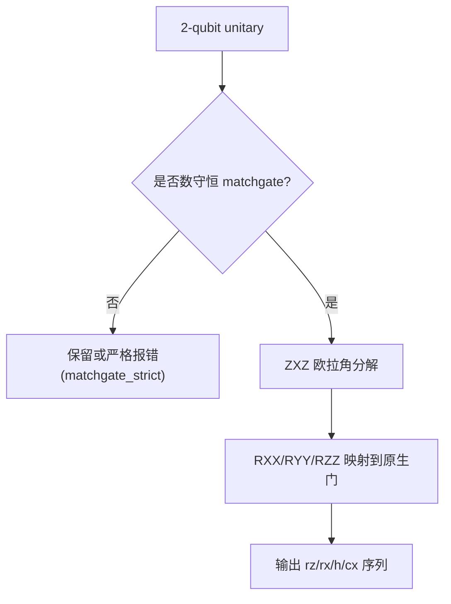
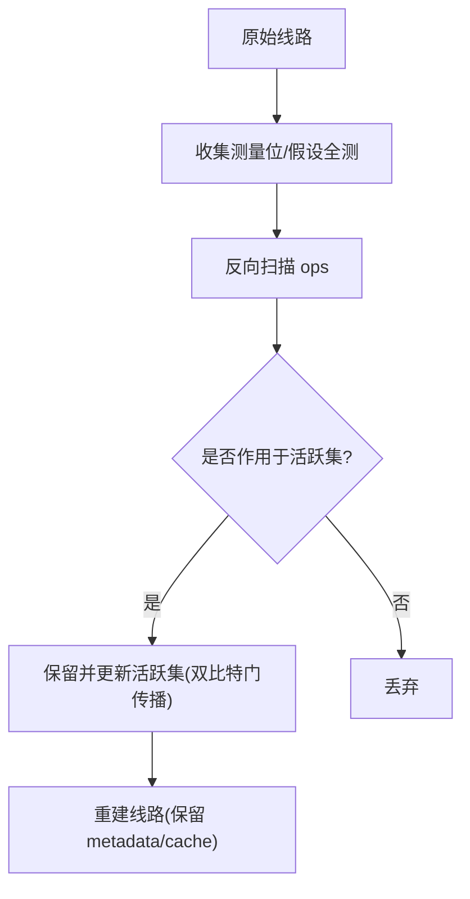
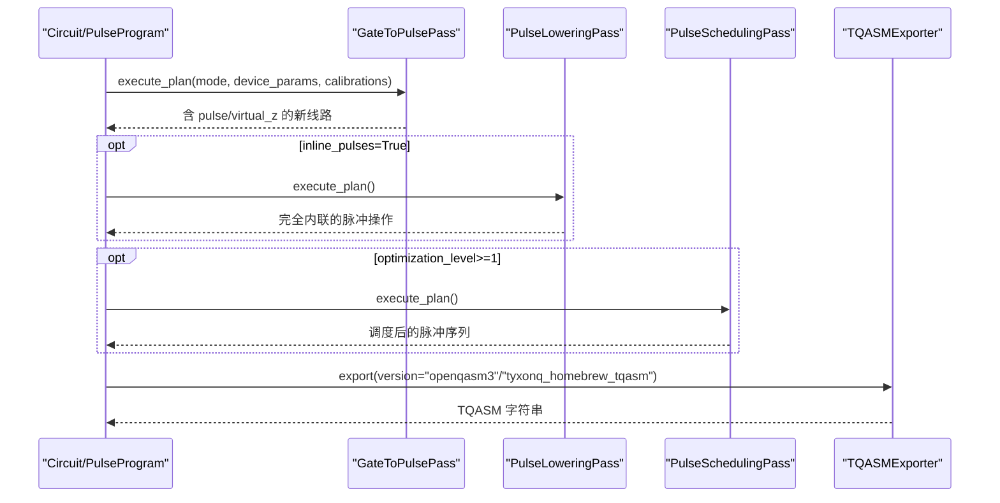
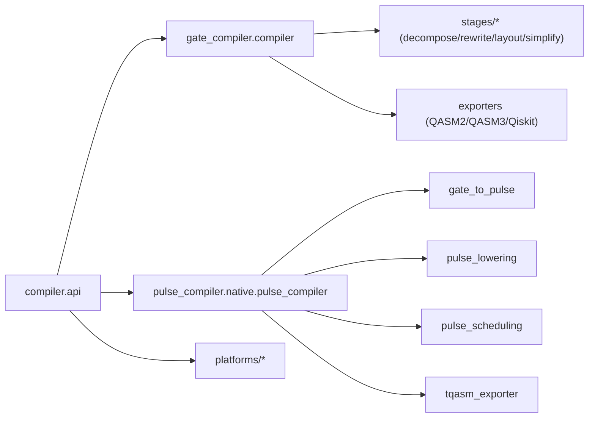

# 自定义编译器开发

<cite>
**本文引用的文件**
- [src/tyxonq/compiler/api.py](file://src/tyxonq/compiler/api.py)
- [src/tyxonq/compiler/gate_compiler/__init__.py](file://src/tyxonq/compiler/gate_compiler/__init__.py)
- [src/tyxonq/compiler/gate_compiler/compiler.py](file://src/tyxonq/compiler/gate_compiler/compiler.py)
- [src/tyxonq/compiler/gate_compiler/steps.py](file://src/tyxonq/compiler/gate_compiler/steps.py)
- [src/tyxonq/compiler/gate_compiler/stages/decompose/matchgate.py](file://src/tyxonq/compiler/gate_compiler/stages/decompose/matchgate.py)
- [src/tyxonq/compiler/gate_compiler/stages/simplify/lightcone.py](file://src/tyxonq/compiler/gate_compiler/stages/simplify/lightcone.py)
- [src/tyxonq/compiler/pulse_compiler/__init__.py](file://src/tyxonq/compiler/pulse_compiler/__init__.py)
- [src/tyxonq/compiler/pulse_compiler/native/pulse_compiler.py](file://src/tyxonq/compiler/pulse_compiler/native/pulse_compiler.py)
- [src/tyxonq/compiler/pulse_compiler/native/gate_to_pulse.py](file://src/tyxonq/compiler/pulse_compiler/native/gate_to_pulse.py)
- [src/tyxonq/compiler/pulse_compiler/native/tqasm_exporter.py](file://src/tyxonq/compiler/pulse_compiler/native/tqasm_exporter.py)
- [src/tyxonq/compiler/platforms/tyxonq/__init__.py](file://src/tyxonq/compiler/platforms/tyxonq/__init__.py)
- [examples/circuit_compiler.py](file://examples/circuit_compiler.py)
</cite>

## 目录
1. [简介](#简介)
2. [项目结构](#项目结构)
3. [核心组件](#核心组件)
4. [架构总览](#架构总览)
5. [详细组件分析](#详细组件分析)
6. [依赖关系分析](#依赖关系分析)
7. [性能考量](#性能考量)
8. [故障排查指南](#故障排查指南)
9. [结论](#结论)
10. [附录](#附录)

## 简介
本指南面向希望基于 TyxonQ 构建“自定义编译器”的开发者，覆盖以下目标：
- 实现自定义编译阶段并集成到编译管道（Gate 级与 Pulse 级）
- 中间表示转换、优化规则应用与门分解策略
- 路由优化与电路简化
- 脉冲级定制：波形生成、调度、TQASM 导出
- 针对特定硬件平台的编译优化与自定义策略落地
- 编译器性能分析与调试方法

TyxonQ 将“门级编译”和“脉冲级编译”解耦为两条主线：
- 门级编译：通过 GateCompiler 统一装配步骤（规范化→分解→路由→优化→化简），再按平台输出 IR/QASM/Qiskit。
- 脉冲级编译：通过 PulseCompiler 将门级或脉冲级 IR 转换为可执行的脉冲序列，支持 defcal 校准、波形约束、调度与 TQASM/OpenQASM3 导出。

## 项目结构
编译器相关代码主要位于 src/tyxonq/compiler 下，分为：
- gate_compiler：设备无关的门级编译核心（步骤装配与执行、分解/重写/路由/化简）
- pulse_compiler：脉冲级编译引擎（Gate→Pulse 分解、defcal 内联、调度、TQASM 导出）
- platforms：各硬件平台适配器（tyxonq/lqcloud/guodun 等），统一委托 gate_compiler 完成通用编译后翻译为目标方言
- api：统一的 compile()/compile_pulse() 入口，负责参数归一、平台分派与结果封装

**图示来源**
- [src/tyxonq/compiler/api.py:39-340](file://src/tyxonq/compiler/api.py#L39-L340)
- [src/tyxonq/compiler/gate_compiler/compiler.py:27-109](file://src/tyxonq/compiler/gate_compiler/compiler.py#L27-L109)
- [src/tyxonq/compiler/pulse_compiler/native/pulse_compiler.py:81-197](file://src/tyxonq/compiler/pulse_compiler/native/pulse_compiler.py#L81-L197)

**章节来源**
- [src/tyxonq/compiler/api.py:39-340](file://src/tyxonq/compiler/api.py#L39-L340)
- [src/tyxonq/compiler/gate_compiler/__init__.py:1-21](file://src/tyxonq/compiler/gate_compiler/__init__.py#L1-L21)
- [src/tyxonq/compiler/pulse_compiler/__init__.py:1-51](file://src/tyxonq/compiler/pulse_compiler/__init__.py#L1-L51)

## 核心组件
- 统一编译入口
  - compile(circuit, platform, output, basis_gates, decompose, route, optimize, simplify, device_rule, options)
  - compile_pulse(pulse_program, output, device_params, calibrations, device, options)
- 门级编译核心
  - GateCompiler.compile：根据类型化参数装配步骤并顺序执行，最终按 output 选择导出器
  - steps.build_compile_steps：按固定顺序装配 AutoMeasure→GatesTransform→Decompose→Routing→MergePrune→LightconeSimplify
- 脉冲级编译核心
  - PulseCompiler.compile：GateToPulsePass → PulseLoweringPass（可选 inline）→ PulseSchedulingPass（按优化级别）→ 导出
  - TQASMExporter：支持 OpenQASM3 + OpenPulse 与 homebrew_s2 专用格式

**章节来源**
- [src/tyxonq/compiler/api.py:39-340](file://src/tyxonq/compiler/api.py#L39-L340)
- [src/tyxonq/compiler/gate_compiler/compiler.py:27-109](file://src/tyxonq/compiler/gate_compiler/compiler.py#L27-L109)
- [src/tyxonq/compiler/gate_compiler/steps.py:27-109](file://src/tyxonq/compiler/gate_compiler/steps.py#L27-L109)
- [src/tyxonq/compiler/pulse_compiler/native/pulse_compiler.py:81-197](file://src/tyxonq/compiler/pulse_compiler/native/pulse_compiler.py#L81-L197)

## 架构总览
下图展示从用户调用到具体实现的完整路径，包括平台分派、门级与脉冲级两条流水线。

**图示来源**
- [src/tyxonq/compiler/api.py:140-340](file://src/tyxonq/compiler/api.py#L140-L340)
- [src/tyxonq/compiler/gate_compiler/compiler.py:64-109](file://src/tyxonq/compiler/gate_compiler/compiler.py#L64-L109)
- [src/tyxonq/compiler/pulse_compiler/native/pulse_compiler.py:143-197](file://src/tyxonq/compiler/pulse_compiler/native/pulse_compiler.py#L143-L197)

## 详细组件分析

### 门级编译管道与自定义阶段
- 步骤装配顺序（由 build_compile_steps 决定）：
  1) AutoMeasure：无测量时补 Z 测量
  2) GatesTransform：按 basis_gates 重写门
  3) Decompose：matchgate/rotations（由 DecomposeSpec 控制）
  4) Routing：按 RoutingSpec 与 device_rule 进行拓扑路由（默认关闭）
  5) MergePrune：相邻门合并/恒等剪枝（optimize>=1）
  6) LightconeSimplify：光锥裁剪不影响测量的算符（simplify=True）
- 自定义步骤接入方式：
  - 实现 CompileStep 协议（apply(circuit, **opts) -> Circuit）
  - 在 build_compile_steps 中按需插入（或在现有 stage 中扩展）
  - 通过 apply_steps 顺序执行，opts 在各 step 间透明传递

**图示来源**
- [src/tyxonq/compiler/gate_compiler/steps.py:27-91](file://src/tyxonq/compiler/gate_compiler/steps.py#L27-L91)
- [src/tyxonq/compiler/gate_compiler/stages/simplify/lightcone.py:12-97](file://src/tyxonq/compiler/gate_compiler/stages/simplify/lightcone.py#L12-L97)

**章节来源**
- [src/tyxonq/compiler/gate_compiler/steps.py:27-109](file://src/tyxonq/compiler/gate_compiler/steps.py#L27-L109)
- [src/tyxonq/compiler/gate_compiler/compiler.py:27-109](file://src/tyxonq/compiler/gate_compiler/compiler.py#L27-L109)

### 门分解策略（matchgate/旋转）
- matchgate 分解：对数守恒 2-qubit unitary（fSim/two_mode_fock 家族）精确分解为 {rz, rx, h, cx}，避免非匹配矩阵；strict 模式在非 matchgate 时报错
- 旋转分解：按 ZXZ 欧拉角展开单比特旋转
- 适用场景：化学算法（LUCJ/SQD）中的两体相互作用项高效降基

**图示来源**
- [src/tyxonq/compiler/gate_compiler/stages/decompose/matchgate.py:46-149](file://src/tyxonq/compiler/gate_compiler/stages/decompose/matchgate.py#L46-L149)
- [src/tyxonq/compiler/gate_compiler/stages/decompose/matchgate.py:152-197](file://src/tyxonq/compiler/gate_compiler/stages/decompose/matchgate.py#L152-L197)

**章节来源**
- [src/tyxonq/compiler/gate_compiler/stages/decompose/matchgate.py:46-197](file://src/tyxonq/compiler/gate_compiler/stages/decompose/matchgate.py#L46-L197)

### 路由优化与电路简化
- 路由：当 route=True 或提供 RoutingSpec 时，按 device_rule 的耦合图进行布局与交换插入（委托 qiskit.transpile）
- 光锥简化：自末态测量反向追踪活跃量子比特集合，仅保留影响测量结果的算符，显著减少无效门

**图示来源**
- [src/tyxonq/compiler/gate_compiler/stages/simplify/lightcone.py:12-97](file://src/tyxonq/compiler/gate_compiler/stages/simplify/lightcone.py#L12-L97)

**章节来源**
- [src/tyxonq/compiler/gate_compiler/steps.py:74-89](file://src/tyxonq/compiler/gate_compiler/steps.py#L74-L89)
- [src/tyxonq/compiler/gate_compiler/stages/simplify/lightcone.py:12-97](file://src/tyxonq/compiler/gate_compiler/stages/simplify/lightcone.py#L12-L97)

### 脉冲级编译定制（波形、调度、TQASM）
- Gate→Pulse 分解：优先使用 defcal_library/元数据校准，否则采用物理默认分解（DRAG/Gaussian/Constant 等）
- 虚拟 Z：以帧相位更新实现，零门时间
- 二比特门：CX 通过交叉共振（CR）+ 回波抑制误差；CZ 通过 H·CX·H；iSWAP/SWAP 通过 CX 链
- 调度：按 optimization_level 启用脉冲时序优化与资源分配
- 导出：TQASMExporter 支持 OpenQASM3 + OpenPulse 与 homebrew_s2 专用 TQASM 0.2

**图示来源**
- [src/tyxonq/compiler/pulse_compiler/native/pulse_compiler.py:143-197](file://src/tyxonq/compiler/pulse_compiler/native/pulse_compiler.py#L143-L197)
- [src/tyxonq/compiler/pulse_compiler/native/gate_to_pulse.py:64-115](file://src/tyxonq/compiler/pulse_compiler/native/gate_to_pulse.py#L64-L115)
- [src/tyxonq/compiler/pulse_compiler/native/tqasm_exporter.py:129-233](file://src/tyxonq/compiler/pulse_compiler/native/tqasm_exporter.py#L129-L233)

**章节来源**
- [src/tyxonq/compiler/pulse_compiler/native/gate_to_pulse.py:137-730](file://src/tyxonq/compiler/pulse_compiler/native/gate_to_pulse.py#L137-L730)
- [src/tyxonq/compiler/pulse_compiler/native/tqasm_exporter.py:24-109](file://src/tyxonq/compiler/pulse_compiler/native/tqasm_exporter.py#L24-L109)
- [src/tyxonq/compiler/pulse_compiler/native/tqasm_exporter.py:465-682](file://src/tyxonq/compiler/pulse_compiler/native/tqasm_exporter.py#L465-L682)

### 平台适配与扩展机制
- TyxonQ 平台：薄适配器直接委托 GateCompiler，输出 IR/QASM/Qiskit
- lqcloud/guodun：先经 gate_compiler 核心完成设备无关编译，再翻译为目标 SDK/文本格式
- 扩展点：
  - 新增平台：实现平台编译器类，复用 GateCompiler 步骤，再实现自身 lowering/export
  - 新增分解/重写/路由/优化/化简阶段：实现 CompileStep，并在 build_compile_steps 中注册

**章节来源**
- [src/tyxonq/compiler/platforms/tyxonq/__init__.py:1-19](file://src/tyxonq/compiler/platforms/tyxonq/__init__.py#L1-L19)
- [src/tyxonq/compiler/gate_compiler/__init__.py:1-21](file://src/tyxonq/compiler/gate_compiler/__init__.py#L1-L21)

### 端到端示例与用法
- 门级编译：通过 circuit.compile 指定 compile_engine/output/options，获取 _compiled_source 或 IR
- 脉冲级编译：通过 compile_pulse 或直接调用 PulseCompiler，设置 device_params/calibrations/inline_pulses 等

**章节来源**
- [examples/circuit_compiler.py:20-51](file://examples/circuit_compiler.py#L20-L51)
- [src/tyxonq/compiler/api.py:343-463](file://src/tyxonq/compiler/api.py#L343-L463)

## 依赖关系分析
- 入口层：api.py 负责平台分派、参数归一、结果封装
- 门级核心：gate_compiler 提供步骤装配与执行，exporters 负责 IR/QASM/Qiskit 输出
- 脉冲级核心：native/* 提供 Gate→Pulse、defcal 内联、调度与 TQASM 导出
- 平台层：platforms/* 复用 gate_compiler 能力，再做方言转换

**图示来源**
- [src/tyxonq/compiler/api.py:140-340](file://src/tyxonq/compiler/api.py#L140-L340)
- [src/tyxonq/compiler/gate_compiler/compiler.py:64-109](file://src/tyxonq/compiler/gate_compiler/compiler.py#L64-L109)
- [src/tyxonq/compiler/pulse_compiler/native/pulse_compiler.py:143-197](file://src/tyxonq/compiler/pulse_compiler/native/pulse_compiler.py#L143-L197)

**章节来源**
- [src/tyxonq/compiler/api.py:140-340](file://src/tyxonq/compiler/api.py#L140-L340)
- [src/tyxonq/compiler/gate_compiler/compiler.py:64-109](file://src/tyxonq/compiler/gate_compiler/compiler.py#L64-L109)
- [src/tyxonq/compiler/pulse_compiler/native/pulse_compiler.py:143-197](file://src/tyxonq/compiler/pulse_compiler/native/pulse_compiler.py#L143-L197)

## 性能考量
- 分解粒度：matchgate 分解仅在必要时启用，避免不必要的门膨胀；strict 模式用于已知必须 matchgate 的场景
- 路由成本：路由会引入 SWAP 与额外门，应在有拓扑限制时开启，并合理设置 optimization_level
- 光锥简化：对大规模电路效果显著，建议配合 measure 使用或 assume_measure_all
- 脉冲调度：optimization_level>=1 启用调度，可减少并行冲突与总时长；inline_pulses=True 利于云端提交但增大体积
- 波形约束：supported_waveforms 可在编译期过滤不支持的波形，降低后端失败率

[本节为通用指导，不直接分析具体文件]

## 故障排查指南
- 未识别的输出格式：PulseCompiler 对不支持的 output 抛出 ValueError，检查 output 取值
- 缺少 device_params：自动补足默认测试参数并告警；生产环境请显式传入真实设备参数
- 非 matchgate 分解：matchgate_strict=True 时会报错；若无需严格校验，保持默认行为
- 脉冲导出问题：确保 inline_pulses 与 TQASM 版本一致；homebrew_s2 需使用 tyxonq_homebrew_tqasm
- 路由不可用：确认 device_rule.coupling_map 正确且启用了 route

**章节来源**
- [src/tyxonq/compiler/pulse_compiler/native/pulse_compiler.py:177-197](file://src/tyxonq/compiler/pulse_compiler/native/pulse_compiler.py#L177-L197)
- [src/tyxonq/compiler/api.py:247-262](file://src/tyxonq/compiler/api.py#L247-L262)
- [src/tyxonq/compiler/gate_compiler/stages/decompose/matchgate.py:187-193](file://src/tyxonq/compiler/gate_compiler/stages/decompose/matchgate.py#L187-L193)

## 结论
TyxonQ 提供了可扩展、模块化的编译器架构：
- 门级编译通过类型化参数驱动步骤装配，易于扩展自定义阶段
- 脉冲级编译提供完整的 Gate→Pulse→调度→导出链路，支持 defcal 与多波形
- 平台适配器复用核心能力，聚焦方言转换
- 结合光锥简化、matchgate 分解与路由优化，可在不同硬件上获得良好性能

## 附录
- 快速上手
  - 门级：c.compile(platform="tyxonq", output="qasm2", options={"basis_gates": [...]})
  - 脉冲级：compile_pulse(prog, output="tqasm", device_params={...}, options={"inline_pulses": True})
- 关键配置
  - basis_gates：目标基集，影响 GatesTransform 与 QASM2 降级
  - decompose：True/False/DecomposeSpec，控制 matchgate/rotations
  - route：True/False/RoutingSpec，控制拓扑路由
  - optimize：0-3，控制合并/剪枝与调度
  - simplify：布尔，控制光锥简化
  - supported_waveforms：脉冲编译期波形白名单

[本节为补充说明，不直接分析具体文件]