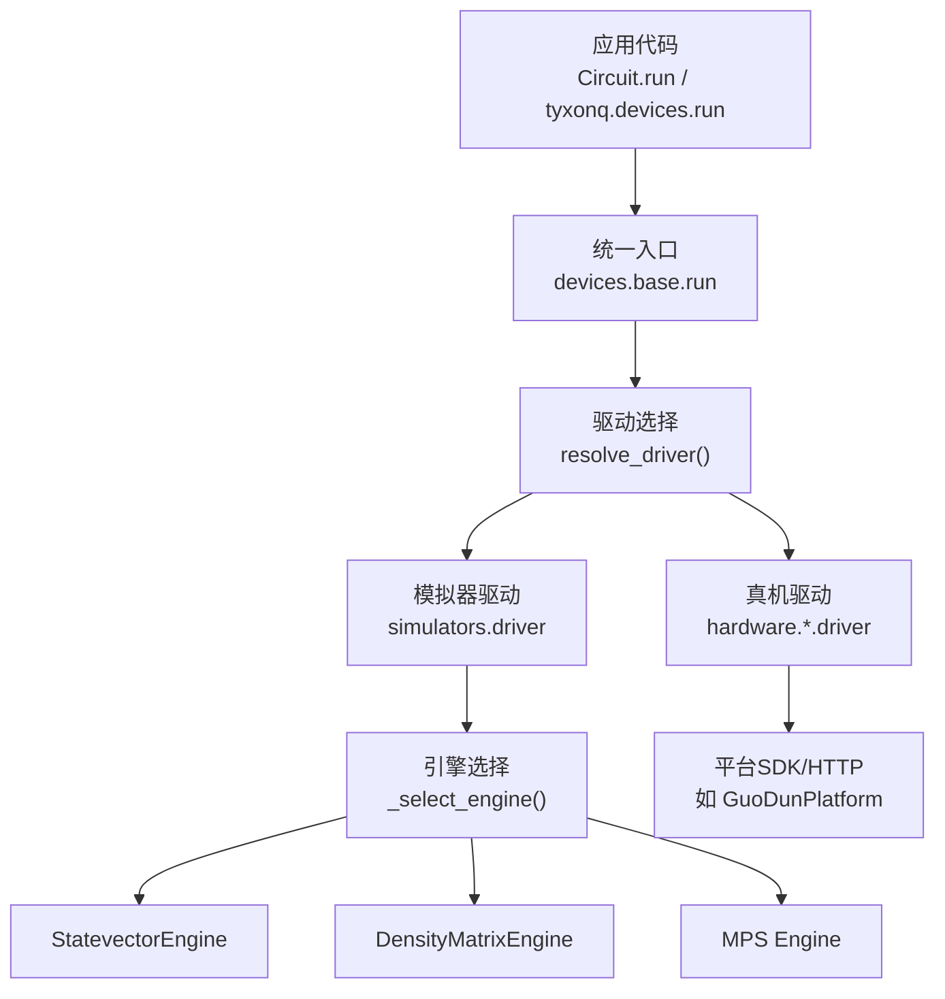
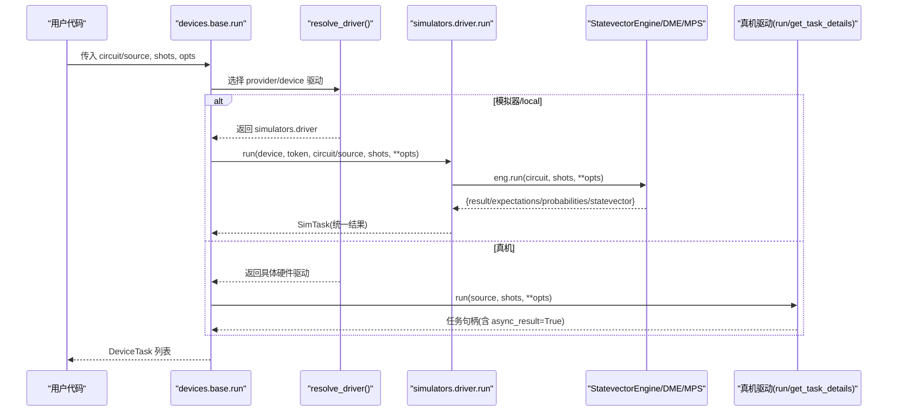
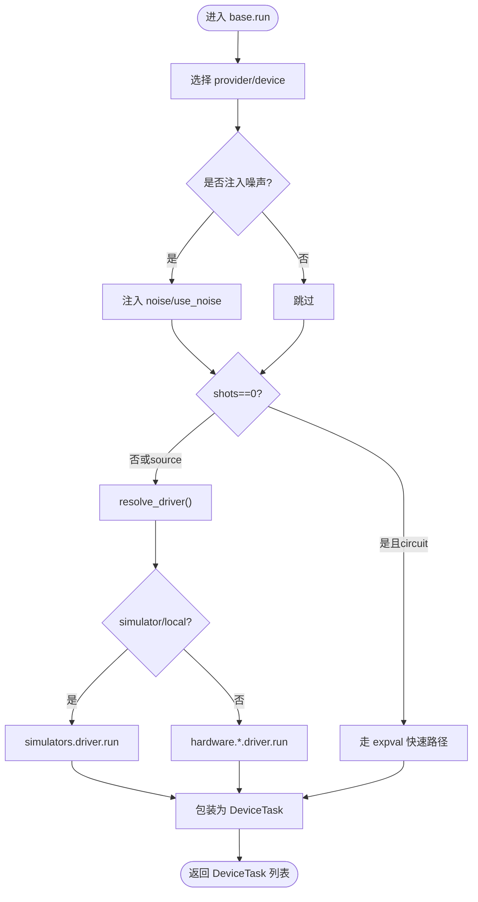
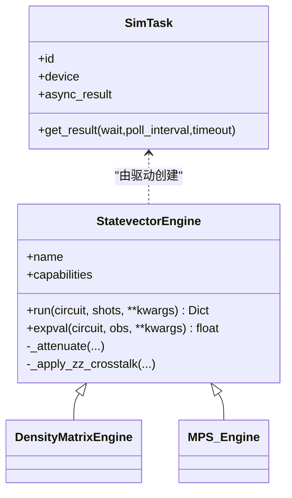
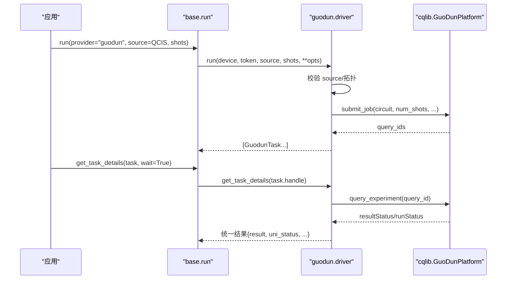
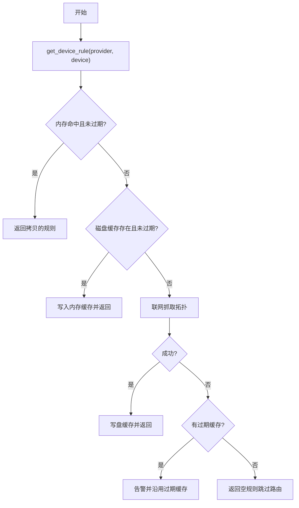
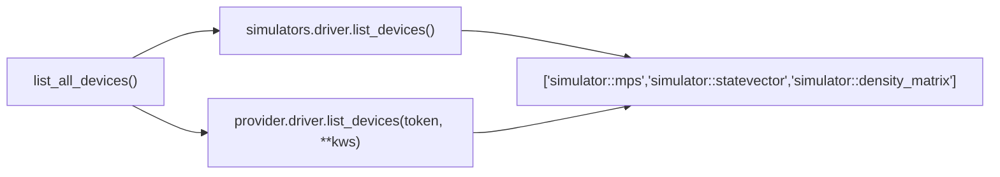
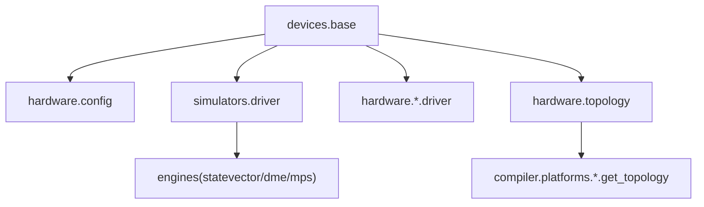

# 自定义设备开发

<cite>
**本文引用的文件**
- [src/tyxonq/devices/base.py](file://src/tyxonq/devices/base.py)
- [src/tyxonq/devices/simulators/driver.py](file://src/tyxonq/devices/simulators/driver.py)
- [src/tyxonq/devices/hardware/config.py](file://src/tyxonq/devices/hardware/config.py)
- [src/tyxonq/devices/hardware/topology.py](file://src/tyxonq/devices/hardware/topology.py)
- [src/tyxonq/devices/simulators/statevector/engine.py](file://src/tyxonq/devices/simulators/statevector/engine.py)
- [src/tyxonq/devices/hardware/guodun/driver.py](file://src/tyxonq/devices/hardware/guodun/driver.py)
- [examples/custom_unitary_gates.py](file://examples/custom_unitary_gates.py)
- [tests_core_module/test_devices_simulators.py](file://tests_core_module/test_devices_simulators.py)
</cite>

## 目录
1. [简介](#简介)
2. [项目结构](#项目结构)
3. [核心组件](#核心组件)
4. [架构总览](#架构总览)
5. [详细组件分析](#详细组件分析)
6. [依赖关系分析](#依赖关系分析)
7. [性能考虑](#性能考虑)
8. [故障排查指南](#故障排查指南)
9. [结论](#结论)
10. [附录](#附录)

## 简介
本指南面向需要在 TyxonQ 中实现“自定义量子设备”的开发者，覆盖从继承基础接口、实现执行流程，到配置管理（拓扑、噪声、硬件参数）、状态管理（初始化、重置、错误处理）、以及设备注册与发现机制。文档同时提供模拟器设备与真实硬件设备的完整实现模式，并给出性能优化最佳实践。

## 项目结构
TyxonQ 的设备层采用“统一入口 + 驱动分发 + 引擎实现”的分层设计：
- 统一入口：devices.base 提供 run/expval/list_all_devices 等高层 API，负责选择 provider/device、注入噪声、统一任务包装。
- 驱动分发：根据 provider 动态加载对应 driver（simulator、guodun、lqcloud、quafu、qcos、ibm、tyxonq）。
- 引擎实现：模拟器通过 statevector/density_matrix/matrix_product_state 引擎完成量子态演化与测量；真机驱动封装 SDK/HTTP 提交与查询。

图表来源
- [src/tyxonq/devices/base.py:294-445](file://src/tyxonq/devices/base.py#L294-L445)
- [src/tyxonq/devices/simulators/driver.py:20-38](file://src/tyxonq/devices/simulators/driver.py#L20-L38)
- [src/tyxonq/devices/simulators/driver.py:86-141](file://src/tyxonq/devices/simulators/driver.py#L86-L141)
- [src/tyxonq/devices/hardware/guodun/driver.py:310-357](file://src/tyxonq/devices/hardware/guodun/driver.py#L310-L357)

章节来源
- [src/tyxonq/devices/base.py:294-445](file://src/tyxonq/devices/base.py#L294-L445)
- [src/tyxonq/devices/simulators/driver.py:20-38](file://src/tyxonq/devices/simulators/driver.py#L20-L38)

## 核心组件
- DeviceTask：统一的任务句柄包装，屏蔽异步/同步差异，提供 get_result/cancel。
- DeviceRule：声明式设备能力描述（耦合图、最大比特数、原生门集等），供编译器路由使用。
- devices.base.run：统一执行入口，自动注入噪声、归一化 shots、区分模拟器/真机路径。
- simulators.driver：模拟器驱动，负责 QASM/IR 转换、引擎选择、结果标准化。
- hardware.config：默认 provider/device、token 管理、端点配置。
- hardware.topology：拓扑发现与 TTL 缓存（内存+磁盘），为编译器提供 coupling_map/native_gates。
- 引擎：statevector/density_matrix/mps 实现量子态演化、测量、期望值计算。
- 真机驱动：以 guodun 为例，封装提交、查询、取消、设备发现与拓扑校验。

章节来源
- [src/tyxonq/devices/base.py:12-57](file://src/tyxonq/devices/base.py#L12-L57)
- [src/tyxonq/devices/base.py:60-108](file://src/tyxonq/devices/base.py#L60-L108)
- [src/tyxonq/devices/base.py:294-445](file://src/tyxonq/devices/base.py#L294-L445)
- [src/tyxonq/devices/simulators/driver.py:6-18](file://src/tyxonq/devices/simulators/driver.py#L6-L18)
- [src/tyxonq/devices/hardware/config.py:7-19](file://src/tyxonq/devices/hardware/config.py#L7-L19)
- [src/tyxonq/devices/hardware/topology.py:1-29](file://src/tyxonq/devices/hardware/topology.py#L1-L29)

## 架构总览
下图展示了从用户调用到具体执行的端到端流程，包括模拟器与真机的不同分支。

图表来源
- [src/tyxonq/devices/base.py:294-445](file://src/tyxonq/devices/base.py#L294-L445)
- [src/tyxonq/devices/simulators/driver.py:86-141](file://src/tyxonq/devices/simulators/driver.py#L86-L141)
- [src/tyxonq/devices/hardware/guodun/driver.py:310-357](file://src/tyxonq/devices/hardware/guodun/driver.py#L310-L357)

## 详细组件分析

### 1) 设备基类与协议（BaseDevice/Device）
- 协议定义：Device 协议要求 name、device_rule、run、expval。
- 统一任务：DeviceTask 封装 provider/device/handle/async_result，并提供 get_result/cancel。
- 统一运行：devices.base.run 负责：
  - 解析 provider/device 默认值与 token
  - 注入噪声（仅对模拟器有效）
  - 规范化 shots（真机不允许 0）
  - 将 simulator 的 circuit 路径与 hardware 的 source 路径分流
  - 统一返回 DeviceTask 列表

图表来源
- [src/tyxonq/devices/base.py:294-445](file://src/tyxonq/devices/base.py#L294-L445)
- [src/tyxonq/devices/base.py:448-469](file://src/tyxonq/devices/base.py#L448-L469)

章节来源
- [src/tyxonq/devices/base.py:97-108](file://src/tyxonq/devices/base.py#L97-L108)
- [src/tyxonq/devices/base.py:12-57](file://src/tyxonq/devices/base.py#L12-L57)
- [src/tyxonq/devices/base.py:294-445](file://src/tyxonq/devices/base.py#L294-L445)
- [src/tyxonq/devices/base.py:448-469](file://src/tyxonq/devices/base.py#L448-L469)

### 2) 模拟器设备实现（Statevector/Density Matrix/MPS）
- 驱动选择：simulators.driver._select_engine 根据 device 字符串选择引擎。
- 执行流程：
  - 若 source 为字符串，尝试解析为 IR（支持 OpenQASM3/TQASM 与 Qiskit QASM2）
  - 构造引擎实例，调用 eng.run(circuit, shots, **opts)
  - 标准化输出：counts/expectations/probabilities/statevector/metadata
  - 返回 SimTask（async_result=False）
- 引擎特性（以 StatevectorEngine 为例）：
  - 支持幺正门、测量、投影、reset、Kraus 噪声、脉冲操作（含三能级泄漏模拟）
  - 支持 ZZ 串扰（local/global 两种模式）
  - 支持后端切换（numpy/pytorch/cupynumeric）

图表来源
- [src/tyxonq/devices/simulators/driver.py:6-18](file://src/tyxonq/devices/simulators/driver.py#L6-L18)
- [src/tyxonq/devices/simulators/driver.py:20-38](file://src/tyxonq/devices/simulators/driver.py#L20-L38)
- [src/tyxonq/devices/simulators/driver.py:86-141](file://src/tyxonq/devices/simulators/driver.py#L86-L141)
- [src/tyxonq/devices/simulators/statevector/engine.py:38-451](file://src/tyxonq/devices/simulators/statevector/engine.py#L38-L451)

章节来源
- [src/tyxonq/devices/simulators/driver.py:20-38](file://src/tyxonq/devices/simulators/driver.py#L20-L38)
- [src/tyxonq/devices/simulators/driver.py:86-141](file://src/tyxonq/devices/simulators/driver.py#L86-L141)
- [src/tyxonq/devices/simulators/statevector/engine.py:38-451](file://src/tyxonq/devices/simulators/statevector/engine.py#L38-L451)

### 3) 真实硬件设备实现（以 GuoDun 为例）
- 驱动职责：
  - 登录与平台对象创建（带版本锁定与重试关闭）
  - 源格式校验（QCIS，必须包含测量指令）
  - 拓扑校验（禁用比特/耦合器、CZ/B 边合法性）
  - 提交作业、轮询查询、取消任务、设备发现
- 任务模型：GuodunTask 保存 query_id、platform、status，并暴露 async_result=True。
- 结果归一化：get_task_details 将平台结果转换为统一格式（result/result_meta/uni_status/error）。

图表来源
- [src/tyxonq/devices/hardware/guodun/driver.py:310-357](file://src/tyxonq/devices/hardware/guodun/driver.py#L310-L357)
- [src/tyxonq/devices/hardware/guodun/driver.py:403-471](file://src/tyxonq/devices/hardware/guodun/driver.py#L403-L471)
- [src/tyxonq/devices/base.py:497-557](file://src/tyxonq/devices/base.py#L497-L557)

章节来源
- [src/tyxonq/devices/hardware/guodun/driver.py:30-90](file://src/tyxonq/devices/hardware/guodun/driver.py#L30-L90)
- [src/tyxonq/devices/hardware/guodun/driver.py:100-140](file://src/tyxonq/devices/hardware/guodun/driver.py#L100-L140)
- [src/tyxonq/devices/hardware/guodun/driver.py:152-222](file://src/tyxonq/devices/hardware/guodun/driver.py#L152-L222)
- [src/tyxonq/devices/hardware/guodun/driver.py:310-357](file://src/tyxonq/devices/hardware/guodun/driver.py#L310-L357)
- [src/tyxonq/devices/hardware/guodun/driver.py:403-471](file://src/tyxonq/devices/hardware/guodun/driver.py#L403-L471)

### 4) 设备配置管理（拓扑、噪声、硬件参数）
- 拓扑发现与缓存：
  - 按 provider/device 获取 coupling_map/num_qubits/native_gates
  - 两级缓存：会话内内存缓存 + 磁盘 TTL 缓存（可配置目录）
  - 失败降级：无网络/凭证时沿用过期缓存或空规则，不中断编译
- 噪声模型：
  - 全局开关 enable_noise/is_noise_enabled/get_noise_config
  - 仅对模拟器生效（真机丢弃 noise/use_noise 键）
  - 支持 depolarizing/readout 等通道（引擎内部实现）
- 硬件参数：
  - 默认 provider/device、token 管理（set_token/get_token）
  - 端点配置（ENDPOINTS）

图表来源
- [src/tyxonq/devices/hardware/topology.py:180-258](file://src/tyxonq/devices/hardware/topology.py#L180-L258)
- [src/tyxonq/devices/base.py:274-292](file://src/tyxonq/devices/base.py#L274-L292)
- [src/tyxonq/devices/hardware/config.py:24-65](file://src/tyxonq/devices/hardware/config.py#L24-L65)

章节来源
- [src/tyxonq/devices/hardware/topology.py:180-258](file://src/tyxonq/devices/hardware/topology.py#L180-L258)
- [src/tyxonq/devices/base.py:274-292](file://src/tyxonq/devices/base.py#L274-L292)
- [src/tyxonq/devices/hardware/config.py:24-65](file://src/tyxonq/devices/hardware/config.py#L24-L65)

### 5) 设备状态管理（初始化、重置、错误处理）
- 初始化：
  - 设置默认 provider/device（set_default）
  - 设置 token（set_token），支持 provider/device 级别与全局环境变量回退
- 重置：
  - 拓扑缓存清理（clear_topology_cache）
  - 任务取消（remove_task）
- 错误处理：
  - 统一任务详情中的 uni_status/error 字段
  - 真机驱动对临时查询异常进行容错（不重新提交）
  - 模拟器引擎对未知 op 抛出明确错误，避免静默丢弃

章节来源
- [src/tyxonq/devices/hardware/config.py:24-65](file://src/tyxonq/devices/hardware/config.py#L24-L65)
- [src/tyxonq/devices/hardware/topology.py:261-291](file://src/tyxonq/devices/hardware/topology.py#L261-L291)
- [src/tyxonq/devices/base.py:497-557](file://src/tyxonq/devices/base.py#L497-L557)
- [src/tyxonq/devices/simulators/statevector/engine.py:335-342](file://src/tyxonq/devices/simulators/statevector/engine.py#L335-L342)
- [src/tyxonq/devices/hardware/guodun/driver.py:392-430](file://src/tyxonq/devices/hardware/guodun/driver.py#L392-L430)

### 6) 设备注册与发现机制
- 设备发现：
  - list_all_devices 聚合模拟器与 provider 设备列表
  - 各驱动实现 list_devices（如 guodun 通过 SDK 查询可用机器）
- 注册方式：
  - 无需显式注册表；通过 resolve_driver 按 provider 动态导入模块
  - 新增 provider 只需在 resolve_driver 中添加分支并实现 driver 接口

图表来源
- [src/tyxonq/devices/base.py:475-493](file://src/tyxonq/devices/base.py#L475-L493)
- [src/tyxonq/devices/simulators/driver.py:33-38](file://src/tyxonq/devices/simulators/driver.py#L33-L38)
- [src/tyxonq/devices/hardware/guodun/driver.py:493-510](file://src/tyxonq/devices/hardware/guodun/driver.py#L493-L510)

章节来源
- [src/tyxonq/devices/base.py:475-493](file://src/tyxonq/devices/base.py#L475-L493)
- [src/tyxonq/devices/simulators/driver.py:33-38](file://src/tyxonq/devices/simulators/driver.py#L33-L38)
- [src/tyxonq/devices/hardware/guodun/driver.py:493-510](file://src/tyxonq/devices/hardware/guodun/driver.py#L493-L510)

### 7) 完整实现示例（模拟器与真机）
- 模拟器设备：
  - 使用 statevector 引擎实现纯态演化、测量与期望值计算
  - 支持噪声注入（depolarizing/readout）与 ZZ 串扰
  - 参考：statevector.engine.run/expval 及 simulators.driver.run
- 真实硬件设备：
  - 以 GuoDun 为例，实现 QCIS 源校验、拓扑验证、提交/查询/取消
  - 参考：guodun.driver.run/get_task_details/remove_task/list_devices
- 自定义门集成：
  - 通过 Circuit.unitary 接入任意幺正矩阵，便于扩展新门集
  - 参考：examples/custom_unitary_gates.py

章节来源
- [src/tyxonq/devices/simulators/statevector/engine.py:46-451](file://src/tyxonq/devices/simulators/statevector/engine.py#L46-L451)
- [src/tyxonq/devices/simulators/driver.py:86-141](file://src/tyxonq/devices/simulators/driver.py#L86-L141)
- [src/tyxonq/devices/hardware/guodun/driver.py:310-357](file://src/tyxonq/devices/hardware/guodun/driver.py#L310-L357)
- [examples/custom_unitary_gates.py:1-255](file://examples/custom_unitary_gates.py#L1-L255)

## 依赖关系分析
- 模块耦合：
  - devices.base 依赖 hardware.config（默认 provider/device/token）
  - devices.base 通过 resolve_driver 动态导入各 provider 的 driver
  - simulators.driver 依赖 engines（statevector/density_matrix/mps）
  - hardware.topology 依赖各 platform 的 get_topology（当前已落地 lqcloud）
- 外部依赖：
  - 真机驱动可能依赖第三方 SDK（如 cqlib for GuoDun）
  - 模拟器引擎依赖数值后端（numpy/pytorch/cupynumeric）

图表来源
- [src/tyxonq/devices/base.py:146-258](file://src/tyxonq/devices/base.py#L146-L258)
- [src/tyxonq/devices/hardware/topology.py:164-177](file://src/tyxonq/devices/hardware/topology.py#L164-L177)
- [src/tyxonq/devices/simulators/driver.py:20-38](file://src/tyxonq/devices/simulators/driver.py#L20-L38)

章节来源
- [src/tyxonq/devices/base.py:146-258](file://src/tyxonq/devices/base.py#L146-L258)
- [src/tyxonq/devices/hardware/topology.py:164-177](file://src/tyxonq/devices/hardware/topology.py#L164-L177)

## 性能考虑
- 模拟器侧：
  - 使用 shots==0 的解析路径直接计算期望值，避免采样开销
  - 合理选择引擎：statevector（小系统精确）、density_matrix（含噪声）、mps（大系统压缩表示）
  - 利用后端切换（numpy/pytorch/cupynumeric）加速大规模张量运算
- 真机侧：
  - 批量提交与 shots 对齐，减少往返次数
  - 拓扑缓存避免重复网络请求
  - 谨慎设置等待超时，避免长时间阻塞
- 通用：
  - 避免在真机路径传递 noise/use_noise 参数（会被丢弃）
  - 使用 DeviceTask.get_result 的统一轮询逻辑，减少重复查询

[本节为通用指导，不直接分析具体文件]

## 故障排查指南
- 常见问题：
  - 拓扑发现失败：检查网络连接与凭证；必要时强制刷新缓存
  - 真机任务超时：增大等待超时或降低 shots；确认设备排队情况
  - 模拟器未知 op：确保使用 libs.quantum_library.kernels.gates 支持的门集
  - 噪声参数无效：确认 provider 为 simulator/local；检查 use_noise/noise 配置
- 定位方法：
  - 查看 DeviceTask.get_result 返回的 uni_status 与 error 字段
  - 使用 clear_topology_cache 清理缓存后重试
  - 在模拟器路径启用 use_noise 并打印噪声配置

章节来源
- [src/tyxonq/devices/base.py:497-557](file://src/tyxonq/devices/base.py#L497-L557)
- [src/tyxonq/devices/hardware/topology.py:240-258](file://src/tyxonq/devices/hardware/topology.py#L240-L258)
- [src/tyxonq/devices/simulators/statevector/engine.py:335-342](file://src/tyxonq/devices/simulators/statevector/engine.py#L335-L342)

## 结论
TyxonQ 的设备层通过统一入口、驱动分发与引擎实现，提供了可扩展、高性能且健壮的量子设备抽象。开发者可基于此快速实现自定义模拟器或对接真实硬件平台，并通过拓扑缓存、噪声模型与状态管理获得一致的使用体验。遵循本文的最佳实践，可在保证正确性的同时显著提升开发与运行效率。

[本节为总结性内容，不直接分析具体文件]

## 附录
- 关键 API 速查：
  - devices.base.run：统一执行入口
  - devices.base.expval：解析期望值快速路径
  - devices.base.list_all_devices：设备发现
  - simulators.driver.run：模拟器执行
  - hardware.config.set_token/get_token：认证管理
  - hardware.topology.get_device_rule：拓扑规则获取
- 测试参考：
  - 模拟器内核与噪声通道测试：test_devices_simulators.py

章节来源
- [tests_core_module/test_devices_simulators.py:51-160](file://tests_core_module/test_devices_simulators.py#L51-L160)