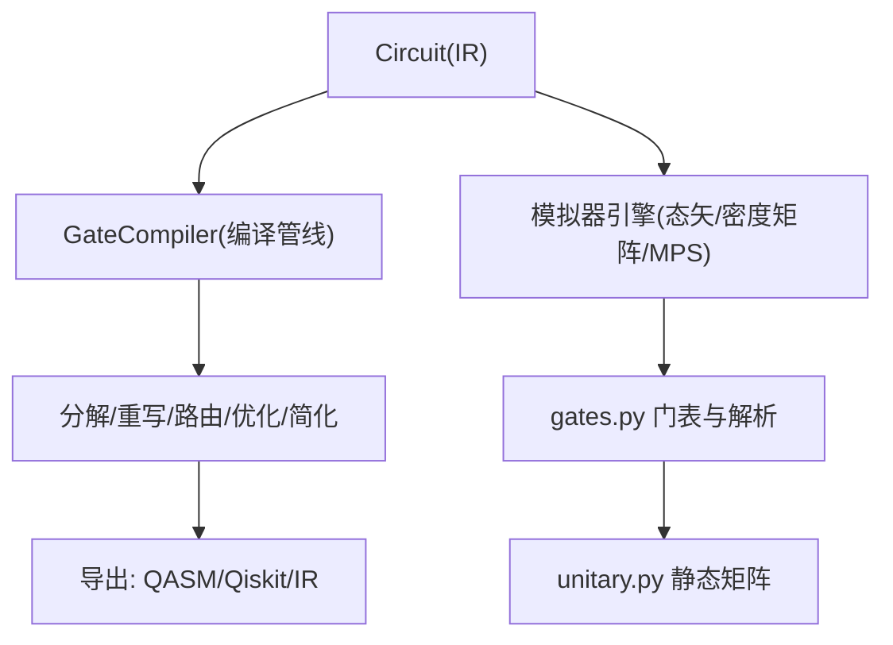
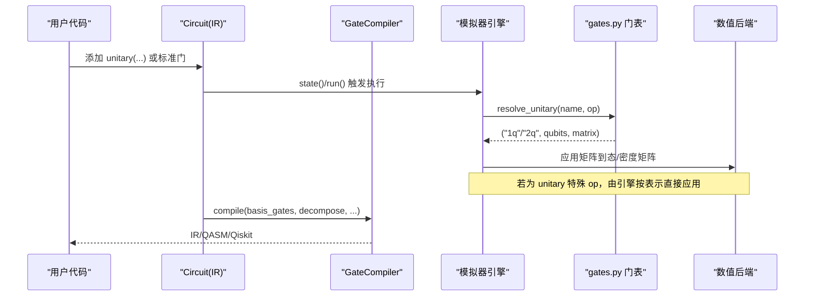
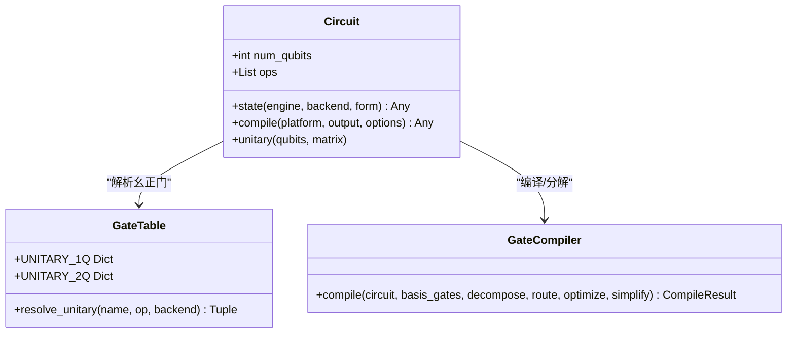
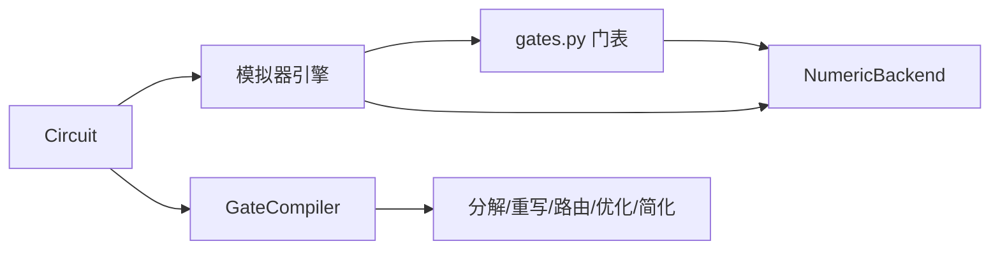

# 自定义量子门开发

<cite>
**本文引用的文件**
- [examples/custom_unitary_gates.py](file://examples/custom_unitary_gates.py)
- [src/tyxonq/libs/quantum_library/kernels/gates.py](file://src/tyxonq/libs/quantum_library/kernels/gates.py)
- [src/tyxonq/core/ir/circuit.py](file://src/tyxonq/core/ir/circuit.py)
- [src/tyxonq/compiler/gate_compiler/compiler.py](file://src/tyxonq/compiler/gate_compiler/compiler.py)
- [src/tyxonq/libs/quantum_library/kernels/unitary.py](file://src/tyxonq/libs/quantum_library/kernels/unitary.py)
- [tests_core_module/test_all_gates_gradient.py](file://tests_core_module/test_all_gates_gradient.py)
</cite>

## 目录
1. [简介](#简介)
2. [项目结构](#项目结构)
3. [核心组件](#核心组件)
4. [架构总览](#架构总览)
5. [详细组件分析](#详细组件分析)
6. [依赖关系分析](#依赖关系分析)
7. [性能考量](#性能考量)
8. [故障排查指南](#故障排查指南)
9. [结论](#结论)
10. [附录](#附录)

## 简介
本指南面向希望在 TyxonQ 中开发自定义量子门的开发者，系统阐述如何定义新的量子门操作（含数学表示、矩阵实现与梯度计算）、如何实现参数化机制（可变参数处理、参数绑定、符号/自动微分支持），以及如何设计分解策略（基本门序列分解、优化规则、编译期转换）。文档同时提供单量子比特门、多量子比特门、参数化门的完整实现示例路径，并给出测试验证方法与性能优化建议。

## 项目结构
TyxonQ 将“门定义”“电路 IR”“编译器”“数值后端”分层组织：
- 门矩阵与解析：位于量子库内核层，集中维护幺正门集合与解析器，保证模拟器引擎统一分发。
- 电路 IR：Circuit 类承载算子列表、元数据与执行配置，并提供 unitary 等便捷 API。
- 编译器：GateCompiler 负责将 IR 转换为设备相关形式，包含分解、路由、优化、简化等阶段。
- 数值后端：通过 NumericBackend 抽象不同后端（NumPy/PyTorch）以支持自动微分与张量运算。

图表来源
- [src/tyxonq/core/ir/circuit.py:427-541](file://src/tyxonq/core/ir/circuit.py#L427-L541)
- [src/tyxonq/compiler/gate_compiler/compiler.py:27-109](file://src/tyxonq/compiler/gate_compiler/compiler.py#L27-L109)
- [src/tyxonq/libs/quantum_library/kernels/gates.py:355-418](file://src/tyxonq/libs/quantum_library/kernels/gates.py#L355-L418)
- [src/tyxonq/libs/quantum_library/kernels/unitary.py:50-80](file://src/tyxonq/libs/quantum_library/kernels/unitary.py#L50-L80)

章节来源
- [src/tyxonq/core/ir/circuit.py:48-183](file://src/tyxonq/core/ir/circuit.py#L48-L183)
- [src/tyxonq/compiler/gate_compiler/compiler.py:14-109](file://src/tyxonq/compiler/gate_compiler/compiler.py#L14-L109)
- [src/tyxonq/libs/quantum_library/kernels/gates.py:355-418](file://src/tyxonq/libs/quantum_library/kernels/gates.py#L355-L418)
- [src/tyxonq/libs/quantum_library/kernels/unitary.py:1-80](file://src/tyxonq/libs/quantum_library/kernels/unitary.py#L1-L80)

## 核心组件
- 门矩阵与解析器：集中定义 1Q/2Q 幺正门及其参数化构建函数，并通过 UNITARY_1Q/UNITARY_2Q 映射到 op 名称；resolve_unitary 将 op 解析为 (arity, qubits, matrix)。
- 电路 IR：Circuit 提供 unitary(qubits, matrix=...) 接口直接注入任意幺正矩阵，支持链式构建与多种执行后端选择。
- 编译器：GateCompiler 根据 basis_gates/decompose/route/optimize/simplify 等参数装配步骤，输出 IR/QASM/Qiskit。
- 数值后端：门矩阵构建使用 NumericBackend，确保在 PyTorch/NumPy 下均能保持自动微分图。

章节来源
- [src/tyxonq/libs/quantum_library/kernels/gates.py:19-65](file://src/tyxonq/libs/quantum_library/kernels/gates.py#L19-L65)
- [src/tyxonq/libs/quantum_library/kernels/gates.py:355-418](file://src/tyxonq/libs/quantum_library/kernels/gates.py#L355-L418)
- [src/tyxonq/core/ir/circuit.py:427-541](file://src/tyxonq/core/ir/circuit.py#L427-L541)
- [src/tyxonq/compiler/gate_compiler/compiler.py:27-109](file://src/tyxonq/compiler/gate_compiler/compiler.py#L27-L109)

## 架构总览
下图展示从用户构建 Circuit 到最终执行或导出的关键流程，以及自定义门在不同阶段的处理方式。

图表来源
- [src/tyxonq/core/ir/circuit.py:427-541](file://src/tyxonq/core/ir/circuit.py#L427-L541)
- [src/tyxonq/libs/quantum_library/kernels/gates.py:355-418](file://src/tyxonq/libs/quantum_library/kernels/gates.py#L355-L418)
- [src/tyxonq/compiler/gate_compiler/compiler.py:27-109](file://src/tyxonq/compiler/gate_compiler/compiler.py#L27-L109)

## 详细组件分析

### 自定义幺正门：通过 Circuit.unitary 直接注入矩阵
- 适用场景：快速原型、随机电路基准、非标准门、VQE ansatz 中的自定义旋转。
- 用法要点：
  - 单量子比特：传入 2×2 复数矩阵。
  - 多量子比特：传入 4×4（或更高维）复数矩阵，注意基序约定（控制位为高位）。
  - 与标准门混用：可与 h/cx 等组合，便于构建复杂电路。
- 参考示例路径：
  - [examples/custom_unitary_gates.py:31-78](file://examples/custom_unitary_gates.py#L31-L78)
  - [examples/custom_unitary_gates.py:81-145](file://examples/custom_unitary_gates.py#L81-L145)
  - [examples/custom_unitary_gates.py:148-229](file://examples/custom_unitary_gates.py#L148-L229)

章节来源
- [examples/custom_unitary_gates.py:31-229](file://examples/custom_unitary_gates.py#L31-L229)
- [src/tyxonq/core/ir/circuit.py:427-541](file://src/tyxonq/core/ir/circuit.py#L427-L541)

### 参数化门：矩阵实现与梯度支持
- 矩阵实现：
  - 旋转门 Rx/Ry/Rz、Rxx/Ryy/Rzz、CRY 等均通过三角函数与张量堆叠构造，保证梯度链不断裂。
  - 使用 NumericBackend 的 stack/eye/kron 等操作，兼容 NumPy/PyTorch。
- 梯度计算：
  - 自动微分：当参数为可微张量时，矩阵构建过程保留计算图，反向传播即可得到梯度。
  - 参数平移法：对采样场景，可通过 ±π/2 偏移估计梯度（见示例）。
- 参考实现路径：
  - [src/tyxonq/libs/quantum_library/kernels/gates.py:19-65](file://src/tyxonq/libs/quantum_library/kernels/gates.py#L19-L65)
  - [src/tyxonq/libs/quantum_library/kernels/gates.py:222-271](file://src/tyxonq/libs/quantum_library/kernels/gates.py#L222-L271)
  - [src/tyxonq/libs/quantum_library/kernels/gates.py:284-303](file://src/tyxonq/libs/quantum_library/kernels/gates.py#L284-L303)
  - [examples/parameter_shift.py:94-183](file://examples/parameter_shift.py#L94-L183)

章节来源
- [src/tyxonq/libs/quantum_library/kernels/gates.py:19-65](file://src/tyxonq/libs/quantum_library/kernels/gates.py#L19-L65)
- [src/tyxonq/libs/quantum_library/kernels/gates.py:222-303](file://src/tyxonq/libs/quantum_library/kernels/gates.py#L222-L303)
- [examples/parameter_shift.py:94-183](file://examples/parameter_shift.py#L94-L183)

### 门表与解析：新增门的注册与分发
- 门表结构：
  - UNITARY_1Q/UNITARY_2Q 将 op 名映射到“是否含参 + 构建函数”。
  - CONTROL_OPS/SPECIAL_OPS 区分控制/特殊操作（如 measure_z、barrier、unitary、kraus 等）。
- 解析流程：
  - resolve_unitary 根据 op 名返回 (“1q”/“2q”, qubits, matrix)，供模拟器引擎统一应用。
- 扩展方式：
  - 在 UNITARY_1Q/UNITARY_2Q 中添加新条目，实现对应的构建函数（保持栈式构造以维持梯度）。
- 参考路径：
  - [src/tyxonq/libs/quantum_library/kernels/gates.py:355-418](file://src/tyxonq/libs/quantum_library/kernels/gates.py#L355-L418)

章节来源
- [src/tyxonq/libs/quantum_library/kernels/gates.py:355-418](file://src/tyxonq/libs/quantum_library/kernels/gates.py#L355-L418)

### 编译器与分解：将自定义门降至目标基集
- 编译管线：
  - GateCompiler.compile 依据 basis_gates/decompose/route/optimize/simplify 组装步骤，顺序执行。
  - 输出可为 IR、QASM2/3、Qiskit 对象。
- 分解策略：
  - 针对特定门（如 iswap/rxx/ryy/rzz）可在分解阶段匹配并替换为基本门序列。
  - 可通过 gates_transform/merge_prune 等阶段进行等价变换与合并剪枝。
- 参考路径：
  - [src/tyxonq/compiler/gate_compiler/compiler.py:27-109](file://src/tyxonq/compiler/gate_compiler/compiler.py#L27-L109)
  - [src/tyxonq/compiler/gate_compiler/stages/rewrite/gates_transform.py](file://src/tyxonq/compiler/gate_compiler/stages/rewrite/gates_transform.py)
  - [src/tyxonq/compiler/gate_compiler/stages/rewrite/merge_prune.py](file://src/tyxonq/compiler/gate_compiler/stages/rewrite/merge_prune.py)

章节来源
- [src/tyxonq/compiler/gate_compiler/compiler.py:27-109](file://src/tyxonq/compiler/gate_compiler/compiler.py#L27-L109)

### 静态矩阵与工具：get_unitary
- 用途：在不执行设备的场景（编译器/测试）获取标准门的静态矩阵。
- 支持门：h、rz、cx 等。
- 参考路径：
  - [src/tyxonq/libs/quantum_library/kernels/unitary.py:50-80](file://src/tyxonq/libs/quantum_library/kernels/unitary.py#L50-L80)

章节来源
- [src/tyxonq/libs/quantum_library/kernels/unitary.py:50-80](file://src/tyxonq/libs/quantum_library/kernels/unitary.py#L50-L80)

### 面向对象视角：门与电路的关系

图表来源
- [src/tyxonq/core/ir/circuit.py:48-183](file://src/tyxonq/core/ir/circuit.py#L48-L183)
- [src/tyxonq/libs/quantum_library/kernels/gates.py:355-418](file://src/tyxonq/libs/quantum_library/kernels/gates.py#L355-L418)
- [src/tyxonq/compiler/gate_compiler/compiler.py:27-109](file://src/tyxonq/compiler/gate_compiler/compiler.py#L27-L109)

## 依赖关系分析
- Circuit 依赖模拟器引擎执行状态演化，引擎通过 gates.py 的门表解析幺正门。
- GateCompiler 依赖 stages（分解/重写/路由/优化/简化）对 IR 进行变换，再导出为目标格式。
- 数值后端贯穿门矩阵构建与执行，保证跨框架的自动微分与张量运算一致性。

图表来源
- [src/tyxonq/core/ir/circuit.py:427-541](file://src/tyxonq/core/ir/circuit.py#L427-L541)
- [src/tyxonq/libs/quantum_library/kernels/gates.py:355-418](file://src/tyxonq/libs/quantum_library/kernels/gates.py#L355-L418)
- [src/tyxonq/compiler/gate_compiler/compiler.py:27-109](file://src/tyxonq/compiler/gate_compiler/compiler.py#L27-L109)

章节来源
- [src/tyxonq/core/ir/circuit.py:427-541](file://src/tyxonq/core/ir/circuit.py#L427-L541)
- [src/tyxonq/libs/quantum_library/kernels/gates.py:355-418](file://src/tyxonq/libs/quantum_library/kernels/gates.py#L355-L418)
- [src/tyxonq/compiler/gate_compiler/compiler.py:27-109](file://src/tyxonq/compiler/gate_compiler/compiler.py#L27-L109)

## 性能考量
- 矩阵构建：
  - 使用 stack/eye/kron 等后端原生操作，避免 Python 循环与类型转换带来的开销。
  - 对大矩阵（如多控门）优先采用稀疏或结构化构造，必要时缓存结果。
- 执行路径：
  - 小尺度精确模拟：statevector 最快；大规模高纠缠：考虑 MPS；含噪声：density_matrix。
- 梯度计算：
  - 自动微分：一次前向+一次反向，适合小规模参数。
  - 参数平移：硬件友好，但需多次电路评估；结合批量化与并行减少开销。
- 编译优化：
  - 合理设置 optimization_level，启用 merge_prune 合并相邻门、lightcone 化简。
  - 指定 basis_gates 以利于后续导出与硬件适配。

[本节为通用指导，不直接分析具体文件]

## 故障排查指南
- 未知门被静默丢弃：
  - 现象：某些门未生效导致结果错误。
  - 原因：模拟器引擎仅识别 KNOWN_OPS 中的幺正/控制/特殊 op，未知 op 应抛出清晰错误而非跳过。
  - 解决：在 gates.py 的 UNITARY_* 或 SPECIAL_OPS 中注册新门，并确保 resolve_unitary 正确解析。
- 梯度断裂：
  - 现象：反向传播失败或梯度为零。
  - 原因：矩阵构建过程中使用了破坏梯度链的操作（如直接 np.array 构造）。
  - 解决：使用 NumericBackend 的 stack/eye/kron 等，保持计算图连续。
- 分解失败或导出异常：
  - 现象：QASM/Qiskit 导出报错。
  - 原因：basis_gates 不包含所需门或未正确分解。
  - 解决：显式设置 basis_gates，或在分解阶段添加匹配规则。

章节来源
- [src/tyxonq/libs/quantum_library/kernels/gates.py:385-418](file://src/tyxonq/libs/quantum_library/kernels/gates.py#L385-L418)
- [tests_core_module/test_all_gates_gradient.py](file://tests_core_module/test_all_gates_gradient.py)

## 结论
在 TyxonQ 中开发自定义量子门的关键在于：
- 明确数学表示与矩阵实现，遵循基序与后端规范。
- 通过 gates.py 的门表与解析器注册新门，确保模拟器引擎统一分发。
- 利用参数化门与自动微分/参数平移实现高效梯度计算。
- 借助编译器与分解阶段将自定义门降至目标基集，提升可移植性与性能。
- 通过示例与测试验证正确性，并结合优化策略获得良好性能。

[本节为总结，不直接分析具体文件]

## 附录

### 实现清单与示例路径
- 单量子比特门：
  - 示例：√X、Rx/Ry/Rz 等
  - 路径：[examples/custom_unitary_gates.py:31-78](file://examples/custom_unitary_gates.py#L31-L78)
- 多量子比特门：
  - 示例：iSWAP、QFT 控制相位门
  - 路径：[examples/custom_unitary_gates.py:55-145](file://examples/custom_unitary_gates.py#L55-L145)
- 参数化门：
  - 实现：Rx/Ry/Rz、Rxx/Ryy/Rzz、CRY
  - 路径：[src/tyxonq/libs/quantum_library/kernels/gates.py:19-65](file://src/tyxonq/libs/quantum_library/kernels/gates.py#L19-L65), [src/tyxonq/libs/quantum_library/kernels/gates.py:222-303](file://src/tyxonq/libs/quantum_library/kernels/gates.py#L222-L303)
- 门表与解析：
  - 路径：[src/tyxonq/libs/quantum_library/kernels/gates.py:355-418](file://src/tyxonq/libs/quantum_library/kernels/gates.py#L355-L418)
- 编译器与分解：
  - 路径：[src/tyxonq/compiler/gate_compiler/compiler.py:27-109](file://src/tyxonq/compiler/gate_compiler/compiler.py#L27-L109)

### 测试与验证
- 全门梯度覆盖测试：
  - 路径：[tests_core_module/test_all_gates_gradient.py](file://tests_core_module/test_all_gates_gradient.py)
- 参数平移梯度校验：
  - 路径：[examples/parameter_shift.py:94-183](file://examples/parameter_shift.py#L94-L183)