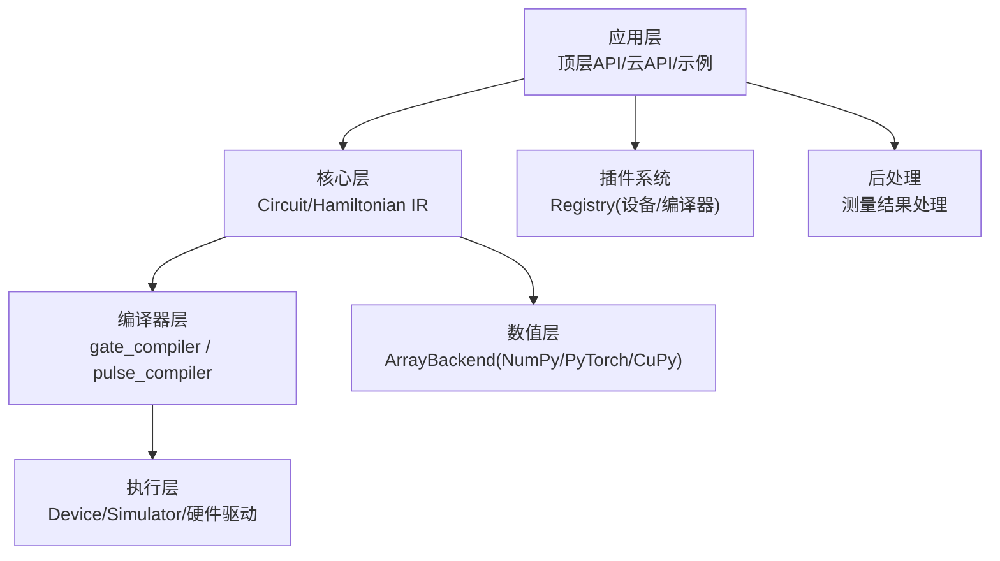
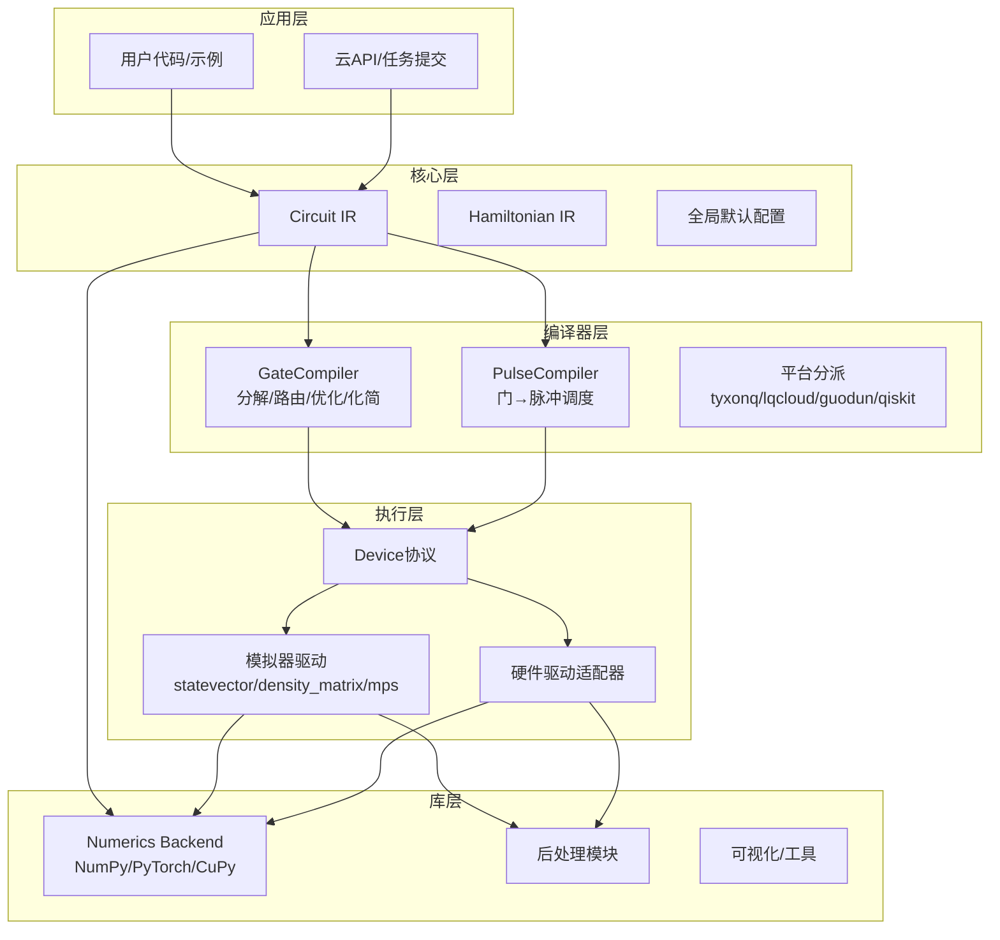
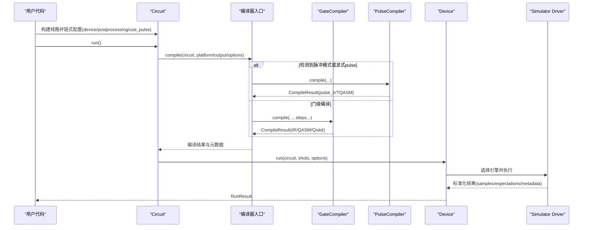
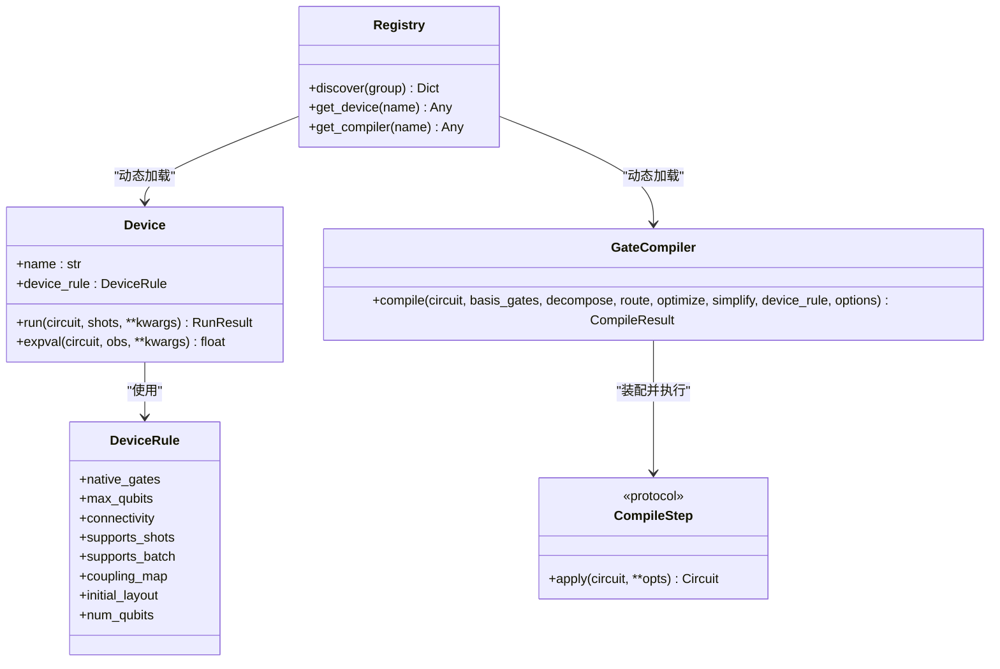
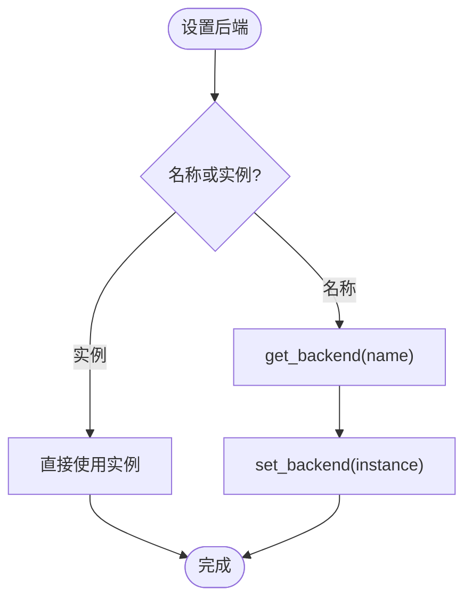
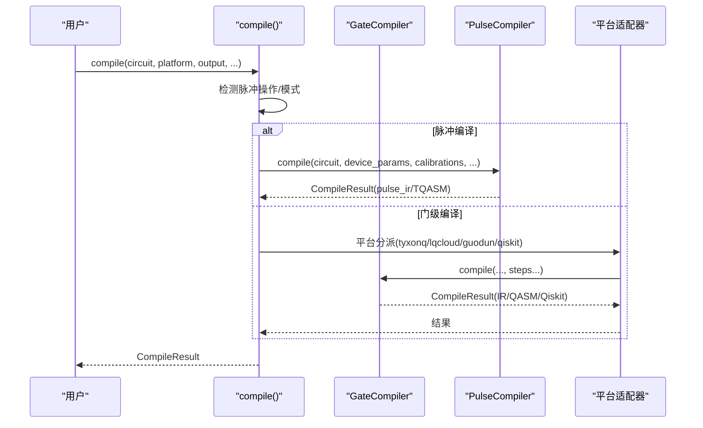
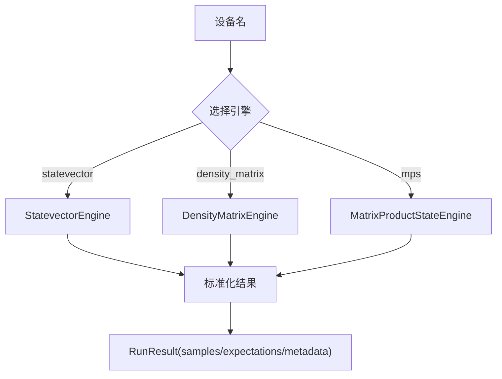
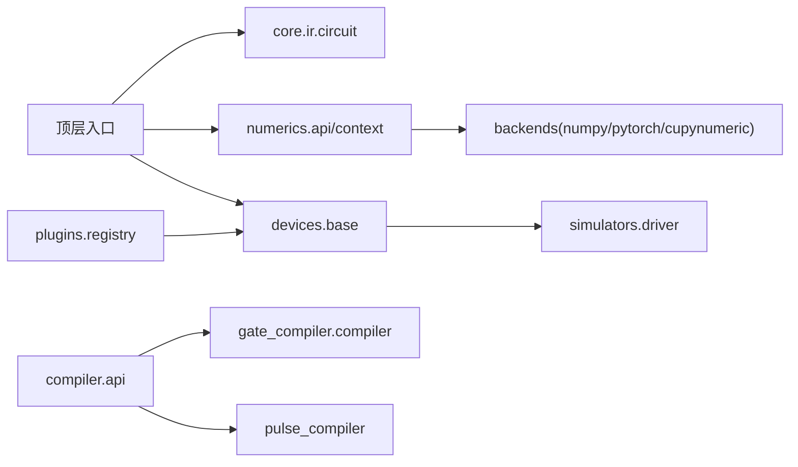

# 架构设计概览

<cite>
**本文引用的文件**
- [src/tyxonq/__init__.py](file://src/tyxonq/__init__.py)
- [src/tyxonq/config.py](file://src/tyxonq/config.py)
- [src/tyxonq/core/__init__.py](file://src/tyxonq/core/__init__.py)
- [src/tyxonq/core/ir/circuit.py](file://src/tyxonq/core/ir/circuit.py)
- [src/tyxonq/compiler/__init__.py](file://src/tyxonq/compiler/__init__.py)
- [src/tyxonq/compiler/api.py](file://src/tyxonq/compiler/api.py)
- [src/tyxonq/compiler/gate_compiler/compiler.py](file://src/tyxonq/compiler/gate_compiler/compiler.py)
- [src/tyxonq/compiler/pulse_compiler/__init__.py](file://src/tyxonq/compiler/pulse_compiler/__init__.py)
- [src/tyxonq/devices/base.py](file://src/tyxonq/devices/base.py)
- [src/tyxonq/devices/simulators/driver.py](file://src/tyxonq/devices/simulators/driver.py)
- [src/tyxonq/plugins/registry.py](file://src/tyxonq/plugins/registry.py)
- [src/tyxonq/numerics/__init__.py](file://src/tyxonq/numerics/__init__.py)
- [src/tyxonq/numerics/api.py](file://src/tyxonq/numerics/api.py)
</cite>

## 目录
1. [简介](#简介)
2. [项目结构](#项目结构)
3. [核心组件](#核心组件)
4. [架构总览](#架构总览)
5. [详细组件分析](#详细组件分析)
6. [依赖关系分析](#依赖关系分析)
7. [性能考量](#性能考量)
8. [故障排查指南](#故障排查指南)
9. [结论](#结论)
10. [附录](#附录)

## 简介
本文件系统性阐述 TyxonQ 框架的分层架构与关键设计：应用层、核心层、执行层与库层的职责划分；各层之间的依赖关系与数据流向；插件系统（设备、编译器阶段、后处理）的扩展机制；链式 API 的设计理念与技术实现；数值后端抽象层如何支持多种计算后端；以及编译器系统的“门级编译器 + 脉冲编译器”双阶段架构。文档配合架构图与流程图，帮助开发者快速理解整体设计思路并高效扩展。

## 项目结构
TyxonQ 采用分层模块化组织，核心入口在包初始化中提供轻量导出与全局默认配置；核心 IR 定义电路与哈密顿量；编译器提供统一编译入口与平台分派；设备层抽象执行接口并提供模拟器驱动；数值层提供统一数组后端；插件注册表提供可扩展的设备与编译器加载能力。

图表来源
- [src/tyxonq/__init__.py:136-183](file://src/tyxonq/__init__.py#L136-L183)
- [src/tyxonq/core/__init__.py:1-10](file://src/tyxonq/core/__init__.py#L1-L10)
- [src/tyxonq/compiler/__init__.py:1-8](file://src/tyxonq/compiler/__init__.py#L1-L8)
- [src/tyxonq/devices/base.py:97-108](file://src/tyxonq/devices/base.py#L97-L108)
- [src/tyxonq/numerics/__init__.py:1-17](file://src/tyxonq/numerics/__init__.py#L1-L17)
- [src/tyxonq/plugins/registry.py:10-62](file://src/tyxonq/plugins/registry.py#L10-L62)

章节来源
- [src/tyxonq/__init__.py:136-183](file://src/tyxonq/__init__.py#L136-L183)
- [src/tyxonq/core/__init__.py:1-10](file://src/tyxonq/core/__init__.py#L1-L10)
- [src/tyxonq/compiler/__init__.py:1-8](file://src/tyxonq/compiler/__init__.py#L1-L8)
- [src/tyxonq/devices/base.py:97-108](file://src/tyxonq/devices/base.py#L97-L108)
- [src/tyxonq/numerics/__init__.py:1-17](file://src/tyxonq/numerics/__init__.py#L1-L17)
- [src/tyxonq/plugins/registry.py:10-62](file://src/tyxonq/plugins/registry.py#L10-L62)

## 核心组件
- 顶层入口与全局默认：提供 device/postprocessing/compile 默认值设置、数值后端切换、噪声控制等便捷方法，降低使用门槛。
- 核心 IR：Circuit 作为设备无关的量子线路表示，内置链式配置（device、postprocessing、use_pulse）、元数据与指令序列。
- 编译器：统一入口 compile() 根据 platform/output 自动选择门级或脉冲编译器；GateCompiler 负责分解、路由、优化、化简等步骤装配与执行；PulseCompiler 将门级线路降为脉冲调度。
- 设备抽象：Device 协议定义 run/expval；DeviceRule 描述拓扑与能力；模拟器驱动按设备名选择引擎（statevector/density_matrix/mps）。
- 数值后端：ArrayBackend 协议统一数组操作；NumericBackend 提供类级代理；支持 NumPy/PyTorch/CuPy 并可动态切换。
- 插件系统：通过路径解析与缓存加载设备/编译器实例，预留 discover 扩展点。

章节来源
- [src/tyxonq/__init__.py:136-183](file://src/tyxonq/__init__.py#L136-L183)
- [src/tyxonq/core/ir/circuit.py:48-139](file://src/tyxonq/core/ir/circuit.py#L48-L139)
- [src/tyxonq/compiler/api.py:39-340](file://src/tyxonq/compiler/api.py#L39-L340)
- [src/tyxonq/compiler/gate_compiler/compiler.py:14-110](file://src/tyxonq/compiler/gate_compiler/compiler.py#L14-L110)
- [src/tyxonq/compiler/pulse_compiler/__init__.py:1-51](file://src/tyxonq/compiler/pulse_compiler/__init__.py#L1-L51)
- [src/tyxonq/devices/base.py:60-108](file://src/tyxonq/devices/base.py#L60-L108)
- [src/tyxonq/devices/simulators/driver.py:20-38](file://src/tyxonq/devices/simulators/driver.py#L20-L38)
- [src/tyxonq/numerics/api.py:19-122](file://src/tyxonq/numerics/api.py#L19-L122)
- [src/tyxonq/numerics/__init__.py:67-123](file://src/tyxonq/numerics/__init__.py#L67-L123)
- [src/tyxonq/plugins/registry.py:21-62](file://src/tyxonq/plugins/registry.py#L21-L62)

## 架构总览
TyxonQ 采用“应用层—核心层—执行层—库层”的分层模式，辅以“编译器双阶段”和“数值后端抽象”。

图表来源
- [src/tyxonq/core/ir/circuit.py:48-139](file://src/tyxonq/core/ir/circuit.py#L48-L139)
- [src/tyxonq/compiler/api.py:39-340](file://src/tyxonq/compiler/api.py#L39-L340)
- [src/tyxonq/compiler/gate_compiler/compiler.py:14-110](file://src/tyxonq/compiler/gate_compiler/compiler.py#L14-L110)
- [src/tyxonq/compiler/pulse_compiler/__init__.py:1-51](file://src/tyxonq/compiler/pulse_compiler/__init__.py#L1-L51)
- [src/tyxonq/devices/base.py:97-108](file://src/tyxonq/devices/base.py#L97-L108)
- [src/tyxonq/devices/simulators/driver.py:20-38](file://src/tyxonq/devices/simulators/driver.py#L20-L38)
- [src/tyxonq/numerics/api.py:19-122](file://src/tyxonq/numerics/api.py#L19-L122)

## 详细组件分析

### 分层架构与职责划分
- 应用层：面向用户的便捷入口（顶层 set_backend/device/postprocessing/compile），云任务提交封装，示例脚本。
- 核心层：设备无关的 IR（Circuit/Hamiltonian），链式配置与元数据管理，全局默认策略。
- 编译器层：统一编译入口，类型化参数驱动步骤装配；门级编译器负责通用优化与输出转换；脉冲编译器负责门到脉冲的降阶与调度。
- 执行层：Device 协议统一运行与期望值计算；模拟器驱动按设备名选择具体引擎；硬件驱动适配不同云平台。
- 库层：数值后端抽象统一数组运算；后处理模块对测量结果进行误差缓解、指标统计等；可视化工具辅助调试。

章节来源
- [src/tyxonq/__init__.py:136-183](file://src/tyxonq/__init__.py#L136-L183)
- [src/tyxonq/core/ir/circuit.py:48-139](file://src/tyxonq/core/ir/circuit.py#L48-L139)
- [src/tyxonq/compiler/api.py:39-340](file://src/tyxonq/compiler/api.py#L39-L340)
- [src/tyxonq/devices/base.py:97-108](file://src/tyxonq/devices/base.py#L97-L108)
- [src/tyxonq/numerics/api.py:19-122](file://src/tyxonq/numerics/api.py#L19-L122)

### 链式 API 设计与实现
- 设计理念：以 Circuit 为中心，通过 method chaining 组合 device、postprocessing、use_pulse、run 等阶段，形成声明式流水线；全局默认可被实例覆盖。
- 技术实现：Circuit 内部维护 _compile_opts/_device_opts/_post_opts，并在 __init__ 时合并全局默认；每个配置方法返回 self 以支持链式调用；run 阶段读取这些选项触发编译与执行。

图表来源
- [src/tyxonq/core/ir/circuit.py:191-239](file://src/tyxonq/core/ir/circuit.py#L191-L239)
- [src/tyxonq/compiler/api.py:39-340](file://src/tyxonq/compiler/api.py#L39-L340)
- [src/tyxonq/compiler/gate_compiler/compiler.py:27-110](file://src/tyxonq/compiler/gate_compiler/compiler.py#L27-L110)
- [src/tyxonq/compiler/pulse_compiler/__init__.py:1-51](file://src/tyxonq/compiler/pulse_compiler/__init__.py#L1-L51)
- [src/tyxonq/devices/base.py:97-108](file://src/tyxonq/devices/base.py#L97-L108)
- [src/tyxonq/devices/simulators/driver.py:86-141](file://src/tyxonq/devices/simulators/driver.py#L86-L141)

章节来源
- [src/tyxonq/core/ir/circuit.py:191-239](file://src/tyxonq/core/ir/circuit.py#L191-L239)
- [src/tyxonq/compiler/api.py:39-340](file://src/tyxonq/compiler/api.py#L39-L340)
- [src/tyxonq/devices/simulators/driver.py:86-141](file://src/tyxonq/devices/simulators/driver.py#L86-L141)

### 插件系统：设备、编译器阶段、后处理方法扩展
- 设备插件：通过 get_device("module:attr") 动态加载设备实例并缓存；discover(group) 预留 entry points 扩展点。
- 编译器阶段：CompileStep 协议定义 apply(circuit, **opts)，GateCompiler 通过 build_compile_steps 装配步骤顺序执行；平台适配器可复用核心步骤。
- 后处理方法：Circuit.postprocessing 注入 method 与 options，执行后由后处理模块消费 metadata 进行误差缓解、指标计算等。

图表来源
- [src/tyxonq/devices/base.py:60-108](file://src/tyxonq/devices/base.py#L60-L108)
- [src/tyxonq/compiler/api.py:28-36](file://src/tyxonq/compiler/api.py#L28-L36)
- [src/tyxonq/compiler/gate_compiler/compiler.py:14-110](file://src/tyxonq/compiler/gate_compiler/compiler.py#L14-L110)
- [src/tyxonq/plugins/registry.py:10-62](file://src/tyxonq/plugins/registry.py#L10-L62)

章节来源
- [src/tyxonq/plugins/registry.py:10-62](file://src/tyxonq/plugins/registry.py#L10-L62)
- [src/tyxonq/compiler/api.py:28-36](file://src/tyxonq/compiler/api.py#L28-L36)
- [src/tyxonq/devices/base.py:60-108](file://src/tyxonq/devices/base.py#L60-L108)

### 数值后端抽象层：多后端支持
- ArrayBackend 协议统一数组创建、代数运算、随机数、可选 vmap/jit/value_and_grad 等；NumericBackend 提供类级代理，屏蔽后端差异。
- 支持 NumPy（CPU）、PyTorch（GPU/自动微分）、CuPy（分布式 GPU），可通过 set_backend/get_backend 动态切换；set_dtype 统一设置复数/实数 dtype。
- vectorize_or_fallback 提供向量化策略（auto/force/off）与回退机制，保证兼容性。

图表来源
- [src/tyxonq/numerics/api.py:179-200](file://src/tyxonq/numerics/api.py#L179-L200)
- [src/tyxonq/numerics/__init__.py:20-58](file://src/tyxonq/numerics/__init__.py#L20-L58)
- [src/tyxonq/numerics/api.py:124-176](file://src/tyxonq/numerics/api.py#L124-L176)

章节来源
- [src/tyxonq/numerics/api.py:19-122](file://src/tyxonq/numerics/api.py#L19-L122)
- [src/tyxonq/numerics/__init__.py:67-123](file://src/tyxonq/numerics/__init__.py#L67-L123)
- [src/tyxonq/numerics/api.py:124-176](file://src/tyxonq/numerics/api.py#L124-L176)

### 编译器系统：双阶段架构（门级 + 脉冲）
- 统一入口 compile()：根据 platform/output 与 circuit 内容智能推断是否启用脉冲编译；homebrew_s2 设备有特定输出约束。
- 门级编译器 GateCompiler：基于类型化参数装配步骤（规范化→分解→路由→优化→化简），输出 IR/QASM2/QASM3/Qiskit。
- 脉冲编译器 PulseCompiler：将门级线路转换为脉冲调度，支持 TQASM/OpenQASM3 输出与云端提交；自动补足 device_params 与波形限制。

图表来源
- [src/tyxonq/compiler/api.py:39-340](file://src/tyxonq/compiler/api.py#L39-L340)
- [src/tyxonq/compiler/gate_compiler/compiler.py:27-110](file://src/tyxonq/compiler/gate_compiler/compiler.py#L27-L110)
- [src/tyxonq/compiler/pulse_compiler/__init__.py:1-51](file://src/tyxonq/compiler/pulse_compiler/__init__.py#L1-L51)

章节来源
- [src/tyxonq/compiler/api.py:39-340](file://src/tyxonq/compiler/api.py#L39-L340)
- [src/tyxonq/compiler/gate_compiler/compiler.py:27-110](file://src/tyxonq/compiler/gate_compiler/compiler.py#L27-L110)
- [src/tyxonq/compiler/pulse_compiler/__init__.py:1-51](file://src/tyxonq/compiler/pulse_compiler/__init__.py#L1-L51)

### 执行层：设备抽象与模拟器驱动
- Device 协议：统一 run/expval 接口；DeviceRule 描述拓扑与能力，供编译器路由使用。
- 模拟器驱动：按设备名选择 statevector/density_matrix/mps 引擎；submit_task/run 统一返回标准化结果（counts/expectations/probabilities/statevector/metadata）。

图表来源
- [src/tyxonq/devices/simulators/driver.py:20-38](file://src/tyxonq/devices/simulators/driver.py#L20-L38)
- [src/tyxonq/devices/simulators/driver.py:86-141](file://src/tyxonq/devices/simulators/driver.py#L86-L141)
- [src/tyxonq/devices/base.py:85-108](file://src/tyxonq/devices/base.py#L85-L108)

章节来源
- [src/tyxonq/devices/simulators/driver.py:20-38](file://src/tyxonq/devices/simulators/driver.py#L20-L38)
- [src/tyxonq/devices/simulators/driver.py:86-141](file://src/tyxonq/devices/simulators/driver.py#L86-L141)
- [src/tyxonq/devices/base.py:85-108](file://src/tyxonq/devices/base.py#L85-L108)

## 依赖关系分析
- 顶层入口依赖 core.ir.circuit 暴露 Circuit/Hamiltonian，并桥接 numerics/context 与 devices.base。
- 编译器 api 依赖 gate_compiler 与 pulse_compiler，并按 platform 分派至平台适配器。
- 设备 base 定义 Device/DeviceRule，模拟器 driver 选择具体引擎；hardware 驱动通过 resolve_driver 动态加载。
- 数值 api 提供 ArrayBackend 协议与 get_backend/set_backend；NumericBackend 作为类级代理。
- 插件 registry 提供 get_device/get_compiler 动态加载与缓存。

图表来源
- [src/tyxonq/__init__.py:136-183](file://src/tyxonq/__init__.py#L136-L183)
- [src/tyxonq/compiler/api.py:39-340](file://src/tyxonq/compiler/api.py#L39-L340)
- [src/tyxonq/devices/base.py:97-108](file://src/tyxonq/devices/base.py#L97-L108)
- [src/tyxonq/devices/simulators/driver.py:20-38](file://src/tyxonq/devices/simulators/driver.py#L20-L38)
- [src/tyxonq/numerics/api.py:179-200](file://src/tyxonq/numerics/api.py#L179-L200)
- [src/tyxonq/plugins/registry.py:21-62](file://src/tyxonq/plugins/registry.py#L21-L62)

章节来源
- [src/tyxonq/__init__.py:136-183](file://src/tyxonq/__init__.py#L136-L183)
- [src/tyxonq/compiler/api.py:39-340](file://src/tyxonq/compiler/api.py#L39-L340)
- [src/tyxonq/devices/base.py:97-108](file://src/tyxonq/devices/base.py#L97-L108)
- [src/tyxonq/devices/simulators/driver.py:20-38](file://src/tyxonq/devices/simulators/driver.py#L20-L38)
- [src/tyxonq/numerics/api.py:179-200](file://src/tyxonq/numerics/api.py#L179-L200)
- [src/tyxonq/plugins/registry.py:21-62](file://src/tyxonq/plugins/registry.py#L21-L62)

## 性能考量
- 编译器优化级别：optimize/optimization_level 控制相邻门合并与恒等剪枝；simplify 启用光锥化简裁剪不影响测量的算符。
- 数值后端选择：NumPy 适合 CPU 调试；PyTorch 支持 GPU 与自动微分；CuPy 用于分布式 GPU；合理选择可显著影响大规模模拟性能。
- 模拟器引擎：statevector 精确但内存增长快；density_matrix 支持噪声但开销更大；mps 适合低纠缠态的大规模近似。
- 脉冲编译：inline_pulses=True 便于云端序列化但可能增大体积；False 保留引用利于自动微分与重用。

[本节提供一般性指导，不直接分析具体文件]

## 故障排查指南
- 脉冲编译缺少 device_params：编译器会自动补足默认测试参数并告警；建议显式传入真实设备参数以避免偏差。
- QASM 导入失败：模拟器驱动要求有效的 QASM3 或 QASM2；若 source 非字符串或格式错误会抛出清晰异常。
- 后端不可用：set_backend 指定名称时若依赖缺失会回退或警告；确保目标后端已安装。
- 设备名无效：模拟器驱动不支持的设备名会报错；检查 provider::device 格式与可用列表。

章节来源
- [src/tyxonq/compiler/api.py:247-262](file://src/tyxonq/compiler/api.py#L247-L262)
- [src/tyxonq/devices/simulators/driver.py:41-72](file://src/tyxonq/devices/simulators/driver.py#L41-L72)
- [src/tyxonq/numerics/__init__.py:20-58](file://src/tyxonq/numerics/__init__.py#L20-L58)
- [src/tyxonq/devices/simulators/driver.py:20-38](file://src/tyxonq/devices/simulators/driver.py#L20-L38)

## 结论
TyxonQ 通过清晰的分层架构、统一的 IR 与编译器双阶段设计、灵活的插件系统与数值后端抽象，实现了从高层应用到底层执行的完整闭环。链式 API 降低了使用复杂度，同时保持强大的可配置性与可扩展性。开发者可基于此架构轻松添加新设备、新编译器阶段与新后处理方法，并针对不同硬件与算法需求选择合适的数值后端与执行策略。

[本节总结性内容，不直接分析具体文件]

## 附录
- 全局默认配置：通过顶层 device/postprocessing/compile 设置全局默认，Circuit 构造时合并；可在实例层面覆盖。
- 云 API 兼容：顶层提供 set_token/submit_task/run 等便捷方法，委托 cloud.apis 实现。
- 噪声控制：顶层 enable_noise/is_noise_enabled/get_noise_config 统一管理模拟器噪声。

章节来源
- [src/tyxonq/__init__.py:136-183](file://src/tyxonq/__init__.py#L136-L183)
- [src/tyxonq/__init__.py:335-355](file://src/tyxonq/__init__.py#L335-L355)
- [src/tyxonq/core/ir/circuit.py:11-47](file://src/tyxonq/core/ir/circuit.py#L11-L47)