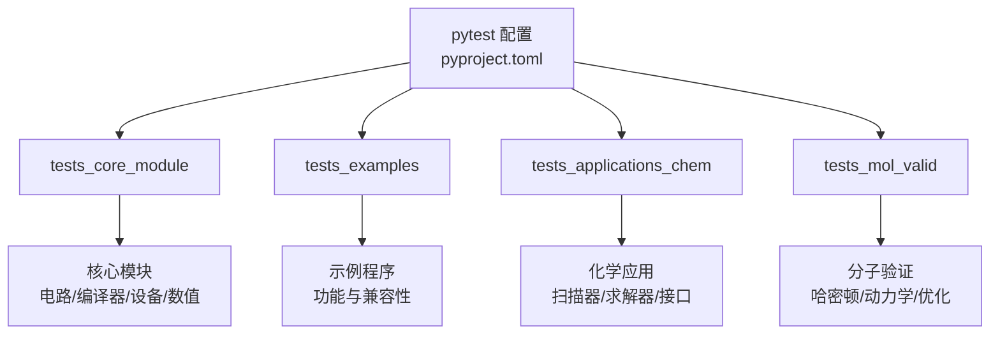
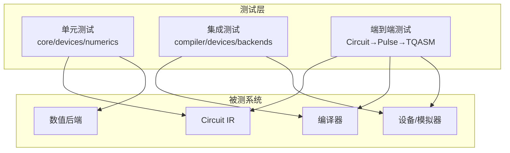
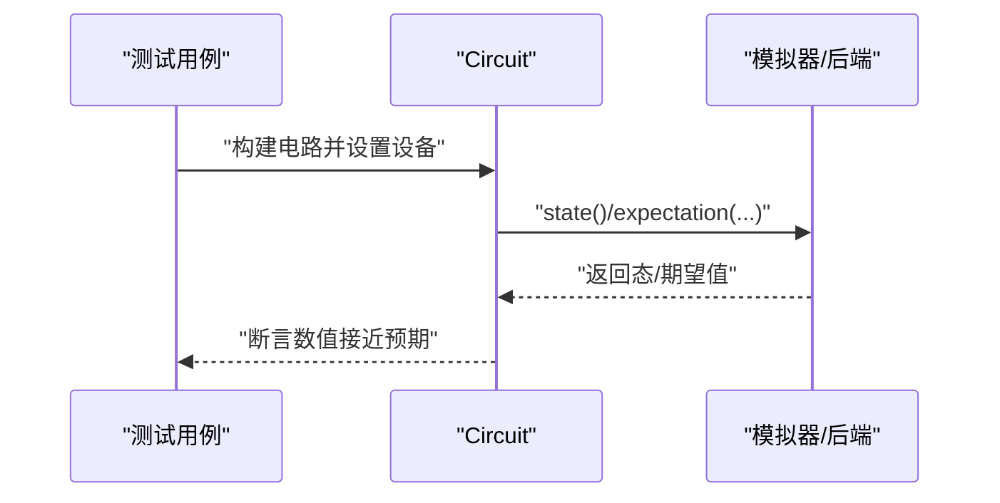
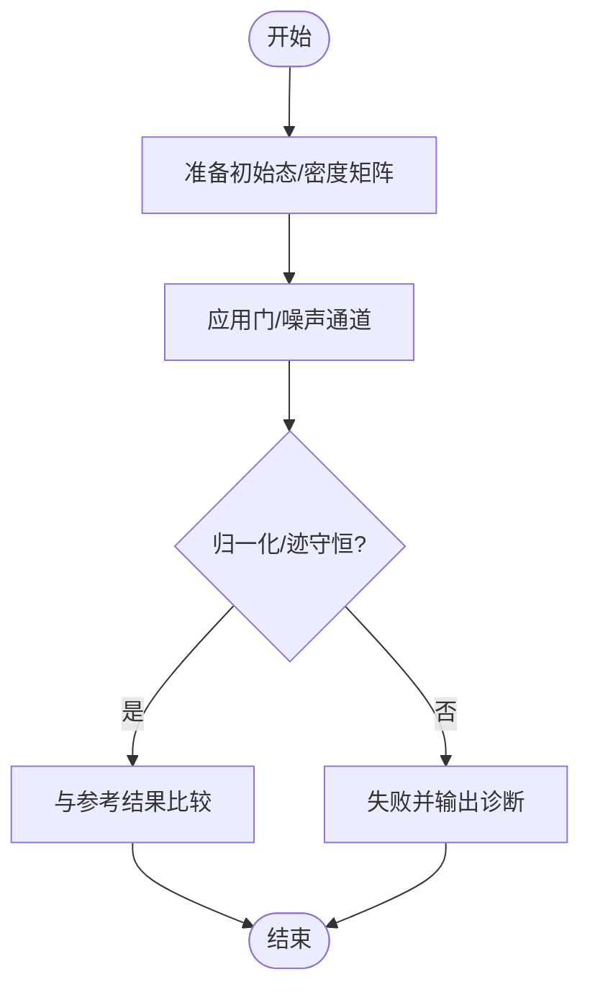
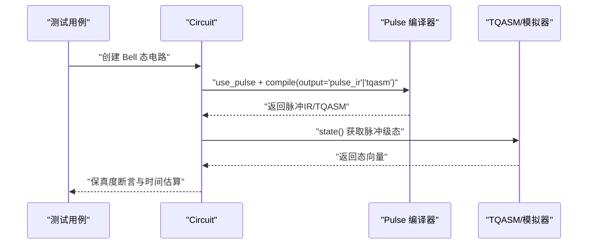
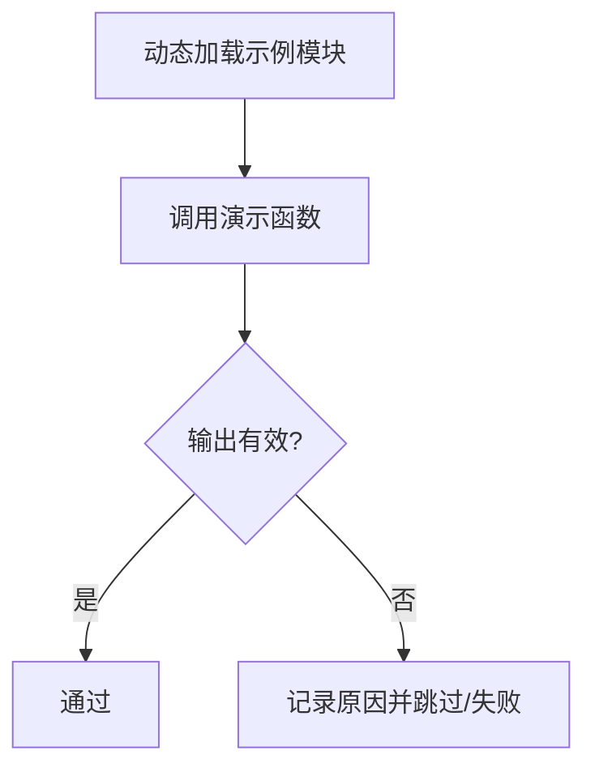
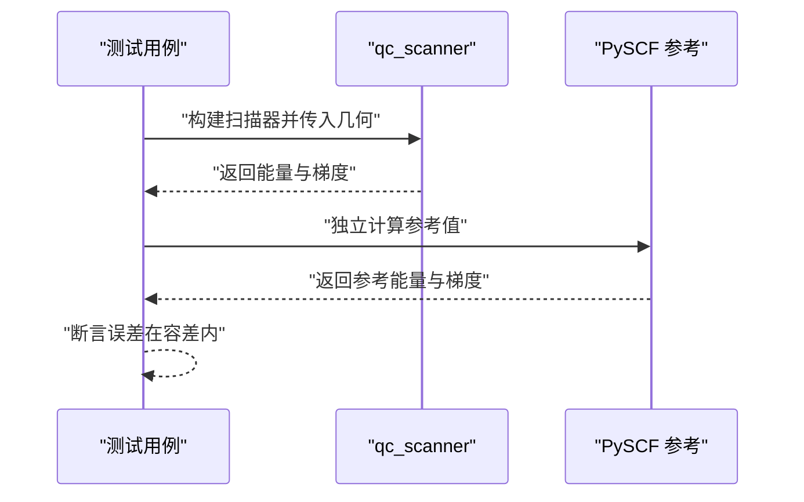
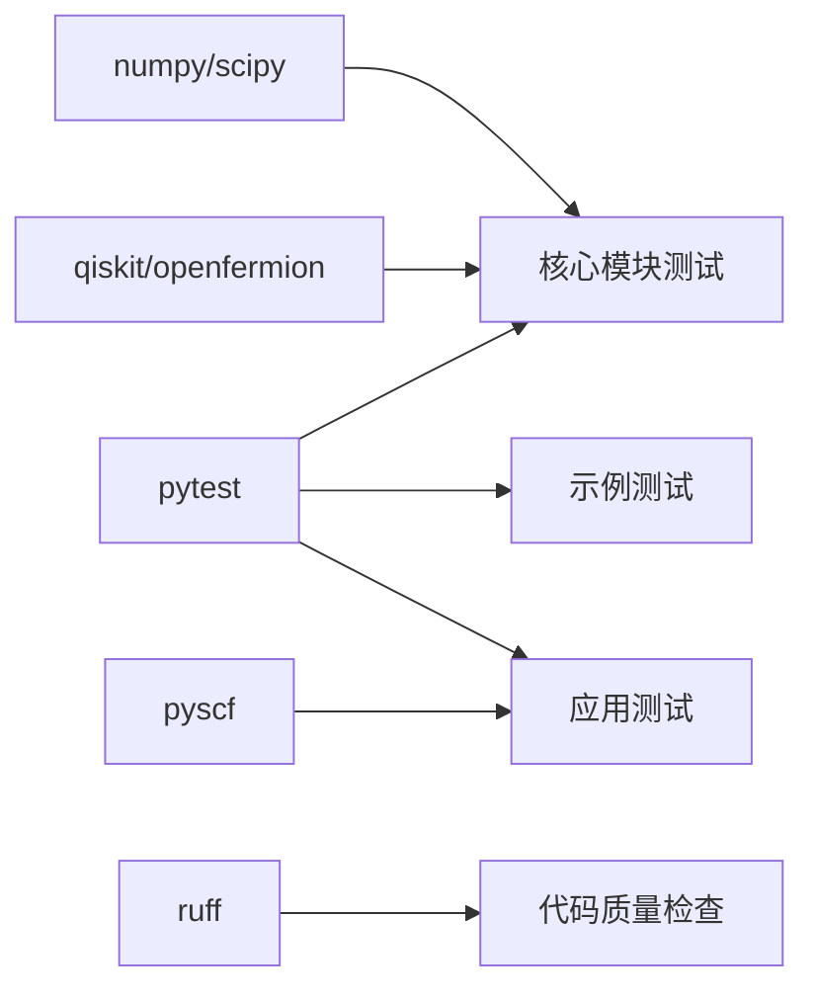

# 测试指南

<cite>
**本文引用的文件**
- [pyproject.toml](file://pyproject.toml)
- [testing_guidelines.rst](file://docs/source/developer_guide/testing_guidelines.rst)
- [test_circuit_expectation.py](file://tests_core_module/test_circuit_expectation.py)
- [test_devices_simulators.py](file://tests_core_module/test_devices_simulators.py)
- [test_pulse_e2e_bell_state.py](file://tests_core_module/test_pulse_e2e_bell_state.py)
- [test_example_basic_chain_api.py](file://tests_examples/test_example_basic_chain_api.py)
- [test_qc_scanner.py](file://tests_applications_chem/test_qc_scanner.py)
</cite>

## 目录
1. [简介](#简介)
2. [项目结构](#项目结构)
3. [核心组件](#核心组件)
4. [架构总览](#架构总览)
5. [详细组件分析](#详细组件分析)
6. [依赖分析](#依赖分析)
7. [性能考虑](#性能考虑)
8. [故障排除指南](#故障排除指南)
9. [结论](#结论)
10. [附录](#附录)

## 简介
本指南面向 TyxonQ 的开发者与贡献者，系统化说明项目的测试策略与质量保证流程。内容覆盖：
- 测试分层与组织：单元测试、集成测试、端到端测试的职责边界与目录划分
- 测试框架与配置：基于 pytest 的配置、标记、运行选项与报告生成
- 测试数据与模拟：数值基准、参考实现对比、外部依赖隔离策略
- 核心模块测试方法：量子电路期望值、模拟器内核、脉冲编译链路等
- 示例程序测试策略：功能验证、性能基准、兼容性检查
- 覆盖率要求与报告：覆盖率阈值、CI 集成与报告上传
- 持续集成流程：自动化测试、代码质量检查、版本发布流程建议
- 最佳实践与故障排除：常见问题定位与修复思路

## 项目结构
TyxonQ 采用多目录测试布局，按“核心模块/示例/应用”分层组织，便于快速定位与并行执行：
- tests_core_module：核心能力与底层算子的单测与集成用例（如电路期望、模拟器内核、脉冲编译）
- tests_examples：对 examples 下脚本的功能性回归与兼容性校验
- tests_applications_chem：化学应用相关接口与算法的回归与一致性测试
- tests_mol_valid：分子构建、哈密顿量、动力学与优化器等的数值验证

图表来源
- [pyproject.toml:84-90](file://pyproject.toml#L84-L90)

章节来源
- [pyproject.toml:84-90](file://pyproject.toml#L84-L90)

## 核心组件
本节聚焦三类关键测试对象及其验证要点：
- 量子电路与期望值计算：验证不同态与观测量的期望值正确性，以及 MPS/状态向量引擎的选择与等价性
- 模拟器内核与噪声通道：验证门操作、MPS 构建、保真度与迹守恒、阻尼与退相干行为
- 脉冲编译端到端链路：从 Circuit 到 Pulse/TQASM 的完整编译流程与物理时间估算、保真度对比

章节来源
- [test_circuit_expectation.py:9-133](file://tests_core_module/test_circuit_expectation.py#L9-L133)
- [test_devices_simulators.py:51-160](file://tests_core_module/test_devices_simulators.py#L51-L160)
- [test_pulse_e2e_bell_state.py:4-167](file://tests_core_module/test_pulse_e2e_bell_state.py#L4-L167)

## 架构总览
下图展示测试在 TyxonQ 中的分层与交互关系：单元测试覆盖核心 API 与内核；集成测试串联编译器、设备与后端；端到端测试贯穿 Circuit→Pulse→TQASM→Simulator/Hardware 的全链路。

图表来源
- [test_circuit_expectation.py:9-133](file://tests_core_module/test_circuit_expectation.py#L9-L133)
- [test_devices_simulators.py:51-160](file://tests_core_module/test_devices_simulators.py#L51-L160)
- [test_pulse_e2e_bell_state.py:4-167](file://tests_core_module/test_pulse_e2e_bell_state.py#L4-L167)

## 详细组件分析

### 量子电路期望值测试
- 目标：验证 Pauli 观测量的期望值在不同态与不同模拟器下的正确性与一致性
- 关键点：
  - 单量子比特与双量子比特期望值断言
  - TFI 哈密顿量能量计算的线性组合断言
  - MPS 与状态向量引擎的自动选择与显式覆盖
- 复杂度：期望值计算通常为 O(2^n) 或受 MPS 键维限制；测试规模控制在可接受范围内

图表来源
- [test_circuit_expectation.py:9-133](file://tests_core_module/test_circuit_expectation.py#L9-L133)

章节来源
- [test_circuit_expectation.py:9-133](file://tests_core_module/test_circuit_expectation.py#L9-L133)

### 模拟器内核与噪声通道测试
- 目标：验证底层门应用、MPS 构建、噪声通道的数学性质（归一化、迹守恒、相干衰减）
- 关键点：
  - Bell 态构造与期望值断言
  - 两量子位旋转与受控门等价性
  - MPS 键维度合法性与保真度比较
  - 去极化、振幅阻尼、相位阻尼、Pauli 通道的物理约束
- 复杂度：密度矩阵操作为 O(4^n)，MPS 操作受键维影响；测试控制 n 与键维以平衡精度与耗时

图表来源
- [test_devices_simulators.py:51-160](file://tests_core_module/test_devices_simulators.py#L51-L160)

章节来源
- [test_devices_simulators.py:51-160](file://tests_core_module/test_devices_simulators.py#L51-L160)

### 脉冲编译端到端测试（Bell 态）
- 目标：验证 Circuit→Pulse→TQASM 的完整编译链路，评估物理时间与保真度
- 关键点：
  - 显式 pulse 模式与智能推断模式的编译差异
  - 脉冲序列结构与数量统计
  - 门级与脉冲级态的保真度对比
  - 物理时间估算与资源使用
- 复杂度：编译阶段涉及调度与分解，需关注参数完备性与警告处理

图表来源
- [test_pulse_e2e_bell_state.py:4-167](file://tests_core_module/test_pulse_e2e_bell_state.py#L4-L167)

章节来源
- [test_pulse_e2e_bell_state.py:4-167](file://tests_core_module/test_pulse_e2e_bell_state.py#L4-L167)

### 示例程序测试策略
- 目标：确保示例脚本可导入、可运行、输出合理，且具备跨环境兼容性
- 关键点：
  - 动态加载示例模块并调用演示函数
  - 捕获缺失可选依赖时的跳过逻辑
  - 对云相关或重计算路径进行隔离或最小化执行
- 复杂度：示例可能包含大量 IO 或网络请求，测试应聚焦功能正确性与稳定性

图表来源
- [test_example_basic_chain_api.py:13-87](file://tests_examples/test_example_basic_chain_api.py#L13-L87)

章节来源
- [test_example_basic_chain_api.py:13-87](file://tests_examples/test_example_basic_chain_api.py#L13-L87)

### 化学应用扫描器测试
- 目标：验证 qc_scanner 与 PySCF CASCI 参考的一致性，包括几何连续性与 MM 电荷注入
- 关键点：
  - UCCSD 路径与 stock CASCI 的能量/梯度误差容限
  - 同一 scanner 对不同几何的连续调用一致性
  - mm_charges 注入对能量的显著影响与数值对齐
- 复杂度：涉及 SCF/MCSCF 收敛与数值误差，需合理设置容差与随机种子

图表来源
- [test_qc_scanner.py:41-123](file://tests_applications_chem/test_qc_scanner.py#L41-L123)

章节来源
- [test_qc_scanner.py:41-123](file://tests_applications_chem/test_qc_scanner.py#L41-L123)

## 依赖分析
- 测试框架与工具：pytest、pytest-lazy-fixtures（开发依赖）、ruff（代码质量）
- 数值与科学库：numpy、scipy、symengine/sympy、opt-einsum
- 量子生态：openfermion、qiskit、pyscf（化学应用）
- 运行时与可选依赖：torch/torchvision、python-dotenv、requests
- 测试路径与标记：通过 pyproject.toml 统一配置测试路径与 pytest 标记（如 live）

图表来源
- [pyproject.toml:25-42](file://pyproject.toml#L25-L42)
- [pyproject.toml:44-65](file://pyproject.toml#L44-L65)
- [pyproject.toml:84-90](file://pyproject.toml#L84-L90)

章节来源
- [pyproject.toml:25-42](file://pyproject.toml#L25-L42)
- [pyproject.toml:44-65](file://pyproject.toml#L44-L65)
- [pyproject.toml:84-90](file://pyproject.toml#L84-L90)

## 性能考虑
- 测试规模控制：对指数级增长的态空间测试，限制 qubit 数与 MPS 键维，避免超时与内存溢出
- 并行执行：利用 pytest 的并行插件（如 pytest-xdist）加速大规模用例集
- 缓存与复用：对昂贵初始化（如大型分子、复杂编译器流水线）进行 fixture 缓存
- 基准测试：将关键路径纳入性能回归测试，跟踪时间/内存变化趋势
- 随机性与确定性：固定随机种子以保证结果可复现

[本节提供通用指导，不直接分析具体文件]

## 故障排除指南
- 外部服务访问：使用 pytest.mark.live 标记并默认跳过，仅在需要时启用
- 可选依赖缺失：在测试中检测依赖可用性并跳过，避免阻塞主流程
- 数值不一致：调整容差、检查单位制（如 Bohr/Angstrom），核对参考实现版本
- 编译器/设备问题：打印中间 IR/脉冲序列，定位分解或调度阶段的异常
- 资源泄漏：确保关闭文件句柄、释放 GPU/内存资源，使用上下文管理器清理

章节来源
- [pyproject.toml:84-90](file://pyproject.toml#L84-L90)
- [test_example_basic_chain_api.py:31-87](file://tests_examples/test_example_basic_chain_api.py#L31-L87)
- [test_qc_scanner.py:40-123](file://tests_applications_chem/test_qc_scanner.py#L40-L123)

## 结论
TyxonQ 的测试体系围绕“核心—示例—应用”三层展开，结合 pytest 的统一配置与标记机制，形成从单元到端到端的完整质量保障闭环。通过严格的数值断言、参考实现对比与性能监控，确保框架在多后端、多设备与多场景下的可靠性与可维护性。建议在 CI 中固化覆盖率阈值与质量门禁，持续提升交付质量。

[本节总结性内容，不直接分析具体文件]

## 附录

### 测试策略与组织结构
- 单元测试：覆盖核心 API、内核与工具函数，强调正确性与边界条件
- 集成测试：串联编译器、设备与后端，验证工作流一致性与兼容性
- 端到端测试：贯穿 Circuit→Pulse→TQASM→Simulator/Hardware，验证最终产出与指标
- 示例测试：确保示例可运行、可复用，并对可选依赖做优雅降级

章节来源
- [testing_guidelines.rst:386-415](file://docs/source/developer_guide/testing_guidelines.rst#L386-L415)
- [testing_guidelines.rst:926-950](file://docs/source/developer_guide/testing_guidelines.rst#L926-L950)

### 测试框架与配置
- pytest 配置：指定测试路径、文件匹配规则、全局选项与标记
- 常用标记：live（外部服务）、skipif（条件跳过）
- 运行命令：pytest -v -ra 以获得详细输出与失败摘要

章节来源
- [pyproject.toml:84-90](file://pyproject.toml#L84-L90)

### 测试数据管理与模拟
- 数值基准：使用已知解析解或高置信度参考实现（如 PySCF CASCI）
- 模拟对象：对外部依赖（云端、硬件）进行隔离，优先使用本地模拟器
- 数据驱动：参数化测试以覆盖多组输入场景

章节来源
- [test_qc_scanner.py:30-123](file://tests_applications_chem/test_qc_scanner.py#L30-L123)
- [test_devices_simulators.py:51-160](file://tests_core_module/test_devices_simulators.py#L51-L160)

### 覆盖率要求与报告生成
- 覆盖率收集：使用 pytest-cov 生成 XML/HTML 报告
- 阈值设定：建议核心模块覆盖率≥80%，关键路径≥90%
- CI 集成：上传至 Codecov 等平台，设置质量门禁

章节来源
- [testing_guidelines.rst:876-925](file://docs/source/developer_guide/testing_guidelines.rst#L876-L925)

### 持续集成流程建议
- 触发条件：push/PR 到 main/develop 分支
- 矩阵策略：多 Python 版本并行测试
- 步骤：安装依赖→运行单元/集成/端到端测试→生成覆盖率→质量门禁→发布制品

章节来源
- [testing_guidelines.rst:876-925](file://docs/source/developer_guide/testing_guidelines.rst#L876-L925)