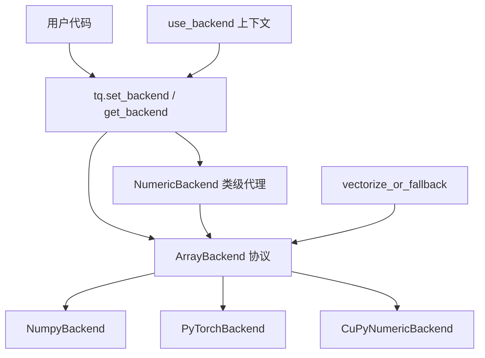
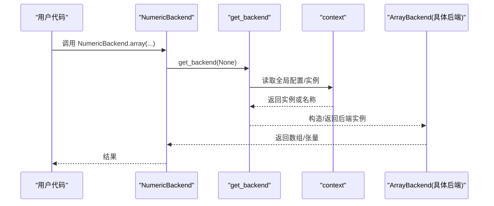
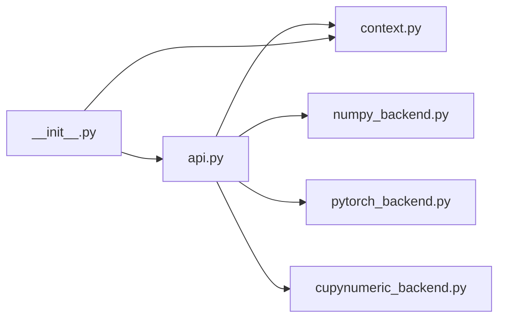

# 自定义数值后端

<cite>
**本文引用的文件**
- [src/tyxonq/numerics/api.py](file://src/tyxonq/numerics/api.py)
- [src/tyxonq/numerics/context.py](file://src/tyxonq/numerics/context.py)
- [src/tyxonq/numerics/__init__.py](file://src/tyxonq/numerics/__init__.py)
- [src/tyxonq/numerics/backends/numpy_backend.py](file://src/tyxonq/numerics/backends/numpy_backend.py)
- [src/tyxonq/numerics/backends/pytorch_backend.py](file://src/tyxonq/numerics/backends/pytorch_backend.py)
- [src/tyxonq/numerics/backends/cupynumeric_backend.py](file://src/tyxonq/numerics/backends/cupynumeric_backend.py)
- [examples/numeric_backend_switching.py](file://examples/numeric_backend_switching.py)
- [tests_core_module/test_numerics.py](file://tests_core_module/test_numerics.py)
- [docs/source/developer_guide/custom_backends.rst](file://docs/source/developer_guide/custom_backends.rst)
</cite>

## 目录
1. [简介](#简介)
2. [项目结构](#项目结构)
3. [核心组件](#核心组件)
4. [架构总览](#架构总览)
5. [详细组件分析](#详细组件分析)
6. [依赖关系分析](#依赖关系分析)
7. [性能与内存管理](#性能与内存管理)
8. [调试与测试指南](#调试与测试指南)
9. [结论](#结论)
10. [附录：完整示例与最佳实践](#附录完整示例与最佳实践)

## 简介
本指南面向希望为 TyxonQ 实现“自定义数值后端”的开发者。TyxonQ 通过统一的 ArrayBackend 协议屏蔽底层数值库差异，支持 NumPy、PyTorch、CuPyNumeric 等后端，并提供运行时切换、自动微分桥接、GPU 加速与向量化策略。本文将系统阐述：
- ArrayBackend 协议设计与必需接口
- 数据类型支持与 set_dtype 机制
- 内存管理与数据拷贝策略
- 集成现有后端（NumPy、PyTorch、CuPyNumeric）的方法与优化要点
- 新后端的注册与选择策略（含运行时切换、条件判断、基准测试）
- 完整的自定义后端实现示例（矩阵运算、向量操作、张量变换）
- 调试与测试方法（精度验证、性能对比、兼容性测试）
- 错误处理与异常策略

## 项目结构
TyxonQ 的数值子系统位于 src/tyxonq/numerics，包含统一 API、全局上下文、以及多个具体后端实现；示例与测试分别位于 examples 与 tests_core_module。文档侧提供开发者指南。

图表来源
- [src/tyxonq/numerics/api.py:19-122](file://src/tyxonq/numerics/api.py#L19-L122)
- [src/tyxonq/numerics/context.py:18-50](file://src/tyxonq/numerics/context.py#L18-L50)
- [src/tyxonq/numerics/__init__.py:20-58](file://src/tyxonq/numerics/__init__.py#L20-L58)

章节来源
- [src/tyxonq/numerics/api.py:1-255](file://src/tyxonq/numerics/api.py#L1-L255)
- [src/tyxonq/numerics/context.py:1-53](file://src/tyxonq/numerics/context.py#L1-L53)
- [src/tyxonq/numerics/__init__.py:1-476](file://src/tyxonq/numerics/__init__.py#L1-L476)

## 核心组件
- ArrayBackend 协议：定义统一数组/张量接口，包括创建、代数运算、线性代数、随机数、自动微分桥接等。
- NumericBackend 类级代理：以类方法形式暴露当前后端能力，便于无实例调用。
- 后端工厂 get_backend：按名称或配置返回后端实例，支持 numpy、pytorch、cupynumeric。
- 全局上下文 context：支持 set_backend/use_backend 进行全局默认后端设置与临时切换。
- vectorize_or_fallback：包装函数以实现自动向量化或回退到 eager 执行。

章节来源
- [src/tyxonq/numerics/api.py:19-122](file://src/tyxonq/numerics/api.py#L19-L122)
- [src/tyxonq/numerics/__init__.py:67-473](file://src/tyxonq/numerics/__init__.py#L67-L473)
- [src/tyxonq/numerics/context.py:18-50](file://src/tyxonq/numerics/context.py#L18-L50)

## 架构总览
TyxonQ 的数值后端采用“协议 + 多实现 + 工厂 + 上下文”的分层设计：
- 协议层：ArrayBackend 规定最小必要接口，确保上层代码与后端解耦。
- 实现层：各后端独立实现协议，提供 dtype、数学运算、线性代数、随机数、自动微分桥接等。
- 工厂层：get_backend 根据名称或全局配置返回后端实例，并做可用性检查。
- 上下文层：set_backend/use_backend 维护全局默认后端，支持线程安全的上下文切换。
- 代理层：NumericBackend 将常用操作以类方法形式转发给当前后端，简化调用。

图表来源
- [src/tyxonq/numerics/__init__.py:20-58](file://src/tyxonq/numerics/__init__.py#L20-L58)
- [src/tyxonq/numerics/api.py:179-252](file://src/tyxonq/numerics/api.py#L179-L252)
- [src/tyxonq/numerics/context.py:18-50](file://src/tyxonq/numerics/context.py#L18-L50)

## 详细组件分析

### ArrayBackend 协议与实现要求
- 必需属性与方法
  - name：后端标识字符串
  - dtype 常量：complex64/complex128/float32/float64/int8/int32/int64/bool/int
  - 创建与转换：array、asarray、to_numpy
  - 代数与数组操作：matmul、einsum、reshape、moveaxis、sum、mean、abs、real、imag、conj、diag、zeros、ones、zeros_like、ones_like、eye、kron、square、stack、concatenate、arange、linspace、transpose、norm、cast、sign、outer
  - 初等函数：exp、sin、cos、sqrt、log、log2
  - 离散操作/采样：choice、bincount、nonzero
  - 线性代数：svd、eigh、eig、solve、inv、expm、tensordot
  - 随机数：rng、normal
  - 自动微分桥接（可选但推荐）：requires_grad、detach
- 可选方法：vmap、jit、value_and_grad、jacfwd、hessian（用于向量化与梯度计算）

实现建议
- 保持 dtype 一致性：所有创建与转换方法需尊重传入 dtype，并在必要时进行类型映射。
- 自动微分兼容：若后端支持 autograd（如 PyTorch），需在 array/asarray 中保留 requires_grad，避免破坏计算图。
- 设备与内存：GPU 后端应尽量减少主机-设备间的数据拷贝；to_numpy 应在必要时才触发拷贝。
- 错误处理：对不可用依赖（如 torch/cupynumeric）进行优雅降级或抛出明确错误。

章节来源
- [src/tyxonq/numerics/api.py:19-122](file://src/tyxonq/numerics/api.py#L19-L122)
- [src/tyxonq/numerics/backends/numpy_backend.py:8-457](file://src/tyxonq/numerics/backends/numpy_backend.py#L8-L457)
- [src/tyxonq/numerics/backends/pytorch_backend.py:13-567](file://src/tyxonq/numerics/backends/pytorch_backend.py#L13-L567)
- [src/tyxonq/numerics/backends/cupynumeric_backend.py:13-300](file://src/tyxonq/numerics/backends/cupynumeric_backend.py#L13-L300)

### 数据类型支持与 set_dtype
- 每个后端维护 complex/real 默认 dtype 字符串（dtypestr/rdtypestr），可通过 set_dtype(dtype_str) 切换为 complex64 或 complex128，同时返回对应的复杂/实数 dtype。
- 在量子计算场景中，状态通常使用复数 dtype，参数使用实数 dtype；set_dtype 可统一调整。

章节来源
- [src/tyxonq/numerics/backends/numpy_backend.py:23-46](file://src/tyxonq/numerics/backends/numpy_backend.py#L23-L46)
- [src/tyxonq/numerics/backends/pytorch_backend.py:31-53](file://src/tyxonq/numerics/backends/pytorch_backend.py#L31-L53)
- [src/tyxonq/numerics/backends/cupynumeric_backend.py:29-53](file://src/tyxonq/numerics/backends/cupynumeric_backend.py#L29-L53)

### 内存管理策略
- 共享视图优先：尽可能使用原地或视图操作（如 reshape、view/movedim）减少拷贝。
- GPU 后端：避免频繁 to_numpy；仅在需要与 CPU-only 库交互时拷贝。
- 自动微分：PyTorch 后端在 array/asarray 中必须保留 requires_grad，防止计算图断裂。
- 随机数：使用后端原生 RNG 生成，避免跨设备/框架的额外开销。

章节来源
- [src/tyxonq/numerics/backends/pytorch_backend.py:77-131](file://src/tyxonq/numerics/backends/pytorch_backend.py#L77-L131)
- [src/tyxonq/numerics/backends/cupynumeric_backend.py:55-70](file://src/tyxonq/numerics/backends/cupynumeric_backend.py#L55-L70)

### 集成现有后端
- NumPy：默认后端，CPU 计算，稳定可靠；适合原型与小规模电路。
- PyTorch：支持 GPU 与自动微分；适合 VQA 训练、梯度优化；可使用 torch.compile 进行 JIT。
- CuPyNumeric：GPU 加速的 NumPy 风格接口；适合大规模状态向量运算。

章节来源
- [src/tyxonq/numerics/backends/numpy_backend.py:8-457](file://src/tyxonq/numerics/backends/numpy_backend.py#L8-L457)
- [src/tyxonq/numerics/backends/pytorch_backend.py:13-567](file://src/tyxonq/numerics/backends/pytorch_backend.py#L13-L567)
- [src/tyxonq/numerics/backends/cupynumeric_backend.py:13-300](file://src/tyxonq/numerics/backends/cupynumeric_backend.py#L13-L300)

### 新后端注册与选择策略
- 注册方式：在 api.get_backend 中添加对新后端名称的支持，并确保模块导入失败时给出明确错误。
- 选择策略：
  - 显式名称：get_backend("your_backend")
  - 全局默认：set_backend("your_backend") 或传入实例
  - 上下文切换：use_backend("your_backend") 临时生效
- 条件判断：在 get_backend 中检测依赖是否可用（如 torch/cupynumeric），不可用时抛出 RuntimeError。
- 基准测试：参考示例脚本对不同后端进行性能对比与一致性校验。

章节来源
- [src/tyxonq/numerics/api.py:179-252](file://src/tyxonq/numerics/api.py#L179-L252)
- [src/tyxonq/numerics/context.py:18-50](file://src/tyxonq/numerics/context.py#L18-L50)
- [examples/numeric_backend_switching.py:187-246](file://examples/numeric_backend_switching.py#L187-L246)

### 自动微分支持
- PyTorch 后端：
  - requires_grad/detach：启用/关闭梯度追踪
  - value_and_grad：优先使用 autograd，失败时回退到有限差分
  - jacfwd/hessian：在 PyTorch >= 2.0 时使用 torch.func，否则提示升级或回退
- NumPy/CuPyNumeric 后端：
  - 提供有限差分近似（scipy.optimize.approx_fprime 或手动实现）
  - 注意性能与数值稳定性

章节来源
- [src/tyxonq/numerics/backends/pytorch_backend.py:356-567](file://src/tyxonq/numerics/backends/pytorch_backend.py#L356-L567)
- [src/tyxonq/numerics/backends/numpy_backend.py:255-457](file://src/tyxonq/numerics/backends/numpy_backend.py#L255-L457)
- [src/tyxonq/numerics/backends/cupynumeric_backend.py:250-297](file://src/tyxonq/numerics/backends/cupynumeric_backend.py#L250-L297)

### GPU 加速配置
- PyTorch：使用 .to(device) 将张量移动到 GPU；确保输入输出在同一设备；利用 torch.compile 提升性能。
- CuPyNumeric：通过 cupynumeric 数组在 GPU 上运行；SVD 等可能回退到 CPU 实现，需注意性能影响。
- 注意事项：避免频繁 in-place 修改导致设备迁移；尽量批量操作以减少内核启动开销。

章节来源
- [src/tyxonq/numerics/backends/pytorch_backend.py:136-158](file://src/tyxonq/numerics/backends/pytorch_backend.py#L136-L158)
- [src/tyxonq/numerics/backends/cupynumeric_backend.py:208-216](file://src/tyxonq/numerics/backends/cupynumeric_backend.py#L208-L216)

## 依赖关系分析
- 模块耦合
  - api.py 依赖 context.py 获取全局配置，并导入具体后端实现
  - __init__.py 暴露 NumericBackend 类级代理与 set/set_dtype/use_backend
  - 各后端实现遵循 ArrayBackend 协议，彼此独立
- 外部依赖
  - NumPy：始终可用
  - PyTorch：可选，按需导入
  - CuPyNumeric：可选，按需导入

图表来源
- [src/tyxonq/numerics/api.py:1-14](file://src/tyxonq/numerics/api.py#L1-L14)
- [src/tyxonq/numerics/context.py:1-16](file://src/tyxonq/numerics/context.py#L1-L16)
- [src/tyxonq/numerics/__init__.py:1-17](file://src/tyxonq/numerics/__init__.py#L1-L17)

章节来源
- [src/tyxonq/numerics/api.py:1-255](file://src/tyxonq/numerics/api.py#L1-L255)
- [src/tyxonq/numerics/context.py:1-53](file://src/tyxonq/numerics/context.py#L1-L53)
- [src/tyxonq/numerics/__init__.py:1-476](file://src/tyxonq/numerics/__init__.py#L1-L476)

## 性能与内存管理
- 选择合适后端
  - 小规模/原型：NumPy
  - 梯度优化/GPU：PyTorch
  - 大规模状态向量/GPU：CuPyNumeric
- 向量化策略
  - vectorize_or_fallback：优先使用后端 vmap，否则沿首轴元素级循环；捕获异常回退 eager
- 内存优化
  - 避免不必要的 to_numpy；GPU 后端尽量保持数据在设备上
  - 使用 zeros_like/ones_like 复用形状信息，减少重复分配
- 基准测试
  - 参考示例脚本进行多后端时间对比与一致性验证

章节来源
- [src/tyxonq/numerics/api.py:124-176](file://src/tyxonq/numerics/api.py#L124-L176)
- [examples/numeric_backend_switching.py:187-246](file://examples/numeric_backend_switching.py#L187-L246)

## 调试与测试指南
- 数值精度验证
  - 使用 allclose/isclose 比较不同后端结果
  - 在 PyTorch 后端检查 requires_grad 是否被正确保留
- 性能对比
  - 使用示例脚本对不同后端进行多次运行，排除预热影响
- 兼容性测试
  - 针对未安装依赖的后端进行跳过测试（pytest.mark.skipif）
  - 验证 vectorize_or_fallback 在不同 policy 下的行为
- 常见问题定位
  - 设备不一致：确保 matmul/dot 等操作前后设备一致
  - 计算图断裂：检查 array/asarray 是否保留了 requires_grad
  - 回退路径：确认有限差分与 vmap 回退逻辑正常工作

章节来源
- [tests_core_module/test_numerics.py:62-143](file://tests_core_module/test_numerics.py#L62-L143)
- [examples/numeric_backend_switching.py:249-283](file://examples/numeric_backend_switching.py#L249-L283)

## 结论
TyxonQ 的数值后端体系通过 ArrayBackend 协议实现了高度抽象与可扩展性。开发者可以基于该协议快速实现自定义后端，并通过工厂与上下文机制无缝集成到系统中。结合自动微分、GPU 加速与向量化策略，可在不同硬件与任务场景下获得最优性能。建议在实现时重点关注 dtype 一致性、内存拷贝控制、自动微分兼容性与错误处理策略，并通过完善的测试与基准验证保证质量。

## 附录：完整示例与最佳实践

### 自定义后端实现步骤
- 定义类并实现 ArrayBackend 协议
  - 提供 name、dtype 常量、set_dtype
  - 实现 array/asarray/to_numpy、代数与线性代数、随机数、自动微分桥接
- 注册到 get_backend
  - 在 api.get_backend 中添加名称分支与可用性检查
- 编写测试与基准
  - 单元测试覆盖关键方法
  - 性能对比与一致性验证

章节来源
- [src/tyxonq/numerics/api.py:179-252](file://src/tyxonq/numerics/api.py#L179-L252)
- [src/tyxonq/numerics/backends/numpy_backend.py:8-457](file://src/tyxonq/numerics/backends/numpy_backend.py#L8-L457)
- [src/tyxonq/numerics/backends/pytorch_backend.py:13-567](file://src/tyxonq/numerics/backends/pytorch_backend.py#L13-L567)
- [src/tyxonq/numerics/backends/cupynumeric_backend.py:13-300](file://src/tyxonq/numerics/backends/cupynumeric_backend.py#L13-L300)

### 矩阵运算、向量操作、张量变换示例
- 矩阵运算：matmul、dot、einsum、tensordot
- 向量操作：sum、mean、norm、outer、stack、concatenate
- 张量变换：reshape、moveaxis、transpose、kron、svd/eigh/eig

章节来源
- [src/tyxonq/numerics/__init__.py:205-400](file://src/tyxonq/numerics/__init__.py#L205-L400)
- [src/tyxonq/numerics/backends/numpy_backend.py:68-236](file://src/tyxonq/numerics/backends/numpy_backend.py#L68-L236)
- [src/tyxonq/numerics/backends/pytorch_backend.py:133-326](file://src/tyxonq/numerics/backends/pytorch_backend.py#L133-L326)
- [src/tyxonq/numerics/backends/cupynumeric_backend.py:72-216](file://src/tyxonq/numerics/backends/cupynumeric_backend.py#L72-L216)

### 运行时切换与条件判断
- 运行时切换：set_backend/get_backend/use_backend
- 条件判断：根据环境可用性选择后端（如 torch/cupynumeric 是否存在）
- 基准测试：参考示例脚本进行多后端对比

章节来源
- [src/tyxonq/numerics/context.py:18-50](file://src/tyxonq/numerics/context.py#L18-L50)
- [examples/numeric_backend_switching.py:86-184](file://examples/numeric_backend_switching.py#L86-L184)

### 错误处理与异常策略
- 依赖缺失：抛出明确的 RuntimeError（如 torch/cupynumeric 未安装）
- 自动微分失败：PyTorch 后端回退到有限差分并记录警告
- 向量化失败：vectorize_or_fallback 捕获异常并回退 eager

章节来源
- [src/tyxonq/numerics/api.py:236-252](file://src/tyxonq/numerics/api.py#L236-L252)
- [src/tyxonq/numerics/backends/pytorch_backend.py:446-567](file://src/tyxonq/numerics/backends/pytorch_backend.py#L446-L567)
- [src/tyxonq/numerics/api.py:124-176](file://src/tyxonq/numerics/api.py#L124-L176)