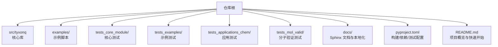
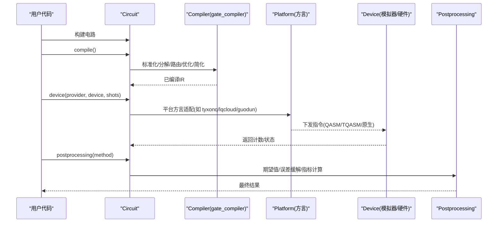
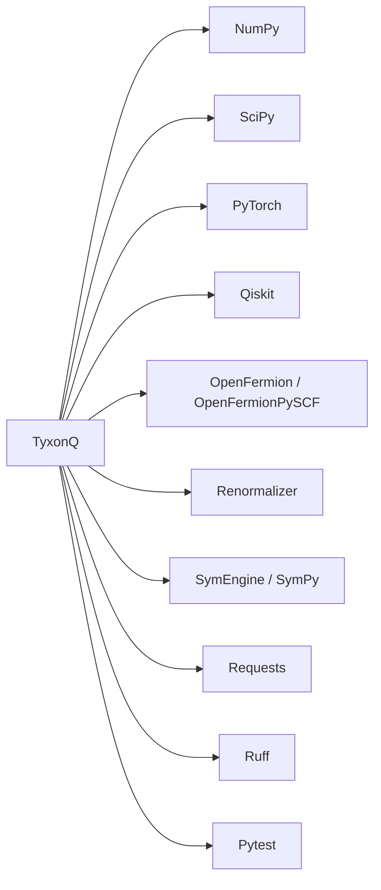

# 贡献指南

<cite>
**本文引用的文件**
- [CONTRIBUTING.md](file://CONTRIBUTING.md)
- [README.md](file://README.md)
- [pyproject.toml](file://pyproject.toml)
- [docs/source/developer_guide/contributing.rst](file://docs/source/developer_guide/contributing.rst)
- [docs/source/conf.py](file://docs/source/conf.py)
- [examples/basic_chain_api.py](file://examples/basic_chain_api.py)
- [src/tyxonq/__init__.py](file://src/tyxonq/__init__.py)
</cite>

## 目录
1. [简介](#简介)
2. [项目结构](#项目结构)
3. [核心组件](#核心组件)
4. [架构总览](#架构总览)
5. [详细组件分析](#详细组件分析)
6. [依赖分析](#依赖分析)
7. [性能考虑](#性能考虑)
8. [故障排查指南](#故障排查指南)
9. [结论](#结论)
10. [附录](#附录)

## 简介
本贡献指南面向希望参与 TyxonQ 开源项目的开发者与研究者，涵盖代码规范、Git 工作流程、开发环境搭建、文档编写规范、问题报告与功能请求流程、社区协作规范，以及新贡献者入门与常见问题解答。TyxonQ 是一个面向真实量子硬件的全栈量子计算框架，提供稳定的 IR、可插拔编译器、统一设备抽象（模拟器与硬件）、单一数值后端接口（NumPy/PyTorch/CuPyNumeric）以及设备运行时友好的后处理。

## 项目结构
仓库采用“源码—示例—测试—文档”分层组织：
- src/tyxonq：核心库与模块（IR、编译器、设备、数值后端、应用等）
- examples：丰富的示例脚本，覆盖基础用法、脉冲编程、量子化学、云任务等
- tests_*：按模块划分的测试集（核心、示例、应用、分子验证）
- docs：Sphinx 文档源与多语言翻译资源
- pyproject.toml：项目元数据、依赖、构建与测试配置
- README.md：快速开始、安装、架构与特性说明

图表来源
- [pyproject.toml:1-91](file://pyproject.toml#L1-L91)
- [README.md:1-120](file://README.md#L1-L120)

章节来源
- [README.md:1-120](file://README.md#L1-L120)
- [pyproject.toml:1-91](file://pyproject.toml#L1-L91)

## 核心组件
- 链式 API：Circuit.compile().device(...).postprocessing(...).run() 是统一的执行路径，支持模拟器与真实硬件无缝切换。
- 双阶段编译器：设备无关的 gate_compiler 核心 + 各平台方言（tyxonq/lqcloud/guodun）进行格式转换与下发。
- 设备抽象：statevector/density_matrix/mps 模拟器与多种硬件驱动（TyxonQ、QCOS、Quafu、LQCloud、Guodun）。
- 数值后端：统一 ArrayBackend 接口，支持 NumPy/PyTorch/CuPyNumeric。
- 应用层：量子化学（UCCSD/HEA 等）、动力学、QM/MM 接口等模块化扩展。

章节来源
- [README.md:191-215](file://README.md#L191-L215)
- [examples/basic_chain_api.py:1-150](file://examples/basic_chain_api.py#L1-L150)
- [src/tyxonq/__init__.py:136-184](file://src/tyxonq/__init__.py#L136-L184)

## 架构总览
下图展示了从用户电路到编译、设备执行与后处理的完整链路，并体现多后端与多云平台的接入点。

图表来源
- [README.md:191-215](file://README.md#L191-L215)
- [examples/basic_chain_api.py:22-41](file://examples/basic_chain_api.py#L22-L41)

## 详细组件分析

### 代码规范与编码标准
- 风格工具与规则
  - 使用 ruff 作为主要静态检查与格式化器（见依赖项）。
  - 行宽建议 100 字符；缩进 4 空格；优先双引号；导入排序由 isort 管理（参考贡献指南中的风格约定）。
- 类型与文档
  - 公共 API 需包含完整的 docstring（参数、返回值、异常、示例），并使用类型注解。
  - Sphinx 通过 autodoc/autosummary/napoleon 自动生成 API 文档，确保注释质量直接影响文档输出。
- 命名约定
  - 模块与包名小写下划线；类名大驼峰；函数/变量小写下划线；常量全大写。
  - 避免单字母变量（除循环索引等惯用场景）。
- 注释规范
  - 模块级 docstring 描述用途与关键设计；函数/类方法遵循 Google/NumPy 风格；复杂逻辑附流程图或伪代码注释。
- 提交信息
  - 采用 Conventional Commits：type(scope): brief description，支持 feat/fix/docs/style/refactor/test/perf/chore 等类型。

章节来源
- [pyproject.toml:25-42](file://pyproject.toml#L25-L42)
- [docs/source/developer_guide/contributing.rst:244-305](file://docs/source/developer_guide/contributing.rst#L244-L305)
- [docs/source/conf.py:144-179](file://docs/source/conf.py#L144-L179)

### Git 工作流程（分支策略、提交规范、PR 流程）
- 分支模型
  - main：稳定发布分支
  - develop：开发集成分支
  - feature/*：新功能分支
  - bugfix/*：缺陷修复分支
  - hotfix/*：紧急修复分支
- 提交流程
  - 在 feature 分支完成开发与自测后，推送至远端并创建 Pull Request。
  - PR 需通过自动化检查（测试、样式、类型检查）。
  - 至少一名维护者审核通过后合并。
- 提交规范
  - 使用 Conventional Commits，保持提交粒度小而聚焦，便于回溯与生成变更日志。
- PR 模板
  - 包含变更描述、影响范围、测试情况、文档更新、兼容性说明等。

章节来源
- [docs/source/developer_guide/contributing.rst:141-243](file://docs/source/developer_guide/contributing.rst#L141-L243)
- [docs/source/developer_guide/contributing.rst:366-453](file://docs/source/developer_guide/contributing.rst#L366-L453)

### 开发环境搭建
- 前置条件
  - Python >= 3.10（推荐最新稳定版）
  - Git、GitHub 账号
  - 可选：VS Code、Docker
- 克隆与上游同步
  - 克隆 fork 仓库，添加 upstream 远程以同步主仓更新。
- 虚拟环境安装
  - 推荐使用 venv/conda 创建隔离环境，以开发模式安装：pip install -e .
  - 安装开发依赖：pip install -r requirements-dev.txt（若存在）或使用 pyproject 的 dev 可选依赖。
- 验证安装
  - 运行 pytest 单元测试；import tyxonq 验证导入；检查 black/flake8/mypy 版本一致性。
- IDE 配置
  - VS Code：启用 Python、Ruff、Mypy 插件；设置默认格式化器为 Ruff；配置 pytest 运行器。
  - PyCharm：配置解释器、pytest 工作目录、Ruff 检查器。
- 调试工具
  - 使用 pytest --pdb 进入调试；Jupyter Notebook 用于交互式探索；结合 logging 输出关键中间态。

章节来源
- [docs/source/developer_guide/contributing.rst:49-140](file://docs/source/developer_guide/contributing.rst#L49-L140)
- [pyproject.toml:44-54](file://pyproject.toml#L44-L54)

### 文档编写规范（Sphinx、示例代码、多语言）
- 文档系统
  - 基于 Sphinx，主题 pydata_sphinx_theme；启用 autodoc、autosummary、napoleon、intersphinx、mathjax、mermaid、nbsphinx、myst_parser 等扩展。
  - 自动从代码 docstring 生成 API 文档，要求高质量注释。
- 示例代码
  - 示例应可独立运行，附带必要依赖说明；尽量复用通用工具函数；避免硬编码敏感信息。
- 多语言支持
  - 使用 gettext 机制，翻译文件位于 docs/locale；新增文案需同步更新 .po 文件。
- 构建与预览
  - 在 docs 目录下执行 make html 构建；检查警告与链接有效性。

章节来源
- [docs/source/conf.py:1-249](file://docs/source/conf.py#L1-L249)

### 问题报告与功能请求流程
- Issue 模板与标签
  - 使用 GitHub Issues 提交 Bug 或功能请求；建议使用标签分类（bug、feature、documentation、good first issue 等）。
- 优先级评估
  - 维护者根据影响面、复现难度、用户需求评估优先级；高优问题将尽快响应。
- 讨论与决策
  - 复杂设计在 Discussions 中先行讨论；达成一致后落地到 Issue/PR。

章节来源
- [docs/source/developer_guide/contributing.rst:15-47](file://docs/source/developer_guide/contributing.rst#L15-L47)
- [README.md:499-505](file://README.md#L499-L505)

### 社区协作规范
- 行为准则
  - 尊重、包容、建设性反馈、耐心帮助新人、协作达成目标。
- 沟通渠道
  - GitHub Discussions（设计与一般问题）、Issues（Bug 与具体需求）、PR Comments（代码评审）、月度开发者会议。
- 响应预期
  - 维护者在 2-3 个工作日内回复；安全/阻塞问题当日响应。
- 认可与晋升
  - 贡献者名单、发布说明致谢、社区表彰；持续高质量贡献者可受邀成为维护者。

章节来源
- [docs/source/developer_guide/contributing.rst:454-522](file://docs/source/developer_guide/contributing.rst#L454-L522)

### 新贡献者入门指导
- 起步步骤
  - 阅读本指南与架构概述；浏览带有 good first issue/help wanted 标签的问题；加入社区讨论。
- 第一个任务
  - 从文档改进或小 Bug 修复开始；遵循代码风格与测试要求；提交 PR 等待审查。
- 学习资源
  - 架构文档、测试指南、扩展指南；示例脚本与教程。

章节来源
- [docs/source/developer_guide/contributing.rst:28-47](file://docs/source/developer_guide/contributing.rst#L28-L47)
- [docs/source/developer_guide/contributing.rst:615-633](file://docs/source/developer_guide/contributing.rst#L615-L633)

### 常见问题解答（FAQ）
- 导入错误
  - 重新以开发模式安装：pip uninstall tyxonq && pip install -e .
- 权限错误
  - 检查脚本可执行权限：chmod +x scripts/*.sh
- 格式化冲突
  - 固定 Ruff/Black 版本，确保团队一致。
- 合并冲突
  - git fetch upstream && git rebase upstream/main，手动解决冲突后继续 rebase。
- 误提交到 main
  - 新建分支移动提交，重置 main 到上游。

章节来源
- [docs/source/developer_guide/contributing.rst:556-595](file://docs/source/developer_guide/contributing.rst#L556-L595)

## 依赖分析
TyxonQ 的核心依赖包括量子化学与仿真相关库（OpenFermion、PySCF、renormalizer）、数值计算（NumPy、SciPy、SymEngine/SymPy）、深度学习（PyTorch）、量子生态（Qiskit）、网络请求（requests）以及代码质量工具（ruff、pytest）。

图表来源
- [pyproject.toml:25-42](file://pyproject.toml#L25-L42)

章节来源
- [pyproject.toml:25-42](file://pyproject.toml#L25-L42)

## 性能考虑
- 梯度与优化
  - 利用 PyTorch Autograd 实现高效梯度计算；支持量子自然梯度（QNG）等高级优化方法。
- 多后端
  - 通过 set_backend 切换 NumPy/PyTorch/CuPyNumeric，兼顾易用性与性能。
- 编译器优化
  - 光锥简化、测量分组、调度优化减少开销；SABRE 布局与 SWAP 插入提升映射效率。
- 噪声与校准
  - 支持 T1/T2 噪声模型与读出误差缓解，贴近真实硬件行为。

章节来源
- [README.md:220-237](file://README.md#L220-L237)
- [README.md:238-399](file://README.md#L238-L399)

## 故障排查指南
- 环境问题
  - 确认 Python 版本与依赖匹配；清理缓存（venv/.ruff_cache/.mypy_cache）后重试。
- 测试失败
  - 使用 pytest -v 查看详细输出；必要时使用 --lf 仅重跑失败用例；结合 pdb 定位问题。
- 文档构建失败
  - 检查 conf.py 扩展是否可用；确保依赖安装完整；关注构建警告。
- 云端任务失败
  - 校验 API Key/Token 与 Provider/Device 配置；检查网络与配额；参考示例脚本最小化复现。

章节来源
- [docs/source/developer_guide/contributing.rst:556-595](file://docs/source/developer_guide/contributing.rst#L556-L595)
- [pyproject.toml:84-90](file://pyproject.toml#L84-L90)

## 结论
本指南提供了 TyxonQ 贡献所需的规范与流程，涵盖代码风格、Git 工作流、环境搭建、文档规范、问题与功能请求流程、社区协作与新贡献者入门。遵循这些实践有助于提升代码质量、加速协作与保障项目长期健康发展。

## 附录
- 快速开始
  - 参考 README 中的最小电路示例与安装说明，快速体验链式 API 与多后端能力。
- 更多学习
  - 查阅 developer_guide 下的架构、测试、扩展指南；浏览 examples 中的丰富案例。

章节来源
- [README.md:27-120](file://README.md#L27-L120)
- [docs/source/developer_guide/contributing.rst:615-633](file://docs/source/developer_guide/contributing.rst#L615-L633)