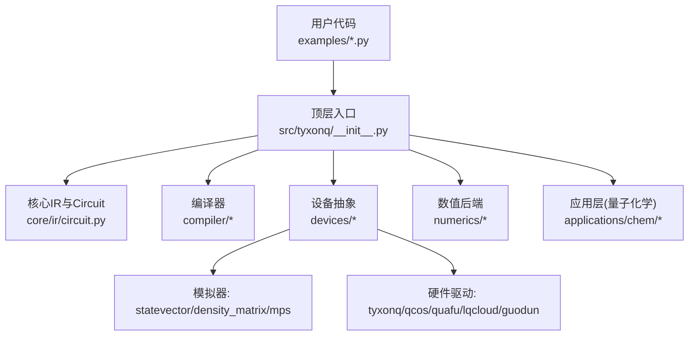
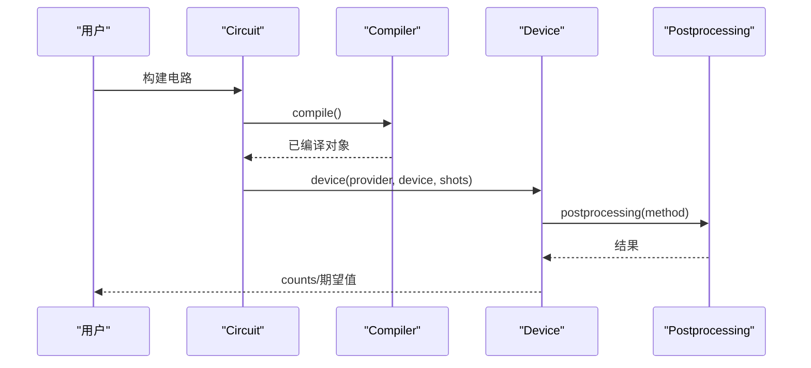
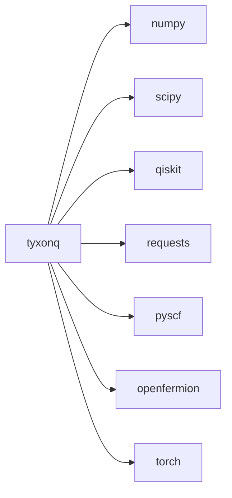

# 快速开始

<cite>
**本文引用的文件**
- [README.md](file://README.md)
- [pyproject.toml](file://pyproject.toml)
- [src/tyxonq/__init__.py](file://src/tyxonq/__init__.py)
- [examples/basic_chain_api.py](file://examples/basic_chain_api.py)
- [examples/circuit_chain_demo.py](file://examples/circuit_chain_demo.py)
- [examples/cloud_uccsd_hea_demo.py](file://examples/cloud_uccsd_hea_demo.py)
- [docs/source/getting_started/installation.rst](file://docs/source/getting_started/installation.rst)
- [docs/source/getting_started/quickstart.rst](file://docs/source/getting_started/quickstart.rst)
- [docs/source/faq.rst](file://docs/source/faq.rst)
</cite>

## 目录
1. [简介](#简介)
2. [项目结构](#项目结构)
3. [核心组件](#核心组件)
4. [架构总览](#架构总览)
5. [详细组件分析](#详细组件分析)
6. [依赖关系分析](#依赖关系分析)
7. [性能注意事项](#性能注意事项)
8. [故障排除指南](#故障排除指南)
9. [结论](#结论)
10. [附录](#附录)

## 简介
本指南旨在帮助你在最短时间内上手 TyxonQ，涵盖安装与环境配置、最小化量子电路示例（从构建到模拟器/真实硬件执行）、链式 API 的基本用法、量子硬件访问配置，以及量子化学 UCCSD 入门。所有示例均可直接运行，并给出预期输出说明。

## 项目结构
TyxonQ 采用模块化设计：顶层入口暴露便捷 API；核心 IR 与编译器位于 core 与 compiler；设备抽象统一封装模拟器与硬件驱动；数值后端提供 NumPy/PyTorch/CuPyNumeric 的统一接口；应用层包含量子化学等高级功能。

图表来源
- [src/tyxonq/__init__.py:136-184](file://src/tyxonq/__init__.py#L136-L184)
- [README.md:191-215](file://README.md#L191-L215)

章节来源
- [README.md:191-215](file://README.md#L191-L215)
- [src/tyxonq/__init__.py:136-184](file://src/tyxonq/__init__.py#L136-L184)

## 核心组件
- 链式API：Circuit.compile().device(...).postprocessing(...).run()，支持自动补全与全局默认配置。
- 数值后端：通过 set_backend 切换 numpy/pytorch/cupynumeric，统一数组与梯度计算。
- 设备抽象：统一的 device(provider, device, shots) 选择本地模拟器或云端硬件。
- 量子化学：UCCSD/HEA 等算法提供一致的 kernel/shots/provider/device 调用方式。

章节来源
- [examples/basic_chain_api.py:22-41](file://examples/basic_chain_api.py#L22-L41)
- [examples/circuit_chain_demo.py:46-68](file://examples/circuit_chain_demo.py#L46-L68)
- [src/tyxonq/__init__.py:186-277](file://src/tyxonq/__init__.py#L186-L277)
- [examples/cloud_uccsd_hea_demo.py:28-50](file://examples/cloud_uccsd_hea_demo.py#L28-L50)

## 架构总览
下图展示了从电路构建到执行的全链路：Circuit 经编译后，由设备层调度至指定后端（模拟器或硬件），并可接入后处理模块。

图表来源
- [examples/basic_chain_api.py:32-38](file://examples/basic_chain_api.py#L32-L38)
- [examples/circuit_chain_demo.py:50-66](file://examples/circuit_chain_demo.py#L50-L66)

## 详细组件分析

### 安装与环境配置
- 环境要求
  - Python 版本：>=3.10（推荐 3.11+）
  - 内存与磁盘：最低 4GB RAM / 2GB 磁盘；推荐 8GB RAM / 10GB 磁盘
- 安装方式
  - pip 安装：pip install tyxonq
  - 源码安装：uv build && uv pip install dist/tyxonq-*.whl（或开发模式 pip install -e ".[dev]"）
  - 可选：QCOS 集成需 Python 3.11 并安装对应 SDK
- 验证安装
  - 导入包并打印版本；创建简单电路并执行

章节来源
- [docs/source/getting_started/installation.rst:18-31](file://docs/source/getting_started/installation.rst#L18-L31)
- [docs/source/getting_started/installation.rst:73-109](file://docs/source/getting_started/installation.rst#L73-L109)
- [README.md:109-120](file://README.md#L109-L120)
- [pyproject.toml:1-42](file://pyproject.toml#L1-L42)

### 最小化量子电路示例（模拟器与硬件）
- 目标：构建一个 Bell 态电路，并在模拟器上执行，同时展示如何切换到真实硬件。
- 步骤
  - 设置数值后端（如 numpy）
  - 构建电路：Hadamard + CNOT + 测量
  - 链式执行：compile().device(...).postprocessing(...).run()
  - 读取计数与期望值
- 预期输出
  - 模拟器：counts 近似 {'00': ~N, '11': ~N}，E[Z] 接近 0
  - 硬件：counts 分布相似，受噪声影响略有偏差

章节来源
- [README.md:29-66](file://README.md#L29-L66)
- [examples/basic_chain_api.py:22-41](file://examples/basic_chain_api.py#L22-L41)
- [examples/circuit_chain_demo.py:46-68](file://examples/circuit_chain_demo.py#L46-L68)

### 链式 API 基本用法
- 完整链式调用：compile().device(...).postprocessing(...).run()
- 自动补全：仅设置部分参数时，缺失项由全局默认智能补齐
- 全局默认：通过 tq.device(...) 和 tq.postprocessing(...) 设置全局默认，简化后续调用
- 多后端：tq.set_backend("numpy"/"pytorch") 无缝切换

章节来源
- [examples/basic_chain_api.py:22-75](file://examples/basic_chain_api.py#L22-L75)
- [examples/circuit_chain_demo.py:46-118](file://examples/circuit_chain_demo.py#L46-L118)
- [src/tyxonq/__init__.py:145-184](file://src/tyxonq/__init__.py#L145-L184)

### 量子硬件访问配置
- 获取 API Key：在 TyxonQ 云平台注册并申请
- 设置 Token：使用 tq.set_token(API_KEY) 配置云访问
- 支持的 Provider 与设备
  - TyxonQ：homebrew_s2
  - QCOS：WuYue-* 系列
  - Quafu：Dongling、Baihua 等
  - LQCloud：账户可见设备
  - Guodun：gd_* 系列
  - 模拟器：statevector、density_matrix、mps
- 环境变量（QCOS）：QCOS_ACCESS_KEY、QCOS_SECRET_KEY

章节来源
- [README.md:122-155](file://README.md#L122-L155)
- [docs/source/faq.rst:196-232](file://docs/source/faq.rst#L196-L232)

### 量子化学入门（UCCSD）
- 前置：安装 PySCF（用于分子积分与参考波函数）
- 流程
  - 定义或加载分子（如 H2）
  - 实例化 UCCSD(molecule)
  - 调用 kernel(shots=..., runtime="device", provider="simulator"/"tyxonq", device="...")
  - 输出基态能量
- 预期输出
  - 模拟器：收敛到接近精确解的基态能量
  - 硬件：考虑噪声后的近似能量

章节来源
- [README.md:89-106](file://README.md#L89-L106)
- [examples/cloud_uccsd_hea_demo.py:28-50](file://examples/cloud_uccsd_hea_demo.py#L28-L50)
- [docs/source/faq.rst:234-252](file://docs/source/faq.rst#L234-L252)

## 依赖关系分析
- 运行时依赖
  - Python >=3.10
  - NumPy、SciPy、SymPy、OpenFermion、PySCF、Qiskit、Requests、PyTorch 等
- 可选依赖
  - lqcloud、guodun、md（MD 接口）
- 构建系统
  - setuptools + wheel

图表来源
- [pyproject.toml:25-42](file://pyproject.toml#L25-L42)

章节来源
- [pyproject.toml:1-42](file://pyproject.toml#L1-L42)

## 性能注意事项
- 小电路优先使用 NumPy 后端；大电路或批量任务可尝试 PyTorch/CuPyNumeric 以获得 GPU 加速
- 合理设置 shots 数量以平衡精度与耗时
- 使用 MPS 模拟器处理低纠缠的大电路
- 编译优化级别与路由策略会影响最终门序列与执行效率

章节来源
- [docs/source/faq.rst:397-422](file://docs/source/faq.rst#L397-L422)
- [README.md:220-237](file://README.md#L220-L237)

## 故障排除指南
- 导入错误
  - 重新安装：pip install --force-reinstall tyxonq
- 依赖冲突
  - 使用虚拟环境隔离：python -m venv env && source env/bin/activate
- 缺少 Qiskit
  - 安装 qiskit 或使用原生编译器避免依赖
- 未设置 Token
  - 使用 tq.set_token(API_KEY) 或环境变量配置
- 脉冲级编程需关闭优化
  - 提交任务时禁用优化标志，避免破坏脉冲序列

章节来源
- [docs/source/getting_started/installation.rst:118-144](file://docs/source/getting_started/installation.rst#L118-L144)
- [docs/source/faq.rst:167-177](file://docs/source/faq.rst#L167-L177)
- [docs/source/faq.rst:331-346](file://docs/source/faq.rst#L331-L346)

## 结论
通过本指南，你已掌握 TyxonQ 的安装、环境配置、最小电路示例、链式 API 用法、硬件访问配置与 UCCSD 量子化学入门。建议从模拟器开始验证逻辑，再迁移到真实硬件；结合全局默认与自动补全提升开发效率。

## 附录
- 快速参考
  - 链式 API：Circuit.compile().device(...).postprocessing(...).run()
  - 后端切换：tq.set_backend("numpy"/"pytorch"/"cupynumeric")
  - 硬件访问：tq.set_token(API_KEY)，provider 与 device 按需选择
- 更多示例与文档
  - examples/ 目录下丰富的演示脚本
  - docs/source/ 下的安装、快速开始与常见问题