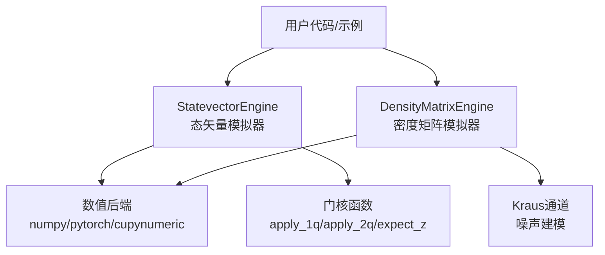
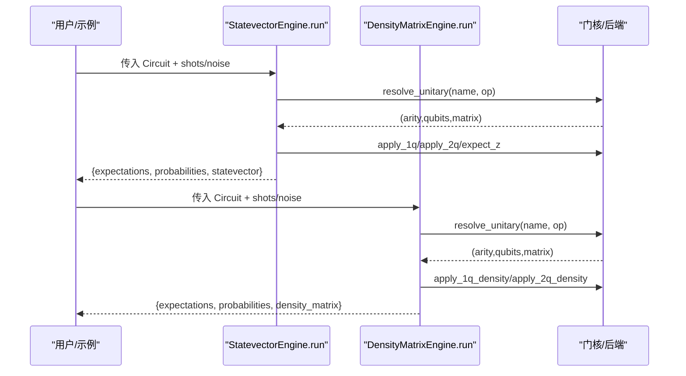
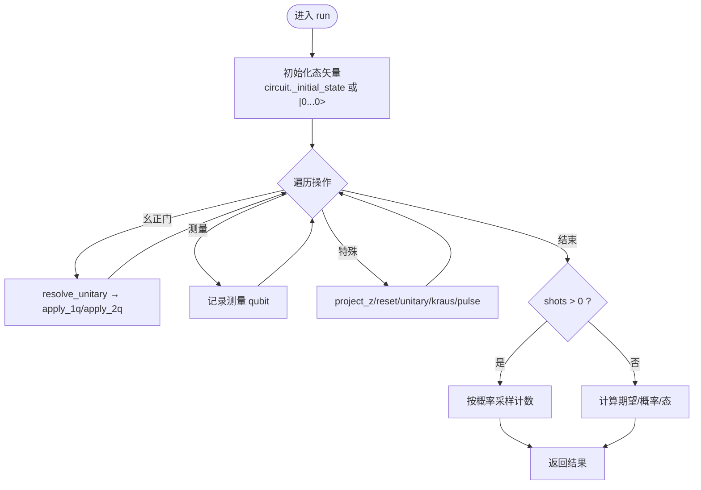
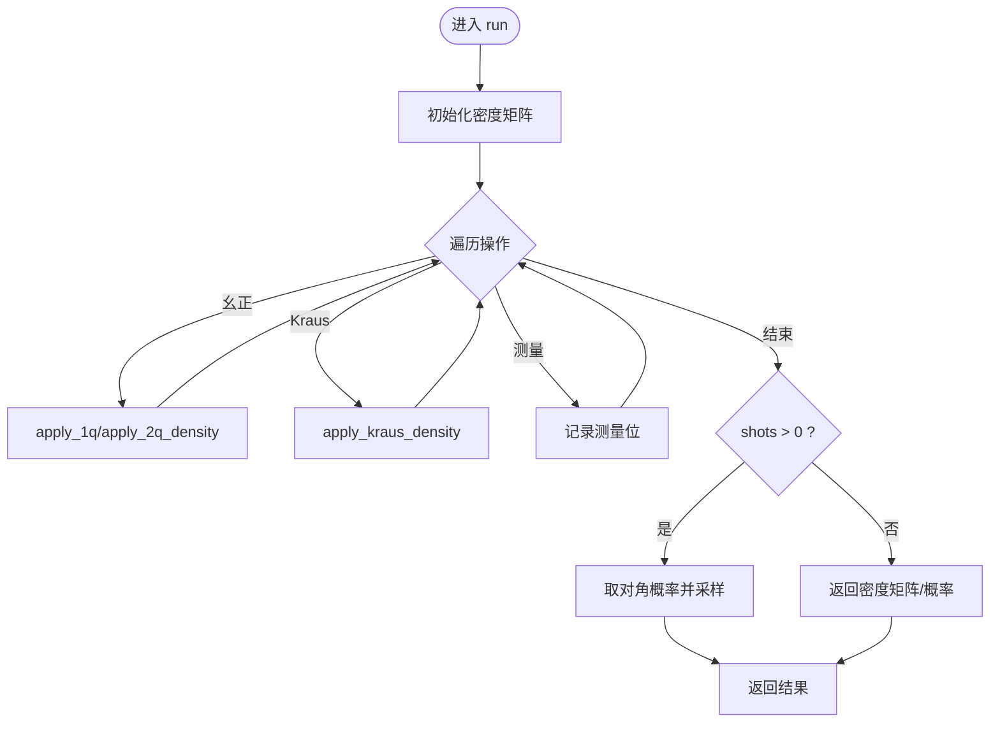
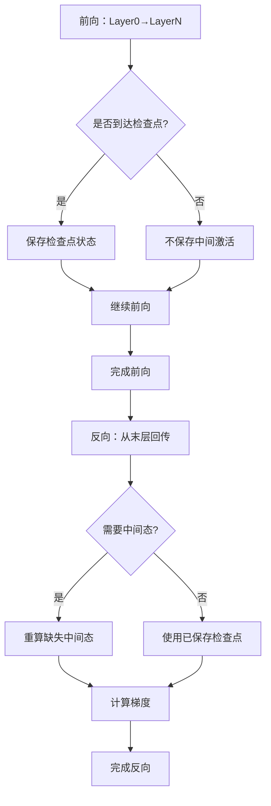
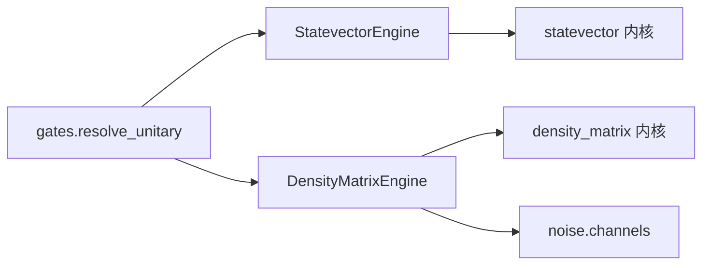

# 内存管理

<cite>
**本文引用的文件**
- [statevector/engine.py](file://src/tyxonq/devices/simulators/statevector/engine.py)
- [density_matrix/engine.py](file://src/tyxonq/devices/simulators/density_matrix/engine.py)
- [memory_optimization_checkpointing.py](file://examples/memory_optimization_checkpointing.py)
- [vqe_memory_scaling_demo.py](file://examples/vqe_memory_scaling_demo.py)
</cite>

## 目录
1. [简介](#简介)
2. [项目结构](#项目结构)
3. [核心组件](#核心组件)
4. [架构总览](#架构总览)
5. [详细组件分析](#详细组件分析)
6. [依赖关系分析](#依赖关系分析)
7. [性能与内存特性](#性能与内存特性)
8. [故障排查指南](#故障排查指南)
9. [结论](#结论)
10. [附录](#附录)

## 简介
本指南聚焦 TyxonQ 在量子状态向量与密度矩阵模拟中的内存管理策略，覆盖：
- 量子态向量的内存占用模型与增长规律
- 检查点（梯度检查点）技术与内存复用机制
- 大规模量子电路的内存优化技巧
- 不同模拟器（态矢量、密度矩阵、张量网络 MPS）的内存使用模式
- 内存泄漏检测与调试方法
- 监控与分析内存使用情况的实践
- 面向大尺度量子计算的内存优化最佳实践

## 项目结构
TyxonQ 将仿真器按表示形式组织为独立引擎模块，便于按需选择内存/精度/速度权衡方案。与内存密切相关的核心路径包括：
- 态矢量模拟器：保存 2^n 维复数向量，支持门应用、测量、采样、噪声近似等
- 密度矩阵模拟器：保存 2^n × 2^n 密度矩阵，原生支持 Kraus 通道等噪声建模
- 示例脚本：展示深度电路梯度检查点、VQE 内存缩放与可观测分解思路

图示来源
- [statevector/engine.py:1-120](file://src/tyxonq/devices/simulators/statevector/engine.py#L1-L120)
- [density_matrix/engine.py:1-110](file://src/tyxonq/devices/simulators/density_matrix/engine.py#L1-L110)

章节来源
- [statevector/engine.py:1-120](file://src/tyxonq/devices/simulators/statevector/engine.py#L1-L120)
- [density_matrix/engine.py:1-110](file://src/tyxonq/devices/simulators/density_matrix/engine.py#L1-L110)

## 核心组件
- StatevectorEngine：以 2^n 复数向量表示纯态，逐门应用幺正演化；支持测量、采样、可选噪声衰减；提供 state/probability/amplitude/perfect_sampling 等接口。
- DensityMatrixEngine：以 2^n × 2^n 密度矩阵表示混合态，原生支持 Kraus 通道；提供 run/state/probabilities/expval 等接口。
- 示例脚本：演示深度 VQE 梯度检查点、内存随系统规模的增长趋势、Pauli 算符分解对切片潜力的影响。

章节来源
- [statevector/engine.py:38-120](file://src/tyxonq/devices/simulators/statevector/engine.py#L38-L120)
- [density_matrix/engine.py:36-110](file://src/tyxonq/devices/simulators/density_matrix/engine.py#L36-L110)
- [memory_optimization_checkpointing.py:1-120](file://examples/memory_optimization_checkpointing.py#L1-L120)
- [vqe_memory_scaling_demo.py:1-120](file://examples/vqe_memory_scaling_demo.py#L1-L120)

## 架构总览
TyxonQ 通过统一的后端抽象与“单一真相源”的门表分发，确保不同模拟器共享一致的语义与实现，减少分叉带来的维护成本与潜在错误。

图示来源
- [statevector/engine.py:46-120](file://src/tyxonq/devices/simulators/statevector/engine.py#L46-L120)
- [density_matrix/engine.py:43-110](file://src/tyxonq/devices/simulators/density_matrix/engine.py#L43-L110)

## 详细组件分析

### 态矢量模拟器（StatevectorEngine）
- 内存占用：O(2^n) 复数数组，n 为量子比特数。每个元素通常为 complex128（16 字节），因此峰值内存约 16×2^n 字节。
- 运行流程：初始化初态 → 遍历操作 → 解析幺正门并应用 → 处理测量/投影/重置 → 返回期望值、概率分布或采样结果。
- 噪声与 ZZ 串扰：支持可选的 depolarizing 衰减与 ZZ 串扰（局部近似或全局精确演化），后者在大 n 时内存/计算开销显著。
- 三能级扩展：在脉冲操作中可选择三能级演化以模拟泄漏到 |2⟩ 的物理过程（当前单量子比特完全支持，多量子比特简化处理）。

图示来源
- [statevector/engine.py:46-120](file://src/tyxonq/devices/simulators/statevector/engine.py#L46-L120)
- [statevector/engine.py:344-451](file://src/tyxonq/devices/simulators/statevector/engine.py#L344-L451)

章节来源
- [statevector/engine.py:38-120](file://src/tyxonq/devices/simulators/statevector/engine.py#L38-L120)
- [statevector/engine.py:344-451](file://src/tyxonq/devices/simulators/statevector/engine.py#L344-L451)
- [statevector/engine.py:474-725](file://src/tyxonq/devices/simulators/statevector/engine.py#L474-L725)
- [statevector/engine.py:789-873](file://src/tyxonq/devices/simulators/statevector/engine.py#L789-L873)

### 密度矩阵模拟器（DensityMatrixEngine）
- 内存占用：O(4^n) 复数矩阵，n 为量子比特数。相比态矢量，内存呈指数级更高，适合中小规模噪声研究。
- 运行流程：初始化密度矩阵 → 遍历操作 → 幺正门作用 ρ→GρG† → 可选 Kraus 通道 → 返回对角概率或密度矩阵。
- 噪声建模：原生支持 depolarizing、amplitude_damping、phase_damping、pauli 等通道，直接作用于密度矩阵。
- 限制：不支持脉冲级演化（需改用态矢量引擎或将脉冲编译为幺正门）。

图示来源
- [density_matrix/engine.py:43-110](file://src/tyxonq/devices/simulators/density_matrix/engine.py#L43-L110)
- [density_matrix/engine.py:111-167](file://src/tyxonq/devices/simulators/density_matrix/engine.py#L111-L167)

章节来源
- [density_matrix/engine.py:36-110](file://src/tyxonq/devices/simulators/density_matrix/engine.py#L36-L110)
- [density_matrix/engine.py:111-167](file://src/tyxonq/devices/simulators/density_matrix/engine.py#L111-L167)
- [density_matrix/engine.py:196-227](file://src/tyxonq/devices/simulators/density_matrix/engine.py#L196-L227)

### 检查点技术（梯度检查点）与内存复用
- 动机：深度电路反向传播中，标准方法会保存所有中间激活，导致 O(depth × 2^n) 内存；梯度检查点仅保存少量“检查点”，反向时重算中间层，将内存降至 O(√depth × 2^n) 或 O(log depth × 2^n)，代价是增加计算时间。
- 实践要点：
  - 在 PyTorch 后端下，结合 torch.utils.checkpoint 对每层或若干层进行包装，避免保存全部中间态。
  - 适用于深电路（>50 层）、大比特数（>10）且内存受限场景；浅电路或速度优先场景不建议启用。
  - 注意参数形状与自动微分图构建，确保 checkpoint 包裹的是可微函数块。

图示来源
- [memory_optimization_checkpointing.py:1-120](file://examples/memory_optimization_checkpointing.py#L1-L120)
- [memory_optimization_checkpointing.py:200-229](file://examples/memory_optimization_checkpointing.py#L200-L229)

章节来源
- [memory_optimization_checkpointing.py:1-120](file://examples/memory_optimization_checkpointing.py#L1-L120)
- [memory_optimization_checkpointing.py:200-229](file://examples/memory_optimization_checkpointing.py#L200-L229)

### 大规模量子电路的内存优化技巧
- 选择合适模拟器：
  - 纯态、无强噪声：优先态矢量（O(2^n)）。
  - 含强噪声/混合态：密度矩阵（O(4^n)），但仅限小规模。
  - 纠缠度低/局域性强的电路：考虑张量网络（MPS）表示，内存与复杂度随纠缠熵增长而非 2^n。
- 可观测分解与切片：
  - 利用 Pauli 字符串中恒等算符 I 的位置，可将期望值计算映射到更小子空间，从而降低有效维度。
  - 示例展示了如何通过识别恒等位置评估切片潜力（尽管完整切片需内部张量网络 API）。
- 分层与批处理：
  - 将大电路拆分为子电路分批执行，合并结果；或在优化循环中对参数进行分组更新，减少同时驻留的中间态数量。
- 数值后端与数据类型：
  - 根据精度需求选择 float32/complex64 或 float64/complex128；在可接受误差范围内降低类型精度可显著节省内存。
- 资源释放：
  - 及时释放不再需要的中间张量；避免在循环中创建临时大对象；谨慎使用视图与拷贝。

章节来源
- [vqe_memory_scaling_demo.py:1-120](file://examples/vqe_memory_scaling_demo.py#L1-L120)
- [vqe_memory_scaling_demo.py:111-177](file://examples/vqe_memory_scaling_demo.py#L111-L177)

### 不同模拟器的内存使用模式
- 态矢量：
  - 内存：O(2^n)
  - 适用：纯态、中等规模系统；支持采样、期望值、振幅访问等。
- 密度矩阵：
  - 内存：O(4^n)
  - 适用：噪声研究、混合态；原生 Kraus 通道；不适合大 n。
- 张量网络（MPS）：
  - 内存：与纠缠熵相关，通常远小于 2^n；适合低纠缠、局域相互作用电路。
  - 在 TyxonQ 中可通过相应引擎/库使用（本仓库包含 MPS 引擎入口）。

章节来源
- [statevector/engine.py:1-10](file://src/tyxonq/devices/simulators/statevector/engine.py#L1-L10)
- [density_matrix/engine.py:1-10](file://src/tyxonq/devices/simulators/density_matrix/engine.py#L1-L10)

## 依赖关系分析
- 门表与核函数：两个引擎均通过统一的门表 resolve_unitary 解析门，再调用对应的 apply_* 内核，保证行为一致。
- 数值后端：通过 get_backend 获取 numpy/pytorch/cupynumeric 等后端，态矢量与密度矩阵共享同一套后端能力。
- 噪声通道：密度矩阵引擎直接调用 channels 模块实现 Kraus 通道；态矢量引擎在特定模式下采用近似衰减或显式 ZZ 串扰演化。

图示来源
- [statevector/engine.py:17-33](file://src/tyxonq/devices/simulators/statevector/engine.py#L17-L33)
- [density_matrix/engine.py:17-30](file://src/tyxonq/devices/simulators/density_matrix/engine.py#L17-L30)

章节来源
- [statevector/engine.py:17-33](file://src/tyxonq/devices/simulators/statevector/engine.py#L17-L33)
- [density_matrix/engine.py:17-30](file://src/tyxonq/devices/simulators/density_matrix/engine.py#L17-L30)

## 性能与内存特性
- 态矢量模拟器：
  - 内存：O(2^n)；典型复杂 16×2^n 字节（complex128）。
  - 时间：每门 O(2^n) 或 O(2^{k+n})（k 为作用比特数），总体近似 poly(gates)·2^n。
  - 噪声：可选 depolarizing 衰减；ZZ 串扰局部近似线性于邻居数，全局精确模式 O(2^{2n}) 不可用于大 n。
- 密度矩阵模拟器：
  - 内存：O(4^n)；时间近似 poly(gates)·4^n。
  - 噪声：原生 Kraus 通道，物理准确但昂贵。
- 梯度检查点：
  - 将反向传播内存从 O(depth·2^n) 降至 O(√depth·2^n) 或 O(log depth·2^n)，以额外重计算换取内存节省。
- 可观测分解/切片：
  - 利用 Pauli 字符串中恒等算符的数量 k，可将有效维度降至 2^{n-k}，内存节省因子 2^k，代价是多次求和与计算。

章节来源
- [statevector/engine.py:1-10](file://src/tyxonq/devices/simulators/statevector/engine.py#L1-L10)
- [density_matrix/engine.py:1-10](file://src/tyxonq/devices/simulators/density_matrix/engine.py#L1-L10)
- [memory_optimization_checkpointing.py:110-142](file://examples/memory_optimization_checkpointing.py#L110-L142)
- [vqe_memory_scaling_demo.py:111-177](file://examples/vqe_memory_scaling_demo.py#L111-L177)

## 故障排查指南
- 未知操作静默跳过问题：
  - 现象：某些门（如 y/z/t/tdg/cy/cry）未被处理，导致结果错误。
  - 解决：使用统一门表 resolve_unitary 分发，并在未知操作时抛出异常，避免静默丢弃。
- 脉冲操作不支持：
  - 现象：密度矩阵引擎不支持 pulse/pulse_inline。
  - 解决：改用态矢量引擎，或先将脉冲编译为幺正门再模拟。
- ZZ 串扰模式选择：
  - local：高效，适用于生产与大系统。
  - global：精确但昂贵，仅小系统可用。
- 三能级模拟限制：
  - 单量子比特完全支持；多量子比特当前简化处理，需注意局限性。

章节来源
- [statevector/engine.py:335-342](file://src/tyxonq/devices/simulators/statevector/engine.py#L335-L342)
- [density_matrix/engine.py:97-109](file://src/tyxonq/devices/simulators/density_matrix/engine.py#L97-L109)
- [statevector/engine.py:474-725](file://src/tyxonq/devices/simulators/statevector/engine.py#L474-L725)
- [statevector/engine.py:789-873](file://src/tyxonq/devices/simulators/statevector/engine.py#L789-L873)

## 结论
- 选择合适的表示与模拟器是控制内存的关键：纯态用态矢量，混合态/强噪声用密度矩阵（限于小规模），低纠缠电路优先考虑张量网络。
- 梯度检查点是深度电路训练的有效内存优化手段，以计算换内存，需结合 PyTorch 集成。
- 可观测分解与切片可利用 Pauli 结构进一步降低有效维度。
- 通过统一门表与后端抽象，TyxonQ 在不同模拟器间保持一致性与可维护性。
- 实践中应持续监控内存使用，结合示例脚本与工具链定位瓶颈，逐步迭代优化。

## 附录
- 监控与分析内存使用情况：
  - 在 Python 中使用 tracemalloc、memory_profiler 或 psutil 跟踪进程内存变化。
  - 针对 PyTorch 后端，可使用 torch.cuda.memory_summary（GPU）或 torch.autograd.gradcheck 验证梯度路径。
  - 在循环中定期打印关键阶段（前向、反向、采样）的峰值内存，定位热点。
- 内存泄漏检测与调试：
  - 检查是否存在未释放的大张量引用（例如闭包捕获、全局缓存过大）。
  - 避免在高频循环中创建临时大对象；尽量复用缓冲区。
  - 使用弱引用或显式 del 清理不再需要的对象；确认异常路径也能释放资源。
- 最佳实践清单：
  - 优先选择态矢量；仅在必要时使用密度矩阵。
  - 深度电路启用梯度检查点；浅电路保持默认以提升速度。
  - 利用可观测分解与切片；合理设置 dtype（float32/complex64）。
  - 谨慎开启全局 ZZ 串扰；优先局部近似。
  - 定期评估内存曲线，结合示例脚本对比不同策略的效果。