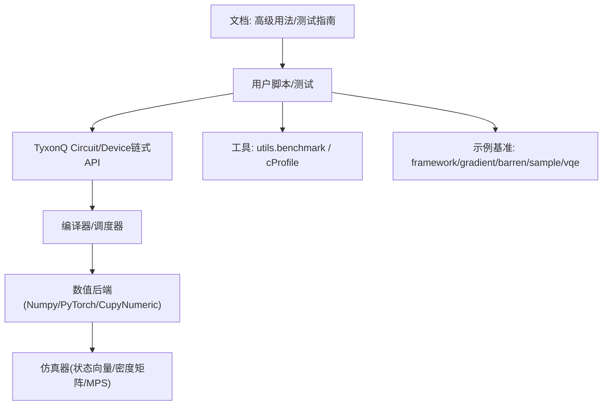
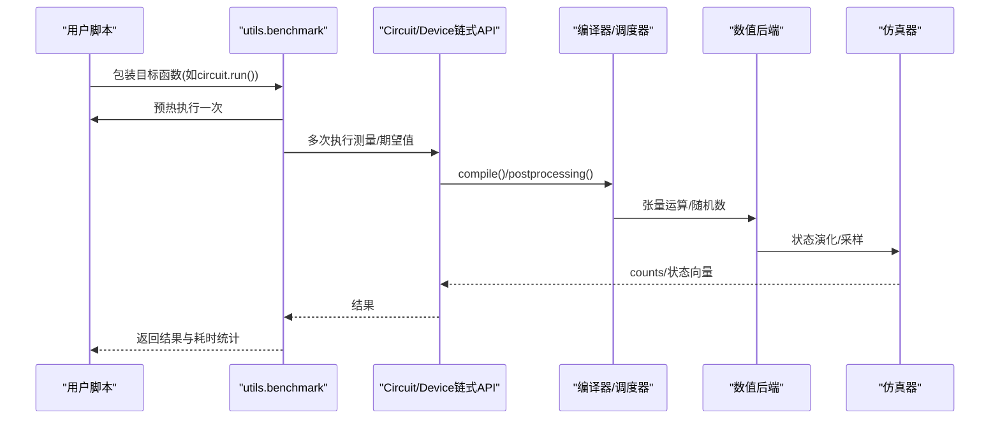
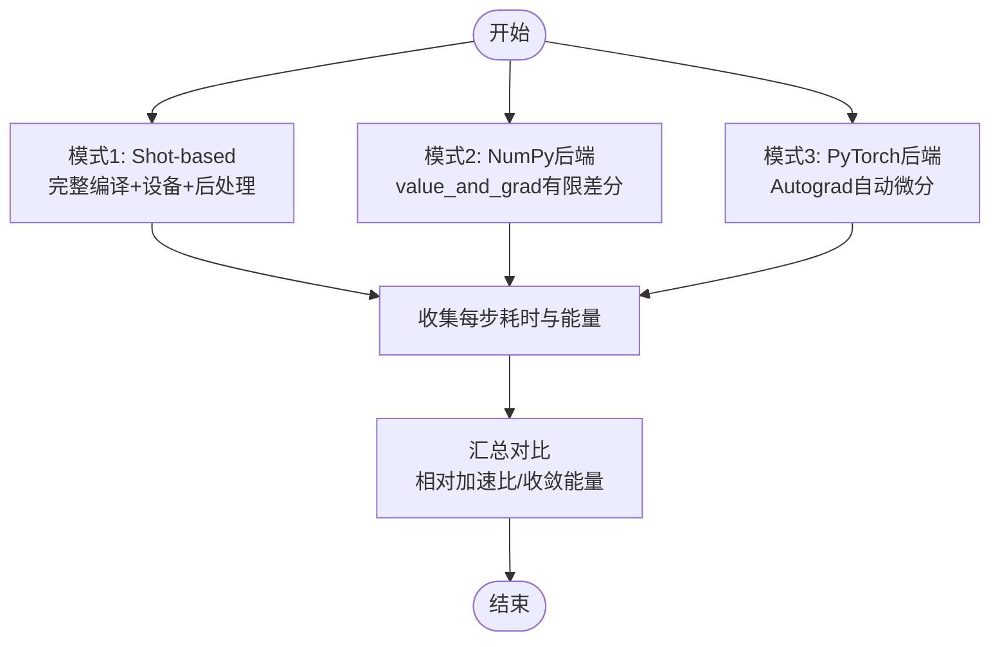
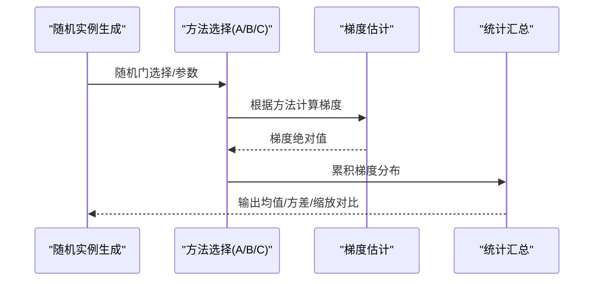
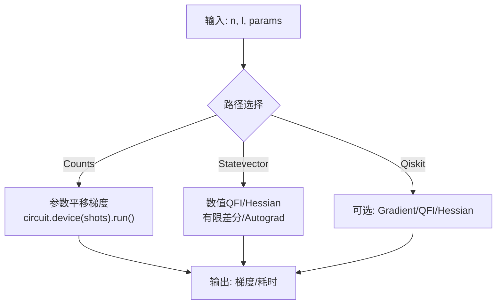
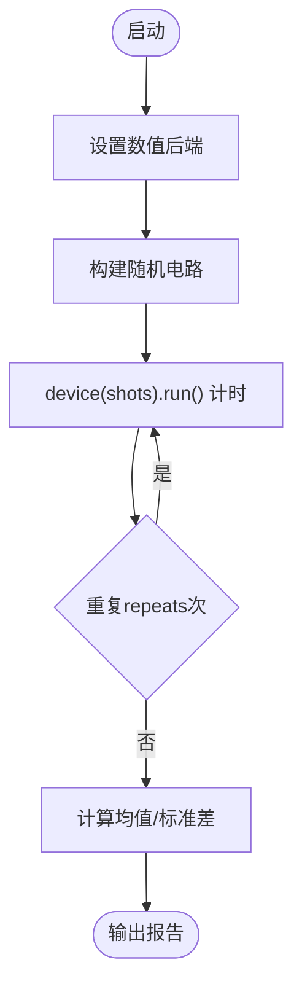
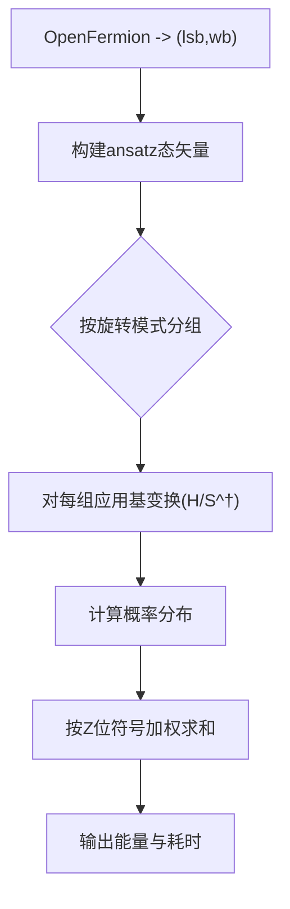
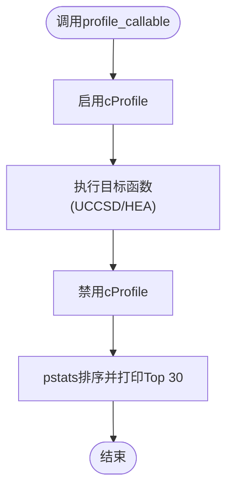
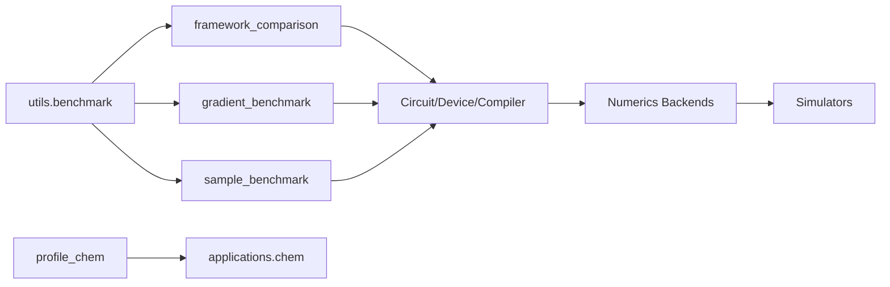

# 基准测试和性能分析

<cite>
**本文引用的文件**
- [src/tyxonq/utils.py](file://src/tyxonq/utils.py)
- [examples/framework_performance_comparison.py](file://examples/framework_performance_comparison.py)
- [examples/barren_plateau_benchmark.py](file://examples/barren_plateau_benchmark.py)
- [examples/gradient_benchmark.py](file://examples/gradient_benchmark.py)
- [examples/sample_benchmark.py](file://examples/sample_benchmark.py)
- [examples/vqeh2o_benchmark.py](file://examples/vqeh2o_benchmark.py)
- [scripts/profile_chem.py](file://scripts/profile_chem.py)
- [docs/source/user_guide/advanced/index.rst](file://docs/source/user_guide/advanced/index.rst)
- [docs/source/developer_guide/testing_guidelines.rst](file://docs/source/developer_guide/testing_guidelines.rst)
</cite>

## 目录
1. [简介](#简介)
2. [项目结构](#项目结构)
3. [核心组件](#核心组件)
4. [架构总览](#架构总览)
5. [详细组件分析](#详细组件分析)
6. [依赖关系分析](#依赖关系分析)
7. [性能注意事项](#性能注意事项)
8. [故障排查指南](#故障排查指南)
9. [结论](#结论)
10. [附录](#附录)

## 简介
本指南面向希望在 TyxonQ 中进行基准测试与性能分析的工程师与研究者，系统介绍内置的基准工具、性能分析方法、瓶颈识别策略、跨框架对比方法、自定义基准编写规范、回归测试实践以及监控与日志最佳实践。文档以仓库中的示例脚本与工具函数为依据，提供可复现的实践路径与可视化流程说明。

## 项目结构
TyxonQ 的基准与性能能力分布在以下位置：
- 通用工具：utils.benchmark 提供统一的“预热+多次运行”计时统计；profile_chem.py 使用 cProfile/pstats 对化学应用进行热点剖析。
- 示例基准：
  - framework_performance_comparison.py：多框架（TyxonQ/Qiskit/PennyLane）与多执行模式（Shot-based/NumPy梯度/PyTorch自动微分）对比。
  - barren_plateau_benchmark.py：三种梯度计算方式（理想autograd、参数平移、含噪声参数平移）的系统性对比。
  - gradient_benchmark.py：基于counts的参数平移梯度、状态向量数值QFI/Hessian、可选Qiskit对比。
  - sample_benchmark.py：不同后端（numpy/pytorch/cupynumeric）采样吞吐对比。
  - vqeh2o_benchmark.py：分子VQE场景下直接数值路径的性能评估。
- 文档与测试指南：
  - docs/source/user_guide/advanced/index.rst：内置性能剖析与内存剖析的使用建议。
  - docs/source/developer_guide/testing_guidelines.rst：性能回归测试与测试组织建议。

图表来源
- [src/tyxonq/utils.py:181-208](file://src/tyxonq/utils.py#L181-L208)
- [examples/framework_performance_comparison.py:75-408](file://examples/framework_performance_comparison.py#L75-L408)
- [examples/gradient_benchmark.py:30-186](file://examples/gradient_benchmark.py#L30-L186)
- [examples/sample_benchmark.py:16-66](file://examples/sample_benchmark.py#L16-L66)
- [examples/vqeh2o_benchmark.py:86-146](file://examples/vqeh2o_benchmark.py#L86-L146)

章节来源
- [src/tyxonq/utils.py:181-208](file://src/tyxonq/utils.py#L181-L208)
- [docs/source/user_guide/advanced/index.rst:669-759](file://docs/source/user_guide/advanced/index.rst#L669-L759)
- [docs/source/developer_guide/testing_guidelines.rst:273-351](file://docs/source/developer_guide/testing_guidelines.rst#L273-L351)

## 核心组件
- 统一基准计时：utils.benchmark 提供一次预热与多次重复执行的平均耗时统计，便于比较不同实现或配置。
- 化学应用剖析：scripts/profile_chem.py 封装 cProfile 调用，支持对 UCCSD/HEA 等算法在 device 路径下的热点定位。
- 多执行模式对比：framework_performance_comparison.py 展示 Shot-based、NumPy有限差分、PyTorch自动微分三种模式的完整流程与时间对比。
- 梯度与量子信息量基准：gradient_benchmark.py 覆盖 counts 参数平移梯度、状态向量 QFI/Hessian、可选 Qiskit 对比。
- 采样吞吐基准：sample_benchmark.py 对比不同后端的采样速度，支持命令行参数化。
- 分子VQE数值路径：vqeh2o_benchmark.py 演示不构建稠密哈密顿量的直接数值求能路径。

章节来源
- [src/tyxonq/utils.py:181-208](file://src/tyxonq/utils.py#L181-L208)
- [scripts/profile_chem.py:9-30](file://scripts/profile_chem.py#L9-L30)
- [examples/framework_performance_comparison.py:75-408](file://examples/framework_performance_comparison.py#L75-L408)
- [examples/gradient_benchmark.py:30-186](file://examples/gradient_benchmark.py#L30-L186)
- [examples/sample_benchmark.py:16-66](file://examples/sample_benchmark.py#L16-L66)
- [examples/vqeh2o_benchmark.py:86-146](file://examples/vqeh2o_benchmark.py#L86-L146)

## 架构总览
下图展示了从用户脚本到执行引擎的端到端数据流，并标注了基准与剖析点。

图表来源
- [src/tyxonq/utils.py:181-208](file://src/tyxonq/utils.py#L181-L208)
- [examples/framework_performance_comparison.py:130-189](file://examples/framework_performance_comparison.py#L130-L189)
- [examples/gradient_benchmark.py:64-109](file://examples/gradient_benchmark.py#L64-L109)
- [examples/sample_benchmark.py:32-39](file://examples/sample_benchmark.py#L32-L39)

## 详细组件分析

### 组件A：多框架与多模式性能对比（framework_performance_comparison.py）
- 目标：在同一问题（TFIM VQE）上对比 TyxonQ 三种执行模式与 Qiskit/PennyLane 的时间开销。
- 关键点：
  - 模式1（Shot-based）：完整编译→设备(shots>0)→后处理，最接近真机。
  - 模式2（NumPy + value_and_grad）：展示框架内有限差分梯度能力。
  - 模式3（PyTorch + Autograd）：推荐的最佳实践，利用自动微分加速。
- 输出：各模式每步平均耗时、最终能量、相对加速比。

图表来源
- [examples/framework_performance_comparison.py:75-408](file://examples/framework_performance_comparison.py#L75-L408)

章节来源
- [examples/framework_performance_comparison.py:75-408](file://examples/framework_performance_comparison.py#L75-L408)

### 组件B：梯度方法与荒原现象（barren_plateau_benchmark.py）
- 目标：对比理想 autograd、参数平移（含/不含噪声）三种梯度估计方式，量化系统规模增大导致的梯度消失。
- 关键点：
  - 方法A：PyTorch autograd（理论基线）。
  - 方法B：参数平移 + 有限shots（硬件可实现）。
  - 方法C：参数平移 + shots + 噪声模型（最贴近NISQ）。
- 输出：梯度标准差随系统规模变化、与理论缩放 O(1/2^(n/2)) 的对比。

图表来源
- [examples/barren_plateau_benchmark.py:142-345](file://examples/barren_plateau_benchmark.py#L142-L345)

章节来源
- [examples/barren_plateau_benchmark.py:142-345](file://examples/barren_plateau_benchmark.py#L142-L345)

### 组件C：梯度与量子Fisher信息基准（gradient_benchmark.py）
- 目标：对比 counts 参数平移梯度、状态向量数值 QFI、PyTorch autograd Hessian，以及可选 Qiskit 路径。
- 关键点：
  - counts 路径：通过 circuit.device(...).run() 获取计数，再按观测算符计算期望。
  - 状态向量路径：直接构造态矢量，使用有限差分求 QFI，或使用 autograd 求 Hessian。
  - 可选 Qiskit：用于交叉验证。

图表来源
- [examples/gradient_benchmark.py:30-186](file://examples/gradient_benchmark.py#L30-L186)

章节来源
- [examples/gradient_benchmark.py:30-186](file://examples/gradient_benchmark.py#L30-L186)

### 组件D：采样吞吐基准（sample_benchmark.py）
- 目标：在不同后端（numpy/pytorch/cupynumeric）下，评估随机电路采样的平均耗时与波动。
- 关键点：
  - 使用 get_backend 与 set_backend 切换数值后端。
  - 通过命令行参数控制 qubit 数、层数、shots、重复次数与种子。

图表来源
- [examples/sample_benchmark.py:16-66](file://examples/sample_benchmark.py#L16-L66)

章节来源
- [examples/sample_benchmark.py:16-66](file://examples/sample_benchmark.py#L16-L66)

### 组件E：分子VQE数值路径（vqeh2o_benchmark.py）
- 目标：在不构建稠密哈密顿量的情况下，按 Pauli 项分组旋转与概率求和，评估直接数值路径性能。
- 关键点：
  - 将 OpenFermion 的 QubitOperator 转换为 (lsb, wb) 形式。
  - 按旋转模式分组，复用旋转后的态矢量，减少重复计算。
  - 使用 PyTorch 后端进行高效张量运算。

图表来源
- [examples/vqeh2o_benchmark.py:86-146](file://examples/vqeh2o_benchmark.py#L86-L146)

章节来源
- [examples/vqeh2o_benchmark.py:86-146](file://examples/vqeh2o_benchmark.py#L86-L146)

### 组件F：化学应用剖析（scripts/profile_chem.py）
- 目标：使用 cProfile/pstats 对 UCCSD/HEA 在 device 路径下的热点进行分析，支持 shots>0 的计数路径剖析。
- 关键点：
  - profile_callable 封装启用/禁用剖析与Top-N排序输出。
  - 可通过环境变量 CHEM_PROFILE_SHOTS 控制 shots。

图表来源
- [scripts/profile_chem.py:9-30](file://scripts/profile_chem.py#L9-L30)

章节来源
- [scripts/profile_chem.py:9-30](file://scripts/profile_chem.py#L9-L30)

## 依赖关系分析
- 工具与示例之间的耦合：
  - utils.benchmark 被多个示例用作统一计时入口。
  - 示例通过 tyxonq.Circuit/device 链式API与编译器、数值后端、仿真器交互。
  - 化学剖析脚本依赖 applications.chem 模块与外部 pyscf（可选）。
- 外部依赖：
  - Qiskit/PennyLane 为可选依赖，仅在可用时参与对比。
  - PyTorch/Numpy/CupyNumeric 作为数值后端影响性能与内存占用。

图表来源
- [src/tyxonq/utils.py:181-208](file://src/tyxonq/utils.py#L181-L208)
- [examples/framework_performance_comparison.py:75-408](file://examples/framework_performance_comparison.py#L75-L408)
- [examples/gradient_benchmark.py:30-186](file://examples/gradient_benchmark.py#L30-L186)
- [examples/sample_benchmark.py:16-66](file://examples/sample_benchmark.py#L16-L66)
- [scripts/profile_chem.py:23-55](file://scripts/profile_chem.py#L23-L55)

章节来源
- [src/tyxonq/utils.py:181-208](file://src/tyxonq/utils.py#L181-L208)
- [examples/framework_performance_comparison.py:75-408](file://examples/framework_performance_comparison.py#L75-L408)
- [examples/gradient_benchmark.py:30-186](file://examples/gradient_benchmark.py#L30-L186)
- [examples/sample_benchmark.py:16-66](file://examples/sample_benchmark.py#L16-L66)
- [scripts/profile_chem.py:23-55](file://scripts/profile_chem.py#L23-L55)

## 性能注意事项
- 预热与多次运行：使用 utils.benchmark 或示例中的 benchmark 包装，避免首次编译/JIT开销干扰。
- 后端选择：
  - PyTorch 后端通常具备更好的自动微分与并行优化。
  - NumPy 后端适合无 GPU 环境或需要确定性行为。
  - CupyNumeric 可用于GPU加速（若可用）。
- 采样与噪声：
  - Shot-based 路径更接近真实硬件，但受统计噪声影响；适当增加 shots 可降低方差。
  - 噪声模型（如 depolarizing）会进一步影响梯度质量与收敛。
- 内存与资源：
  - 大电路建议使用 statevector 或 MPS 仿真器，结合 checkpointing 降低内存峰值。
  - 使用 profile_memory 或 psutil/torch.cuda 监控内存变化。
- 回归测试：
  - 将关键路径纳入单元测试与性能回归测试，确保扩展不会引入退化。

[本节为通用指导，无需特定文件引用]

## 故障排查指南
- 常见问题定位：
  - 运行时异常：优先检查 device/provider 配置与 shots 设置。
  - 性能退化：使用 cProfile 定位热点函数；对比不同后端与编译选项。
  - 梯度不稳定：检查参数平移步长、shots 数量与噪声强度。
- 诊断步骤：
  - 使用 scripts/profile_chem.py 对化学应用进行热点剖析。
  - 使用 docs/source/user_guide/advanced/index.rst 中的 advanced_profiler 装饰器记录时间与内存变化。
  - 参考 docs/source/developer_guide/testing_guidelines.rst 中的性能回归测试组织方式，建立基线与阈值。

章节来源
- [scripts/profile_chem.py:9-30](file://scripts/profile_chem.py#L9-L30)
- [docs/source/user_guide/advanced/index.rst:714-759](file://docs/source/user_guide/advanced/index.rst#L714-L759)
- [docs/source/developer_guide/testing_guidelines.rst:273-351](file://docs/source/developer_guide/testing_guidelines.rst#L273-L351)

## 结论
TyxonQ 提供了从通用计时工具到领域专用剖析脚本的完整基准与性能分析能力。通过多执行模式对比、梯度方法研究、采样吞吐评估与分子VQE数值路径，用户可以系统性地识别瓶颈、选择合适的后端与执行策略，并将性能回归测试纳入持续集成流程，保障长期稳定性与可扩展性。

[本节为总结，无需特定文件引用]

## 附录

### 快速上手清单
- 选择基准：
  - 多框架对比：运行 examples/framework_performance_comparison.py。
  - 梯度方法研究：运行 examples/barren_plateau_benchmark.py。
  - 梯度与QFI/Hessian：运行 examples/gradient_benchmark.py。
  - 采样吞吐：运行 examples/sample_benchmark.py。
  - 分子VQE数值路径：运行 examples/vqeh2o_benchmark.py。
- 剖析热点：
  - 使用 scripts/profile_chem.py 对化学应用进行 cProfile 剖析。
- 监控与日志：
  - 使用 docs/source/user_guide/advanced/index.rst 中的 advanced_profiler 装饰器记录时间与内存。
- 回归测试：
  - 参考 docs/source/developer_guide/testing_guidelines.rst 中的性能回归测试组织与CI配置建议。

[本节为操作指引，无需特定文件引用]