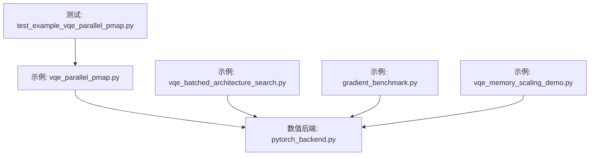
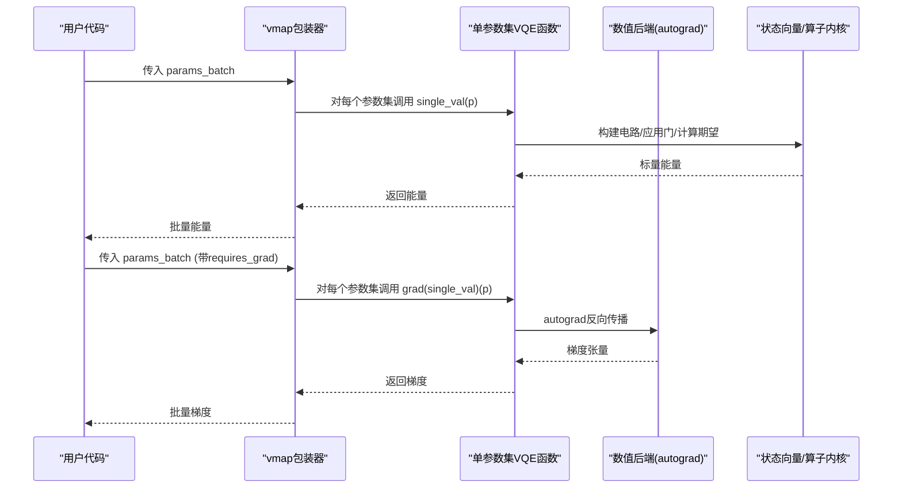
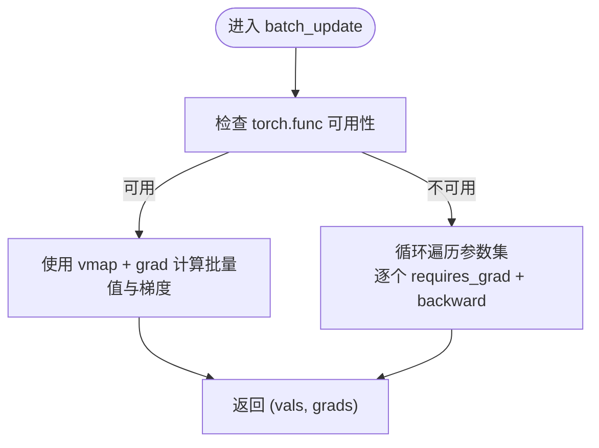
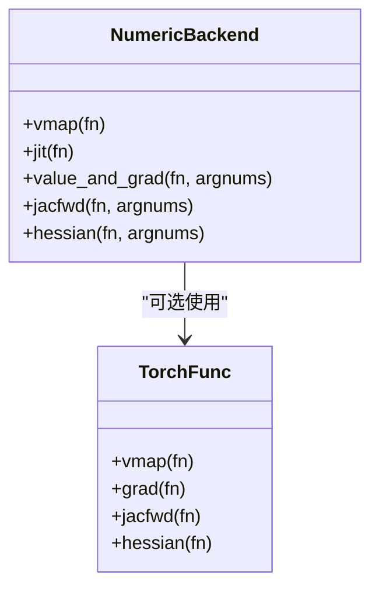
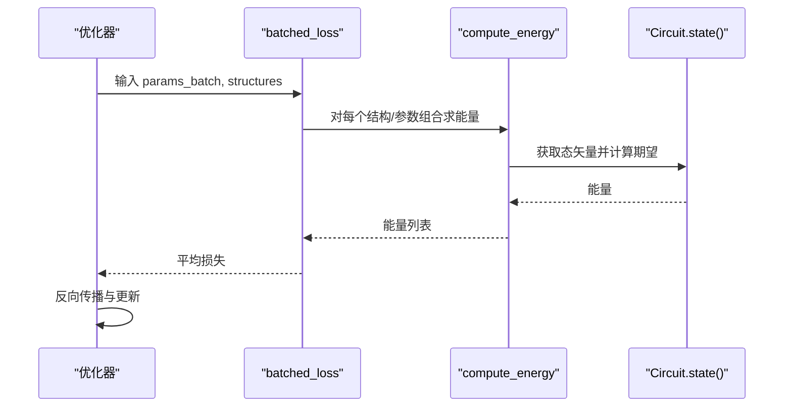
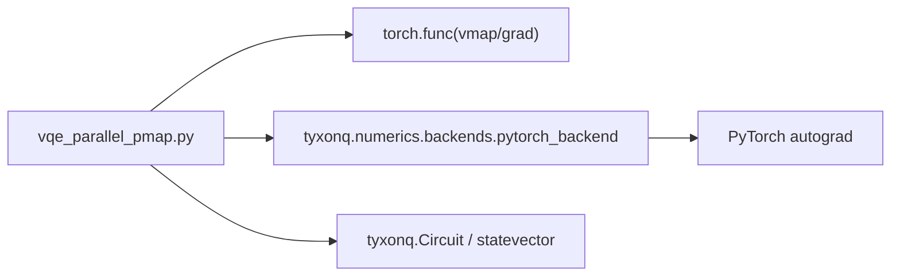

# vmap和pmap并行化技术

<cite>
**本文引用的文件**
- [examples/vqe_parallel_pmap.py](file://examples/vqe_parallel_pmap.py)
- [src/tyxonq/numerics/backends/pytorch_backend.py](file://src/tyxonq/numerics/backends/pytorch_backend.py)
- [examples/vqe_batched_architecture_search.py](file://examples/vqe_batched_architecture_search.py)
- [examples/vqe_memory_scaling_demo.py](file://examples/vqe_memory_scaling_demo.py)
- [examples/gradient_benchmark.py](file://examples/gradient_benchmark.py)
- [tests_examples/test_example_vqe_parallel_pmap.py](file://tests_examples/test_example_vqe_parallel_pmap.py)
</cite>

## 目录
1. [简介](#简介)
2. [项目结构](#项目结构)
3. [核心组件](#核心组件)
4. [架构总览](#架构总览)
5. [详细组件分析](#详细组件分析)
6. [依赖关系分析](#依赖关系分析)
7. [性能考量](#性能考量)
8. [故障排查指南](#故障排查指南)
9. [结论](#结论)
10. [附录](#附录)

## 简介
本文件系统性阐述 TyxonQ 中基于 PyTorch 的 vmap 与 pmap 并行化技术在 VQE（变分量子本征求解器）中的应用。重点包括：
- 使用 torch.func.vmap 对批量参数进行映射，实现批量值与梯度计算
- 在 VQE 中的具体用法：状态向量路径与计数路径
- pmap 在多 GPU 环境下的分布式能力说明与集成建议
- 不同批处理大小的性能对比、内存使用模式与优化建议
- 常见问题定位与调试技巧

## 项目结构
围绕 vmap/pmap 的关键代码集中在示例与数值后端：
- 示例演示：vqe_parallel_pmap.py、vqe_batched_architecture_search.py、gradient_benchmark.py、vqe_memory_scaling_demo.py
- 数值后端封装：pytorch_backend.py（提供 vmap/jit/value_and_grad 等统一接口）
- 测试用例：test_example_vqe_parallel_pmap.py

图表来源
- [examples/vqe_parallel_pmap.py:1-164](file://examples/vqe_parallel_pmap.py#L1-L164)
- [src/tyxonq/numerics/backends/pytorch_backend.py:360-559](file://src/tyxonq/numerics/backends/pytorch_backend.py#L360-L559)
- [examples/vqe_batched_architecture_search.py:1-307](file://examples/vqe_batched_architecture_search.py#L1-L307)
- [examples/gradient_benchmark.py:1-320](file://examples/gradient_benchmark.py#L1-L320)
- [examples/vqe_memory_scaling_demo.py:1-288](file://examples/vqe_memory_scaling_demo.py#L1-L288)
- [tests_examples/test_example_vqe_parallel_pmap.py:1-200](file://tests_examples/test_example_vqe_parallel_pmap.py#L1-L200)

章节来源
- [examples/vqe_parallel_pmap.py:1-164](file://examples/vqe_parallel_pmap.py#L1-L164)
- [src/tyxonq/numerics/backends/pytorch_backend.py:360-559](file://src/tyxonq/numerics/backends/pytorch_backend.py#L360-L559)

## 核心组件
- 批量映射与梯度：通过 torch.func.vmap 将单参数集的函数映射到批次维度，同时结合 torch.func.grad 或 value_and_grad 获得批量梯度
- 数值后端抽象：pytorch_backend.py 暴露 vmap、jit、value_and_grad、jacfwd、hessian 等接口，兼容不同 PyTorch 版本并提供回退策略
- VQE 示例：vqe_parallel_pmap.py 展示 exact（状态向量）与 counts（采样）两条路径；vqe_batched_architecture_search.py 展示多结构+多参数的批量训练
- 基准与内存：gradient_benchmark.py 提供梯度/QFI/Hessian 基准；vqe_memory_scaling_demo.py 分析内存随系统规模增长的模式

章节来源
- [examples/vqe_parallel_pmap.py:126-164](file://examples/vqe_parallel_pmap.py#L126-L164)
- [src/tyxonq/numerics/backends/pytorch_backend.py:360-559](file://src/tyxonq/numerics/backends/pytorch_backend.py#L360-L559)
- [examples/vqe_batched_architecture_search.py:150-202](file://examples/vqe_batched_architecture_search.py#L150-L202)
- [examples/gradient_benchmark.py:140-186](file://examples/gradient_benchmark.py#L140-L186)
- [examples/vqe_memory_scaling_demo.py:111-143](file://examples/vqe_memory_scaling_demo.py#L111-L143)

## 架构总览
下图展示了 vmap 在 VQE 中的端到端调用流程：从用户传入的批量参数出发，经 vmap 展开为多个独立任务，分别执行量子电路评估与梯度计算，最终聚合结果。

图表来源
- [examples/vqe_parallel_pmap.py:126-164](file://examples/vqe_parallel_pmap.py#L126-L164)
- [src/tyxonq/numerics/backends/pytorch_backend.py:446-559](file://src/tyxonq/numerics/backends/pytorch_backend.py#L446-L559)

## 详细组件分析

### 组件A：vmap 批量参数映射与梯度
- 功能要点
  - 使用 torch.func.vmap 将“单参数集”的 VQE 函数映射到批次维度，一次性计算所有参数集的能量与梯度
  - 支持两种路径：exact（状态向量无噪声）与 counts（有限shots采样）
  - 当 torch.func 不可用时，自动回退为循环+autograd
- 关键实现位置
  - 批量更新函数定义与 vmap/grad 的使用
  - 回退逻辑保证兼容性

图表来源
- [examples/vqe_parallel_pmap.py:126-164](file://examples/vqe_parallel_pmap.py#L126-L164)

章节来源
- [examples/vqe_parallel_pmap.py:126-164](file://examples/vqe_parallel_pmap.py#L126-L164)

### 组件B：数值后端 vmap/value_and_grad 封装
- 功能要点
  - 提供 vmap 包装，内部尝试导入 torch.func.vmap，失败则返回原函数作为回退
  - value_and_grad 优先使用 autograd，若失败回退到有限差分
  - 提供 jacfwd/hessian 等高级微分工具（需要较新 PyTorch）
- 适用场景
  - 统一不同 PyTorch 版本的差异
  - 在框架层屏蔽底层实现细节

图表来源
- [src/tyxonq/numerics/backends/pytorch_backend.py:360-559](file://src/tyxonq/numerics/backends/pytorch_backend.py#L360-L559)

章节来源
- [src/tyxonq/numerics/backends/pytorch_backend.py:360-559](file://src/tyxonq/numerics/backends/pytorch_backend.py#L360-L559)

### 组件C：批量架构搜索与训练
- 功能要点
  - 同时优化多种电路结构与多组参数初始化
  - 利用 Circuit.state() 的 autograd 支持进行端到端训练
  - 通过 batched_loss 聚合多结构/多参数的损失
- 适用场景
  - 超参搜索、结构探索、鲁棒性评估

图表来源
- [examples/vqe_batched_architecture_search.py:150-202](file://examples/vqe_batched_architecture_search.py#L150-L202)
- [examples/vqe_batched_architecture_search.py:208-267](file://examples/vqe_batched_architecture_search.py#L208-L267)

章节来源
- [examples/vqe_batched_architecture_search.py:150-202](file://examples/vqe_batched_architecture_search.py#L150-L202)
- [examples/vqe_batched_architecture_search.py:208-267](file://examples/vqe_batched_architecture_search.py#L208-L267)

### 组件D：梯度基准与高阶导数
- 功能要点
  - 提供 counts 路径的参数平移梯度
  - 提供基于状态向量的 QFI（有限差分）与 Hessian（PyTorch autograd）
  - 便于对比不同方法的性能与精度
- 适用场景
  - 方法选型、性能评测、算法验证

章节来源
- [examples/gradient_benchmark.py:95-186](file://examples/gradient_benchmark.py#L95-L186)

### 组件E：内存缩放与观测分解
- 功能要点
  - 展示密集态矢量的内存随 qubit 数量呈指数增长
  - 分析 Pauli 字符串中 Identity 项可被“追踪掉”以减小有效维度
  - 给出小系统基准与梯度计算演示
- 适用场景
  - 资源规划、大规模仿真策略选择

章节来源
- [examples/vqe_memory_scaling_demo.py:111-143](file://examples/vqe_memory_scaling_demo.py#L111-L143)
- [examples/vqe_memory_scaling_demo.py:179-208](file://examples/vqe_memory_scaling_demo.py#L179-L208)
- [examples/vqe_memory_scaling_demo.py:213-258](file://examples/vqe_memory_scaling_demo.py#L213-L258)

## 依赖关系分析
- vmap 依赖 torch.func（PyTorch >= 2.0 时可用），否则回退为循环+autograd
- VQE 示例依赖 TyxonQ 的 Circuit、statevector 内核与后端抽象
- 数值后端封装屏蔽了不同 PyTorch 版本的差异，确保 API 一致性

图表来源
- [examples/vqe_parallel_pmap.py:126-164](file://examples/vqe_parallel_pmap.py#L126-L164)
- [src/tyxonq/numerics/backends/pytorch_backend.py:360-559](file://src/tyxonq/numerics/backends/pytorch_backend.py#L360-L559)

章节来源
- [examples/vqe_parallel_pmap.py:126-164](file://examples/vqe_parallel_pmap.py#L126-L164)
- [src/tyxonq/numerics/backends/pytorch_backend.py:360-559](file://src/tyxonq/numerics/backends/pytorch_backend.py#L360-L559)

## 性能考量
- 批处理大小对吞吐的影响
  - 增大 batch 可减少 Python 循环开销，提升 GPU/CPU 并行度
  - 但会线性增加显存占用（每个参数集独立态矢量/中间图）
- 路径选择
  - Exact（状态向量）路径适合中小规模系统，精度高、可微分
  - Counts（采样）路径适用于真实硬件或含噪声模拟，需权衡 shots 与方差
- 内存模式
  - 密集态矢量内存 ~ O(2^n)，n 每增1，内存翻倍
  - 可通过观测分解减少非平凡作用位，从而降低有效维度
- 建议
  - 根据显存预算选择最大 batch；必要时分块计算
  - 使用 jit（如 torch.compile）加速热点函数
  - 对 counts 路径，合理设置 shots 平衡精度与耗时

[本节为通用指导，不直接分析具体文件]

## 故障排查指南
- 常见错误与解决
  - torch.func 不可用：自动回退为循环+autograd；升级 PyTorch 以获得原生 vmap/grad
  - 梯度为 None：检查是否对正确参数启用 requires_grad，并确保输出参与计算图
  - 数值不稳定：适当调整学习率、步长或使用更稳定的优化器
  - 内存溢出：减小 batch、系统规模或采用稀疏观测/近似方法
- 调试技巧
  - 打印各阶段张量形状与 dtype，确认广播与类型一致
  - 逐步关闭 vmap，回归单参数集定位问题
  - 使用最小复现脚本隔离第三方库影响

章节来源
- [src/tyxonq/numerics/backends/pytorch_backend.py:446-559](file://src/tyxonq/numerics/backends/pytorch_backend.py#L446-L559)
- [examples/vqe_parallel_pmap.py:126-164](file://examples/vqe_parallel_pmap.py#L126-L164)

## 结论
- vmap 能显著提升 VQE 批量参数评估与梯度计算的效率，尤其在大 batch 下
- 数值后端封装提供了稳定、兼容的微分与并行接口
- 结合 exact 与 counts 路径，可在不同资源与精度需求间灵活取舍
- 对于多 GPU 分布式，pmap 可作为扩展方向；当前仓库以 vmap 为主，pmap 可按需集成

[本节为总结性内容，不直接分析具体文件]

## 附录

### 完整代码示例路径（不含代码正文）
- 使用 torch.func.vmap 进行批量梯度计算的示例入口
  - [批量更新函数与 vmap/grad 用法:126-164](file://examples/vqe_parallel_pmap.py#L126-L164)
- 数值后端 vmap/value_and_grad 的统一接口
  - [vmap 包装与 value_and_grad 实现:360-559](file://src/tyxonq/numerics/backends/pytorch_backend.py#L360-L559)
- 批量架构搜索与训练
  - [批量损失与优化循环:150-267](file://examples/vqe_batched_architecture_search.py#L150-L267)
- 梯度基准与高阶导数
  - [QFI/Hessian 基准实现:140-186](file://examples/gradient_benchmark.py#L140-L186)
- 内存缩放分析
  - [内存与系统规模关系:111-143](file://examples/vqe_memory_scaling_demo.py#L111-L143)

### 不同批处理大小的性能对比（实践建议）
- 小 batch（如 1-4）：内存占用低，适合快速验证与调试
- 中等 batch（如 8-16）：兼顾吞吐与内存，推荐默认起点
- 大 batch（≥32）：最大化并行度，需关注显存与通信开销（若引入 pmap）
- 建议通过计时与内存监控确定最佳 batch，并结合 jit 进一步优化

[本节为通用指导，不直接分析具体文件]

### pmap 在多 GPU 环境下的分布式计算能力（集成建议）
- 概念说明
  - pmap 可将函数在多个设备间数据并行执行，适合大规模参数空间搜索或多实例 VQE
- 集成思路
  - 在现有 vmap 基础上，将参数按设备切分，使用 pmap 分发到多 GPU
  - 注意设备间通信与同步开销，合理划分任务粒度
- 注意事项
  - 确保后端与设备管理一致
  - 对 counts 路径，考虑采样结果的聚合策略

[本节为概念性说明，不直接分析具体文件]