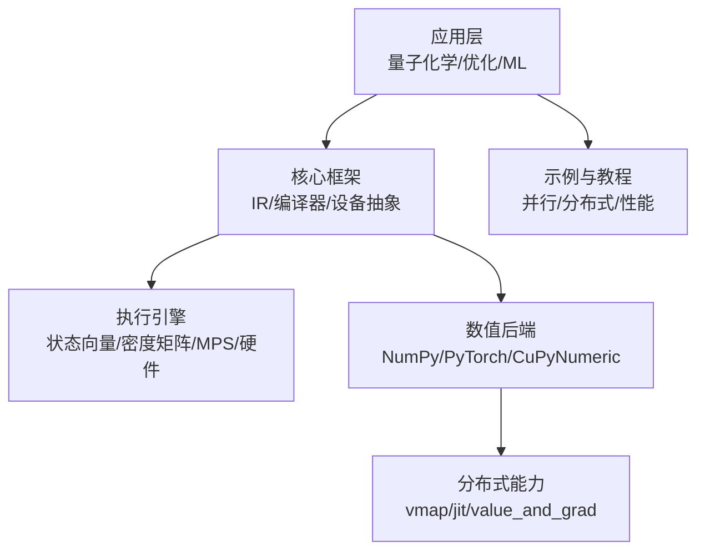
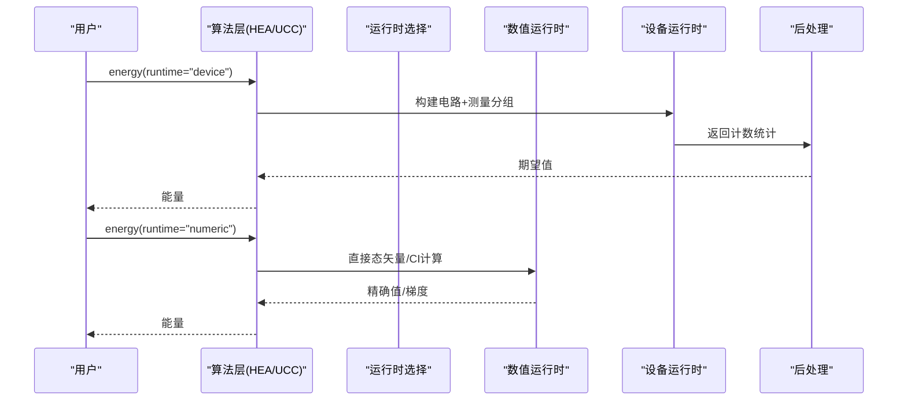
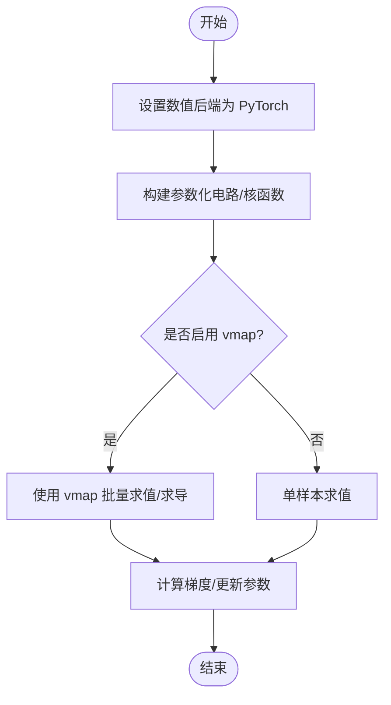
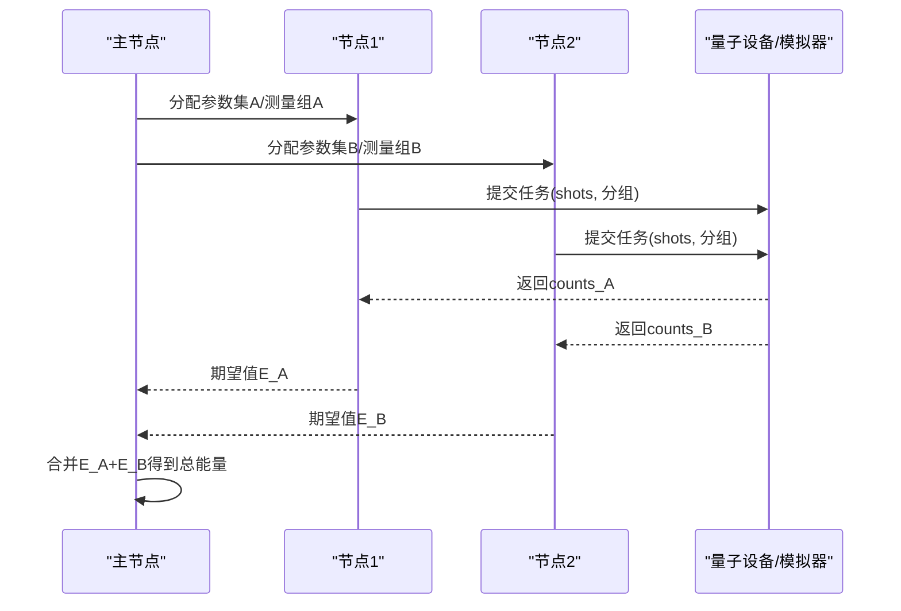
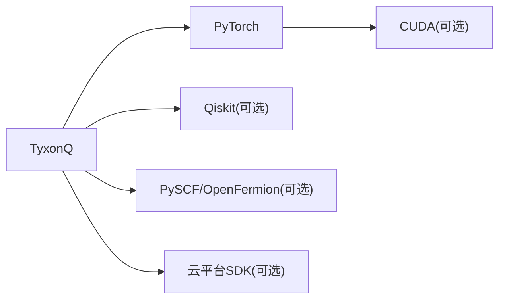

# 分布式计算框架集成

<cite>
**本文引用的文件**
- [README.md](file://README.md)
- [pyproject.toml](file://pyproject.toml)
- [src/tyxonq/numerics/__init__.py](file://src/tyxonq/numerics/__init__.py)
- [src/tyxonq/numerics/backends/pytorch_backend.py](file://src/tyxonq/numerics/backends/pytorch_backend.py)
- [src/tyxonq/numerics/context.py](file://src/tyxonq/numerics/context.py)
- [examples/vqe_parallel_pmap.py](file://examples/vqe_parallel_pmap.py)
- [examples/hybrid_quantum_classical_training.py](file://examples/hybrid_quantum_classical_training.py)
- [src/tyxonq/applications/chem/algorithms/vqe/runtimes/__init__.py](file://src/tyxonq/applications/chem/algorithms/vqe/runtimes/__init__.py)
- [src/tyxonq/applications/chem/algorithms/vqe/ucc_base.py](file://src/tyxonq/applications/chem/algorithms/vqe/ucc_base.py)
- [docs/source/quantum_chemistry/runtimes/index.rst](file://docs/source/quantum_chemistry/runtimes/index.rst)
- [docs/source/quantum_chemistry/runtimes/numerical_methods.rst](file://docs/source/quantum_chemistry/runtimes/numerical_methods.rst)
- [docs/source/technical_references/whitepaper.rst](file://docs/source/technical_references/whitepaper.rst)
- [tests_core_module/test_compiler_routing.py](file://tests_core_module/test_compiler_routing.py)
</cite>

## 目录
1. [简介](#简介)
2. [项目结构](#项目结构)
3. [核心组件](#核心组件)
4. [架构总览](#架构总览)
5. [详细组件分析](#详细组件分析)
6. [依赖关系分析](#依赖关系分析)
7. [性能与扩展性](#性能与扩展性)
8. [故障排除指南](#故障排除指南)
9. [结论](#结论)
10. [附录](#附录)

## 简介
本文件面向希望在大规模量子化学计算中部署 TyxonQ 的工程师与研究者，系统阐述 TyxonQ 与 PyTorch 分布式模块的集成方式、与 Horovod/DeepSpeed 等分布式训练框架的适配思路、跨节点量子电路并行执行方案、通信优化与同步策略配置方法，以及调试与性能分析方法。TyxonQ 提供统一的数值后端抽象（NumPy/PyTorch/CuPyNumeric），并通过链式 API 将编译、设备/数值运行时、后处理串联起来，天然支持在单机多卡或多机多卡环境中进行批量化与并行化扩展。

## 项目结构
TyxonQ 的核心由“稳定 IR + 编译器 + 设备抽象 + 统一数值后端”构成；应用层包含量子化学算法（VQE/UCCSD/HEA）、动力学、QM/MM 接口等；示例覆盖 VQE、脉冲编程、混合训练、并行映射等。针对分布式场景，重点关注的目录包括：
- numerics：数值后端与上下文管理（PyTorch/CuPyNumeric 等）
- applications/chem：量子化学算法与运行时（device/numeric 双路径）
- compiler/devices：编译与设备驱动（含云平台与模拟器）
- examples：并行与分布式实践（vmap/pmap、混合训练、噪声建模等）

图表来源
- [README.md:191-218](file://README.md#L191-L218)
- [docs/source/developer_guide/architecture_overview.rst:36-49](file://docs/source/developer_guide/architecture_overview.rst#L36-L49)

章节来源
- [README.md:191-218](file://README.md#L191-L218)
- [pyproject.toml:25-42](file://pyproject.toml#L25-L42)

## 核心组件
- 统一数值后端 NumericBackend：对外暴露一致的数组与数学运算接口，内部委托给当前激活的后端（NumPy/PyTorch/CuPyNumeric）。支持自动微分、可选 vmap/jit/value_and_grad 等高级特性。
- PyTorch 后端：实现张量创建、类型转换、线性代数、随机数、autograd、jacfwd/hessian、value_and_grad 等，并兼容 torch.compile/jit。
- 数值后端上下文：全局设置默认后端或临时切换，便于在测试/运行期动态选择。
- 量子化学运行时：VQE 族算法通过 device/numeric 双路径执行，数值路径提供精确期望值与梯度，设备路径面向真实硬件或模拟器采样。

章节来源
- [src/tyxonq/numerics/__init__.py:79-123](file://src/tyxonq/numerics/__init__.py#L79-L123)
- [src/tyxonq/numerics/backends/pytorch_backend.py:13-34](file://src/tyxonq/numerics/backends/pytorch_backend.py#L13-L34)
- [src/tyxonq/numerics/context.py:18-50](file://src/tyxonq/numerics/context.py#L18-L50)
- [src/tyxonq/applications/chem/algorithms/vqe/runtimes/__init__.py:1-14](file://src/tyxonq/applications/chem/algorithms/vqe/runtimes/__init__.py#L1-L14)
- [src/tyxonq/applications/chem/algorithms/vqe/ucc_base.py:428-510](file://src/tyxonq/applications/chem/algorithms/vqe/ucc_base.py#L428-L510)

## 架构总览
TyxonQ 的双路径执行模型为分布式提供了良好基础：数值路径可借助 PyTorch 的 vmap/jit/autograd 做批量化与并行化；设备路径可通过任务提交、分组测量与 shot 计划实现跨节点调度。

图表来源
- [docs/source/technical_references/whitepaper.rst:482-508](file://docs/source/technical_references/whitepaper.rst#L482-L508)

章节来源
- [docs/source/technical_references/whitepaper.rst:482-508](file://docs/source/technical_references/whitepaper.rst#L482-L508)

## 详细组件分析

### 与 PyTorch 分布式模块的集成
- 使用 vmap 对参数集进行批量求值与求导，结合 statevector 核函数实现高效并行。
- 利用 value_and_grad 获取标量损失对参数的梯度，必要时回退到有限差分以保证鲁棒性。
- 通过 jit/torch.compile 加速热点函数，减少 Python 开销。
- 在混合训练中，量子层作为 nn.Module 的一部分参与端到端反向传播，GPU 加速经典与量子部分。

图表来源
- [examples/vqe_parallel_pmap.py:126-145](file://examples/vqe_parallel_pmap.py#L126-L145)
- [src/tyxonq/numerics/backends/pytorch_backend.py:446-563](file://src/tyxonq/numerics/backends/pytorch_backend.py#L446-L563)

章节来源
- [examples/vqe_parallel_pmap.py:126-145](file://examples/vqe_parallel_pmap.py#L126-L145)
- [examples/hybrid_quantum_classical_training.py:131-181](file://examples/hybrid_quantum_classical_training.py#L131-L181)
- [src/tyxonq/numerics/backends/pytorch_backend.py:364-444](file://src/tyxonq/numerics/backends/pytorch_backend.py#L364-L444)

### 与 Horovod 的适配方案
- 目标：在多进程/多卡环境下，将 TyxonQ 的数值计算（statevector/矩阵运算）与经典优化器梯度聚合对接。
- 建议步骤：
  - 初始化 Horovod（进程组、rank/world_size）。
  - 在每个 rank 上独立构建电路与数值后端，确保随机种子隔离。
  - 使用 Horovod 的广播/Allreduce 同步初始参数与每步梯度。
  - 将 TyxonQ 的 value_and_grad 输出梯度经 Allreduce 后更新本地参数。
  - 对于设备路径，可将不同 rank 的任务分发至不同量子设备或云端任务队列，结果汇总。
- 注意事项：
  - 避免跨进程共享张量；每个 rank 维护独立张量。
  - 合理设置 batch size 与通信频率，平衡计算与通信开销。
  - 若使用 PyTorch DDP，可直接将 TyxonQ 的数值路径封装为 Module，交由 DDP 处理梯度同步。

[本节为概念性说明，不直接引用具体代码文件]

### 与 DeepSpeed 的适配方案
- 目标：利用 ZeRO 进行参数/梯度/优化器状态切分，降低显存占用，提升可扩展性。
- 建议步骤：
  - 将 TyxonQ 的数值路径（statevector/矩阵运算）封装为可被 DeepSpeed 管理的计算图。
  - 使用 DeepSpeed 的 ZeRO-2/ZeRO-3 进行参数与梯度分片。
  - 在 vmap/batch 维度上进行数据并行，配合 ZeRO 进行模型并行。
  - 对设备路径，按 rank 分配不同分子/参数集，结果汇聚。
- 注意事项：
  - 注意内存碎片与通信拓扑；优先使用连续内存布局。
  - 对高频小算子考虑融合或缓存。
  - 监控梯度稀疏性与通信瓶颈。

[本节为概念性说明，不直接引用具体代码文件]

### 大规模量子化学计算的分布式部署指南
- 任务划分：
  - 参数空间搜索：不同 rank 探索不同初始参数或超参网格。
  - 分子并行：不同 rank 处理不同分子或活性空间。
  - 测量分组并行：不同 rank 负责不同 Pauli 项组的采样。
- 资源规划：
  - 数值路径：优先 GPU 集群，利用 vmap/jit 提升吞吐。
  - 设备路径：结合云平台任务提交，按 shots 与分组并发提交。
- 容错与重试：
  - 对云端任务失败进行指数退避重试。
  - 检查点保存中间结果，支持断点续跑。

[本节为概念性说明，不直接引用具体代码文件]

### 通信优化与同步策略配置
- 数值路径：
  - 使用 vmap 将循环展开为向量化操作，减少 Python 开销。
  - 使用 jit/torch.compile 编译热点函数。
  - 控制 dtype（complex64/complex128）以平衡精度与带宽。
- 设备路径：
  - 测量分组与 shot 计划由编译器生成，减少重复测量。
  - 路由与布局优化保证相邻耦合，降低 SWAP 开销。
- 同步策略：
  - 全量同步（Allreduce）适用于小规模；分层同步（树形/环形）适用于大规模。
  - 异步梯度聚合可降低等待时间，但需权衡收敛稳定性。

章节来源
- [tests_core_module/test_compiler_routing.py:171-186](file://tests_core_module/test_compiler_routing.py#L171-L186)
- [tests_core_module/test_compiler_routing.py:456-463](file://tests_core_module/test_compiler_routing.py#L456-L463)

### 跨节点量子电路并行执行的实现方案
- 数值路径并行：
  - 使用 torch.func.vmap 对参数批进行并行求值与求导。
  - 结合 statevector 核函数，避免显式构建大矩阵。
- 设备路径并行：
  - 将不同参数集或不同 Pauli 项组分配到不同节点/设备。
  - 通过云平台 API 提交任务，收集 counts 后在后处理阶段合并期望值。
- 结果合并：
  - 数值路径：直接堆叠结果。
  - 设备路径：按权重加权合并各组期望值。

图表来源
- [examples/vqe_parallel_pmap.py:89-123](file://examples/vqe_parallel_pmap.py#L89-L123)
- [docs/source/quantum_chemistry/runtimes/index.rst:148-211](file://docs/source/quantum_chemistry/runtimes/index.rst#L148-L211)

章节来源
- [examples/vqe_parallel_pmap.py:89-123](file://examples/vqe_parallel_pmap.py#L89-L123)
- [docs/source/quantum_chemistry/runtimes/index.rst:148-211](file://docs/source/quantum_chemistry/runtimes/index.rst#L148-L211)

## 依赖关系分析
TyxonQ 依赖 PyTorch 提供自动微分与高性能张量运算；可选依赖包括 qiskit（用于互操作与路由）、pyscf/openfermion（量子化学积分与哈密顿量）、cloud SDK（云平台接入）。数值后端通过统一接口屏蔽底层差异，便于替换与扩展。

图表来源
- [pyproject.toml:25-42](file://pyproject.toml#L25-L42)
- [README.md:494-498](file://README.md#L494-L498)

章节来源
- [pyproject.toml:25-42](file://pyproject.toml#L25-L42)
- [README.md:494-498](file://README.md#L494-L498)

## 性能与扩展性
- 数值路径：
  - 使用 vmap 将循环转换为向量化操作，显著降低 Python 开销。
  - 使用 jit/torch.compile 编译热点函数，提升执行效率。
  - 选择合适的 dtype（complex64 vs complex128）以平衡精度与带宽。
- 设备路径：
  - 测量分组与 shot 计划由编译器生成，减少重复测量。
  - 路由与布局优化保证相邻耦合，降低 SWAP 开销。
- 扩展性：
  - 数据并行：vmap 对参数批并行。
  - 模型并行：ZeRO 切分参数/梯度/优化器状态。
  - 任务并行：不同 rank 处理不同分子/参数集/测量组。

章节来源
- [examples/vqe_parallel_pmap.py:126-145](file://examples/vqe_parallel_pmap.py#L126-L145)
- [tests_core_module/test_compiler_routing.py:171-186](file://tests_core_module/test_compiler_routing.py#L171-L186)
- [docs/source/quantum_chemistry/runtimes/numerical_methods.rst:11-49](file://docs/source/quantum_chemistry/runtimes/numerical_methods.rst#L11-L49)

## 故障排除指南
- 梯度为 None：
  - 检查 autograd 链是否被破坏（如 detach 过早、非可微操作）。
  - 确认 value_and_grad 的输入已启用 requires_grad。
- 性能瓶颈：
  - 使用 jit/torch.compile 编译热点函数。
  - 调整 batch size 与通信频率，避免过度通信。
- 设备路径不稳定：
  - 检查测量分组与 shot 计划是否正确。
  - 验证路由与布局优化是否生效。
- 云平台任务失败：
  - 实现指数退避重试与错误码解析。
  - 记录任务元数据以便定位问题。

章节来源
- [src/tyxonq/numerics/backends/pytorch_backend.py:497-510](file://src/tyxonq/numerics/backends/pytorch_backend.py#L497-L510)
- [tests_core_module/test_compiler_routing.py:171-186](file://tests_core_module/test_compiler_routing.py#L171-L186)

## 结论
TyxonQ 通过统一数值后端与双路径执行模型，为分布式量子化学计算提供了坚实基础。结合 PyTorch 的 vmap/jit/autograd，可在单机多卡环境高效并行；通过与 Horovod/DeepSpeed 的适配，可进一步扩展到多机多卡场景。设备路径的测量分组与 shot 计划、路由与布局优化，为跨节点量子电路并行执行提供了可靠保障。建议在工程实践中根据任务规模选择合适的并行策略，并结合性能分析与调试工具持续优化。

## 附录
- 快速开始：参考 README 中的最小电路示例与量子化学示例。
- 文档：技术白皮书与开发者指南提供深入架构说明。
- 示例：examples 目录下涵盖并行、分布式、噪声建模等实践。

章节来源
- [README.md:27-106](file://README.md#L27-L106)
- [docs/source/technical_references/whitepaper.rst:131-235](file://docs/source/technical_references/whitepaper.rst#L131-L235)