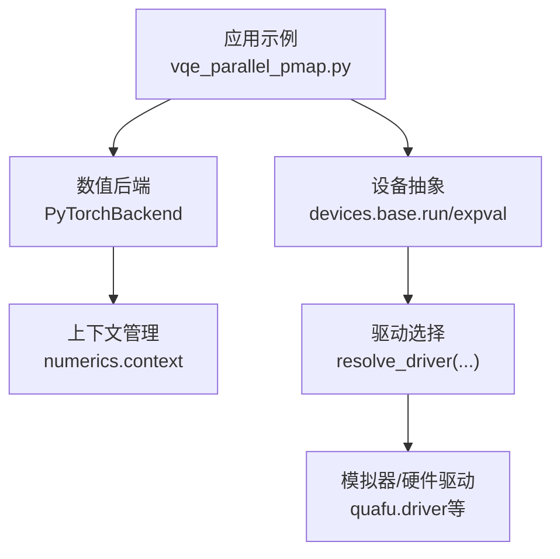
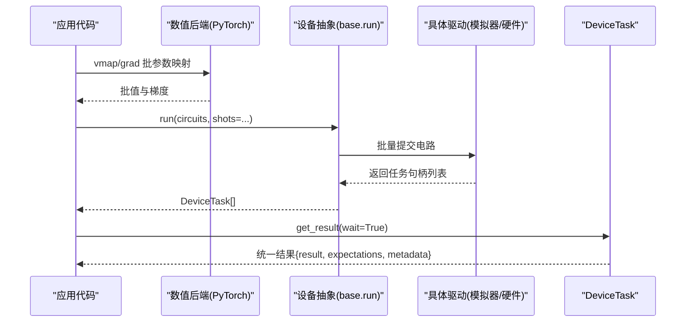
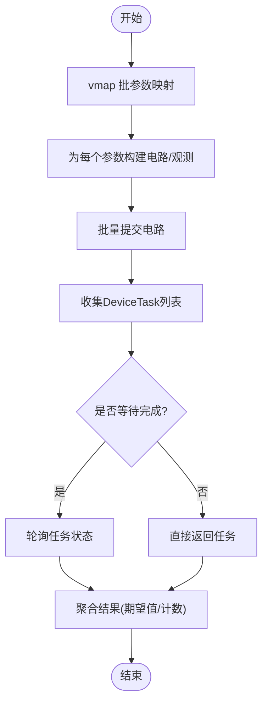
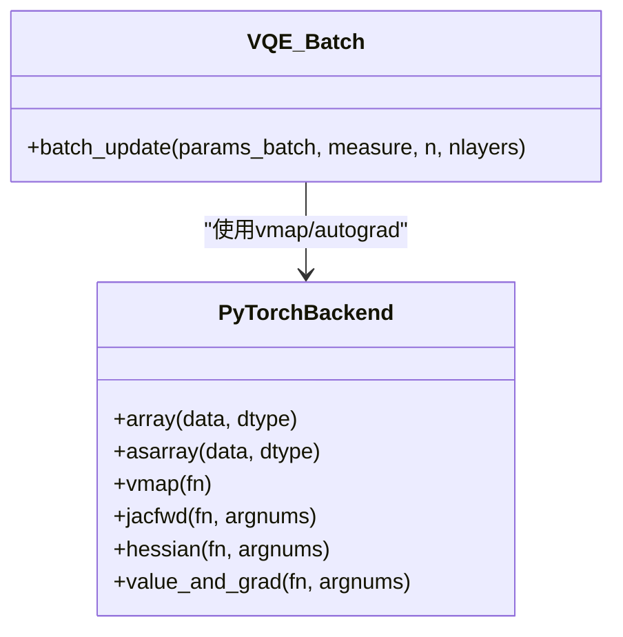
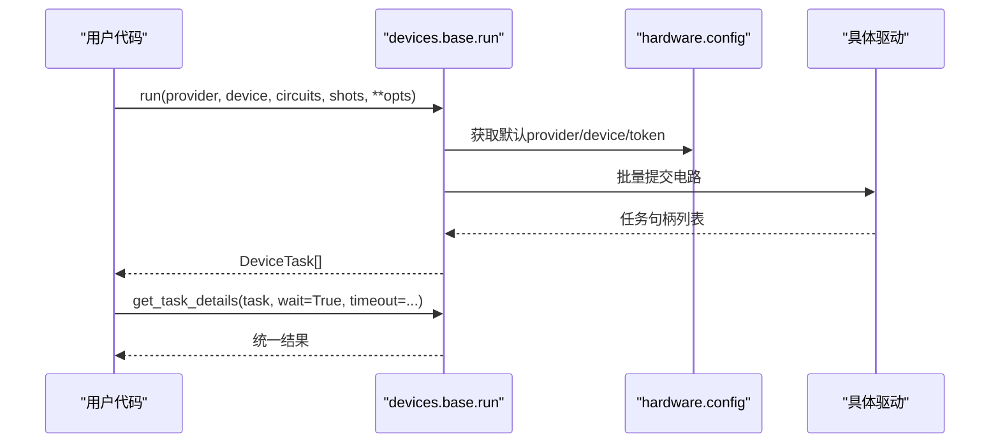
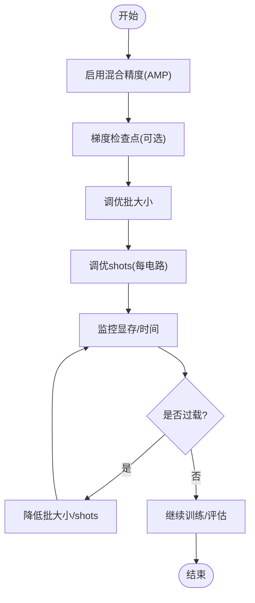
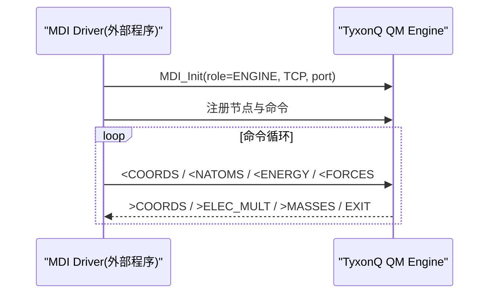
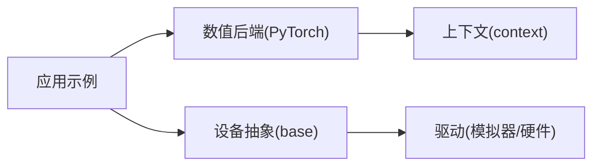

# 多核CPU和多GPU并行计算

<cite>
**本文引用的文件**
- [vqe_parallel_pmap.py](file://examples/vqe_parallel_pmap.py)
- [config.py](file://src/tyxonq/config.py)
- [context.py](file://src/tyxonq/numerics/context.py)
- [base.py](file://src/tyxonq/devices/base.py)
- [pytorch_backend.py](file://src/tyxonq/numerics/backends/pytorch_backend.py)
- [index.rst（高级用户指南）](file://docs/source/user_guide/advanced/index.rst)
- [memory_optimization_checkpointing.py](file://examples/memory_optimization_checkpointing.py)
- [main.py（SMILES-TyxonQ）](file://examples/SMILES-TyxonQ/main.py)
- [main.py（gqe_drug_design）](file://examples/gqe_drug_design/main.py)
- [driver.py（Quafu硬件驱动）](file://src/tyxonq/devices/hardware/quafu/driver.py)
- [MDI引擎接口](file://src/tyxonq/applications/chem/interfaces/mdi_engine.py)
</cite>

## 目录
1. [简介](#简介)
2. [项目结构](#项目结构)
3. [核心组件](#核心组件)
4. [架构总览](#架构总览)
5. [详细组件分析](#详细组件分析)
6. [依赖关系分析](#依赖关系分析)
7. [性能考虑](#性能考虑)
8. [故障排查指南](#故障排查指南)
9. [结论](#结论)
10. [附录](#附录)

## 简介
本指南面向在单节点多核CPU与多GPU环境下使用TyxonQ进行并行计算的工程师与研究者，覆盖以下主题：
- 多核CPU任务级并行：以批参数映射、批电路提交为核心策略，结合数值后端与设备层批量执行。
- 多GPU数据并行与模型并行：基于PyTorch后端的张量并行、自动微分与混合精度训练实践。
- 设备管理与资源分配：统一设备抽象、驱动选择、令牌与默认设备配置。
- GPU内存优化与负载均衡：显存监控、混合精度、梯度检查点、批大小与shots调优。
- 性能监控与瓶颈识别：内置基准与自定义剖析工具。
- 多节点分布式案例：通过MDI协议将量子计算作为力/能量提供方接入分子动力学等外部系统。

## 项目结构
TyxonQ的并行能力由“数值后端 + 设备抽象 + 应用示例”三层协同实现：
- 数值后端：提供CPU/GPU数组运算、自动微分、vmap/jacobian等并行原语。
- 设备抽象：统一模拟器与硬件驱动的run/expval/任务管理，支持批电路提交与结果聚合。
- 应用示例：展示VQE批处理、内存优化、性能剖析与分布式集成。

图表来源
- [vqe_parallel_pmap.py:1-164](file://examples/vqe_parallel_pmap.py#L1-L164)
- [pytorch_backend.py:13-567](file://src/tyxonq/numerics/backends/pytorch_backend.py#L13-L567)
- [base.py:294-445](file://src/tyxonq/devices/base.py#L294-L445)
- [context.py:18-50](file://src/tyxonq/numerics/context.py#L18-L50)

章节来源
- [vqe_parallel_pmap.py:1-164](file://examples/vqe_parallel_pmap.py#L1-L164)
- [base.py:294-445](file://src/tyxonq/devices/base.py#L294-L445)
- [context.py:18-50](file://src/tyxonq/numerics/context.py#L18-L50)

## 核心组件
- 数值后端与上下文
  - 全局后端设置与上下文切换，避免逐层传递后端对象。
  - PyTorch后端提供张量操作、自动微分、vmap/jacobian/hessian等并行与求导能力。
- 设备抽象与运行
  - 统一的run/expval入口，支持单电路、批电路、解析期望值路径。
  - 任务包装DeviceTask与get_task_details，统一异步等待与结果格式。
- 配置与归一化
  - 后端名称归一化（cpu/numpy、gpu/cupynumeric、torch/pytorch）。
  - 默认dtype与向量化策略校验。

章节来源
- [context.py:18-50](file://src/tyxonq/numerics/context.py#L18-L50)
- [pytorch_backend.py:13-567](file://src/tyxonq/numerics/backends/pytorch_backend.py#L13-L567)
- [base.py:97-108](file://src/tyxonq/devices/base.py#L97-L108)
- [base.py:294-445](file://src/tyxonq/devices/base.py#L294-L445)
- [config.py:50-75](file://src/tyxonq/config.py#L50-L75)

## 架构总览
下图展示了从应用到设备的并行执行链路，包括批参数映射、批电路构建与提交、以及结果聚合。

图表来源
- [vqe_parallel_pmap.py:126-163](file://examples/vqe_parallel_pmap.py#L126-L163)
- [base.py:294-445](file://src/tyxonq/devices/base.py#L294-L445)
- [base.py:497-557](file://src/tyxonq/devices/base.py#L497-L557)

## 详细组件分析

### 多核CPU任务级并行（批参数映射与批电路）
- 批参数映射
  - 使用torch.func.vmap对参数批次进行并行映射，同时用grad或autograd计算梯度，形成批值与批梯度。
  - 适用于状态向量精确路径与计数采样路径。
- 批电路提交
  - 设备层run支持传入电路列表，内部按顺序提交并收集任务，保持顺序一致性。
  - shots可为标量或列表，适配不同电路的不同采样次数。
- 结果聚合
  - DeviceTask.get_result统一结果格式，便于下游后处理（如Pauli项期望值聚合）。

图表来源
- [vqe_parallel_pmap.py:126-163](file://examples/vqe_parallel_pmap.py#L126-L163)
- [base.py:392-445](file://src/tyxonq/devices/base.py#L392-L445)
- [base.py:497-557](file://src/tyxonq/devices/base.py#L497-L557)

章节来源
- [vqe_parallel_pmap.py:126-163](file://examples/vqe_parallel_pmap.py#L126-L163)
- [base.py:392-445](file://src/tyxonq/devices/base.py#L392-L445)

### 多GPU数据并行与模型并行
- 数据并行
  - 通过PyTorch后端的vmap对参数批次进行并行映射，天然利用GPU并行计算能力。
  - 批内各成员独立执行，适合大规模参数扫描或超参搜索。
- 模型并行
  - 当前仓库未提供显式模型切分API；可通过外部框架（如FSDP/DeepSpeed）配合PyTorch后端进行大模型切分。
  - 对于量子部分，建议将量子电路评估封装为可被并行框架调度的子模块。
- 设备选择
  - 通过环境变量控制可见GPU，或在PyTorch中指定device。
  - 示例中使用CUDA_VISIBLE_DEVICES限定可用GPU。

图表来源
- [pytorch_backend.py:364-444](file://src/tyxonq/numerics/backends/pytorch_backend.py#L364-L444)
- [vqe_parallel_pmap.py:126-163](file://examples/vqe_parallel_pmap.py#L126-L163)

章节来源
- [pytorch_backend.py:364-444](file://src/tyxonq/numerics/backends/pytorch_backend.py#L364-L444)
- [main.py（SMILES-TyxonQ）:1-7](file://examples/SMILES-TyxonQ/main.py#L1-L7)
- [main.py（gqe_drug_design）:1-7](file://examples/gqe_drug_design/main.py#L1-L7)

### 设备管理与资源分配最佳实践
- 统一设备抽象
  - 使用devices.base.run统一提交电路或源程序，自动选择模拟器或硬件驱动。
  - 支持批电路与shots列表，简化多任务调度。
- 默认设备与令牌
  - 通过hardware.config设置默认provider/device与token，避免重复配置。
- 异步任务与超时
  - DeviceTask.get_result支持wait与timeout，防止长时间阻塞。
- 噪声与仿真专属参数
  - 模拟器专属参数（noise/use_noise）在真机提交前会被丢弃，保证跨平台一致。

图表来源
- [base.py:294-445](file://src/tyxonq/devices/base.py#L294-L445)
- [base.py:497-557](file://src/tyxonq/devices/base.py#L497-L557)

章节来源
- [base.py:294-445](file://src/tyxonq/devices/base.py#L294-L445)
- [driver.py（Quafu）:242-275](file://src/tyxonq/devices/hardware/quafu/driver.py#L242-L275)

### GPU内存优化与负载均衡
- 混合精度训练
  - 使用PyTorch AMP上下文减少显存占用，提升吞吐。
  - 文档示例展示了在GPU上启用混合精度并进行显存清理。
- 梯度检查点
  - 对深层量子电路采用梯度检查点，以重计算换取内存节省。
  - 示例分析了标准反向传播与检查点的内存复杂度权衡。
- 负载平衡
  - 调整批大小与shots，使GPU利用率与延迟达到平衡。
  - 对长尾电路可采用动态shots或分批提交。

图表来源
- [index.rst（高级用户指南）:71-103](file://docs/source/user_guide/advanced/index.rst#L71-L103)
- [memory_optimization_checkpointing.py:1-200](file://examples/memory_optimization_checkpointing.py#L1-L200)

章节来源
- [index.rst（高级用户指南）:71-103](file://docs/source/user_guide/advanced/index.rst#L71-L103)
- [memory_optimization_checkpointing.py:1-200](file://examples/memory_optimization_checkpointing.py#L1-L200)

### 性能监控与瓶颈识别
- 内置基准与剖析
  - 使用benchmark/profile_memory等工具统计执行时间与峰值内存。
  - 自定义装饰器可记录CPU/GPU内存变化与耗时。
- 常见瓶颈
  - 批大小过大导致显存溢出；shots过多导致I/O与采样瓶颈；电路过深导致内存增长。
- 定位方法
  - 逐步缩小批大小/shots，观察性能曲线；使用profiler定位热点函数。

章节来源
- [index.rst（高级用户指南）:669-759](file://docs/source/user_guide/advanced/index.rst#L669-L759)

### 多节点分布式计算案例（MDI协议）
- 角色与命令
  - MDI将力提供方称为engine，控制方称为driver；支持TCP/MPI/LINK传输。
  - TyxonQ可作为QM engine注册命令表，接收坐标、返回能量与力。
- 主循环与通信
  - 通过MDI_Init建立连接，进入命令派发循环，处理<NATOMS、<ENERGY、<FORCES等命令。
- 适用场景
  - 与分子动力学软件耦合，实现量子力学区域的高精度能量/力计算。

图表来源
- [MDI引擎接口:103-130](file://src/tyxonq/applications/chem/interfaces/mdi_engine.py#L103-L130)

章节来源
- [MDI引擎接口:103-130](file://src/tyxonq/applications/chem/interfaces/mdi_engine.py#L103-L130)

## 依赖关系分析
- 数值后端依赖
  - PyTorch后端提供vmap/jacobian/hessian/value_and_grad等并行与求导能力。
  - 上下文管理允许全局或局部切换后端。
- 设备抽象依赖
  - devices.base.run根据provider/device选择具体驱动，统一任务管理与结果格式。
- 应用示例依赖
  - vqe_parallel_pmap演示了批参数映射与批电路提交。
  - memory_optimization_checkpointing演示了内存优化策略。

图表来源
- [vqe_parallel_pmap.py:126-163](file://examples/vqe_parallel_pmap.py#L126-L163)
- [pytorch_backend.py:364-444](file://src/tyxonq/numerics/backends/pytorch_backend.py#L364-L444)
- [base.py:294-445](file://src/tyxonq/devices/base.py#L294-L445)
- [context.py:18-50](file://src/tyxonq/numerics/context.py#L18-L50)

章节来源
- [vqe_parallel_pmap.py:126-163](file://examples/vqe_parallel_pmap.py#L126-L163)
- [pytorch_backend.py:364-444](file://src/tyxonq/numerics/backends/pytorch_backend.py#L364-L444)
- [base.py:294-445](file://src/tyxonq/devices/base.py#L294-L445)
- [context.py:18-50](file://src/tyxonq/numerics/context.py#L18-L50)

## 性能考虑
- 批大小与shots
  - 增大批大小提高GPU利用率，但需监控显存；shots影响采样方差与I/O开销。
- 混合精度
  - 在GPU上使用AMP可减少显存并提升吞吐，注意数值稳定性。
- 梯度检查点
  - 对深层电路启用检查点，以重计算换取内存节省。
- 后端选择
  - CPU使用numpy后端稳定可靠；GPU使用pytorch/cupynumeric获得加速。
- 设备选择
  - 通过环境变量或上下文管理切换设备，避免硬编码。

[本节为通用指导，不直接分析具体文件]

## 故障排查指南
- 异步任务超时
  - get_task_details支持wait与timeout，若超时返回可能不完整，需增大超时或重试。
- 梯度为None
  - PyTorch后端在value_and_grad中检测梯度为None时抛出异常，提示计算图断裂。
- 显存溢出
  - 使用AMP与梯度检查点；降低批大小或shots；及时清理缓存。
- 设备不可用
  - 检查CUDA_VISIBLE_DEVICES与驱动可用性；确认provider/device配置正确。

章节来源
- [base.py:497-557](file://src/tyxonq/devices/base.py#L497-L557)
- [pytorch_backend.py:489-507](file://src/tyxonq/numerics/backends/pytorch_backend.py#L489-L507)
- [index.rst（高级用户指南）:71-103](file://docs/source/user_guide/advanced/index.rst#L71-L103)

## 结论
TyxonQ在多核CPU与多GPU环境下的并行能力由数值后端与设备抽象共同支撑：
- 多核CPU：通过vmap与批电路提交实现任务级并行，适合参数扫描与超参优化。
- 多GPU：借助PyTorch后端的并行原语与混合精度，实现高效的数据并行训练。
- 设备管理：统一抽象屏蔽底层差异，简化多设备调度与结果聚合。
- 内存优化：混合精度与梯度检查点显著降低显存占用，提升可扩展性。
- 分布式：通过MDI协议将量子计算嵌入外部系统，拓展应用场景。

[本节为总结，不直接分析具体文件]

## 附录
- 快速参考
  - 设置全局后端：使用numerics.context.set_backend/use_backend。
  - 批参数映射：使用torch.func.vmap与grad组合。
  - 批电路提交：devices.base.run支持电路列表与shots列表。
  - 混合精度：在GPU上使用AMP上下文。
  - 梯度检查点：对深层电路启用checkpoint机制。
  - 分布式：通过MDI引擎接口与外部系统通信。

[本节为补充信息，不直接分析具体文件]