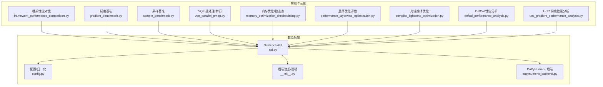
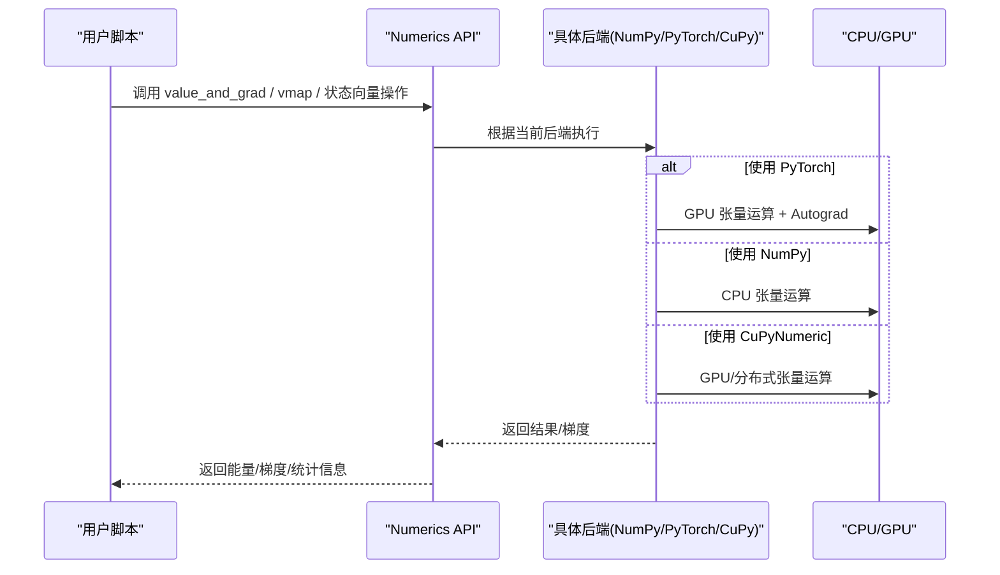
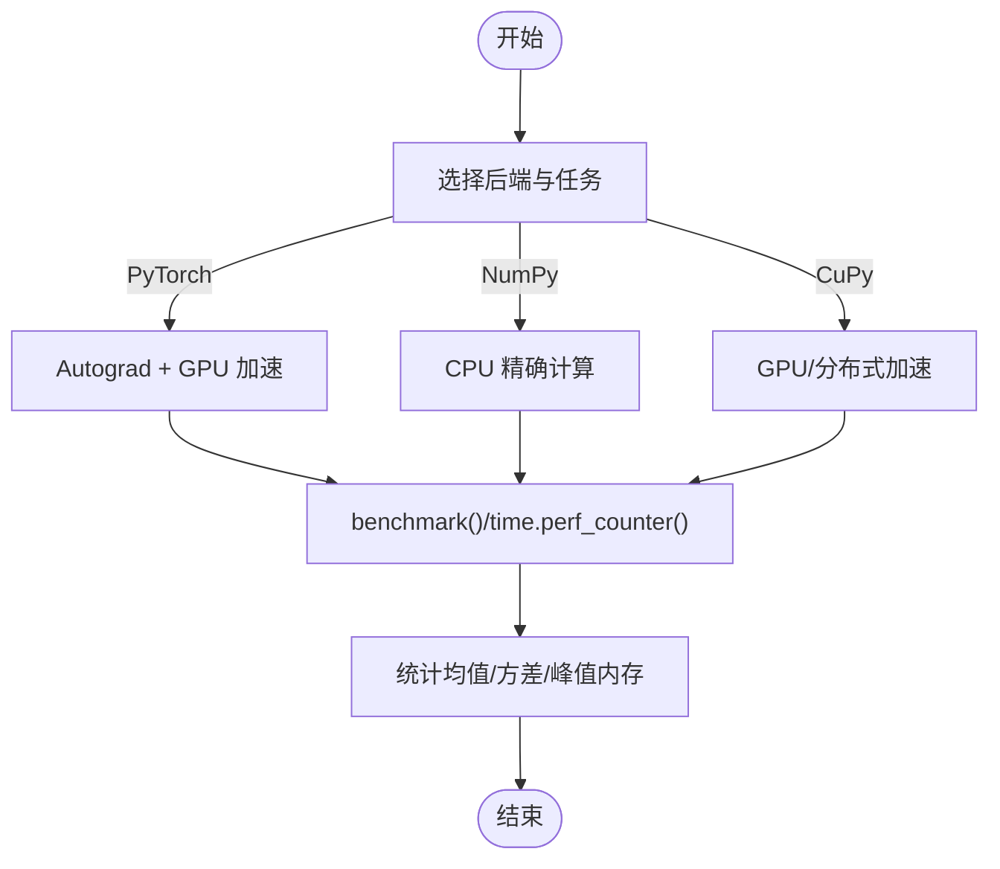
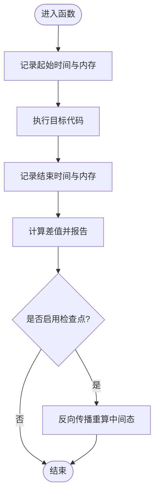
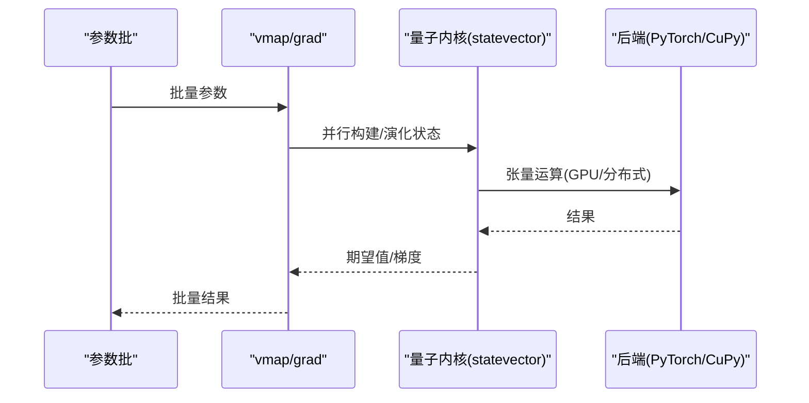
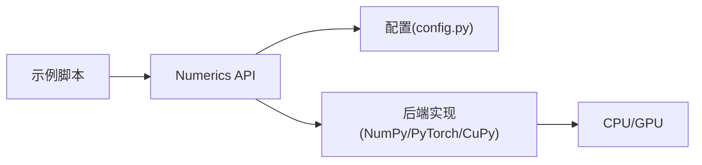

# 并行性能分析和瓶颈识别

<cite>
**本文引用的文件**
- [framework_performance_comparison.py](file://examples/framework_performance_comparison.py)
- [gradient_benchmark.py](file://examples/gradient_benchmark.py)
- [sample_benchmark.py](file://examples/sample_benchmark.py)
- [vqe_parallel_pmap.py](file://examples/vqe_parallel_pmap.py)
- [memory_optimization_checkpointing.py](file://examples/memory_optimization_checkpointing.py)
- [performance_layerwise_optimization.py](file://examples/performance_layerwise_optimization.py)
- [compiler_lightcone_optimization.py](file://examples/compiler_lightcone_optimization.py)
- [defcal_performance_analysis.py](file://examples/defcal_performance_analysis.py)
- [ucc_gradient_performance_analysis.py](file://examples/ucc_gradient_performance_analysis.py)
- [api.py](file://src/tyxonq/numerics/api.py)
- [cupynumeric_backend.py](file://src/tyxonq/numerics/backends/cupynumeric_backend.py)
- [__init__.py](file://src/tyxonq/numerics/__init__.py)
- [config.py](file://src/tyxonq/config.py)
- [index.rst（高级主题）](file://docs/source/user_guide/advanced/index.rst)
- [performance_leadership.rst](file://docs/source/technical_references/performance_leadership.rst)
</cite>

## 目录
1. [引言](#引言)
2. [项目结构](#项目结构)
3. [核心组件](#核心组件)
4. [架构总览](#架构总览)
5. [详细组件分析](#详细组件分析)
6. [依赖关系分析](#依赖关系分析)
7. [性能考量](#性能考量)
8. [故障排查指南](#故障排查指南)
9. [结论](#结论)
10. [附录](#附录)

## 引言
本指南面向需要在 TyxonQ 中进行并行计算性能分析与瓶颈识别的工程师与研究者。内容覆盖：
- 时间、内存与 GPU 利用率的分析方法
- 通信开销、负载不均衡等常见瓶颈的定位策略
- 基准测试方法与标准
- 不同并行策略的性能对比
- Amdahl 定律与 Gustafson 定律在真实场景中的验证思路
- 优化建议与最佳实践
- 基于仓库示例的真实案例研究

## 项目结构
TyxonQ 将数值后端抽象为统一协议，支持 NumPy、PyTorch、CuPyNumeric 等后端；示例脚本提供了丰富的性能基准与优化演示，涵盖采样、梯度、批处理、编译优化与内存优化等维度。

**图示来源**
- [framework_performance_comparison.py:1-120](file://examples/framework_performance_comparison.py#L1-L120)
- [gradient_benchmark.py:1-120](file://examples/gradient_benchmark.py#L1-L120)
- [sample_benchmark.py:1-91](file://examples/sample_benchmark.py#L1-L91)
- [vqe_parallel_pmap.py:1-164](file://examples/vqe_parallel_pmap.py#L1-L164)
- [memory_optimization_checkpointing.py:1-120](file://examples/memory_optimization_checkpointing.py#L1-L120)
- [performance_layerwise_optimization.py:260-300](file://examples/performance_layerwise_optimization.py#L260-L300)
- [compiler_lightcone_optimization.py:116-144](file://examples/compiler_lightcone_optimization.py#L116-L144)
- [defcal_performance_analysis.py:280-370](file://examples/defcal_performance_analysis.py#L280-L370)
- [ucc_gradient_performance_analysis.py:365-401](file://examples/ucc_gradient_performance_analysis.py#L365-L401)
- [api.py:1-25](file://src/tyxonq/numerics/api.py#L1-L25)
- [config.py:48-94](file://src/tyxonq/config.py#L48-L94)
- [__init__.py:79-89](file://src/tyxonq/numerics/__init__.py#L79-L89)
- [cupynumeric_backend.py:55-132](file://src/tyxonq/numerics/backends/cupynumeric_backend.py#L55-L132)

**章节来源**
- [framework_performance_comparison.py:1-120](file://examples/framework_performance_comparison.py#L1-L120)
- [api.py:1-25](file://src/tyxonq/numerics/api.py#L1-L25)
- [config.py:48-94](file://src/tyxonq/config.py#L48-L94)
- [__init__.py:79-89](file://src/tyxonq/numerics/__init__.py#L79-L89)

## 核心组件
- 数值后端抽象与选择
  - 通过统一协议暴露数组创建、矩阵运算、求和、实部/共轭等能力，并支持 vmap 向量化策略与自动回退机制。
  - 支持别名归一化（如 cpu→numpy、gpu→cupynumeric、torch/pytorch→pytorch）。
  - 提供多后端（NumPy、PyTorch、CuPyNumeric）以适配 CPU/GPU/分布式场景。
- 示例基准套件
  - 框架对比、梯度基准、采样基准、批处理并行、编译优化、内存优化、DefCal 与 UCC 梯度分析等，覆盖从端到端到内核级性能观测。

**章节来源**
- [api.py:133-163](file://src/tyxonq/numerics/api.py#L133-L163)
- [config.py:48-94](file://src/tyxonq/config.py#L48-L94)
- [__init__.py:79-89](file://src/tyxonq/numerics/__init__.py#L79-L89)
- [cupynumeric_backend.py:55-132](file://src/tyxonq/numerics/backends/cupynumeric_backend.py#L55-L132)

## 架构总览
下图展示“用户示例 → 数值后端 → 具体实现”的执行路径，以及在不同后端下的性能差异来源。

**图示来源**
- [api.py:133-163](file://src/tyxonq/numerics/api.py#L133-L163)
- [cupynumeric_backend.py:55-132](file://src/tyxonq/numerics/backends/cupynumeric_backend.py#L55-L132)
- [config.py:48-94](file://src/tyxonq/config.py#L48-L94)

## 详细组件分析

### 时间分析与基准方法
- 内置工具与文档指引
  - 使用 benchmark/profile_memory 进行函数级计时与内存峰值采集，适合对电路运行或优化循环进行统计。
- 示例实践
  - 框架对比脚本展示了三种执行模式（shots 采样、NumPy 数值梯度、PyTorch Autograd），并输出每步耗时与加速比。
  - 梯度基准脚本实现了 counts-based 参数平移梯度、有限差分 QFI、Autograd Hessian，并提供可选 Qiskit 对比。
  - 采样基准脚本对比 NumPy/PyTorch/CuPyNumeric 在不同 qubit 数、层数与 shots 下的时延分布。

**图示来源**
- [index.rst（高级主题）:669-759](file://docs/source/user_guide/advanced/index.rst#L669-L759)
- [framework_performance_comparison.py:75-408](file://examples/framework_performance_comparison.py#L75-L408)
- [gradient_benchmark.py:30-186](file://examples/gradient_benchmark.py#L30-L186)
- [sample_benchmark.py:16-91](file://examples/sample_benchmark.py#L16-L91)

**章节来源**
- [index.rst（高级主题）:669-759](file://docs/source/user_guide/advanced/index.rst#L669-L759)
- [framework_performance_comparison.py:75-408](file://examples/framework_performance_comparison.py#L75-L408)
- [gradient_benchmark.py:30-186](file://examples/gradient_benchmark.py#L30-L186)
- [sample_benchmark.py:16-91](file://examples/sample_benchmark.py#L16-L91)

### 内存分析与 GPU 利用率监控
- 内存分析
  - 使用 profile_memory 装饰器或自定义包装器记录进程 RSS 变化；对于大电路训练，结合梯度检查点降低显存占用。
- GPU 利用率
  - 在 PyTorch 环境下可通过 torch.cuda.memory_allocated() 跟踪显存分配；在 CuPyNumeric 下关注其底层库的显存行为。
- 检查点策略
  - 深度电路训练中，按层保存中间态并在反向传播中重算，可将内存复杂度由 O(depth×2^n) 降至更低。

**图示来源**
- [index.rst（高级主题）:669-759](file://docs/source/user_guide/advanced/index.rst#L669-L759)
- [memory_optimization_checkpointing.py:46-142](file://examples/memory_optimization_checkpointing.py#L46-L142)

**章节来源**
- [index.rst（高级主题）:669-759](file://docs/source/user_guide/advanced/index.rst#L669-L759)
- [memory_optimization_checkpointing.py:46-142](file://examples/memory_optimization_checkpointing.py#L46-L142)

### 并行策略与扩展性对比
- 批处理/映射并行
  - 使用 torch.func.vmap/grad 对多个参数集并行求值与求导，结合 statevector 内核获得高吞吐。
- 后端并行
  - PyTorch 后端可充分利用 GPU；CuPyNumeric 后端可用于分布式 GPU 场景。
- 编译器优化
  - 光锥优化在部分测量场景下带来显著加速；层序优化可在编译期减少运行时开销。

**图示来源**
- [vqe_parallel_pmap.py:39-164](file://examples/vqe_parallel_pmap.py#L39-L164)
- [compiler_lightcone_optimization.py:116-144](file://examples/compiler_lightcone_optimization.py#L116-L144)
- [performance_layerwise_optimization.py:260-300](file://examples/performance_layerwise_optimization.py#L260-L300)

**章节来源**
- [vqe_parallel_pmap.py:39-164](file://examples/vqe_parallel_pmap.py#L39-L164)
- [compiler_lightcone_optimization.py:116-144](file://examples/compiler_lightcone_optimization.py#L116-L144)
- [performance_layerwise_optimization.py:260-300](file://examples/performance_layerwise_optimization.py#L260-L300)

### 通信开销与负载不均衡识别
- 通信开销
  - 在分布式/多卡场景中，注意跨设备数据拷贝与同步成本；优先使用后端原生 vmap/并行原语减少显式通信。
- 负载不均衡
  - 当某些参数子图或 Pauli 项计算更昂贵时，采用分块/自适应调度；在 counts 路径中，避免重复电路执行，合并测量。
- 定位方法
  - 使用 benchmark 分段计时（构建/执行/后处理），结合内存/显存曲线定位热点；对梯度路径比较不同策略（参数平移 vs Autograd）。

**章节来源**
- [gradient_benchmark.py:95-186](file://examples/gradient_benchmark.py#L95-L186)
- [framework_performance_comparison.py:156-252](file://examples/framework_performance_comparison.py#L156-L252)

### Amdahl 与 Gustafson 定律验证
- Amdahl 定律（固定问题规模）
  - 通过逐步增加并行度（批大小/后端并行）观察加速上限，识别串行瓶颈（如单测项测量、I/O）。
- Gustafson 定律（随规模增长）
  - 扩大问题规模（更多 qubits/层数/参数）同时提升并行粒度，观察线性扩展区域与饱和点。
- 实践建议
  - 在示例中固定 shots 与电路结构，改变批大小或后端；或在相同批大小下增大系统规模，分别拟合两条曲线。

[本节为概念性说明，不直接分析具体文件]

### 真实应用场景案例研究
- 框架对比（VQE-TFIM）
  - 对比 TyxonQ 三种模式与 Qiskit/PennyLane，展示 shots-based、数值梯度、Autograd 的差异与适用场景。
- 梯度基准（counts 与 statevector）
  - 对比 counts-based 参数平移梯度与 statevector 的 QFI/Hessian 计算，给出阶段耗时与运行耗时分解。
- 采样基准
  - 对比 NumPy/PyTorch/CuPyNumeric 在不同 n/layers/shots 下的平均时延与波动。
- 编译优化
  - 光锥优化在部分测量下显著减少不必要计算；层序优化改善编译期开销。
- 内存优化
  - 深度电路中使用检查点降低显存占用，平衡重算代价。
- DefCal 与 UCC 梯度
  - DefCal 库在特定门序列上带来编译与运行收益；UCC 梯度在多分子与参数规模增长下展示扩展性。

**章节来源**
- [framework_performance_comparison.py:75-800](file://examples/framework_performance_comparison.py#L75-L800)
- [gradient_benchmark.py:186-320](file://examples/gradient_benchmark.py#L186-L320)
- [sample_benchmark.py:16-91](file://examples/sample_benchmark.py#L16-L91)
- [compiler_lightcone_optimization.py:116-144](file://examples/compiler_lightcone_optimization.py#L116-L144)
- [performance_layerwise_optimization.py:260-300](file://examples/performance_layerwise_optimization.py#L260-L300)
- [memory_optimization_checkpointing.py:144-280](file://examples/memory_optimization_checkpointing.py#L144-L280)
- [defcal_performance_analysis.py:280-370](file://examples/defcal_performance_analysis.py#L280-L370)
- [ucc_gradient_performance_analysis.py:365-401](file://examples/ucc_gradient_performance_analysis.py#L365-L401)

## 依赖关系分析
- 组件耦合
  - 示例脚本依赖 Numerics API 提供的统一接口；API 内部根据配置选择具体后端。
- 外部依赖
  - PyTorch 用于 Autograd 与 GPU 加速；CuPyNumeric 用于分布式 GPU；可选 Qiskit 用于对比。
- 潜在环依赖
  - 当前结构为单向依赖（示例→API→后端），未见循环导入迹象。

**图示来源**
- [api.py:1-25](file://src/tyxonq/numerics/api.py#L1-L25)
- [config.py:48-94](file://src/tyxonq/config.py#L48-L94)
- [cupynumeric_backend.py:55-132](file://src/tyxonq/numerics/backends/cupynumeric_backend.py#L55-L132)

**章节来源**
- [api.py:1-25](file://src/tyxonq/numerics/api.py#L1-L25)
- [config.py:48-94](file://src/tyxonq/config.py#L48-L94)
- [cupynumeric_backend.py:55-132](file://src/tyxonq/numerics/backends/cupynumeric_backend.py#L55-L132)

## 性能考量
- 选择合适后端
  - 梯度型算法优先 PyTorch 后端；小规模/无 GPU 环境可用 NumPy；大规模分布式用 CuPyNumeric。
- 避免重复执行
  - 缓存状态向量、一次性构建 Hamiltonian 矩阵，减少多次 circuit.state() 带来的重复开销。
- 批处理与向量化
  - 使用 vmap/autograd 并行处理多参数集；合理设置 batch size 以匹配硬件资源。
- 编译优化
  - 启用光锥优化、层序优化以减少不必要的门与测量。
- 内存管理
  - 深度电路使用检查点；监控显存峰值，必要时降低精度或拆分任务。

[本节为通用指导，不直接分析具体文件]

## 故障排查指南
- 常见问题
  - 后端不可用：CuPyNumeric 未安装时会抛出异常；需确保依赖可用或回退到 NumPy/PyTorch。
  - 性能退化：检查是否存在重复电路执行、未批处理、未使用 Autograd 等问题。
  - 内存溢出：深度电路需开启检查点或降低精度。
- 诊断步骤
  - 使用 benchmark/profile_memory 分段计时与内存追踪；对比不同后端与批大小；对 counts 路径与 statevector 路径分别评估。
  - 参考技术参考中的持续性能监控与回归测试流程。

**章节来源**
- [cupynumeric_backend.py:55-132](file://src/tyxonq/numerics/backends/cupynumeric_backend.py#L55-L132)
- [index.rst（高级主题）:669-759](file://docs/source/user_guide/advanced/index.rst#L669-L759)
- [performance_leadership.rst:503-549](file://docs/source/technical_references/performance_leadership.rst#L503-L549)

## 结论
- 通过统一的数值后端与丰富的示例基准，TyxonQ 支持从 CPU 到 GPU/分布式的高效并行计算。
- 时间/内存/GPU 指标应结合 benchmark 与检查点进行系统化分析。
- 针对通信与负载不均衡，优先采用后端原生并行原语与批处理，避免重复执行与频繁同步。
- 在真实应用中，结合光锥/层序编译优化与检查点策略，可获得稳定且可扩展的性能。

[本节为总结性内容，不直接分析具体文件]

## 附录
- 快速上手建议
  - 先用 NumPy 验证正确性，再切换到 PyTorch 获取 Autograd 加速；需要更大规模时使用 CuPyNumeric。
  - 对 counts 路径使用参数平移梯度；对 statevector 路径使用 Autograd 计算高阶导数。
  - 在部分测量场景启用光锥优化；在深度电路中启用检查点。
- 参考脚本
  - 框架对比、梯度基准、采样基准、批处理并行、编译优化、内存优化、DefCal 与 UCC 梯度分析等。

[本节为补充信息，不直接分析具体文件]