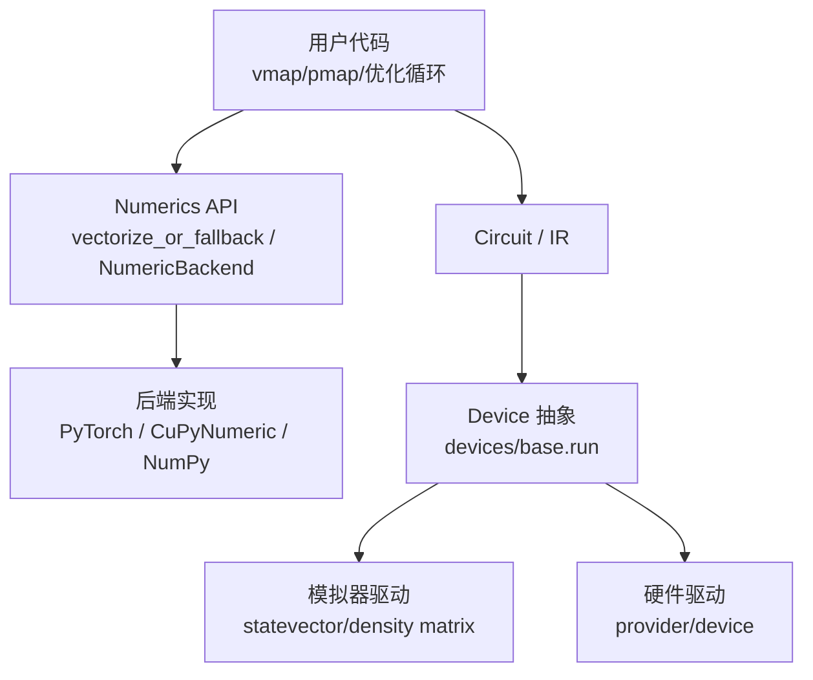
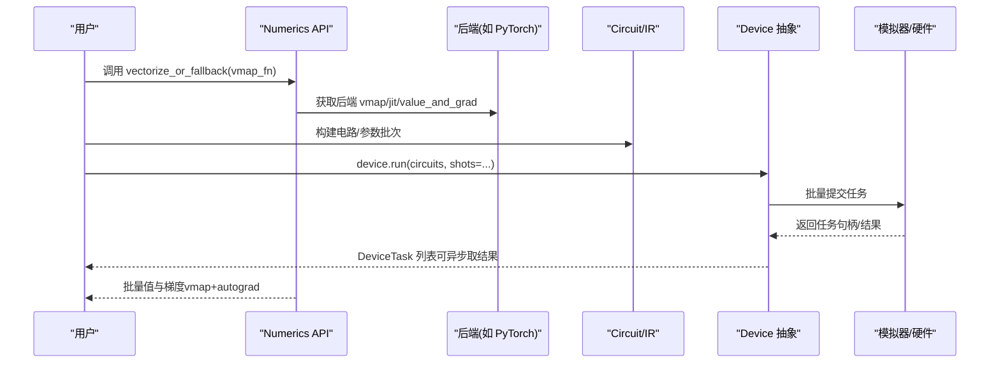
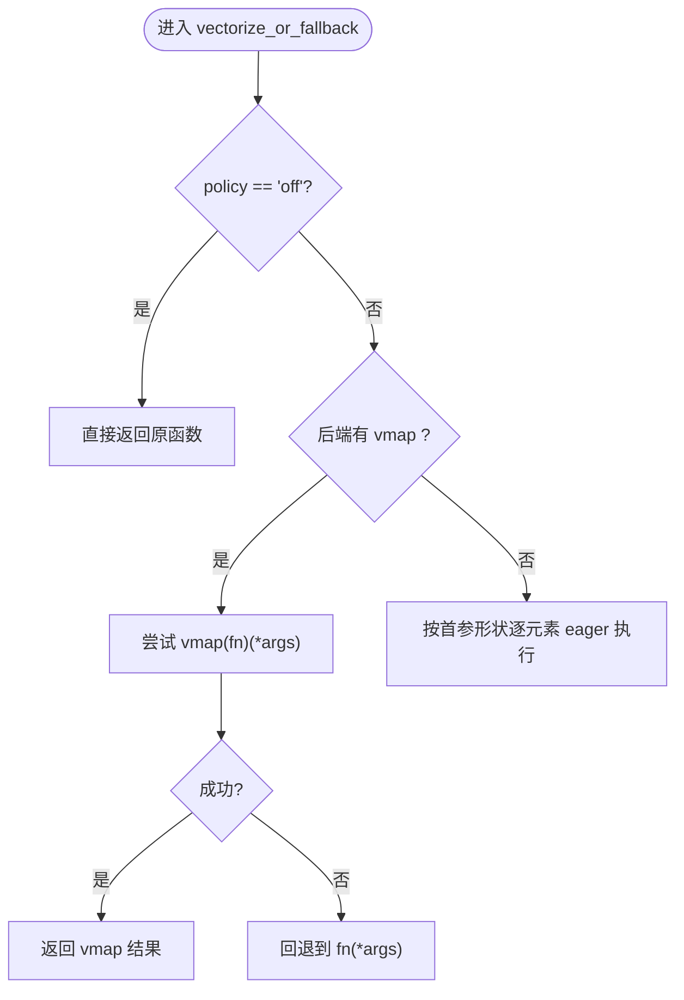
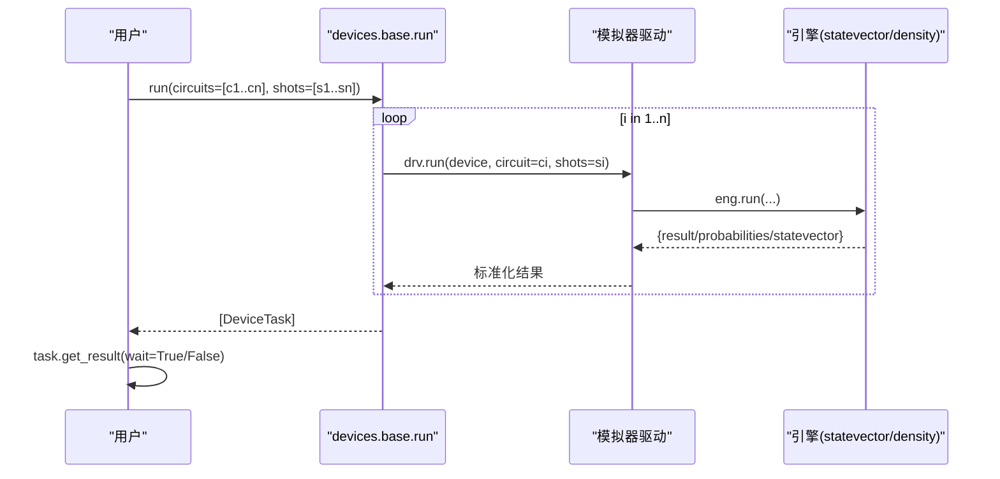
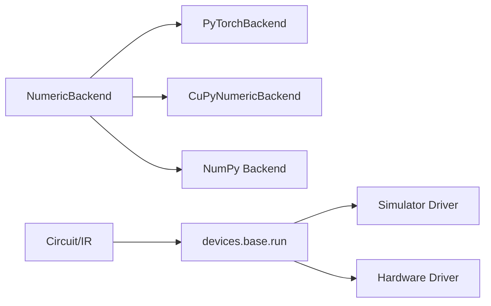

# 并行计算

<cite>
**本文引用的文件**
- [src/tyxonq/numerics/__init__.py](file://src/tyxonq/numerics/__init__.py)
- [src/tyxonq/numerics/api.py](file://src/tyxonq/numerics/api.py)
- [src/tyxonq/numerics/context.py](file://src/tyxonq/numerics/context.py)
- [src/tyxonq/numerics/backends/pytorch_backend.py](file://src/tyxonq/numerics/backends/pytorch_backend.py)
- [src/tyxonq/numerics/backends/cupynumeric_backend.py](file://src/tyxonq/numerics/backends/cupynumeric_backend.py)
- [examples/vqe_parallel_pmap.py](file://examples/vqe_parallel_pmap.py)
- [examples/framework_performance_comparison.py](file://examples/framework_performance_comparison.py)
- [examples/memory_optimization_checkpointing.py](file://examples/memory_optimization_checkpointing.py)
- [src/tyxonq/core/ir/circuit.py](file://src/tyxonq/core/ir/circuit.py)
- [src/tyxonq/devices/base.py](file://src/tyxonq/devices/base.py)
- [src/tyxonq/devices/simulators/driver.py](file://src/tyxonq/devices/simulators/driver.py)
- [src/tyxonq/devices/simulators/density_matrix/engine.py](file://src/tyxonq/devices/simulators/density_matrix/engine.py)
- [docs/source/user_guide/advanced/index.rst](file://docs/source/user_guide/advanced/index.rst)
</cite>

## 目录
1. [简介](#简介)
2. [项目结构](#项目结构)
3. [核心组件](#核心组件)
4. [架构总览](#架构总览)
5. [详细组件分析](#详细组件分析)
6. [依赖关系分析](#依赖关系分析)
7. [性能考量](#性能考量)
8. [故障排查指南](#故障排查指南)
9. [结论](#结论)
10. [附录](#附录)

## 简介
本指南聚焦 TyxonQ 的并行计算能力，系统讲解 vmap/pmap 风格的批量与并行执行、多核 CPU 与多 GPU 环境下的使用方式、批量处理与分布式计算的优化策略、性能分析与瓶颈识别方法，以及在量子化学（VQE/UCCSD）中的最佳实践。文档基于仓库源码与示例进行提炼，提供可操作的流程、图示与对比建议。

## 项目结构
TyxonQ 将“数值后端”与“设备执行”解耦：
- 数值后端层：提供统一的数组/张量接口与可选的 vmap/jit/value_and_grad 等高级特性，支持 numpy、pytorch、cupynumeric 三种后端。
- 设备执行层：统一封装模拟器与硬件驱动，支持批量化提交与异步结果收集。
- 应用与示例：包含 VQE、UCCSD、框架性能对比、内存优化等典型场景。

图表来源
- [src/tyxonq/numerics/api.py:133-163](file://src/tyxonq/numerics/api.py#L133-L163)
- [src/tyxonq/numerics/__init__.py:67-123](file://src/tyxonq/numerics/__init__.py#L67-L123)
- [src/tyxonq/devices/base.py:294-445](file://src/tyxonq/devices/base.py#L294-L445)

章节来源
- [src/tyxonq/numerics/__init__.py:67-123](file://src/tyxonq/numerics/__init__.py#L67-L123)
- [src/tyxonq/devices/base.py:294-445](file://src/tyxonq/devices/base.py#L294-L445)

## 核心组件
- 数值后端与向量化
  - vectorize_or_fallback：根据策略选择后端 vmap 或回退到 eager；异常时安全降级。
  - NumericBackend：类级代理，统一暴露 array/matmul/einsum 等操作，并转发到当前后端。
  - set_backend/use_backend：全局默认后端切换与上下文管理。
- 后端实现
  - PyTorchBackend：完整 autograd、vmap、jacfwd/hessian、value_and_grad（含有限差分回退）、jit（torch.compile）。
  - CuPyNumericBackend：GPU 加速数组运算，SVD 回退至 host numpy，梯度通过有限差分近似。
  - NumPy 后端：CPU 基准路径，无自动微分。
- 设备执行
  - devices/base.run：统一入口，支持单电路与批量化电路提交，shots 可为标量或列表，返回 DeviceTask 列表。
  - simulators/driver：标准化输出（counts/probabilities/statevector），避免重复调用 state()。
  - density_matrix engine：按门表解析幺正门，顺序应用密度矩阵演化。

章节来源
- [src/tyxonq/numerics/api.py:133-163](file://src/tyxonq/numerics/api.py#L133-L163)
- [src/tyxonq/numerics/__init__.py:67-123](file://src/tyxonq/numerics/__init__.py#L67-L123)
- [src/tyxonq/numerics/backends/pytorch_backend.py:364-444](file://src/tyxonq/numerics/backends/pytorch_backend.py#L364-L444)
- [src/tyxonq/numerics/backends/cupynumeric_backend.py:208-297](file://src/tyxonq/numerics/backends/cupynumeric_backend.py#L208-L297)
- [src/tyxonq/devices/base.py:294-445](file://src/tyxonq/devices/base.py#L294-L445)
- [src/tyxonq/devices/simulators/driver.py:101-137](file://src/tyxonq/devices/simulators/driver.py#L101-L137)
- [src/tyxonq/devices/simulators/density_matrix/engine.py:40-74](file://src/tyxonq/devices/simulators/density_matrix/engine.py#L40-L74)

## 架构总览
TyxonQ 的并行化由两条主线构成：
- 数值并行：通过 vmap 对参数批次进行映射，结合 autograd 一次性计算值与梯度。
- 任务并行：通过 device.run 提交多个电路（或带不同 shots 的任务），异步收集结果。

图表来源
- [src/tyxonq/numerics/api.py:133-163](file://src/tyxonq/numerics/api.py#L133-L163)
- [src/tyxonq/devices/base.py:294-445](file://src/tyxonq/devices/base.py#L294-L445)
- [src/tyxonq/devices/simulators/driver.py:101-137](file://src/tyxonq/devices/simulators/driver.py#L101-L137)

## 详细组件分析

### 数值并行：vmap 与批量梯度
- 策略与回退
  - vectorize_or_fallback 在 policy != "off" 时优先使用后端 vmap；若失败则回退到 eager。
  - NumericBackend.vmap 为可选能力，未提供时不报错。
- PyTorch 后端
  - 提供 torch.func.vmap、jacfwd、hessian、value_and_grad（含有限差分回退）、torch.compile 的 jit。
  - 注意：array/asarray 会保留 requires_grad，确保 autograd 链不断裂。
- 使用模式
  - 对参数批次做 vmap，同时计算期望值与梯度，适合 VQE/UCCSD 的批量优化。
  - 示例展示了 exact 路径（状态向量内核）与 counts 路径（采样）两种评估方式。

图表来源
- [src/tyxonq/numerics/api.py:133-163](file://src/tyxonq/numerics/api.py#L133-L163)
- [src/tyxonq/numerics/backends/pytorch_backend.py:364-444](file://src/tyxonq/numerics/backends/pytorch_backend.py#L364-L444)

章节来源
- [src/tyxonq/numerics/api.py:133-163](file://src/tyxonq/numerics/api.py#L133-L163)
- [src/tyxonq/numerics/backends/pytorch_backend.py:77-128](file://src/tyxonq/numerics/backends/pytorch_backend.py#L77-L128)
- [examples/vqe_parallel_pmap.py:126-145](file://examples/vqe_parallel_pmap.py#L126-L145)

### 任务并行：批量电路与异步结果
- 批量提交
  - devices.base.run 支持 circuits 列表与 shots 列表对齐，内部逐个提交并归一化为 DeviceTask 列表。
  - 模拟器 driver 在 run(shots==0) 时直接返回 probabilities/statevector，避免二次调用 state()。
- 异步与等待
  - Circuit.run 支持 wait_async_result 控制是否立即等待异步结果。
- 适用场景
  - 对不同初始参数、不同 Hamiltonian 项、不同噪声配置进行批量评测。

图表来源
- [src/tyxonq/devices/base.py:294-445](file://src/tyxonq/devices/base.py#L294-L445)
- [src/tyxonq/devices/simulators/driver.py:101-137](file://src/tyxonq/devices/simulators/driver.py#L101-L137)
- [src/tyxonq/core/ir/circuit.py:986-1016](file://src/tyxonq/core/ir/circuit.py#L986-L1016)

章节来源
- [src/tyxonq/devices/base.py:294-445](file://src/tyxonq/devices/base.py#L294-L445)
- [src/tyxonq/devices/simulators/driver.py:101-137](file://src/tyxonq/devices/simulators/driver.py#L101-L137)
- [src/tyxonq/core/ir/circuit.py:986-1016](file://src/tyxonq/core/ir/circuit.py#L986-L1016)

### 多核 CPU 与多 GPU 并行
- 多核 CPU
  - 使用 NumPy 后端 + 任务并行（batch circuits）提升吞吐。
  - 对于独立优化起点，可使用 Python 并发库（如 ThreadPoolExecutor）并行启动多个优化进程（参考文档中优化示例）。
- 多 GPU
  - 使用 PyTorch 后端，利用 vmap 在 GPU 上并行批处理参数。
  - 使用 CuPyNumeric 后端进行大规模线性代数（注意 SVD 回退到 host）。
  - 结合 torch.compile 与 value_and_grad 获得端到端加速。

章节来源
- [src/tyxonq/numerics/backends/pytorch_backend.py:364-444](file://src/tyxonq/numerics/backends/pytorch_backend.py#L364-L444)
- [src/tyxonq/numerics/backends/cupynumeric_backend.py:208-297](file://src/tyxonq/numerics/backends/cupynumeric_backend.py#L208-L297)
- [docs/source/user_guide/advanced/index.rst:669-712](file://docs/source/user_guide/advanced/index.rst#L669-L712)

### 批量处理与分布式计算优化策略
- 批大小选择
  - vmap 批大小受显存限制；过大导致 OOM，过小降低吞吐。建议逐步增大直至接近显存上限。
- 数据布局
  - 将参数组织为 [batch, layers, wires, params] 等连续布局，减少 reshape/moveaxis 开销。
- 算子融合
  - 使用 torch.compile（jit）对热点函数编译，减少 Python 调度开销。
- 任务并行
  - 对独立任务（不同参数集/不同哈密顿项）使用 batch circuits 提交，充分利用多核/多卡。
- 分布式
  - CuPyNumeric 可用于分布式 GPU 数组；注意部分算子（如 SVD）可能回退到 host，需评估通信与计算平衡。

章节来源
- [src/tyxonq/numerics/backends/cupynumeric_backend.py:208-297](file://src/tyxonq/numerics/backends/cupynumeric_backend.py#L208-L297)
- [src/tyxonq/devices/base.py:418-445](file://src/tyxonq/devices/base.py#L418-L445)

### 量子化学并行化最佳实践（VQE/UCCSD）
- 推荐路径
  - 精确路径（statevector）+ PyTorch vmap + autograd：适合中小体系快速迭代。
  - 采样路径（counts）+ Parameter Shift：贴近真实硬件梯度计算。
- 性能对比
  - 示例对比了 shot-based、NumPy value_and_grad、PyTorch autograd 三种模式，展示速度与精度权衡。
- UCCSD
  - 在不同后端下比较能量与梯度计算时间，验证 PyTorch autograd 的优势。

章节来源
- [examples/framework_performance_comparison.py:75-408](file://examples/framework_performance_comparison.py#L75-L408)
- [examples/framework_performance_comparison.py:660-778](file://examples/framework_performance_comparison.py#L660-L778)
- [examples/vqe_parallel_pmap.py:39-145](file://examples/vqe_parallel_pmap.py#L39-L145)

### 实际案例研究
- 案例一：TFIM 的 VQE 并行优化
  - 使用 vmap 对参数批次求值与梯度，对比 exact 与 counts 路径。
- 案例二：框架性能对比
  - 对比 TyxonQ 三种模式与 Qiskit/PennyLane，给出速度比与最终能量。
- 案例三：深度电路内存优化
  - 展示梯度检查点思想与 O(N×2^n) 到 O(√N×2^n) 的折中。

章节来源
- [examples/vqe_parallel_pmap.py:126-164](file://examples/vqe_parallel_pmap.py#L126-L164)
- [examples/framework_performance_comparison.py:582-654](file://examples/framework_performance_comparison.py#L582-L654)
- [examples/memory_optimization_checkpointing.py:200-228](file://examples/memory_optimization_checkpointing.py#L200-L228)

## 依赖关系分析
- Numerics 与后端
  - NumericBackend 通过 get_backend 动态绑定具体后端；vmap/jit/value_and_grad 为可选能力。
- 设备与驱动
  - devices.base.run 作为统一入口，屏蔽 simulator/hardware 差异；driver 标准化输出。
- 示例与文档
  - 示例覆盖 vmap、性能对比、内存优化；文档提供 profiling/benchmark 工具指引。

图表来源
- [src/tyxonq/numerics/__init__.py:67-123](file://src/tyxonq/numerics/__init__.py#L67-L123)
- [src/tyxonq/devices/base.py:294-445](file://src/tyxonq/devices/base.py#L294-L445)

章节来源
- [src/tyxonq/numerics/__init__.py:67-123](file://src/tyxonq/numerics/__init__.py#L67-L123)
- [src/tyxonq/devices/base.py:294-445](file://src/tyxonq/devices/base.py#L294-L445)

## 性能考量
- 选择后端
  - 需要自动微分与 GPU 加速：优先 PyTorch 后端。
  - 仅需 CPU 基准或兼容性好：NumPy 后端。
  - 大规模线性代数且已有分布式生态：考虑 CuPyNumeric（注意回退行为）。
- 批大小与显存
  - vmap 批大小越大吞吐越高，但需监控显存峰值；必要时拆分批次。
- 算子与图优化
  - 使用 torch.compile 编译热点函数；避免频繁 Python 循环与类型转换。
- 任务并行
  - 对独立任务使用 batch circuits；合理设置 shots 列表以匹配不同需求。
- 测量与后处理
  - exact 路径（shots==0）速度快、无噪声；counts 路径更接近真机但引入统计误差。

章节来源
- [examples/framework_performance_comparison.py:75-408](file://examples/framework_performance_comparison.py#L75-L408)
- [src/tyxonq/devices/simulators/driver.py:101-137](file://src/tyxonq/devices/simulators/driver.py#L101-L137)

## 故障排查指南
- vmap 失败
  - 现象：vmap 抛出异常，回退到 eager。
  - 排查：确认后端是否提供 vmap；检查输入形状与广播规则；查看异常日志。
- 梯度为 None
  - 现象：value_and_grad 返回 None 梯度。
  - 排查：确保 array/asarray 保留 requires_grad；避免中间拷贝破坏图；升级 PyTorch 以启用 jacfwd/hessian。
- 显存溢出
  - 现象：OOM。
  - 排查：减小 vmap 批大小；使用更低的 dtype（complex64/float32）；采用梯度检查点；拆分任务。
- 任务结果不一致
  - 现象：batch circuits 结果顺序或格式不一致。
  - 排查：确认 shots 列表长度与 circuits 一致；使用 DeviceTask.get_result(wait=True) 保证同步。

章节来源
- [src/tyxonq/numerics/api.py:133-163](file://src/tyxonq/numerics/api.py#L133-L163)
- [src/tyxonq/numerics/backends/pytorch_backend.py:77-128](file://src/tyxonq/numerics/backends/pytorch_backend.py#L77-L128)
- [src/tyxonq/devices/base.py:418-445](file://src/tyxonq/devices/base.py#L418-L445)

## 结论
- TyxonQ 通过“数值并行（vmap/autograd）+ 任务并行（batch circuits）”的双通道设计，在多核 CPU 与多 GPU 环境下均可高效运行。
- 对于量子化学问题，推荐优先使用 PyTorch 后端 + vmap + autograd 的精确路径；在需要模拟真机时使用 counts 路径与 Parameter Shift。
- 性能调优的关键在于：合理的批大小、dtype 选择、算子融合（torch.compile）、任务并行与内存优化（检查点）。
- 通过内置 benchmark/profile 工具与示例脚本，可系统化地进行性能分析与瓶颈定位。

## 附录
- 常用操作速查
  - 设置后端：set_backend("pytorch"/"numpy"/"cupynumeric")
  - 批量梯度：vectorize_or_fallback(vmap_fn) 或 NumericBackend.vmap
  - 批量执行：device.run(circuits, shots=...)
  - 性能分析：使用 docs/source/user_guide/advanced/index.rst 提供的 benchmark/profile_memory 工具

章节来源
- [docs/source/user_guide/advanced/index.rst:669-712](file://docs/source/user_guide/advanced/index.rst#L669-L712)