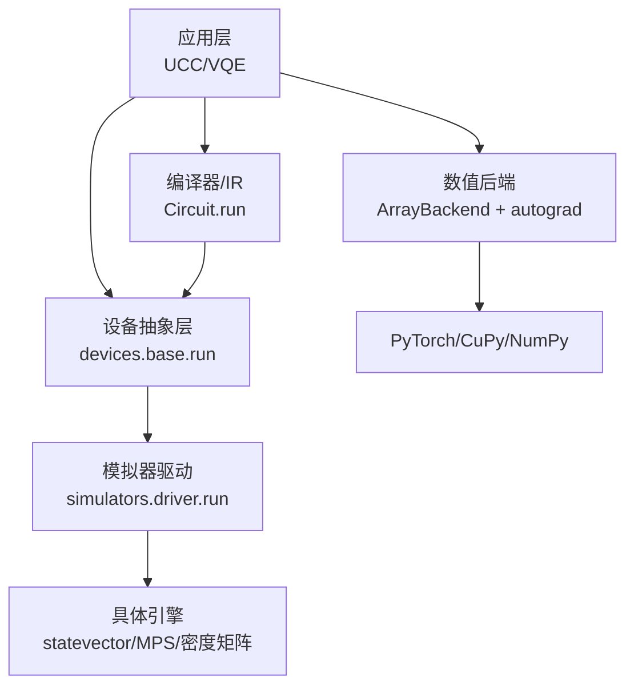
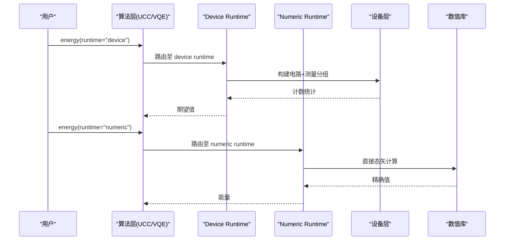
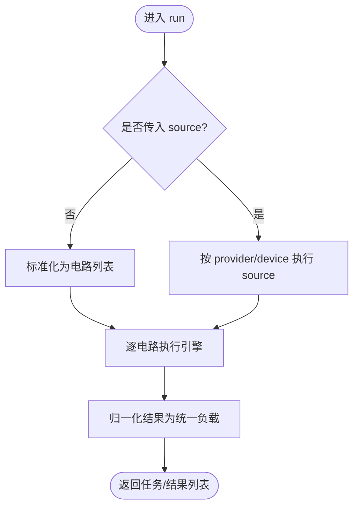
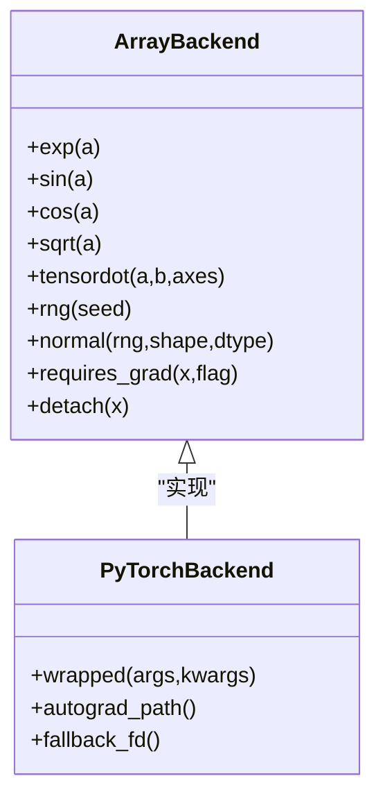
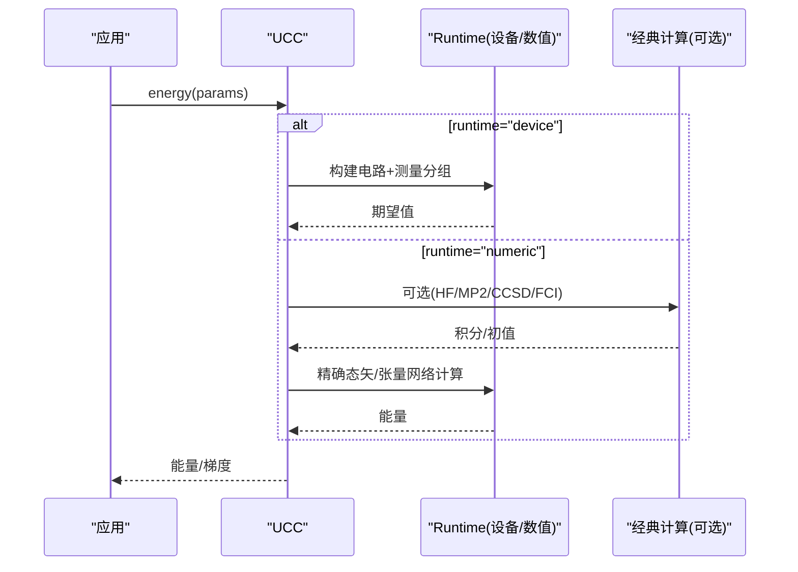
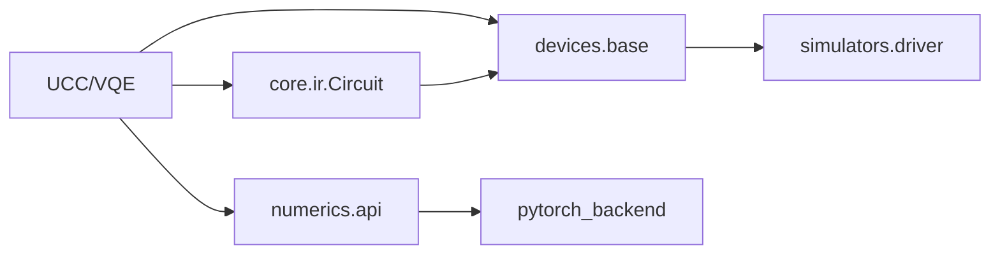

# 批量处理优化策略

<cite>
**本文引用的文件**
- [driver.py](file://src/tyxonq/devices/simulators/driver.py)
- [base.py](file://src/tyxonq/devices/base.py)
- [circuit.py](file://src/tyxonq/core/ir/circuit.py)
- [ucc_base.py](file://src/tyxonq/applications/chem/algorithms/vqe/ucc_base.py)
- [pytorch_backend.py](file://src/tyxonq/numerics/backends/pytorch_backend.py)
- [api.py](file://src/tyxonq/numerics/api.py)
- [topology.py](file://src/tyxonq/devices/hardware/topology.py)
- [performance_optimization.rst](file://docs/source/technical_references/performance_optimization.rst)
- [runtime_optimization.rst](file://docs/source/quantum_chemistry/runtimes/runtime_optimization.rst)
- [numerical_methods.rst](file://docs/source/quantum_chemistry/runtimes/numerical_methods.rst)
- [vqe_parallel_pmap.py](file://examples/vqe_parallel_pmap.py)
- [gradient_benchmark.py](file://examples/gradient_benchmark.py)
- [memory_optimization_checkpointing.py](file://examples/memory_optimization_checkpointing.py)
- [performance_layerwise_optimization.py](file://examples/performance_layerwise_optimization.py)
- [vqe_batched_architecture_search.py](file://examples/vqe_batched_architecture_search.py)
</cite>

## 目录
1. [简介](#简介)
2. [项目结构](#项目结构)
3. [核心组件](#核心组件)
4. [架构总览](#架构总览)
5. [详细组件分析](#详细组件分析)
6. [依赖关系分析](#依赖关系分析)
7. [性能考量](#性能考量)
8. [故障排查指南](#故障排查指南)
9. [结论](#结论)
10. [附录](#附录)

## 简介
本指南聚焦 TyxonQ 在量子化学与变分算法中的批量处理优化策略，系统阐述不同批大小对性能与内存的影响、静态/动态批处理的适用场景、与梯度累积的结合方式、面向不同规模量子化学问题的批处理方案、I/O 与数据预取优化、以及自动微分兼容性。文档同时给出可复现的基准测试方法与调优案例，帮助读者在实际工程中落地高效稳定的批量执行流程。

## 项目结构
TyxonQ 将“设备抽象—数值后端—编译器—应用层”分层解耦，批量能力贯穿各层：
- 设备层：统一驱动接口支持单电路与批电路提交；模拟器驱动内部对列表输入进行循环执行并归一化结果。
- 核心 IR：Circuit.run 支持 source 或 circuit 路径，统一返回任务列表，便于上层做批式编排。
- 数值后端：PyTorch/CuPy/NumPy 通过 ArrayBackend 协议提供向量化与自动微分桥接，支持 vmap/grad 等批量变换。
- 应用层：UCC/VQE 等算法封装 device/numeric 双路径，结合缓存与懒加载降低重复计算。

图表来源
- [base.py:368-393](file://src/tyxonq/devices/base.py#L368-L393)
- [driver.py:75-141](file://src/tyxonq/devices/simulators/driver.py#L75-L141)
- [circuit.py:986-1016](file://src/tyxonq/core/ir/circuit.py#L986-L1016)

章节来源
- [base.py:368-393](file://src/tyxonq/devices/base.py#L368-L393)
- [driver.py:75-141](file://src/tyxonq/devices/simulators/driver.py#L75-L141)
- [circuit.py:986-1016](file://src/tyxonq/core/ir/circuit.py#L986-L1016)

## 核心组件
- 设备驱动与批运行
  - devices.base.run 统一处理 source/circuit 两种提交路径，并对硬件路径丢弃模拟器专属参数，保证跨 provider 一致性。
  - simulators.driver.run 接受单个或批电路（list/tuple），内部循环调用引擎 run，并将结果归一化为统一负载格式（counts/expectations/probabilities/statevector）。
- 数值后端与自动微分
  - numerics.api.vectorize_or_fallback 提供函数级向量化包装与安全回退，配合 PyTorch/CuPy 实现批式求值。
  - pytorch_backend 中 grad 包装确保参数张量启用梯度追踪，并在失败时回退到有限差分。
- 量子化学运行时
  - UCC 类封装 device/numeric 双路径，支持本地或云端经典计算（HF/MP2/CCSD）以加速积分与初值构建。
  - 运行时采用两级缓存（LRU 与局部字典）与懒加载属性，减少重复开销。

章节来源
- [base.py:368-393](file://src/tyxonq/devices/base.py#L368-L393)
- [driver.py:75-141](file://src/tyxonq/devices/simulators/driver.py#L75-L141)
- [api.py:124-131](file://src/tyxonq/numerics/api.py#L124-L131)
- [pytorch_backend.py:460-553](file://src/tyxonq/numerics/backends/pytorch_backend.py#L460-L553)
- [ucc_base.py:52-200](file://src/tyxonq/applications/chem/algorithms/vqe/ucc_base.py#L52-L200)
- [runtime_optimization.rst:1-27](file://docs/source/quantum_chemistry/runtimes/runtime_optimization.rst#L1-L27)

## 架构总览
TyxonQ 的双路径执行模型为批量优化提供了基础：device 路径侧重采样效率与测量分组，numeric 路径侧重精确态矢/张量网络计算与自动微分。两者在应用层统一入口下切换，保持语义一致。

图表来源
- [TYXONQ_TECHNICAL_WHITEPAPER.md:482-508](file://TYXONQ_TECHNICAL_WHITEPAPER.md#L482-L508)

章节来源
- [TYXONQ_TECHNICAL_WHITEPAPER.md:482-508](file://TYXONQ_TECHNICAL_WHITEPAPER.md#L482-L508)

## 详细组件分析

### 设备驱动与批运行
- 批电路提交
  - base.run 将 circuit 标准化为列表，统一走 batch 处理逻辑；hardware 路径要求 source，避免未编译 IR 直接下发。
  - simulator driver 接收 list/tuple 后逐项执行，并统一输出格式，便于上层聚合。
- 批大小与吞吐
  - 小批：调度开销占比高，吞吐低。
  - 大批：可能受限于显存/内存峰值（状态向量、中间态、计数直方图）。
  - 建议：根据目标设备与问题规模，选择使 GPU/CPU 利用率接近饱和且峰值内存可控的批大小。

图表来源
- [base.py:368-393](file://src/tyxonq/devices/base.py#L368-L393)
- [driver.py:75-141](file://src/tyxonq/devices/simulators/driver.py#L75-L141)

章节来源
- [base.py:368-393](file://src/tyxonq/devices/base.py#L368-L393)
- [driver.py:75-141](file://src/tyxonq/devices/simulators/driver.py#L75-L141)

### 数值后端与自动微分
- 向量化与批式求值
  - vectorize_or_fallback 将普通函数包装为可批量调用，自动检测后端能力并安全回退。
  - PyTorch 后端在 grad 包装中确保 requires_grad，并在异常时回退到有限差分，保障稳定性。
- 与批处理的结合
  - 使用 torch.func.vmap/grad 对参数集进行批式求值与求导，适合多初始点/多结构的并行搜索。
  - 对于 counts 路径，可在外层对多个参数集构造独立电路并发执行（注意 I/O 与队列长度）。

图表来源
- [api.py:93-131](file://src/tyxonq/numerics/api.py#L93-L131)
- [pytorch_backend.py:460-553](file://src/tyxonq/numerics/backends/pytorch_backend.py#L460-L553)

章节来源
- [api.py:93-131](file://src/tyxonq/numerics/api.py#L93-L131)
- [pytorch_backend.py:460-553](file://src/tyxonq/numerics/backends/pytorch_backend.py#L460-L553)

### 量子化学运行时与缓存
- 双路径一致性
  - UCC 对外暴露 energy/energy_and_grad，内部根据 runtime 选择 device 或 numeric 路径，保持语义一致。
- 缓存与懒加载
  - 运行时采用 LRU 缓存与局部字典缓存，结合 @property 懒加载，避免重复构建 CI 字符串与算符张量。
- 云端经典计算
  - 可将 HF/MP2/CCSD/FCI 等经典核卸载到云端节点，显著加速积分与初值构建。

图表来源
- [ucc_base.py:52-200](file://src/tyxonq/applications/chem/algorithms/vqe/ucc_base.py#L52-L200)
- [runtime_optimization.rst:1-27](file://docs/source/quantum_chemistry/runtimes/runtime_optimization.rst#L1-L27)

章节来源
- [ucc_base.py:52-200](file://src/tyxonq/applications/chem/algorithms/vqe/ucc_base.py#L52-L200)
- [runtime_optimization.rst:1-27](file://docs/source/quantum_chemistry/runtimes/runtime_optimization.rst#L1-L27)

### 批处理与梯度累积
- 何时使用
  - 当显存不足以容纳完整批次的状态或中间激活时，使用梯度累积模拟更大有效批次，提高吞吐与收敛稳定性。
- 如何结合
  - 数值路径：将 loss 累加后每 k 步反向传播一次，等价于增大有效批大小。
  - 设备路径：对 counts 路径，可按批提交电路，每 k 个批聚合梯度更新。
- 注意事项
  - 累积期间需控制中间态生命周期，及时释放；监控梯度范数与噪声水平，避免发散。

[本节为通用指导，不直接分析具体文件]

### 静态批处理 vs 动态批处理
- 静态批处理
  - 固定批大小，适合稳定吞吐场景（如离线批评估、超参扫描）。
  - 优点：调度简单、易于并行化；缺点：对小样本或长尾任务利用率不高。
- 动态批处理
  - 按任务复杂度/尺寸动态组合批次，提升资源利用率。
  - 适用于量子化学中分子尺寸差异大、哈密顿量项数不同的场景。
- 实践建议
  - 先以静态批跑通流水线，再引入动态批合并相似任务，观察吞吐与延迟变化。

[本节为通用指导，不直接分析具体文件]

### 不同规模量子化学问题的批处理策略
- 小体系（≤12 qubits）
  - statevector 精确路径为主，批大小可较大；注意 O(2^n) 内存增长。
- 中等体系（12–20 qubits）
  - 倾向 MPS/密度矩阵或混合路径；批大小需保守，结合缓存与懒加载。
- 大体系（>20 qubits）
  - 优先 MPS/张量网络；批大小较小，强调 I/O 与预处理缓存；必要时拆分子空间或 active space。

章节来源
- [performance_optimization.rst:238-360](file://docs/source/technical_references/performance_optimization.rst#L238-L360)
- [numerical_methods.rst:339-404](file://docs/source/quantum_chemistry/runtimes/numerical_methods.rst#L339-L404)

### I/O 优化与数据预取
- 拓扑发现缓存
  - 设备拓扑采用会话内内存缓存与磁盘持久化缓存（TTL 控制），避免重复网络请求。
- 批式 I/O
  - 将多次读取/写入合并为批量操作；对频繁访问的积分、映射、MPO 等对象使用全局 LRU 缓存。
- 数据预取
  - 在训练循环中提前准备下一批参数/电路，隐藏 I/O 延迟；注意与批大小和队列深度匹配。

章节来源
- [topology.py:1-21](file://src/tyxonq/devices/hardware/topology.py#L1-L21)
- [numerical_methods.rst:339-404](file://docs/source/quantum_chemistry/runtimes/numerical_methods.rst#L339-L404)

### 批处理与自动微分的兼容性
- 数值路径
  - 使用 PyTorch 后端时，参数张量需开启 requires_grad；框架已内置自动微分路径，并在异常时回退到有限差分。
- 设备路径
  - 基于参数平移（parameter-shift）的梯度估计天然兼容批处理：对每个参数生成 ±shift 的子批，分别求值后组合梯度。
- 混合路径
  - 在 VQE 架构搜索中，可通过 Circuit.state() 获取可微状态，结合 vmap/grad 实现批式优化。

章节来源
- [pytorch_backend.py:460-553](file://src/tyxonq/numerics/backends/pytorch_backend.py#L460-L553)
- [vqe_batched_architecture_search.py:154-174](file://examples/vqe_batched_architecture_search.py#L154-L174)

### 实际案例与基准测试
- 批式 VQE 架构搜索
  - 同时优化多个电路结构与多组参数初始化，展示批式 autograd 的优势。
- 梯度基准
  - 对比 counts 路径（参数平移）与数值路径（有限差分/Hessian），记录阶段时间与运行时间。
- 深层噪声电路的分层优化
  - 通过每层强制状态计算打断计算图，显著缩短 JIT 编译时间，代价为轻微运行开销。
- 内存优化与检查点
  - 展示标准反向传播与检查点的内存/速度权衡，指导深电路训练。

章节来源
- [vqe_batched_architecture_search.py:1-200](file://examples/vqe_batched_architecture_search.py#L1-L200)
- [gradient_benchmark.py:1-320](file://examples/gradient_benchmark.py#L1-L320)
- [performance_layerwise_optimization.py:1-337](file://examples/performance_layerwise_optimization.py#L1-L337)
- [memory_optimization_checkpointing.py:1-280](file://examples/memory_optimization_checkpointing.py#L1-L280)

## 依赖关系分析
- 组件耦合
  - 应用层依赖设备抽象与数值后端；设备抽象屏蔽底层驱动差异；数值后端提供统一的数组与微分接口。
- 外部依赖
  - 云平台拓扑查询、经典化学计算（PySCF）、第三方库（PyTorch/CuPy/Qiskit 可选）。
- 潜在环路
  - 通过明确分层与接口契约避免循环依赖；插件注册表提供编译器/设备的动态加载与缓存。

图表来源
- [base.py:368-393](file://src/tyxonq/devices/base.py#L368-L393)
- [driver.py:75-141](file://src/tyxonq/devices/simulators/driver.py#L75-L141)
- [api.py:124-131](file://src/tyxonq/numerics/api.py#L124-L131)
- [pytorch_backend.py:460-553](file://src/tyxonq/numerics/backends/pytorch_backend.py#L460-L553)
- [circuit.py:986-1016](file://src/tyxonq/core/ir/circuit.py#L986-L1016)

章节来源
- [base.py:368-393](file://src/tyxonq/devices/base.py#L368-L393)
- [driver.py:75-141](file://src/tyxonq/devices/simulators/driver.py#L75-L141)
- [api.py:124-131](file://src/tyxonq/numerics/api.py#L124-L131)
- [pytorch_backend.py:460-553](file://src/tyxonq/numerics/backends/pytorch_backend.py#L460-L553)
- [circuit.py:986-1016](file://src/tyxonq/core/ir/circuit.py#L986-L1016)

## 性能考量
- 批大小选择
  - 小批：低吞吐、低内存；大批：高吞吐、高内存。需结合设备特性与问题规模折中。
- 内存管理
  - 状态向量内存随 qubit 数指数增长；合理使用 MPS/密度矩阵；批间清理中间态。
- 并行度
  - 电路级并行（batch_run）、shot 级并行（硬件自动/模拟器多线程）、参数优化并行（多初始点）。
- 缓存与懒加载
  - 利用 LRU 缓存与 @property 懒加载，避免重复构建昂贵对象。
- 分层优化
  - 对深层噪声电路，分层强制状态计算可大幅缩短 JIT 编译时间。

章节来源
- [performance_optimization.rst:238-360](file://docs/source/technical_references/performance_optimization.rst#L238-L360)
- [numerical_methods.rst:339-404](file://docs/source/quantum_chemistry/runtimes/numerical_methods.rst#L339-L404)
- [performance_layerwise_optimization.py:1-337](file://examples/performance_layerwise_optimization.py#L1-L337)

## 故障排查指南
- 设备拓扑刷新
  - 若拓扑缓存过期或被删除，需按 TTL 规则刷新；可通过收紧 max_age_days 强制刷新。
- 设备运行时回归
  - 关注位序镜像、解析分支短路、采样容差等问题；确保 device runtime 分支被覆盖测试。
- 批运行错误
  - hardware 路径必须提供 source；simulator/local 路径可传 circuit；确认参数键名不被硬件驱动拒绝。
- 自动微分异常
  - 若 autograd 路径失败，框架会回退到有限差分；检查参数类型与 requires_grad 设置。

章节来源
- [test_device_topology_cache.py:133-165](file://tests_core_module/test_device_topology_cache.py#L133-L165)
- [test_device_runtime_regression.py:1-19](file://tests_applications_chem/test_device_runtime_regression.py#L1-L19)
- [base.py:368-393](file://src/tyxonq/devices/base.py#L368-L393)
- [pytorch_backend.py:460-553](file://src/tyxonq/numerics/backends/pytorch_backend.py#L460-L553)

## 结论
TyxonQ 通过设备抽象、数值后端与运行时缓存机制，为量子化学与变分算法提供了强大的批量处理能力。实践中应依据问题规模与设备特性选择合适的批大小与路径（device/numeric），并结合梯度累积、分层优化与 I/O 预取策略，最大化吞吐与稳定性。借助示例与基准脚本，可快速定位瓶颈并验证优化效果。

## 附录
- 推荐工作流
  - 小规模开发：numeric 路径 + PyTorch 后端 + vmap/grad 批式优化。
  - 大规模生产：device 路径 + 批式提交 + 缓存/懒加载 + 分层优化。
- 关键参考
  - 双路径执行模型、运行时优化、数值方法优化、设备拓扑缓存等文档与示例。

[本节为总结性内容，不直接分析具体文件]