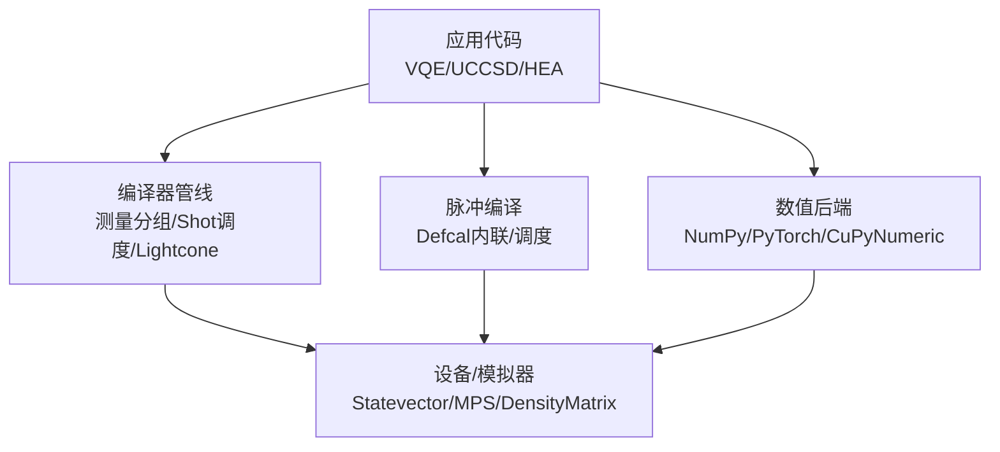
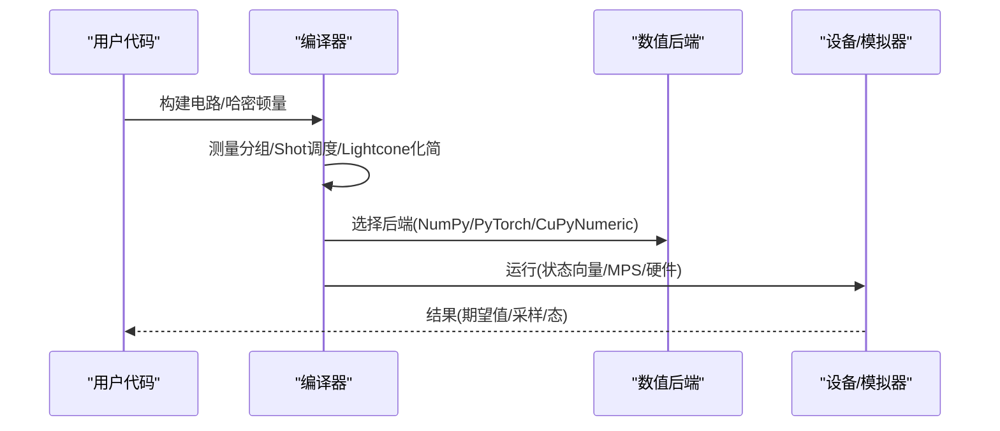
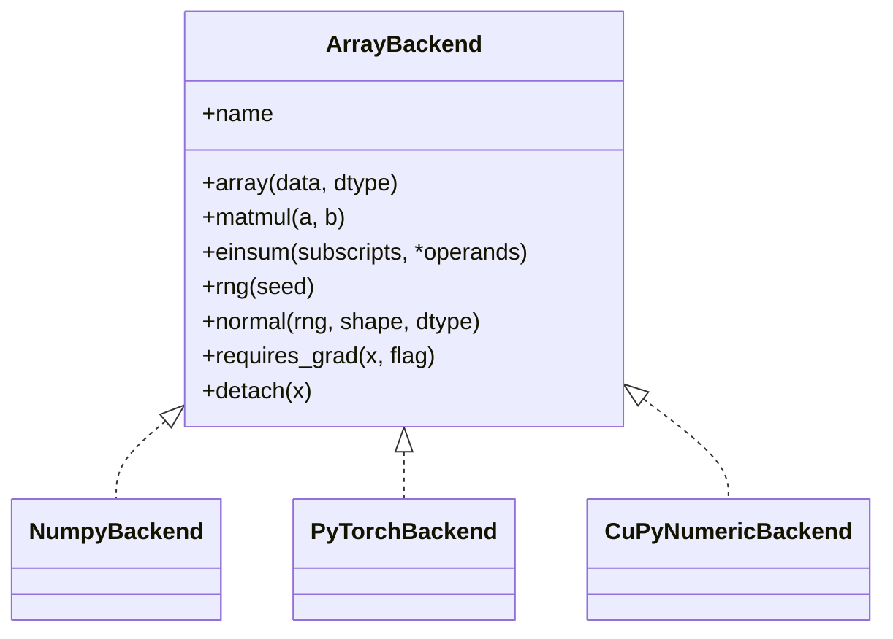
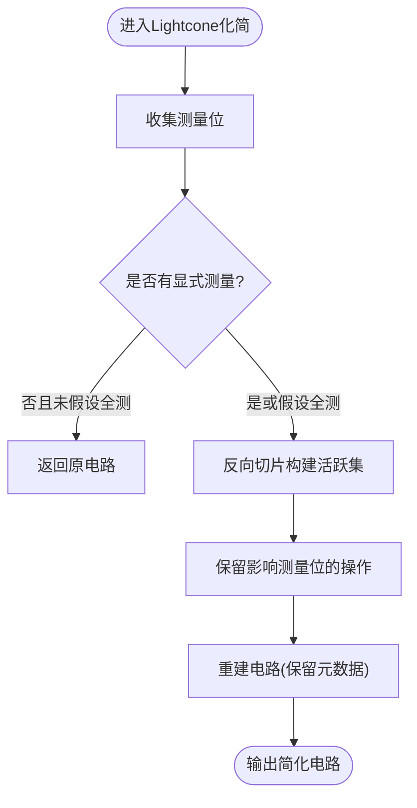
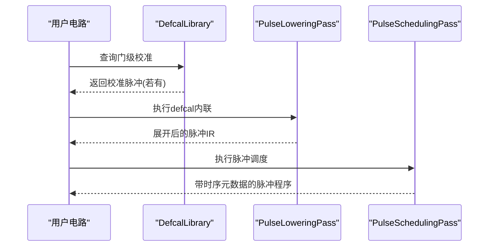
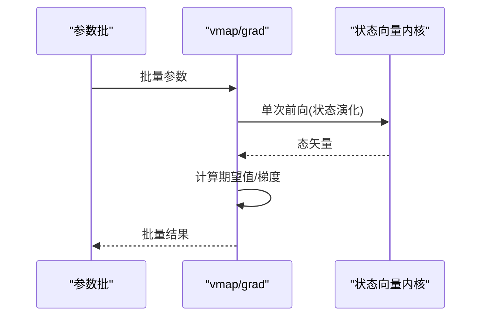
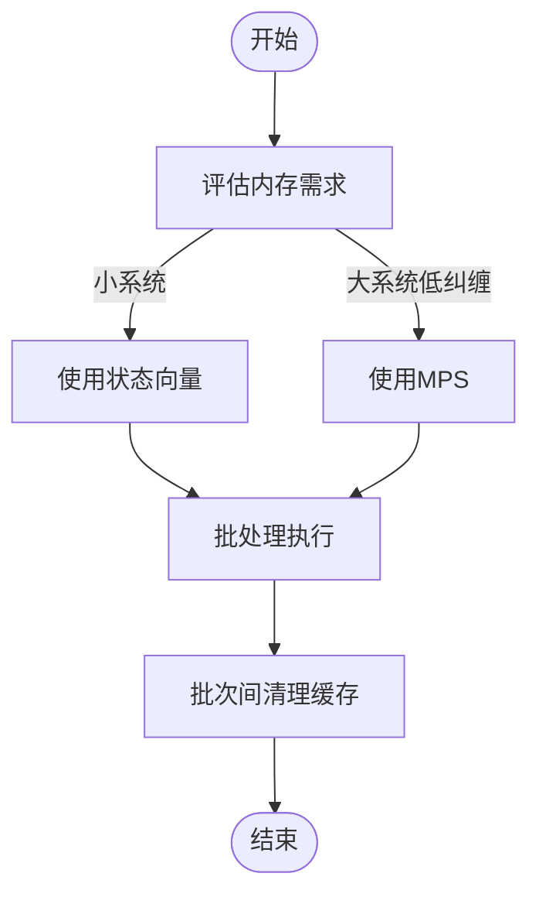
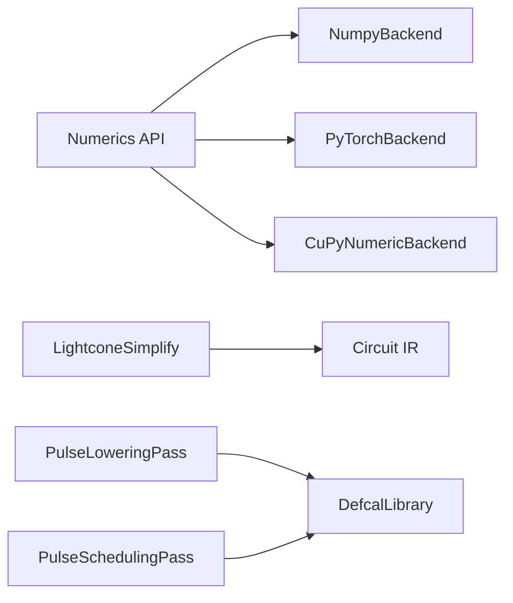

# 性能优化

<cite>
**本文引用的文件**
- [performance_optimization.rst](file://docs/source/technical_references/performance_optimization.rst)
- [config.py](file://src/tyxonq/config.py)
- [api.py](file://src/tyxonq/numerics/api.py)
- [lightcone.py](file://src/tyxonq/compiler/gate_compiler/stages/simplify/lightcone.py)
- [test_compiler_simplify_lightcone.py](file://tests_core_module/test_compiler_simplify_lightcone.py)
- [pulse_lowering.py](file://src/tyxonq/compiler/pulse_compiler/native/pulse_lowering.py)
- [pulse_scheduling.py](file://src/tyxonq/compiler/pulse_compiler/native/pulse_scheduling.py)
- [hybrid_mode.rst](file://docs/source/user_guide/pulse/hybrid_mode.rst)
- [vqe_parallel_pmap.py](file://examples/vqe_parallel_pmap.py)
- [memory_optimization_checkpointing.py](file://examples/memory_optimization_checkpointing.py)
- [profile_chem.py](file://scripts/profile_chem.py)
- [performance_optimization_tips.md](file://examples/performance_optimization_tips.md)
</cite>

## 目录
1. [简介](#简介)
2. [项目结构](#项目结构)
3. [核心组件](#核心组件)
4. [架构总览](#架构总览)
5. [详细组件分析](#详细组件分析)
6. [依赖关系分析](#依赖关系分析)
7. [性能考量](#性能考量)
8. [故障排查指南](#故障排查指南)
9. [结论](#结论)
10. [附录](#附录)

## 简介
本指南面向TyxonQ用户与开发者，系统性阐述性能调优策略与最佳实践。内容覆盖：数值后端选择、编译器优化选项、内存管理与缓存、并行与分布式计算、量子化学计算瓶颈与技巧、脉冲编程优化、基准测试与性能分析、问题定位与解决、以及不同应用场景的优化案例与硬件资源利用建议。目标是帮助你在不同执行路径（设备路径 vs 数值路径）和不同硬件条件下，获得稳定且可复现的性能收益。

## 项目结构
TyxonQ在性能相关的关键位置包括：
- 数值后端抽象与切换：位于 numerics 模块，提供统一接口与自动降级机制
- 编译器优化：包含测量分组、Shot调度、Lightcone化简等Pass
- 脉冲编译：包含defcal内联、脉冲调度等Pass，支持混合模式（门级+脉冲级）
- 应用层示例：VQE并行批处理、内存优化与梯度检查点、化学任务剖析脚本
- 文档与参考：技术参考中的性能优化章节、用户指南中的混合模式说明

图表来源
- [performance_optimization.rst:10-18](file://docs/source/technical_references/performance_optimization.rst#L10-L18)
- [lightcone.py:12-97](file://src/tyxonq/compiler/gate_compiler/stages/simplify/lightcone.py#L12-L97)
- [api.py:179-252](file://src/tyxonq/numerics/api.py#L179-L252)

章节来源
- [performance_optimization.rst:10-18](file://docs/source/technical_references/performance_optimization.rst#L10-L18)
- [api.py:179-252](file://src/tyxonq/numerics/api.py#L179-L252)

## 核心组件
- 数值后端系统：通过统一协议暴露数组创建、线性代数、随机数、可选自动微分能力；支持按名称或实例设置全局后端，具备自动降级与可用性检查
- 编译器优化：Lightcone化简、测量重写与分组、Shot调度等Pass，减少电路执行次数与无效门
- 脉冲编译：Defcal内联与脉冲调度，支持混合模式（门+脉冲），便于渐进式优化
- 应用与示例：并行VQE批处理、梯度检查点、化学任务剖析脚本，展示实际优化手段

章节来源
- [api.py:19-121](file://src/tyxonq/numerics/api.py#L19-L121)
- [api.py:179-252](file://src/tyxonq/numerics/api.py#L179-L252)
- [lightcone.py:12-97](file://src/tyxonq/compiler/gate_compiler/stages/simplify/lightcone.py#L12-L97)
- [pulse_lowering.py:22-68](file://src/tyxonq/compiler/pulse_compiler/native/pulse_lowering.py#L22-L68)
- [pulse_scheduling.py:24-66](file://src/tyxonq/compiler/pulse_compiler/native/pulse_scheduling.py#L24-L66)

## 架构总览
TyxonQ将“算法—编译器—后端—设备”解耦，形成多层优化杠杆：
- 算法层：选择合适Ansatz（UCCSD/HEA/k-UpCCGSD/pUCCD）、Active Space近似、梯度方法（参数平移 vs 自动微分）
- 编译器层：测量分组、Shot调度、Lightcone化简、硬件特定编译
- 后端层：NumPy（开发/小规模）、PyTorch（梯度/GPU）、CuPyNumeric（大规模GPU/分布式）
- 设备层：状态向量、密度矩阵、MPS、真实硬件

图表来源
- [performance_optimization.rst:10-18](file://docs/source/technical_references/performance_optimization.rst#L10-L18)
- [api.py:179-252](file://src/tyxonq/numerics/api.py#L179-L252)
- [lightcone.py:12-97](file://src/tyxonq/compiler/gate_compiler/stages/simplify/lightcone.py#L12-L97)

## 详细组件分析

### 数值后端与选择策略
- 统一协议：ArrayBackend定义数组创建、线性代数、随机数、自动微分桥接等接口
- 后端工厂：get_backend支持按名称获取或回退到配置默认；对PyTorch/CuPyNumeric进行可用性检查
- 别名与规范化：normalize_backend_name支持cpu/gpu/torch等别名映射
- 向量化策略：vectorize_or_fallback根据policy尝试vmap并安全回退

图表来源
- [api.py:19-121](file://src/tyxonq/numerics/api.py#L19-L121)
- [api.py:179-252](file://src/tyxonq/numerics/api.py#L179-L252)
- [config.py:50-69](file://src/tyxonq/config.py#L50-L69)

章节来源
- [api.py:19-121](file://src/tyxonq/numerics/api.py#L19-L121)
- [api.py:179-252](file://src/tyxonq/numerics/api.py#L179-L252)
- [config.py:50-69](file://src/tyxonq/config.py#L50-L69)

### 编译器优化：Lightcone化简
- 目标：仅保留影响测量结果的算符，裁剪无关门，降低深度与开销
- 实现要点：收集测量位→反向切片追踪光锥→保留必要操作→重建电路（保留metadata/instructions/unitary_cache）
- 行为验证：单元测试覆盖单测位裁剪、多测量传播、reset/project保留规则、assume_measure_all行为

图表来源
- [lightcone.py:12-97](file://src/tyxonq/compiler/gate_compiler/stages/simplify/lightcone.py#L12-L97)
- [test_compiler_simplify_lightcone.py:8-75](file://tests_core_module/test_compiler_simplify_lightcone.py#L8-L75)

章节来源
- [lightcone.py:12-97](file://src/tyxonq/compiler/gate_compiler/stages/simplify/lightcone.py#L12-L97)
- [test_compiler_simplify_lightcone.py:8-75](file://tests_core_module/test_compiler_simplify_lightcone.py#L8-L75)

### 脉冲编译与混合模式
- Defcal内联：将用户定义的脉冲校准展开为内联波形，消除抽象层，便于直接执行
- 脉冲调度：基于时间步长与最大并行度，构建依赖图并优化时序，提升吞吐
- 混合模式：在同一电路中混用门级与脉冲级操作，优先使用DefcalLibrary提供的校准，其次元数据，最后默认分解

图表来源
- [pulse_lowering.py:22-68](file://src/tyxonq/compiler/pulse_compiler/native/pulse_lowering.py#L22-L68)
- [pulse_scheduling.py:24-66](file://src/tyxonq/compiler/pulse_compiler/native/pulse_scheduling.py#L24-L66)
- [hybrid_mode.rst:107-134](file://docs/source/user_guide/pulse/hybrid_mode.rst#L107-L134)

章节来源
- [pulse_lowering.py:22-68](file://src/tyxonq/compiler/pulse_compiler/native/pulse_lowering.py#L22-L68)
- [pulse_scheduling.py:24-66](file://src/tyxonq/compiler/pulse_compiler/native/pulse_scheduling.py#L24-L66)
- [hybrid_mode.rst:107-134](file://docs/source/user_guide/pulse/hybrid_mode.rst#L107-L134)

### 并行与批处理
- 批处理/并行映射：使用PyTorch vmap/grad对参数集进行批量求值与梯度计算，提高吞吐
- 计数路径与精确路径对比：statevector内核用于精确期望值，counts路径用于有限shots模拟
- 适用场景：多初始猜测VQE、参数扫描、超参搜索

图表来源
- [vqe_parallel_pmap.py:126-145](file://examples/vqe_parallel_pmap.py#L126-L145)
- [vqe_parallel_pmap.py:39-86](file://examples/vqe_parallel_pmap.py#L39-L86)

章节来源
- [vqe_parallel_pmap.py:39-86](file://examples/vqe_parallel_pmap.py#L39-L86)
- [vqe_parallel_pmap.py:126-145](file://examples/vqe_parallel_pmap.py#L126-L145)

### 内存管理与缓存策略
- 状态向量内存：O(2^n)增长，n=30约需16GB，n=40不可行；大系统建议使用MPS或active space
- 批处理与清理：分批执行并在批次间释放中间结果，避免OOM
- 缓存管理：化学计算中缓存哈密顿量、MPO矩阵、CI映射；长时间运行需定期清理
- 梯度检查点：深电路训练时以重计算换取内存节省，结合PyTorch checkpoint

图表来源
- [performance_optimization.rst:279-325](file://docs/source/technical_references/performance_optimization.rst#L279-L325)
- [memory_optimization_checkpointing.py:110-141](file://examples/memory_optimization_checkpointing.py#L110-L141)

章节来源
- [performance_optimization.rst:279-325](file://docs/source/technical_references/performance_optimization.rst#L279-L325)
- [memory_optimization_checkpointing.py:110-141](file://examples/memory_optimization_checkpointing.py#L110-L141)

### 量子化学计算优化
- Ansatz选择：UCCSD高精度但成本高；HEA浅层适合NISQ；k-UpCCGSD/pUCCD在不同精度/成本间权衡
- Active Space近似：聚焦化学重要轨道，显著减少qubit数量
- 梯度方法：设备路径使用参数平移（2×n_params次电路评估）；数值路径使用自动微分（一次前向+一次反向）
- 云端卸载：将经典核（HF/积分）卸载至云端GPU节点加速

章节来源
- [performance_optimization.rst:173-278](file://docs/source/technical_references/performance_optimization.rst#L173-L278)

### 脉冲编程优化
- 参数平移与自动微分：PSR适用于任意电路；Autograd在多参数场景更高效
- 波形选择与形状搜索：比较Constant/Gaussian/DRAG等波形，评估泄漏与保真度
- 混合模式工作流：先门级快速迭代，再逐步引入关键门的校准脉冲，平衡可读性与精度

章节来源
- [performance_optimization_tips.md:1-223](file://examples/performance_optimization_tips.md#L1-L223)
- [hybrid_mode.rst:1-477](file://docs/source/user_guide/pulse/hybrid_mode.rst#L1-L477)

## 依赖关系分析
- 数值后端依赖：get_backend根据名称或配置选择具体实现；PyTorch/CuPyNumeric需要相应依赖可用
- 编译器依赖：Lightcone化简依赖Circuit IR与DeviceRule；测试用例确保正确性
- 脉冲编译依赖：DefcalLibrary与GateToPulsePass协同完成校准注入与调度
- 应用依赖：VQE并行示例依赖PyTorch vmap/grad；化学剖析脚本依赖UCCSD/HEA运行时

图表来源
- [api.py:179-252](file://src/tyxonq/numerics/api.py#L179-L252)
- [lightcone.py:12-97](file://src/tyxonq/compiler/gate_compiler/stages/simplify/lightcone.py#L12-L97)
- [pulse_lowering.py:22-68](file://src/tyxonq/compiler/pulse_compiler/native/pulse_lowering.py#L22-L68)
- [pulse_scheduling.py:24-66](file://src/tyxonq/compiler/pulse_compiler/native/pulse_scheduling.py#L24-L66)

章节来源
- [api.py:179-252](file://src/tyxonq/numerics/api.py#L179-L252)
- [lightcone.py:12-97](file://src/tyxonq/compiler/gate_compiler/stages/simplify/lightcone.py#L12-L97)
- [pulse_lowering.py:22-68](file://src/tyxonq/compiler/pulse_compiler/native/pulse_lowering.py#L22-L68)
- [pulse_scheduling.py:24-66](file://src/tyxonq/compiler/pulse_compiler/native/pulse_scheduling.py#L24-L66)

## 性能考量
- 选择正确执行路径：设备路径用于硬件验证，数值路径用于快速迭代
- 启用编译器优化：测量分组、Shot调度、Lightcone化简可显著减少执行次数与门数
- 后端选择：NumPy开发、PyTorch梯度/GPU、CuPyNumeric大规模GPU
- 状态向量与MPS：n≤12用状态向量，12<n≤20考虑GPU，n>20低纠缠用MPS或集群仿真
- 张量收缩：opt_einsum优化复杂张量网络
- 并行与批处理：batch_run、vmap/grad并行参数集
- 内存管理：批处理+缓存清理；深电路使用梯度检查点
- 量子化学：Active Space、Ansatz选择、梯度方法、云端卸载
- 脉冲优化：波形搜索、混合模式、校准优先级

章节来源
- [performance_optimization.rst:10-18](file://docs/source/technical_references/performance_optimization.rst#L10-L18)
- [performance_optimization.rst:100-172](file://docs/source/technical_references/performance_optimization.rst#L100-L172)
- [performance_optimization.rst:279-371](file://docs/source/technical_references/performance_optimization.rst#L279-L371)
- [performance_optimization.rst:372-473](file://docs/source/technical_references/performance_optimization.rst#L372-L473)

## 故障排查指南
- 常见问题：
  - 未使用测量分组导致多次重复执行
  - 均匀Shot分配造成浪费
  - 错误后端选择导致OOM
  - 深UCCSD在硬件上过深
  - 忽略Active Space导致qubit过多
  - 长时间运行未清理缓存
  - 串行执行错过并行机会
- 诊断工具：
  - Python cProfile/pstats剖析
  - GPU剖析（PyTorch profiler）
  - 计时框架分离staging与execution时间
- 化学任务剖析：
  - 使用profile_chem脚本对UCCSD/HEA进行设备路径与shots路径剖析

章节来源
- [performance_optimization.rst:433-473](file://docs/source/technical_references/performance_optimization.rst#L433-L473)
- [profile_chem.py:23-83](file://scripts/profile_chem.py#L23-L83)

## 结论
TyxonQ提供多层优化杠杆：编译器驱动（测量分组、Shot调度）、执行灵活性（设备/数值路径）、后端选择（NumPy/PyTorch/CuPyNumeric）、领域特定优化（Active Space、Ansatz、云端卸载）。合理组合这些手段可实现：
- 电路执行次数减少5-10倍（测量分组）
- 总Shot数减少2-3倍（Shot调度）
- 梯度计算提速10-100倍（自动微分 vs 参数平移）
- 经典核加速5-20倍（云端GPU卸载）

## 附录
- 基准测试与性能分析：
  - 使用cProfile与snakeviz剖析Python脚本
  - 使用PyTorch profiler分析GPU时间分布
  - 分离staging与execution时间，关注关键指标（电路执行次数、总Shot、门数、内存、端到端延迟）
- 硬件资源利用建议：
  - 根据系统规模选择后端与模拟器（状态向量/MPS/密度矩阵）
  - 控制BLAS线程以避免干扰（OMP_NUM_THREADS/OPENBLAS_NUM_THREADS）
  - 批处理与并行最大化吞吐
  - 深电路训练采用梯度检查点平衡内存与速度

章节来源
- [performance_optimization.rst:372-473](file://docs/source/technical_references/performance_optimization.rst#L372-L473)
- [profile_chem.py:85-100](file://scripts/profile_chem.py#L85-L100)